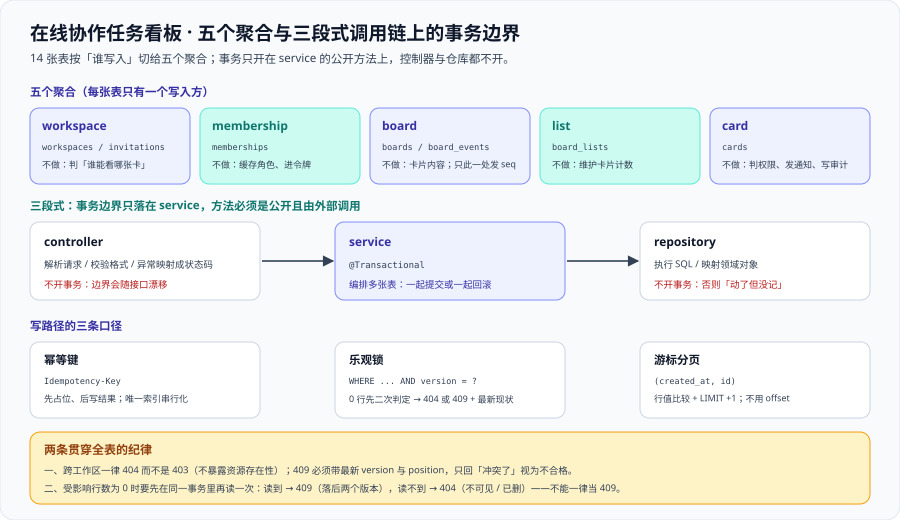

# 领域核心：工作区、看板、列表与卡片的读写服务

这一页把 [数据库设计](../Database/index.md) 的 **14 张表**变成**可以被调用的服务**：五个聚合各自独占哪几张表、`controller → service → repository` 三段式里**事务边界画在哪一层**、乐观锁与幂等键怎么落地、分页与错误码怎么定口径。它是 [架构设计](../Architecture/index.md) 第二节「九个模块的边界」在领域层内部的展开——架构说「模块之间不直接读对方的表」，这一页说清「那张表归谁独占、方法长什么样、失败时抛什么状态码」。



::: warning 本项目只有文档，没有代码
下面出现的类名、方法签名、SQL 与请求头（`CardService`、`moveCard`、`Idempotency-Key`）都是**读者在自己工程里要创建的**；本仓库不存放源码、SQL 与可执行副本，「运行 `xxx`」一律指「先按本节创建好该文件，再执行」。
:::

## 一、这一页把 14 张表变成可被调用的服务

表是**数据**，服务是**行为**。同一个「卡片」在两页里有两种身份：在 [数据库设计](../Database/index.md) 里它是 `cards` 表上的一行（`list_id` + `position` + `version`），在这里它是 `card` 聚合上一个可被调用的对象（能移动、能改标题、能被删）。**这一页要做的唯一一件事，就是把后者写死**——写死之后，任何绕过服务直接写表的行为都会立刻成为缺陷，而不是「一种更快的写法」。

| 表 | 独占它的服务 | 对外契约（只暴露动作，不暴露表） |
| --- | --- | --- |
| `workspaces` | `workspace` | `create_workspace` / `rename_workspace` |
| `memberships` / `invitations` | `workspace`（成员关系部分） | `require_member` / `invite` / `change_role` |
| `boards` | `board` | `create_board` / `append_event` |
| `board_lists` | `board`（列表部分） | `create_list` / `reorder_lists` |
| `cards` | `card` | `create_card` / `move_card` / `patch_card` / `delete_card` |
| `board_events` | `board` | `append_event`（其他模块只投递，不直接写） |
| `comments` | `comment` | `add_comment` / `list_comments` |
| `notifications_outbox` | `notification` | `enqueue`（业务模块只投递，不自己写表） |
| `attachments` | `attachment` | `sign_upload` / `sign_download` |
| `audit_log` | `audit` | `record`（只追加，永不更新） |
| `idempotency_keys` | 接入层 | 由统一切面读写，业务代码不感知 |
| `users` / `user_tokens` | `identity` | `authenticate` / `current_user` |

三条纪律，**违反任何一条都会在两周内变成一个「查不出来」的缺陷**：① **表不跨服务直读**——`card` 不允许 `JOIN memberships`，它需要权限时调用 `workspace.require_member()`；② **事务边界只在 service 层**（第三节）；③ **错误码只有一套映射**（第七节），否则客户端写不出统一的重试策略。

判断聚合边界切得对不对，只问一句：**这张表被几个地方写？** 答案大于 1 说明边界切错了——写路径一旦有两处，`version` 与审计就会漏一处。14 张表里只有 `memberships` 会被两个服务读（`workspace` 写、其他服务通过方法读），其余每张表都只有一个写入方。

## 二、五个聚合与各自「明确不做什么」

聚合是「必须一起保持一致的一组数据」的最小单位。本节重点不是「它做什么」，而是**「它明确不做什么」**——后半句才是边界。

### 2.1 workspace：工作区与它的设置

| 项 | 内容 |
| --- | --- |
| 负责的表 | `workspaces`、`invitations` |
| 对外契约 | `create_workspace` / `rename_workspace` / `invite` / `require_member` |
| **明确不做什么** | 不看板、不列、不卡的任何内容；不判定「谁能看哪张卡」，只回答「这个人是不是成员、角色是什么」 |

`require_member(workspaceId, userId, boardId)` 是**权限判定的唯一出口**，它返回角色或抛 `403` / `404`。让它只回答「成员关系」这一件事，是 [架构设计](../Architecture/index.md) 易错点「`card` 里直接查 `memberships` 表判权限」能被真正堵住的前提。

### 2.2 membership：成员关系与角色

| 项 | 内容 |
| --- | --- |
| 负责的表 | `memberships` |
| 对外契约 | `require_member` / `change_role` / `remove_member` |
| **明确不做什么** | 不缓存角色、不把角色塞进令牌；不决定「邀请是否有效」（那是 `invitations` 的事） |

写死一条：**角色的变更立即生效**（[需求拆分](../Requirements/index.md) US-10）。因此角色不允许进本地缓存、也不允许进令牌载荷——令牌里带角色是这套设计里最诱人的错误，它会把「降级生效时间」偷换成「令牌过期时间」。

### 2.3 board：看板、列与事件序号

| 项 | 内容 |
| --- | --- |
| 负责的表 | `boards`、`board_lists`、`board_events` |
| 对外契约 | `create_board` / `create_list` / `reorder_lists` / `append_event` |
| **明确不做什么** | 不做卡片内容（它不知道卡片标题）；不决定「谁能看」（权限在 `workspace`） |

`append_event(boardId, type, payload)` 是**唯一分配 `seq` 的地方**（`boards.seq = seq + 1` 与 `board_events` 插入在同一事务，见 [数据库设计](../Database/index.md) 3.3）。把它收在 `board` 服务里而不是让各模块自己写 `board_events`，换来的是「一块看板的事件顺序只有一个生成点」——多个写入点必然产生交错与空洞。

### 2.4 list：列与列顺序

| 项 | 内容 |
| --- | --- |
| 负责的表 | `board_lists` |
| 对外契约 | `create_list` / `rename_list` / `reorder_lists` |
| **明确不做什么** | 不持有卡片、不维护「列里有几张卡」的计数（计数用查询，不用冗余列）；列的 `position` 与卡片同一套排序键，但 `reorder_lists` 允许一次更新多行——**每看板 ≤ 30 列，成本预算不同**，这一点要写进方法注释 |

### 2.5 card：卡片本体

| 项 | 内容 |
| --- | --- |
| 负责的表 | `cards` |
| 对外契约 | `create_card` / `move_card` / `patch_card` / `delete_card` |
| **明确不做什么** | 不判权限、不直接发通知、不写审计（只在自己的事务里**投递**给这三个服务）；每个写方法都必须带 `boardId` 与 `expectedVersion`——**可选即等于把两条不变量降级成约定** |

## 三、controller → service → repository：事务边界落在哪一层

### 3.1 三层的职责与允许依赖

| 层 | 只允许做 | 明确不做 | 允许依赖 |
| --- | --- | --- | --- |
| controller | 解析请求、校验格式、调用 service、把异常映射成状态码 | **不开事务**、不写业务分支、不碰 repository | service |
| service | 开启事务、编排多个 repository 与其它 service、执行业务规则、抛领域异常 | 不解析 HTTP、不拼响应 JSON | repository + 其它 service（只走对外契约） |
| repository | 执行 SQL、把结果映射成领域对象 | **不开事务**、不含业务分支、不跨聚合 JOIN | JDBC / ORM |

### 3.2 为什么事务不在 controller

1. **事务范围会随接口而变**：一旦开在 controller，同一个 service 方法被两个入口调用时，会得到「接口 A 原子、接口 B 不原子」这种没人能一眼看出的差异——因为「这次操作要改几张表」是业务知识，不是 HTTP 知识。
2. **异常映射需要知道事务是否已回滚**：controller 的职责是「把领域异常翻成状态码」。若它还管事务，就会出现「提交失败了但 200 已经写出去了」这类最难查的缺陷。
3. **`@Transactional` 只在「从外部调用 public 方法」时生效**（Spring 走代理）。写在 service 的 public 方法上，事务边界恰好等于「一次用例」；写在 controller 上，边界就分散到多个入口。

### 3.3 为什么事务不在 repository

1. **一次业务操作会被拆成多个小事务**：若 `cards.updatePosition` 自带事务，同一个 service 方法里的 `appendEvent`、`audit.record`、`outbox.enqueue` 会各自独立提交，结果是 [架构设计](../Architecture/index.md) 第 ⑨ 步最忌讳的「**动了但没记**」——位置改了、事件没落库，其他客户端永远不知道发生了什么。
2. **回滚不再成立**：`audit_log` 与 `outbox` 的全部价值建立在「和业务改动同生共死」上，小事务把「同生共死」降级成「谁先谁后」。
3. **repository 不知道「这次操作的意图」**，因此无法判断「这些写是不是一组」。事务的粒度是业务语义，不是数据访问语义。

### 3.4 一条完整调用链（事务边界就一条）

```java [app/src/main/java/com/teamboard/domain/card/CardService.java]
@Service
public class CardService {
  private final CardRepository cards;        // 只暴露带 boardId 的方法（INV-5）
  private final WorkspaceService members;    // 权限唯一出口
  private final BoardService boards;         // append_event：分配 seq
  private final AuditService audit;          // 只追加
  private final OutboxService outbox;        // 只投递
  @Transactional                            // ← 事务边界只在这一行
  public MoveResult moveCard(MoveCommand cmd) {
    members.requireEditor(cmd.workspaceId(), cmd.actorId(), cmd.boardId());   // 403 / 404
    String newPos = ranking.between(cmd.beforePos(), cmd.afterPos())
        .orElseThrow(NeedsCompactionException::new);                          // 见 CardMove 页
    int rows = cards.updatePosition(cmd.cardId(), cmd.boardId(),
        cmd.targetListId(), newPos, cmd.version());
    if (rows == 0) throw conflictOrNotFound(cmd);                             // 见 4.2 / 4.3
    long seq = boards.appendEvent(cmd.boardId(), "card.moved", payloadOf(cmd, newPos));
    audit.record(cmd.actorId(), "card.move", cmd.cardId(), diffOf(cmd, newPos));
    outbox.enqueue("card.moved", payloadOf(cmd, newPos));
    return new MoveResult(newPos, cmd.version() + 1, seq);   // 同一事务，任一失败则整体回滚
  }
}
```

::: danger 事务上四个一定会踩的坑
1. **`@Transactional` 写在私有方法或同类内部自调用**：Spring 代理不介入自调用，注解**静默失效**，代码看起来有事务、实际每条语句自动提交。正确写法是把事务方法做成 public 且**由外部 bean 调用**，需要内部复用时抽成独立 bean。
2. **在事务里调用外部 HTTP 或广播**：事务持有连接与行锁，网络抖动会把锁持有时间拉到秒级。正确写法是**提交之后再广播**（[架构设计](../Architecture/index.md) 第 ⑩ 步），用 afterCommit 钩子或交给 outbox。
3. **只读方法不加 `readOnly = true`**：正确写法是每个只读 service 方法显式标 `@Transactional(readOnly = true)`，让连接池与数据库能省掉回滚段开销。
4. **在事务里捕获领域异常后吞掉**：事务不会回滚，等于「写了一半还说自己成功了」。正确写法是让领域异常**穿透事务边界**，由统一异常处理器映射（第七节）。
:::

## 四、乐观锁落地：`version` 字段与受影响行数

### 4.1 写入语句的形态

乐观锁不需要框架，只需要**一条把版本写进 WHERE 的 UPDATE**：

```sql [card 位置更新的唯一语句形态]
UPDATE cards
   SET list_id = :targetListId, position = :newPosition,
       version = version + 1,          -- 严格自增，不允许显式赋值（INV-6）
       updated_at = now()
 WHERE id = :cardId
   AND board_id = :boardId             -- 租户收窄，不允许省略（INV-5）
   AND version = :expectedVersion;     -- 乐观锁：客户端手里的版本
-- 受影响行数：1 = 成功；0 = 「版本过期」或「行不在可见范围」，由调用方区分（见 4.2）
```

`version` 的三个纪律：**只由数据库自增**（应用层不允许赋值）、**每次都参与 WHERE**、**冲突时返回现状而不是返回失败**。第三条最容易漏：只回「冲突了」等于逼客户端去猜。

### 4.2 受影响行数为 0 时抛 `409`

`rows == 0` 表示「没有任何一行同时满足 `id`、`board_id`、`version`」——它可能是版本过期，也可能是行不可见。**服务端必须在同一事务里再读一次，把两者分开**：

```sql [受影响行数为 0 时的二次判定（同一事务内）]
SELECT version, list_id, position FROM cards
 WHERE id = :cardId AND board_id = :boardId
 FOR UPDATE;    -- 读到 → 版本冲突；读不到 → 不可见 / 已不存在
```

| 二次判定的结果 | 抛什么 | 响应体必须带什么 |
| --- | --- | --- |
| 读到该行，且 `version <> :expectedVersion` | **`409`** | 最新 `version` 与最新 `position`（客户端据此回滚乐观更新，而不是盲目重试） |
| 读不到该行（不存在 / 已删 / 不在该看板下） | **`404`** | 什么都不带（不暴露存在性） |
| 行在本操作内部被并发删掉（`FOR UPDATE` 读不到但事务开始时可见） | **`409`** | 明确原因 `card_deleted_concurrently`——此刻客户端手里还留着这张卡片的乐观状态，需要「回滚 + 提示」，`404` 不足以表达 |

### 4.3 `409` 与 `404` 的区别（写死，不允许第二种解释）

这两个状态码在本项目里**语义完全不相交**，任何接口返回它们时都必须能对上下面这一行：

| 状态码 | 一句话语义 | 触发条件（穷举） | 客户端应当做什么 |
| --- | --- | --- | --- |
| **`404`** | **这个资源对你不可见** | 从未存在；已被删；跨工作区；已不是成员 | 把这张卡片从界面移除，**不重试** |
| **`409`** | **资源还在、你也有权改，但你手里的版本不是最新的** | 乐观锁版本不符；`UNIQUE (list_id, position)` 冲突；幂等键处于「在途」状态 | 用响应体里的现状刷新本地，然后**最多重试一次** |

::: danger 三处最容易把 `409` 写成 `404` 的地方
1. **「卡片不在我拖动的这块看板下」**：按不可见处理 → **`404`**。`board_id` 来自 URL 路径，能走到这里说明请求者已通过成员校验，返回 `404` 不泄漏任何事情，而 `409` 会泄漏「这张卡片存在于某个我看不到的地方」。
2. **「列不存在或不属于这块看板」**：同样是 **`404`**——目标位置不可用不是冲突，是「你要移动到的地方不存在」。
3. **「`UPDATE` 受影响 0 行」**：**不要直接映射成 `409`**，必须先按 4.2 二次判定分开。否则一个已被删除的卡片会永远返回 `409`，客户端会无限重试一个不可能成功的请求——**把「不存在」误报成「冲突」，会让重试逻辑变成死循环，这是本页最贵的一条。**
:::

### 4.4 JPA 与 MyBatis 两种落地

```java [JPA：用 @Version，把框架异常翻译成 409]
@Entity
public class Card {
  @Id private UUID id;
  @Version private long version;   // 由 Hibernate 维护，禁止业务代码赋值
}
try {
  cardRepository.save(card);       // 自动生成 WHERE id = ? AND version = ?
} catch (ObjectOptimisticLockingFailureException e) {
  throw new VersionConflictException(cardId);   // 交给统一异常处理器映射成 409 + 最新现状
}
```

```sql [MyBatis 映射里的同一条语句（自己判受影响行数）]
UPDATE cards
   SET list_id = #{targetListId}, position = #{newPosition},
       version = version + 1, updated_at = now()
 WHERE id = #{cardId} AND board_id = #{boardId} AND version = #{expectedVersion}
-- 返回 int rows；rows = 0 即进入 4.2 的二次判定
```

两种写法**必须选一种并全项目统一**：混用时会出现「`@Version` 实体被手写更新语句绕过」，乐观锁在一半路径上失效——而这类缺陷在功能测试里全绿。

## 五、幂等键：`Idempotency-Key` 与唯一约束兜底

### 5.1 幂等键落在哪张表

幂等键来自请求头 `Idempotency-Key`（客户端在**一次用户手势**里生成一次，跨重试不变），落库为 [数据库设计](../Database/index.md) 3.4 的 `idempotency_keys`：

| 列 | 作用 |
| --- | --- |
| `(scope, client_op_id)` | 复合主键，**这就是幂等键**；`scope` 取路由模板（如 `POST /boards/{id}/cards/{cardId}/move`） |
| `actor_id` | 同一个 `client_op_id` 被另一个用户重放时，不能返回别人的结果 |
| `response_code` / `response_body` | 上次的响应原文，重发时**原样返回** |
| `created_at` | 过期清理依据（保留 24~48 小时） |

### 5.2 「先查后写」为什么一定会漏

直觉写法是「先 `SELECT` 看这个 key 有没有，没有就执行」。而读已提交隔离级别下，**第一个事务尚未提交的插入对第二个事务不可见**：

```text [错误顺序：先查后写，并发重试时两次 SELECT 都读到空]
T1、T2 同时 SELECT → 都为空（T1 的事务还没提交，插入对 T2 不可见）
T1 写业务表 → T2 再写一次（撞主键时副作用已经发生两次）
```

于是这个漏洞只在「用户快速双击」或「网络超时后立即重试」时出现，测试环境几乎复现不到——**它是一次必然的漏，不是一次偶发。**

### 5.3 唯一约束是唯一的兜底：先占位，后写结果

正确顺序是把「占位」做成一条插入语句，**让数据库来串行化**：

```sql [正确顺序：同一事务内先占位、后写结果]
-- ① 先尝试占位：并发时 ON CONFLICT 会等待对方提交或回滚
INSERT INTO idempotency_keys (scope, client_op_id, actor_id, response_code, response_body)
VALUES (:scope, :clientOpId, :actorId, 0, '{}'::jsonb)
ON CONFLICT (scope, client_op_id) DO NOTHING;
-- 0 行 → key 已被占用；1 行 → 本次是第一次执行
-- ② 读回：response_code = 0 说明另一个请求还在执行中 → 返回 409；<> 0 说明已完成 → 原样返回上次结果
-- ③ 业务写入（移动卡片、append_event、audit、outbox）…… ④ 同一事务回填响应
UPDATE idempotency_keys SET response_code = 200, response_body = :body
 WHERE scope = :scope AND client_op_id = :clientOpId;
-- COMMIT：占位与业务结果一起可见
```

::: tip 为什么这一条必须靠唯一约束，而不是「代码里小心一点」
`ON CONFLICT DO NOTHING` 的关键行为是：**另一个事务已插入同一主键但未提交时，本次插入会等待**，直到对方提交或回滚。
等待结束后若对方已提交，本次返回 0 行 → 走读回分支；若对方回滚，本次插入成功 → 自己成为第一次执行。**串行化由索引完成，而不是由应用代码完成**，这是「先查后写」永远做不到的一点。
响应存**整段响应原文**而不是「结果对象」，换来的是**重放严格等于第一次**（结果对象需要在重放时重新走一遍序列化与状态码映射，而那段逻辑可能已经改过）。
:::

## 六、游标分页：不透明游标与稳定排序键

### 6.1 为什么不用 `offset`

| 问题 | `OFFSET n` 的表现 | 游标分页的表现 |
| --- | --- | --- |
| 深翻页成本 | 数据库要**扫描并丢弃**前 n 行，第 100 页比第 1 页慢一个量级 | 每一页都是一次索引定位 + 取 k 行，**第 100 页与第 1 页同量级** |
| 数据漂移 | 翻页期间有插入/删除 → **漏行或重行**（同一张卡片可能在第 2 页和第 3 页各出现一次） | 位置由「上一页最后一行的键」锚定，**不受中间插入影响** |
| 计数 | 需要额外一次 `count(*)`，而这个数本来就一直在变 | 不承诺总数，只承诺「下一页从哪儿开始」 |

「顺序列表要跳到第 50 页」是一个需求，而本项目**没有这个需求**：看板的一列是滚动的、评论是追加的、通知是按时间倒序的。**没有跳页需求的地方，`offset` 只带来成本。**

### 6.2 稳定排序键必须是 `created_at, id`

排序只用 `created_at` 是不稳定的：同一毫秒内创建的若干行，两次查询之间的相对顺序**不保证一致**，于是游标会出现「跳过一行」或「重复一行」。因此排序键写死为复合键：

```sql [评论列表的游标分页（键集分页）]
SELECT id, card_id, author_id, body, created_at
  FROM comments
 WHERE card_id = :cardId
   AND (created_at, id) < (:cursorCreatedAt, :cursorId)   -- 行值比较，等价于字典序
 ORDER BY created_at DESC, id DESC
 LIMIT :limit + 1;      -- 多取一行，用来判断还有没有下一页
```

`(created_at, id)` 的**行值比较**恰好等于「先比 `created_at`，相等再比 `id`」。索引 `comments_card_idx (card_id, created_at)` 覆盖前两列；若翻页经常停在 `created_at` 相同的一大片行上，把索引扩成 `(card_id, created_at DESC, id DESC)` 可获得完全索引化的比较。

### 6.3 不透明游标的编码与校验

游标对客户端是**不透明字符串**（opaque cursor），不是可读 JSON——既防客户端拼装非法游标（注入面），也让服务端能自由改变内部排序键而不破坏客户端。游标内容形如 `{"k":"created_at,id","v":"<时间戳>,<id>","sig":"<hmac>"}`，编码为 `base64url`：

| 规则 | 内容 |
| --- | --- |
| 校验 | 每次解码都要验签；签名不符 → **`400`**（问题在参数本身，不是 `404`）；`k` 字段标明排序键，换排序键时旧游标失效并要求从头拉 |
| 响应形态 | `{"items":[...], "nextCursor":"...", "hasMore":true}`；`nextCursor` 为 `null` 表示到底 |

::: danger 游标分页的三个易错点
1. **把游标里的 `id` 只当去重标记、不参与排序**：游标退化成「按时间戳单键」分页，同一毫秒的多行依旧会漏。正确写法是把 `(created_at, id)` 当作**一个**排序键，并在 SQL 里用行值比较。
2. **只取 `LIMIT :limit` 而不多取一行**：`hasMore` 就只剩「本页行数 < limit」这条不可靠的判据（恰好整除时会多一次空查询）。正确写法是**取 `limit + 1` 行，返回前 `limit` 行**。
3. **游标不签名**：客户端可以把 `v` 改成任意值，翻到允许范围之外。正确写法是**签名 + 校验 + 换键即失效**。
:::

## 七、统一错误码映射表

状态码不是「随手选的数字」，而是**客户端重试策略的输入**。下表是唯一一套映射，任何接口都必须能在这里找到自己：

| 状态码 | 语义 | 用在哪（穷举） | 明确不用在哪 | 客户端动作 |
| --- | --- | --- | --- | --- |
| **`400`** | 请求本身不合法 | JSON 解析失败、必填字段缺失、类型错、游标签名不符 | 不用于业务规则不满足 | 不重试，修请求 |
| **`401`** | 身份未被证实 | 令牌缺失 / 过期 / 签名错 / 已撤销 | 不用于「是成员但角色不允许」 | 走刷新令牌；失败则回登录 |
| **`403`** | 有身份、角色不允许 | 是成员但不是 `owner`/`editor`；越权订阅实时流 | 不用于跨工作区（那是 `404`） | 不重试，提示无权 |
| **`404`** | 资源对你不可见 | 不存在 / 已删 / 跨工作区 / 已不是成员 | 不用于版本冲突（那是 `409`） | 不重试，从界面移除 |
| **`409`** | 冲突，资源仍在 | 乐观锁失败、`UNIQUE (list_id, position)` 冲突、幂等键在途、并发删卡 | 不用于字段校验 | 用响应体里的现状刷新，**最多重试一次** |
| **`422`** | 语义校验失败 | 字段长度 / 枚举越界、把卡片移到已归档看板、指派人不是成员 | 不用于格式错误（那是 `400`） | 不重试，展示给用户改 |
| **`429`** | 限流 | 按用户与工作区两个维度超限 | 不与 `401` 混淆（`429` 是「你先等等」，不是「你是谁」） | 按 `Retry-After` 退避重试 |

两条贯穿全表的判据：**「无权」与「不存在」必须长得一样**（跨工作区一律 `404`，`403` 会告诉攻击者「资源存在，只是你没权限」）；**`409` 必须带现状**——响应体固定包含 `latestVersion` 与 `latestPosition`，只回「冲突了」的实现视为不合格。

统一响应壳（成功与失败同一形状，客户端一处解析）：

```json [统一错误响应体]
{
  "code": "CARD_VERSION_CONFLICT",
  "message": "卡片已被他人移动，请以最新位置为准",
  "traceId": "3f2a9c1e5b7d",
  "details": { "latestVersion": 9, "latestPosition": "0|a1V" },
  "retriable": true
}
```

`code` 是**机器可判的稳定标识**（客户端按它分支），`message` 是给人看的，`traceId` 用来把这次失败与日志对上。**客户端不允许按 `message` 分支**——那句话会改，改了就会静默地让某个分支永远不再命中。

## 八、判据族 `DC-A ~ DC-H`

本页判据统一用 `DC-` 前缀，分两层：前五条**文档级**（验这份设计是否自洽、是否可执行），后三条**运行期**。级别与状态分开写，**不把「设计完成」写成「运行期验证通过」**。

| 判据 | 判什么 | 级别 | 状态 |
| --- | --- | --- | --- |
| **`DC-A`** | 五个聚合齐全，且每个都写了「明确不做什么」 | 文档级 | ✅ 本机可判 |
| **`DC-B`** | 事务边界写在 service 层，控制器与仓库各有一条「为什么不在它」 | 文档级 | ✅ 本机可判 |
| **`DC-C`** | 乐观锁 SQL 完整（`version` 参与 WHERE），受影响行数为 0 的二次判定与 `409` / `404` 的区别写死 | 文档级 | ✅ 本机可判 |
| **`DC-D`** | 幂等键落在 `idempotency_keys`，说明「先查后写会漏」并给出唯一约束兜底 | 文档级 | ✅ 本机可判 |
| **`DC-E`** | 游标分页：不透明游标 + 稳定排序键 `(created_at, id)` + 「为什么不用 offset」 | 文档级 | ✅ 本机可判 |
| **`DC-F`** | 同一 `Idempotency-Key` 连发两次，第二次返回上次响应且该看板 `seq` 只前进 1 | 运行期 | ⏳ 未跑 · 本仓无工程代码（`BL-2`） |
| **`DC-G`** | 过期 `version` 返回 `409` 且带最新 `version` 与 `position`；跨工作区返回 `404` | 运行期 | ⏳ 未跑 · 本仓无工程代码（`BL-2`） |
| **`DC-H`** | 游标翻到第 N 页的延迟与第 1 页同量级，且同一批数据不重不漏 | 运行期 | ⏳ 未跑 · 本仓无工程代码（`BL-2`） |

## 九、当日做了什么

1. 把 [数据库设计](../Database/index.md) 的 14 张表**逐张分配独占方**，产出「表 → 服务 → 对外契约」映射表，写下三条纪律（表不跨服务直读 / 事务边界只在 service / 错误码只有一套），并拆出**五个聚合**（`workspace` / `membership` / `board` / `list` / `card`），每个都写成「负责的表 + 对外契约 + **明确不做什么**」三段。
2. 定下 **controller → service → repository 三段式**的职责与允许依赖，用两条独立论证回答「为什么事务不在 controller」（边界随接口漂移、异常映射需要知道回滚结果）与「为什么事务不在 repository」（会被拆成小事务、破坏「同生共死」），并补一张 `CardService` 完整调用链与事务上四个易错点。
3. 把**乐观锁**落到一条 `UPDATE ... WHERE id = ? AND board_id = ? AND version = ?`，写死「受影响行数为 0 时必须先二次判定」（读到该行 → `409` + 最新版本与位置；读不到 → `404`；操作内部被并发删 → `409` 且带明确原因），并产出 **`409` 与 `404` 的区别表**，点出三处最容易把 `409` 写成 `404` 的地方——其中最贵的是「把『不存在』误报成『冲突』会让重试变成死循环」。
4. 把**幂等键**落到 `Idempotency-Key` 请求头与 `idempotency_keys` 表，用一段时序写出「先查后写」在并发重试下必然漏一次的原因，给出正确顺序（同一事务内**先占位、后写结果**，靠 `ON CONFLICT` 与唯一索引串行化）。
5. 定下**游标分页**：不透明游标（`base64url + HMAC`）、稳定排序键 `(created_at, id)` 与行值比较 SQL、`LIMIT :limit + 1` 判断 `hasMore`，逐条论证「为什么不用 offset」（深翻页成本、数据漂移、无跳页需求）；产出**统一错误码映射表**（`400` / `401` / `403` / `404` / `409` / `422` / `429` 七类，含「明确不用在哪」与客户端动作）与统一错误响应体，写死「客户端不允许按 `message` 分支」。

## 十、如何验证

前七条是本页的**文档级自查**（`grep -c`，本机已跑，括注为实测值）；最后两条需要工程代码与容器运行时，只给命令、**不给通过结论**。

```shell
grep -c '^### 2\.' index.md                              # 1) 五个聚合小节齐全（2.1 ~ 2.5）：期望 5
grep -c '^| \*\*明确不做什[么]\*\*' index.md                # 2) 五个聚合逐条写了边界：期望 5
grep -c '^### 3\.' index.md                              # 3) 三段式三节 + 调用链一节：期望 4
grep -cE '^### 3\.[23]' index.md                        # 4) 事务边界的反证两条：期望 2
grep -c 'AND version = :expectedVersio[n]' index.md       # 5) 乐观锁写入语句在：期望 1
grep -c '先查后[写]' index.md                              # 6) 「先查后写会漏」写进正文：期望 6
grep -oE '^\| \*\*`(400|401|403|404|409|422|429)`\*\*' index.md | sort -u | wc -l   # 7) 七类错误码齐全：期望 7
grep -c 'assets/tb-domain-core.sv[g]' index.md             # 8) 配图被本页引用：期望 1
```

第 9 条是运行期判据（幂等 / 乐观锁 / 游标各一条），**本仓没有可执行的工程，未跑**：

```shell
docker compose up -d db cache app
curl -s -o /dev/null -w '%{http_code}\n' -X POST \
  "http://localhost:8080/api/v1/boards/b_7f3a/cards/c_9d21/move" \
  -H "Authorization: Bearer $TOKEN" -H "Idempotency-Key: op-1" \
  -H 'Content-Type: application/json' -d '{"targetListId":"l_doing","beforeCardId":null,"version":7}'
```

::: warning 这一页没有一条运行期判据被跑过
第 9 条只给命令、**不给「期望通过」的结论**。未跑的原因**不是容器**：实测本机 `docker compose version` 输出 `v2.29.1-desktop.1`、`docker info` 输出 `27.1.1`，[验收](../Acceptance/index.md) 里的 `BL-1` 在本机已解除；挡住它的是 `BL-2`——本仓库按 [AGENTS.md](/AGENTS.md) 第 9 节**只存放 Markdown 与配图**，没有 `compose.yaml`、`app/` 与迁移脚本，这条判据没有可跑的对象。
第 1 ~ 8 条的期望值是**本机实跑 `grep -c` 读出来的**，它们验的是「这份设计是否自洽」，不是「这套服务是否跑通」。**设计完成与运行期验证完成是两列，不能合并。**
:::

## 十一、下一步

1. **[卡片拖动：一次拖动只更新一行](../CardMove/index.md)**：把第三节的调用链与第四节的乐观锁，落到「全项目最难的写操作」上——包括分数排序键的 midpoint 算法、两个并发场景与「一次拖动只更新一行」的成本判据。
2. **[评论、@ 提及与通知](../Comments/index.md)**：把第五节的事务内投递展开成完整的状态机与去重折叠口径。
3. **第 148 天**：进入**联调与测试**——把本页的 `DC-F ~ DC-H` 三条运行期判据接进权限矩阵与容量验证。

## 参考资料

- [数据库设计：表、约束与顺序字段](../Database/index.md)（14 张表、INV-1~INV-6 与本页的独占方映射） · [架构设计：模块边界与实时链路](../Architecture/index.md)（九个模块、十二步链路、三处权限判定点）
- [需求拆分：角色、故事与验收条件](../Requirements/index.md)（US-03 / US-04 的 Given/When/Then 与非功能口径） · [验收：把「做完了」变成可执行的步骤](../Acceptance/index.md)（`TB-A ~ TB-H` 与 18 格权限矩阵）
- [完整项目交付 · 接口契约](/docs/Others/ProjectDelivery/Contract/index.md)（契约三问：约定是什么、定错的代价、怎么验证没被破坏）
- [完整项目交付 · 数据模型](/docs/Others/ProjectDelivery/DataModel/index.md)（聚合边界与「谁独占哪张表」的通用口径）
- [PostgreSQL 专题](/docs/DB/Relational/PostgreSQL/index.md)（行值比较、`ON CONFLICT`、`FOR UPDATE` 的原理侧） · [数据建模](/docs/DB/DataModeling/index.md)
- [后端通用模板](../../../Base/BackendTemplate/index.md)（统一响应、异常处理器与幂等切面的复用基座）
