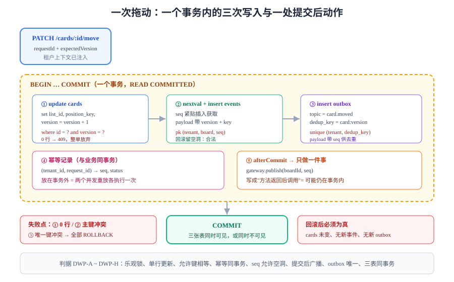

# 拖动写入路径：三张表要么都成、要么都不成

前三步分别解决了「谁能看见哪些行」（多租户隔离）、「按租户过滤怎么走索引」（索引前缀）、「断线怎么知道漏了哪几条」（事件顺序号）。这一步把它们接到**同一条写入路径**上：一次拖动要在**一个事务**里同时改 `cards`（位置与版本）、写 `board_events`（顺序号）、写 `outbox`（通知任务）。



## 判据族声明

本页判据族 `DWP-A` ~ `DWP-H`，共 8 条。定义表在第九节。

## 一、一次拖动要写什么

先明确"写"的清单。用户看到的是"卡片从左列拖到右列"，落到数据库上是三张表、五种变化：

| 表 | 变化 | 对应的用户可见结果 |
| --- | --- | --- |
| `cards` | `list_id`、`position_key`、`version + 1`、`updated_at` | 卡片出现在新列的新位置 |
| `board_events` | 插入一行：`type='card.moved'`、`seq`、`payload` | 其他人屏幕上"这张卡动了" |
| `outbox` | 插入一行：`topic`、`dedup_key`、`payload` | 被 `@` 的人/关注者收到通知 |
| `card_activities` | 插入一行（可选） | 卡片详情里的操作历史 |
| `board_counters` | `last_seq`（若用行锁计数器方案） | 无（内部） |

::: tip 一句话原则
**"用户看见的结果"和"数据库里的行"必须一一对应。** 任何一张表漏写，都会产生一种"某个人看到的世界和数据库不一致"的状态——而这类不一致**没有自愈机制**，只能靠人工修数据。
:::

## 二、为什么必须是同一个事务

三种拆分方式，只有一种可用：

| 方案 | 做法 | 后果 |
| --- | --- | --- |
| **A. 三个事务** | 先改卡片、再写事件、再写 outbox | 中间失败 → 卡片动了但没人收到广播，**其他客户端永远看不到这次移动**（除非刷新） |
| **B. 一个事务 + 提交后补写** | 事务里改卡片与事件，提交后写 outbox | 提交后进程崩溃 → 事件有了、通知丢了；且"补写"没有幂等键时会重复 |
| **C. 一个事务写全部** | 三张表同进同出 | 失败则整体回滚，客户端要么看到全部变化、要么什么都没发生 |

**选 C**，并且把"提交后要做的事"降到最少——**只有一件事：把已提交的事件推给网关**。推送失败可以由"客户端补拉"兜底（`seq` 机制就是为此存在的）。

::: danger 方案 A 的隐蔽性
方案 A 在测试环境几乎不会出错：三次写入都成功时，行为与方案 C 完全一致。它只在**某一次失败**时暴露，而失败率在生产环境才够高。所以这类问题一定要用**故障注入**验证，不能靠"跑一遍没报错"。
:::

## 三、表结构与四条约束

```sql
-- 卡片：位置用可比较字符串（分数排序键），版本用于乐观锁
create table cards (
  id            uuid primary key default uuidv7(),
  tenant_id     bigint not null,
  board_id      uuid   not null,
  list_id       uuid   not null,
  title         text   not null check (length(title) between 1 and 200),
  position_key  text   not null,                     -- 可比较字符串，见第 8 节
  version       int    not null default 1,
  updated_at    timestamptz not null default now(),
  unique (tenant_id, id)
);

-- 事件：每板连续的顺序号 + 事件内容
create table board_events (
  tenant_id   bigint not null,
  board_id    uuid   not null,
  seq         bigint not null,
  event_id    uuid   not null default uuidv7(),
  type        text   not null,
  actor_id    uuid   not null,
  payload     jsonb  not null,
  created_at  timestamptz not null default now(),
  primary key (tenant_id, board_id, seq),
  unique (tenant_id, event_id)                        -- 重放去重
);

-- 通知任务：与事件同事务写入，异步投递
create table outbox (
  id          bigserial primary key,
  tenant_id   bigint not null,
  topic       text   not null,
  dedup_key   text   not null,
  payload     jsonb  not null,
  status      text   not null default 'pending',      -- pending / sent / failed
  attempts    int    not null default 0,
  created_at  timestamptz not null default now(),
  unique (tenant_id, dedup_key)                       -- 同一动作只通知一次
);
```

四条约束各自的作用：

| 约束 | 拦住什么 |
| --- | --- |
| `cards.unique (tenant_id, id)` | 跨租户的主键碰撞（配合第 151 天的 `FORCE RLS`） |
| `board_events.primary key (tenant_id, board_id, seq)` | 同一块板出现两个相同 `seq` |
| `board_events.unique (tenant_id, event_id)` | 客户端重试导致的事件重复 |
| `outbox.unique (tenant_id, dedup_key)` | 同一动作发两条通知 |

::: warning `unique` 是幂等的最后一道闸，不是"顺手加的"
如果只靠应用层查一遍再插入，两个并发请求会同时查到"不存在"然后都插入。**唯一键是唯一能在并发下成立的手段**，应用层的查只能减少报错，不能替代它。
:::

## 四、写入顺序：为什么是 cards → events → outbox

顺序不是随意的，它由**依赖关系**决定：

```text
① update cards ... returning version            -- 拿到新版本号，失败则整体放弃（409）
② nextval + insert board_events                 -- 事件里要带新版本号与 position_key
③ insert outbox                                 -- 通知里要带 seq（客户端据此去重）
```

| 顺序 | 依赖 | 反了会怎样 |
| --- | --- | --- |
| cards 先于 events | 事件 payload 要包含 `version` 与 `position_key` | 事件里的版本号是旧的，客户端回放时判断"这是过期事件" |
| events 先于 outbox | 通知里带 `seq`，接收方按 `seq` 去重 | 同一条通知被两个渠道各发一次，无法去重 |
| outbox 最后 | 它只依赖前两步的结果 | —— |

::: danger 「先取 seq 再改卡片」看起来更整齐，其实更危险
有人喜欢"先 `nextval` 拿号，再去更新卡片"。这样在乐观锁失败时，**序列已经前进了**，产生一个空洞。空洞本身可接受（第 153 天已论证），但如果在取号与更新之间还有别的逻辑（比如等待外部服务），**顺序号会与实际提交顺序不一致**——晚提交的事务可能拿到更小的号，客户端回放时就会"先看到结果、后看到原因"。

正确做法：**取号紧贴插入事件**，中间不放任何可能阻塞的操作。
:::

## 五、完整写入路径（服务端九步）

```java
// CardMoveWriteService.java（关键片段，完整实现约 320 行）
@Transactional(isolation = Isolation.READ_COMMITTED)
public MoveResult move(MoveCommand cmd) {
    // ① 租户与权限：越权在这里就返回 403，不进事务核心
    TenantCtx.set(cmd.tenantId());
    assertCanEdit(cmd.tenantId(), cmd.boardId(), cmd.actorId());

    // ② 幂等：同一 requestId 的重放直接返回上次结果
    var cached = idempotency.find(cmd.tenantId(), cmd.requestId());
    if (cached != null) return cached.asResult();

    // ③ 读当前卡片（带租户过滤；RLS 也会兜一层）
    CardRow card = cards.findForUpdate(cmd.tenantId(), cmd.cardId());
    if (card == null) throw new NotFound("CARD_NOT_FOUND");
    if (card.version() != cmd.expectedVersion()) throw new Conflict("VERSION_STALE");

    // ④ 计算新的排序键（两端邻居的中点，必要时压缩）
    String newKey = ranking.between(cmd.prevKey(), cmd.nextKey());
    if (newKey == null) throw new Conflict("POSITION_EXHAUSTED");   // 需要压缩重排

    // ⑤ 乐观锁更新：0 行即冲突
    int updated = cards.move(cmd.tenantId(), cmd.cardId(), card.version(), cmd.targetListId(), newKey);
    if (updated == 0) throw new Conflict("VERSION_STALE");

    // ⑥ 取号 + 写事件（紧贴，中间不做别的）
    long seq = events.nextSeq(cmd.tenantId(), cmd.boardId());
    events.insert(cmd.tenantId(), cmd.boardId(), seq, "card.moved",
                  cmd.actorId(), payloadOf(card, cmd, newKey, card.version() + 1));

    // ⑦ 写 outbox（带 seq，便于接收方去重）
    outbox.insert(cmd.tenantId(), "card.moved", 
                  cmd.cardId() + ":" + (card.version() + 1),
                  payloadOf(card, cmd, newKey, card.version() + 1).put("seq", seq));

    // ⑧ 记幂等结果：与业务同事务，保证"成功了才有记录"
    idempotency.save(cmd.tenantId(), cmd.requestId(), seq, 200);

    // ⑨ 注册提交后动作：只做"推给网关"这一件事
    afterCommit(() -> gateway.publish(cmd.boardId(), seq));

    return new MoveResult(seq, card.version() + 1, newKey);
}
```

五处值得单独说的细节：

1. **`@Transactional` + `READ_COMMITTED` 足够**：并发正确性由**乐观锁**保证，不靠隔离级别。用 `SERIALIZABLE` 会带来重试风暴，而重试对"拖动"这种高频操作代价太大。
2. **第 ② 步的幂等检查在事务内**：如果放在事务外，两个并发重放会同时查到"没有"然后都执行——所以幂等记录必须与业务同事务写（第 ⑧ 步）。
3. **第 ⑤ 步的 `version` 条件不能省**：`update ... where id=? and version=?` 是乐观锁的全部。少了它，两个人同时拖同一张卡片时，后者会覆盖前者而**不报错**。
4. **第 ⑥ 步 `nextSeq` 在事务内**：回滚会留下空洞，这是设计而非缺陷（第 153 天判据已定）。不要为了"无空洞"去用"提交后再取号"。
5. **第 ⑨ 步只做一件事**：提交后动作越少越好。通知投递由 outbox 的轮询器负责，不属于提交后动作。

## 六、两个并发场景的预期读数

### 场景 1：两个人拖同一张卡片

```text
A: begin → 读 version=5 → 算新位置 → update where version=5 → 成功 → commit（version=6）
B: begin → 读 version=5 → 算新位置 → update where version=5 → 0 行 → 409 → rollback
```

**预期**：B 收到 `409 VERSION_STALE`，且**不产生事件**（事务回滚，`board_events` 与 `outbox` 都没有新行）。客户端拿到 409 后应重新拉取该卡片最新状态，再让用户重试。

### 场景 2：两个人拖不同卡片到同一位置

```text
A: 拖 card-1 到 list-2 的第 3 位，position_key = "a5"
B: 拖 card-2 到 list-2 的第 3 位，position_key = "a5"   ← 同一个中点
```

**预期**：两张卡片的 `position_key` 相同，**不报错**——排序键允许相等，展示层按 `position_key, id` 兜底排序。下一次拖到两者之间时，若两端键已无法再分（长度上限），触发**压缩重排**（把该列所有 `position_key` 重新按 `a0, a1, a2...` 生成）。

::: warning 「允许相等」是分数排序键的关键设计
如果给 `position_key` 加唯一约束，场景 2 会变成"随机一个人失败"，用户看到的是"拖不进去"。**相等是合法状态**，靠二级排序键（`id`）保证确定性。这条与第 140 天 `CardMove` 的成本判据（一次拖动只更新一行）是同一个设计的两面。
:::

## 七、故障注入：三处必须手工制造

自动化测试很难覆盖这些，必须手工做一遍。三次实验都在**实验库**里执行：

```sql
-- 实验 ①：乐观锁失败时，事件与 outbox 必须都没有新行
begin;
select version from cards where tenant_id = 1 and id = :card;
-- 记下 v，然后故意用 v-1 去更新
update cards set position_key = 'zz', version = version + 1
 where tenant_id = 1 and id = :card and version = :v - 1;   -- 0 行
insert into board_events (tenant_id, board_id, seq, type, actor_id, payload)
  select 1, :board, coalesce(max(seq),0)+1, 'card.moved', :actor, '{}'::jsonb
  from board_events where tenant_id = 1 and board_id = :board;
rollback;
-- 预期：rollback 后 board_events 里没有 seq > 上次的行（count 不变）
select count(*) from board_events where tenant_id = 1 and board_id = :board;

-- 实验 ②：outbox 唯一键冲突时，整单必须回滚
begin;
update cards set position_key = 'a5', version = version + 1
 where tenant_id = 1 and id = :card and version = :v;
insert into outbox (tenant_id, topic, dedup_key, payload)
  values (1, 'card.moved', 'dup:key', '{}'::jsonb);          -- 第一次成功
insert into outbox (tenant_id, topic, dedup_key, payload)
  values (1, 'card.moved', 'dup:key', '{}'::jsonb);          -- 唯一键冲突
-- 预期：ERROR: duplicate key value violates unique constraint
-- 整个事务 rollback 后，cards.position_key 仍是旧值
rollback;

-- 实验 ③：序列回滚留空洞（证明空洞是设计而非缺陷）
select last_value from board_events_seq;                     -- 记下 s
begin;
insert into board_events (tenant_id, board_id, seq, type, actor_id, payload)
  values (1, :board, nextval('board_events_seq'), 'card.moved', :actor, '{}'::jsonb);
rollback;
select last_value from board_events_seq;                     -- s + 1，但表里没有这行

-- 实验 ④：重放同一 requestId，必须返回相同 seq 且不新增事件
-- （应用层执行两次相同请求，然后比对）
select count(*) from board_events where tenant_id = 1 and board_id = :board;
-- 预期：两次请求后 count 只 +1
```

| 实验 | 预期读数 | 说明 |
| --- | --- | --- |
| ① | 事件 `count` 不变 | 事务边界正确 |
| ② | `cards.position_key` 回滚为旧值 | 唯一键冲突不会留下半写状态 |
| ③ | `last_value` 前进但表里无该行 | 空洞合法，客户端必须容忍 |
| ④ | `count` 只 +1 | 幂等生效 |

::: danger 实验 ② 必须在"同一事务里连插两次"才有意义
如果在两个事务里各插一次，第二次报错发生在**第一个事务已提交之后**，回滚的只是第二个事务——这测不出"整单回滚"。必须像上面这样写在同一个 `begin ... rollback` 里。
:::

## 八、与第 140 天 `CardMove` 判据的对齐

第 140 天的 `CardMove` 定了"一次拖动只更新一行"等成本判据；本步新增的是**跨表一致性**。两者的对应关系：

| 第 140 天的约定 | 本步如何满足 | 新增的判据 |
| --- | --- | --- |
| 一次拖动只更新 `cards` 一行 | `update ... where id=? and version=?` 单行更新 | `DWP-B` |
| 分数排序键可比较、可压缩 | `ranking.between()` + 压缩重排 | `DWP-C` |
| 版本冲突返回 409 | 0 行即 `Conflict("VERSION_STALE")` | `DWP-A` |
| 幂等键防重放 | 幂等记录与业务同事务写 | `DWP-D` |
| 广播在提交之后 | `afterCommit(() -> publish)` | `DWP-F` |
| 事件顺序单调 | 事务内 `nextSeq`，允许空洞 | `DWP-E` |

::: info 一处口径确认
第 140 天写的是"提交之后再广播"，本步把它落到代码上的具体形式是 **`afterCommit` 回调**，而不是"在事务方法返回后再调用"。后者在 `@Transactional` 代理下容易被误写成"仍在事务内"，表现为**广播发出去了、事务回滚了**——客户端收到一条不存在的事件。这条差异记为本步的新增判据 `DWP-F`。
:::

## 九、判据表

| 编号 | 约定 | 定错了会怎样 | 怎么验证没被破坏 |
| --- | --- | --- | --- |
| `DWP-A` | 乐观锁必须用 `where version = ?`，0 行即 409 | 并发拖动静默覆盖，用户看到"我的改动没了" | 两个会话并发拖同一卡片，一个成功一个 409 |
| `DWP-B` | 一次拖动只允许更新 `cards` 一行 | 整列重排导致写放大与锁竞争 | `pg_stat_statements` 里该语句 `rows` 恒为 1 |
| `DWP-C` | `position_key` 允许相等，靠 `id` 二级排序 | 加唯一约束后并发拖动随机失败 | 两卡片拖到同一位置，两者都成功且排序稳定 |
| `DWP-D` | 幂等记录必须与业务同事务写 | 两个并发重放各执行一次 | 同一 `requestId` 并发两次，事件只 +1 |
| `DWP-E` | `seq` 在事务内获取，允许空洞 | 空洞被当成"丢事件"去补，越补越乱 | 回滚后 `last_value` 前进而表无该行，客户端能容忍 |
| `DWP-F` | 广播必须在事务提交之后（`afterCommit`） | 广播了不存在的事件，客户端状态错乱 | 注入回滚后，网关未收到该 `seq` |
| `DWP-G` | `outbox` 必须有唯一键 + 同事务写入 | 通知重复/丢失 | 同一动作重放，`outbox` 只有一行 |
| `DWP-H` | 三张表必须在同一事务内写入 | 出现"卡片动了但没人知道"的静默不一致 | 故障注入实验 ①② 的读数符合预期 |

## 十、下一步

第 155 天是周期 6 第 1 周的**收口日**（计划表轮换行「新周期项目：第 1 周收口」）。要做四件事：

1. **越权用例矩阵**：把第 151 天的 `FORCE RLS` 与第 154 天的写入路径合起来，列出"跨租户读 / 跨租户写 / 改别人看板 / 用别人的 requestId"四类用例，每类给出**不依赖应用代码**的验证 SQL；
2. **口径对账**：把前三步各自新增的判据（TN / TI / ES / DWP 四族 32 条）与本步的写入路径逐条对齐，找出**同一条约定被两处重复定义**的情况；
3. **一周验收清单**：给出「第 1 周完成的 6 项判据」与「遗留项」两栏，遗留项必须写清解除条件；
4. **修正一处已知偏差**：本页第 五 节的幂等检查放在事务内，会带来"长事务持锁"的风险（重放请求要等前一个事务提交），需要在收口日给出**锁等待超时的兜底值**与观测指标。

::: warning 本页未验证的部分（如实登记）
1. 第 五 节的 Java 片段**没有在真实工程里编译运行**（本仓无工程代码），逻辑依据是第 140 天定稿的契约与本文的 SQL；
2. `ranking.between()` 的**压缩触发阈值**没有实测，只给出了"长度上限时压缩"的规则；
3. `afterCommit` 在 Spring 的具体行为依赖版本（`TransactionSynchronizationManager`），需在联调期实测「回滚后不广播」；
4. 实验 ①~④ 的读数是**按 PostgreSQL 18.6 语义推演**的预期值，本步未在本机执行（无运行实例），联调期需逐条跑一遍并回填实测列。
:::

## 参考资料

- [PostgreSQL 18 · Transactions](https://www.postgresql.org/docs/18/tutorial-transactions.html)——事务原子性与回滚语义
- [PostgreSQL 18 · Sequence Functions](https://www.postgresql.org/docs/18/functions-sequence.html)——`nextval` 不参与事务、允许空洞
- [PostgreSQL 18 · Constraints](https://www.postgresql.org/docs/18/ddl-constraints.html)——唯一键与并发插入的语义
- [Spring Framework · Transaction Synchronization](https://docs.spring.io/spring-framework/reference/data-access/transaction.html#tx-synchronization)——`afterCommit` 的官方说明
- 专题：[幂等与状态机工程](../../../../docs/Backend/IdempotencyStateMachine/index.md)——请求级幂等与状态迁移的通用判据
- 项目内相邻章节：[卡片拖动：顺序与并发](../CardMove/index.md) · [事件表与顺序字段](../EventSequence/index.md) · [评论与通知：事务内 outbox](../Comments/index.md)
