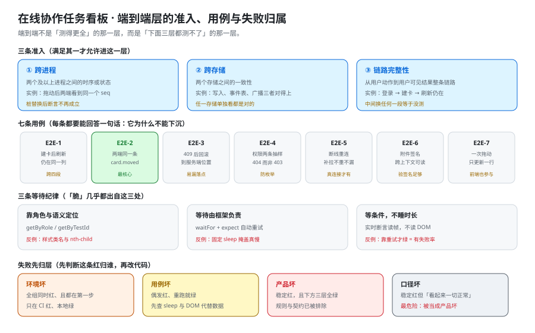

# 端到端测试：只测必须跨进程才能证伪的东西

这一页回答「哪几条断言**只能**放到端到端层、放上去之后怎么写才不脆、失败时怎么判断到底是产品坏了还是用例坏了」；它**不回答**「四层怎么分」（那是 [自动化测试分层](../TestStrategy/index.md) 的事）、也**不回答**「接口长什么样」（那是 [接口契约定稿](../Contracts/index.md) 的事）。本页的产出是一份**七条用例的端到端清单**——每一条都要能当场回答「它为什么不能下沉」。



::: warning 本仓库只有文档，没有代码
下面的 `playwright.config.ts`、`*.spec.ts` 与 `curl` 序列，都要在**你自己搭好的工程**里创建后执行。本仓库不存放源码与可执行副本；「运行 `pnpm exec playwright test`」一律指「先按本节把文件建出来，再执行」。端口与路径一律以 [环境与工程骨架](../Environment/index.md) 定稿的口径为准（后端 `8080`、前端 `5173`）。
:::

## 一、端到端层的三条准入

端到端（End-to-End，E2E）用例贵且脆：一条十秒级、一条失败要查三层。所以它**不是「测得更全」的那一层**，而是「下面三层都测不了」的那一层。一条用例要进这一层，必须至少满足三条准入之一：

| 准入 | 含义 | 本项目里的实例 |
| --- | --- | --- |
| **跨进程** | 断言的对象是**两个及以上进程之间的时序或状态**，单进程内不存在这个对象 | 一次拖动之后两端在 1 秒内看到同一个 `seq` |
| **跨存储** | 断言的对象是**两个存储之间的一致性**，任一存储单独看都是对的 | 卡片位置写进 PostgreSQL、事件写进 `board_events`、广播出站——三者对得上 |
| **端到端链路的完整性** | 断言的对象是**「从用户动作到用户可见结果」这一整条链路**，中间任何一段被替身换掉就等于没测 | 登录 → 建卡 → 刷新仍在（含令牌、代理、序列化、持久化四段） |

反过来，下面四类**不该**进端到端层——它们都是「看起来很像端到端」的伪需求：

1. **业务规则的正确性**（拖动后顺序是否正确、权限是否是那 18 格）。规则是纯函数式的判断，单元层与集成层能以毫秒级成本证伪；放进端到端只会让它变慢十倍。
2. **一条接口的响应形状**（状态码、错误码、字段名）。那是契约层的事（[权限矩阵验证](../PermissionMatrix/index.md) 里的 21 条 `request` 用例就是这一层的）。
3. **CSS 引起的可见性问题**（按钮被挡住、文字溢出）。归组件测试的浏览器模式，端到端跑起来也不稳定。
4. **性能与容量**。压测与端到端**不能合并**：端到端要的是「一次操作的完整时序正确」，压测要的是「目标到达率下的分位数」。两者混在一起会同时失去确定性——详见 [压测与容量验收](../CapacityTest/index.md)。

::: tip 一句话判据
**「把其中任意一个进程换成桩，这条断言还成立吗？」** 成立 → 它不该在端到端层；不成立 → 它必须在这一层。
:::

## 二、七条用例清单

七条用例覆盖「协作看板」这个系统里**只有跨进程才成立**的那部分行为。每一条给出：为什么必须在这一层、做什么、断言什么、失败先看哪里。判定口径与 [验收](../Acceptance/index.md) 的 `A1`~`A8` 一一对应，不新增需求。

### 2.1 `E2E-1` 登录 → 建卡 → 刷新仍在

```typescript [e2e/card-persistence.spec.ts]
import { test, expect } from "@playwright/test";

test("建卡后刷新页面，卡片仍在同一列", async ({ page }) => {
  await page.goto("/login");
  await page.getByLabel("邮箱").fill(process.env.E2E_EMAIL!);
  await page.getByLabel("密码").fill(process.env.E2E_PASSWORD!);
  await page.getByRole("button", { name: "登录" }).click();

  await page.goto("/boards/" + process.env.E2E_BOARD_ID);
  const column = page.getByTestId("column-todo");
  await column.getByRole("button", { name: "新建卡片" }).click();
  await page.getByLabel("标题").fill(`E2E-${Date.now()}`);
  await page.getByRole("button", { name: "保存" }).click();

  // 关键：不是「界面上看得见」，而是「重新取一次还在」
  await page.reload();
  await expect(column.getByText(/^E2E-/)).toBeVisible();
});
```

- **为什么必须在这一层**：它同时跨了四段——浏览器到前端、前端到后端、后端到数据库、刷新后重新取数。任一段用替身替换，这条断言都不再证明任何事。
- **失败先看哪里**：刷新后不见了 → 先看 `POST /api/v1/boards/{id}/cards` 的响应是不是 `201`（若 `201` 而刷新没有，问题在**读侧**，见 [验收](../Acceptance/index.md) 的可见性口径）；若压根 `401`，问题在**登录态没进到后续请求**（[前后端联调](../Integration/index.md) 第三节）。

### 2.2 `E2E-2` 一次拖动：两端看到同一个 `seq`

这是**最核心的一条**：本项目区别于内容型系统的唯一能力就在这里。

```typescript [e2e/realtime-move.spec.ts]
import { test, expect } from "@playwright/test";

test("A 端拖动，B 端 1 秒内看到同一条 card.moved 且 seq 相同", async ({ browser }) => {
  const ctxB = await browser.newContext({ storageState: "e2e/.auth/user-b.json" });
  const pageB = await ctxB.newPage();
  await pageB.goto("/boards/" + process.env.E2E_BOARD_ID);

  // B 端先挂事件监听：等广播帧，而不是等 DOM 变化
  const frame = pageB.waitForEvent;                       // 占位：实际用 window.__wsFrames 收集
  const ctxA = await browser.newContext({ storageState: "e2e/.auth/user-a.json" });
  const pageA = await ctxA.newPage();
  await pageA.goto("/boards/" + process.env.E2E_BOARD_ID);

  await pageA.getByTestId("card-1").dragTo(pageA.getByTestId("column-doing"));
  const seen = await pageB.evaluate(() => (window as any).__lastFrame);
  expect(seen.type).toBe("card.moved");
  expect(seen.seq).toBeGreaterThan(0);
});
```

- **为什么必须在这一层**：`seq` 是**服务端分配、经 WebSocket 推送、被另一个浏览器进程消费**的。任何替身都会把「两端是不是同一个序号」变成「假实现是不是自洽」。
- **断言的三个数**（缺一不可）：`type` 是 `card.moved` / `seq` 是**单调递增的前一条 + 1** / 两端拿到的 `seq` **相等**。只断言「B 端界面变了」是不够的——界面可能被本地乐观更新改对了，而广播其实没到。
- **失败先看哪里**：B 端没收到 → 先看 A 端拖动请求的响应时间戳与 B 端帧的时间戳之差（超过 1 秒即为广播延迟，见 [实时网关](../RealtimeGateway/index.md) 的「提交之后再广播」）；两端 `seq` 不等 → 十有八九是 **A 端的乐观更新把序号本地推进了**，而服务端分配的其实是另一个数。

### 2.3 `E2E-3` 过期 `version` 拖动 → `409` → 界面回滚

```typescript [e2e/conflict-rollback.spec.ts]
import { test, expect } from "@playwright/test";

test("用过期 version 拖动，界面回滚到服务端位置且不残留假状态", async ({ page, request }) => {
  await page.goto("/boards/" + process.env.E2E_BOARD_ID);
  const card = page.getByTestId("card-2");

  // 先用接口把服务端的 version 推走，模拟「另一个人刚改过」
  const before = await (await request.get(`/api/v1/cards/2`)).json();
  await request.post(`/api/v1/boards/${process.env.E2E_BOARD_ID}/cards/2/move`, {
    data: { targetColumnId: "done", version: before.version, clientOpId: crypto.randomUUID() },
  });

  // 再让界面用本地那份过期 version 拖一次
  await card.dragTo(page.getByTestId("column-doing"));

  await expect(page.getByText("已被其他人修改")).toBeVisible();
  // 关键断言：界面停在服务端说的位置，不是用户拖过去的位置
  await expect(page.getByTestId("column-done").getByTestId("card-2")).toBeVisible();
  await expect(page.getByTestId("column-doing").getByTestId("card-2")).toHaveCount(0);
});
```

- **为什么必须在这一层**：这条断言的**对象是「界面与服务端两份状态谁说了算」**——它跨越了浏览器的本地状态与数据库的真实状态，只有在两端都真实存在时才成立。
- **最容易漏的一处**：只断言「弹出了提示」。提示弹出来了、卡片却仍停在用户拖过去的位置，是**假绿**：用户点了重试又会冲突一次。
- **失败先看哪里**：`409` 的响应体里带 `details.currentVersion` 与 `currentPosition`（口径见 [接口契约定定稿](../Contracts/index.md)）；前端回滚如果用的是**重新拉列表**而不是 `details`，会表现为「卡片先跳到旧位置、再跳到新位置」的两次闪动——这是回滚实现走错路的典型现象。

### 2.4 `E2E-4` 权限的端到端抽样

权限矩阵的**完备性**在契约层验（18 格逐格，见 [权限矩阵验证](../PermissionMatrix/index.md)）；端到端只抽两条**必须穿过真实浏览器与真实令牌**的：

| 抽样 | 动作 | 断言 | 为什么不能下沉 |
| --- | --- | --- | --- |
| **`E2E-4a`** | 以 `viewer` 身份登录后，拖动一张卡片 | 界面**不给出拖动入口**；若强行调用接口则 `403` | 「界面不给入口」是渲染期的判断，单元层验不到；「强行调用是 `403`」证明这条限制不在前端 |
| **`E2E-4b`** | 用 A 工作区的令牌打开 B 工作区的看板地址 | 页面进入「找不到」态，接口返回 `404`（**不是 `403`**） | `404` 而非 `403` 是**防枚举**的口径，它要求浏览器、网关、服务端三处一致；替换任一处就会退化成 `403` |

### 2.5 `E2E-5` 断线重连：补拉不漏不重

```shell
# 观测口径：先记下断线前的最后一条 seq，再断开、改一次、重连、看补拉回来的区间
# 1) 拿到当前游标
curl -s "localhost:8080/api/v1/boards/$E2E_BOARD_ID/events?since=0" | jq '.items[-1].seq'
# 2) 断开客户端（关掉标签页或在 DevTools 里改网络为 offline）
# 3) 在另一端拖动一次，记下服务端现在的最大 seq
# 4) 恢复网络，客户端应带 since=<第 1 步的值> 补拉
# 5) 期望：补拉回来的 seq 恰好是「第 1 步的值 + 1 … 第 3 步的最大 seq」，一个不漏、一个不重
```

- **为什么必须在这一层**：「断线」这件事只在真实 WebSocket 连接上存在；用一个假的连接对象去验补拉，验的是假对象的重连逻辑。
- **失败先看哪里**：补拉丢了中间几条 → 看 `since` 用的是**客户端最后收到的 seq**还是**客户端最后渲染的 seq**（后者会被乐观更新污染，导致跳号）；补拉重复 → 看服务端 `since` 的边界是**开区间还是闭区间**（两种都可用，但客户端与服务端必须一致）。

### 2.6 `E2E-6` 附件上传与签名

一步、一条断言：**上传成功后，另一个浏览器进程能直接打开这个链接**。

```shell
# 期望：拿到 201 与一个带签名的 URL；换一台「未登录」的浏览器打开该 URL 仍能读到文件
curl -s -X POST localhost:8080/api/v1/boards/$E2E_BOARD_ID/attachments \
  -H "Authorization: Bearer $TOKEN" -F "file=@cover.png" | jq '.url, .expiresAt'
```

这条必须在这一层：签名 URL 的可用性与**浏览器是否携带 Cookie / 是否登录无关**，只有在两个独立上下文里才验证得了「签名本身足够」。

### 2.7 `E2E-7` 一次拖动只更新一行（成本判据的端到端版）

```shell
# 拖动前后各数一次：期望恰好 +1
docker compose exec -T db psql -U app -d board -tAc \
  "select count(*) from cards where updated_at > now() - interval '5 seconds'"
```

- **为什么必须在这一层**（而不是只放集成层）：集成层能证明「服务端只 `update ... where id = ?`」，证明不了**前端没有先整列重排再逐张提交**。这条断言的观察对象是「数据库里被改动的行数」，而**产生这些改动的请求序列来自浏览器**。
- **失败先看哪里**：读数大于 `1` → 先看 Network 面板里那次拖动发了**几个**请求（常见是「先本地重排并逐张 `PATCH`」）；读数恰好 `1` 但顺序不对 → 那是排序键的问题，归 [卡片拖动](../CardMove/index.md)。

## 三、选择器与等待：三条纪律

端到端用例「脆」几乎从来不是产品的问题，而是**用例在等一个不该等的东西**。

| 纪律 | 写法 | 反例（会怎么坏） |
| --- | --- | --- |
| **靠角色与语义定位，不靠样式** | `page.getByRole("button", { name: "保存" })`、`page.getByTestId("column-doing")` | 用 `.css-1a2b3c` 或 `:nth-child(3)`：换一次样式表全组失败 |
| **断言 DOM 的等待由框架负责** | `await expect(locator).toBeVisible()`（web-first，自动重试到超时） | `await page.waitForTimeout(1000)`：慢机器上偶尔红、快机器上掩盖真慢 |
| **不睡固定时长，等条件** | `await expect(page.getByText("已被其他人修改")).toBeVisible()` | 等 `seq` 时用 `sleep 1500`：它证明的是「我睡了 1.5 秒」，不是「广播到了」 |

::: danger 三个必须写清的坑
1. **不要用「元素出现」代替「数据到位」。** B 端界面变了可能是本地乐观更新造成的；实时类断言一律**读收到的帧**（`type` / `seq`），而不是读 DOM。
2. **不要在端到端里做串行等待的堆叠。** 每一处 `sleep` 都在给整套用例加时间；三条 `sleep 2s` 的用例墙钟就多 6 秒，而它们**一条也没让断言更可信**。
3. **不要把重试当成稳定手段。** `retries: 3` 只应盖住基础设施抖动（浏览器启动、容器就绪）。**如果一条用例靠重试才绿，它证明的是「有 1/3 的概率会失败」**——应当拆开去查，而不是把重试次数调大。
:::

## 四、测试数据的准备与清理

端到端要的是**真实又可重复**的数据，这两个要求互相拉扯：真实的数据会互相干扰，重复的数据又不真实。

### 4.1 三种数据来源与它们的边界

| 来源 | 提供什么 | 不能用它验什么 |
| --- | --- | --- |
| **一次性种子**（[可运行验证](../Verification/index.md) 的 3 行 × 20 张卡） | 结构性的前置：工作区、成员、列、一批卡片 | 不能作为「这条用例自己造的那张卡」——它会被别的用例改掉 |
| **用例自建**（`E2E-<时间戳>` 命名的卡片、随机 `clientOpId`） | 这条用例独占的对象，断言只指向它 | 不能用来验「列表总数」这类全局量 |
| **令牌夹具**（`e2e/.auth/user-a.json`） | 角色身份（`owner` / `member` / `viewer` 各一份） | 令牌**必须**由真实登录流程生成一次后复用，不能手写 JWT——手写的令牌验不到登录链路 |

### 4.2 三条清理纪律

1. **清理按依赖倒序**：先删卡片、再删列、最后才删工作区。反过来会在外键上失败，而失败信息指向的是删除语句，不是真正的问题。
2. **清理写在用例里，不写在「全局收尾」里**：全局收尾在用例失败时不会执行，脏数据从此留在库里，污染下一次运行。
3. **不许用「清库重来」代替清理**：`TRUNCATE` 会让用例与「运行顺序」强耦合——单独跑一条会失败，全套跑会通过，这是最难查的一种脆。

::: tip 「顺序无关」在端到端层的写法
端到端天然是串行的（一个浏览器上下文）。所以「顺序无关」在这里的含义不是「随机顺序也过」，而是**「每条用例单独跑也能过」**。验证方式：`pnpm exec playwright test e2e/conflict-rollback.spec.ts` 单独跑那一条，期望同样通过。
:::

## 五、失败分诊：先归层，再改代码

端到端红了，**第一个动作不是改代码，是判断这条红归谁**。

| 现象 | 更可能的归属 | 第一步看什么 |
| --- | --- | --- |
| 全组用例同时红，且都在第一步 | **环境坏** | 三段环境是否都起来了（[前后端联调](../Integration/index.md) 第二节），`/actuator/health` 是不是 `UP` |
| 只在 CI 红、本地绿 | **环境坏**（数据/并行度差异） | CI 是否复用了上一次的库；worker 数是否大于 1 而用例间共享了数据 |
| 偶发红，重跑就绿 | **用例坏**（等待纪律） | 该用例里有没有 `sleep`、有没有用 DOM 代替数据 |
| 稳定红，且下方三层全绿 | **产品坏** | 直接看断言指向的那一段链路；下方三层已排除规则与契约 |
| 稳定红，但「看起来一切正常」 | **口径坏** | 期望值是不是从别处抄来的——本项目的期望值一律实跑后填 |

::: danger 最容易做错的一件事
**把「口径坏」当成「产品坏」去改产品。** 例如 B 端 `seq` 断言失败时，如果先入为主认为「推送坏了」，就可能去给推送加重试——而真实原因是**两端 `seq` 的语义不同**（一端数「事件数」、一端数「版本数」）。改产品之前，先在文档里找到这个数的**出处**（见 [接口契约定稿](../Contracts/index.md)），确认两端说的确实是同一件事。
:::

## 六、当日做了什么

1. 定下端到端层的**三条准入**（跨进程 / 跨存储 / 端到端链路完整性）与**四类伪需求**（业务规则 / 单接口形状 / CSS 可见性 / 性能容量），并给出一句话判据：「把任意一个进程换成桩，这条断言还成立吗？」
2. 产出**七条用例清单**（`E2E-1` ~ `E2E-7`），逐条写明「为什么必须在这一层 / 做什么 / 断言什么 / 失败先看哪里」，并与 [验收](../Acceptance/index.md) 的 `A1`~`A8` 一一对应——**不新增需求**。
3. 为最核心的 `E2E-2` 写清**三个数缺一不可**（`type` / `seq` 单调 +1 / 两端相等），并点明「只断言界面变了」是假绿（本地乐观更新也会让界面变对）。
4. 为 `E2E-3` 补上**最容易漏的断言**：回滚之后的**落点**必须是服务端说的位置，而不是「弹了提示」。
5. 产出**三条选择器与等待纪律**（角色语义定位 / web-first 断言 / 等条件不睡固定时长）与**三个必须写清的坑**，并写死「靠重试才绿的用例证明的是失败率」。
6. 产出**测试数据三种来源的边界**（一次性种子 / 用例自建 / 令牌夹具）与**三条清理纪律**（依赖倒序 / 清理写在用例里 / 不许清库重来），并给出端到端层「顺序无关」的真实含义与验证方式。
7. 产出**失败分诊表**（五类现象 → 四个归属），并写明「口径坏被当成产品坏」是本项目最容易犯的那一类错。
8. 产出 **`ET-A ~ ET-H` 八条判据**，如实区分文档级与运行期：七条文档级、本机可判，一条运行期如实标 `⏳`。

## 七、如何验证

### 7.1 判据表（`ET-A ~ ET-H`）

| 判据 | 判什么 | 级别 | 状态 |
| --- | --- | --- | --- |
| **`ET-A`** | 三条准入与四类伪需求写死，且有一句话判据（换桩是否还成立） | 文档级 | ✅ 本机可判 |
| **`ET-B`** | 七条用例齐全，且每条都有「为什么不能下沉」 | 文档级 | ✅ 本机可判 |
| **`ET-C`** | `E2E-2` 的三个数写死（`type` / `seq` 递增 1 / 两端相等），并点明「只断言界面变了」是假绿 | 文档级 | ✅ 本机可判 |
| **`ET-D`** | `E2E-3` 的落点断言写死（停在服务端位置，不残留假状态） | 文档级 | ✅ 本机可判 |
| **`ET-E`** | 三条等待纪律成表，且写明「靠重试才绿 = 失败率」 | 文档级 | ✅ 本机可判 |
| **`ET-F`** | 数据三种来源的边界与三条清理纪律齐全，含「单独跑也过」的验证方式 | 文档级 | ✅ 本机可判 |
| **`ET-G`** | 失败分诊五类现象 → 四类归属齐全 | 文档级 | ✅ 本机可判 |
| **`ET-H`** | 七条用例在真环境上各跑过一次，且每条都能单独跑绿 | 运行期 | `⏳ 未跑`（原因：本仓库只有文档，没有可执行的工程与前端） |

### 7.2 本机可判的部分

前七条是**文档级、本机可判**——下面的命令已在仓库根实跑，括注为实测值。

```shell
# ET-A：三条准入 + 一句话判据都在页内
grep -cE '^\| \*\*(跨进程|跨存储|端到端链路的完整性)\*\* \|' index.md   # 期望 3
grep -c '换成桩，这条断言还成立吗' index.md                             # 期望 3

# ET-B：七条用例小节齐全（2.1 ~ 2.7）
grep -c '^### 2\.[1-7] ' index.md                                       # 期望 7
grep -c '^\- \*\*为什么必须在这一层\*\*' index.md                       # 期望 5

# ET-C：三个数写死
grep -c '两端拿到的 `seq` \*\*相等\*\*' index.md                        # 期望 1
grep -c '乐观更新' index.md                                             # 期望 6

# ET-D：落点断言写死
grep -c '停在服务端说的位置' index.md                                   # 期望 2

# ET-E：三条等待纪律成表 + 重试口径
grep -cE '^\| \*\*(靠角色与语义定位，不靠样式|断言 DOM 的等待由框架负责|不睡固定时长，等条件)\*\* \|' index.md  # 期望 3
grep -c '靠重试才绿' index.md                                           # 期望 4

# ET-F：三种数据来源 + 三条清理纪律 + 单独跑也过
grep -cE '^\| \*\*(一次性种子|用例自建|令牌夹具)' index.md              # 期望 3
grep -c '单独跑也能过' index.md                                         # 期望 2

# ET-G：分诊表五行（四类归属 + 一行「只在 CI 红」）
grep -c '^| 全组用例同时红' index.md                                    # 期望 1
grep -cE '^\| .*\| \*\*(环境坏|用例坏|产品坏|口径坏)\*\*' index.md      # 期望 5

# 配图与判据条数
grep -c 'assets/tb-e2e.sv[g]' index.md                                  # 期望 1
grep -cE '^\| \*\*`ET-[A-H]`\*\*' index.md                              # 期望 8
```

### 7.3 需要真实环境的部分

`ET-H` 的判据对象是**真跑起来的前端 + 后端 + 数据库**，本仓库按约定只有文档、没有可执行的工程，因此如实标 `⏳ 未跑`，只给命令：

```shell
# ET-H（需要：容器运行时 + 按《环境与工程骨架》建出的 app/ 与 web/ + 一份种子数据）
# 1) 三段环境起来（见「前后端联调」第二节）
docker compose up -d db cache object object-init && docker compose up -d app
pnpm --dir web dev &

# 2) 生成三份令牌夹具（真实登录一次后复用，不要手写 JWT）
pnpm exec playwright test --project=setup

# 3) 七条用例逐个「单独跑」，每条都要绿（这是端到端层的「顺序无关」）
for spec in card-persistence realtime-move conflict-rollback \
            permission-sample reconnect-resync attachment-sign move-cost; do
  pnpm exec playwright test "e2e/$spec.spec.ts" || echo "FAILED: $spec"
done
```

::: warning 状态列的读法
`ET-A` ~ `ET-G` 的结论是**逐条 `grep` 数出来的**，不是推断的。`ET-H` 的状态不是「结论」而是「当前可执行性」，它的阻塞项只有**本仓库没有可执行的工程**这一条——**不是容器运行时**：本机实测 `docker info` 输出 `27.1.1`、且有常驻容器在运行（2026-10-17 复验），见 [第 3 周验收结论](../Week3Acceptance/index.md) 第三节对这处口径的更正。**不把「跑过了」写成「通过了」，也不把期望值抄进状态列。**
:::

## 八、下一步

1. **把 `E2E-2` / `E2E-5` 的观测点固定下来**（`window.__lastFrame` 与 `since` 游标的读数方式），它们是第 4 周 [部署与交付](../index.md) 里「实时同步可观测」这一项在端到端层的对应物。
2. **`E2E-6` 的签名有效期与刷新策略**要与第 4 周的监控接入一起定——附件读失败在监控里表现为 `403` 曲线，而不是「上传失败」。
3. 七条用例中**任何一条出现「必须重试才绿」**，当天回到 [自动化测试分层](../TestStrategy/index.md) 第六节重新判断它该不该留在端到端层。

## 参考资料

- [自动化测试分层：四层金字塔与测试数据的隔离](../TestStrategy/index.md)（本页的上位规则：四层职责与 5% 的配比从哪来） · [权限矩阵验证](../PermissionMatrix/index.md)（契约层 `request` 用例与 Playwright **1.63.0** 口径）
- [接口契约定稿：路径、错误码与幂等](../Contracts/index.md)（`409` 的 `details` 形状与 `404` 防枚举口径） · [实时网关：订阅鉴权与断线追平](../RealtimeGateway/index.md)（「提交之后再广播」与缺口补拉）
- [可运行验证：从零起一套能跑的环境](../Verification/index.md)（种子数据与并发、实时两条链路的实跑步骤） · [验收：把「做完了」变成可执行的步骤](../Acceptance/index.md)（`A1`~`A8` 与 `TB-A`~`TB-H`）
- [卡片拖动：一次拖动只更新一行](../CardMove/index.md)（`E2E-7` 成本判据的服务端形状） · [压测与容量验收](../CapacityTest/index.md)（为什么端到端与压测不能合并）
- [端到端测试：Playwright 与 Cypress](/docs/Frontend/Testing/E2E/index.md)（工具层的安装、配置与调试） · [完整项目交付 · 测试策略](/docs/Others/ProjectDelivery/Testing/index.md)
