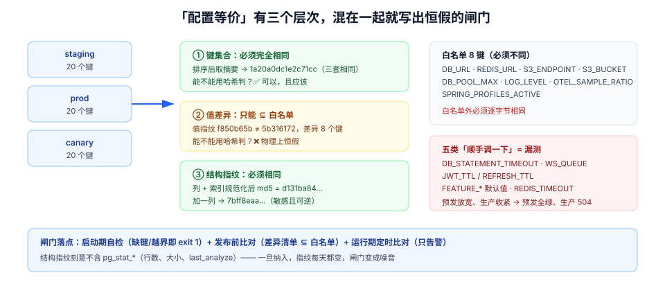

# 第 4 周第 2 步 · 环境等价：三套环境的差异必须落在白名单里

[上一步](./../ImageSupplyChain/index.md)把「部署什么」压成了一个 manifest digest，于是「三套环境跑的是不是同一份产物」不再有歧义。但它只解决了产物，没解决**环境**。

同一个 digest，在 staging 上 5 秒完成巡检、在 prod 上 40 秒超时；在 staging 上开关全开、在 prod 上开关是旧快照——这类故障的根因从来不是代码，而是**两份配置文件在三个月里各自被改过几次**。

本页要建立的是一个闸门：**「环境差异」必须是一张写下来的、可复核的白名单，而不是「大概是那几个变量」。**

## 判据族声明

本页判据族 `EPR-A` ~ `EPR-H`，共 8 条。定义表在第七节。

## 本页不讲什么

- 不讲配置三分法（结构 / 值 / 密钥）与密钥四级落点，归 [配置与密钥](../ConfigSecrets/index.md)；本页只判「差异允不允许」。
- 不讲 Compose 怎么把 env 文件注进容器，归 [部署脚本](../DeployScripts/index.md)。
- 不讲开关快照的读取时机与 `version` 归因，归 [请求作用域与观测信号](../SignalScope/index.md)。
- 不讲库表结构本身怎么设计，归 [数据库设计](../Database/index.md)；本页只讲**怎么证明两个库的结构一样**。



## 一、「配置等价」有三个层次，混在一起就会写出恒假的闸门

| 层次 | 问的问题 | 判据形态 | 能否用「哈希相等」 |
| --- | --- | --- | --- |
| **键集合** | 该有的键是不是都在、有没有多出没人认识的键 | 两边键名排序后的摘要相等 | ✅ 可以，且应该 |
| **值差异** | 每个键的差异是否在白名单内 | 差异清单 ⊆ 白名单 | ❌ 不行，见第二节 |
| **结构** | 两边库的表 / 列 / 索引 / 约束是否一致 | 规范化行集合的摘要相等 | ✅ 可以 |

第二行是本页最重要的一句话：**配置值不可能全部相等**，所以「两边配置的哈希必须相同」这条闸门在物理上恒假。恒假的闸门比没有闸门更糟——它会被加豁免、被注释掉，最后连键集合都没人看了。

## 二、20 个键的实测：键集合相同，值指纹必然不同

实验用两份 20 键的 env 文件（内容取自本项目 `ConfigSecrets` 的清单），把 staging 的名字整体替换成 prod、并改动四处真实会变的配置，然后按三种方式算指纹：

```shell
# 归一化函数：去掉注释、按键名排序、密钥类值一律掩码成 ***
norm(){ grep -v -E '^#' "$1" | sort \
  | awk -F= '{k=$1; v=substr($0, index($0,"=")+1);
              if (k ~ /(SECRET|PASSWORD|TOKEN|KEY)/) v="***"; print k"="v}'; }
```

| 指纹 | staging | prod | 相等？ |
| --- | --- | --- | --- |
| 键集合（只取 `KEY` 名排序后哈希） | `1a20a0dc1e2c71cc` | `1a20a0dc1e2c71cc` | ✅ 相同 |
| 归一化全量值（掩码后） | `f850b65ba43d9950` | `5b316172324ae32b` | ❌ **不同** |
| 差异键数量 | —— | —— | **8 个**（20 个键里的 8 个） |

八个差异键的完整清单：

| 键 | staging | prod | 该不该不同 |
| --- | --- | --- | --- |
| `SPRING_PROFILES_ACTIVE` | `staging` | `prod` | ✅ 必须不同 |
| `DB_URL` | `…//pg-staging:5432/…` | `…//pg-prod:5432/…` | ✅ |
| `REDIS_URL` | `…//redis-staging:6379/0` | `…//redis-prod:6379/0` | ✅ |
| `S3_ENDPOINT` | `…//minio-staging:9000` | `…//minio-prod:9000` | ✅ |
| `S3_BUCKET` | `tb-staging` | `tb-prod` | ✅ |
| `DB_POOL_MAX` | `20` | `50` | ✅（按实例数换算，见 [容量复核](../PoolCapacity/index.md)） |
| `LOG_LEVEL` | `DEBUG` | `INFO` | ✅ |
| `OTEL_SAMPLE_RATIO` | `1.0` | `0.1` | ✅ |

八条全部「该不同」，恰恰说明**这个实验的成功判据不是「哈希相等」，而是「差异集合恰好等于白名单」**。

::: danger 两个常见的错法
1. **把差异写进豁免文件，再让闸门比对哈希**：豁免越加越多，最后豁免文件本身成了唯一真相，没人再读它。正确做法是让闸门**直接输出差异清单**，人来判「清单是否 ⊆ 白名单」，机器只负责清单的完整性。
2. **把 `LOG_LEVEL`、`OTEL_SAMPLE_RATIO` 也归为「无所谓」**：它们决定你**能不能看见**故障。prod 采样 0.1 + INFO，意味着一次偶发失败的日志大概率不存在。它们必须在白名单里，而不是被忽略。
:::

## 三、白名单怎么写才不会变成豁免仓库

白名单的每一行必须带三样东西：**键名、为什么允许不同、差异的合法范围**。

| 键 | 为什么允许不同 | 合法范围 | 越界会怎样 |
| --- | --- | --- | --- |
| `DB_URL` / `REDIS_URL` / `S3_ENDPOINT` | 指向各环境的实例 | 必须同协议、同端口、库名/桶名带环境前缀 | 指向别环境的实例 = 串租户事故 |
| `S3_BUCKET` | 环境隔离 | 必须匹配 `^tb-(staging\|prod)$` | 桶名写错 = 附件写进别人的桶 |
| `DB_POOL_MAX` | 按实例规格换算 | 由公式算出（±20% 内） | 超卖 = 连接数打满（见 [容量复核](../PoolCapacity/index.md)） |
| `LOG_LEVEL` | 生产控制成本 | `INFO` 或 `WARN`；**不允许 `DEBUG`** | prod DEBUG = 日志量与 PII 双爆 |
| `OTEL_SAMPLE_RATIO` | 采样成本 | `0.05 ~ 0.2` | 采到 1.0 = 追踪存储被打爆 |
| `SPRING_PROFILES_ACTIVE` | 装配差异 | 只能是 `staging` / `prod` | 写 `dev` = 连接本地库 |

**不在白名单里的键，一律必须完全相同。** 尤其这几个最容易被「顺手调一下」：

| 键 | 为什么不能不同 | 差异的后果 |
| --- | --- | --- |
| `DB_STATEMENT_TIMEOUT` | 预发放宽、生产收紧，会让预发漏掉超时类缺陷 | 预发全绿、生产 504 |
| `WS_QUEUE` | 队列长度决定背压触发点 | 预发不触发背压、生产频繁 `4408` |
| `JWT_TTL` / `REFRESH_TTL` | 令牌有效期是安全属性 | 预发测不出续期路径 |
| `FEATURE_*` 默认值 | 开关默认值决定「没配置时走哪条路」 | 生产走了一条没测过的分支 |
| `REDIS_TIMEOUT` | 超时阈值决定熔断时机 | 预发降级、生产雪崩 |

## 四、结构等价：用一行 SQL 证明两个库一样

值可以白名单，**结构不行**。两个库差一个索引，性能结论就作废；差一个约束，越权用例就漏判。

结构指纹的做法是把「表 / 列 / 索引」拍平成有序行，再取摘要：

```sql
-- 结构指纹：列 + 索引的规范化行集合（在目标库执行）
with s as (
  select table_name || '.' || column_name || ':' || data_type || ':' || is_nullable
         || ':' || coalesce(column_default, '-') as line
  from information_schema.columns
  where table_schema = 'public'
  union all
  select tablename || '.' || indexname as line
  from pg_indexes
  where schemaname = 'public'
)
select count(*) as lines, md5(string_agg(line, '|' order by line)) as fingerprint
from s;
```

在本机 PG 18.6 沙盒里的读数（表 `card`，两列 + 主键）：

| 状态 | 行数 | 指纹 |
| --- | --- | --- |
| 基准 | 9 | `d131ba846d8919a2fa48c34081f4d763` |
| 加一列 `_fp_probe int` 后 | 10 | `7bff8eaa230c87b70c553a205d21a0d2` |
| 删掉该列后 | 9 | 回到 `d131ba84…` |

三个读数各有一个用处：

1. **敏感**：加一列指纹立刻变——闸门不是摆设。
2. **可逆**：删掉后回到原值——说明指纹只依赖结构，不掺时间戳/统计信息，不会「每次跑都不一样」。
3. **可比**：staging 与 prod 各跑一次，两个 `fingerprint` 相同即结构等价；不同则再跑一次**逐行 diff**（把 `line` 换出来）定位到具体差异。

::: warning 结构指纹刻意不包含的东西
`pg_stat_user_tables` 的行数、索引的 `size`、`last_analyze` 时间——这些会随数据变化，一旦纳入，指纹每天都变，闸门变成噪音。结构等价只谈**定义**，数据量归第五节的「数据基线」。
:::

## 五、数据等价：种子基线而不是生产副本

三套环境的数据不可能一样，但**基线的形状**必须一样：

| 项 | 要求 | 验证 |
| --- | --- | --- |
| 租户数 | staging ≥ 2（必须有多租户才能跑跨租户用例） | `select count(*) from tenant` |
| 每租户成员数 | ≥ 3（owner / editor / viewer 三角色齐全） | `select tenant_id, count(*) … group by 1` |
| 每看板卡片数 | ≥ 20（要能翻页、能排序） | `select board_id, count(*) …` |
| 附件 | ≥ 1 个 `pending` + 1 个 `committed`（否则过期清理用例永远不跑） | `select status, count(*) …` |
| 事件表 | 至少有 1 个断点（`seq` 有空洞） | `select count(*) from board_events where seq > …` |

数据用**固定种子脚本**生成（脱敏规则归专题 [测试数据与仿真](/docs/Tools/TestDataSimulation/index.md)），不用生产副本：生产副本一进预发，就等于把 PII 搬到了一个没人按生产标准守护的环境里。

## 六、把闸门放到哪：启动期还是发布前

| 位置 | 能拦什么 | 拦不住什么 | 本项目选择 |
| --- | --- | --- | --- |
| **启动期**（应用读配置时自检） | 缺键、类型错、值越界 | 环境间差异是否在白名单（应用不知道别的环境） | ✅ 必做，fail-fast |
| **发布前**（CI 比对两份 env + 两个库） | 差异集合、结构指纹 | 运行期才出现的配置生效问题 | ✅ 必做，作为 Go/No-Go 的一票 |
| 运行期定时比对 | 漂移（有人手工改了配置） | —— | ⚠️ 只告警，不阻断 |

启动期自检的三条最小要求：缺键直接退出（`exit 1`）、值越界拒绝启动、**日志里打印键名但不打印值**（密钥类打 `***`）。`/actuator/env` 必须按白名单暴露键名，否则它本身就是一个泄漏面。

## 七、判据表

| 编号 | 规则 | 违反时的样子 | 怎么验证 |
| --- | --- | --- | --- |
| `EPR-A` | 三套环境的键集合指纹相同 | 某环境缺键，启动才崩 | 命令①，三个指纹必须相等 |
| `EPR-B` | 差异键集合 ⊆ 白名单，且每行有理由与范围 | 豁免文件越来越长 | 命令②，输出即差异清单 |
| `EPR-C` | 白名单外的键值必须完全相同 | 「预发放宽、生产收紧」类漏测 | 命令③ |
| `EPR-D` | 结构指纹一致 | 预发缺索引，性能结论作废 | 第四节 SQL，两边指纹相等 |
| `EPR-E` | 结构指纹不含统计信息 | 指纹每天变，闸门被关掉 | 检查 SQL 里没有 `pg_stat_*` |
| `EPR-F` | 数据基线满足五条最小形状 | 跨租户 / 过期清理类用例永远不跑 | 第五节五条 SQL |
| `EPR-G` | 启动期缺键 / 越界即退出 | 带着默认值上线 | 删一个必填键重启，期望 `exit 1` |
| `EPR-H` | 日志与 `/actuator/env` 不回显密钥值 | 密钥进日志、进排查包 | 命令④，命中即为违规 |

## 验证命令

```shell
# ① EPR-A：三套环境的键集合指纹
for f in env/staging.env env/prod.env env/canary.env; do
  printf '%-22s %s\n' "$f" "$(grep -v '^#' "$f" | cut -d= -f1 | sort | shasum -a 256 | cut -c1-16)"
done
# 期望：三行指纹完全相同

# ② EPR-B：差异清单（这就是要人工判「是否 ⊆ 白名单」的那张表）
diff <(norm env/staging.env) <(norm env/prod.env) | grep '^[<>]'
# 期望：只出现白名单里的 8 个键；出现 DB_STATEMENT_TIMEOUT / WS_QUEUE / JWT_TTL 即为 EPR-C 违规

# ③ EPR-C：白名单外的键必须逐字节相同
comm -12 <(grep -v '^#' env/staging.env | cut -d= -f1 | sort) \
         <(grep -v '^#' env/prod.env    | cut -d= -f1 | sort) \
  | grep -vE '^(DB_URL|REDIS_URL|S3_ENDPOINT|S3_BUCKET|DB_POOL_MAX|LOG_LEVEL|OTEL_SAMPLE_RATIO|SPRING_PROFILES_ACTIVE)$' \
  | while read k; do
      a=$(grep -m1 "^$k=" env/staging.env); b=$(grep -m1 "^$k=" env/prod.env)
      [ "$a" = "$b" ] || echo "DIFF $k"
    done
# 期望：无输出

# ④ EPR-H：日志与 actuator 里不许出现密钥值
grep -rnE '(password|secret|token)=[^ *]' logs/ | grep -v '\*\*\*'
# 期望：无输出
```

## 八、下一步

产物有了指纹、环境差异进了白名单，第三个问题是最容易在周五晚上爆炸的那个：**这次发布带的 DDL，会不会把生产库锁死？**

归第 4 周第 3 步 [迁移前置闸门](../MigrationPreflight/index.md)：`lock_timeout` 的实测（0.238 s 自杀 vs 1.42 s 排队）、排队中的 `ALTER` 如何把普通 `SELECT` 一起堵住（1.19 s）、以及为什么 `CREATE INDEX CONCURRENTLY` 不能进事务。
