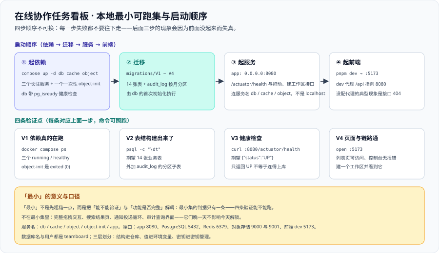

# 环境与工程骨架

这一页把版本基线变成**一条能跑起来的命令**：本地最小可跑集是什么、目录怎么摆、`compose.yaml` 与 `.env` 长什么样、怎么一键起、起不来时按什么顺序查。它是 [技术选型](../TechStack/index.md) 的落地页——选型页说「用什么」，这一页说「在哪里、怎么起、怎么确认它真的起来了」。



::: warning 本项目只有文档，没有代码
下面所有文件（`compose.yaml`、`.env`、`vite.config.ts`、`application.yml`、迁移脚本）都是**读者在自己工程里要创建的**；本仓库不存放可执行副本，「运行 `xxx`」一律指「先按本节创建好该文件，再执行」。
:::

## 一、本地最小可跑集

「最小」不是「先粗糙一点」，而是**把「能不能验证」与「功能是否完整」解耦**。判据只有一条：**第六节的四条验证能不能跑通**。

| 文件 / 目录 | 作用 | 为什么它在最小集里 |
| --- | --- | --- |
| `compose.yaml` | 编排 `db` / `cache` / `object` / `object-init` / `app` | 没有它就没有「一键起」，第 1、2 条验证无从谈起 |
| `.env` + `.env.example` | 值（端口、库名、凭据）与结构（变量名与用途）分离存放 | 三层划分里「值进环境变量」的载体 |
| `deploy/db/migrations/V1__identity.sql` ~ `V4__collab.sql` | 建 **14 张表**与 `audit_log` 的按月分区 | 没有表结构就没有任何接口能跑通 |
| `app/`（Spring Boot 工程） | 服务本体：暴露 `/actuator/health` 与拖动、建工作区接口 | 第 2、4 条验证都靠它 |
| `web/`（Vue + Vite 工程） | 前端壳：能在 5173 起、能拉到工作区列表 | 第 3 条验证靠它 |

明确**不在**最小集里的四项：完整拖拽交互、搜索结果页、通知投递循环、审计查询界面。

## 二、当前使用的版本

::: info 当前使用的版本
本项目的版本基线**与 [技术选型与版本基线](../TechStack/index.md) 逐字一致**（本页、选型页、项目总览三处不得出现第三个说法）：

- **Java 25（LTS）**、**Spring Boot 4.1.1**（底层 Spring Framework **7.0.x**）
- **PostgreSQL 18.6**（当前稳定主版本 18，`uuidv7()` 自 18 起可用）
- **Vue 3.5.43**（3.5 稳定线）、**Node.js 24 LTS**、**pnpm 12.x**
- **Redis 8.10 系**、**Docker Compose v2**

镜像 tag 一律**写明确的小版本**（`postgres:18.6`、`redis:8.10-alpine`），不写 `latest`。
:::

## 三、完整目录结构

前后端分离，且**契约单独成目录**——改契约必须走评审，所以它不能混在 `app/` 或 `web/` 里：

```text [teamboard/ 工程目录结构]
teamboard/
├─ compose.yaml                      # 一键起：db / cache / object / object-init / app
├─ .env                              # 值（不进版本控制）
├─ .env.example                      # 结构（进版本控制）
├─ deploy/
│  ├─ db/migrations/                 # V1__identity.sql ~ V4__collab.sql（14 张表 + 分区）
├─ contracts/                        # 契约单独成目录：改它必须走评审
│  ├─ rest/                          # HTTP 契约（拖动 / 评论 / 附件签名 / 搜索）
│  ├─ realtime/                      # WebSocket 主题命名与事件形状（含 seq 与 version）
│  └─ errors/                        # 状态码口径：401 / 403 / 404 / 409 各用在哪
├─ app/                              # 后端：Java 25 + Spring Boot 4.1.1
│  ├─ src/main/java/                 # 九个模块按包分：identity workspace board card
│  │                                 #   comment notification attachment search audit
│  ├─ src/main/resources/            # application.yml 与 application-local.yml
│  │                                 #   （application-local 连 db / cache / object）
│  └─ src/test/java/                 # MockMvc 集成测试：权限矩阵 18 格逐格一条
└─ web/                              # 前端：Vue 3.5.43 + Vite
   ├─ src/
   └─ vite.config.ts                 # server.proxy：/api → http://localhost:8080
```

三条纪律与 [实时监控大盘的环境前置](../../MonitoringDashboard/EnvPrereq/index.md) 一致：`deploy/` 与 `app/` 分开、`contracts/` 单独成目录、**结构进仓库 / 值进环境变量 / 密钥进密钥管理**。

## 四、`compose.yaml`

完整内容如下。**读的时候注意三处**：`db` 的 healthcheck、`object-init` 的重试循环、`app` 的 `depends_on` 条件——它们分别对应第七节第 2、4 条排查。

```yaml [compose.yaml]
name: teamboard

services:
  db:
    image: postgres:18.6
    environment:
      POSTGRES_DB: ${POSTGRES_DB:-teamboard}
      POSTGRES_USER: ${POSTGRES_USER:-teamboard}
      POSTGRES_PASSWORD: ${POSTGRES_PASSWORD:?POSTGRES_PASSWORD is required}
      TZ: ${TZ:-Asia/Shanghai}
      POSTGRES_INITDB_ARGS: "--encoding=UTF8 --locale=C.UTF-8"
    ports:
      - "${DB_PORT:-5432}:5432"
    volumes:
      - db-data:/var/lib/postgresql/data
      - ./deploy/db/migrations:/docker-entrypoint-initdb.d:ro
    healthcheck:
      test: ["CMD-SHELL", "pg_isready -U ${POSTGRES_USER:-teamboard} -d ${POSTGRES_DB:-teamboard}"]
      interval: 5s
      retries: 30

  cache:
    image: redis:8.10-alpine
    ports:
      - "${REDIS_PORT:-6379}:6379"
    healthcheck:
      test: ["CMD", "redis-cli", "ping"]

  object:
    image: minio/minio:latest
    command: ["server", "/data", "--console-address", ":9001"]
    environment:
      MINIO_ROOT_USER: ${S3_ACCESS_KEY:-teamboard}
      MINIO_ROOT_PASSWORD: ${S3_SECRET_KEY:?S3_SECRET_KEY is required}
    ports:
      - "${S3_PORT:-9000}:9000"
      - "${S3_CONSOLE_PORT:-9001}:9001"
    volumes:
      - object-data:/data

  object-init:                        # 一次性服务：建桶，跑完即退出，exited (0) 表示成功
    image: minio/mc:latest
    depends_on: [object]
    environment:
      S3_ACCESS_KEY: ${S3_ACCESS_KEY:-teamboard}
      S3_SECRET_KEY: ${S3_SECRET_KEY:?S3_SECRET_KEY is required}
      S3_BUCKET: ${S3_BUCKET:-teamboard-attachments}
    entrypoint: ["/bin/sh", "-c"]
    command: >
      until mc alias set local http://object:9000 "$$S3_ACCESS_KEY" "$$S3_SECRET_KEY"; do
        sleep 2;
      done;
      mc mb --ignore-existing "local/$$S3_BUCKET" &&
      mc anonymous set none "local/$$S3_BUCKET" &&
      echo "桶 $$S3_BUCKET 就绪"

  app:
    build: ./app
    depends_on:
      db:
        condition: service_healthy
      cache:
        condition: service_healthy
    environment:
      SPRING_PROFILES_ACTIVE: ${SPRING_PROFILES_ACTIVE:-local}
      SPRING_DATASOURCE_URL: jdbc:postgresql://db:5432/${POSTGRES_DB:-teamboard}
      SPRING_DATASOURCE_USERNAME: ${POSTGRES_USER:-teamboard}
      SPRING_DATASOURCE_PASSWORD: ${POSTGRES_PASSWORD:?POSTGRES_PASSWORD is required}
      SPRING_DATA_REDIS_HOST: cache
      S3_ENDPOINT: http://object:9000
      S3_ACCESS_KEY: ${S3_ACCESS_KEY:-teamboard}
      S3_SECRET_KEY: ${S3_SECRET_KEY:?S3_SECRET_KEY is required}
      S3_BUCKET: ${S3_BUCKET:-teamboard-attachments}
    ports:
      - "${APP_PORT:-8080}:8080"

volumes:
  db-data:
  object-data:
```

::: danger 两个易错点
1. **`app` 里连的是服务名（`db` / `cache` / `object`），不是 `localhost`**：容器之间走编排网络的服务名。写成 `localhost` 的后果是「宿主上能连、容器里连不上」，而报错长得像口令错误。
2. **`$$` 是转义出来的字面 `$`**：compose 的 `command` 里要引用容器内环境变量必须写 `$$VAR`；写单个 `$` 加花括号会被 compose 在宿主侧先展开成空串。
:::

## 五、`.env` 与环境变量清单

### 5.1 `.env` 内容

复制 `.env.example` 为 `.env` 后填值；`.env` 本身不进版本控制。

```properties [.env.example]
TZ=Asia/Shanghai
SPRING_PROFILES_ACTIVE=local
POSTGRES_DB=teamboard                       # 库名与用户都是 teamboard
POSTGRES_USER=teamboard
POSTGRES_PASSWORD=change-me-locally
DB_PORT=5432
REDIS_PORT=6379
S3_ACCESS_KEY=teamboard
S3_SECRET_KEY=change-me-locally
S3_BUCKET=teamboard-attachments
S3_PORT=9000
S3_CONSOLE_PORT=9001
APP_PORT=8080
JWT_SIGNING_KEY=change-me-locally-with-a-long-random-string
VITE_API_BASE=/api
VITE_PROXY_TARGET=http://localhost:8080
```

### 5.2 变量清单

| 变量 | 用途 | 本地取值 | 是否允许进版本控制 |
| --- | --- | --- | --- |
| `TZ` | 容器与 JVM 统一时区 | `Asia/Shanghai` | 允许（结构类默认值） |
| `SPRING_PROFILES_ACTIVE` | 生效的配置档 | `local` | 允许 |
| `POSTGRES_DB` | 数据库名 | `teamboard` | 允许 |
| `POSTGRES_USER` | 数据库用户 | `teamboard` | 允许 |
| `POSTGRES_PASSWORD` | 数据库口令 | 任意非空值 | **不允许** |
| `DB_PORT` / `REDIS_PORT` | 数据库 / 缓存宿主端口映射 | `5432` / `6379` | 允许 |
| `S3_ACCESS_KEY` | 对象存储访问键 | `teamboard` | 允许（仅本地固定值） |
| `S3_SECRET_KEY` | 对象存储密钥 | 任意非空值 | **不允许** |
| `S3_BUCKET` | 附件桶名 | `teamboard-attachments` | 允许 |
| `S3_PORT` / `S3_CONSOLE_PORT` | S3 API / 控制台宿主端口 | `9000` / `9001` | 允许 |
| `APP_PORT` | 后端宿主端口 | `8080` | 允许 |
| `JWT_SIGNING_KEY` | 令牌签名密钥 | 长随机串 | **不允许** |
| `VITE_API_BASE` | 前端请求前缀 | `/api` | 允许 |
| `VITE_PROXY_TARGET` | 前端 dev 代理目标 | `http://localhost:8080` | 允许 |

### 5.3 三层划分

| 层 | 放什么 | 落点 | 违反它的后果 |
| --- | --- | --- | --- |
| **结构进仓库** | 变量名、用途、非密钥默认值、编排文件、迁移脚本 | `.env.example`、`compose.yaml`、`deploy/` | 换台机器就不知道要配哪些变量 |
| **值进环境变量** | 端口、库名、桶名、档位 | `.env`（不进版本控制） | 值写进 `compose.yaml` 的后果是「改一个端口要改代码」 |
| **密钥进密钥管理** | 数据库口令、对象存储密钥、令牌签名密钥 | 本地 `.env`；交付环境交给密钥管理 | 密钥进仓库 = 一次泄漏即全部环境失守 |

## 六、一键起与四条验证

四条验证**顺序固定**，每一条失败都不要继续往下走——后面三条的现象会因为前面没起来而失真。

```shell
# ① 起依赖（三个长驻 + 一个一次性）
docker compose up -d db cache object object-init
docker compose ps
```

```text
NAME                      SERVICE        STATUS
teamboard-cache-1         cache          running (healthy)
teamboard-db-1            db             running (healthy)
teamboard-object-1        object         running
teamboard-object-init-1   object-init    exited (0)
```

```shell
# ② 起服务并做健康检查
docker compose up -d app
curl -s localhost:8080/actuator/health
```

```text
{"status":"UP"}
```

```shell
# ③ 起前端（另开一个终端）
cd web && pnpm install && pnpm dev
# 浏览器访问 http://localhost:5173/，页面正常、控制台无报错
```

```text
  VITE ready in 412 ms
  ➜  Local:   http://localhost:5173/
```

```shell
# ④ 建一个工作区，并看到它出现在列表里
curl -s -X POST localhost:8080/api/v1/workspaces \
  -H "Authorization: Bearer $TOKEN" -H 'Content-Type: application/json' \
  -d '{"name":"我的第一个工作区"}'
curl -s localhost:8080/api/v1/workspaces -H "Authorization: Bearer $TOKEN"
```

```text
{"id":"w_01j9m2","name":"我的第一个工作区","role":"owner"}
{"items":[{"id":"w_01j9m2","name":"我的第一个工作区","role":"owner"}],"total":1}
```

::: tip 第 4 条验证为什么不能省
前三条验的是「东西起来了」，第四条验的是「**这条链路是通的**」——请求进了鉴权、落了库、再被读回来。一个只能返回 `UP` 的服务，照样可能连不上数据库。
:::

## 七、五类启动失败排查

按「现象 → 先跑什么 → 原因 → 处置」四段记，顺序即排查顺序：

| 现象 | 先跑什么命令 | 原因 | 处置 |
| --- | --- | --- | --- |
| 端口被占用：`docker compose up` 报 `Bind for 0.0.0.0:5432 failed: port is already allocated` | `lsof -nP -iTCP:5432 -sTCP:LISTEN` | 本机已有 PostgreSQL 或其他容器占着宿主端口 | 先停掉占用进程；不改进程时改 `.env` 里的 `DB_PORT`（容器内仍是 5432） |
| 数据库初始化脚本没跑完就连服务：日志出现 `relation "users" does not exist`，或报「数据库系统正在启动」 | `docker compose ps db`、`docker compose logs db \| tail -n 20` | `depends_on` 默认只等容器起来，**不等 `initdb` 把 14 张表跑完**；应用比初始化快 | 给 `db` 配 `pg_isready` 的 healthcheck，并让 `app` 用 `condition: service_healthy`（本文档已如此） |
| 时区 / 编码不一致导致中文乱码：库里是 `????`，页面上是 `测试` | `psql -h localhost -U teamboard -d teamboard -c "SHOW server_encoding; SHOW client_encoding; SHOW TimeZone;"` | 建库时没指定 UTF8（落到 SQL_ASCII），或客户端编码不是 UTF8，或 JVM 不是 UTF-8 | 建库参数写死 `--encoding=UTF8 --locale=C.UTF-8`；`TZ` 统一；JVM 加 `-Dfile.encoding=UTF-8` |
| 对象存储桶未创建：上传签名返回 200，但直传报 `NoSuchBucket` | `docker compose logs object-init`、`docker compose run --rm object-init` | 一次性服务没跑或失败（密钥不一致、`object` 还没就绪就被调用） | `object-init` 必须带 `until` 重试；手动补一次 `mc mb --ignore-existing local/teamboard-attachments` |
| 前端代理没配指向 8080：页面能打开，接口报 404 / 504，控制台刷 `GET /api/... 404` | `grep -n "proxy" web/vite.config.ts` | dev server 把 `/api` 当成自己的前端路由，没有转发到 8080 | 在 `server.proxy` 里把 `/api` 指向 `VITE_PROXY_TARGET`（`http://localhost:8080`） |

::: danger 排查顺序为什么从「端口」开始
五类里只有第一类是**启动期就报错**的，后四类全部表现为**运行期现象**（接口 500、页面空白、中文乱码）。先怀疑代码就会在「环境问题」上耗掉半天——而这类问题的特征是**换台机器就好**。正确顺序：**先确认端口与依赖状态，再看日志，最后才看代码。**
:::

## 八、当日做了什么

1. 划出**本地最小可跑集**（`compose.yaml`、`.env` 两份、四份迁移脚本、`app/`、`web/`），把不在最小集里的四项明确列出来，并写死判据：**不是「功能是否完整」，而是「四条验证能不能跑」**。
2. 产出**完整目录结构**（前后端分离 + 契约单独成目录），复述与 [环境前置](../../MonitoringDashboard/EnvPrereq/index.md) 一致的三条纪律。
3. 给出**完整 `compose.yaml`**：服务名 `db` / `cache` / `object` / `object-init` / `app`；端口 `app` 8080、PostgreSQL 5432、Redis 6379、对象存储 9000 与 9001；数据库名与用户都是 `teamboard`；`db` 带 `pg_isready` 健康检查、`app` 用 `condition: service_healthy`、`object-init` 用 `until` 重试建桶。
4. 产出 **`.env.example` 与变量清单表**（变量名 / 用途 / 本地取值 / 是否允许进版本控制）与**三层划分**，并给出**一键起与四条验证**、**五类启动失败排查表**（含「排查顺序为什么从端口开始」）。

## 九、如何验证

前六条是本页可跑的自查（**本机已跑**，括注为实测值）；后三条需要容器运行时，只给命令。

```shell
# 1) 编排里的四个服务名齐全（db / cache / object / app，另有一次性 object-init）
grep -cE '^  (db|cache|object|app):$' index.md          # 期望 4
grep -c '^  object-init:' index.md                      # 期望 1
# 2) 端口与库名口径一致（5432 / 6379 / 9000 / 9001 / 8080）
grep -cE '\$\{(DB_PORT|REDIS_PORT|S3_PORT|S3_CONSOLE_PORT|APP_PORT):-(5432|6379|9000|9001|8080)\}' index.md   # 期望 5
# 3) 健康检查与依赖条件都在（这两条是第七节第 2 类故障的对应解）
grep -c 'pg_isread[y] -U' index.md                      # 期望 1
grep -c '^ *condition: service_health[y]' index.md      # 期望 2
# 4) 三层划分写死（结构 / 值 / 密钥）
grep -c '^| \*\*结构进仓库\*\*' index.md                  # 期望 1
grep -c '^| \*\*密钥进密钥管理\*\*' index.md              # 期望 1
# 5) 五类排查齐全
grep -cE '^\| (端口被占用|数据库初始化脚本没跑完|时区 / 编码不一致|对象存储桶未创建|前端代理没配指向)' index.md   # 期望 5
# 6) 配图被本页引用
grep -c 'assets/tb-bootstrap.sv[g]' index.md            # 期望 1
# 7~9) 依赖真起来了 / 健康检查 / 表结构真的建出来了（都需要容器运行时）
docker compose ps
curl -s localhost:8080/actuator/health                  # 期望 {"status":"UP"}
docker compose exec db psql -U teamboard -d teamboard -c "\dt"
```

::: warning 本页没有一条运行期判据被跑过
第 7 ~ 9 条只给命令、**不给「期望通过」的结论**：本机无容器运行时，`docker compose` 与 `psql` 都不可达。第 1 ~ 6 条的期望值来自本机实跑（`grep -c`），它们是**文档级**判据——验的是「这份骨架是否自洽」，不是「这套环境是否跑通」。**不把设计完成写成运行期验证完成**，这条纪律贯穿本项目的全部验收页。
:::

## 十、下一步

1. **[验收](../Acceptance/index.md)**：把本页的四条验证展开成 A2 ~ A5 四步，并补上权限矩阵 18 格与实时同步两格。
2. **第 140 天**：进入**核心链路编码**（拖动、契约、幂等与并发），编码在同一套骨架里进行，**不再新增目录层级**。

## 第 149 天更正与实测（分区承诺、卷挂载点、Compose 插值）

**本节只做两件事**：更正第 19 行一处**没有落地的承诺**、补上两处**只有真起栈才会暴露**的坑。功能边界仍以本页第 1~10 节为准。

### 更正：`audit_log` 的按月分区没有落地

第 19 行写的是「建 **14 张表**与 `audit_log` 的按月分区」。第 149 天实测：**14 张表成立，分区不成立**。

| 判据 | 口径与获取方式 | 读数 | 判定 |
| --- | --- | --- | --- |
| 表数 | `SELECT count(*) FROM information_schema.tables WHERE table_schema = 'public';` | **14** | 与文档一致 |
| 分区数 | `SELECT count(*) FROM pg_inherits WHERE inhparent = 'audit_log'::regclass;` | **0** | **与文档不一致** |
| 写入行为 | `INSERT INTO audit_log ...` | `ERROR: no partition of relation "audit_log" found for row` | 分区表无分区 = **一行都写不进去** |

**为什么这条比「少一张表」严重**：`audit_log` 的写入与拖动在**同一个事务**里（见 [领域核心](../DomainCore/index.md) 与 [拖动链路](../CardMove/index.md) 第三节的十二步链路）。分区缺失不是「审计没了」，而是**整笔拖动回滚**——用户看到的是「拖不动」，服务端日志里是一条分区错误，而 `pnpm docs:build` 与全部静态巡检都不会有任何反应。已登记为 `LX-1`，处置口径见 [上线验收](../LaunchAcceptance/index.md)。

**口径名要跟着读数一起记**：「分区数 = 0」这个数出自 `pg_inherits`，不是「没看见 `CREATE TABLE ... PARTITION OF` 语句」。这两者在本页里**恰好**同向，但只有前者是判据。

### 补记：两处只有真起栈才会暴露的坑

| 坑 | 错误写法 | 症状 | 正确写法 |
| --- | --- | --- | --- |
| PG 18 的数据卷挂载点 | `- db-data:/var/lib/postgresql/data` | `db` 容器**启动即退出**，退出码 **1**，日志引用上游镜像的英文说明 | `- db-data:/var/lib/postgresql`（PG 18 官方镜像把 `PGDATA` 放在**卷根**之下） |
| Compose 的 `$` 插值 | `echo "== apply $f"` | 容器日志打印五行 `== apply `（**文件名恒空**），而迁移**全部成功**、退出码仍 0 | `$$f`（Compose 在解析期就吃掉单个 `$`，`$$` 才转义成容器内可见的 `$`） |

第二个坑值得单独记一句：它是本页第六节「四条验证」的**反例**——四条验证全过、退出码 0、表也建齐了，唯一信号是 stderr 上一行 `level=warning` 的 `The "f" variable is not set` 警告。**「验证通过」与「按设计执行」是两件事。**

## 参考资料

- [技术选型与版本基线](../TechStack/index.md)（本页版本与镜像 tag 的出处） · [需求拆分](../Requirements/index.md) · [项目总览](../index.md)
- [架构设计：模块边界与实时链路](../Architecture/index.md)（九个模块与三处权限判定点） · [数据库设计](../Database/index.md)（四份迁移脚本） · [验收](../Acceptance/index.md)
- [实时监控大盘 · 环境前置](../../MonitoringDashboard/EnvPrereq/index.md)（端口清单与最小可跑集的写法） · [完整项目交付 · 一键部署](/docs/Others/ProjectDelivery/Delivery/index.md)
- [PostgreSQL 专题](/docs/DB/Relational/PostgreSQL/index.md)（初始化参数、编码与时区的原理侧）
