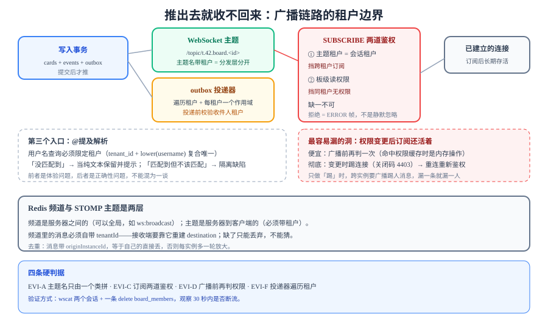

# 事件与推送隔离：广播不许串租户

写路径的事务保证了「三张表要么都成、要么都不成」，但**广播不在事务里**——它是提交之后的一次网络发送。本页处理这条链路上的租户边界：主题怎么命名、订阅怎么鉴权、投递器怎么取数，以及一个很容易被忽略的洞：**权限变更之后，已经建立的订阅还活着**。



::: tip 本页与第 1 周已有页面的分工
[事件表与顺序字段](../EventSequence/index.md)解决的是「断线重连后漏了哪几条」——顺序号、空洞与游标分页，落点在数据库。本页解决的是**广播**：一条已经写进库的事件，怎样在推送这一步不落到别的租户的连接上。前者管「写下来的是不是全」，后者管「推出去的是不是只该看见的人看见」。
:::

## 判据族声明

本页判据族 `EVI-A` ~ `EVI-H`，共 8 条。定义表在第七节。

## 一、三个广播入口，三种泄漏形态

| 入口 | 送达方式 | 泄漏形态 | 一旦泄漏 |
| --- | --- | --- | --- |
| **WebSocket 主题** | 服务端按 destination 广播给订阅者 | 主题名只含 `boardId`，知道 ID 就能订 | 实时看到别人板上的每一次改动 |
| **outbox 投递** | 轮询任务按行投递 | 投递器没按租户取数，用平台角色扫全表 | 通知发给错的人（电子邮件、站内信） |
| **@提及解析** | 解析 `@name` 时查用户 | 用户查询没限定租户 | 提及到了别的租户的同名用户 |

三者共用一条原则：**广播是「推」，推出去就收不回来**。数据库可以补一条 `where tenant_id`，推送发出去之后只能靠「客户端自己校验」——而客户端是不可信的。

::: danger 最容易被接受的错误设计
「主题名用 `board.{boardId}` 就够了，因为 `boardId` 是 UUID，别人猜不到。」
——这属于**用不可猜测性代替授权**。UUIDv7 的前 48 位是时间戳，同一天创建的看板 ID 前缀相同；更关键的是 `boardId` 会出现在 URL、日志、分享链接、错误信息里。猜不到 ≠ 无权访问。
:::

## 二、主题命名空间：租户必须在主题名里

```text
/topic/t.42.board.0192f3c1-...     # 正确：租户 + 资源
/topic/board.0192f3c1-...          # 错误：只有资源
```

为什么不是「鉴权时判一下就行」：Spring 的简单消息代理（`SimpleBroker`）按 destination 字符串做**字符串匹配**分发。主题名里没有租户时，两个租户的订阅者会落在**同一个 destination** 上；你可以在 `SUBSCRIBE` 时拒绝越权订阅，但只要有任何一条路径（例如客户端直接发 `SUBSCRIBE` 帧、或某个实例漏配了拦截器）绕过了判定，广播就会同时到达两边。**主题名里带租户，是在分发层就分开**，不依赖任何一处判定生效。

```java [src/main/java/com/example/team/ws/TopicNaming.java]
/** 主题名的唯一拼装点：任何地方拼主题都必须经过它。 */
public static String boardTopic(long tenantId, UUID boardId) {
    return "/topic/t." + tenantId + ".board." + boardId;
}

public static String userQueue(long tenantId, long userId) {
    return "/queue/t." + tenantId + ".user." + userId;
}
```

三条纪律：

1. **主题名只能由这一个类拼**。散落在各处的字符串拼接是最常见的漏点——某处写成 `"/topic/board." + id`，编译通过、测试也过（因为测试只有单租户）。
2. **用户队列也带租户**。`/user/queue/notify` 这种依赖 `Principal` 的写法看起来安全（代理会按 principal 路由），但**它要求握手时设置了 `Principal`**；一旦某个入口忘了设置，`Principal` 为 `null` 时行为依实现而定，最坏情况是**所有匿名连接收到同一条消息**。
3. **不要把租户做成「主题前缀层级」之外的东西**（例如放在消息体里让客户端过滤）——客户端的过滤是**体验优化**，不是隔离。

## 三、订阅鉴权：两道，不是一道

```java [src/main/java/com/example/team/ws/SubscriptionGuard.java]
@Component
public class SubscriptionGuard implements ChannelInterceptor {

    @Override
    public Message<?> preSend(Message<?> msg, MessageChannel ch) {
        var accessor = StompHeaderAccessor.wrap(msg);
        if (StompCommand.SUBSCRIBE.equals(accessor.getCommand())) {
            var dest = accessor.getDestination();               // /topic/t.42.board.<id>
            var parsed = TopicNaming.parse(dest);               // 解析出 tenantId 与 boardId
            var tenant = tenantOf(accessor.getSessionAttributes());

            // 第一道：主题里的租户必须等于会话的租户
            if (parsed.tenantId() != tenant.tenantId()) throw new AccessDeniedException("cross-tenant subscribe");

            // 第二道：这个人在这个板上必须有读权限（查库或查缓存）
            if (!permissionService.canRead(tenant.tenantId(), tenant.userId(), parsed.boardId())) {
                throw new AccessDeniedException("no board permission");
            }
        }
        return msg;
    }
}
```

第一道挡「跨租户订阅」，第二道挡「同租户但无权限」。**两道都要**：只做第一道时，同租户的访客能订阅他没被授权的板；只做第二道时，越权订阅会在权限查询里带上别人的 boardId（能不能查出来取决于实现，属于「靠下游兜底」）。

::: warning 第二道判据的时效性
订阅鉴权发生在 `SUBSCRIBE` 那一刻。之后成员被移出看板，**连接还开着，消息还在推**。两种处置：

- **便宜**：广播前再判一次（每个事件一次权限查询，命中缓存时是内存操作）；
- **彻底**：权限变更时主动断开该用户的连接（发送自定义关闭码 4403），客户端会用新 token 重连，重连时重新鉴权。

本项目两条都做：广播前判（正确性），变更时踢（及时性）。只做「变更时踢」的方案在跨实例部署下要额外广播踢人消息，漏一条就漏一个人。
:::

## 四、outbox 投递器：按租户取数，不用平台角色

[评论与通知](../Comments/index.md)一节已经定过 outbox 的写入。投递侧要补的是**取数范围**：

```java [src/main/java/com/example/team/outbox/OutboxRelay.java]
@Scheduled(fixedDelay = 1_000)
public void relay() {
    // ① 先取「有哪些租户有待投递任务」——只读 tenant_id，不读业务字段
    for (long tenantId : outboxRepo.distinctPendingTenants(50)) {
        // ② 每个租户单独开一个作用域，后续所有查询都被 RLS 限制在该租户
        TenantContext.runWith(TenantContext.Tenant.system(tenantId), () -> {
            var batch = outboxRepo.claimBatch(tenantId, 100);   // 带租户条件
            for (var row : batch) deliver(row);                 // ③ 投递时校验收件人同租户
        });
    }
}
```

三处判据：

| 位置 | 要求 | 违反后果 |
| --- | --- | --- |
| ① 取租户列表 | 只 `select distinct tenant_id`，不把整行捞出来 | 「先捞全表再按租户分组」在数据量大时直接把内存打满 |
| ② 作用域 | 每个租户一个作用域 | 一个作用域跑完全部租户 = 后面的租户用第一个租户的身份 |
| ③ 收件人 | 投递前校验 `recipient.tenantId == row.tenantId` | 数据被人工改过（或历史脏数据）时，通知发给别的租户 |

::: danger 投递器最容易写成「平台角色扫全表」
「反正是后台任务，用高权限账号跑更方便」——这样 outbox 里的 `tenant_id` 就失去了意义：投递器看到的是一张没有边界的表，任何一条脏数据（`tenant_id` 写错、收件人 id 属于别的租户）都会变成一次真实的跨租户通知。
正确形态是「**后台任务也用受限角色，靠遍历租户来获得全量能力**」。这条与[运维面守卫](../OpsGuard/index.md)的「能用受限角色就别用 bypass」是同一条纪律。
:::

## 五、跨实例广播：Redis 频道也是「主题名」

单实例时，`SimpMessagingTemplate` 直接在进程内分发。多实例时，需要把事件转发到其他实例：

```java [src/main/java/com/example/team/ws/RedisBroadcastBridge.java]
// 订阅：每个实例订阅同一个频道，收到后本地分发
@EventListener(ApplicationReadyEvent.class)
public void subscribe() {
    redis.listen("ws:broadcast", payload -> {
        var msg = decode(payload);                       // {tenantId, boardId, event}
        // 本地分发时重新拼主题——主题名由 TopicNaming 唯一生成
        messaging.convertAndSend(TopicNaming.boardTopic(msg.tenantId(), msg.boardId()), msg.event());
    });
}
```

| 检查项 | 要求 | 为什么 |
| --- | --- | --- |
| 频道名 | 可以是全局的（`ws:broadcast`） | 频道是**实例之间**的通道，不是用户可见的；租户隔离在 destination 层完成 |
| 消息体 | **必须带 `tenantId`** | 接收端要靠它拼 destination；缺了就只能丢弃 |
| 分发 | 只发给本实例持有的会话 | 不做二次广播，否则每多一个实例就多一轮放大 |
| 来源去重 | 消息带 `originInstanceId`，等于自己的直接丢 | 避免「自己发的又被自己收一次」造成重复推送 |

::: tip 通道与主题是两层
很多人把「Redis 频道」和「STOMP 主题」混为一谈。它们的隔离要求不同：**频道是服务器之间的，主题是服务器到客户端的**。频道可以全局，但**频道里的消息必须自带租户**，因为接收端要用它重建客户端可见的 destination。
:::

## 六、@提及：用户查询必须限定租户

`@` 提及的解析发生在**评论写入时**，它要做一次「用户名 → 用户」的查询。这条查询如果只按用户名查，跨租户的同名用户会被提及：

```sql
-- 正确：用户名在租户内唯一
select id from users
where tenant_id = current_setting('app.tenant_id')::bigint
  and lower(username) = lower($1);
```

前提是唯一约束也是租户内的：`unique (tenant_id, lower(username))`。如果唯一约束是全局的（`unique (lower(username))`），那么「A 租户已经有人叫 alice」会导致 B 租户不能再用这个名字——这是另一个方向的错误，但同样源于「唯一性范围」没定清楚。

::: warning 提及失败要静默还是报错
用户名不存在时，**不要**报错让评论失败（用户写错一个字就发不出评论，体验很差）；正确做法是把 `@foo` 当作纯文本保留，并在响应里返回「未匹配到的提及」列表，让前端提示。
但**跨租户同名**不能走这条路径：那是「匹配到了但不该匹配」，属于隔离缺陷，必须由 SQL 条件挡住，而不是靠「匹配不到就忽略」。
:::

## 七、判据表

| 编号 | 判据 | 怎么验证 | 本机读数 |
| --- | --- | --- | --- |
| `EVI-A` | 主题名含租户段，且只由一个类拼装 | `grep -rn "/topic/" src/` 只在 `TopicNaming` 里出现 | 待跑（无工程） |
| `EVI-B` | 用户队列 destination 也含租户段 | `grep -rn "/queue/" src/` 每条含 `t.` | 待跑（无工程） |
| `EVI-C` | `SUBSCRIBE` 有两道鉴权（租户 + 板权限） | 越权订阅返回 `ERROR` 帧且连接未断开 | 待跑（无工程） |
| `EVI-D` | 广播前再判一次读权限 | 移出成员后，仍在线的连接 30 秒内不再收到该板事件 | 待跑（无工程） |
| `EVI-E` | 权限变更会主动断开（关闭码 4403） | 移出成员时，客户端收到 `4403` 并触发重连 | 待跑（无工程） |
| `EVI-F` | 投递器按租户遍历，每租户一个作用域 | `grep -rn "distinctPendingTenants" src/` 命中；循环体在 `runWith` 内 | 待跑（无工程） |
| `EVI-G` | 投递前校验收件人租户 | 构造一条 `tenant_id` 与收件人不一致的 outbox 行，期望被拒并告警 | 待跑（无工程） |
| `EVI-H` | 提及查询限定租户，唯一约束也是租户内 | `\d users` 输出含 `unique (tenant_id, lower(username))` | 待跑（无工程） |

## 八、当日做了什么

1. **把广播拆成三个入口**（WebSocket 主题、outbox 投递、@提及解析），逐个写清泄漏形态与「一旦泄漏的后果」，并点明广播是「推出去收不回来」的。
2. **驳掉「UUID 猜不到所以安全」**：UUIDv7 前 48 位是时间戳，且 `boardId` 会出现在 URL、日志、分享链接里——不可猜测性不能代替授权。
3. **定死主题命名 `t.{tenantId}.board.{boardId}`**，并说明为什么不能只靠「订阅时判一下」：简单消息代理按 destination 字符串分发，主题名里没有租户就意味着**两个租户共用同一个 destination**。
4. **给出主题拼装的唯一入口类**，附三条纪律（只由一个类拼、用户队列也带租户、不靠客户端过滤）。
5. **订阅鉴权写成两道**（主题租户 = 会话租户；板级读权限），并指出只做一道时各自漏什么。
6. **补「订阅时效性」这个洞**：订阅鉴权只在 `SUBSCRIBE` 时发生，成员被移出后连接仍活着。给出两条处置（广播前再判 + 变更时踢），并说明为什么两条都做。
7. **把 outbox 投递器改成「遍历租户 + 每租户一个作用域 + 投递前校验收件人」**，并点出「后台任务也用受限角色」这条与运维面一致的纪律。
8. **讲清 Redis 频道与 STOMP 主题是两层**：频道可以全局，但消息必须自带租户，因为接收端要用它重建 destination。
9. **把 @提及 的隔离落到 SQL 与唯一约束**，并区分「没匹配到」（忽略并提示）与「匹配到但不该匹配」（必须由条件挡住）。
10. **定稿 `EVI-A~EVI-H` 八条判据。**

## 九、如何验证

两条终端 + 一条 `wscat`：

```shell
# 1) 越权订阅：用 A 的 token 订阅 B 的板，期望 ERROR 帧 / 连接被拒
wscat -c "ws://localhost:8080/ws?token=$TOKEN_A" \
  -x 'SUBSCRIBE\nid:sub-0\ndestination:/topic/t.43.board.'"$BOARD_OF_B"'\n\n'

# 2) 正常订阅：A 订阅自己的板，然后在另一个终端拖动该板上的卡片
wscat -c "ws://localhost:8080/ws?token=$TOKEN_A" \
  -x 'SUBSCRIBE\nid:sub-1\ndestination:/topic/t.42.board.'"$BOARD_OF_A"'\n\n'
# 期望：收到 {"type":"card.moved","seq":N,...}

# 3) 时效性：把 A 移出该板，再拖动一次
psql "$DATABASE_URL_TEST" -c \
  "delete from board_members where board_id = '$BOARD_OF_A' and user_id = $USER_A"
# 期望：30 秒内不再收到该板事件；连接收到关闭码 4403
```

判读：第 1 步若订阅成功，说明主题名里没有租户段或鉴权拦截器没挂上；第 3 步若仍在收包，说明只有「订阅时判一次」而没有「广播前再判」，这是最常见的一种「看起来做了鉴权」。

## 十、下一步

- 推送用的权限缓存命中的是[缓存隔离](../CacheIsolation/index.md)那套 key，权限 key 失效漏了会导致「已经被移出的人还能收 30 秒」。
- 投递器用的受限角色与平台角色的边界，见[运维面守卫](../OpsGuard/index.md)第三节。
- 实时链路的完整时序（`seq` 分配、断线追平）在[实时网关](../RealtimeGateway/index.md)；本页只管「谁能收到」。
- 第 1 周全部收口：[第 1 周验收](../Week1Acceptance/index.md)。

## 参考资料

- [Spring Framework · WebSocket STOMP](https://docs.spring.io/spring-framework/reference/web/websocket/stomp.html)——`ChannelInterceptor` 与 destination 的分发语义。
- [RFC 6455 · The WebSocket Protocol](https://www.rfc-editor.org/rfc/rfc6455)——关闭码取值范围（4000~4999 为应用私有）。
- 项目内：[实时网关](../RealtimeGateway/index.md) · [评论与通知](../Comments/index.md) · [拖动写入路径](../DragWritePath/index.md)
- 技术专题：[实时协作与冲突解决](/docs/Backend/RealtimeCollaboration/index.md) · [分布式缓存](/docs/Backend/DistributedCache/index.md)
