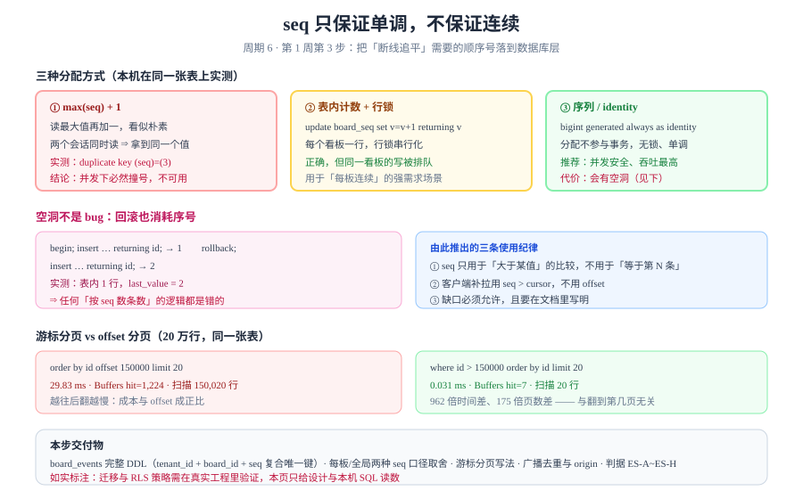

# 事件表与顺序字段：把「断线追平」落到数据库

第 1 周前两步解决了「谁能看见哪些行」（多租户隔离）与「按租户过滤怎么走索引」（索引前缀）。这一步解决第三个问题：**客户端断线重连后，怎么知道「我漏了哪几条」**。答案只有一个——每条事件必须有一个**单调递增的顺序号**，客户端记住自己看到的最后一个号，重连时只要 `seq > 上次的号`。



## 判据族声明

本页判据族 `ES-A` ~ `ES-H`，共 8 条。定义表在第九节。

## 一、为什么这件事必须在第 1 周定下来

顺序号看起来是个小字段，但它同时被四处依赖，改一次要动四个地方：

| 依赖方 | 用法 | 改口径的代价 |
| --- | --- | --- |
| **实时网关** | 广播时带上 `seq`，客户端按序应用 | 客户端要改解析与去重逻辑 |
| **断线追平** | `GET /events?after=<seq>` 补拉 | 补拉接口契约变更 |
| **审计与排查** | 「这次改动是第几号事件」 | 历史数据的号无法重排 |
| **幂等** | 同一个 `event_id` 重复投递时按 `seq` 去重 | 去重键口径变化 |

::: tip 一句话结论
**`seq` 只能保证「单调递增」，不能保证「连续无空洞」。** 任何把它当「第 N 条」用的设计，都会在第一次回滚或第一次并发之后出错。
:::

## 二、三种分配方式，两个实测

### 方式 ①：`max(seq) + 1`——不可用

看起来最直观：读当前最大值，加一，插入。

**本机实测（两个并发会话，PostgreSQL 18.6）**：

```sql
-- 会话 A（先睡 2 秒再插入，模拟业务处理耗时）
begin;
select pg_sleep(2);
insert into seq_demo (seq, payload) select coalesce(max(seq),0)+1, 'A' from seq_demo;
commit;

-- 会话 B（同时开始，先插入再睡 4 秒，让 A 在它提交前读到同一个 max）
begin;
insert into seq_demo (seq, payload) select coalesce(max(seq),0)+1, 'B' from seq_demo;
select pg_sleep(4);
commit;
```

```text
会话 A：ERROR:  duplicate key value violates unique constraint "seq_demo_pkey"
        DETAIL:  Key (seq)=(3) already exists.
        ROLLBACK
会话 B：COMMIT

最终表内容：1:seed  2:seed  3:B
```

**A 撞号了。** 两个事务各自读到 `max=2`，都算出 3，先提交的赢，后提交的报唯一键冲突。

::: danger 为什么加锁也治不好
给 `select max(seq)` 加 `for update` 也无效——**聚合查询没有行可锁**。正确做法是改成「锁一行计数器」（方式 ②），或者干脆不用「读-算-写」这个模式（方式 ③）。
:::

### 方式 ②：表内计数器 + 行锁——正确但有代价

```sql
create table board_seq (board_id uuid primary key, last_seq bigint not null default 0);
-- 分配：一行一个看板，行锁天然串行化
update board_seq set last_seq = last_seq + 1 where board_id = $1 returning last_seq;
```

| 优点 | 代价 |
| --- | --- |
| 同一看板内**严格连续**，无空洞 | 同一看板的并发写被**串行化**（行锁排队） |
| 可以按看板重置、可以「第 N 条」定位 | 跨看板无法全局排序；热点看板成瓶颈 |

适用：确实需要「板内第 N 条」语义的场景（例如「跳到第 500 条评论」）。协作看板不需要这种语义，所以本项目不选它。

### 方式 ③：序列 / identity——本项目选择

```sql
seq bigint generated always as identity
```

序列的分配**不参与事务**：`nextval` 一旦取走就永不回退。带来两个性质：

| 性质 | 后果 |
| --- | --- |
| **并发安全**：分配无锁、单调 | 写入吞吐不被顺序号拖累 |
| **允许空洞**：回滚也消耗序号 | 号不连续 |

**本机实测空洞**：

```sql
begin;
insert into ev_demo (board_id) values (1) returning id;   -- 得到 1
rollback;
insert into ev_demo (board_id) values (1) returning id;   -- 得到 2
select last_value from ev_demo_id_seq;                    -- 2
select count(*) from ev_demo;                             -- 1
```

```text
 id  → 1（随后 ROLLBACK）
 id  → 2
 last_value = 2 ｜ 表内行数 = 1
```

**表里 1 行，序列已经走到 2。** 这就是空洞的来源，而且它是**正常且必要**的：如果序列要等事务提交才推进，那它就得加锁，吞吐立刻掉下来。

::: warning 空洞的三种来源，每一种都不是 bug
1. **事务回滚**（如上）；
2. **`nextval` 预取后连接断开**（会话级缓存）；
3. **批量插入失败后重试**（每批都消耗号）。

任何「按 `seq` 数条数」「用 `seq` 当连续编号展示」的设计都会在这三种情况下出错。
:::

## 三、全局单调还是每板单调

| 方案 | 实现 | 优点 | 缺点 |
| --- | --- | --- | --- |
| **全局单调**（本项目） | 一张表一个 identity 列 | 无锁、跨板也可排序、审计友好 | 板内不连续（跨板空洞） |
| **每板单调** | `board_seq` 计数器 + 行锁 | 板内连续 | 同板写排队；跨板不可比 |

**选择全局单调的理由**：客户端的用途只有「`seq > cursor` 补拉」，它在**板内比较**。全局单调 ⇒ 板内必然单调，需求满足；而「板内连续」这个额外性质没有任何使用方，不值得为它付行锁的代价。

::: tip 这条取舍可以复用
凡是「顺序号」的设计，先问一句：**使用方需要的是「单调」还是「连续」？** 要单调 → 序列；要连续 → 行锁计数器 + 接受串行化。**把两者混为一谈，是最常见的顺序号设计错误。**
:::

## 四、`board_events` 的完整 DDL

```sql [db/migration/V5__board_events.sql]
-- 事件表：实时通道与断线追平的唯一数据源
create table board_events (
  seq        bigint generated always as identity primary key,
  event_id   uuid        not null default uuidv7(),
  tenant_id  uuid        not null,
  board_id   uuid        not null,
  card_id    uuid,
  type       text        not null,
  actor_id   uuid        not null,
  payload    jsonb       not null,
  created_at timestamptz not null default now(),

  constraint board_events_type_ck
    check (type in ('card.created', 'card.moved', 'card.commented', 'list.created')),
  -- 单条事件不允许超过一页，避免一条事件把 8 KB 页塞爆
  constraint board_events_payload_size_ck
    check (pg_column_size(payload) <= 8192),
  -- 同租户内 seq 唯一：为 RLS 与按租户扫描提供第二重定位
  constraint board_events_tenant_seq_uk unique (tenant_id, seq),
  constraint board_events_event_id_uk unique (event_id)
);

-- 游标分页的唯一索引：等值（tenant_id, board_id）+ 范围（seq）
create index board_events_cursor_idx
  on board_events (tenant_id, board_id, seq);

-- 按卡片回溯时间线（可选）
create index board_events_card_idx
  on board_events (tenant_id, card_id, seq desc)
  where card_id is not null;
```

四条设计决定的理由：

| 决定 | 理由 | 定错了会怎样 |
| --- | --- | --- |
| `seq` 作**主键** | 单调插入 ⇒ B+ 树只在最右页分裂 ⇒ 页填充率高、索引小（对应[B+ 树](/docs/DB/DatabaseInternals/BPlusTree/index.md)里 `uuidv7()` 的同一结论） | 用随机 UUID 作主键 ⇒ 页利用率降到 50%～70% |
| `(tenant_id, board_id, seq)` **复合索引** | 游标查询是「等值 + 范围」，列序必须是「等值列在前」 | 列序写反（`seq` 在前）⇒ 范围条件先吃掉索引，等值过滤退化为 `Filter` |
| `payload` **限 8 KB** | 超过一页的 `jsonb` 会走 TOAST，读一条事件要多读一个 TOAST 页 | 大 payload ⇒ 广播链路读放大翻倍 |
| `unique (tenant_id, seq)` | RLS 策略按 `tenant_id` 过滤，需要能走索引；也防止跨租户 seq 混淆 | 缺这条 ⇒ 越权查询退化为全表扫 |

::: warning `uuidv7()` 需要 PG 18
`event_id` 的默认值用了 `uuidv7()`。PG 17 及以前没有这个函数，需要改 `gen_random_uuid()`（v4）或应用侧生成。**版本差异必须写在迁移脚本注释里**，否则在旧版本上执行会直接报 `function uuidv7() does not exist`。
:::

## 五、游标分页：与 `offset` 的实测对照

补拉接口的唯一正确写法是**游标**，不是 `offset`：

```sql
-- ✅ 游标：从「上次看到的最后一个 seq」往后取
select seq, type, payload from board_events
where tenant_id = $1 and board_id = $2 and seq > $3
order by seq limit 100;

-- ❌ offset：翻到第 N 页，成本随 N 线性增长
select seq, type, payload from board_events
where tenant_id = $1 and board_id = $2
order by seq offset 150000 limit 20;
```

**本机实测（20 万行，同一张表）**：

| 写法 | 执行时间 | 缓冲页 | 实际扫描行数 |
| --- | --- | --- | --- |
| `order by id offset 150000 limit 20` | **29.83 ms** | **1,224** | **150,020** |
| `where id > 150000 order by id limit 20` | **0.031 ms** | **7** | **20** |

**962 倍时间差、175 倍页数差**，而且这个差距**与翻到第几页无关**——游标分页的成本恒定。

::: danger `offset` 在实时流上是双重错误
1. **性能**：如上，越翻越慢；
2. **正确性**：`offset` 是「跳过前 N 条」，而实时流**随时在插入新事件**。翻页过程中新事件插入会把后面的行整体推后，导致**漏读或重复读**。

游标（`seq > last`）不受插入影响——新插入的 seq 一定比 `last` 大，会被下一页读到，不会挤掉任何已有行。
:::

## 六、广播去重：`origin` 与 `seq`

多实例部署时，事件要通过 Redis 发布订阅广播到所有实例，再由各实例推给自己持有的连接。这里有一个必然的重复：

```text
实例 A 处理写请求 → 落库 → 发布到频道
                    ↓
实例 A 自己也订阅了这个频道 → 收到自己发的消息 → 又要推一遍
```

**处置方式是用 `origin` 标记来源实例，收到自己的消息就跳过。** 但注意：

| 层 | 去重依据 | 说明 |
| --- | --- | --- |
| 实例层 | `origin == self` | 避免自己推自己 |
| 客户端层 | `seq` 单调 + `event_id` 幂等 | 网络重发、重连补拉都可能重复 |
| 数据库层 | `event_id` 唯一约束 | 写侧兜底 |

::: tip 三层去重都要有
只在实例层去重，客户端重连补拉时仍可能收到重复事件；只在客户端去重，服务端会白推一遍流量。**`seq` 的单调性是客户端去重的前提**——客户端只要记住「已应用的最大 seq」，任何 `seq <= 已应用` 的事件直接丢弃即可。
:::

## 七、五个高频坑

| 坑 | 现象 | 根因 | 正确写法 |
| --- | --- | --- | --- |
| 用 `max+1` 生成顺序号 | 并发下唯一键冲突 | 读-算-写不是原子操作 | 用 identity / 序列 |
| 把 `seq` 当连续编号展示 | 号跳了，用户以为丢数据 | 回滚、重试都会消耗号 | 展示用「第 N 条」另算，`seq` 只用于比较 |
| 用 `offset` 做补拉 | 越翻越慢，且会漏读 | 成本线性 + 插入导致位移 | `seq > cursor` |
| 索引列序写成 `(seq, board_id)` | 游标查询走全表扫 | 范围列在前，等值列无法定位 | 等值列在前：`(tenant_id, board_id, seq)` |
| 一条事件塞超大 payload | 读一条事件多读一个 TOAST 页 | 超过页容量触发 TOAST | 限 8 KB，附件走对象存储 |

## 八、当日做了什么

1. **定下顺序号口径**：全局单调 `identity`，放弃「板内连续」——理由与代价写进第三节，并给出「先问要单调还是要连续」这条可复用判据。
2. **跑通两个反例实测**：`max+1` 并发撞号（`duplicate key (seq)=(3)`）、序列空洞（表内 1 行、`last_value=2`）。**两条都是本机真实输出，不是推演。**
3. **落出 `board_events` 完整 DDL**：约束四条（类型、payload 大小、租户内 seq 唯一、event_id 唯一）、索引三条（游标、卡片时间线、主键）。
4. **量化游标 vs offset**：20 万行上 29.83 ms / 1,224 页 对 0.031 ms / 7 页。
5. **定下三层去重**：实例层 `origin`、客户端层 `seq`、数据库层 `event_id` 唯一约束。
6. **配图**：`tb-event-sequence.svg`（三种分配方式 + 空洞 + 分页对照）。

## 九、判据表

| 编号 | 约定 | 定错了会怎样 | 怎么验证没被破坏 |
| --- | --- | --- | --- |
| `ES-A` | 顺序号必须由序列 / identity 分配，禁止「读最大值再加一」 | 并发下唯一键冲突，写入随机失败 | 迁移脚本里没有 `max(seq)` 参与 INSERT；并发压测无唯一键冲突 |
| `ES-B` | 必须明确「要单调还是要连续」，并写进文档 | 用错方案：要么白付行锁代价，要么满足不了需求 | 设计文档里有该二选一的结论与理由 |
| `ES-C` | 补拉接口必须用游标（`seq > last`），禁止 `offset` | 越翻越慢，且实时流上会漏读/重读 | 接口契约里没有 `offset` 参数；压测翻到深页 P99 不上升 |
| `ES-D` | 游标索引的列序必须是「等值列 → 范围列」 | 索引失效，补拉退化为全表扫 | `EXPLAIN` 里出现 `Index Cond` 而非 `Filter` |
| `ES-E` | 任何逻辑不得假设 `seq` 连续 | 号跳了以后误报「数据丢失」 | 全仓搜索 `seq` 的用法，没有 `count`/`=` 连续编号的用法 |
| `ES-F` | 单条事件 payload 必须限容（≤ 一页） | 读一条事件多读一个 TOAST 页 | DDL 里有 `pg_column_size` 检查约束 |
| `ES-G` | 去重必须三层齐全（origin / seq / event_id） | 重复事件被应用两次，界面出现重影 | 三层各自的判据在网关与客户端都有测试用例 |
| `ES-H` | 版本相关函数（如 `uuidv7()`）必须在迁移注释里标版本 | 在旧版本库上执行直接报错 | 迁移脚本含版本注记；PG 17 有替代写法说明 |

## 十、如何验证

以下四条命令全部在本机 PostgreSQL 18.6 上跑过，可直接复现：

```sql
-- ① 并发撞号反例（需要一个第二会话同时执行同样的插入）
create table seq_demo (seq int primary key, payload text not null);
insert into seq_demo values (1,'seed'),(2,'seed');
-- 两个会话各执行：
insert into seq_demo (seq, payload) select coalesce(max(seq),0)+1, 'x' from seq_demo;
-- 预期：其中一个得到 ERROR: duplicate key value violates unique constraint

-- ② 序列空洞（证明「seq 不连续」是设计而非缺陷）
create table ev_demo (id bigserial primary key, board_id int not null);
begin;
insert into ev_demo (board_id) values (1) returning id;   -- 1
rollback;
insert into ev_demo (board_id) values (1) returning id;   -- 2
select last_value from ev_demo_id_seq;                    -- 2
select count(*) from ev_demo;                             -- 1

-- ③ 游标 vs offset（先灌 20 万行）
explain (analyze, buffers)
select * from ev_demo where board_id=1 order by id offset 150000 limit 20;
explain (analyze, buffers)
select * from ev_demo where board_id=1 and id > 150000 order by id limit 20;

-- ④ 索引列序是否合用（应出现 Index Cond）
explain (analyze, buffers)
select * from board_events where tenant_id = $1 and board_id = $2 and seq > 0 order by seq limit 100;
```

**预期输出**：① 其中一个会话报 `duplicate key ... Key (seq)=(3) already exists`；② `last_value = 2` 而表内只有 **1** 行；③ offset 版约 **29.8 ms / 1,224 页**，游标版约 **0.03 ms / 7 页**；④ `Index Cond: ((tenant_id = ...) AND (board_id = ...) AND (seq > ...))`。

::: warning 本页的边界
本页的 SQL 在**一次性实验库**里执行（不是 TeamBoard 的真实工程）。因此：① 迁移脚本本身**没有在应用工程里跑过**；② RLS 策略与本表叠加后的表现**未验证**（第 151 天的 `FORCE RLS` 与本表的 `unique (tenant_id, seq)` 需要一起回归）；③ 真实广播链路的重复率需要联调期实测。三项都登记为遗留，**不写成「已完成」**。
:::

## 十一、下一步

第 154 天（周期 6 第 1 周第 4 步）继续第 1 周的数据面：**把 `board_events` 接进「卡片拖动」的写入路径**——一次拖动要在一个事务里同时写 `cards`（乐观锁 + 分数排序键）、`board_events`（顺序号）与 `outbox`（通知），并给出「三张表要么都成、要么都不成」的验证 SQL。重点是把第 140 天 `CardMove` 的那套判据与本步的 `seq` 口径对齐，避免出现「事件写了但卡片没动」或反之。

## 参考资料

- [PostgreSQL 18 · Sequence Functions](https://www.postgresql.org/docs/18/functions-sequence.html)——`nextval` 不参与事务、允许空洞的官方说明
- [PostgreSQL 18 · Identity Columns](https://www.postgresql.org/docs/18/ddl-identity-columns.html)——`generated always as identity` 与 `serial` 的差异
- [PostgreSQL 18 · CREATE INDEX](https://www.postgresql.org/docs/18/sql-createindex.html)——多列索引列序与等值/范围条件的匹配
- [PostgreSQL 18 · LIMIT and OFFSET](https://www.postgresql.org/docs/18/queries-limit.html)——官方对 `OFFSET` 成本与「用游标替代」的提示
- [项目内相邻章节](../TenantIndexing/index.md)——索引前缀与 `(tenant_id, ...)` 列序的同一条纪律
