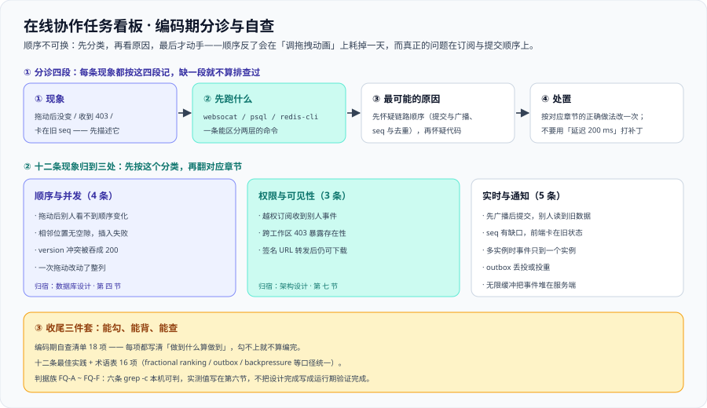

# 常见问题与最佳实践：编码期分诊与自查

这一页是本项目的收口。前面十二个章节讲「怎么设计、怎么编码」，这一页只回答一个问题：**当现象摆在面前、但你不知道它属于哪一层时，先做什么。** 顺序固定不可换——**先分诊（第一节）、再问答（第二节）、再自查（第三节）**，最后用最佳实践、术语表与可跑的验证收尾（第四~六节）。本页判据族统一编号为 **`FQ-A ~ FQ-F`**（六条 `grep -c`，本机可判），与 `TB-A ~ TB-H` 不重叠、只引用不复述。



::: tip 一句话理解
协作系统里绝大多数「玄学」，本质是**顺序错了**：先怀疑「先广播后提交」，再怀疑「权限漏了第三处」，最后才怀疑业务代码。顺序反了，你会在「调拖拽动画」上耗掉一天，最后发现是**订阅没鉴权**。
:::

## 一、现象分诊表：十二条

按「**现象 → 先跑什么 → 最可能的原因 → 处置**」四段走一圈，能省掉一半排查时间。**先按这张表分类，再去翻对应章节**，不要一上来就读代码、更不要一上来就加日志重跑。

| 现象 | 先跑什么 | 最可能的原因 | 处置 |
| --- | --- | --- | --- |
| 拖动后自己的顺序对了，**别人屏幕上没变**，刷新一下才出现 | `websocat -t "ws://localhost:8080/ws?token=$TOKEN"` 订阅看板，另一个终端改一张卡片，看有没有 `card.moved` | **先广播后提交**：别人收到事件时事务还没提交，立刻拉详情拉到的是旧数据；或广播本身没发出去 | 广播调用挪到**事务提交之后**（[架构设计](../Architecture/index.md) 第 ⑩ 步）；广播失败不修数据，只靠客户端 `since=seq` 补拉兜底 |
| 两个人的顺序**互相不一致**，其中一个人的改动被另一个人覆盖 | `curl -s -o /dev/null -w '%{http_code}'` 用过期 `version` 发一次 move，看是不是 `409` | 乐观锁没生效（请求没带 `version`），或客户端拿的一直是过期的 `version` | 请求必须带 `version`；冲突返回 `409` 且响应体带上**最新 `version` 与最新位置**，客户端据此回滚乐观更新 |
| 越权订阅能收到别人工作区的事件（没有任何报错） | `websocat` 用工作区 A 的令牌订阅工作区 B 的看板，看是否收到消息 | 握手校验了身份，**忘了校验订阅的看板是否属于该用户的工作区** | 订阅时补 `require_member(workspaceId, userId)`，未授权返回 **`403`** 而不是静默不推（[架构设计](../Architecture/index.md) 第七节） |
| 拖到某两张卡片之间**插入失败**（`409` 或 `400`） | `psql -c "SELECT list_id, position FROM cards ORDER BY list_id, position"` 看相邻两键 | 相邻顺序键之间**已经没有空隙**可插中间值 | 对该列做一次**重排压缩**（在一个事务里），并占用一个新 `seq` 广播 `list.reordered`，否则客户端手里的旧键会对不上 |
| `version` 冲突被**吞成 `200`**，界面先回弹一下又变了 | `curl -i` 用过期 `version` 重发一次 move，看状态码与响应体 | 冲突被 catch 后当成「成功」写回，或响应里只写了 `{"ok":true}` | 冲突必须翻译成 `409` + 可读原因 + 最新版本与位置；`200` 只用于真正做成的那一次 |
| 评论发成功了但**通知丢了**；或者同一条评论**收到两条通知** | `psql -c "SELECT count(*) FROM notifications_outbox WHERE delivered_at IS NULL"` 看有没有未投递行 | 没走 outbox（事务外直接发通知），或投递没有按 `dedup_key` 去重 | 通知在**业务事务内**写 `notifications_outbox`；投递是至少一次语义 + `dedup_key` 唯一去重 |
| 前端**卡在旧状态**：收到 `seq=108`，而本地最大只到 `105` | `grep -rn resync_required web/src` 看客户端有没有处理缺口与整体刷新 | 事件被丢（连接队列超限）**且没有人检测缺口** | 客户端发现 `seq` 跳号时主动带 `since=105` 补拉 106~108；服务端丢事件时下发 `resync_required` |
| 两个实例（或两个投递 job）时，**消息只到一个实例** | `redis-cli PUBSUB CHANNELS 'board:*'` 看频道里到底有没有消息 | 每个实例各订阅了自己的频道，或「往本机连接直接写」而没有经过广播 | 统一走 `board:{boardId}` 一个频道，订阅它的实例各自推本机连接；本机没有连接也不算失败 |
| 跨工作区请求返回 **`403`**，等于告诉对方「这个资源存在」 | `curl -s -o /dev/null -w '%{http_code}'` 用 A 的令牌读 B 的看板 | 权限判定把「不是成员」和「是成员但角色不允许」混成了一种结果 | 跨工作区一律 **`404`**；`403` 只保留给「是成员但角色不允许」这一种情形（[验收](../Acceptance/index.md) 第三节） |
| 附件签名 URL 被转发给非成员后仍然能下载 | `curl -I` 把上一次拿到的签名 URL 复制到无痕窗口访问 | 签名有效期过长，或签名时**没有重新判一次**成员关系 | 只发**短时效**签名 URL，且每次签名都重新判定读取权限（[架构设计](../Architecture/index.md) 第七节第三处判定点） |
| 一次拖动把**整列都改了**（顺序对，但很慢、并发互相覆盖） | `psql -c "SELECT count(*) FROM cards WHERE xmin::text::bigint > $TXID"` 对比拖动前后的行数 | 顺序字段用了**整数 `position`** 并做全列后移 | 换成字符串**分数排序键**，一次拖动只写一行；「只更新一行」要当成可测的不变量 |
| 客户端被限流后**内存一直涨**，最后把服务端拖死 | `redis-cli INFO clients` 与客户端 `resync_required` 计数一起看 | 出口做了**无限缓冲**，慢客户端把事件堆在服务端内存里 | 每连接发送队列设上限，超限**丢事件并标记 `resync_required`**；丢一条 + 补拉，代价远小于拖死一个进程 |

::: warning 分诊表的前提
这张表能用的前提是**你手上有能区分的数据**。至少要能回答三个问题：① 事件的 `seq` 与本地最大 `seq` 差多少（按看板看）；② 请求的状态码到底是 `200` / `403` / `404` / `409` 哪一个；③ 广播频道里**到底有没有消息**。三个都答不上来时，第一件事不是改代码，是**先把观测点加上**——本项目第八个失败模式里的五个，就是「用户看不到、必须先有指标」的那一类。
:::

## 二、高频十二问

每问先给结论，再给理由。**结论可以直接当评审口径用。**

### Q1：为什么用分数排序键，而不是整数 `position`？

**结论：因为拖动是「重排」，整数 `position` 的重排代价是 O(列长度)。**

把卡片插到第 2 位，整数写法必须 `UPDATE cards SET position = position + 1 WHERE list_id = ... AND position >= 2` —— 一行拖动变成全列更新，且并发拖动之间互相覆盖（顺序最终对、中间状态乱）。列里有 1000 张卡片时，一次拖动产生 1000 次行更新。

分数排序键把顺序表示成**可比较的字符串**（lexicographic rank），相邻两键之间永远算得出一个「夹在中间」的新值，**一次拖动只写一行**：

```text [在 "0|hzzzzz:" 与 "0|i00000:" 之间插入]
前一张：0|hzzzzz:
后一张：0|i00000:
新卡片：0|hzzzzz:V      ← 只在末位追加，其余行一个字都不用动
```

代价要如实写出来：键长会随插入次数缓慢增长，极端情况下相邻两键之间**无空隙可插**——这时对该列做一次重排压缩，并广播 `list.reordered`（见 [数据库设计](../Database/index.md) 第四节）。

### Q2：为什么不用 SSE，而用 WebSocket？

**结论：因为本项目需要「按看板订阅 + 服务端掌握订阅关系」，SSE 是单向的、订阅关系不落服务端。**

三个具体理由：① 订阅鉴权是**本项目三处权限判定点之一**，需要服务端在「订阅某块看板」这个动作上判一次成员关系——SSE 只有一条流，客户端订阅什么服务端并不掌握；② 客户端要回传心跳、订阅变更与补拉游标；③ 多实例广播时，服务端要按连接分发事件，而不是给每个浏览器方向写。

代价也很明确：**心跳、指数退避重连、背压都要自己实现**，这些正是 [架构设计](../Architecture/index.md) 第四节与本节 Q9 / Q10 的纪律来源。

### Q3：为什么用乐观锁，而不是悲观锁？

**结论：因为看板冲突率低、而悲观锁的串行化代价高。**

拖动读当前卡片时用 `SELECT ... FOR UPDATE` 锁**那一行**是允许的（也需要）；要避免的是「为了不冲突而把整列甚至整个看板串行化」——任何一次慢请求都会阻塞整列。乐观锁把冲突变成**一次可解释的失败**（`409` + 最新版本与位置），客户端据此刷新而不是盲目重试。

::: danger 两处一定会踩的坑
1. **把乐观锁做成悲观锁**：给卡片加长事务锁并持有到响应结束，单个看板的拖动被串行化，且慢请求阻塞整列。正确做法是**只锁被拖动的那一张卡片所在的那一行**。
2. **幂等键与乐观锁混为一谈**：幂等键解决「同一次操作重发两次」（网络重试），乐观锁解决「两个人改同一张卡片」（业务冲突）。两者都要，缺一不可。
:::

### Q4：为什么拖动的广播必须后于提交，不能合并？

**结论：因为「先广播后提交」会产生一类最难查的缺陷——别人界面比广播更旧，而库里最终正确。**

另外两个客户端收到事件后立刻拉详情，却因为事务尚未提交而拉到旧数据；现象是「刷新一下就对了」，因此极难复现。补救措施（收到事件后延迟 200 ms 再拉）是把 bug 变成小概率事件的**补丁**，不是修复。

正确做法只有一种：**事务提交之后再广播**。广播失败**不影响正确性**，只影响实时性——数据已落库，客户端靠 `since=seq` 补拉兜底。

### Q5：`Idempotency-Key` 到底解决什么？

**结论：只解决「同一次操作被重发两次」，不解决「两个人改同一张卡片」。**

它拦的是三类必然发生的重发：网络层重试、用户连点、客户端重试队列。落地口径三条：① 主键是 `(scope, client_op_id)`，命中则**直接返回上次响应**；② 键**随请求不变**——重试时 `client_op_id` 不许换；③ 只保留 24~48 小时，到期清理（留着不删，它会变成比业务表还大的表）。

```text [幂等键的判据：同一个 client_op_id 连发两次]
第一次：200，该看板 seq 由 107 → 108
第二次：200（返回上次响应体），该看板 seq 仍然停在 108   ← 不变，才算幂等
```

### Q6：评论要不要做无限层级？

**结论：不做。** 本期是「卡片下的扁平时间序评论 + `@` 提及」。

理由：无限层级会同时把三条规则复杂化——「通知发给谁」（父评论作者？所有祖先？）、「未读怎么算」、「删除父评论时子评论怎么办」。而这三条规则每一条都要写进验收判据。层级需求用 **`@` 提及 + 引用**表达即可。这类判断必须写在 [需求拆分](../Requirements/index.md) 第六节的「范围外四项」里，而不是留到评审时口头确认。

### Q7：未读计数用计数列，还是每次实时查？

**结论：本期两样都不加，用「已读游标」推导；将来要做红点，也优先加游标列而不是计数列。**

理由：① 实时 `count(*)` 在每次打开看板时扫一遍通知表，而且口径（哪些算未读）会散落在多个查询里；② 计数列必须与通知写入**同事务**维护，还要求在撤回 / 回滚 / 删除时减回去——它是典型的**派生值**，一旦漏减就会长期漂移且没人发现。

游标口径天然幂等：未读数 = 该作用域最大 `seq` − 已读游标 `last_read_seq`，重放与重复提交都不会算错。**能推导就不要存**，存下来的每一个派生值都是一个未来的不一致源。

### Q8：为什么跨工作区要 `404`，不能用 `403`？

**结论：因为 `403` 会告诉攻击者「这个资源存在，只是你没权限」。**

`404` 什么都不透露——**「无权」与「不存在」必须长得一样**。`403` 只保留给一种情形：**你是这个工作区的成员，但你的角色不允许这个动作**（权限矩阵 18 格里 `viewer` 的三格写）。

判据：拿工作区 A 的令牌去读工作区 B 的看板，**必须返回 `404`**；返回 `403` 就是缺陷。这条与「越权订阅返回 `403` 而不是静默不推」是一对：那里必须让「没权限」显式可见（否则客户端分不清「没数据」和「没权限」），这里必须让「无权」与「不存在」不可区分。

### Q9：WebSocket 断线后，谁来追平？

**结论：客户端主动追平，服务端只负责给出「从哪开始」。**

服务端手里只有连接；连接一断，它不知道客户端缺了什么。只有客户端知道自己的最大 `seq`。所以重连时带 `since={seq}` 做增量补拉：

```shell
curl -s "http://localhost:8080/api/v1/boards/b_7f3a/events?since=105" \
  -H "Authorization: Bearer $TOKEN"
# 预期：第一条事件的 seq 恰好是 106（缺口被完整补上）
```

服务端唯一要额外做的事是：连接队列超限丢事件时，**下发 `resync_required`**，主动告诉客户端「别等了，去整体刷新」。

### Q10：Redis 发布订阅会不会丢消息？

**结论：会，所以它不能当数据源，只能当加速器。**

Redis Pub/Sub 是「在线才收得到」的语义：没有订阅者时消息直接丢弃，不做持久化、不做确认、不重传。本项目的权威顺序在 `board_events.seq`（落库、可补拉、可对账），广播只是**把已经落库的事实推给在线连接**。

一句话口径：**设计上允许它丢，工程上让它丢得起。** 判断依据：任何「把发布订阅当队列用」的设计，都会在某天以「用户说数据不对」的形式迟到出现。

### Q11：通知重复了怎么收敛？

**结论：靠 `dedup_key` 唯一约束，而不是靠投递端「保证只发一次」。**

投递必须是**至少一次**语义（投递成功但标记 `delivered_at` 之前崩溃 → 必然重投）。既然重复不可避免，就让它落在**写库端**被吸收：`notifications_outbox.dedup_key` 唯一，形如 `mention:{cardId}:{userId}:{commentId}`。

**至少一次 + 幂等去重 = 事实上的恰好一次。** 去重键是数据模型的一部分（写在 DDL 的 `UNIQUE` 里），不是投递代码里的一个 `if`——`if` 挡不住并发与重启。

### Q12：接口返回 `version` 有什么用？

**结论：它是「客户端手里这份数据有多新」的凭证，同时是乐观锁的输入与事件去重的依据。**

三个用途，缺一个都会出问题：

1. **拖动请求带 `version`**，服务端据此判断这是不是一个过期请求；
2. **`409` 响应回最新 `version` 与位置**，客户端据此把乐观更新回滚到服务端状态（只回「冲突了」等于逼客户端去猜）；
3. **事件里带 `version`**，客户端能判断「这条事件是否比我已经应用的那条更新」，避免重复推送或乱序到达造成界面回跳。

对应到 [架构设计](../Architecture/index.md) 的三个「会静默变歪的写法」：事件不带 `version`、`payload` 只带 id 不带内容、用自增主键当 `seq`。

## 三、编码期自查清单：18 项

每一项都写清「**做到什么算做到**」。能全部勾上，才算这条链路编完；**勾不上就不算完成**，不要用「跑起来看着对」代替。

- [ ] **拖动只写一行**：拖动前后对比该列被改动的行数，恰好 `+1`（不是「顺序看起来对」）
- [ ] **顺序键可比较且与库排序规则无关**：`position` 声明为 `text COLLATE "C"`，换环境后顺序不变
- [ ] **退化有兜底**：相邻键无空隙时对该列做一次重排压缩，且**占用一个新 `seq`** 广播 `list.reordered`
- [ ] **提交后才广播**：广播调用位于事务提交之后；把 Redis 停掉，写接口仍 `200` 且库里数据正确
- [ ] **乐观锁真的在拦**：用过期 `version` 重发返回 `409`，且响应体带最新 `version` 与位置
- [ ] **冲突翻译成 409**：`UNIQUE (list_id, position)` 冲突被翻译为 `409` + 可读原因，不是 `500`
- [ ] **幂等键在链路上**：同一个 `client_op_id` 连发两次，看板 `seq` 只前进 1，第二次返回上次响应
- [ ] **幂等键有清理**：`idempotency_keys` 只保留 24~48 小时，且有可执行的清理动作（不是文档里的一句「定期清理」）
- [ ] **权限只有三处入口**：全局只有 HTTP 请求、WebSocket 订阅、附件签名三处调用 `require_member`，第四处即缺陷
- [ ] **订阅真的鉴权了**：用工作区 A 的令牌订阅工作区 B 的看板，返回 `403` 而不是静默不推
- [ ] **跨工作区一律 404**：换租户 ID 读同一个资源返回 `404`；`403` 只用于「是成员但角色不允许」
- [ ] **附件签名短时效且重判权限**：过期签名被对象存储拒绝；被移除的成员重新签名为 `404` 或 `403`
- [ ] **事件自解释**：`payload` 带齐卡片标题、`version`、目标列，客户端不需要再发一次请求
- [ ] **`seq` 不缺号**：`boards.seq` 等于 `max(board_events.seq)`；事件在同一事务内追加
- [ ] **缺口可检测、可补拉**：收到 `seq=108` 而本地停在 `105` 时，主动带 `since` 补拉 106~108
- [ ] **每连接队列有上限**：超限丢事件并标记 `resync_required`；代码里不存在「无限缓冲」
- [ ] **通知与业务同生共死**：outbox 行与业务改动在同一个事务里写；投递按 `dedup_key` 去重
- [ ] **审计只追加**：每一次可见的写操作留 1 条 `audit_log`，且不随业务数据级联删除

::: tip 这份清单为什么是 18 项
它按四条链路分组：**顺序**（前 3 项）、**提交与幂等**（第 4~8 项）、**权限与可见性**（第 9~12 项）、**实时与通知**（第 13~18 项）。分组的意义是——**某一组整组不勾，说明那一层还没落地**，不必等 18 项全部凑齐才知道问题在哪。
:::

## 四、十二条最佳实践

每条一句话结论加一句为什么，可以直接当评审清单用。

1. **一次拖动只允许更新一行。** 因为「正确但昂贵」的实现功能测试全绿——只有成本判据能分辨它。
2. **事务提交之后再广播。** 因为顺序反了会得到「刷新一下就好」的幽灵缺陷，而广播失败只损失实时性。
3. **广播只是加速器，`seq` 才是事实。** 因为任何「无限缓冲」的设计，都是在把一次小故障预约成一次大故障。
4. **乐观锁与幂等键都要。** 因为一个管业务冲突、一个管网络重试，只做一个必然漏另一半。
5. **冲突要带现状。** 因为只回「冲突了」等于逼客户端去猜；回最新 `version` 与位置，客户端才有确定动作。
6. **权限只有三处入口。** 因为权限一旦散落，改一次规则要改三处且必然漏一处；`card` 里直接查 `memberships` 是典型漏法。
7. **无权与不存在必须同形。** 因为 `403` 泄露资源存在性；跨工作区一律 `404`，`403` 只留给「是成员但角色不允许」。
8. **订阅鉴权不能省。** 因为越权订阅是静默的：没有 `404`、没有日志异常，只能靠权限矩阵逐格测出来。
9. **通知走事务内 outbox。** 因为「评论成功但通知丢了」是协作系统里最容易被投诉的一类不一致。
10. **至少一次 + 去重 = 恰好一次。** 因为去重键应当写在数据模型的唯一约束里，而不是投递代码的 `if` 里。
11. **事件要自解释。** 因为 `payload` 不带内容时，推送会退化成触发器——刚重连时还会打出一串请求风暴。
12. **不把设计完成写成运行期验证完成。** 因为「本机可判」与「容器里跑通」是两件事，混在一起下一阶段就会从「联调」变成「返工」。

## 五、术语表：16 项

本页与前面各章反复出现的词，**统一口径是后面所有讨论的前提**。

| 术语 | 英文原文 | 一句话解释 |
| --- | --- | --- |
| **分数排序键** | fractional ranking | 用可比较的字符串表示「顺序」，相邻两键之间永远算得出中间值 |
| **字典序** | lexicographic order | 按字节逐字符比较大小，`COLLATE "C"` 指定的就是它 |
| **排序规则** | collation | 数据库比较字符串的规则；不锁定它，换环境后顺序会变 |
| **乐观锁** | optimistic locking | 不加长锁，靠 `version` 比对，冲突时返回 `409` 并回最新现状 |
| **悲观锁** | pessimistic locking | 先锁住再改；只锁被拖动的那一行可以，锁整列不行 |
| **幂等键** | idempotency key | 标记「同一次操作」，重发只产生一次副作用 |
| **事务发件箱** | transactional outbox | 业务改动与待投递通知写在同一个事务里，投递异步做 |
| **至少一次** | at-least-once | 投递允许重复，靠去重把重复吸收掉，而不是承诺只发一次 |
| **去重键** | dedup key | 通知的唯一标识，重复写库时被唯一约束挡掉 |
| **单调序号** | seq（monotonic sequence） | 每块看板一个只增不减的号，给事件排序与补拉用 |
| **增量补拉** | incremental catch-up | 重连时带 `since=seq`，只取缺口里的那几条事件 |
| **订阅鉴权** | subscription authorization | 给 WebSocket 订阅单独判一次成员关系；漏了就是静默越权 |
| **背压** | backpressure | 客户端收得太慢时，出口只能限队列、丢事件、通知客户端重新同步 |
| **游标分页** | cursor pagination | 用「上一页最后一条的键」翻下一页，避免深翻时性能塌陷 |
| **写放大** | write amplification | 一次逻辑改动实际写了多少行；一次拖动只应写 1 行 |
| **租户隔离** | tenant isolation | 每条查询都带 `workspace_id`；不带租户的查询在代码结构上写不出来 |

## 六、如何验证

下面六条**全部是本机可跑的静态自查**（括注值就是本机实测值），不依赖容器与工程代码。模式串里用 `[x]` 打断自匹配，避免「命令把自己那一行也数进去」。

```shell
# 1) 分诊表 12 行（每行的「先跑什么」列都以一条命令开头）
grep -cE '^\| .+ \| `' index.md                  # 实测 12

# 2) 高频十二问齐全（Q1 ~ Q12）
grep -c '^### Q' index.md                        # 实测 12

# 3) 编码期自查清单 18 项（可勾选）
grep -c '^- \[ \]' index.md                      # 实测 18

# 4) 最佳实践十二条（限定在第四节内，避免把问答里的编号列表一起数进去）
sed -n '/^## 四、/,/^## 五、/p' index.md | grep -cE '^[0-9]+\. \*\*'   # 实测 12

# 5) 术语表 16 项
grep -cE '^\| \*\*' index.md                     # 实测 16

# 6) 配图被本页引用（只此一处，且是 ../assets/ 相对路径）
grep -c 'assets/tb-faq.sv[g]' index.md           # 实测 1
```

::: warning 这六条验的是什么
`FQ-A ~ FQ-F` 验的是**「这一页是否自洽、是否按约定成形」**，不是「这套系统跑得对不对」——后者归 `TB-B ~ TB-H`，需要容器运行时与工程代码（见 [验收](../Acceptance/index.md) 第五节的阻塞项台账 `BL-1` / `BL-2`）。

**不把期望值抄进判据，也不把「跑过了」写成「通过了」。** 顺序判据（`TB-D` / `TB-F`）与权限矩阵（`TB-G`）依然要通过真实请求执行，本节六条一条都不能替代它们。
:::

## 参考资料

- 同项目章节：[需求拆分](../Requirements/index.md)（US-01~US-12 与范围外四项） · [技术选型与版本基线](../TechStack/index.md) · [架构设计：模块边界与实时链路](../Architecture/index.md)（十二步链路、三处权限判定点、八个失败模式）
- 同项目章节：[数据库设计：表、约束与顺序字段](../Database/index.md)（14 张表、六条不变量、分数排序键） · [环境与工程骨架](../Environment/index.md) · [验收：把「做完了」变成可执行的步骤](../Acceptance/index.md)（A1~A8、18 格权限矩阵、`TB-A ~ TB-H`）
- 方法论：[完整项目交付 · 架构文档](/docs/Others/ProjectDelivery/Architecture/index.md) · [完整项目交付 · 接口契约](/docs/Others/ProjectDelivery/Contract/index.md)（契约三问：约定是什么、定错的后果、怎么验证没被破坏）
- 原理侧：[分布式缓存 · 拓扑](/docs/Backend/DistributedCache/Topology/index.md)（多实例广播与发布订阅「会丢消息」的原因） · [响应式编程 · 背压](/docs/Backend/ReactiveProgramming/Backpressure/index.md)（出口没有真背压时的正确策略）
- 原理侧：[数据建模](/docs/DB/DataModeling/index.md) · [PostgreSQL 专题](/docs/DB/Relational/PostgreSQL/index.md)（`COLLATE "C"`、唯一约束与事务隔离） · [认证与授权](/docs/Backend/Auth/index.md)（令牌只存散列与整族撤销）
- 容量与压测：[性能与容量工程 · 压测方法论](/docs/Ops/PerformanceEngineering/LoadTesting/index.md)（200 RPS 到达率与 P99 阈值的判读口径，`TB-H` 用得到）
- 同类资产的收口写法：[实时监控大盘 · 契约](/project/Complete/MonitoringDashboard/Contracts/index.md) · [全栈博客平台 · 上线验收](/project/Complete/BlogPlatform/ReleaseAcceptance/index.md) · [项目总览](../index.md)
