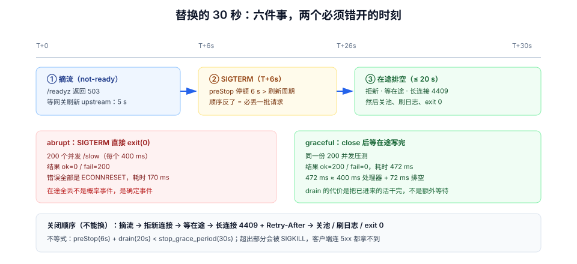

# 第 4 周第 4 步 · 优雅退出：滚动替换的那 30 秒里，请求去哪了

[上一步](../MigrationPreflight/index.md)管住了库。这一步管住**进程**。

`docker compose up -d` 换镜像、K8s 滚动更新、甚至一次 `docker restart`，都会让旧实例收到 `SIGTERM`。所有团队都知道「要优雅退出」，但绝大多数实现只做到了「处理函数里加了个 `server.close()`」——而**真正丢的请求，发生在摘流与 `SIGTERM` 之间的那个缝隙里**。

## 判据族声明

本页判据族 `DRN-A` ~ `DRN-H`，共 8 条。定义表在第七节。

## 本页不讲什么

- 不讲探针的语义（`startup` / `readiness` / `liveness` 三级就绪与退出码），归 [部署脚本](../DeployScripts/index.md)。
- 不讲 WebSocket 的订阅鉴权、`seq` 分配与 `resync_required` 的补齐协议，归 [实时网关](../RealtimeGateway/index.md)。
- 不讲客户端的指数退避重连与状态收敛，归 [状态一致性联调](../Week3StateConsistency/index.md)。
- 不讲发布窗口、灰度比例与回滚决策，归 [发布与回滚手册](../ReleaseRunbook/index.md)。



## 一、一次替换里，实际发生了六件事

| 时刻 | 谁在动 | 发生了什么 | 常见的错 |
| --- | --- | --- | --- |
| T+0 | 编排器 | 把旧实例从「就绪端点」里摘掉 | 只改探针，但网关的 upstream 列表是**缓存**的，几十秒后才更新 |
| T+0 | 编排器 | 向旧实例发 `SIGTERM` | 摘流与 `SIGTERM` **同时**发出，于是「还在收新请求」的实例被告知要退出 |
| T+0~T+5s | 旧实例 | 应停止接新连接、等在途请求 | 直接 `process.exit()` / `System.exit()`，在途全断 |
| T+5s~T+25s | 旧实例 | 在途排空、长连接发 close、连接池关闭 | 先关池再等在途 → 在途请求拿不到连接，变成 500 |
| T+25s | 旧实例 | 退出（`exit 0`） | 超过编排器宽限期，被 `SIGKILL`，日志里什么也没有 |
| T+0~T+30s | 编排器 | 新实例通过 `readiness` 后接入 | 新实例 `readiness` 太浅，还没连上库就被接入 |

本页要解决的是 T+0 到 T+25 这一段。

## 二、实测：同一份 200 并发，两种退出方式

实验用一个最小 HTTP 服务：`/slow` 处理器固定延迟 400 ms；客户端用 keep-alive 连接池发 **200 个并发** `/slow` 请求；在请求发出 200 ms 后向服务发 `SIGTERM`。两种退出实现：

| 实现 | 服务端行为 | 客户端结果 | 耗时 |
| --- | --- | --- | --- |
| **abrupt** | 收到 `SIGTERM` 立即 `process.exit(0)` | `ok=0 / fail=200`，**全部 `ECONNRESET`** | 170 ms |
| **graceful** | `server.close()` 停止接受新连接，等已有连接把响应写完再退出 | `ok=200 / fail=0`，全部 `200` | **472 ms** |

两个数字放在一起看，才是这条判据的分量：

- **abrupt 的 `fail=200`** 说明「在途请求全丢」不是概率事件，是**确定事件**：只要替换发生在有流量的时候，就必然丢。170 ms 的耗时还说明它「退得很快」——快得没给任何人反应时间。
- **graceful 的 472 ms** ≈ 400 ms（处理器延迟）+ 72 ms（排空与关闭），说明 drain 的代价就是**把已经进来的活干完**，不是额外等待。
- **200/200 → 0 失败**是唯一可以写进上线验收的读数。

::: danger `server.close()` 单独用是不够的
`server.close()` 只停止**接受新连接**，它**不会**断开 keep-alive 的空闲连接，也不会等待已建立连接上的新请求。在本项目的场景里还有两个额外要求：

1. 主动向空闲的 keep-alive 连接发 `Connection: close`，否则客户端会复用它，触发一次「连上了但对端已关闭」的 `ECONNRESET`。
2. 长连接（WebSocket）必须发 **close frame**，不能直接断 TCP。
:::

## 三、顺序不能反：先摘流，再 `SIGTERM`

正确的顺序是**两步**，而不是一步：

```text
① 从就绪端点摘除   →  等待「摘除生效」（网关刷新 + 传播）
② 发 SIGTERM      →  实例开始 drain
```

如果两步同时做，会出现一个**必然**的窗口：网关还没更新 upstream 列表，仍然把新请求发给旧实例；旧实例已经收到 `SIGTERM` 并开始 `close()`，于是这些「刚被路由过来」的请求直接失败。

等待多久取决于两件事，而不是拍脑袋：

| 因子 | 本项目取值 | 依据 |
| --- | --- | --- |
| 网关 / 负载均衡的 upstream 刷新周期 | 5 s | 本项目用 Nginx + Compose，DNS 解析与 upstream 缓存按 5 s 计 |
| 实例侧的 `preStop` 停顿 | **6 s** | 必须 > 刷新周期，留 1 s 余量 |
| 应用 drain 超时 | **20 s** | ≥ 最长正常请求（3 s）× 5，且 < 编排器宽限期 |

三者的关系是一条不等式：**`preStop` + `drain 超时` < 编排器宽限期（30 s）**。超出宽限期的部分会被 `SIGKILL`，那一刻所有未完成的请求**都没有响应**——客户端看到的是连接被重置，而不是一个 5xx。

Spring Boot 侧的对应配置：

```yaml [application-prod.yml]
server:
  shutdown: graceful                 # 收到 SIGTERM 后停止接受新请求，等待在途
spring:
  lifecycle:
    timeout-per-shutdown-phase: 20s  # = 上表的 drain 超时
```

```yaml [compose.yaml（片段）]
services:
  app:
    stop_grace_period: 30s           # 编排器宽限期，必须 > preStop + drain
    healthcheck:
      test: ["CMD", "curl", "-fsS", "http://localhost:8080/readyz"]
      interval: 5s
      timeout: 2s
      retries: 3
```

## 四、长连接：close frame 与「去哪儿」

看板的实时通道是 WebSocket，第 3 周的压测里长连接目标是 1 万条（[压测与容量验收](../CapacityTest/index.md)）。实例退出时这些连接**不能靠断 TCP**：

| 做法 | 客户端看到 | 后果 |
| --- | --- | --- |
| 直接断 TCP | `1006 abnormal closure` | 客户端无法区分「网络抖」与「服务端主动退」，退避策略失效 |
| 发 `1001 going away` | 标准关闭 | 客户端知道该重连，但不知该等多久 |
| 发 **`4409 server_draining`** + `Retry-After` | 应用层语义 | 客户端按 `Retry-After` 重连，且**带 `lastSeq` 走补齐** |

本项目选第三种，因为只有它能让客户端做对两件事：**按提示延迟重连**、**带 `lastSeq` 补齐缺口**（补齐协议归 [实时网关](../RealtimeGateway/index.md)）。`4409` 与背压的 `4408` 必须分开：`4408` 是「你太快了」，`4409` 是「我要走了」——客户端的处理完全不同（一个降速，一个换实例）。

## 五、关闭顺序：五步，一步都不能换

```text
① 标记 not-ready（/readyz 返回 503）        ← 让探针先把它摘掉
② 停止接受新连接（listener close）
③ 等在途 HTTP 请求完成（≤ 20 s）
④ 给所有 WebSocket 发 4409 + Retry-After
⑤ 关连接池、关 Redis、刷日志，然后 exit 0
```

第 ⑤ 步的顺序是**先关池再退出**，而不是「先退出，池自然断」：

| 错序 | 现象 |
| --- | --- |
| 先关池，再等在途 | 在途请求拿不到连接 → `500`，drain 成功但结果全是错 |
| 先 exit，池自然断 | 库侧看到大量 `unexpected EOF`，连接数统计失真 |
| 不刷日志就 exit | 最后 200 ms 的日志丢失——恰好是排障最需要的那一段 |

## 六、怎么证明「真的没丢」

| 观测点 | 期望 | 怎么采 |
| --- | --- | --- |
| 客户端错误率 | 替换窗口内 `5xx` 与 `ECONNRESET` 为 **0** | 压测客户端按秒聚合 |
| 服务端 | 日志出现 `drain start` 与 `drain done inflight=0`，两者间隔 ≤ 20 s | `grep drain` |
| 长连接 | 服务端 close code 全为 `4409`，无 `1006` | 网关侧按 close code 计数 |
| 编排器 | `docker inspect` 的 `ExitCode = 0`，`OOMKilled=false` | 替换后立即查 |
| 新实例 | 接入前 `readiness` 连续 3 次通过 | 探针历史 |

四条里最容易漏的是**第二条**：没有 `drain done inflight=0` 这行日志，你无法区分「排空了」和「到点被杀」。

## 七、判据表

| 编号 | 规则 | 违反时的样子 | 怎么验证 |
| --- | --- | --- | --- |
| `DRN-A` | 收到 `SIGTERM` 后停止接新请求并完成在途 | 替换窗口 100% `ECONNRESET` | 第二节实验：`ok=200 / fail=0` |
| `DRN-B` | 先摘流再 `SIGTERM`，`preStop` > 网关刷新周期 | 「刚路由过来」的请求失败 | 替换日志时序：`not-ready` 早于 `SIGTERM` ≥ 5 s |
| `DRN-C` | `preStop + drain` < 编排器宽限期 | 到点被 `SIGKILL`，请求无响应 | `stop_grace_period` ≥ 30 s 且 drain ≤ 20 s |
| `DRN-D` | 关闭顺序为「摘流 → 拒新 → 等在途 → 关长连接 → 关池」 | drain 成功但结果全是 500 | 代码审查 + 第五节清单 |
| `DRN-E` | WebSocket 用 `4409` + `Retry-After` 关闭 | 客户端 `1006`，退避策略失效 | 命令①，close code 统计 |
| `DRN-F` | 有 `drain start` / `drain done inflight=0` 日志 | 无法区分「排空」与「被杀」 | 命令② |
| `DRN-G` | 空闲 keep-alive 连接主动发 `Connection: close` | 复用旧连接时 `ECONNRESET` | 压测后客户端连接复用计数下降 |
| `DRN-H` | 替换后实例 `ExitCode = 0` 且非 `OOMKilled` | 静默 `SIGKILL` | 命令③ |

## 验证命令

```shell
# ① DRN-E：长连接的 close code 分布（网关或应用侧日志）
grep -o 'close_code=[0-9]*' logs/ws.log | sort | uniq -c | sort -rn
# 期望：只有 4409（服务端 drain）与客户端主动关闭；出现 1006 即为直接断 TCP

# ② DRN-F：drain 是否排空
grep -E 'drain (start|done)' logs/app.log | tail -4
# 期望：成对出现，且 done 行带 inflight=0；只有 start 没有 done = 到点被杀

# ③ DRN-H：替换后的退出码
docker inspect teamboard-app-1 --format 'ExitCode={{.State.ExitCode}} OOMKilled={{.State.OOMKilled}}'
# 期望：ExitCode=0 OOMKilled=false

# ④ DRN-B：摘流早于 SIGTERM（按时间戳比对）
grep -nE 'not-ready|SIGTERM|drain start' logs/app.log | head -6
# 期望：not-ready 的时间戳比 SIGTERM 早 ≥ 5 s
```

::: warning 本页的读数边界
第二节的 200/200 是**本机 Node 22.22.2 的最小复现**（`server.close()` 语义），用来证明「优雅与不优雅差 200 个请求」这个结论。真实 JVM 的 drain 还多两段：`server.shutdown=graceful` 的请求排空与 Spring 容器的 bean 销毁（连接池、Redis、定时任务），因此**生产上的 drain 耗时会比 472 ms 长**，验收时要按 `drain done` 日志的实测值填，不能抄本页数字。
:::

## 八、下一步

产物、配置、库、进程四关都过了，接下来是「部署完成后 60 秒内怎么知道它是好的」。归第 4 周第 5 步 [部署后冒烟](../SmokeGate/index.md)：十条走真实链路的用例、每条的断言与超时预算，以及「失败即回滚」为什么必须由闸门而不是由人决定。
