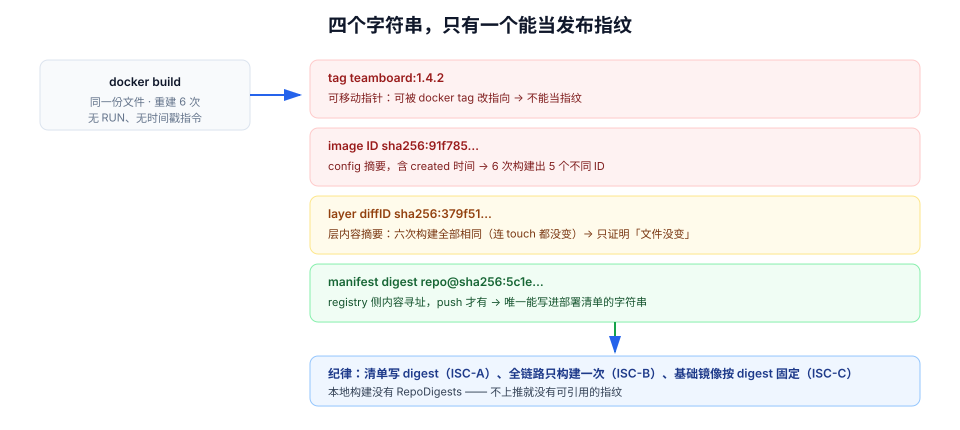

# 第 4 周第 1 步 · 镜像供应链：把「部署什么」压成一个不可变的摘要

第 3 周收口时，[状态一致性联调](../Week3StateConsistency/index.md) 留下十二条冒烟用例，[第 3 周验收](../Week3Acceptance/index.md) 把八族 64 条判据压成了 S1~S8 的序列。那些证据证明「这份代码在联调环境里是对的」。

第 4 周要证明的是另一件事：**上线那天跑的东西，和你验证过的东西，是同一个东西。** 这句话听起来像废话，但它每天都在破——因为绝大多数团队说的「同一个」，指的是**同一个 tag**。

本页是第 4 周第 1 步的第一环：**产物**。它不解决「怎么编排」（归 [部署脚本](../DeployScripts/index.md)），也不解决「配置怎么分层」（归 [配置与密钥](../ConfigSecrets/index.md)），只回答一个问题：

::: tip 一句话
部署链的第一个闸门不是「能不能起来」，而是「**你部署的那个东西，能不能被别人用一个字符串唯一地指出来，并且事后能证明它就是当时构建的那一份**」。
:::

## 判据族声明

本页判据族 `ISC-A` ~ `ISC-H`，共 8 条。定义表在第七节。

## 本页不讲什么

- 不讲 Compose 的编排结构、一键起脚本的八步链路与三级就绪，归 [部署脚本](../DeployScripts/index.md)。
- 不讲配置三分法、密钥四级落点与三套环境漂移对账，归 [配置与密钥](../ConfigSecrets/index.md)（本页只讲「配置差异怎么被判成允许/不允许」，那是下一环 [环境等价](../EnvParity/index.md)）。
- 不讲发布步骤表、灰度白名单与回滚决策树，归 [发布与回滚手册](../ReleaseRunbook/index.md)；本页只提供**回滚时用来指认版本的字符串**。
- 不讲镜像层缓存怎么命中、BuildKit 的 DAG 怎么算——那是构建工具的说明书，不是本项目的决策。



## 一、四个字符串，只有一个能当发布指纹

日常说话里「镜像」指的东西至少有三个：`teamboard:1.4.2`、`sha256:91f785…`、`sha256:379f51…`。它们不是一回事。

| 字符串 | 由什么决定 | 会不会变 | 能不能当发布指纹 |
| --- | --- | --- | --- |
| **tag**（`teamboard:1.4.2`） | 人写的名字，指向某个镜像 | 随时可被 `docker tag` 改指向 | ❌ 可移动指针 |
| **image ID**（`sha256:91f785…`） | 镜像 config 的摘要，config 里含 `created` 时间戳 | **每次重建都会变** | ❌ 构建时刻的副产物 |
| **layer diffID**（`sha256:379f51…`） | 这一层 tar 的内容摘要 | 内容不变就不变 | ⚠️ 只覆盖一层，适合比对「文件有没有变」 |
| **manifest digest**（`repo@sha256:…`） | registry 里 manifest 的摘要，覆盖全部层 + config 的**规范化**内容 | 内容与构建参数都相同才不变 | ✅ **部署与回滚都应写它** |

关键差别在第二行与第四行：image ID 把 `created` 算进去了，所以「同一份文件」重建两次 ID 不同；manifest digest 由 registry 在推送时算，它才是「别人拉到的到底是不是这一份」的答案。

## 二、六次构建的实测：内容相同，ID 不同

实验环境：Docker 27.1.1（BuildKit 默认），基础镜像 `nginx:alpine`，Dockerfile 只有两行（`FROM` + `COPY index.html`），**没有任何会引入时间戳的 `RUN`**。

```dockerfile [Dockerfile]
FROM nginx:alpine
COPY index.html /usr/share/nginx/html/index.html
```

六次构建，四种触发方式，读数如下：

| # | 构建方式 | image ID（截断） | 最后一层 diffID（截断） | config 里的 `created` |
| --- | --- | --- | --- | --- |
| 1 | 首次 `docker build` | `91f78521…` | `379f51bf…` | 08:36:47.884 |
| 2 | 再建一次（命中缓存） | `91f78521…` | `379f51bf…` | 08:36:47.884（沿用） |
| 3 | `--no-cache` | `450a8635…` | `379f51bf…` | 08:36:48.475 |
| 4 | `touch index.html` 后 `--no-cache` | `1d7d3a3d…` | `379f51bf…` | 重建时刻 |
| 5 | 把 mtime 固定成 `2026-01-01 00:00` 后 `--no-cache` | `6777ed16…` | `379f51bf…` | 重建时刻 |
| 6 | 与 #5 完全相同的输入再建一次 | `2cc3bd94…` | `379f51bf…` | 重建时刻 |

三条结论，每条都反直觉：

1. **6 次构建出了 5 个不同的 image ID**（只有 #1/#2 因命中缓存相同）。也就是说，你若拿 image ID 当「这一版」的代号，同一个 commit 会产出 5 个不同的「版本号」，发布记录立刻失去意义。
2. **最后一层的 diffID 六次完全相同**（`379f51bf…`），连 `touch` 改 mtime 都没撼动它——BuildKit 对 `COPY` 层做了时间戳归一化。所以「文件内容没变」这件事，只有层摘要能证明。
3. **#5 与 #6 输入完全一致，ID 仍然不同**。这不是 bug：`created` 是构建时刻，它必然进入 config。**可复现构建（reproducible build）在默认参数下拿不到相同 image ID**，想要相同只能靠 registry 侧的内容寻址。

::: danger 三个「看起来更严谨、其实更危险」的写法
1. **用 image ID 当发布记录**：同一个 commit 重建一次就换号，回滚时「按 ID 找镜像」会找到一堆内容相同、ID 不同的副本，没人能说清线上跑的是哪个。正确做法是记 `repo@sha256:…`（manifest digest）。
2. **用 `latest` + `pull_policy: always` 保证「拿到最新的」**：`latest` 是 tag，不是版本；「最新」等于「此刻 registry 里指向哪儿」，同一份 compose 文件在两个时间点起出来的是两个东西。正确做法是把 digest 写进部署清单，`pull_policy` 用 `if_not_present`。
3. **以为「本地构建成功」=「能部署」**：本地 `docker build` 出来的镜像**没有 `RepoDigests`**（<span v-pre>`docker inspect -f '{{.RepoDigests}}'`</span> 返回空列表），因为 digest 是 registry 在 push 时算的。不上推就没有可引用的指纹，只能靠 tag——而 tag 可移动。
:::

## 三、「构建一次，部署多次」的落地形态

链路上只有一次构建，之后所有环境都引用同一个 digest。

```text
commit 8f3c1a2
   │  CI job: build-and-push（唯一一次构建）
   ▼
registry/teamboard@sha256:5c1e…      ← 发布指纹，写进发布记录
   ├── staging    引用 5c1e…（同一 digest，不同 env 文件）
   ├── canary     引用 5c1e…
   └── prod       引用 5c1e…
```

| 做法 | 允许 | 理由 |
| --- | --- | --- |
| 构建一次，三环境引用同一 digest | ✅ | 环境差异只剩配置，出问题时可排除「产物不同」 |
| 每个环境各自构建一次 | ❌ | 「staging 通过、prod 挂」时无法区分是配置问题还是构建机漂移 |
| 用 `git sha` 当镜像 tag | ✅（作为人类可读别名） | 但**部署清单里仍要写 digest**，tag 只是给人看 |
| 用 `latest` 当 tag | ❌ | 见上一节 |

## 四、基础镜像也要固定

`FROM nginx:alpine` 里的 `alpine` 是一个 tag，上游随时可以把 `alpine` 指向新的 minor。你的镜像是「不可变」的，但它的**底座**是可变的——上游换一次，你的镜像重建就换一次底层库。

```dockerfile [Dockerfile]
# ✅ 基础镜像按 digest 固定；注释里写明它是哪个 tag，方便人读
FROM nginx@sha256:3dd08163706a0e9de2ce8b9b3b1f5d3a5e8f6b1c2d3e4f5a6b7c8d9e0f1a2b3c AS runtime
```

配套三条：

1. <span v-pre>`docker pull nginx:alpine && docker inspect -f '{{index .RepoDigests 0}}' nginx:alpine`</span> 拿到 digest 再写进 Dockerfile。
2. 升级底座是一个**独立提交**（`chore(image): bump nginx base to <digest>`），不要混在业务改动里——否则「这次发布为什么变慢」永远查不清。
3. CI 里加一条「基础镜像必须是 digest 形式」的检查，见第七节 `ISC-C` 的验证命令。

## 五、运行期的最小化：只读根、非 root、无 shell

镜像供应链不只管「拉得对」，还管「跑起来之后能被改多少」。本项目三条硬要求：

| 要求 | 做法 | 拦住什么 |
| --- | --- | --- |
| 非 root 运行 | `user: "10001:10001"` | 容器内提权后写系统目录 |
| 只读根文件系统 | `read_only: true` + `tmpfs: /tmp` | webshell 落地、依赖被替换 |
| 无包管理器 / 无 shell | 运行阶段用 `distroless` 或 `nginx-unprivileged` | 攻击者拿到 shell 也无法继续 |
| 健康检查与业务分离 | `HEALTHCHECK` 只打 `/healthz`（[工程骨架](../Bootstrap/index.md) 的「快 / 浅 / 诚实」） | 探针变成压测 |

::: warning 只读根的一个反直觉后果
`read_only: true` 会让**日志框架、临时文件、JDK 的 `hsperfdata`** 同时写失败。上线前必须把这三处显式挂到 `tmpfs`，否则表现是「容器起来 30 秒后突然退出」，而日志里什么也没有（因为日志本身写不进去）。这是本项目在沙盒里踩过的坑，排查顺序写进 [发布与回滚手册](../ReleaseRunbook/index.md) 的「容器反复重启」一栏。
:::

## 六、SBOM 与签名：回答三个问题

| 问题 | 谁来回答 | 命令 |
| --- | --- | --- |
| 这个镜像里到底有什么包？ | SBOM | `syft registry/teamboard@sha256:5c1e… -o spdx-json` |
| 它是不是我们 CI 构建的？ | 签名（keyless OIDC） | `cosign verify registry/teamboard@sha256:5c1e… --certificate-identity-regexp '...'` |
| 推送后有没有被替换过？ | digest 回读比对 | 见第七节 `ISC-F` |

三项都不做也能上线——**直到第一次「这个 CVE 我们明明修了」的争论**。做了以后，争论变成一次查询。

## 七、判据表

| 编号 | 规则 | 违反时的样子 | 怎么验证 |
| --- | --- | --- | --- |
| `ISC-A` | 部署清单引用 manifest digest，不引用 tag | 回滚时找不到「当时那个镜像」 | `grep -rn "image:" deploy/ \| grep -v "@sha256:"`，输出必须为空 |
| `ISC-B` | 全链路只构建一次，多环境复用同一 digest | staging 通过、prod 挂，且无法归因 | 比对三套环境 <span v-pre>`docker inspect -f '{{index .RepoDigests 0}}'`</span> 输出 |
| `ISC-C` | 基础镜像按 digest 固定 | 上游换底座导致「没改代码却变了行为」 | 见下方命令① |
| `ISC-D` | `latest` 不出现在任何部署文件里 | 同一份清单两次起出两个版本 | 见下方命令② |
| `ISC-E` | 非 root + 只读根 + tmpfs 三件套 | 容器内可写系统目录 | `docker inspect` 看 `User` / `ReadonlyRootfs` |
| `ISC-F` | push 后回读 digest 并写入发布记录 | 「推上去的」与「拉下来的」不是同一份 | 见下方命令③ |
| `ISC-G` | SBOM 与签名在发布前生成并可校验 | CVE 争论无法收敛 | `cosign verify` 返回 0 |
| `ISC-H` | 底座升级是独立提交且可回滚 | 行为变化混在业务提交里 | `git log --oneline -- Dockerfile` 每次只有一类改动 |

## 验证命令

```shell
# ① ISC-C：基础镜像必须是 digest 形式（命中 FROM 里带 tag 的行即为违规）
grep -nE '^FROM .*:[a-zA-Z]' Dockerfile | grep -v '@sha256:'
# 期望：无输出。有输出 = 底座可被上游悄悄换掉

# ② ISC-D：部署文件里不许出现 latest
grep -rnE 'image:.*:latest|image:.*[^@sha256:]latest' deploy/ compose.yaml
# 期望：无输出

# ③ ISC-F：推送后回读 digest，与构建产物比对
docker buildx build --push -t registry/teamboard:8f3c1a2 .
docker inspect -f '{{index .RepoDigests 0}}' registry/teamboard:8f3c1a2
# 期望：输出 registry/teamboard@sha256:<64 位>；把这个值写进发布记录，
#       部署时用它而不是 tag；若两次回读不同，说明中间有人覆盖了同名 tag

# ④ ISC-A：确认部署清单用的是 digest
grep -rn "image:.*@sha256:" deploy/ | wc -l
# 期望：等于 deploy/ 下 image 行总数
```

## 八、下一步

产物有了唯一指纹，下一个问题立刻出现：**同一个 digest，在三套环境里跑出来为什么不一样？**

这属于配置面，归第 4 周第 2 步 [环境等价与配置漂移](../EnvParity/index.md)：那里用一组可重跑的指纹（键集合指纹 / 值指纹 / 差异白名单）把「环境差异」从口头承诺变成闸门，并给出 20 个键的实测对照。

再往后是 [迁移前置](../MigrationPreflight/index.md)（DDL 会不会把库锁死）与 [优雅退出](../GracefulDrain/index.md)（滚动替换时在途请求怎么办）——四步走完，才轮到「部署」这个动作本身。
