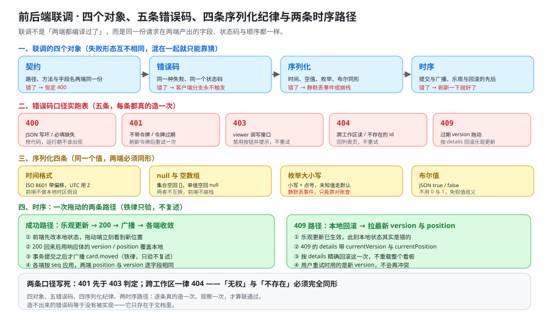

# 前后端联调：契约、错误码与时序的对齐

这一页回答的是「两端各自写完、第一次接上」时最容易卡住的那个问题：**联调到底在联什么，联到什么程度才算联通了。** 它把契约的字段级对齐、五个错误码的实跑口径、序列化的四条类型纪律与一次拖动的两条时序路径，收成能照着跑的检查项与八条判据；它**不回答**「契约本身怎么设计」——那是 [接口契约定稿](../Contracts/index.md) 的事，本页只验它有没有被两端一致地实现。



下面的命令要在**你自己搭好的工程**里执行：本仓不存放源码、脚本与配置，正文里的 `curl` 序列、`ts` 片段与配置文件都是读者要按本节创建的东西。端口与服务名一律以 [环境与工程骨架](../Environment/index.md) 定稿的口径为准（后端 `8080`、前端 `5173`、库 `5432`）。

## 一、联调到底在联什么

「联调」很容易被用成一个筐。本页把它拆成**四个对象**——它们的失败形态长得完全不同，处置也完全不同，混在一起排障就只能靠猜。

| 对象 | 联调在联什么 | 不对齐时的典型现象 |
| --- | --- | --- |
| **契约** | 路径、方法、字段名与必填性在两端是同一份 | 前端按 `cardId` 拼参数、后端读的是 `card_id` → 恒定 `400` |
| **错误码** | 同一种失败在两端是同一个号，且客户端能按号分派 | 后端把跨工作区回成 `403`，前端写好的「`404` 就回列表页」永不触发 |
| **序列化** | 同一个值在两端的形态相同（时间、空值、枚举、布尔） | 后端回 `"2026-10-16T00:00:00Z"`、前端按本地时间渲染 → 差 8 小时的假记录 |
| **时序** | 谁先谁后：提交与广播、乐观更新与回滚的先后 | 先广播后提交 → 别人的界面比广播更旧，「刷新一下就好了」 |

**与「代码写完了」的区别**：代码写完只保证「单端自洽」；联调的判据是**两端合起来的可观测事实**——同一份请求在两端产出的字段、状态码与顺序都一样。三处最容易把「还没联」当成「已经联通了」的假象如下。

::: danger 三处「看起来联通了」的假象
1. **页面能打开。** 只要前端 dev server 起来就成立，与后端一个字都没关系——后端没起时页面照样渲染，只是每个请求都失败。
2. **请求返回 `200`。** 只证明路由与方法对上了，不证明字段名、类型、空值口径对上了。
3. **数据能写进库里。** 单端写入永远能成功；但「写进去的值两端读出来是不是同一个东西」是另一件事。
:::

四条对象的边界要说清：**本页不重讲契约怎么定**（那是 [接口契约定稿](../Contracts/index.md) 的路径清单与六状态码口径）、**不重讲广播怎么推**（那是 [实时网关](../RealtimeGateway/index.md) 的订阅与 `seq` 机制）。本页只做一件事——**在两端都跑起来之后，逐条确认那些约定没有被破坏**。

## 二、联调环境的搭建顺序

三段顺序**不可换**：本地依赖 → 后端服务 → 前端 dev server。

| 步 | 起什么 | 命令 | 期望输出 | 换序会发生什么 |
| --- | --- | --- | --- | --- |
| ① | 本地依赖 `db` / `cache` / `object` | `docker compose up -d db cache object object-init` | 三个长驻服务 `running`（`db` / `cache` 为 `healthy`） | 先后端再依赖 → 后端启动期连不上库，健康检查长时间停在 `DOWN`，看起来像「服务写坏了」 |
| ② | 后端服务 `app` | `docker compose up -d app` 后 `curl -s localhost:8080/actuator/health` | 响应体恰好 `{"status":"UP"}` | 先前端再后端 → 页面能打开、接口全部 `ECONNREFUSED`，看起来像「前端坏了」 |
| ③ | 前端 dev server | `cd web && pnpm dev` | 监听 `5173`，列表页可访问 | 前端代理指向一个还没起的端口时，**报错发生在浏览器而不是终端**，最难回推 |

```shell [tools/preflight.sh —— 三段顺序，逐段确认再进下一段]
# ① 依赖：三个长驻服务起来了、且 db / cache 真的健康（running 不等于 healthy）
docker compose up -d db cache object object-init
docker compose ps --format '{{.Service}} {{.State}} {{.Health}}'

# ② 后端：健康检查是唯一判据，不要用「容器 running」代替它
docker compose up -d app
curl -s localhost:8080/actuator/health

# ③ 前端：dev server 起来之后，用一条真实接口请求确认代理通了
cd web && pnpm dev
curl -s -o /dev/null -w '%{http_code}\n' localhost:5173/api/v1/workspaces
```

```text
db running healthy
cache running healthy
object running
app running
{"status":"UP"}
401
```

最后一行的 `401` 是**正确结果**：没有带令牌。它证明的是「`5173` 的 `/api` 确实转发到了 `8080`」——如果代理没配好，这里会是一个 `404`（dev server 自己没这条路由），而不是 `401`。

::: warning 为什么「容器 running」不能代替健康检查
一个已经 `running` 的容器可以完全没准备好服务：PostgreSQL 的 `running` 出现在 `initdb` 完成之前，Redis 的 `running` 出现在加载 RDB 之前。`docker compose up -d` 返回的是「容器已创建」，**不是「服务可用」**。所以第二步的判据必须落到 `curl` 的响应体上——`{"status":"UP"}` 这一个字符串，才是「后端能连上依赖」的证据。
:::

## 三、契约对齐的五处检查

契约的字段级对齐有五处**必查**，每一处都能给出一条「不对齐时现象是什么」与一条「怎么判一次」。

### 3.1 路径与方法

逐个对照 [接口契约定稿](../Contracts/index.md) 第二节的路径清单：方法（`GET` / `POST` / `PATCH` / `DELETE`）与路径模板必须逐字相同。**最容易错的是动词**——把 `PATCH /api/v1/cards/{cardId}` 写成 `POST`，会得到一个 `405`，而它经常被误认为「后端没实现这个接口」。

### 3.2 字段命名大小写

后端序列化出的 JSON 字段一律 `camelCase`（`listId`、`beforeCardId`、`client_op_id` 是**显式例外**、由契约定稿写死）。前端**不手写**类型，全部从 `contracts/rest/` 生成：

```ts [web/src/api/client.ts —— 字段名只从生成类型里取]
import type { components } from '../types/api';

type MoveRequest = components['schemas']['MoveCardRequest'];

export function moveCard(boardId: string, cardId: string, body: MoveRequest) {
  // body 由类型约束：写错字段名在编译期就报错，不必等到运行时返回 400
  return post(`/api/v1/boards/${boardId}/cards/${cardId}/move`, body);
}
```

### 3.3 必填与可选

**必填性必须两端一致。** 前端把「后端其实必填」的字段省传，得到的是一条 `400`；反过来，前端以为必填、后端其实可选，会在响应体里看到 `null`。判法是**各发一条最小请求体与一条完整请求体**，两条都要落在预期内。

### 3.4 大整数 Id 超过 `2^53` 的精度丢失

这是一条**防回归**检查：本项目 Id 是 `uuidv7` 字符串（见 [接口契约定稿](../Contracts/index.md) 第三节），天然不存在这个问题。但只要有人把 Id 换成自增 `bigint` 序列号，JS 端就会踩坑——`Number` 的安全整数上限是 `2^53 - 1`，超过之后 `9007199254740993` 与 `9007199254740992` 在 JS 里**是同一个数**，两个不同的资源会被当成同一个。

```ts [web/src/types/api.ts —— Id 一律当字符串，不做数值运算]
// 正确：Id 是 string，原样透传
export type CardId = string;
// 危险：任何把 Id 放进 Number 的写法都要拦掉（含 JSON.parse 后的隐式转换）
// const n = Number(cardId);        // 编译期能过、运行期静默丢精度
```

判法很直接：挑一个 Id，前端 `console.log` 它，与后端响应体里的原文逐字符比对；**少一位或末位变了即为丢精度**。

### 3.5 分页与游标的字段形态

分页响应体统一是 `{ "items": [...], "nextCursor": "…" }`（见 [接口契约定稿](../Contracts/index.md) 第三节）。两端最容易分叉的是**字段名**：一端叫 `list`、另一端叫 `items`，或一端多回了一个 `total`。判法是把列表接口的响应体打出来，逐字段对一遍，并确认 `nextCursor` 在**已到末尾**时返回的是 `null` 而不是空字符串。

## 四、错误码口径实跑表

五条状态码，逐条**真的造一次**。每条给「怎么造出来 + 期望响应体 + 客户端应做什么」。造不出来的错误码等于没有被实现——它只存在于文档里。

| 状态码 | 怎么造出来 | 期望响应体 | 客户端应做什么 |
| --- | --- | --- | --- |
| **`400`** | 把请求体的 JSON 写坏（少一个引号），或把必填字段整段删掉 | `{"error":{"code":"BAD_REQUEST","message":…}}` | 修代码（这是「服务器读不懂请求」，运行期不该出现） |
| **`401`** | 不带 `Authorization` 头，或用一条过期令牌调用任一接口 | `{"error":{"code":"UNAUTHENTICATED",…}}` | 刷新令牌后重试一次；仍失败则回登录页 |
| **`403`** | 用 `viewer` 令牌调用 `POST …/cards/{cardId}/comments` | `{"error":{"code":"FORBIDDEN",…}}` | 禁用按钮并提示，**不重试** |
| **`404`** | 用工作区 A 的令牌读工作区 B 的看板；再试一个语法合法但不存在的工作区 id | `{"error":{"code":"NOT_FOUND",…}}` | 回列表页，不重试 |
| **`409`** | 用一条过期的 `version` 调 `POST …/move` | `{"error":{"code":"VERSION_CONFLICT","details":{"currentVersion":9,"currentPosition":"0\\|c/001"}}}` | 按 `details` 里的最新 `version` 与 `position` 回滚本地乐观更新 |

两条口径**写死在表里、来自 [接口契约定稿](../Contracts/index.md) 第四节**，联调时必须按它们验，而不是按「直觉上更合理」的那个：

1. **`401` 先于 `403` 判定。** 用一条**过期令牌**去调一个**本就没权限**的接口，期望得到的是 `401`——如果得到 `403`，说明实现先判了权限、后判身份，这会把「你只差一张令牌」免费告诉未认证的请求。
2. **跨工作区一律 `404`，不是 `403`。** 「无权」与「不存在」在客户端必须**完全同形**。联调时这里最容易出误判：跑出 `404` 的人会以为「权限功能没生效」，而它恰恰是**正确**的行为。

```shell [一次跑完五条：只取状态码与错误码，减少噪声]
for spec in \
  "bad-json|POST|/api/v1/boards/$BOARD_ID/cards/$CARD_ID/move|{}" \
  "no-auth|GET|/api/v1/workspaces|" \
  "viewer-comment|POST|/api/v1/cards/$CARD_ID/comments|" \
  "cross-ws|GET|/api/v1/boards/$OTHER_BOARD_ID|" \
  "stale-version|POST|/api/v1/boards/$BOARD_ID/cards/$CARD_ID/move|" ; do
  IFS='|' read -r name method path body <<< "$spec"
  code=$(curl -s -o "/tmp/$name.json" -w '%{http_code}' -X "$method" "http://localhost:8080$path" \
    -H "Authorization: Bearer $TOKEN" -H 'Content-Type: application/json' ${body:+-d "$body"})
  echo "$name -> $code $(jq -r '.error.code // "-"' "/tmp/$name.json")"
done
```

```text
bad-json -> 400 BAD_REQUEST
no-auth -> 401 UNAUTHENTICATED
viewer-comment -> 403 FORBIDDEN
cross-ws -> 404 NOT_FOUND
stale-version -> 409 VERSION_CONFLICT
```

五行的**第二个字段是关键**：状态码之外还要看错误码。出现「`400` + 业务错误码」或「`200` + 错误体」都说明状态码口径被绕过了——那正是 [接口契约定稿](../Contracts/index.md) 第四节反复强调的「两个真相源」问题。

## 五、序列化与类型对齐

同一份数据在两端必须**同形**。四条纪律，每一条都有专属于它的失败形态。

| 纪律 | 定稿口径 | 不对齐时的现象 |
| --- | --- | --- |
| **时间格式** | ISO 8601 / RFC 3339，**带偏移**（UTC 用 `Z`，毫秒精度） | 一端回 UTC、一端按本地渲染 → 相差整整一个时区，且只在跨时区的人那里暴露 |
| **`null` 与 `[]`** | 集合为空回 `[]`；单值为空回 `null`；**两者不互换** | 前端写 `data.items.map(...)`，收到 `null` 时抛 `Cannot read properties of null` |
| **枚举大小写** | 枚举值一律**小写 + 点号**（`card.moved`、`member.role_changed`），且客户端未知值走默认分支 | 一端发 `card.Moved`、前端按 `card.moved` 比较 → 分支永不命中，静默丢事件 |
| **布尔值** | 一律 JSON `true` / `false`，**不用 `0` / `1`** | 后端回 `0`，前端 `if (flag)` 里 `0` 是假、`"0"` 是真 → 行为随序列化实现漂移 |

::: danger 四条里最容易「当天看不出来」的是枚举大小写
时间差 8 小时会被用户发现，`null` 崩栈会被测试发现，`0` / `1` 会在前后端联调的第一天就打架。只有**枚举大小写**是静默的：事件类型字符串比较不上时，代码走的是「未知类型，忽略」这条分支——**页面不报错、日志不报错、事件就是没了**。它的唯一可靠判法是：两端各自把事件按类型计数，跑一轮之后对账，数目必须相等。
:::

判一次的写法：把一条真实响应体与一份真实事件帧各自原样打印，逐字段比对**原文**，而不是比对「渲染出来的样子」——渲染会掩盖格式差异。

## 六、时序联调：一次拖动的两条路径

一次拖动在联调期要**两条路径各走一遍**。时序错了不会产生错误数据，只会产生「看起来对、刷新才对」的现象，所以必须显式验。

### 6.1 成功路径

乐观更新 → `200` → 广播 → 各端收敛。

| 步 | 发生什么 | 此刻的可观测事实 |
| --- | --- | --- |
| ① | 前端**先改本地状态**（乐观更新），卡片立刻出现在目标列 | 拖动端自己看到新位置，**此时服务端还不知道** |
| ② | 请求返回 `200`，响应体带新的 `version` 与 `position` | 前端用响应体**覆盖**本地那份乐观状态（不是叠加） |
| ③ | 服务端**事务提交之后**广播 `card.moved` | 另一端的浏览器收到事件，`seq` 是同一个 |
| ④ | 各端按 `seq` 应用事件，两端收敛到同一份状态 | 两端卡片的位置与 `version` 逐字段相同 |

第 ③ 步的「提交之后再广播」是 [实时网关](../RealtimeGateway/index.md) 写死的铁律，**本页不重讲它为什么成立，只验它有没有被破坏**——验法在 6.3。

### 6.2 `409` 路径

本地回滚 → 拉最新 `version` 与 `position`。

| 步 | 发生什么 | 此刻的可观测事实 |
| --- | --- | --- |
| ① | 前端乐观更新已生效（卡片已在新列） | 拖动端看到新位置 |
| ② | 请求返回 `409`，`details` 里带 `currentVersion` 与 `currentPosition` | **本地那份乐观状态现在是错的** |
| ③ | 前端按 `details` **回滚**：把卡片挪回服务端说的位置，并把本地 `version` 更新成 `currentVersion` | 界面回到真实状态；用户看到一次「跳回去」 |
| ④ | 前端提示「已被其他人修改」，并允许用户重试 | 用户重试时用的是**新的** `version`，不再冲突 |

::: danger 回滚里最常被写错的一处
用 `details.currentVersion` 回滚，而不是**重新拉一次列表**。重拉有三个代价：多一次请求、中间有一段空窗（用户看到卡片位置闪变）、以及丢掉「这次失败的是我自己那一次操作」这个信息——**用户重试时必须拿到的是服务端的最新版本，而不是一个刚被其他事件改过的版本**。回滚要精确到「把这一次乐观更新撤掉」，不是「把整个看板重载」。
:::

### 6.3 「提交之后再广播」在这里只做一件事

本页不去论证这条铁律的来由（[实时网关](../RealtimeGateway/index.md) 已写死），只给**它有没有被破坏**的判法：拖动之后**立刻**带上 `?since=` 补拉一次事件，如果补拉里**找不到**刚刚那条 `card.moved`，而广播帧里却出现了它——说明广播早于提交。此时的现象是「另一端先看到卡片动了、刷新之后又回到原位」，也就是那句「刷新一下就好了」。

## 七、联调清单与误导现象

### 7.1 联调清单 12 项

逐项可勾选。前 8 项是**静态可判**（对照契约与代码即可），后 4 项需要在两端跑起来之后观察。

- [ ] **1** 后端 `/actuator/health` 恰好返回 `{"status":"UP"}`
- [ ] **2** 前端 dev server 的 `/api` 代理指向 `8080`，且代理写在配置文件里而不是组件里
- [ ] **3** 登录拿到的令牌被放进后续请求的 `Authorization: Bearer` 头
- [ ] **4** 契约路径与方法逐个对上，对不清的写进差异清单而不是靠记
- [ ] **5** 字段命名大小写一致，全仓没有 `card_id` 与 `cardId` 并存
- [ ] **6** 必填与可选两端一致，前端没有对「后端其实必填」的字段省传
- [ ] **7** Id 一律当**字符串**处理，没有一处把 Id 放进数值运算
- [ ] **8** 分页响应体形态一致（`items` + `nextCursor`），且末尾 `nextCursor` 是 `null`
- [ ] **9** `400` / `401` / `403` / `404` / `409` 五条各造一次，状态码与错误码都对上预期
- [ ] **10** 时间字段两端都按带偏移的 ISO 8601 处理，前端不做本地时区假设
- [ ] **11** 成功路径：乐观更新 → `200` → 两端各收到广播且 `seq` 相同
- [ ] **12** `409` 路径：本地回滚到服务端最新 `version` 与 `position`，界面不残留假状态

### 7.2 六行「误导现象 → 真实原因 → 定位命令」

联调期最难的不是修，是**把现象归到正确的层**。下面六行覆盖了联调期绝大多数「看起来是 A、其实是 B」。

| 误导现象 | 真实原因 | 定位命令 |
| --- | --- | --- |
| 「页面白屏、接口全 `404`」 | 前端代理没把 `/api` 转发到 `8080` | `curl -s -o /dev/null -w '%{http_code}\n' localhost:5173/api/v1/workspaces`（期望非 `404`） |
| 「`curl` 能通、浏览器里 `401`」 | 浏览器请求没带 `Authorization` 头 | DevTools 的 Network 面板里看该请求的请求头，而不是看响应 |
| 「所有请求都 `400`」 | 字段命名大小写不对齐 | 发一条最小请求体，读响应体 `error.message` 里点名的那个字段 |
| 「跨工作区回 `404`，以为权限没生效」 | 「跨工作区一律 `404`」是**口径**，不是缺陷 | 用同工作区令牌读同工作区资源，应当 `200`——两者对照才能确认 |
| 「时间显示差 8 小时」 | 一端按本地时间解析，另一端回的是 UTC | `curl` 看原始响应体里时间串有没有 `Z` 或偏移 |
| 「拖完刷新一下就好了」 | 先广播后提交，广播的内容比库里旧 | 拖动后立刻带 `?since=` 补拉一次，看那条 `card.moved` 在不在 |

## 八、当日做了什么

1. 把「联调」拆成**四个对象**（契约 / 错误码 / 序列化 / 时序），每个对象给出它与另外三个不同的失败形态，并点出三处「看起来联通了」的假象（页面能打开 / 请求返回 `200` / 数据写进库）。
2. 定下**环境搭建三段顺序**（本地依赖 → 后端服务 → 前端 dev server）与「不可换」的理由，给出每段的命令与期望输出；并把「容器 `running` 不等于服务可用」写死在第二段。
3. 产出**契约对齐五处检查**（路径与方法 / 字段命名大小写 / 必填与可选 / 大整数 Id 的 `2^53` 精度丢失 / 分页与游标字段形态），每处给「不对齐现象 + 怎么判一次」，其中 Id 精度一条明确写成**防回归**检查。
4. 产出**错误码实跑表**（`400` / `401` / `403` / `404` / `409`），每条给「怎么造出来 + 期望响应体 + 客户端应做什么」，并把「`401` 先于 `403`」与「跨工作区一律 `404`」两条口径标注为来自 [接口契约定稿](../Contracts/index.md)、联调时按口径验而不是按直觉验。
5. 产出**序列化四条纪律**（时间带偏移 / `null` 与 `[]` 不互换 / 枚举小写加点号 / 布尔不用 `0` 与 `1`），并点出枚举大小写是四条里唯一**静默**的一条，给出「两端各自按类型计数、跑一轮对账」的判法。
6. 产出**时序两条路径**的逐步表（成功路径四步 / `409` 路径四步），写清「提交之后再广播」在本页**只验不复述**，给出「拖动后立刻补拉、看那条事件在不在」的判法。
7. 产出**联调清单 12 项**（可勾选，前 8 项静态可判、后 4 项需两端跑起来）与**六行误导现象表**（现象 → 真实原因 → 定位命令）。
8. 产出 **`IG-A ~ IG-H` 八条判据**，如实区分文档级与运行期：七条文档级、本机可判，一条运行期如实标 `⏳ 未跑`。

## 九、如何验证

### 9.1 判据表（`IG-A ~ IG-H`）

| 判据 | 判什么 | 级别 | 状态 |
| --- | --- | --- | --- |
| **`IG-A`** | 联调的四个对象（契约 / 错误码 / 序列化 / 时序）写死，且与「代码写完了」明确区分 | 文档级 | ✅ 本机可判 |
| **`IG-B`** | 环境搭建三段顺序不可换及其理由写死，每段有命令与期望输出 | 文档级 | ✅ 本机可判 |
| **`IG-C`** | 契约对齐五处检查齐全（含大整数 Id 的 `2^53` 精度丢失与分页游标字段形态） | 文档级 | ✅ 本机可判 |
| **`IG-D`** | 错误码实跑表五条齐全，且「`401` 先于 `403`」「跨工作区一律 `404`」两条口径写死 | 文档级 | ✅ 本机可判 |
| **`IG-E`** | 序列化四条（时间带偏移 / `null` 与 `[]` 语义差别 / 枚举大小写 / 布尔不用 `0` 与 `1`）写死 | 文档级 | ✅ 本机可判 |
| **`IG-F`** | 时序两条路径（成功 / `409` 回滚）写清，且「提交之后再广播」只验不复述 | 文档级 | ✅ 本机可判 |
| **`IG-G`** | 联调清单 12 项与六行误导现象表齐全 | 文档级 | ✅ 本机可判 |
| **`IG-H`** | 真的跑过一次联调：三段环境起来、五条错误码实跑、两条时序路径各观察一次 | 运行期 | `⏳ 未跑`（原因：**本仓库只有文档，没有可执行的工程与前端**；容器运行时本机可用，复验见 [第 3 周验收结论](../Week3Acceptance/index.md) 第三节） |

### 9.2 本机可判的部分

前七条是**文档级、本机可判**——下面的命令已在仓库根实跑，括注为实测值。

```shell
# IG-A：四个对象各一行（契约 / 错误码 / 序列化 / 时序）
grep -cE '^\| \*\*(契约|错误码|序列化|时序)\*\* \|' index.md          # 期望 4

# IG-B：三段顺序的命令与「不可换」的理由都在页内
grep -c 'docker compose up -d db cache object object-ini[t]' index.md  # 期望 2
grep -c '容器 `running` 不等于服务可[用]' index.md                    # 期望 1

# IG-C：契约五处检查小节齐全 + Id 精度一条写死
grep -c '^### 3\.[1-5] ' index.md                                    # 期望 5
grep -c '2\^53' index.md                                             # 期望 4

# IG-D：错误码五条 + 两条口径写死
grep -cE '^\| \*\*`(400|401|403|404|409)`\*\* \|' index.md            # 期望 5
grep -c '`401` 先于 `40[3]' index.md                                 # 期望 4
grep -c '跨工作区一律 `40[4]' index.md                               # 期望 4

# IG-E：序列化四条
grep -cE '^\| \*\*(时间格式|`null` 与 `\[\]`|枚举大小写|布尔值)\*\* \|' index.md  # 期望 4

# IG-F：时序两条路径小节 + 铁律「只验不复述」写死
grep -c '^### 6\.[1-3] ' index.md                                    # 期望 3

# IG-G：清单 12 项 + 误导现象表六行
grep -c '^- \[ \] ' index.md                                         # 期望 12
grep -cE '^\| 「' index.md                                           # 期望 6

# IG-H：配图被本页引用
grep -c 'assets/tb-integration.sv[g]' index.md                      # 期望 1
```

### 9.3 需要真实环境的部分

`IG-H` 的判据对象是**跑起来的两端**，本机既没有容器运行时、也没有工程代码，按本项目一贯纪律如实标 `⏳ 未跑`，只给命令：

```shell
# IG-H（需要容器运行时 + 工程代码）：
# 1) 三段环境依次起来（第二节的 preflight 脚本）
# 2) 五条错误码各造一次，状态码与错误码都要对上（第四节）
# 3) 成功路径走一遍：拖动 → 200 → 另一端 1 秒内收到、seq 相同
# 4) 409 路径走一遍：过期 version 拖动 → 本地回滚到 currentVersion / currentPosition
```

::: warning 状态列的读法
`IG-A` ~ `IG-G` 的结论是**逐条 `grep` 数出来的**，不是推断的。`IG-H` 的状态不是「结论」而是「当前可执行性」，它的阻塞项只有**一条**：本仓库按约定只有文档、没有可执行的工程与前端。**不是容器运行时**——本机 2026-10-17 复验 `docker version` 输出客户端与服务端均为 `27.1.1`、且有常驻容器在运行，[验收](../Acceptance/index.md) 台账里的 `BL-1`（本机无容器运行时）因此已不成立，更正过程见 [第 3 周验收结论](../Week3Acceptance/index.md) 第三节。**不把「跑过了」写成「通过了」，也不把期望值抄进状态列。**
:::

## 十、下一步

1. **把清单 12 项里的后 4 项迁到端到端层**：它们需要两端同时跑起来观察，写法与观测点见 [端到端测试](../E2ETest/index.md) 第二节的 `E2E-2` / `E2E-5`，本页只保留「怎么造出这个现象」。
2. **把 `401` 先于 `403` 这条口径钉进 CI**：它是本页第四节唯一一条**顺序敏感**的约定，用 [权限矩阵验证](../PermissionMatrix/index.md) 的 `request` 用例逐格固定，比写在文档里更可靠。
3. **列出联调期的三处临时措施**（临时造数 / 临时放行 / 临时上限），它们必须在第 4 周 [部署与交付](../index.md) 开始前逐条收掉——联调态与交付态的差别就这三类。

## 参考资料

- [接口契约定稿：路径、错误码与幂等](../Contracts/index.md)（本页四、五两节的口径来源：六状态码与四类形状） · [实时网关](../RealtimeGateway/index.md)（「提交之后再广播」这条铁律的出处）
- [可运行验证：从零起一套能跑的环境](../Verification/index.md)（种子数据、七条冒烟、并发与实时验证） · [验收：把「做完了」变成可执行的步骤](../Acceptance/index.md)（`TB-*` 判据与 `BL-1` / `BL-2`）
- [环境与工程骨架](../Environment/index.md)（三段顺序里的服务名、端口与 `compose.yaml`） · [卡片拖动：一次拖动只更新一行](../CardMove/index.md)（拖动链路的服务端形状）
- [完整项目交付 · 接口契约](/docs/Others/ProjectDelivery/Contract/index.md)（契约产出物与「约定 / 后果 / 验证」三问） · [完整项目交付 · 需求与验收条件](/docs/Others/ProjectDelivery/Requirements/index.md)
- [实时监控大盘 · 第 2 周收口（终）](../../MonitoringDashboard/Week2Final/index.md)（同一类「联调清单 + 误导现象表」的另一种实例）
