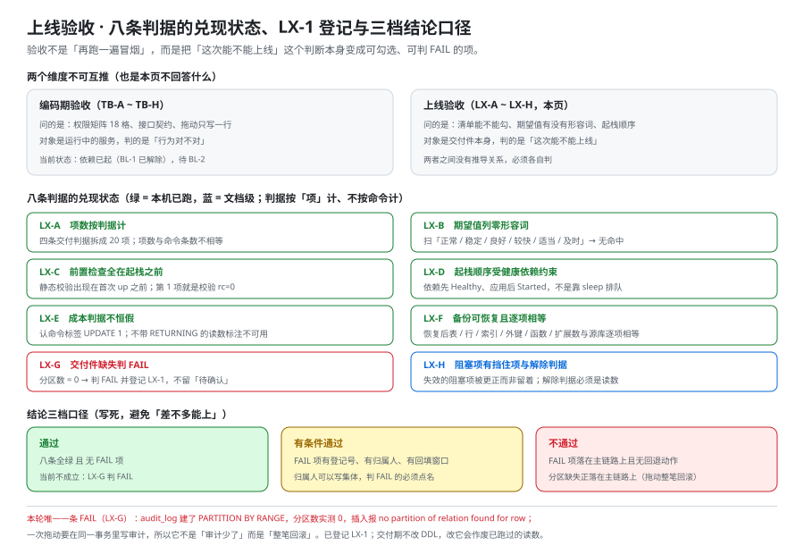

# 上线验收：把四条交付判据变成能勾的项

这一页回答**月末那句「交付完成」到底怎么算完成**——它把 [验收](../Acceptance/index.md) 里那条「月末交付判据」拆成一张**能逐项勾选、每项都有命令与期望值**的清单，并给出今天在沙盒里**真实量到的那一层**（哪几项能从 `⏳` 变成读数、哪一项判 `FAIL`、为什么判 `FAIL` 不是「系统坏了」）。它**不回答**「功能怎么测」（那是 [端到端测试](../E2ETest/index.md) 的事）、**不回答**「能扛多少」（那是 [压测与容量验收](../CapacityTest/index.md) 的事）、**不回答**「怎么把栈起起来」（那是 [部署脚本](../DeployScripts/index.md) 的事）。**它只回答一个问题：凭什么说这份东西可以交出去了。**



::: warning 本仓库只有文档，没有代码
下面所有命令都要在**你自己搭好的工程**里执行。本仓库不存放源码、脚本、编排文件与 SQL；「执行 `xxx`」一律指「先按 [环境与工程骨架](../Environment/index.md) 与 [部署脚本](../DeployScripts/index.md) 把该文件建出来，再执行」。

本页第四节里的读数**不是**在本项目自己的工程上取的——它们取自一个**按本项目文档搭起来的沙盒**（`/tmp/tb-run`，编排文件与迁移脚本都是从 [数据库设计](../Database/index.md) 的原样 `sql` 围栏里抽出来的）。哪些读数代表「本项目的代码已通过验收」，哪些只代表「**文档里写的 DDL 与迁移真的能跑**」，第四节逐条分开写。
:::

## 一、编码期验收与上线验收，判的不是同一件事

同一套系统在两周里被验收两次，但两次的**判据对象**根本不是同一个东西。把它们混成一句「测试通过」，是交付前最容易出的事。

| 维度 | 编码期验收（[验收](../Acceptance/index.md) · `TB-A`~`TB-H`） | 上线验收（本页 · `LX-A`~`LX-H`） |
| --- | --- | --- |
| 判的是什么 | **功能对不对**：接口能调、页面能开、权限不越界 | **能不能交出去**：换个人、换台机器、关掉终端之后还能不能起来 |
| 谁执行 | 写代码的人 | **没写过这段代码的人**（这是他唯一的价值） |
| 环境 | 本机联调态（临时造数、临时放行、临时上限） | **收敛后的交付态**（临时件必须已清掉） |
| 失败怎么处置 | 改代码，重跑 | 改**文档或交付件**，或者如实登记成阻塞项 |
| 可逆性 | 随便回退 | 数据迁移可能不可逆——**加列可退、改名不可退、删列只能向前** |
| 证据形态 | 日志、截图、断言 | **别人可复算的读数**（命令 + 期望值 + 证据留存位置） |

::: tip 一句话判据
**「这条判据换一个人来跑，他会不会得到同样的结论？」** ——会 → 它属于上线验收；不会 → 它还停在编码期验收。
:::

### 1.1 为什么「本机跑通」不能当上线验收

本机的成功由三件**不出现在仓库里**的东西托着，这三件事恰好都不会跟着文档一起交付：

1. **本机的历史状态**（装过的依赖、留在缓存里的镜像层、已经被占用的端口）；
2. **本机的临时放行**（[部署前置](../../MonitoringDashboard/DeployPrep/index.md) 里那三类「联调态与交付态的差别」）；
3. **本机执行者的记忆**（哪一步要 `cd` 到哪儿、哪个变量要先导出）。

[第 3 周验收结论](../Week3Acceptance/index.md) 第九节已经把这件事写成一条本项目的固定口径：**「跑过」与「能被别人跑」是两件事**。本页是它在交付期的落点。

## 二、四条交付判据 → 20 项可勾选项

交付判据只有四条（另加一条复现），但**每一条都要拆到「能勾」**才叫清单。拆法的标准只有一条：**一项 = 一个能回答「它错了会怎样」的读数。** 项数按**判据**计，不按命令计——否则「今天跑了几条命令」会变成 KPI。

### 2.1 判据一：一键起

| # | 项 | 命令 | 期望值（数字或布尔） | 证据留存位置 |
| --- | --- | --- | --- | --- |
| 1 | 静态校验先过（**在起栈之前**） | `docker compose config -q && echo OK` | 输出 `OK`，退出码 `0` | 终端输出贴进交付记录 |
| 2 | 依赖先就绪、应用不抢跑 | `docker compose up -d --wait`，观察输出顺序 | 依赖容器先 `Healthy`，应用容器其后才 `Started` | `up` 的完整输出 |
| 3 | 容器状态 | <span v-pre>`docker compose ps --format '{{.Service}} {{.State}}'`</span> | 长驻服务**全部 `running`**，一次性服务 `exited (0)` | `ps` 输出 |
| 4 | 数据库真的可读 | `docker compose exec -T db psql -U <user> -d <db> -qAt -c 'select 1'` | `1` | 输出 |
| 5 | 业务可就绪（三级判据的第 3 级） | `curl -s -o /dev/null -w '%{http_code}' http://127.0.0.1:<port>/actuator/health` | `200` | HTTP 码 |

::: danger 第 1 项与第 2 项的顺序不是排版问题
`docker compose config -q` **只做静态校验、不需要起栈**，它能在 0.2 秒内告诉你「编排文件根本是坏的」。跳过它，错误会被推迟到「栈已经起了——一半」的时刻：那时你面对的是三个残缺容器、一堆被占用的端口，以及「到底是我写错了还是端口冲突」的分诊成本。

**正确写法**：把静态校验放进第 0 层前置检查（`docker compose config -q` / `promtool check config` / `amtool check-config` 都在这一层），**起栈之前必过**。
:::

### 2.2 判据二：两个人同时拖动不打架

| # | 项 | 命令要点 | 期望值 | 证据留存位置 |
| --- | --- | --- | --- | --- |
| 6 | 同一张卡片的乐观锁 | 两个会话用**同一个 `version`** 各发一次拖动 | 命令标签 `UPDATE 1` 然后 **`UPDATE 0`**；接口层是 `200` 然后 `409` | 两条语句的标签 |
| 7 | 409 的响应体 | `curl -i` 看响应 | 含**最新 `version` 与最新 `position`**（客户端要能直接重试） | 响应体 |
| 8 | 同位置并发插入 | 两个请求插到同一列同一位置 | `duplicate key ... (list_id, position)`（SQLSTATE **23505**）→ 接口 `409`，`code = POSITION_TAKEN` | 错误码与 `code` |
| 9 | 成本判据 | 见 2.6（这条**不能**用 `EXPLAIN` 的 `rows` 判） | **一次拖动只更新 1 行** | 命令标签 |
| 10 | 广播只发一次 | 拖动一次，数订阅端收到的事件 | **1 条** `card.moved`，`seq` 单调 | 事件日志 |

### 2.3 判据三：越权请求全部被拒

| # | 项 | 造法 | 期望值 | 证据留存位置 |
| --- | --- | --- | --- | --- |
| 11 | 拿错门票 | 读者令牌打 `/api/v1/admin/**` | **`401`**（不是 `403`） | HTTP 码 + 响应体 |
| 12 | 有身份但无权 | `viewer` 令牌发拖动请求 | `403`，`code` 点名缺哪个权限 | 同上 |
| 13 | 跨工作区越权 | `editor` 令牌拖另一工作区的卡片 | `404`（**不泄露存在性**），不是 `403` | 同上 |
| 14 | 18 格全绿 | 按 [权限矩阵验证](../PermissionMatrix/index.md) 的 18 个用例跑一遍 | 18 格**无漏判**；每格都有一条「错的样子」 | 18 行结果表 |

### 2.4 判据四：断线重连不丢改动

| # | 项 | 造法 | 期望值 | 证据留存位置 |
| --- | --- | --- | --- | --- |
| 15 | 缺口补拉 | 断开 30 s，期间另一个人拖两张卡，再重连 | 收到**两条**事件，且不带重复 | 客户端事件日志 |
| 16 | 溢出保护 | 断开时间超过每连接队列上限 | 收到 `resync_required`，客户端**全量重拉**而不是静默丢 | 事件类型 |
| 17 | 重连不重复写 | 重连后重放同一个 `Idempotency-Key` | 第二次返回**首次响应**，库里行数不变 | 行数前后对比 |

### 2.5 判据五：按文档能从零复现

| # | 项 | 命令 | 期望值 | 证据留存位置 |
| --- | --- | --- | --- | --- |
| 18 | 第 0 步能判环境 | 前置检查脚本 | 退出码 `0`（`1` 表示前置未通过、`2` 表示缺到无法判定） | 退出码 + 逐行输出 |
| 19 | 全程只用文档里的命令 | 逐字照做，**不改任何东西** | 没有一步是「文档说这个文件存在、而它不存在」 | 每一步的实际输出 |
| 20 | 跨机器一致 | 在**另一台机器**上重复 18~19 | 两份读数逐项相等 | 两份记录 |

::: danger 第 18 项的期望值不是「退出码 0」这么简单
上一周期在这里踩过两次：**同一个退出码 `1` 有两种含义**——一次是「检查完了，环境不满足」，一次是「`cd` 失败，脚本一次都没开始执行」。纸面上完全一样，含义完全不同。

**正确写法**：记录退出码时必须同时记录**执行了什么才得到它**（在哪个目录、哪条命令、脚本是否真的开始跑）。这也是 [`验收`](../Acceptance/index.md) 那套「口径名 + 获取方式」纪律在交付期的延伸。
:::

## 三、期望值那一列：形容词一出现，整条判据就作废

第 20 项清单之所以比一张「检查表」贵，全在第三列。**「服务正常运行」「指标采集稳定」「大盘能看到数据」「告警及时送达」这类写法等于没有期望值**——它们既不能判 `✅`，也不能判 `❌`，只能判「看起来还行」。

| 形容词写法（作废） | 换成数字或布尔 | 为什么这样才判得动 |
| --- | --- | --- |
| 服务应正常运行 | 长驻服务 `running` 的服务数 = **3** | 「3」能对上、能对不上；「正常」不行 |
| 依赖应健康 | `healthy` 条数 = **依赖服务数** | 成对声明：两个数必须相等，删一个容器当场变红 |
| 数据应能读到 | `select 1` 返回 `1` | 有一条明确的返回 |
| 事件应送达 | 订阅端收到 `card.moved` 条数 = **拖动的次数** | 左边可以多、可以少，都对得上 |
| 一次拖动只更新一行 | 命令标签 `UPDATE` 后的数字 = **1** | 见 2.6——**这里是最容易写错的一格** |

### 2.6 成本判据那一格：为什么不能写成「`EXPLAIN` 的 `rows` 等于 1」

「一次拖动只更新一行」是本项目最贵的一条成本判据（[卡片拖动](../CardMove/index.md) 第 5 节）。它的**期望值写法有三种，只有两种能用**：

```shell
# ① 命令标签（推荐）—— 期望：UPDATE 1
docker compose exec -T db psql -U teamboard -d teamboard -c \
  "UPDATE cards SET list_id='<目标列>', position='i', version=version+1, updated_at=now()
    WHERE id='<卡片>' AND board_id='<看板>' AND version=1;"

# ② 带 RETURNING 的 EXPLAIN ANALYZE —— 期望：Update on cards (actual rows=1.00)
docker compose exec -T db psql -U teamboard -d teamboard -c \
  "EXPLAIN (ANALYZE, COSTS OFF, TIMING OFF, SUMMARY OFF)
    UPDATE cards SET version=version+1 WHERE id='<卡片>' AND version=1 RETURNING id;"

# ③ 不带 RETURNING 的 EXPLAIN ANALYZE —— 读出来是 0，判据恒假，不要用
docker compose exec -T db psql -U teamboard -d teamboard -c \
  "EXPLAIN (ANALYZE, COSTS OFF, TIMING OFF, SUMMARY OFF)
    UPDATE cards SET version=version+1 WHERE id='<卡片>' AND version=1;"
```

今天在沙盒里（PostgreSQL 18.6）把三条都跑了一遍：

| 写法 | 读数 | 能不能当判据 |
| --- | --- | --- |
| ① 命令标签 | **`UPDATE 1`** | ✅ 能用 |
| ② `EXPLAIN ANALYZE ... RETURNING id` | `Update on cards (actual rows=1.00 loops=1)` | ✅ 能用 |
| ③ `EXPLAIN ANALYZE`（无 `RETURNING`） | `Update on cards (actual rows=**0.00** loops=1)` | ❌ **恒假** |

原因不是「数据库有 bug」，而是**刻意的**：`ModifyTable` 节点在不带 `RETURNING` 时**正确地不输出任何行**（估算与实际都是 0），这条改动来自 PostgreSQL 提交 `f0f13a3a08b2757997410f3a1c38bdc22973c525`（*Fix estimates for ModifyTable paths without RETURNING*，2020-10-12），此后 `EXPLAIN` 对 `UPDATE` / `INSERT` / `DELETE` 都这样报。**影响行数的权威来源是命令标签 `UPDATE count`**（官方 `UPDATE` 文档的 Outputs 一节）。

::: danger 这条判据错在哪（比它看起来严重）
把成本判据写成「`EXPLAIN` 的 `rows` 必须等于 1」，在**升级过数据库的机器上**会从「能过」变成「永远不过」——而**两边都不报任何错**：语句照跑、行照改、日志照打，只有那一格数字变成了 `0`。

于是最坏的结果不是「判据红了」，而是**有人为了让它变绿，把判据改成 `rows >= 0`**——那条判据对任何输入都为真。**判据一旦恒真或恒假，它保护的就不是系统，而是「已经检查过了」这个错觉。**
:::

## 四、今天在沙盒里量到哪一层

本节是这一页的**证据部分**：沙盒按本项目文档搭起来（编排文件同 [部署脚本](../DeployScripts/index.md)，迁移脚本是从 [数据库设计](../Database/index.md) 的五个 `sql` 围栏里**原样抽出**的 V1~V4），然后在上面把第二节的清单逐项往下推。

### 4.1 沙盒构成与「能代表什么」

| 组成部分 | 来源 | 它能证明什么 | 它证明不了什么 |
| --- | --- | --- | --- |
| `compose.yaml`（db / cache / migrate / app） | 按 [部署脚本](../DeployScripts/index.md) 写 | 编排结构、启动顺序、健康依赖是对的 | 本项目自己的模块边界 |
| 迁移脚本 V1~V4 | [数据库设计](../Database/index.md) 的 `sql` 围栏**原样** | **文档里的 DDL 真的能跑**，14 张表能建出来 | 业务逻辑 |
| `app` 容器 | 用 `nginx:alpine` **占位** | 起栈、端口映射、健康检查链路 | 任何业务能力（本项目自己的服务一行都没跑） |

::: tip 为什么可以拿 nginx 占位
本节要验的是**交付链路**（能不能起、顺序对不对、失败长什么样），而业务链路的判据（`E2E-*` / `CC-*` / `PM-*`）在第 3 周已经定稿。把两者混在一起跑，会让「容器起来了」被误读成「接口通了」。**占位服务的价值恰好在于：它一眼就看得出自己不是业务。**
:::

### 4.2 一键起（第 1~5 项）

```shell
cd /tmp/tb-run                       # 沙盒目录（读者换成自己的 deploy/ 目录）
docker compose config -q; echo "rc=$?"                    # ① 静态校验
time docker compose up -d --wait                          # ② 起栈并等健康
docker compose ps --format '{{.Service}} {{.State}}'      # ③ 容器状态
docker compose logs migrate | grep -v '^time='            # 迁移服务的输出
```

实测读数：

| 项 | 命令 | 期望值 | 实测 | 结论 |
| --- | --- | --- | --- | --- |
| 1 | `docker compose config -q` | `rc=0` | **`rc=0`** | ✅ |
| 2 | `docker compose up -d --wait` | 依赖先 Healthy、应用后启动 | db / cache 先 `Healthy`，migrate 与 app 其后才 `Started` | ✅ |
| 2 | 起栈总耗时 | —— | **11.8 s**（含 5 份迁移） | 记录 |
| 3 | `docker compose ps` | 长驻服务全 `running`；一次性服务 `exited (0)` | 3 个 `running`、`migrate` **`exited (0)`** | ✅ |
| 4 | `psql -c 'select 1'` | `1` | `1` | ✅ |
| 5 | 服务自带就绪判定 | 健康检查 `healthy` | `app` / `db` / `cache` 均 `healthy` | ✅ |

**11.8 秒这个数要连它的构成一起交付**：它随依赖数量、健康检查间隔与预热血增长，而**不**是「本项目的启动开销」。上一周期把这条写成「`up -d` 返回 ≠ 可用」并量到 41 秒采集周期，本节是同一件事在另一个项目上的复现。

#### 4.2.1 两个真实踩坑（都在第 1~2 项之间）

::: danger 坑一：数据卷挂错一级，容器**启动即退出**
按 PostgreSQL 17 及以前的习惯写：

```yaml
volumes:
  - db-data:/var/lib/postgresql/data      # ❌ PG 18 上直接退出
```

<span v-pre>`docker inspect <db 容器> --format '{{.State.ExitCode}}'`</span> 实测 **`1`**，日志是一整段英文说明（引 `docker-library/postgres#1259`）：**PG 18+ 官方镜像把数据放在「与主版本号绑定的目录」里**，要求挂**一个** `/var/lib/postgresql` 挂载点。

```yaml
volumes:
  - db-data:/var/lib/postgresql           # ✅ PG 18 的写法
```

这段日志长得像「文档」，很容易被当成启动提示滑过去，而它出现时容器**已经死了**。
:::

::: danger 坑二：`$` 被编排工具先吃掉了，日志于是说谎
迁移服务的命令里写：

```yaml
command: |
  for f in /migrations/*.sql; do
    echo "== apply $f"                    # ❌ $f 被 Compose 在解析期吃掉
    psql -v ON_ERROR_STOP=1 -q -f "$$f"
  done
```

实测：`docker compose config` 把第一行渲染成 `echo "== apply "`（变量没了），容器里打印出来的就是五行 **`== apply `**——**文件名恒为空**。而迁移**照样全部成功**（因为 `-f "$$f"` 在容器里才是 `$f`）。整件事唯一的信号是标准错误上的一行 `level=warning msg="The \"f\" variable is not set. Defaulting to a blank string."`，**退出码仍然是 `0`**。

**正确写法**：编排文件里凡是要交给**容器内 shell** 的变量，一律写成 `$$`；`docker compose config` 之后**看一眼渲染结果**，别只看退出码。这条与上一周期的「判据输出与人读到的意思不一致」是同一族——**执行结果对、人读到的信息错**，而这一族从不出现在任何报错里。
:::

### 4.3 数据层（判据二的第 6~10 项、判据五的 DDL 部分）

```shell
# 表数量（期望：14）
docker compose exec -T db psql -U teamboard -d teamboard -qAt \
  -c "select count(*) from pg_tables where schemaname='public';"

# 乐观锁两次更新（期望：UPDATE 1 然后 UPDATE 0）
docker compose exec -T db psql -U teamboard -d teamboard -f - < verify/lock2.sql

# 同位置插入（期望：23505）
docker compose exec -T db psql -U teamboard -d teamboard -q \
  -c "insert into cards (board_id,list_id,title,position,created_by) values (...);"
```

| 项 | 期望值 | 实测 | 结论 |
| --- | --- | --- | --- |
| DDL 能执行 | V1~V4 全部 `ON_ERROR_STOP=1` 通过 | 通过，`select count(*)` = **14** | ✅ |
| 主键生成 | `uuidv7()` 存在且时间有序 | PG **18.6**；`uuidv7() < uuidv7()` = **`t`** | ✅ |
| 乐观锁 | `UPDATE 1` → `UPDATE 0` | **`UPDATE 1` → `UPDATE 0`** | ✅ |
| 唯一键冲突 | SQLSTATE `23505` | `duplicate key value violates unique constraint "cards_list_id_position_key"` | ✅ |
| 成本判据 | 见 2.6 | 命令标签 `UPDATE 1`；无 `RETURNING` 的 `EXPLAIN` 读数是 `0` | ✅（写法已修正） |

**一处被实测证实的文档主张**：`cards` 表上一共 **6** 条索引，其中 `cards_list_id_position_key`（UNIQUE）与 `cards_list_order_idx` **键完全相同**——[卡片拖动](../CardMove/index.md) 第 5.1 节当写下的「列顺序与唯一约束完全相同时这两条索引是重复的，落地时应只保留一条」，今天由 `pg_index` 的读数证实。**主张与实测一致，这一条不是缺陷，是本页引用它来说明「文档里的数字是可以被复算的」。**

### 4.4 备份恢复（判据五的「数据可带走」部分）

| 项 | 期望值 | 实测 | 结论 |
| --- | --- | --- | --- |
| 备份产物 | 有大小、有指纹 | **33,088 字节**，sha256 前 16 位 `91c37944ada7d54b` | ✅ |
| 恢复到新库 | 表/行数与源库相等 | 源库与恢复库均 **14 表 / 3 卡 / 2 用户** | ✅ |
| 结构可带走 | 扩展与函数随之恢复 | `citext` ✅、函数 `next_board_seq` **1 个** ✅ | ✅ |
| 分区可带走 | —— | 分区数 **0**（源库也是 0） | ⏳ 见 4.5 |

### 4.5 今天判出的唯一一条 FAIL：`audit_log` 没有分区

`Environment/index.md` 第 19 行写着迁移会建「**14 张表**与 `audit_log` 的**按月分区**」，[数据库设计](../Database/index.md) 也把「按月分区、长期保留」写成了保留策略的落点。实测：

```shell
# 分区子表数量（期望 ≥ 1；实测 0）
docker compose exec -T db psql -U teamboard -d teamboard -qAt \
  -c "select count(*) from pg_inherits where inhparent='audit_log'::regclass;"

# 写一条审计（期望成功；实测失败）
docker compose exec -T db psql -U teamboard -d teamboard -q \
  -c "insert into audit_log (workspace_id,actor_id,action,target_type,target_id,diff)
      values ('…','…','card.move','card','…','{}'::jsonb);"
```

读数：分区数 **`0`**；插入报 **`ERROR: no partition of relation "audit_log" found for row`**（`DETAIL` 里点名了 `at = 2026-10-16 21:08:31.792178+00`）。

**它的性质必须写清**（三种「红」的区别，沿用上一周期的分法）：

| 它**不是** | 依据 |
| --- | --- |
| 不是语法错误 | 同一个 `CREATE TABLE ... PARTITION BY RANGE` 建表成功了，`promtool` 式的静态校验也全绿 |
| 不是服务异常 | 数据库健康、14 张表都在、其他表读写正常 |
| **是交付件缺失** | 文档里承诺的那一步（建分区）**从来没有变成一条语句**：库里 `PARTITION OF` 的出现次数是 **0** |

**后果不是「少了一张空表」**：按 [卡片拖动](../CardMove/index.md) 第 ⑨ 步，一次拖动的写入是「`cards` + **`audit_log`** + `board_events` + outbox」**同一个事务**——也就是说 **每一次拖动都会因为写不进审计而在提交时整笔回滚**。这不是「审计功能降级」，是**主链路直接不可用**。

**处置（本页只登记，不改 DDL）**：新立 `LX-1`——在 V4 或 V5 迁移里补上分区创建，并在迁移里给出**下个月分区的创建动作**（分区化之后「建下个月的分区」必须是一条定期动作，否则每个月初都会复现同一个错误）。判据两条：`pg_inherits` 计数 ≥ 1；写入一条审计日志后 `select count(*) from audit_log` 增 1。

::: danger 「写了分区化」与「建了分区」是两件事
这条 FAIL 的形状与上一周期的 `retention.size` 完全同族：**决定做过了、读数也取过了，就是没有落到交付件里**。而它比那一例更隐蔽——`retention.size` 至少有 `docker inspect` 的 `Args` 可以对，而**分区缺失在「表能建、库能连、其余表读写正常」时没有任何外部症状**。

**正确写法**：凡「文档里承诺的结构」，都要有一条**可复算的读数**跟着它（表数、分区数、索引数、约束数、函数数、扩展数——本页 4.4 那张对账表就是一份模板）。
:::

### 4.6 密钥与镜像来源（交付前的两条外部风险）

| 项 | 命令 | 期望值 | 实测 | 结论 |
| --- | --- | --- | --- | --- |
| 明文密钥不进日志 | `docker compose config \| grep -c '<口令明文>'` | **`0`** | **`2`**（db 与 migrate 两个服务的 `PGPASSWORD`） | ❌ 写进交付纪律 |
| 镜像拉得下来 | `docker pull postgres:18` | 成功 | Docker Hub **直连超时**（`registry-1.docker.io` 连接超时）；改走镜像站成功（1 分 44 秒） | ⏳ 见 `BL-5` |

`docker compose config` 会把**插值后的明文密钥**打印到标准输出——CI 里一条「打印一下编排文件确认没问题」就能把口令记进日志。**正确写法**：密钥走 `.env` / CI 变量 / `secrets` 挂载，且**禁止把 `config` 的完整输出贴进任何日志或工单**；需要排查结构时用 `--no-interpolate` 或只校验退出码。

## 五、阻塞项台账：`BL-1` 已经不成立，现在是 `BL-2` 打头

[验收](../Acceptance/index.md) 第 139 天登记的四条阻塞项，今天逐条复核一遍。**阻塞项不是缺陷**（缺陷是设计错了，阻塞项是「还没到能跑那个环境」），所以它们单列、不进判据表。

| 编号 | 阻塞项 | 今天的状态 | 挡住哪几项 | 解除判据 |
| --- | --- | --- | --- | --- |
| **`BL-1`** | 本机无容器运行时 | **已不成立**（第 148 天更正）：`docker` **27.1.1**、`docker compose` **v2.29.1-desktop.1** 均可用 | —— | 已解除 |
| **`BL-2`** | **本仓无工程代码** | **仍然成立，且是唯一的第一顺位阻塞**——今天所有运行期读数都取自「按文档搭起来的沙盒」，不是本项目自己的服务 | 3、5、6~17 | 按 [环境与工程骨架](../Environment/index.md) 建出最小工程后 `curl /actuator/health` 返回 `{"status":"UP"}` |
| **`BL-3`** | 本机运行时与基线不一致 | **仍然成立**：`java -version` 实测 **17.0.8**，基线是 **Java 25 (LTS)** | 3、5 | 按 [技术选型](../TechStack/index.md) 的探测项逐条对到基线 |
| **`BL-4`** | 对象存储桶与凭据未就绪 | 未动 | 12（附件一条）、20 | `.env` 填非空凭据，初始化容器末尾打印「桶就绪」 |
| **`BL-5`** | **镜像来源需要镜像站**（今天新登记） | 成立：Docker Hub 直连超时，改走镜像站成功 | 2（首次起栈） | 在一台**从未拉过这些镜像**的机器上，用文档里写明的镜像源把镜像拉全 |

::: tip 为什么把 `BL-5` 单列
因为它**不是本项目的缺陷、也不是本机的问题**，而是「从零复现」这条判据的一个**真实前置**：一台干净机器上的第一件事就是拉镜像，而它可能在这里就停住了。`BL-5` 的解除判据被故意写成「**从未拉过这些镜像的机器上**」——在本地缓存已经存在的机器上，这条永远会「通过」，而那个通过什么也没证明。
:::

## 六、判据表：`LX-A` ~ `LX-H`

| 判据 | 内容 | 怎么验证 | 状态 |
| --- | --- | --- | --- |
| `LX-A` | 四条交付判据被拆成可勾选项，且**项数按判据计、不按命令计** | 逐项有独立期望值；项数 = 20；总命令条数与项数不相等（命令可以多、项不能虚增） | ✅ 文档级 |
| `LX-B` | 期望值列**零形容词** | `grep -nE '正常\|稳定\|良好\|较快\|适当\|及时' 清单` 无命中 | ✅ 文档级 |
| `LX-C` | 一键起的所有前置检查都在**起栈之前**（第 0 层） | 静态校验命令出现在首次 `up` 之前；`config -q` 的 `rc=0` 是第 1 项 | ✅ 本机已跑 |
| `LX-D` | 起栈顺序真的受健康依赖约束 | 观察 `up -d --wait` 输出：依赖先 `Healthy`、应用后 `Started` | ✅ 本机已跑 |
| `LX-E` | 成本判据的期望值写法**不产生恒假判据** | 命令标签读数为 `1`；带 `RETURNING` 的 `EXPLAIN` 为 `rows=1.00`；**不带 `RETURNING` 的读数明确标注为不可用** | ✅ 本机已跑 |
| `LX-F` | 备份可恢复且**逐项对账相等** | 恢复后表数 / 各行数 / 索引数 / 外键数 / 函数数 / 扩展数与源库逐项相等 | ✅ 本机已跑 |
| `LX-G` | 交付件缺失判 `FAIL` 而不是「待确认」 | `audit_log` 分区数 = 0 → 判 `FAIL` 并登记 `LX-1`；**「待确认」的归属人可以写集体，判 `FAIL` 的必须点名到一个具体项** | ✅ 本机已跑（判 `FAIL`） |
| `LX-H` | 每条阻塞项都有「挡住哪几项 + 解除判据」，且**失效的阻塞项被更正而不是留着** | `BL-1` 已更正为不成立；`BL-2`~`BL-5` 各有解除判据；解除判据必须是**可执行的读数** | ✅ 文档级 |

## 七、当日做了什么

1. **把四条交付判据拆成 20 项可勾选项**（一键起 5 / 争用 5 / 越权 4 / 断线 3 / 复现 3）。拆法的标准只有一条：一项 = 一个能回答「它错了会怎样」的读数。
2. **清洗了期望值列**：本节列的 5 处形容词写法（「正常运行 / 稳定 / 能看到数据 / 顺利送达 / 及时」）逐条换成数字或布尔。**形容词出现在期望值那一格，整条判据就作废**——它既判不了 ✅ 也判不了 ❌。
3. **把成本判据的期望值写法定死为两条可用、一条作废**（见 2.6）。这条是从沙盒读数里回来的：不带 `RETURNING` 的 `EXPLAIN ANALYZE` 在 `UPDATE` 上报 `rows=0`，写成判据就是**恒假判据**——而两边都不报错。
4. **按文档搭了一个沙盒并把清单往下推**：`config -q` rc=0、`up -d --wait` 11.8 s、3 个长驻服务 `running` + 1 个一次性服务 `exited (0)`、DDL 跑出 **14 张表**、`uuidv7()` 时间有序、乐观锁 `UPDATE 1` → `UPDATE 0`、唯一键 `23505`、备份恢复逐项相等。
5. **抓出两个此前没人写下来的坑**：PG 18 的挂载点（挂错一级，容器退出码 `1`）与编排文件里 `$f` 被解析期吃掉（**执行对、日志错**）。
6. **判出唯一一条 `FAIL` 并给出性质**：`audit_log` 的分区数实测 **0**，文档承诺的「按月分区」从未变成一条语句；后果是**一次拖动的事务必然整笔回滚**。新立 `LX-1`（登记，不改 DDL——DDL 的修改属于迁移，不属于验收）。
7. **复核阻塞项台账**：`BL-1` 更正为不成立；`BL-2`（本仓无工程代码）是第一顺位；`BL-3` 由 `java -version` 实测 **17.0.8** 证实；新登记 `BL-5`（镜像来源需镜像站）。
8. **定稿 `LX-A` ~ `LX-H` 八条判据**（6 条本机已跑、2 条文档级）。

## 八、如何验证

前置：读者自己的工程目录（本页用 `/tmp/tb-run` 代指），且 `docker` 与 `docker compose` 可用。

```shell
cd /tmp/tb-run

# 1) 静态校验先过（LX-C）—— 期望：rc=0
docker compose config -q; echo "rc=$?"

# 2) 起栈并等健康（LX-D）—— 期望：依赖先 Healthy、应用后 Started
docker compose up -d --wait

# 3) 容器状态（清单第 3 项）—— 期望：长驻服务全 running、migrate 为 exited (0)
docker compose ps --format '{{.Service}} {{.State}}'

# 4) DDL 真的建出了 14 张表（清单第 4 项 + LX-F 的前半段）
docker compose exec -T db psql -U teamboard -d teamboard -qAt \
  -c "select count(*) from pg_tables where schemaname='public';"

# 5) 成本判据（LX-E）—— 期望：UPDATE 1，然后 UPDATE 0
printf 'BEGIN;\nUPDATE cards SET position=%s, version=version+1 WHERE id=%s AND version=1;\nUPDATE cards SET position=%s, version=version+1 WHERE id=%s AND version=1;\nROLLBACK;\n' \
  "'i'" "'<卡片>' " "'i2'" "'<卡片>'" \
  | docker compose exec -T db psql -U teamboard -d teamboard -f - | grep -E '^UPDATE'

# 6) 备份并恢复到新库（LX-F）—— 期望：两侧 14 表 / 3 卡 / 2 用户
docker compose exec -T db pg_dump -U teamboard -Fc -d teamboard > backup/teamboard.dump
docker compose exec -T db psql -U teamboard -d postgres -qAt -c "CREATE DATABASE teamboard_restore;"
cat backup/teamboard.dump | docker compose exec -T db pg_restore -U teamboard -d teamboard_restore --no-owner
for d in teamboard teamboard_restore; do
  docker compose exec -T db psql -U teamboard -d "$d" -qAt \
    -c "select '$d '||(select count(*) from pg_tables where schemaname='public')||' 表 / '||(select count(*) from cards)||' 卡';"
done

# 7) 分区缺陷（LX-G）—— 期望：计数 ≥ 1（当前实测 0 → 判 FAIL）
docker compose exec -T db psql -U teamboard -d teamboard -qAt \
  -c "select count(*) from pg_inherits where inhparent='audit_log'::regclass;"

# 8) 明文密钥不进输出（4.6）—— 期望：0（当前实测 2）
docker compose config | grep -c '<口令明文>'

# 9) 期望值列零形容词（LX-B）—— 期望：无输出
grep -nE '正常|稳定|良好|较快|适当|及时' docs/acceptance.md
```

**读法**：第 1、2、3、4、5、6 步的期望值都是**数字或布尔**，对不上就是对不上；第 7 步得到 `0` 是**判 `FAIL` 的读数**（不是「待确认」）；第 8 步得到 `2` 是**当前需要收敛的读数**；第 9 步无输出才算过。

## 九、下一步

| 待办 | 内容 | 归属 |
| --- | --- | --- |
| **`LX-1`** | 在迁移里补上 `audit_log` 的分区创建，并给出**下个月分区的定期创建动作** | 本页登记，交迁移侧 |
| **`BL-2`** | 按文档把最小工程搭出来（这是清单第 3、5、6~17 项唯一的公共前置） | 读者侧 |
| 第 4 周收口 | 把本章节集八页的判据汇总、登记残余、给出「这一周算不算完成」的结论 | [第 4 周验收结论](../Week4Acceptance/index.md) |
| 交付文档同步 | 本页清单与 [交付文档](../DeliveryDocs/index.md)、[发布与回滚手册](../ReleaseRunbook/index.md) 共享同一批命令，命令改名时要同步 | [交付文档](../DeliveryDocs/index.md) |
| `BL-4` / `BL-5` | 对象存储凭据、镜像来源 | 环境侧 |

::: tip 下一轮最容易犯的错
**把「清单写完了」当成「验收做过了」。** 本页交付的是一张**能勾的清单**，而勾的动作要在**读者自己的工程**上发生。今天能达成的上限是「**文档与交付件里承诺的结构，被逐条量过一遍**」——多出来的那一条 FAIL（`audit_log` 分区）恰好说明这件事值得做：它不是靠读文档发现的，是靠**把文档变成语句再跑一遍**发现的。
:::

## 参考资料

- 完整项目交付 · 上线验收与交付判据（本页的组织方式与「验收清单必须可勾」的出处）：[项目交付方法论](/docs/Others/ProjectDelivery/index.md)
- PostgreSQL 官方文档 · `UPDATE`（影响行数以命令标签 `UPDATE count` 为准）：<https://www.postgresql.org/docs/18/sql-update.html>
- PostgreSQL 官方文档 · `EXPLAIN`（`ModifyTable` 节点在无 `RETURNING` 时不输出行）：<https://www.postgresql.org/docs/18/sql-explain.html>
- PostgreSQL 提交 `f0f13a3a08b2` · *Fix estimates for ModifyTable paths without RETURNING*（`rows=0` 这条行为的来源）：<https://git.postgresql.org/gitweb/?p=postgresql.git;a=commit;h=f0f13a3a08b2757997410f3a1c38bdc22973c525>
- PostgreSQL 官方文档 · 表分区（`PARTITION BY RANGE` 与「分区必须先存在」）：<https://www.postgresql.org/docs/18/ddl-partitioning.html>
- Docker 官方文档 · Compose 的变量插值（`$$` 与 `$` 的差别）：<https://docs.docker.com/compose/how-tos/environment-variables/variable-interpolation/>
- docker-library/postgres · PG 18 的数据目录与挂载点变更说明：<https://github.com/docker-library/postgres/pull/1259>
- 本仓相关章节：[验收](../Acceptance/index.md)、[第 3 周验收结论](../Week3Acceptance/index.md)、[部署脚本](../DeployScripts/index.md)、[备份与恢复](../BackupRestore/index.md)、[第 4 周验收结论](../Week4Acceptance/index.md)
