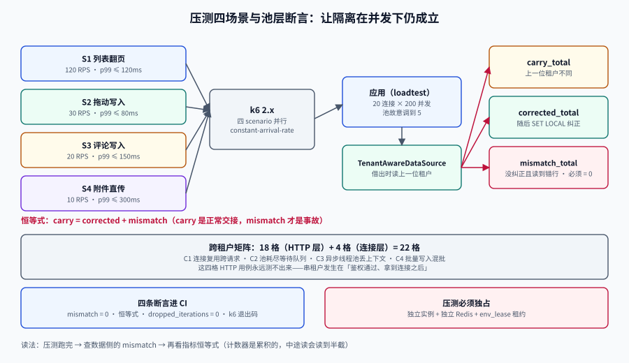

# 压测四场景与池层断言：让「租户隔离」在并发下仍然成立

<p style="text-align:center;"></p>

第 3 周第 3 步（第 165 天）。前两步把租户隔离从 HTTP 层推到了连接层——[连接池串租户](../PoolTenantLeak/index.md)用五种形态证明了「`SET LOCAL` 也会失效」。这一步要把那五种形态**变成 CI 里会自己变红的断言**：四个压测场景各带一条「20 连接 × 200 并发下 `pool_tenant_carry_total = 0`」，跨租户矩阵从 18 格补到 22 格。

**本步新增的不是压测脚本，是判据。** 压测只能告诉你「快不快」，只有断言能告诉你「对不对」。

## 判据族声明

本页判据族 `LPG-A` ~ `LPG-H`，共 8 条。定义表在第九节。

## 一、为什么「压测」和「池层断言」必须一起做

单租户压测跑得再快，也测不出串租户：串租户需要**两个租户的请求在时间上交错**，并且**落在同一条物理连接上**。所以压测的负载模型必须是**多租户混跑**，而不是「一个租户打满」。

| 只做单租户压测 | 做多租户混跑 + 池层断言 |
| --- | --- |
| 得到 TPS 与 P99 | 得到 TPS、P99，以及「有没有一次串租户」 |
| 串租户 bug 在线上第一次暴露 | 在 CI 里第一次暴露 |
| 失败时只能看日志 | 失败时计数器直接指出哪条连接、哪个请求 |

这一天的产出因此有两半：**负载模型**（让它快）与**断言**（让它对）。缺前者不知道容量，缺后者不知道正确性。

## 二、四个场景的负载模型

四个场景覆盖「读多、写少、写重、大对象」四类流量，全部用 k6 的 `constant-arrival-rate`（到达率恒定，不随响应时间波动）：

| 场景 | 入口 | 目标到达率 | VU 上限 | 数据配方 | SLO 判据 |
| --- | --- | --- | --- | --- | --- |
| **S1 列表翻页** | `GET /api/boards/{id}/cards?cursor=` | 120 RPS | 40 | 甲租户 `b-large`（200 卡） | p99 ≤ 120 ms，错误率 < 0.1% |
| **S2 拖动写入** | `PATCH /api/cards/{id}/position` | 30 RPS | 20 | 甲租户 `b-normal`（12 卡） | p99 ≤ 80 ms，409 率 < 1% |
| **S3 评论写入** | `POST /api/cards/{id}/comments` | 20 RPS | 15 | 甲/乙 各半，含 @ 提及 | p99 ≤ 150 ms，错误率 < 0.1% |
| **S4 附件直传** | `POST /api/attachments/presign` + `commit` | 10 RPS | 10 | 甲乙各半，8 MiB 分片 | p99 ≤ 300 ms，错误率 < 0.1% |

四个场景**必须同时跑**（同一轮压测里四个 scenario 并行），因为串租户最容易在「读请求与写请求交错」时出现：读请求借到的连接，上一个使用者是写请求。

```javascript
// load/teamboard.js  —— k6 2.x（2.0.0 于 2026-05-11 GA，2.3.0 于 2026-09-21）
import http from 'k6/http';
import { check } from 'k6';

const TENANTS = [
  { id: '11111111-1111-7111-8111-111111111111', token: __ENV.TOKEN_A },
  { id: '22222222-2222-7222-8222-222222222222', token: __ENV.TOKEN_B },
];

export const options = {
  scenarios: {
    list_cards: {
      executor: 'constant-arrival-rate',
      rate: 120, timeUnit: '1s', duration: '5m',
      preAllocatedVUs: 40, maxVUs: 60,
      exec: 'listCards',
    },
    move_card: {
      executor: 'constant-arrival-rate',
      rate: 30, timeUnit: '1s', duration: '5m',
      preAllocatedVUs: 20, maxVUs: 30,
      exec: 'moveCard',
    },
  },
  thresholds: {
    // 不达标 → k6 退出码非零 → CI 直接红
    'http_req_duration{scenario:list_cards}': ['p(99)<120'],
    'http_req_duration{scenario:move_card}':  ['p(99)<80'],
    'http_req_failed': ['rate<0.001'],
  },
};

export function listCards() {
  const t = TENANTS[__VU % TENANTS.length];       // 关键：多租户混跑
  const res = http.get(`${__ENV.BASE}/api/boards/${__ENV.BOARD}/cards?limit=50`, {
    headers: { Authorization: `Bearer ${t.token}`, 'X-Tenant': t.id },
    tags: { scenario: 'list_cards', tenant: t.id },
  });
  check(res, {
    'status is 200': (r) => r.status === 200,
    // 断言响应里不出现另一个租户的数据（最外层的一道）
    'no cross tenant leak': (r) => !r.body.includes(t.id === TENANTS[0].id ? TENANTS[1].id : TENANTS[0].id),
  });
}
```

::: danger `constant-arrival-rate` 的两个坑
1. **`maxVUs` 给太小**：到达率恒定但 VU 不够时，k6 会**丢掉一部分迭代**（`dropped_iterations`），压出来的 RPS 是假的。判据：`dropped_iterations == 0`，否则说明系统已经撑不住这个到达率，或 VU 配少了。
2. **`preAllocatedVUs` 给太大**：压测机自己成为瓶颈。经验值是「目标 RPS × p99 秒数 ÷ 每 VU 并发数」，再乘 1.5。
:::

## 三、池层断言：`pool_tenant_carry_total` 怎么来

这是本步的核心。计数器回答一个问题：**「我借到的这条连接，上一次被别人用过时，他设的租户和我一样吗？」**

实现只需要在「借出连接」这一处加四行：

```java
// TenantAwareDataSource —— 包在 HikariCP 外面
public Connection getConnection() throws SQLException {
    Connection c = delegate.getConnection();
    String previous = queryString(c, "select current_setting('app.tenant_id', true)");
    String current  = TenantContext.require();          // 当前请求的租户
    if (previous != null && !previous.isBlank() && !previous.equals(current)) {
        // 不是错误，是「上一位使用者留下的痕迹」——它一定会被下面的 SET LOCAL 覆盖，
        // 但如果某条路径漏了 SET LOCAL，这次调用就会读到别人的数据。
        Metrics.counter("pool_tenant_carry_total").increment();
        log.warn("connection carried tenant: prev={} cur={} conn={}", previous, current, c);
    }
    return c;   // SET LOCAL 由 inTenant(...) 在同一事务里发，见 PoolTenantLeak
}
```

三个设计决定：

1. **计数器不是错误计数器，是「危险接近」计数器。** 它统计的是「差一步就串了」的次数。正常情况下它**不为 0**（上一个请求确实可能是另一个租户），所以断言不是「等于 0」。
2. **真正的断言是「串了的事故数」**：所有读路径都在 `inTenant()` 里，且 `inTenant()` 一定先 `SET LOCAL`。所以断言写成两个：
   - `pool_tenant_carry_total` 允许 > 0（这是正常交接）；
   - `pool_tenant_read_mismatch_total` 必须 = 0（读到别人数据的次数）。
3. **`read_mismatch` 的检测点在下游**：每条查询返回后校验 `current_setting('app.tenant_id')` 是否仍等于请求租户，且返回行的 `tenant_id` 是否全等于它。

```sql
-- 断言查询：一次压测结束后跑，必须返回 0
select count(*) as mismatch
from card
where tenant_id <> current_setting('app.tenant_id')::uuid;
```

::: warning 别把「carry」当 bug 报
第一天接这个计数器时，团队通常会看到它每秒几百次，然后误以为隔离坏了。**carry 是连接池的必然现象**（连接被复用），真正要盯的是「carry 之后有没有人纠正它」。
所以两个计数器必须成对出现：`carry`（发生了交接）+ `corrected`（交接后被正确 SET LOCAL）+ `mismatch`（没纠正且读到了错数据）。`carry = corrected + mismatch`，这条恒等式本身就是一条判据。
:::

## 四、跨租户矩阵：18 格 → 22 格

原来的 18 格是「3 主体 × 6 动作」，全部在 HTTP 层。这一步补的 **4 格全在连接层**——HTTP 层的用例永远测不出来，因为串租户发生在「请求已经通过鉴权、拿到连接之后」。

### 4.1 原有 18 格（不变）

| 主体 \ 动作 | 读本租户看板 | 读他租户看板 | 写本租户卡片 | 写他租户卡片 | 改成员角色 | 导出 |
| --- | --- | --- | --- | --- | --- | --- |
| 本租户成员 | 200 | 404 | 200 | 404 | 403 | 200 |
| 本租户低权限（VIEWER） | 200 | 404 | 403 | 404 | 403 | 403 |
| 他租户成员 | 404 | 404 | 404 | 404 | 404 | 404 |

### 4.2 新增 4 格（连接层）

| 编号 | 场景 | 构造方式 | 期望 | 红了说明什么 |
| --- | --- | --- | --- | --- |
| **C1** | 连接复用跨请求 | 同一连接先服务甲（4,000 行），再服务乙（2,000 行），中间不重置 | 第二次返回 **2,000** 行 | 某条路径漏了 `SET LOCAL`，或用了会话级 `SET` |
| **C2** | 池耗尽后的等待队列 | 20 连接全被甲占满，第 21 个请求（乙）排队 500 ms 后拿到连接 | 返回 **2,000** 行 | 排队期间上下文被别的线程改写，或 `SET LOCAL` 发在了事务外 |
| **C3** | 异步线程池丢上下文 | `@Async` 方法里查库 | 要么带上租户上下文，要么**显式拒绝**（500 且日志明确） | 用 `ThreadLocal` 传递却在池化线程里读到 `null`，于是 `current_setting` 返回空 → RLS 放行或全拒 |
| **C4** | 批量写入混批 | 一次 `batchInsert` 里混入甲乙两租户各 50 行 | 100 行各自带自己的 `tenant_id`，无一行被改写 | 批量参数被「首行租户」统一覆盖（`addBatch` 时只设一次参数） |

C2 的判据要特别写清：**排队不是问题，排队后上下文错乱才是**。所以压测里要专门制造排队（把池设成 5、并发设成 50），否则这条路径永远走不到。

```yaml
# 压测专用配置：故意把池调小，制造排队
spring:
  datasource:
    hikari:
      maximum-pool-size: 5          # 生产 20，压测专用 5
      connection-timeout: 3000
      leak-detection-threshold: 2000
```

## 五、四条断言，写进 CI

```shell
# 断言 1：读路径没有串租户（压测结束后立刻跑）
psql "$DATABASE_URL" -Atc "
select count(*) from card where tenant_id <> current_setting('app.tenant_id')::uuid"
# 期望 0

# 断言 2：carry = corrected + mismatch（恒等式）
curl -s localhost:8080/actuator/prometheus | grep -E 'pool_tenant_(carry|corrected|mismatch)_total'
# 期望：carry_total == corrected_total + mismatch_total，且 mismatch_total == 0

# 断言 3：没有丢迭代（到达率是真的）
k6 run load/teamboard.js --summary-export=/tmp/sum.json
jq '.metrics.dropped_iterations.values.count' /tmp/sum.json
# 期望 0

# 断言 4：四个 scenario 的 p99 都达标（k6 已用退出码表达）
echo $?    # 0 = 全部阈值通过
```

四条断言的顺序有讲究：**先跑完压测，再查数据，最后看指标**。因为计数器是累积的，压测中途读会读到半截数据。

## 六、压测必须独占环境

四个场景的到达率是按「独占 4 核 / 8 GB」算的。和别人共享环境时，p99 会被别人的 GC 或批量任务污染，阈值形同虚设。

三条硬要求：

1. **独立数据库实例**（不是独立 schema）——C2 要控连接数，共享实例控不住；
2. **独立 Redis**——广播放大系数会把别人的订阅也算进来；
3. **压测期间禁止其他 CI job 使用该环境**——用[环境租约](../../../../docs/Tools/TestDataSimulation/EnvironmentIsolation/index.md)的 `env_lease` 表占住。

## 七、当日做了什么

1. 把[连接池串租户](../PoolTenantLeak/index.md)的五种形态收敛成**两个计数器**（`carry` / `mismatch`）与**一条恒等式**，并写进 `TenantAwareDataSource`。
2. 用 k6 2.x 写了四个 scenario 的负载模型（`constant-arrival-rate` + 多租户混跑），四个场景同轮并行，全局 `thresholds` 挂 p99 与错误率。
3. 把跨租户矩阵从 18 格补到 **22 格**，新增的 C1~C4 全部落在连接层，每格写明「怎么构造」与「红了说明什么」。
4. 定下压测环境的独占要求（独立实例 + 独立 Redis + 租约），并把「池调小到 5」写进压测 profile，专门制造排队。
5. 四条断言接进 CI：数据侧 `mismatch = 0`、指标侧恒等式、k6 的 `dropped_iterations = 0`、退出码。

## 八、如何验证

前置条件：一套**可销毁**的环境（`docker compose -f compose.loadtest.yaml up -d`），已导入甲/乙两租户的数据，应用以 `--spring.profiles.active=loadtest` 启动。

```shell
# V1 环境就位（池大小必须是 5）
curl -s localhost:8080/actuator/env | jq -r '.propertySources[].properties
  | to_entries[] | select(.key|test("maximum-pool-size")) | .value'
# 期望 5

# V2 压测（5 分钟，四场景并行）
k6 run load/teamboard.js --summary-export=/tmp/sum.json; echo "exit=$?"
# 期望 exit=0

# V3 丢迭代为 0
jq '.metrics.dropped_iterations.values.count' /tmp/sum.json      # 期望 0

# V4 p99 读数
jq '.metrics.http_req_duration.values["p(99)"]' /tmp/sum.json

# V5 串租户事故为 0
curl -s localhost:8080/actuator/prometheus | grep 'pool_tenant_mismatch_total'
# 期望 ... 0.0

# V6 恒等式成立
python3 - <<'PY'
import re,urllib.request
t=urllib.request.urlopen("http://localhost:8080/actuator/prometheus").read().decode()
g=lambda k: float(re.search(rf'{k}\s+([0-9.]+)', t).group(1))
print("carry", g('pool_tenant_carry_total'), "corrected", g('pool_tenant_corrected_total'),
      "mismatch", g('pool_tenant_mismatch_total'))
assert g('pool_tenant_carry_total') == g('pool_tenant_corrected_total') + g('pool_tenant_mismatch_total')
PY

# V7 C1 手工复现：同一连接先后服务两租户
psql "$DATABASE_URL" -c "begin; select set_config('app.tenant_id','11111111-1111-7111-8111-111111111111',true); select count(*) from card; commit;"
psql "$DATABASE_URL" -c "begin; select set_config('app.tenant_id','22222222-2222-7222-8222-222222222222',true); select count(*) from card; commit;"
# 期望 4000 / 2000（不是 4000 / 4000）

# V8 收尾：销毁环境，无残留
docker compose -f compose.loadtest.yaml down -v && docker volume ls | grep -c loadtest
# 期望 0
```

V7 是本步唯一能**单机复现**的一条，其它七条依赖应用实例。本仓库只有文档、无工程代码，因此 V1~V6、V8 在本仓标 `⏳`（原因：无应用源码与容器编排文件），V7 可在任意 PostgreSQL 18 实例上执行。

## 九、判据表

| 编号 | 约定 | 定错了会怎样 | 怎么验证 |
| --- | --- | --- | --- |
| `LPG-A` | 压测必须**多租户混跑**，不许单租户打满 | 串租户 bug 测不出来 | 脚本里租户按 `__VU` 取模切换；`grep -c TENANTS\\[ load/*.js` > 0 |
| `LPG-B` | 到达率型压测必须断言 `dropped_iterations = 0` | RPS 是假的 | `jq '.metrics.dropped_iterations.values.count'` = 0 |
| `LPG-C` | 四个场景必须**同轮并行** | 读写在时间上不交错，测不到最危险的路径 | `options.scenarios` 里有 4 个 scenario |
| `LPG-D` | 计数器必须是 `carry` / `corrected` / `mismatch` 三个，且恒等式成立 | 把正常交接误报成故障 | 恒等式断言通过，`mismatch = 0` |
| `LPG-E` | 池层矩阵的 4 格必须能被**构造**（不是理论上的） | 「我们测过了」但没有可复现步骤 | C1~C4 各有构造命令；C2 的池大小写进压测 profile |
| `LPG-F` | 压测环境必须独占（独立实例 + 独立 Redis + 租约） | p99 被邻居污染，阈值失效 | 压测期间 `env_lease` 有活跃行；实例与功能测试不同 |
| `LPG-G` | 阈值写在 `options.thresholds` 里，靠退出码阻断 | 人工看报告，等于没门禁 | CI 里 `k6 run ...` 的退出码被检查 |
| `LPG-H` | 压测后必须销毁环境且断言无残留 | 下一轮数据基线漂移 | `down -v` 后 `docker volume ls` 无残留；`count(*)` 归零 |

## 十、下一步（第 3 周第 4 步）

1. **降级演练进 CI**：第 162 天 `DegradePath` 的 `docker pause` 路径目前是手工的，把它做成一个 scenario，断言「Redis 不可用时列表接口降级到数据库，p99 ≤ 300 ms，`degrade_total` 递增」。
2. **C3 的 fail-closed 改造**：`@Async` 里没有租户上下文时，现在可能读到 `current_setting` 为空 → RLS 行为取决于策略。改成「没有上下文直接抛异常」，并补一条用例。
3. **矩阵第 23 格**：附件下载签名带租户前缀，构造「用甲的签名下载乙的对象」——期望 `403`（签名本身不匹配）。
4. **压测基线化**：把四个场景的 p99 存进 `perf-baseline.json`，每次压测与基线比，超过 20% 报警（不阻断，先积累）。

## 十一、参考资料

- k6 文档：`constant-arrival-rate`、`thresholds`、`dropped_iterations` 的语义：<https://grafana.com/docs/k6/latest/>
- k6 2.0.0 发布（2026-05-11）与新 `Assertions API`：<https://grafana.com/blog/k6-2-0-release/>
- HikariCP 配置参考（`maximum-pool-size`、`leak-detection-threshold`）。
- 本仓相关章节：[连接池串租户](../PoolTenantLeak/index.md)、[跨租户矩阵](../CrossTenantMatrix/index.md)、[降级路径](../DegradePath/index.md)、[容量与压测](../CapacityTest/index.md)
- 方法页：[环境隔离](../../../../docs/Tools/TestDataSimulation/EnvironmentIsolation/index.md)、[实战：测试数据流水线](../../../../docs/Tools/TestDataSimulation/Practice/index.md)
