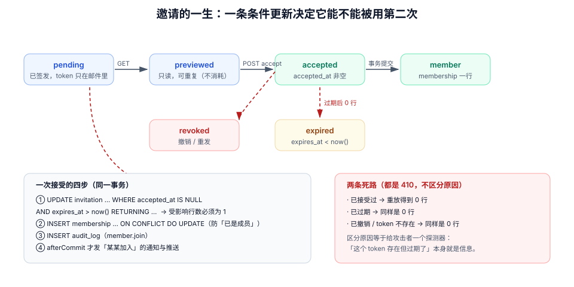

# 成员邀请与角色变更：把「加个人」做成一次可撤销的授权

第 2 周第 7 步：让一个看板真的能被**多个真实的人**同时打开——邀请、接受、角色变更、离职回收，每一步都要留下可审计的痕迹，并且**一条链接只能换一次成员资格**。

## 当日做了什么

| 项 | 产出 |
| --- | --- |
| 数据模型 | `invitation` 表完整 DDL 与五条约束（只存 `token_hash`、单次接受、`(workspace, email)` 唯一、角色白名单、过期时间） |
| 接口 | `POST /api/v1/workspaces/{id}/invitations`、`GET /api/v1/invitations/{token}`、`POST /api/v1/invitations/{token}/accept`、`PATCH /api/v1/members/{userId}` 四条契约 |
| 接受语义 | 用一条条件更新完成「校验 + 占用」，实测 `UPDATE 1` → 重放 `UPDATE 0` |
| 角色变更 | 降级时必须同时作废的三样东西（成员缓存、实时订阅、进行中的写） |
| 令牌 | 32 字节 CSPRNG、base64url、只落哈希、7 天过期、重发换新 token |
| 判据 | `MB-A` ~ `MB-H` 八条，每条给出可执行验收 |

::: tip 本步为什么在第 2 周中段
前六步把「一个人怎么读写数据」做完了。这一步第一次引入**另一个主体的授权从哪来**——没有它，第 8 步的看板页面只能一个人自己拖动，第 9 / 10 步的通知与实时推送也永远只有一个收件人。
:::

## 一、邀请不是「发个链接」

一条邀请链接在真实世界里会经历它设计者没想到的事：

| 情形 | 如果不处理会怎样 |
| --- | --- |
| 链接被转发到群里 | 任何拿到链接的人都能进 workspace，权限等同于发链接的人 |
| 同一个邮箱被邀请两次 | 两条邀请都有效，接受后 `membership` 出现两条记录或角色互相覆盖 |
| 用户点两次（或邮件客户端预取链接） | 第二次请求把 `accepted_at` 覆盖掉，审计里看不出真实接受时间 |
| 邀请时给 `admin`、接受时被改成 `owner` | 角色从请求体里来，等于把提权写进了前端 |
| 离职后只删了 `membership` | 旧 token 仍在有效期内，7 天内可以重新加入 |

**每一条都对应一条约束或一个状态机，而不是一段 `if`。**



## 二、数据模型

```sql
-- V8__invitation.sql

CREATE TABLE invitation (
  id           uuid        NOT NULL DEFAULT uuidv7(),
  tenant_id    bigint      NOT NULL,
  workspace_id uuid        NOT NULL,
  email        text        NOT NULL,
  role         text        NOT NULL,
  token_hash   text        NOT NULL,
  invited_by   bigint      NOT NULL,
  expires_at   timestamptz NOT NULL DEFAULT now() + interval '7 days',
  accepted_at  timestamptz,
  revoked_at   timestamptz,
  created_at   timestamptz NOT NULL DEFAULT now(),

  CONSTRAINT invitation_pk PRIMARY KEY (id),
  CONSTRAINT invitation_token_uk UNIQUE (token_hash),
  CONSTRAINT invitation_ws_email_uk UNIQUE (workspace_id, email),
  CONSTRAINT invitation_role_ck CHECK (role IN ('editor', 'viewer')),
  CONSTRAINT invitation_email_ck CHECK (email ~ '^[^@[:space:]]+@[^@[:space:]]+\.[a-z]{2,}$'),
  CONSTRAINT invitation_ws_fk FOREIGN KEY (workspace_id, tenant_id)
      REFERENCES workspace (id, tenant_id) ON DELETE CASCADE,
  CONSTRAINT invitation_taken_ck CHECK (accepted_at IS NULL OR revoked_at IS NULL)
);

CREATE INDEX invitation_pending_idx ON invitation (workspace_id, expires_at)
  WHERE accepted_at IS NULL AND revoked_at IS NULL;
```

五条约束各自挡住一类错误：

| 约束 | 挡住什么 |
| --- | --- |
| `invitation_token_uk` | 两个邀请共用 token（等于一个 token 能进两个 workspace） |
| `invitation_ws_email_uk` | 同一 workspace 对同一邮箱发两条邀请（接受时角色互相覆盖） |
| `invitation_role_ck` | 邀请时直接给 `admin` / `owner`，绕过角色矩阵 |
| `invitation_taken_ck` | 「已接受」与「已撤销」同时为真这种半截数据 |
| `invitation_pending_idx` | 清理任务扫全表（部分索引只覆盖待接受） |

::: danger 三个必须避开的写法
1. **表里存 token 明文**：一次数据库导出、一条慢查询日志、一张备份快照，都等于把所有人的邀请链接泄露。**只存 `sha256(token)`**，明文只在邮件里出现一次。
2. **用 `email` 当唯一键的一部分却不做大小写归一**：`A@x.com` 与 `a@x.com` 是同一个邮箱，但在 `text` 下是两条记录。本项目的 `email` 列用 `citext`（见[第 1 周数据库设计](../Database/index.md)），不是 `text`。
3. **「接受」写成先查后改**：`SELECT` 判空、应用层 `if`、再 `UPDATE`——两个请求同时通过判空，两个都插入 `membership`。必须用**条件更新 + 受影响行数**做占用。
:::

## 三、四条接口契约

### 1. 发起邀请

```http
POST /api/v1/workspaces/{workspaceId}/invitations
Authorization: Bearer <token>
Content-Type: application/json

{ "email": "lin@example.com", "role": "editor" }
```

```json
{
  "invitationId": "01a14e7b-370b-7f9b-b58c-f00fe871e19e",
  "email": "lin@example.com",
  "role": "editor",
  "expiresAt": "2026-10-25T10:04:00Z",
  "mailQueued": true
}
```

响应里**没有 token**。token 只出现在邮件正文里，服务端不留明文——这条纪律让「查库能不能拿到链接」的答案永远是「不能」。

权限与配额：

| 检查 | 不通过 |
| --- | --- |
| 当前用户在该 workspace 的角色是 `owner` 或 `admin` | `403` |
| 目标角色不高于自己的角色（`admin` 不能邀请 `owner`） | `403` |
| 该 workspace 的成员数 < 套餐上限 | `409 MEMBER_LIMIT` |
| 邮箱尚未是成员 | `409 ALREADY_MEMBER`（幂等：返回已有成员信息） |

### 2. 预览邀请（不消耗）

```http
GET /api/v1/invitations/{token}
```

```json
{ "workspaceName": "产品设计组", "invitedBy": "陈默", "role": "editor", "expiresAt": "2026-10-25T10:04:00Z" }
```

这一步是**只读**的：邮件客户端与安全网关会预取链接，任何「点开即接受」的设计都会被预取机制提前消耗掉。

### 3. 接受邀请

```http
POST /api/v1/invitations/{token}/accept
Authorization: Bearer <token>   # 已登录用户
```

```json
{ "workspaceId": "…", "role": "editor", "joinedAt": "2026-10-18T10:12:31Z" }
```

### 4. 变更角色

```http
PATCH /api/v1/members/{userId}
{ "role": "viewer" }
```

降级（`editor → viewer`）与升级（`viewer → editor`）走同一个接口，但**副作用不同**，见第五节。

## 四、接受邀请：一条条件更新完成占用

整个接受过程是一个事务，核心只有一条 SQL：

```sql
-- ① 占用：校验 + 标记，一步完成
UPDATE invitation
   SET accepted_at = now()
 WHERE token_hash = encode(sha256($1), 'hex')
   AND accepted_at IS NULL
   AND revoked_at IS NULL
   AND expires_at > now()
RETURNING id, workspace_id, tenant_id, role, email;
```

受影响行数是**唯一可信的判定**：

| 行数 | 含义 | 响应 |
| --- | --- | --- |
| 1 | 占用成功 | 继续 ②③ |
| 0 | 已接受 / 已撤销 / 已过期 / token 不存在 | `410 INVITATION_UNAVAILABLE`（**不区分**，避免探测） |

本机实测（PostgreSQL 18.6，同一 token 连续两次）：

```text
UPDATE 1  Time: 1.339 ms     -- 第一次：占用成功
UPDATE 0  Time: 0.466 ms     -- 第二次：重放，返回空结果集
UPDATE 0  Time: 0.388 ms     -- 过期 token：同样 0 行
```

```sql
-- ② 建立成员关系（幂等 upsert，防「已是成员」时 500）
INSERT INTO membership (tenant_id, workspace_id, user_id, role, joined_at)
VALUES ($tenant, $ws, $uid, $role, now())
ON CONFLICT (workspace_id, user_id) DO UPDATE SET role = EXCLUDED.role;

-- ③ 记一条审计（谁在什么时候用什么 token 进了哪个工作区）
INSERT INTO audit_log (tenant_id, actor_id, action, target_type, target_id, detail)
VALUES ($tenant, $uid, 'member.join', 'workspace', $ws, jsonb_build_object('invitationId', $inv, 'role', $role));
```

::: warning 为什么第 ② 步必须 upsert
用户可能**已经是**成员（先被管理员直接加进来，之后才点开旧邀请）。此时 `INSERT` 会撞 `membership` 的主键，整个事务回滚，`accepted_at` 也跟着回滚——邀请变成「永远接受不了」。
:::

**事务边界**：①②③ 必须在同一个事务里；邮件通知（「某某加入了」）在 `afterCommit` 之后发，回滚时不能发。

## 五、角色变更：降级要比升级多做三件事

| 动作 | 必须做的事 | 漏掉的后果 |
| --- | --- | --- |
| 升级 `viewer → editor` | 作废成员的权限缓存 | 最多 60 秒内仍然写不进去（用户以为坏了） |
| 降级 `editor → viewer` | ① 作废权限缓存 ② **踢掉该用户在该 workspace 上的实时订阅** ③ 让进行中的写请求在提交前重新校验 | 被降级的人仍能收到看板推送，甚至用已打开的连接继续拖卡片 |
| 移除成员 | 上面三件 + 撤销该用户所有未接受的邀请 + 记审计 | 旧邀请 token 在 7 天内可以重新加入 |

②这一条最容易被漏掉，因为**写权限的判定发生在 HTTP 请求里，而推送走的是另一条长连接**：

```java
// 伪代码：降级后的三步失效
memberCache.evict(tenantId, workspaceId, userId);          // ① 缓存
realtimeGateway.revokeSubscription(tenantId, workspaceId, userId, CloseStatus.POLICY_VIOLATION_4403); // ② 长连接
// ③ 不需要「取消」已在执行的写：靠它在提交前重新读一次成员关系
```

::: danger 三个会发生、但没人报错的场景
1. **只清缓存不踢连接**：被降级的人界面还在，拖动仍然「看起来成功」——直到刷新页面才发现 403。中间那段时间他改的数据是真实写入的。
2. **降级与写入并发**：写请求在鉴权时是 `editor`，降级发生在鉴权之后、提交之前。修法是在**事务内**再查一次角色（`SELECT role FROM membership WHERE … FOR SHARE`），代价是一次索引查询。
3. **`owner` 被降级后工作区没有 owner**：加一条约束——最后一名 `owner` 不能被降级或移除，否则整个 workspace 再也改不了设置。
:::

## 六、令牌：只落哈希，重发换新

| 项 | 取值 | 理由 |
| --- | --- | --- |
| 长度 | 32 字节（256 bit）CSPRNG | 抗枚举；base64url 后 43 字符，适合放 URL |
| 存储 | `sha256(token)` 的 hex | 库泄露不等于链接泄露；`sha256` 足够（token 本身高熵，不需要慢哈希） |
| 有效期 | 7 天 | 覆盖「周一发、下周一才看邮件」的常见情形 |
| 重发 | **生成新 token，旧 token 立即失效** | 否则「重发」等于把有效期无限延长，且无法判断是哪个链接被用了 |
| 邮件里的链接 | `https://app.example.com/invite#token=…` | token 放 fragment，不进 Referer、不进服务器访问日志 |

::: tip 为什么用 `sha256` 而不是 `bcrypt`
慢哈希的目的是对抗「低熵口令的离线爆破」。邀请 token 有 256 bit 熵，爆破不可行；而接受邀请是**热路径**（每次点链接都要算一次），`bcrypt` 的 100 ms 会成为无谓的成本。
:::

## 七、验收：八条命令

```shell
# ① 发起邀请（owner 身份）
curl -s -X POST "http://localhost:8080/api/v1/workspaces/$WS/invitations" \
  -H "Authorization: Bearer $OWNER" -H 'Content-Type: application/json' \
  -d '{"email":"lin@example.com","role":"editor"}' | jq '{invitationId, role, mailQueued}'
# 期望：200，mailQueued=true，响应体里没有 token 字段
```

```shell
# ② 非管理员发起 → 403
curl -s -o /dev/null -w '%{http_code}\n' -X POST "http://localhost:8080/api/v1/workspaces/$WS/invitations" \
  -H "Authorization: Bearer $VIEWER" -H 'Content-Type: application/json' \
  -d '{"email":"x@example.com","role":"editor"}'
# 期望：403
```

```shell
# ③ 同一邮箱重复邀请 → 409（不是 500）
curl -s -o /dev/null -w '%{http_code}\n' -X POST "http://localhost:8080/api/v1/workspaces/$WS/invitations" \
  -H "Authorization: Bearer $OWNER" -H 'Content-Type: application/json' \
  -d '{"email":"lin@example.com","role":"viewer"}'
# 期望：409；若 500，说明唯一约束没有被翻译成业务错误
```

```shell
# ④ 预览不消耗：连点两次都是 200，且 accepted 仍为 false
curl -s "http://localhost:8080/api/v1/invitations/$TOKEN" | jq '{workspaceName, role}'
curl -s "http://localhost:8080/api/v1/invitations/$TOKEN" | jq '{workspaceName, role}'
# 期望：两次都 200，库中 accepted_at 仍为 NULL
```

```shell
# ⑤ 接受一次成功
curl -s -X POST "http://localhost:8080/api/v1/invitations/$TOKEN/accept" \
  -H "Authorization: Bearer $LIN" | jq '{workspaceId, role}'
# 期望：200；库中 accepted_at 非空
```

```shell
# ⑥ 重放 → 410，且不会产生第二条 membership
curl -s -o /dev/null -w '%{http_code}\n' -X POST "http://localhost:8080/api/v1/invitations/$TOKEN/accept" \
  -H "Authorization: Bearer $LIN"
# 期望：410；SELECT count(*) FROM membership WHERE workspace_id=$WS AND user_id=$LIN 仍为 1
```

```shell
# ⑦ 过期 token → 410（不是 500、不是 404 带堆栈）
curl -s -o /dev/null -w '%{http_code}\n' -X POST "http://localhost:8080/api/v1/invitations/$EXPIRED/accept" \
  -H "Authorization: Bearer $LIN"
# 期望：410
```

```shell
# ⑧ 降级后：旧连接被踢、写请求 403、读请求仍 200
curl -s -o /dev/null -w '%{http_code}\n' -X PATCH "http://localhost:8080/api/v1/members/$LIN" \
  -H "Authorization: Bearer $OWNER" -H 'Content-Type: application/json' -d '{"role":"viewer"}'
curl -s -o /dev/null -w '%{http_code}\n' -X POST "http://localhost:8080/api/v1/cards/$CARD/move" \
  -H "Authorization: Bearer $LIN" -H 'Content-Type: application/json' -d '{"toListId":"…","beforeCardId":null}'
# 期望：PATCH 200；move 403；该用户 WebSocket 收到 4403 关闭帧
```

## 八、判据族 `MB-A` ~ `MB-H`

| 判据 | 规则 | 违反时的样子 | 验证方式 |
| --- | --- | --- | --- |
| `MB-A` | 表中不存 token 明文，只有 `token_hash` | `select * from invitation` 能直接拿到可用链接 | `grep -i token` 看 DDL 列名；查一条记录确认 43 字符链接不在库里 |
| `MB-B` | 接受用一条条件更新占用，判定依据是受影响行数 | 并发两次接受产生两条 `membership` | 命令 ⑤⑥ 连跑；`membership` 计数恒为 1 |
| `MB-C` | `(workspace_id, email)` 唯一，重复邀请返回 409 | 同一邮箱两条有效邀请，角色互相覆盖 | 命令 ③ |
| `MB-D` | 预览接口无副作用，可重复调用 | 邮件安全网关预取后链接失效 | 命令 ④ 连点两次 |
| `MB-E` | 角色受白名单约束，且不能邀请高于自己的角色 | 请求体里写 `owner` 就变成 owner | 用 `{"role":"owner"}` 发起邀请，应 400/403 |
| `MB-F` | 降级同时作废缓存与实时订阅 | 被降级的人仍收到推送 | 命令 ⑧ + 观察关闭帧 4403 |
| `MB-G` | 最后一名 `owner` 不能被降级/移除 | workspace 再也改不了设置 | 对唯一 owner 发 PATCH，应 409 |
| `MB-H` | 邀请、接受、角色变更、移除都写 `audit_log` | 出事时查不到「谁把人放进来的」 | `select action,count(*) from audit_log group by 1`，四种都在 |

## 九、下一步

1. **看板页面**：把邀请与成员管理接进前端，让「两个人同时打开」成为可以手工复现的场景（下一步）。
2. **通知中心读接口**：成员加入要给 owner 发一条站内通知——写侧已在第 160 天的 outbox 里，读侧还没有。
3. **越权矩阵补格**：邀请引入两个新主体（被邀请人、过期 token），需要补进[跨租户用例矩阵](../CrossTenantMatrix/index.md)。
4. **成员列表分页**：当前 `GET /members` 一次返回全部，成员数上千时要改成游标分页。

## 与「邮件送达工程」专题的分工（第 179 天补充）

| 问题 | 本页回答 | [邮件送达工程](/docs/Backend/EmailDeliverability/index.md) 回答 |
| --- | --- | --- |
| 邀请链接怎么生成 | 32 字节随机、只存 `token_hash`、单次使用 | 这封信怎么**送得到**：SPF/DKIM/DMARC、退信处理、抑制名单 |
| 令牌怎么校验 | 条件更新 + 受影响行数，`MB-B` | 邮件安全网关**预取**链接之后令牌是不是还活着（`MB-D`） |
| 过期与重发 | `expires_at`、重发作废旧 token | 重发时的节奏：同一天给同一地址发第 3 封邀请，会被判为骚扰 |
| 审计怎么留 | 四种动作都写 `audit_log` | 投诉与退信也要回流成事件，而不只是记在 `audit_log` |

::: danger 本页特有的坑：以为「预览接口无副作用」就够了，忽略了邮件网关会**主动点链接**
`MB-D` 要求预览接口（`GET /invite/{token}`）无副作用，这条是对的，但它挡不住另一件事：很多企业邮件安全网关（Mimecast、Proofpoint、Microsoft Defender for Office 365 的安全链接）会在**投递时就把信里的每个链接抓一遍**，用的还是并发 4~8 个连接的爬虫。它们抓完之后，链接就处于「已被访问过」的状态。

如果你的接受动作是 `GET /invite/{token}/accept`（很多实现图省事就是这么写的，因为点链接最自然），那这封邀请在真正的主人看到之前就已经被「接受」掉了 —— 而接受者是一个没有 cookie、没有登录态的爬虫，于是它要么 302 到登录页（浪费掉唯一一次机会），要么以匿名身份失败并把 token 标成已使用。

三条纪律，缺一条就会出现「客户说链接失效」的工单：

1. **接受必须是 POST**，且必须由已登录用户提交 —— 让爬虫无法完成。
2. **GET 只渲染确认页**，不改变任何状态（这正是 `MB-D` 的实质）。
3. **不要在邮件里放「点击即接受」的一键链接**；如果产品坚持要一键，就把它做成「打开页面 + 页面内一个 POST 按钮」，中间的这一步对人类无感，对爬虫是墙。

延伸一步：这也决定了重发策略。同一地址 24 小时内重发超过 2 次，收件方（尤其 Gmail）会把它当骚扰信号；正确做法是**重发即作废旧 token 并复用同一封信的线程**（`In-Reply-To` 指向上一次），而不是新起一封看似全新的邀请。
:::

## 十、参考资料

- [OWASP · Forgot Password Cheat Sheet](https://cheatsheetseries.owasp.org/cheatsheets/Forgot_Password_Cheat_Sheet.html)（token 高熵、单次使用、只存哈希的同一套纪律）
- [RFC 6749 · OAuth 2.0](https://www.rfc-editor.org/rfc/rfc6749)（授权码单次使用的语义来源）
- [PostgreSQL 18 · `UPDATE … RETURNING`](https://www.postgresql.org/docs/18/sql-update.html)
- [项目章节 · 认证与租户成员关系](../AuthTenantMember/index.md)（`membership` 表与 401/404/403 分工）
- [项目章节 · 跨租户用例矩阵](../CrossTenantMatrix/index.md)（18 格的来源）
