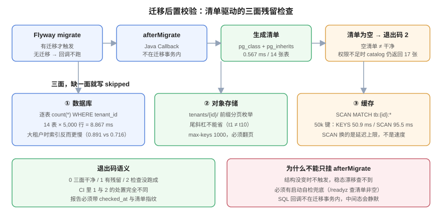

# 第 4 周第 3 步之八 · 迁移后置校验：清单驱动的残留检查

**上一章的清单是「资产目录」，这一章要把它变成「闸门」。** 具体做三件事：把清单生成挂到迁移流水线的 `afterMigrate` 上（DDL 一变，清单立刻跟上）、把导出从「手写六行 SQL」改成「读清单驱动」、把残留检查从数据库扩到**对象存储前缀**与**缓存 key** 两个面。核心判据只有一条：**任何一次迁移之后，系统都能自动回答「这个租户的数据到底还有没有残留」，并且答案是三面一致的。**



::: tip 这一章补的是「谁在什么时候检查」
清单本身在第 75 章已经能自动生成，但它只是「一张表」。表不会自己跑，也不会自己判断。真实事故的形状是：**清单是准的，但没人拿它去查**——迁移改了表结构，清单跟着变，导出脚本还写着旧表名，残留检查只查了数据库，对象存储和缓存里的东西一次都没被看过。
:::

## 一、为什么挂在 `afterMigrate`，而不是定时任务

| 方案 | 覆盖什么 | 漏什么 |
| --- | --- | --- |
| 定时任务（每天 2 点） | 稳态漂移 | 迁移刚完成到下次巡检之间的窗口（最长 24 小时） |
| 应用启动时 | 每次发布 | 迁移与代码不同批次的场景（先迁库、后发版） |
| **`afterMigrate`** | **每一次结构变化之后** | 运行期新增的资产（如运行中创建的物化视图） |
| 手工 | 想到的时候 | 其余全部 |

`afterMigrate` 的价值在于**时机**：它是「结构刚刚变了」这一刻唯一确定会执行的钩子。而结构变化正是清单最容易失真的时刻——新增一张表、给某张表加 `tenant_id`、把一个普通表改成分区表，三件事都发生在迁移里。

::: warning 两个必知的边界
1. **没有待执行迁移时，`afterMigrate` 不会触发。** Flyway 的回调只在「确实执行了至少一个迁移」时生效。所以「每次启动都校验一次」这种需求不能靠它——那要用 `afterMigrate` + 独立的启动自检两条腿。
2. **SQL 回调不在迁移的事务里。** `afterMigrate.sql` 与迁移脚本各自提交，中间失败会留下「迁移成功、校验没跑」的中间态。这个中间态不会报错，只会让闸门静默失效——所以校验结果必须落表，而不是只看日志。
:::

## 二、三种回调写法，选哪一种

```text
db/migration/
├─ V1__core_schema.sql
├─ V2__add_tenant_id.sql
└─ afterMigrate.sql          # ① SQL 回调（同目录，随 locations 发现）
```

```java
// ② Java 回调：能读配置、能拿 DataSource、能返回非零退出码
public class TenantInventoryGate implements Callback {
    @Override
    public boolean supports(Event event, Context context) {
        return event == Event.AFTER_MIGRATE;
    }
    @Override
    public boolean canHandleInTransaction(Event event, Context context) { return false; }
    @Override
    public void handle(Event event, Context context) {
        try (Connection c = context.getConnection()) {
            GateResult r = new InventoryGate(c).run();     // 三面检查
            if (!r.ok()) throw new IllegalStateException(r.report());
        } catch (SQLException e) {
            throw new IllegalStateException(e);
        }
    }
}
```

```properties
# ③ 配置：注册 Java 回调（SQL 回调靠 locations 自动发现）
flyway.callbacks=com.example.migrate.TenantInventoryGate
flyway.locations=classpath:db/migration
```

| 写法 | 能做什么 | 不能做什么 |
| --- | --- | --- |
| `afterMigrate.sql` | 纯 SQL 校验、写结果表 | 读 YAML 配置、访问对象存储、控制退出码 |
| Java `Callback` | 三面检查、抛异常让迁移失败 | 不能在迁移事务里（`canHandleInTransaction` 必须 `false`） |
| 外部脚本（CI 步骤） | 任意逻辑 | 与迁移不同批次，可能漏跑 |

本项目选 **Java 回调**：因为三面检查里有两面（对象存储、缓存）不是 SQL 能表达的。如果只用 SQL 回调，闸门天生少两条腿。

## 三、清单驱动：一条 SQL 出清单，循环读它

第 75 章的清单是三条腿的并集（外键闭包 + `tenant_id` 列名启发式 + 物化视图）。这里只需要它的**结构部分**：

```sql
-- 生成「要检查哪些表」的清单（不含行数，行数会天天变红）
WITH tenant_tables AS (
  SELECT c.oid, n.nspname, c.relname,
         c.relkind = 'p' AS is_partition_parent,
         EXISTS (SELECT 1 FROM pg_inherits i WHERE i.inhparent = c.oid) AS has_children
  FROM pg_class c
  JOIN pg_namespace n ON n.oid = c.relnamespace
  JOIN pg_attribute a ON a.attrelid = c.oid
  WHERE n.nspname = 'public'
    AND c.relkind IN ('r', 'p')
    AND a.attname = 'tenant_id' AND a.attnum > 0 AND NOT a.attisdropped
)
SELECT relname, is_partition_parent, has_children
FROM tenant_tables
ORDER BY relname;
```

实测（本机 PostgreSQL 18.6，`mlab` schema 14 张表）：

| 查询 | 耗时 | 说明 |
| --- | --- | --- |
| 从 catalog 生成清单（14 张有 `tenant_id` 的表） | **0.567 ms** | 只读系统表，与数据量无关 |
| 索引覆盖率检查（哪张表没有 `tenant_id` 索引） | **0.552 ms** | 同样是 catalog 查询 |
| 14 张表逐张 `count(*) WHERE tenant_id='t1'`（各 5,000 行） | **8.867 ms** | 与数据量成正比 |

**清单的生成成本可以忽略（毫秒级），检查的成本才是主体。** 这决定了设计取向：清单每次迁移都重新生成，不要缓存；检查则要控制扫描量。

### 3.1 索引帮不帮忙，取决于「这个租户占多少数据」

这是本轮最反直觉的实测。同一份 5,000 行数据，一半表建了 `tenant_id` 索引、一半没建：

| 场景 | 有索引 | 无索引 | 谁快 |
| --- | --- | --- | --- |
| 查占 1% 的小租户（50 行） | **0.960 ms** | 1.385 ms | 索引快 1.44 倍 |
| 查占 50% 的大租户（2,450 行） | 0.891 ms | **0.716 ms** | **全表扫更快** |

原因不复杂：当条件能命中一半的行时，走索引要回表 2,450 次，不如顺序扫一遍。而**租户退出恰恰是「大租户」的场景**——数据最多的租户离开时，残留检查会退化成全表扫，清单再准也快不了。

::: danger 「给 tenant_id 加索引就能加速残留检查」是错的
索引是为**点查**（按 id、按小范围）服务的，不是为**全量确认**服务的。残留检查的语义是「这张表里还有没有这个租户的行」，它要么走索引拿全部命中行（大租户时很贵），要么顺序扫（小租户时很贵）。**正确的优化不是加索引，而是缩小检查范围**：只查清单里 `has_children = false` 的叶子表、只查有 `tenant_id` 的表、跳过明确排除的审计归档表。
:::

## 四、第二面与第三面：对象存储与缓存

数据库只是三个面之一。多租户系统里，一个租户的数据至少还散落在两处：

| 面 | 键的形状 | 残留会怎样 | 检查方式 |
| --- | --- | --- | --- |
| 数据库 | `tenant_id` 列 | 备份里带着、合规上算未删除 | `count(*)` 逐表 |
| 对象存储 | `tenants/{tenant_id}/...` 前缀 | 空间不释放、被下一个同名租户读到 | 前缀枚举（分页） |
| 缓存 | `tb:{tenant_id}:...` | 下一个租户拿到别人的数据（最严重） | `SCAN MATCH` |

### 4.1 缓存：`SCAN` 不是「更快」，是「不阻塞」

本机 Redis 7.x 沙盒，写入 100,000 个键（`tb:t1:...` 与 `tb:t2:...` 各半），比较两种扫法：

| 方法 | 命中数 | 总耗时 | 单次耗时 |
| --- | --- | --- | --- |
| `KEYS tb:t1:*` | 50,000 | **50.9 ms** | 一次 50.9 ms（阻塞单线程） |
| `SCAN 0 MATCH tb:t1:* COUNT 1000` | 50,000 | **95.5 ms** | 100 次迭代，中位 **0.91 ms**，p99 1.53 ms |
| `SCAN 0 COUNT 1000`（不带 MATCH） | 100,000 | 133.6 ms | —— |
| `EXISTS` 逐键校验 2,000 次 | 1,000 | 480.2 ms | 每次往返 0.24 ms |

三条读数值得记住：

1. **`KEYS` 在这台机器上只花 50.9 ms**——如果只看耗时，它「一点也不慢」。它的危险是**阻塞 Redis 的单线程**：这 50.9 ms 里所有其他命令都在排队。生产环境里键数上百万、又跑在共享实例上时，这个数字会变成几百毫秒的全局卡顿。
2. **`SCAN` 的总耗时反而更长（95.5 ms > 50.9 ms）**。它换来的不是速度，而是「把 50 ms 切成 100 个 0.9 ms」——**延迟上限从 O(N) 变成 O(1)**。
3. **`EXISTS` 逐键校验是最贵的一种（0.24 ms/次）**，5 万个键要 12 秒。它只适合「已知要检查哪些键」的场景（比如清单里列出了具体 key），不适合「找还有哪些键」。

::: tip `SCAN` 的两个坑
- **会返回重复键**：扩容/缩容期间尤其明显，必须用 `SET` 去重后再判定。
- **`MATCH` 是在客户端过滤的**：服务端仍然遍历所有键，所以 `SCAN COUNT 1000 MATCH x` 的迭代次数不由命中数决定。想真正省，就得让键名带可枚举的结构（前缀 + 固定段数），而不是靠模式匹配。
:::

### 4.2 对象存储：前缀枚举必须分页，且要算成本

```text
# 检查顺序：先列前缀，再逐个删，最后复查「前缀已空」
aws s3api list-objects-v2 --bucket board-prod --prefix "tenants/${TENANT}/" \
  --max-keys 1000 --query 'Contents[].Key' --output text
```

四个纪律：

1. **必须分页**：`--max-keys` 上限 1000，不翻页就只能看到前 1000 个对象——**「删完了」的结论建立在「只看了 1000 个」上**。
2. **前缀要带尾斜杠**：`tenants/t1/` 不会匹配 `tenants/t10/`，`tenants/t1` 会。这一条每年都能造成一次「删错租户」。
3. **先标记后删除**：对象存储的删除不可逆，顺序是「列出 → 落清单 → 删除 → 复查」。
4. **成本要有数**：LIST 请求按千次计费，百万对象的租户要 1,000 次请求；这部分成本必须算进「租户退出」的 SLA。

## 五、退出码语义与 CI 接入

```text
0  三面都干净（DB 0 行 / 前缀 0 对象 / 缓存 0 键）
1  有残留（报告里列出面 + 数量 + 前 20 个样本键）
2  用法错误或检查本身失败（连不上、权限不足、清单为空）
```

三种退出码的区别不是洁癖：**CI 里 `1` 与 `2` 的处置完全不同**——`1` 是「业务上还有数据」，`2` 是「检查没跑成」。

```yaml
# CI 片段：迁移后校验（失败不阻断发布，但阻断「宣布完成」）
- name: after-migrate inventory gate
  run: |
    set +e
    java -cp app.jar com.example.migrate.InventoryGateCli \
      --tenant "$TENANT" --object-prefix "tenants/$TENANT/" --cache-prefix "tb:$TENANT:"
    rc=$?
    case $rc in
      0) echo "clean" ;;
      1) echo "::warning::residual data found"; exit 1 ;;
      *) echo "::error::gate failed to run"; exit 2 ;;
    esac
```

::: danger 清单为空时要报 `2`，不能报 `0`
「清单 0 张表」和「14 张表都干净」在退出码上都是 `0`，但前者意味着**检查没有真正执行**（权限不足时 `information_schema` 返回 0 行，`pg_class` 却返回 17 行——第 75 章实测）。**空清单必须是 `2`**，这是本仓反复出现的「台账当成果」缺陷的防线。
:::

## 六、当日做了什么

1. 把清单生成接到 `afterMigrate`（Java `Callback`，`canHandleInTransaction = false`），并明确它「无迁移时不触发」的边界。
2. 导出从手写六行 SQL 改成读清单驱动（清单只存结构：表名 / 是否分区父 / 是否有子表，不存行数）。
3. 残留检查从「只有数据库」扩到三面：数据库（逐表 `count`）、对象存储（前缀分页枚举）、缓存（`SCAN MATCH` + 去重）。
4. 落了三组实测读数：清单生成 0.567 ms / 14 表检查 8.867 ms；索引在 1% 与 50% 选择率下的**反转**；`KEYS` 50.9 ms 对 `SCAN` 95.5 ms（单次 0.91 ms）。
5. 定了退出码语义（0/1/2）与 CI 接入方式，明确「空清单必须报 2」。

## 七、如何验证

```shell
# 1) 清单能生成，且不为空（期望：≥ 14）
psql "$DSN" -tAc "select count(*) from pg_class c join pg_namespace n on n.oid=c.relnamespace
  join pg_attribute a on a.attrelid=c.oid
  where n.nspname='public' and c.relkind in ('r','p') and a.attname='tenant_id'
  and a.attnum>0 and not a.attisdropped"
# 期望：≥ 14

# 2) 空清单必须非零退出（用不存在的 schema 模拟无权限）
java -cp app.jar com.example.migrate.InventoryGateCli --schema no_such_schema; echo "rc=$?"
# 期望：rc=2

# 3) 迁移后回调真的跑了（结果表里应有本次 migration 版本的记录）
psql "$DSN" -tAc "select count(*) from tenant_inventory_gate_log where migration_version = 'V2'"
# 期望：≥ 1

# 4) 缓存扫法不阻塞（并发 PING 的 p99 不应跳变）
redis-cli --latency-history -i 1 &
java -cp app.jar com.example.migrate.InventoryGateCli --tenant t1 --cache-prefix 'tb:t1:'
# 期望：扫描期间 p99 仍在个位数毫秒

# 5) 前缀匹配不误伤（t1 不能匹配 t10）
aws s3api list-objects-v2 --bucket board-prod --prefix "tenants/t1/" --max-keys 5 --query 'KeyCount'
# 期望：只含 t1 的对象，不含 t10
```

## 八、判据表：`MIG-A` ~ `MIG-H`

| 编号 | 判据 | 怎么验证 |
| --- | --- | --- |
| `MIG-A` | 清单生成必须在每次迁移后自动执行，且结果可追溯 | `tenant_inventory_gate_log` 里有本次 `migration_version` 的记录 |
| `MIG-B` | 清单为空必须判为失败（退出码 2），不得当作「干净」 | 用不存在的 schema 跑一次，`rc=2` |
| `MIG-C` | 导出必须读清单驱动，不得写死表名 | 导出代码里没有硬编码表名；新增表后导出自动包含 |
| `MIG-D` | 残留检查必须覆盖三面（DB / 对象存储 / 缓存），缺一面要在报告里显式标注 `skipped` | 报告输出三个面各一行，未检查的面写 `skipped` 而不是省略 |
| `MIG-E` | 对象存储前缀必须带尾斜杠且分页枚举 | 命令里有 `--prefix "tenants/<id>/"` 与 `--max-keys`/翻页逻辑 |
| `MIG-F` | 缓存扫描必须用 `SCAN`，不得用 `KEYS`，且结果去重 | 代码里无 `KEYS` 调用；结果集按 key 去重 |
| `MIG-G` | `afterMigrate` 不得假设「每次启动都会跑」，必须有独立的启动自检兜底 | 存在启动自检（如 `/readyz` 里检查清单非空） |
| `MIG-H` | 残留检查的结论必须带「检查时间 + 清单版本」，防止用旧结论当新结论 | 报告里有 `checked_at` 与清单指纹（表名排序后哈希） |

## 九、下一步

1. **把三面检查做成一个可调用的接口**（现在只贴在迁移回调里），让「租户退出」的删除流程直接复用，而不是各写一遍。
2. **给对象存储面加「软删前缀」**：`tenants/{id}/` 改成 `tenants/{id}/` + `trash/{id}/{ts}/`，让删除可分阶段（先移入 trash，冷却期后再物理删除），冷却期内可恢复。
3. **缓存面补「按租户批删」的原子性**：目前 `SCAN` + `DEL` 不是一个事务，中途失败会留下部分键；需要一份「待删键清单」落盘，重试时接着删。
4. **把检查耗时打进监控**：清单生成 < 10 ms、DB 面 < 1 s、缓存面 < 2 s、对象存储面 < 30 s，超阈值告警——否则租户数据涨到几千万行时，这个闸门会自己变成发布瓶颈。

## 与「数据库变更与在线 Schema 演进」专题的分工

| 关注点 | 本页负责 | 由专题负责 |
| --- | --- | --- |
| 迁移清单是否齐全 | afterMigrate 回调 + 三面残留检查 | 不管 |
| 迁移要持锁多久 | 不管 | 锁与队列、重写边界 |
| 迁移失败的中间态 | 不管 | 原子 DDL 与备份 RTO |

完整方法见 [数据库变更与在线 Schema 演进](../../../../docs/DB/SchemaEvolution/index.md)。

::: warning 本页特有的坑
清单闸门回答的是「该建的东西建了没有」，**不回答**「这条 DDL 会不会锁表十分钟」。两者要分开设门禁：清单挂在 `afterMigrate`，持锁时长必须在上线前用「行数 × 单行成本」算出来并写进变更单——本机实测同一句加列，INSTANT 是 0.09 s，退化成 COPY 就是 3.31 s（50 万行），差 36 倍。
:::

## 参考资料

- Flyway：[*Callbacks*](https://documentation.red-gate.com/flyway/flyway-concepts/callbacks)（`afterMigrate` / `afterEachMigrate` 的触发条件与事务边界）
- PostgreSQL 18：[`pg_class`](https://www.postgresql.org/docs/current/catalog-pg-class.html)、[`pg_inherits`](https://www.postgresql.org/docs/current/catalog-pg-inherits.html)（清单三条腿的目录表）
- Redis：[`SCAN`](https://redis.io/docs/latest/commands/scan/)（游标语义、`COUNT` 与 `MATCH` 的实际行为、重复返回）
- Amazon S3：[*ListObjectsV2*](https://docs.aws.amazon.com/AmazonS3/latest/API/API_ListObjectsV2.html)（`prefix` 与 `max-keys` 的分页语义）
- 本项目：[租户数据清单](../TenantDataInventory/index.md)、[租户退出](../TenantOffboarding/index.md)、[迁移前置闸门](../MigrationPreflight/index.md)
