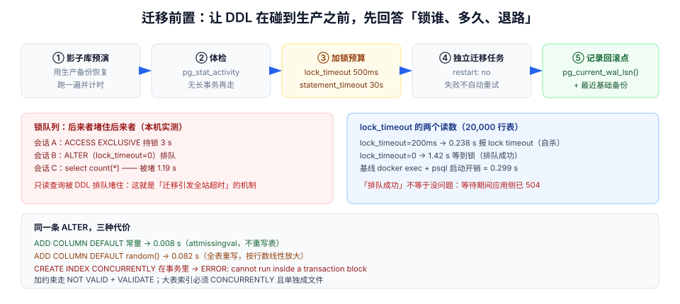

# 第 4 周第 3 步 · 迁移前置闸门：DDL 是发布链里唯一不可逆的动作

[上一步](../EnvParity/index.md)证明了三套环境的结构指纹一致——那说的是**发布后**。这一步说的是**发布中**：从旧结构到新结构的那几十秒里，库会发生什么。

发布链上其他东西都能退：镜像能换回旧 digest、配置能改回旧值、实例能重新拉起。**只有 DDL 退不回去**——`DROP COLUMN` 之后那列的数据真的没了，`RENAME` 之后旧代码真的会 `42703`。所以这一步的定位不是「让迁移更快」，而是：

::: tip 一句话
让每一条 DDL 在**碰到生产库之前**，就先回答三个问题：**它会锁多久、锁的是谁、退路在哪。**
:::

## 判据族声明

本页判据族 `MGP-A` ~ `MGP-H`，共 8 条。定义表在第八节。

## 本页不讲什么

- 不讲迁移的三分法（加列可退 / 改名不可退 / 删列只能向前）与发布步骤表，归 [发布与回滚手册](../ReleaseRunbook/index.md)。
- 不讲库表结构本身，归 [数据库设计](../Database/index.md)；不讲 Flyway 的目录与命名纪律，归 [工程骨架](../Bootstrap/index.md)。
- 不讲回滚时的数据补偿与 PITR 演练，归 [备份与恢复](../BackupRestore/index.md) 与本轮的 [回滚矩阵](../RollbackMatrix/index.md)。
- 不讲检索索引的 `create index concurrently` 特例（那是同一个机制的业务应用），归 [检索相关性联调](../BoardSearch/index.md)。



## 一、先分清「锁级别」，再谈「快不快」

PostgreSQL 的 DDL 不是一个整体，每条语句拿的锁不同，代价差三个数量级：

| 语句 | 拿的锁 | 阻塞谁 | 本机读数（20,000 行表） |
| --- | --- | --- | --- |
| `ADD COLUMN … DEFAULT <常量>` | `ACCESS EXCLUSIVE`（瞬时） | 所有读写，但只一瞬间 | **0.008 s**（无表重写，PG 11+ 走 attmissingval） |
| `ADD COLUMN … DEFAULT <易变表达式>` | `ACCESS EXCLUSIVE` + 全表重写 | 所有读写，直到重写完 | **0.082 s**（20,000 行；按行数线性放大） |
| `ADD COLUMN … NOT NULL`（无默认、表非空） | 直接失败 | —— | `ERROR: column "ver" of relation "card" contains null values` |
| `CREATE INDEX`（普通） | `SHARE`，阻塞写不阻塞读 | 写入全停 | 与表大小线性 |
| `CREATE INDEX CONCURRENTLY` | `SHARE UPDATE EXCLUSIVE` | 不阻塞读写；但**不能在事务里** | `ERROR: CREATE INDEX CONCURRENTLY cannot run inside a transaction block` |
| `ALTER TABLE … RENAME COLUMN` | `ACCESS EXCLUSIVE`（瞬时） | 所有读写；**旧代码此后全部 `42703`** | 瞬时，但语义不可逆 |
| `DROP COLUMN` | `ACCESS EXCLUSIVE`（瞬时） | 所有读写；**数据随列消失** | 瞬时，且不可恢复 |

`0.008 s` 与 `0.082 s` 的差别不在「快慢」，而在**要不要重写整张表**：常量默认值在 PG 11 之后写进 `pg_attribute.attmissingval`，不碰数据页；一旦默认值是 `random()`、`now()` 这类易变表达式，就必须逐行算一遍。20,000 行差 10 倍，2,000 万行就是**分钟级**的写阻塞。

## 二、实测：`lock_timeout` 让迁移「自杀」而不是「排队」

`ACCESS EXCLUSIVE` 与任何锁都冲突。如果此刻有一个长事务正拿着该表的锁，`ALTER` 会**排队等**——而排队本身是灾难的开始（见第三节）。

`lock_timeout` 的作用不是加速，而是**给排队设一个上限，超时就自己放弃**。实测（PG 18.6，Docker 沙盒，20,000 行表，另一个会话持 `ACCESS EXCLUSIVE` 3 秒）：

| 场景 | 设置 | 观测耗时（已扣除 0.299 s 的 `docker exec` + `psql` 启动开销） | 结果 |
| --- | --- | --- | --- |
| 持锁 3 s，迁移设 `lock_timeout='200ms'` | `SET lock_timeout='200ms'` | **0.238 s** | `ERROR: canceling statement due to lock timeout` |
| 持锁 2 s，迁移设 `lock_timeout=0` | 无上限 | **1.42 s** | `SET` 后 `ALTER TABLE` 成功（等到了锁） |
| 基线 | 一次 `select 1` | 0.299 s | —— |

**0.238 s 这个数字才是闸门**：它意味着「库被锁住时，迁移在 200 毫秒内退出，而不是把整个发布吊在那里」。而 1.42 s 看起来「也成功了」，但它成功的原因是**恰好只等了 1.4 秒**——如果持锁的是一条跑了 40 分钟的报表查询，这 1.42 秒会变成 2,400 秒，期间排队的所有请求全部超时。

::: danger 「成功了」不等于「没问题」
用 `lock_timeout=0` 跑完迁移，日志里只有一行 `ALTER TABLE`，看起来漂亮。但**等待期间发生的事不会留在迁移日志里**：应用侧的 504、连接池被打满、健康检查连续失败触发重启。上线复盘时你只能看到「迁移成功」，看不到「成功了但它堵了 14 秒」。给迁移设 `lock_timeout` 的第一个价值，是让这种「隐形事故」变成一个**显式的失败**。
:::

## 三、实测：排队中的 `ALTER` 会把普通 `SELECT` 一起堵住

这是 PostgreSQL 锁队列最反直觉的一条：**后来者插队会堵住后来者**。

场景：会话 A 持 `ACCESS EXCLUSIVE` 2 秒；会话 B 发出 `ALTER`（`lock_timeout=0`）开始排队；会话 C 发出一条**纯读** `select count(*) from t`。

| 观测 | 读数 |
| --- | --- |
| 会话 C 的 `select count(*)` 耗时（扣除 0.299 s 基线） | **1.19 s** |
| C 返回的行数 | 20,000（数据没错，只是等了） |

原因：`ACCESS EXCLUSIVE` 在队列里**排在 C 前面**，而 PG 的锁队列是**近似 FIFO**——C 不能越过 B 去和 A 共享锁，因为那会让 B 永远等不到（饿死）。于是**一条只读查询被一条 DDL 排队堵了 1.19 秒**。

这就是「迁移引发全站超时」的真实机制：不是 DDL 执行慢，是**DDL 在队列里当了一堵墙**。所以迁移必须满足两条：

1. `lock_timeout` 必须设（让墙在 200~500 ms 内自己拆掉）。
2. 迁移必须在**低峰且监控在位**时执行，且失败后**不自动重试**——自动重试会反复插队，把偶发的 200 ms 抖动放大成持续的锁风暴。

## 四、迁移前的体检 SQL：先找到「谁在挡路」

不要靠感觉判断「现在能不能迁」。执行前跑一条体检语句，把持锁者与长事务点名：

```sql
-- 迁移前置体检：谁在持锁、谁在等锁、事务开了多久
select pid,
       state,
       wait_event_type,
       pg_blocking_pids(pid)                        as blockers,
       round(extract(epoch from (now() - xact_start))::numeric, 2) as xact_age_s,
       left(query, 60)                              as query_head
from pg_stat_activity
where datname = current_database()
  and pid <> pg_backend_pid()
order by xact_age_s desc nulls last;
```

本机在「A 持锁、B 排队」时的真实输出（两行）：

| pid | state | wait_event_type | blockers | xact_age_s |
| --- | --- | --- | --- | --- |
| 62024 | active | `Timeout` | `{}` | 0.61 |
| 62031 | active | `Lock` | `{62024}` | 0.32 |

读法只有三步：

1. **`wait_event_type = Lock` 的行**就是「正在排队的人」，`blockers` 里是它的挡路者。
2. 顺着 `blockers` 找到持锁 pid，看 `xact_age_s`——**超过 5 s 就该等**，超过 60 s 说明有长事务（报表、手工 `BEGIN` 没提交、被 `pg_sleep` 卡住的脚本）。
3. `state = idle in transaction` 且 `xact_age_s` 很大，是**最危险的一类**：它什么都不干，只是把锁拿着不放。

## 五、迁移的五个前置动作

| # | 动作 | 具体做什么 | 不做会怎样 |
| --- | --- | --- | --- |
| 1 | **影子库预演** | 用生产备份恢复到沙盒，跑一遍迁移并计时 | 在生产上第一次跑，等于拿生产当测试环境 |
| 2 | **体检** | 上节 SQL，确认没有长事务 / 持锁者 | 迁移排队，全站超时 |
| 3 | **加锁预算** | `SET lock_timeout='500ms'; SET statement_timeout='30s'` | 排队无上限、DDL 跑飞 |
| 4 | **独立迁移任务** | 迁移作为单独的 Compose 服务 / Job，先于应用启动，`depends_on: service_completed_successfully` | 多实例同时迁移，Flyway 抢锁失败 |
| 5 | **记录与回滚点** | 迁移前记 `pg_current_wal_lsn()` 与最近一次基础备份位置 | 出事时不知道恢复到哪个点 |

第 4 条在本项目的形态（[部署脚本](../DeployScripts/index.md) 里的 `migrate` 服务）：

```yaml [compose.yaml（片段）]
services:
  migrate:
    image: registry/teamboard@sha256:5c1e…      # 与 app 同一 digest
    command: ["sh", "-c", "flyway -connectRetries=10 migrate"]
    environment:
      FLYWAY_URL: jdbc:postgresql://db:5432/teamboard
      FLYWAY_LOCK_RETRY_COUNT: "0"              # 抢不到锁就失败，不要无限重试
    depends_on:
      db: { condition: service_healthy }
    restart: "no"                               # 迁移失败不许自动重启
  app:
    depends_on:
      migrate: { condition: service_completed_successfully }
```

`restart: "no"` 与 `FLYWAY_LOCK_RETRY_COUNT: 0` 是两条纪律：迁移失败**必须停下来让人看**，自动重试只会把「一次锁冲突」变成「一串锁冲突」。

## 六、三条写法的成本对照（本项目实际用的）

| 需求 | ❌ 别这么写 | ✅ 这么写 | 理由 |
| --- | --- | --- | --- |
| 加一列带默认值 | `ADD COLUMN pos int NOT NULL DEFAULT (random()*100)::int` | `ADD COLUMN pos int NOT NULL DEFAULT 0`，需要随机值时**另起一次回填** | 易变默认值触发全表重写（示例 0.082 s vs 0.008 s，按行数放大） |
| 给大表加索引 | `CREATE INDEX idx ON card(...)` | `CREATE INDEX CONCURRENTLY idx ON card(...)`，且该脚本**单独一个迁移文件**、`executeInTransaction=false` | 普通 `CREATE INDEX` 拿 `SHARE` 锁阻塞全部写入 |
| 加约束 | `ADD CONSTRAINT ... CHECK (...)` | `ADD CONSTRAINT ... CHECK (...) NOT VALID` + 之后 `VALIDATE CONSTRAINT` | `NOT VALID` 只拿短暂锁，`VALIDATE` 拿 `SHARE UPDATE EXCLUSIVE`，不阻塞读写 |

::: warning `CONCURRENTLY` 的三个副作用
1. **失败会留下 `INVALID` 索引**：`indisvalid = false` 的索引仍会被写入维护，但查询不用它。必须检查并 `DROP INDEX CONCURRENTLY` 重来。
2. **不能在事务块里**（实测报错见第一节），Flyway 需要显式关掉事务包装。
3. **执行时间更长**：它要扫两遍表。所以它适合「不能停写」的场景，不是「更快」的方案。
:::

## 七、迁移脚本的四个自查问题

写完一个迁移文件，按顺序问四句：

1. **它锁谁、锁多久？** 对照第一节的表格，能说出锁级别与量级。
2. **它在旧代码还在跑的时候安全吗？** 旧代码不会写新列 → 新列必须有默认值或可空（实测：`NOT NULL` 无默认会让旧代码插入直接失败，见 [回滚矩阵](../RollbackMatrix/index.md) 场景 B）。
3. **它能不能在 30 秒内跑完？** 跑不完就拆：加列 / 回填 / 加约束 / 删旧列，四次发布做完。
4. **它的退路是什么？** 能 `DROP COLUMN` 退（丢数据）还是只能向前？写进 [发布与回滚手册](../ReleaseRunbook/index.md) 的迁移清单。

## 八、判据表

| 编号 | 规则 | 违反时的样子 | 怎么验证 |
| --- | --- | --- | --- |
| `MGP-A` | 迁移会话必须设 `lock_timeout`（≤ 500 ms）与 `statement_timeout` | 发布吊死、全站 504 | 命令①，迁移日志里出现 `lock timeout` 或配置里显式 `SET` |
| `MGP-B` | 迁移前跑体检 SQL，无 > 5 s 的长事务 | 迁移排队、只读被堵 | 命令②，输出中 `xact_age_s` 均 < 5 |
| `MGP-C` | 迁移是独立任务，失败不自动重启 | 多实例抢锁、失败后无限重试 | `docker compose ps` 中 `migrate` 为 `Exited (0)` |
| `MGP-D` | 大表索引一律 `CONCURRENTLY` 且单独成文件 | 写入全停 | 命令③，`CREATE INDEX` 非 `CONCURRENTLY` 的命中数为 0 |
| `MGP-E` | `CONCURRENTLY` 失败后检查 `indisvalid` | 留下无效索引，查询不用它 | 命令④，`indisvalid` 全为 `t` |
| `MGP-F` | 易变默认值禁止直接进 `ADD COLUMN` | 全表重写，写阻塞分钟级 | `grep -nE 'DEFAULT *\(' migrations/` 人工复核 |
| `MGP-G` | 加约束走 `NOT VALID` + `VALIDATE` | 加约束期间写入全停 | 迁移文件里两条语句成对出现 |
| `MGP-H` | 迁移前记录 WAL 位置与备份点 | 出事不知道恢复到哪 | 命令⑤，两行输出齐全 |

## 验证命令

```shell
# ① MGP-A：迁移脚本里必须有 lock_timeout（Flyway 的每条迁移都会执行它）
grep -rn "lock_timeout" migrations/ | wc -l
# 期望：≥ 迁移文件数（推荐放在 V1 或 flyway.conf 的 initSql 里一次性设置）

# ② MGP-B：迁移前体检（在目标库执行，人工判读）
psql "$DATABASE_URL" -c "select pid, state, wait_event_type,
  pg_blocking_pids(pid) blockers,
  round(extract(epoch from (now()-xact_start))::numeric,2) xact_age_s
  from pg_stat_activity where datname=current_database() and pid<>pg_backend_pid()
  order by xact_age_s desc nulls last limit 10;"
# 期望：没有 wait_event_type=Lock 的行；xact_age_s 均 < 5

# ③ MGP-D：不许出现非并发的 CREATE INDEX
grep -rnE 'create +index' migrations/ | grep -vi concurrently
# 期望：无输出；有输出则确认该表行数是否真的小到可以锁（并写进注释）

# ④ MGP-E：并发建索引后校验有效性
psql "$DATABASE_URL" -c "select c.relname, i.indisvalid
  from pg_index i join pg_class c on c.oid=i.indexrelid
  where not i.indisvalid;"
# 期望：0 行。有行 = 上次 CONCURRENTLY 失败，需 DROP INDEX CONCURRENTLY 重建

# ⑤ MGP-H：迁移前记录恢复点
psql "$DATABASE_URL" -c "select pg_current_wal_lsn() as lsn, now();"
```

## 九、下一步

DDL 通过了闸门，接下来是**替换实例**：`docker compose up -d` 或滚动更新时，旧实例被 `SIGTERM`，新实例开始接流量。这中间有一个所有团队都以为自己处理好了、实测却 100% 丢请求的窗口。

归第 4 周第 4 步 [优雅退出与滚动替换](../GracefulDrain/index.md)：同一份 200 个在途请求的压测，直接 `exit` 是 **200 个 `ECONNRESET`**，优雅 drain 是 **200 个 200**、耗时 472 ms。
