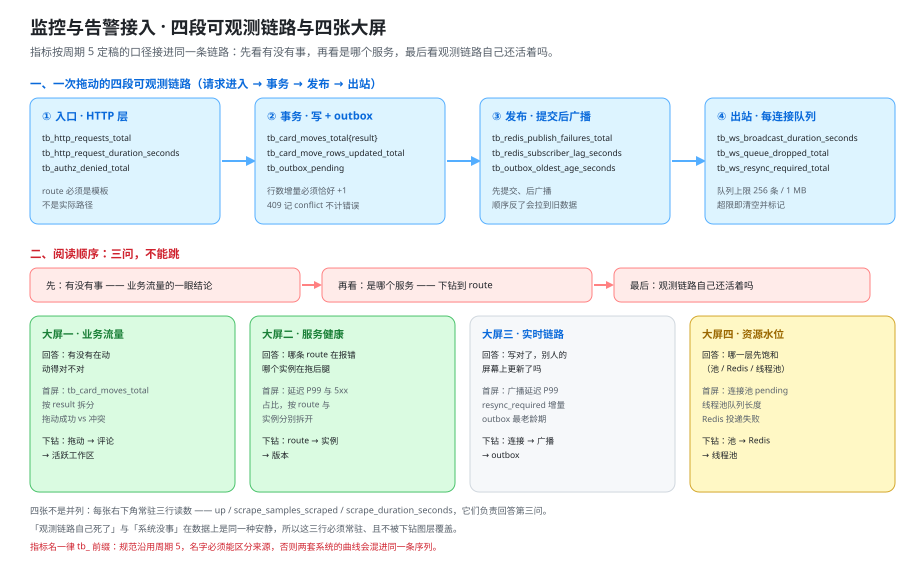

# 监控与告警接入：把本项目的指标接进周期 5 那条链路

这一页回答「本项目的指标按什么口径暴露出去、告警挂在哪几条规则上、四张大屏各自看什么」——它把 [压测与容量验收](../CapacityTest/index.md) 里量出来的四个场景模型、[实时网关](../RealtimeGateway/index.md) 里的连接与背压口径，收敛成一套**能被采集、能被判定、能被叫醒**的读数；它**不回答**「栈怎么编排起来」（那是 [部署脚本](../DeployScripts/index.md) 的事）、「密钥与采集器凭据放在哪」（那是 [配置与密钥](../ConfigSecrets/index.md) 的事）、「告警响了之后先跑哪条命令」（那是 [发布与回滚手册](../ReleaseRunbook/index.md) 与 [交付文档](../DeliveryDocs/index.md) 的事）。



::: warning 本仓库只有文档，没有代码
下面的 `application.yml`、采集任务、规则文件与 `curl` 命令，都要在**你自己搭好的工程**里执行。本仓库不存放源码、脚本、SQL 与配置文件；「运行 `curl /actuator/prometheus`」一律指「先按本节把端点与采集任务配好，再执行」。
:::

## 一、与周期 5 的关系：它观测别人，本项目被观测

周期 5 的 [实时监控大盘](../../MonitoringDashboard/index.md) 自己就是那套**采集 → 存储 → 规则 → 路由 → 大盘**的链路，它的项目在**观测别人的系统**；本项目反过来：**它不是监控系统，它是被监控对象**。因此本页的口径只有一句：

> **继承那条链路的组织方式与命名规范，自己补的是本项目的业务指标与实时链路指标。**

| 维度 | 从周期 5 继承什么 | 本项目自己补什么 |
| --- | --- | --- |
| 采集 | `job` / `instance` 由**采集端注入**，应用侧不得注入（注入会被改名成 `exported_instance`）；抓取间隔 15 s、超时 5 s 的口径 | 一条新的抓取任务 `job="board"`，指向本项目的端点 |
| 规则 | recording 命名三段式 `level:metric:operations`（如 `svc:http_error_ratio:rate5m`）；`for` 用**抖动周期**定值；分组 / 抑制 / 静默三道闸门 | 本项目的 recording（拖动成本、错误率）与 6 条告警 |
| 路由 | `severity` + `team` 必填；`summary` / `description` / `runbook_url` 注解四件套；一个根因只叫人一次 | 本项目的 `team` 取值与 `runbook_url` 指向 [故障应对索引](../DeliveryDocs/index.md) |
| 大盘 | 组织方式（总览 → 详情 → 自监控）与「有序列 / 值可解释 / 空值可识别」的判据 | 四张（多一张「实时链路」）；自监控降级为每张的**常驻角落** |

::: tip 一句话判据
周期 5 的判据回答「**你的采集链路自己还活着吗**」；本项目的判据回答「**这条协作链路在别人屏幕上是活的吗**」。前者已经存在、不需要重写；后者只能在**被观测的那一端**新写。
:::

::: danger 三处「另起一套」的写法
1. **自己起一套采集器与告警组件**：看起来更独立，实际会得到两条互不可见的链路。正确写法是**复用已有的采集器与告警路由**，本项目只加「一个抓取目标 + 一组规则文件」。
2. **给指标名换一套命名风格**（驼峰名、无单位后缀）：大盘与告警要在两套风格之间做映射。正确写法是 `_total` / `_seconds` / `_ratio` 后缀 + 三段式 recording 命名——**写进规则里能一眼看出窗口**。
3. **把周期 5 的指标名直接搬过来用**：两套系统的曲线会混进同一条序列，一个数字同时属于两个含义。正确写法是**规范可以搬、名字不能搬**——本项目统一用 `tb_` 前缀（TeamBoard）。
:::

## 二、指标清单：四组、每条都要写出基数上限

指标名（含单位后缀与 `_total` / `_seconds` 约定）、类型（counter / gauge / histogram）、标签与**基数上限（cardinality budget）**四样缺一不可。上限不是提醒，而是**可校验**：抓一次端点，逐个指标数序列数，越界即判缺陷。

### 2.1 HTTP 层：有没有在动、动得对不对

| 指标名 | 类型 | 标签与基数上限 | 口径 |
| --- | --- | --- | --- |
| `tb_http_requests_total` | counter（`_total`） | `route` ≤ 40 · `method` ≤ 7 · `status` ≤ 12 | 按**路由模板**计数的请求数；`route` 取 `/api/v1/boards/{boardId}/cards/{cardId}/move`，不是实际路径 |
| `tb_http_request_duration_seconds` | histogram（`_seconds`） | 同上 + `le`（桶 ≤ 12） | 请求延迟分布，`P95` / `P99` 都由它算，**不在应用侧预先算分位** |
| `tb_authz_denied_total` | counter（`_total`） | `code` ∈ {401, 403, 404, 422} ≤ 4 | 被拒的越权请求；`409` **不进这里**（它是并发冲突的合法结果） |
| `tb:http_error_ratio:rate5m` | recording（继承周期 5 命名） | 继承 `route` | 分子分母先分别聚合再相除，不要先算比率再平均 |

### 2.2 业务层：产品上发生了什么

| 指标名 | 类型 | 标签与基数上限 | 口径 |
| --- | --- | --- | --- |
| `tb_card_moves_total` | counter（`_total`） | `result` ∈ {moved, conflict, rejected} ≤ 3 | 拖动次数按结果拆分；`409` 记 `conflict`，**不计入错误率** |
| `tb_card_move_rows_updated_total` | counter（`_total`） | 无额外标签 ≤ 1 | 拖动累计更新的行数；判据：增量 == `result="moved"` 的增量（成本判据「一次拖动只更新一行」的读数） |
| `tb_comments_total` | counter（`_total`） | `has_mention` ∈ {true, false} ≤ 2 | 评论数；**提及了谁不进标签** |
| `tb_active_workspaces` | gauge | 无 ≤ 1 | 近 15 分钟内有写动作的工作区数（产品口径） |
| `tb_online_users` | gauge | 无 ≤ 1 | 产品口径的在线人数（来自业务库会话表），与实时链路口径**分开**（见下） |

### 2.3 实时链路：写对了，但别人屏幕上更新了吗

| 指标名 | 类型 | 标签与基数上限 | 口径 |
| --- | --- | --- | --- |
| `tb_ws_connections` | gauge | 无 ≤ 1 | 本实例当前持有的连接数 |
| `tb_ws_connections_opened_total` | counter（`_total`） | 无 ≤ 1 | 新建连接速率——扩容的**第一判据**（连接建立要握手 + 验票 + 订阅鉴权） |
| `tb_ws_broadcast_duration_seconds` | histogram（`_seconds`） | `board_shard` ≤ 8 | 从「从 Redis 收到」到「写完本实例 socket」的延迟；容量判据是 **1 s** |
| `tb_ws_queue_dropped_total` | counter（`_total`） | 无 ≤ 1 | 每连接发送队列丢弃的事件数（超 256 条 / 1 MB 即清空队列） |
| `tb_ws_resync_required_total` | counter（`_total`） | `reason` ∈ {queue_overflow, seq_gap, client_reload} ≤ 3 | 推了 `resync_required` 的次数；**突然上涨通常意味着推送链路早就坏了** |
| `tb_outbox_pending` | gauge | 无 ≤ 1 | outbox 待投递条数 |
| `tb_outbox_oldest_age_seconds` | gauge（`_seconds`） | 无 ≤ 1 | **最老未投递事件的存在时长**；比条数更早报警（条数很低但龄期很大 = 投递卡住） |

::: tip 两组「在线人数」不要互相替代
业务层的 `tb_active_workspaces` / `tb_online_users` 是**产品口径**，来自业务库的统计，回答「有多少人在用」；实时链路的 `tb_ws_connections` 是**链路口径**，来自网关本机，回答「推送链路健不健康」。两者数值接近、语义不同：**产品口径降而链路口径不降**，说明连接没被回收（半开连接占着）。
:::

### 2.4 资源层：哪一层先饱和

| 指标名 | 类型 | 标签与基数上限 | 口径 |
| --- | --- | --- | --- |
| `tb_db_pool_active` | gauge | `pool` ≤ 4 | 连接池活跃连接数（「忙」） |
| `tb_db_pool_pending` | gauge | `pool` ≤ 4 | 等待连接的请求数（「堵」）——**非 0 即排队，比活跃数更该报警** |
| `tb_executor_queue_size` | gauge | `executor` ≤ 6 | 线程池队列长度（异步投递与广播都用它） |
| `tb_redis_publish_failures_total` | counter（`_total`） | 无 ≤ 1 | 发布失败次数；Redis 不可用时的降级读数 |
| `tb_redis_subscriber_lag_seconds` | gauge（`_seconds`） | 无 ≤ 1 | 订阅者落后时长 |

::: danger 高基数黑名单：四个字段永远不进标签
1. **`card_id`（卡片 ID）**：序列数会等于卡片数（50 万量级）。正确写法是——要按卡片下钻，走日志或 `board_events` 表，**指标里只留聚合后的总数**。
2. **`board_id`（看板 ID）**：序列数等于看板数，且随业务无上限增长。正确写法是——需要分看板观察时用 `board_shard`（把 ID 取模成 ≤ 8 个桶），或按工作区规模分层。
3. **`user_id`（用户 ID）**：10 万用户 = 10 万条序列。正确写法是——只在 `tb_active_workspaces` / `tb_online_users` 里聚合成**一个总数**，不做按人拆分的序列。
4. **`client_op_id`（幂等键）**：每个请求一个新值，等于给每个请求造一条序列。正确写法是——它只出现在日志与 `audit_log` 里，**标签列里不许出现**。
:::

## 三、`/actuator/prometheus` 的接入与三条纪律

Spring Boot 的 Actuator 默认把 Prometheus 端点（endpoint）挂在 `/actuator/prometheus`，直接输出 Prometheus 文本格式，采集器抓它即可。**但它默认对所有人开放**——这是本节三条纪律的第一条。

```yaml [app/src/main/resources/application.yml]
management:
  endpoints:
    web:
      exposure:
        include: health,prometheus     # 只暴露这两个；不要 include: "*"
  endpoint:
    health:
      show-details: never              # 健康详情会泄漏内部组件名与连接串
  metrics:
    tags:
      service: team-board              # 公共标签只注入 service 与 env
      env: ${ENV}
server:
  port: 8080
```

```yaml [deploy/prometheus/scrape.yaml —— 追加进周期 5 的采集配置]
scrape_configs:
  - job_name: board
    metrics_path: /actuator/prometheus
    scrape_interval: 15s
    scrape_timeout: 5s
    static_configs:
      - targets: ['host.docker.internal:8080']
```

| # | 纪律 | 违反后的现象 | 判据 |
| --- | --- | --- | --- |
| 1 | **端点不对外** | 全部内部指标名、`route` 模板与错误码分布被读到；端口绑到 `0.0.0.0` 时公网可读 | 容器端口只绑 `127.0.0.1`，或只在内部网络暴露 |
| 2 | **只给采集器网段** | 任何容器都能抓，指标可被伪造与放大 | 反向代理或防火墙只允许采集器网段访问该路径 |
| 3 | **指标名不得与既有契约冲突** | 与周期 5 重名或自行改名时，**大盘静默变空**：查询不报错、只是没有序列 | 名字先登记，改名前跑一次「指标名与大盘查询对账」 |

::: danger 改名是静默故障：`ALERTS` 为空与一切正常长得一样
```text
改名前：tb_card_moves_total{result="moved"} = 1234    → 大盘有曲线
改名后：查询同一个名字 → 空向量（empty vector）
```

空向量与「今天真的没有拖动」**完全同形**：HTTP 层 `status: success`、面板不报错、告警不响（不存在的指标不会触发阈值）。周期 5 已经踩过同一族坑（`count(up == 0)` 的空向量与真正的 `0` 无法区分），处置写死为两条：查询侧一律用 `or vector(0)` 兜底；交付侧在 [上线验收](../LaunchAcceptance/index.md) 里保留一条「指标名与大盘查询对账」的勾选项。
:::

## 四、告警规则：本项目要挂的六条

六条**都挂在同一条已有链路上**（周期 5 的规则引擎 + 告警路由），本节只写条件、`for` 的定值依据，以及**它为什么会静默失效**。

| 告警名 | 表达式要点 | `for` 与定值依据 | 为什么会静默失效 |
| --- | --- | --- | --- |
| **`MoveLatencyHigh`** | `histogram_quantile(0.95, sum by (le, route) (rate(tb_http_request_duration_seconds_bucket{route=~".*move"}[5m]))) > 0.3` | `for: 10m`——抓取间隔 15 s 的 40 倍；拖动是用户直接感知的操作，容忍度低于后台任务 | `route` 用了实际路径（`/cards/123/move`）而不是模板 → 选择器匹配不到 → `ALERTS` 为空 |
| **`RealtimeFanoutLag`** | `histogram_quantile(0.99, sum by (le) (rate(tb_ws_broadcast_duration_seconds_bucket[5m]))) > 1` | `for: 5m`——容量判据是 1 s，取 5 m 是为了不把一次 GC 当故障 | 规则里带了 `instance`：多实例时每台各自评估，**另一台的慢广播看不见** |
| **`OutboxBacklogAge`** | `max(tb_outbox_oldest_age_seconds) > 300` | `for: 5m`——够投递循环重试两轮 | 只挂 `tb_outbox_pending > N`：条数一直很低（循环卡在单条重试），**条数少、龄期大**才是该报的形态 |
| **`WsConnDrop`** | `sum(rate(tb_ws_connections_opened_total[5m])) < 0.1 and sum(tb_ws_connections) > 100` | `for: 10m`——连接数变化本身就是分钟级 | 只判 `tb_ws_connections == 0`（全断才响），而**连接数虚高**（半开连接占着资源）看起来完全正常 |
| **`DbPoolSaturated`** | `tb_db_pool_pending > 0` | `for: 5m`——等待数持续非 0 就不是抖动 | 写成 `active / max > 0.9`：**池已满但请求在排队**时活跃数本来就是满值，两者差别是「忙」与「堵」 |
| **`ErrorRateHigh`** | `tb:http_error_ratio:rate5m > 0.05` | `for: 10m`——沿用周期 5 `HighErrorRate` 的定值，让两个项目的告警语义可比 | 把 `409` 算进错误率 → 每次并发拖动都报一次 → 三天后没人再看这段告警 |

```yaml [deploy/prometheus/rules/board-alerts.yaml —— 结构与两条关键规则]
groups:
  - name: board_alerts
    interval: 30s
    rules:
      # 主判据是「龄期」而不是「条数」：投递卡在单条上时条数一直很低
      - alert: OutboxBacklogAge
        expr: max(tb_outbox_oldest_age_seconds) > 300
        for: 5m
        labels:
          severity: critical
          team: board-backend
        annotations:
          summary: "最老未投递通知已积压超过 5 分钟"
          description: "先确认投递循环是否卡在单条重试，再确认 outbox 表是否还能写入。"
          runbook_url: "https://runbook.internal/team-board/outbox-backlog"

      # 分母只取 5xx：409 是并发冲突的合法结果，进分母会让告警失去意义
      - alert: ErrorRateHigh
        expr: tb:http_error_ratio:rate5m > 0.05
        for: 10m
        labels:
          severity: warning
          team: board-backend
        annotations:
          summary: "路由 {{ $labels.route }} 的 5xx 占比超过 5%"
          description: "先看最近变更，再看该路由的下游依赖；409 不计入本指标。"
          runbook_url: "https://runbook.internal/team-board/error-rate"
```

```shell
# 规则文件的语法与表达式校验（本机静态可判，只要 promtool 二进制）
promtool check rules deploy/prometheus/rules/board-alerts.yaml
# 期望：SUCCESS: 6 rules found
```

::: tip `ALERTS` 为空与一切正常长得一样
这是本节最值钱的一句话：**告警不响有两种原因**——真的没事，与选择器压根匹配不上。二者的观测面**完全一样**（`ALERTS` 为空、无通知、无报错）。唯一的处置方式是在清单里放一条**主动校验**：造一次真故障，确认它从 `inactive` 走到 `pending` 再到 `firing`；周期 5 的 `RL-D/E/F` 就是这个形状。
:::

## 五、四张大屏：各自回答什么、首屏看什么

| 大屏 | 它回答什么 | 首屏看什么 | 下钻路径 |
| --- | --- | --- | --- |
| **业务流量** | 有没有在动、动得对不对 | `tb_card_moves_total` 按 `result` 的构成比（moved vs conflict）与总量趋势 | 拖动 → 评论 → 活跃工作区 |
| **服务健康** | 哪条 `route` 在报错、哪个实例在拖后腿 | `P99` 延迟与 5xx 占比，按 `route` 与实例分别拆开 | 路由 → 实例 → 版本 |
| **实时链路** | 写对了，别人屏幕上更新了吗 | 广播延迟 `P99`、`resync_required` 的增量、outbox 最老龄期 | 连接 → 广播 → outbox |
| **资源水位** | 哪一层先饱和 | 连接池 `pending`、线程池队列长度、Redis 投递失败 | 连接池 → Redis → 线程池 |

阅读顺序写死为三问，**不许跳**：

```text
先：有没有事      —— 业务流量 + 服务健康的一眼结论（总量、错误率、延迟分位）
再：是哪个服务    —— 下钻到 route 与实例，把「系统慢」收敛到一个具体位置
最后：观测链路自己还活着吗 —— up 与抓到的样本数；这一问不通过，前两问的结论全部作废
```

::: danger 每张大屏必须有一个常驻角落
周期 5 把「自监控」单独作为第三张大屏；本项目只有四张、且多了一张「实时链路」，于是**把自监控降级为每张角落的常驻读数**。否则第三问无处可问：

1. **`up{job="board"}`**（目标活着吗）——正确写法是常驻，不随下钻图层切换。
2. **`scrape_samples_scraped{job="board"}`**（活着但抓不到样本吗）——这正是周期 5 的 `C2` 失败模式：可达但零样本，多为暴露路径、鉴权或过滤器写错。
3. **`scrape_duration_seconds{job="board"}`**（抓取耗时）——它变慢说明被测端本身已经变形。

**「观测链路自己死了」与「系统没事」在数据上是同一种安静**，所以这三行必须固定、且不允许被下钻图层覆盖。
:::

## 六、一次拖动的可观测链路：四段观测点与「不做链路追踪」的代价

| 段 | 时间点 | 观测点（指标） | 这一段坏了你会看到什么 |
| --- | --- | --- | --- |
| **① 入口** | 请求进入 HTTP 层 | `tb_http_requests_total{route, method, status}`、`tb_http_request_duration_seconds`、`tb_authz_denied_total{code}` | `401` / `404` / `422` 分得清；`409` 单独计，不污染错误率 |
| **② 事务** | 写 `cards` + `board_events` + outbox，提交 | `tb_card_move_rows_updated_total`、`tb_outbox_pending`、`tb_card_moves_total{result}` | 行数增量大于 1 → 成本判据破了（见 [卡片拖动](../CardMove/index.md)） |
| **③ 发布** | 提交**成功之后**投到 Redis 频道 `board:{boardId}` | `tb_redis_publish_failures_total`、`tb_redis_subscriber_lag_seconds`、`tb_outbox_oldest_age_seconds` | 发布失败：写成功、别人看不到（[实时网关](../RealtimeGateway/index.md) 第五节） |
| **④ 出站** | 各实例按 `seq` 推给自己持有的连接 | `tb_ws_broadcast_duration_seconds`、`tb_ws_queue_dropped_total`、`tb_ws_resync_required_total`、`tb_ws_connections` | 队列丢弃与 `resync_required` 上涨 = 有人屏幕开始偏旧 |

**取舍：本项目只做指标，不做链路追踪（tracing）。** 这个取舍必须把代价一起写清，否则它只是一句省略：

| 做了什么 | 换来什么 | 代价 |
| --- | --- | --- |
| 只做指标、不做链路追踪 | 每条读数都是低基数、可长期保留，大盘与告警能直接消费，不需要采样与额外存储 | **无法回答「这一条拖动具体慢在哪一段」**：跨实例的慢广播只能靠 `seq` 与日志拼时间戳 |
| 把 ID 类字段留在日志与 `board_events`，不进标签 | 基数受控（见第二节黑名单） | 排障要在两套系统之间跳；所以**请求 ID 必须同时出现在响应头与日志里**，作为唯一的连接点 |

::: tip 「不做链路追踪」是取舍，不是省略
写清代价之后这条取舍才可被复核：**指标回答「哪一段系统性变慢了」，日志回答「这一条去哪了」。** 把两者混起来（例如把请求 ID 塞进标签）会同时失去指标的低基数与日志的可检索性。
:::

## 七、判据族：`MO-A ~ MO-H`

### 7.1 判据族声明

| 项 | 内容 |
| --- | --- |
| 族名 | `MO`（Monitoring，监控接入） |
| 条数 | **8** |
| 覆盖 | 继承口径 1 条 · 指标清单 2 条 · 端点纪律 1 条 · 告警 1 条 · 大屏 1 条 · 可观测链路 1 条 · 运行期 1 条 |
| 级别分布 | 文档级 7 + 运行期 1 |
| 与相邻族的关系 | 不重复 [压测与容量验收](../CapacityTest/index.md) 的 `CAP-*`（那里定容量结论，这里定读数口径），也不重复 [实时网关](../RealtimeGateway/index.md) 的 `RT-*`（那里定网关实现口径，这里定它暴露什么） |
| 运行期判据的唯一阻塞项 | **本仓库无工程代码**——不是容器运行时：本机 `docker` 客户端与服务端均为 27.1.1、`docker compose` 为 v2.29.1（[第 3 周验收结论](../Week3Acceptance/index.md) 第三节已更正该口径） |

### 7.2 判据定义

| 判据 | 判什么 | 级别 | 状态 |
| --- | --- | --- | --- |
| **`MO-A`** | 与周期 5 的关系写清（继承四项 / 自补三项 + 一句话判据） | 文档级 | ✅ 本机可判 |
| **`MO-B`** | 指标清单四组齐全（HTTP / 业务 / 实时链路 / 资源），每条含类型、单位后缀、标签与基数上限 | 文档级 | ✅ 本机可判 |
| **`MO-C`** | 高基数黑名单写死四个字段（`card_id` / `board_id` / `user_id` / `client_op_id`）且各给正确写法 | 文档级 | ✅ 本机可判 |
| **`MO-D`** | 端点三条纪律齐全（不对外 / 只给采集器网段 / 指标名不与既有契约冲突），并写明改名是静默故障 | 文档级 | ✅ 本机可判 |
| **`MO-E`** | 六条告警齐全，每条给表达式要点、`for` 定值依据与静默失效方式 | 文档级 | ✅ 本机可判 |
| **`MO-F`** | 四张大屏各自的问题与三问阅读顺序写死，且「自监控降级为常驻角落」写明 | 文档级 | ✅ 本机可判 |
| **`MO-G`** | 一次拖动的四段观测点写清，且「不做链路追踪」的代价与唯一连接点写死 | 文档级 | ✅ 本机可判 |
| **`MO-H`** | 六条告警各真响一次、四张大屏都有非空序列，且成本判据读数恰好 `+1` | 运行期 | `⏳ 未跑 · 原因：本仓库无工程代码（BL-2）` |

## 当日做了什么

1. 写清**与周期 5 的关系**：周期 5 观测别人、本项目被观测，给出「继承四项（采集 / 规则 / 路由 / 大盘）与自补三项（业务指标 / 实时链路指标 / 第四张大屏）」的对照表，并写死「另起一套」的三处错法与正确写法。
2. 产出**四组指标清单**（HTTP 层 / 业务层 / 实时链路 / 资源层，共 20 条），每条给出指标名、类型、单位后缀、标签与**基数上限**；实时链路一组是本项目特有的，覆盖连接、广播延迟、`resync_required`、队列丢弃与 outbox 积压 / 最老龄期。
3. 写死**高基数黑名单**（`card_id` / `board_id` / `user_id` / `client_op_id`）并给每个字段的正确替代写法（日志、`board_events`、`board_shard` 分桶、聚合总数）。
4. 定稿 **`/actuator/prometheus` 的接入**（`application.yml` + 采集任务片段）与三条纪律；把「改名导致大盘静默变空」的机制与处置（`or vector(0)` 兜底 + 交付清单勾选项）写明。
5. 定稿**六条告警**（`MoveLatencyHigh` / `RealtimeFanoutLag` / `OutboxBacklogAge` / `WsConnDrop` / `DbPoolSaturated` / `ErrorRateHigh`），逐条给出表达式要点、`for` 定值依据与**为什么它会静默失效**，并给出规则文件骨架与 `promtool check rules` 的静态校验。
6. 定稿**四张大屏**的问题与首屏读数，写死三问阅读顺序；把周期 5 的「自监控大屏」降级为**每张角落的常驻三行读数**，理由是「观测链路自己死了」与「系统没事」在数据上同一种安静。
7. 画出**一次拖动的四段可观测链路**（入口 / 事务 / 发布 / 出站）并写清「只做指标、不做链路追踪」的取舍与两条代价，给出请求 ID 这一唯一连接点。
8. 产出 **`MO-A ~ MO-H` 八条判据**：七条文档级、本机可判，一条运行期如实标 `⏳`（原因：本仓库无工程代码）。

## 如何验证

### 8.1 本机静态可判的部分

```shell
cd project/Complete/TeamBoard/Monitoring

# MO-A：继承与自补的对照表（四行）+ 一句话判据
grep -cE '^\| (采集|规则|路由|大盘) \|' index.md            # 期望 4
grep -c '规范可以搬、名字不能搬' index.md                    # 期望 2

# MO-B：四组指标分小节 + 20 条指标行
grep -cE '^### 2\.[1-4] ' index.md                          # 期望 4
grep -cE '^\| `tb_[a-z_]+' index.md                         # 期望 20

# MO-C：高基数黑名单四个字段
grep -cE '^[0-9]\. \*\*`(card_id|board_id|user_id|client_op_id)`' index.md   # 期望 4

# MO-D：端点三条纪律 + 静默故障一句
grep -cE '^\| [123] \| \*\*(端点不对外|只给采集器网段|指标名不得与既有契约冲突)\*\* \|' index.md  # 期望 3
grep -c '空向量（empty vector）' index.md                    # 期望 2

# MO-E：六条告警齐 + for 定值依据齐
grep -cE '^\| \*\*`(MoveLatencyHigh|RealtimeFanoutLag|OutboxBacklogAge|WsConnDrop|DbPoolSaturated|ErrorRateHigh)`\*\* \|' index.md   # 期望 6
grep -c '为什么会静默失效' index.md                          # 期望 3

# MO-F：四张大屏 + 三问顺序
grep -cE '^\| \*\*(业务流量|服务健康|实时链路|资源水位)\*\* \|' index.md   # 期望 4
grep -c '观测链路自己还活着吗' index.md                       # 期望 2

# MO-G：四段观测点 + 取舍
grep -cE '^\| \*\*[①②③④] ' index.md                        # 期望 4
grep -c '不做链路追踪' index.md                              # 期望 7

# 端点与规则文件的两个 curl / promtool 入口是否给出（静态检查命令本身存在）
grep -c 'curl -s localhost:8080/actuator/prometheus' index.md   # 期望 3
grep -c 'promtool check rules' index.md                        # 期望 3

# 指标名与大盘查询对账：第五节引用的指标名必须都在第二节登记过（差集为空）
sed -n '/^## 五、/,/^## 六、/p' index.md | grep -oE 'tb_[a-z_]+' | sort -u > /tmp/mo_dash.txt
sed -n '/^## 二、/,/^## 三、/p' index.md | grep -oE 'tb_[a-z_]+' | sort -u > /tmp/mo_dict.txt
comm -23 /tmp/mo_dash.txt /tmp/mo_dict.txt                     # 期望：无输出

# 配图与判据条数
grep -c 'assets/tb-monitoring.sv[g]' index.md                  # 期望 1
grep -cE '^\| \*\*`MO-[A-H]`\*\* \|' index.md                  # 期望 8
wc -l index.md                                                 # 期望 280 ~ 400
```

**预期结果读法**：上面的期望值都是**本机实跑后回填**的，不是从模式里反推的。其中「指标名与大盘查询对账」那条是本节最有价值的一条静态检查——它把「大盘上写了未登记的指标名」这类**只会在运行期表现为空面板**的缺陷，提前拦在了文档阶段。

### 8.2 需要真实环境的部分

`MO-H` 的判据对象是**真跑起来的栈 + 采集器 + 告警路由**，本仓库按约定只有文档，因此如实标 `⏳ 未跑`，只给命令：

```shell
# MO-H（需要：容器运行时 + 工程代码；本机 docker 27.1.1 / compose v2.29.1 可用，缺的是工程）
# ① 端点被抓到，且带 tb_ 前缀的序列非空
curl -s localhost:8080/actuator/prometheus | grep -c '^tb_'          # 期望：> 0
# ② 反例：未登记的名字必须查得到「空向量」而不是报错（这就是静默故障的样子）
curl -s --get --data-urlencode 'query=tb_does_not_exist' localhost:19090/api/v1/query
curl -s --get --data-urlencode 'query=tb_does_not_exist or vector(0)' localhost:19090/api/v1/query
# ③ 六条规则已加载且状态可读
curl -s localhost:19090/api/v1/rules | python3 -c "import json,sys;print(sorted(r['name'] for g in json.load(sys.stdin)['data']['groups'] for r in g['rules'] if r['type']=='alerting'))"
# ④ 造一次真故障（停掉工程实例），确认 WsConnDrop / RealtimeFanoutLag 从 inactive 走到 firing
# ⑤ 成本判据的读数：拖动前后各读一次，期望恰好 +1
curl -s localhost:8080/actuator/prometheus | grep '^tb_card_move_rows_updated_total'
```

::: warning 状态列的读法
`MO-A` ~ `MO-G` 的结论是**逐条 `grep` 数出来的**，不是推断的；`MO-H` 的状态不是「结论」而是「当前可执行性」，它的唯一阻塞项是**本仓库没有可执行的工程与前端**（`BL-2`）——**不是容器运行时**：本机实测 `docker version` 为 Client/Server 27.1.1、`docker compose version` 为 v2.29.1（2026-10-17 复验），这处口径的更正见 [第 3 周验收结论](../Week3Acceptance/index.md) 第三节。**不把「跑过了」写成「通过了」，也不把期望值抄进状态列。**
:::

## 下一步

1. **把抓取任务与规则文件的位置写进 [部署脚本](../DeployScripts/index.md) 与 [配置与密钥](../ConfigSecrets/index.md)**：采集器地址、网段允许名单与 `runbook_url` 的基址都属于「配置」，不属于「文档」；本页只定口径，落地位置在那边。
2. **把六条告警的 `runbook_url` 指向 [故障应对索引](../DeliveryDocs/index.md) 的对应现象行**：告警与索引之间是单向引用——告警引用索引的现象描述，**索引不引用告警的内部编号**（编号会漂移）。
3. **把「指标名与大盘查询对账」写进 [上线验收](../LaunchAcceptance/index.md) 的清单**，并在 [第 4 周验收结论](../Week4Acceptance/index.md) 里回填 `MO-H` 的读数；本条一旦缺失，改名造成的空面板只能靠人眼看出来。

## 参考资料

- [压测与容量验收：把「能扛多少」变成有前提的结论](../CapacityTest/index.md)（四个场景模型、广播放大系数与「出站消息量 / 秒」这个量） · [实时网关：订阅鉴权、事件序号与断线追平](../RealtimeGateway/index.md)（连接生命周期、背压与 `resync_required`、心跳参数）
- [部署脚本](../DeployScripts/index.md) · [配置与密钥](../ConfigSecrets/index.md) · [发布与回滚手册](../ReleaseRunbook/index.md) · [上线验收](../LaunchAcceptance/index.md) · [交付文档：四份文档各自只回答一个问题](../DeliveryDocs/index.md)
- [第 3 周验收结论](../Week3Acceptance/index.md)（`BL-1` 口径更正与八条运行期判据的出处） · [验收：把「做完了」变成可执行的步骤](../Acceptance/index.md)（`A1`~`A8` 与越权请求全部被拒）
- [实时监控大盘 · 指标暴露端点](../../MonitoringDashboard/MetricsEndpoint/index.md)（`/metrics` 端点的接入口径与「应用侧不注入 `instance` / `job`」） · [实时监控大盘 · 查询与规则设计](../../MonitoringDashboard/Rules/index.md)（recording 三段式命名、`for` 定值依据与三道闸门）
- [实时监控大盘 · 指标模型与保留策略](../../MonitoringDashboard/MetricModel/index.md)（基数与序列数的容量估算、高基数禁令） · [实时监控大盘 · 上线验收收口](../../MonitoringDashboard/LaunchAcceptance/index.md)（规则名集合判据与空向量兜底）
- [监控告警专题](/docs/Ops/Monitoring/index.md)（指标类型与抓取模型的方法论） · [云上架构 · 云上安全边界](/docs/Ops/CloudArchitecture/Security/index.md)（暴露端不对公网开放的理由）
- Prometheus 官方文档 · [Alerting rules](https://prometheus.io/docs/prometheus/latest/configuration/alerting_rules/) · [Recording rules](https://prometheus.io/docs/prometheus/latest/configuration/recording_rules/) · [Naming best practices](https://prometheus.io/docs/practices/naming/)
