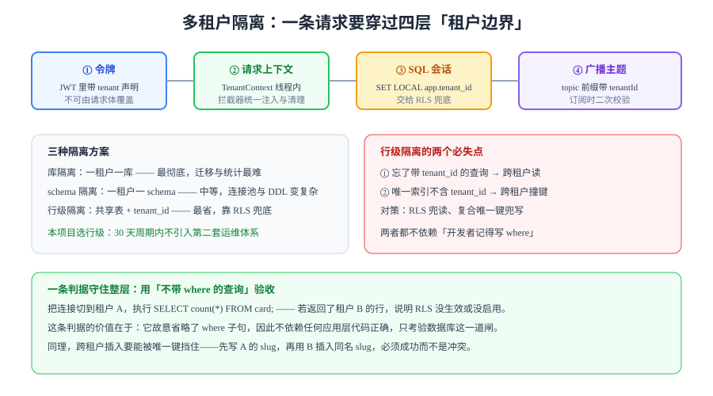

# 多租户隔离：把「同表不同租户」变成数据库级别的边界

周期 6 的第 1 周从这里开工。前面 29 章把「同一块看板上的并发写入」讲透了，但一直有个前提没被正面回答：**这些看板属于不同的组织，凭什么保证 A 组织的人看不到 B 组织的卡片？**

「代码里每处查询都记得加 `where tenant_id = ?`」不是答案——它依赖每个人每次都记得。这一页要落的是**不依赖记忆的边界**。



## 判据族声明

本页判据族 `TN-A` ~ `TN-H`，共 8 条。每条只回答三件事：约定是什么 / 定错了会怎样 / 怎么验证它没被破坏。定义表见第六节。

## 当日做了什么

周期 6（第 151-180 天）的排期照旧按四周推进，本周是「需求设计」：

| 周 | 天数 | 里程碑 | 本周落点 |
| --- | --- | --- | --- |
| 第 1 周 | 151-157 | 需求设计 | 多租户模型、隔离方案、DDL 与越权判据 |
| 第 2 周 | 158-164 | 核心编码 | 租户上下文、查询改写、广播隔离 |
| 第 3 周 | 165-171 | 联调测试 | 跨租户用例矩阵、连接池串租户复现 |
| 第 4 周 | 172-180 | 部署验收 | 迁移脚本、灰度、上线验收补充项 |

今天（第 151 天）的五件事：

1. **定死租户模型的层级**：组织（tenant）→ 工作区（workspace）→ 看板（board）→ 卡片（card），并说明为什么不把 `tenant` 和 `workspace` 合并。
2. **对比三种隔离方案**，给出本项目的选择与代价。
3. **写出可直接执行的 DDL**：`tenant_id` 列、复合主键、复合唯一键、`FORCE ROW LEVEL SECURITY` 与两条策略。
4. **定下租户上下文的四层传播路径**，指出每一层「如果漏了会怎样」。
5. **把跨租户越权拆成两个必失点**（读越权、键冲突），各给一条不依赖应用代码的验收手段。

::: tip 为什么现在补这一章
原来 29 章里，「租户」只在 `FAQ` 页顺带出现过一次（「多租户要按 tenant 分区」），既没有 DDL，也没有判据。**一个只被提到过一次的概念，等于没有被设计过。**
:::

## 一、租户模型：为什么是三级

| 层级 | 实体 | 谁在管 | 边界意义 |
| --- | --- | --- | --- |
| 组织 | `tenant` | 平台运营 | **计费与数据隔离的最小单位** |
| 工作区 | `workspace` | 组织管理员 | 成员与权限的容器 |
| 看板 | `board` | 工作区成员 | 协作发生的地方 |
| 卡片 | `card` | 看板成员 | 内容与并发写入的对象 |

不把 `tenant` 和 `workspace` 合并的理由只有一条：**它们的变化节奏不同**。一个组织可以有多个工作区（研发、市场、客服各一个），组织是「谁付钱、数据归谁」，工作区是「谁跟谁一起干活」。合并之后，「把一个工作区转给另一个组织」会变成一次跨租户搬迁，而这件事在合规上通常是禁止的。

::: warning 层级越多不等于越灵活
再往下加一层「项目组」就属于过度设计：多一层就多一次 `join`、多一处权限判定、多一类「这个人在这一层是什么角色」的问题。**三级的判据是：每一级都有一个独立的、会被单独变更的属性**（计费主体 / 成员集合 / 协作范围）。
:::

## 二、三种隔离方案的取舍

| 方案 | 数据落点 | 隔离强度 | 迁移成本 | 统计与运维 | 适用 |
| --- | --- | --- | --- | --- | --- |
| **库隔离** | 一租户一 database | 最强（连接级别隔离） | 高（每租户一套迁移） | 跨租户统计要汇总，最麻烦 | 强合规、租户数少（几十） |
| **schema 隔离** | 一租户一 schema | 强（`search_path` 隔离） | 中（迁移要跑 N 次） | 连接池要按租户分，DDL 变慢 | 租户数百、需要物理归档 |
| **行级隔离** | 共享表 + `tenant_id` | 依赖 RLS 与约束 | 低（一次迁移） | 最简单，一处查询 | 租户数多、SaaS 常态 |

本项目选**行级隔离**，理由是可验证的三条：

1. **迁移只跑一次**：30 天周期内没有余量维护「每租户一套 DDL」的流水线。
2. **跨租户统计天然可行**：运营要看「全平台日活」，行级隔离一句 `group by tenant_id` 就够。
3. **隔离强度可以用数据库补足**：`FORCE ROW LEVEL SECURITY` 让「忘记写 where」的查询返回 0 行，而不是别人的数据。

代价也要写清楚：**行级隔离把正确性押在「RLS 策略 + 复合唯一键」上**。这两样任何一个没做，隔离就退化成了「靠自觉」。

## 三、DDL：三样东西缺一不可

```sql
-- ① 租户表本身（不带 tenant_id，它是租户的定义者）
CREATE TABLE tenant (
  id         bigint GENERATED ALWAYS AS IDENTITY PRIMARY KEY,
  slug       text   NOT NULL UNIQUE,
  name       text   NOT NULL,
  created_at timestamptz NOT NULL DEFAULT now()
);

-- ② 业务表：tenant_id 进主键，唯一键也进
CREATE TABLE card (
  tenant_id  bigint NOT NULL REFERENCES tenant(id) ON DELETE CASCADE,
  id         bigint GENERATED ALWAYS AS IDENTITY,
  board_id   bigint NOT NULL,
  slug       text   NOT NULL,
  title      text   NOT NULL,
  version    bigint NOT NULL DEFAULT 0,
  created_at timestamptz NOT NULL DEFAULT now(),
  -- 主键带 tenant_id：跨租户的 id 可以重复，且索引天然按租户聚簇
  PRIMARY KEY (tenant_id, id),
  -- 唯一键必须带 tenant_id，否则 A 的 slug 会挡住 B
  UNIQUE (tenant_id, board_id, slug)
);

-- ③ 行级安全：开着还不够，要 FORCE
ALTER TABLE card ENABLE ROW LEVEL SECURITY;
ALTER TABLE card FORCE  ROW LEVEL SECURITY;

CREATE POLICY card_tenant_read ON card
  FOR SELECT
  USING (tenant_id = nullif(current_setting('app.tenant_id', true), '')::bigint);

CREATE POLICY card_tenant_write ON card
  FOR ALL
  USING (tenant_id = nullif(current_setting('app.tenant_id', true), '')::bigint)
  WITH CHECK (tenant_id = nullif(current_setting('app.tenant_id', true), '')::bigint);
```

三个细节都值得单独说：

| 细节 | 为什么这么写 | 写错的后果 |
| --- | --- | --- |
| `FORCE ROW LEVEL SECURITY` | 默认 RLS **不约束表所有者**，而开发环境里应用账号常常就是 owner | 本地测试全绿，生产换成普通账号后行为突变 |
| `current_setting(..., true)` 加 `nullif` | GUC 未设置时 `current_setting` 会报错；`true` 让它返回 NULL，比较结果为 false | 未设置上下文时抛异常，或（更糟）意外匹配到全部行 |
| `WITH CHECK` 与 `USING` 都写 | `USING` 管「能不能看到」，`WITH CHECK` 管「能不能写进来」 | 只能防读，插入时带上别人的 `tenant_id` 照样成功 |

::: danger `ENABLE` 不等于生效
`ALTER TABLE ... ENABLE ROW LEVEL SECURITY` 对**表所有者**默认无效。如果你的应用用 owner 账号连库（很多本地 compose 就是这么配的），**RLS 全程不生效，而你又以为自己做了隔离**。这一条必须用「不带 where 的查询」实测，不能看代码判断。
:::

## 四、租户上下文的四层传播

| 层 | 载体 | 谁写入 | 漏了会怎样 |
| --- | --- | --- | --- |
| ① 令牌 | JWT 的 `tid` 声明 | 认证服务 | 无法判断请求属于哪个租户，只能靠请求参数——**可伪造** |
| ② 请求上下文 | `TenantContext`（ThreadLocal / ScopedValue） | 拦截器 | Service 层拿不到租户，只能层层传参，必然有地方漏 |
| ③ 数据库会话 | `SET LOCAL app.tenant_id` | 事务开始时 | RLS 拿到空值，查询返回 0 行（失败关闭）或抛异常 |
| ④ 广播主题 | `tenant:{tid}:board:{bid}` | 广播层 | 一个租户的事件被推到另一个租户的连接上 |

```java [TenantFilter.java]
@Component
public class TenantFilter implements Filter {
  @Override
  public void doFilter(ServletRequest req, ServletResponse res, FilterChain chain)
      throws IOException, ServletException {
    HttpServletRequest r = (HttpServletRequest) req;
    String tid = (String) r.getAttribute("jwt.tid"); // 只能来自已验签的令牌
    if (tid == null) {
      ((HttpServletResponse) res).sendError(401, "missing tenant claim");
      return;
    }
    try (TenantContext.Scope ignored = TenantContext.open(Long.parseLong(tid))) {
      chain.doFilter(req, res); // 作用域结束自动清理，避免线程复用串租户
    }
  }
}
```

**第 ③ 层要用 `SET LOCAL` 而不是 `SET`**：`SET` 是会话级的，连接池把连接还回去之后，下一个请求会继承上一个租户的上下文——这就是最经典的「串租户」事故。`SET LOCAL` 只在当前事务内有效，事务结束自动失效。

```sql
-- 事务开始处（由 ORM 的拦截器或 @Transactional 的切面执行）
BEGIN;
SELECT set_config('app.tenant_id', '42', true); -- 第三个参数 true = 仅本事务
-- ...业务 SQL...
COMMIT; -- 上下文随之失效
```

## 五、两个必失点与它们的对策

### 必失点一：读越权（忘了 `where`）

任何一处「漏写 `where tenant_id = ?`」的查询，在行级隔离下都会被 RLS 兜住——**前提是 RLS 真的开着且 FORCE 了**。所以这条的验收方式必须绕开应用代码：

```sql
-- 以应用账号连库，切到租户 42，故意不带 where
SELECT set_config('app.tenant_id', '42', true);
SELECT count(*) FROM card;          -- 期望：只数出租户 42 的行
SELECT count(*) FROM card WHERE true; -- 期望：同上（证明不是被 where 挡住的）
```

如果第二条返回了全部行，只有两种可能：RLS 没开，或者当前账号是 owner 且没 `FORCE`。

### 必失点二：键冲突（唯一索引没带 `tenant_id`）

这是**更难发现**的一类：功能全部正常，只是「B 租户新建看板时提示 slug 已存在」，而那个 slug 明明只有 A 用过。

```sql
-- 在租户 42 下建一个 slug = 'sprint-1' 的看板
INSERT INTO card (tenant_id, board_id, slug, title) VALUES (42, 1, 'sprint-1', 'A 的看板');
-- 切到租户 43，建同名 slug
SELECT set_config('app.tenant_id', '43', true);
INSERT INTO card (tenant_id, board_id, slug, title) VALUES (43, 1, 'sprint-1', 'B 的看板');
-- 期望：成功。若报 duplicate key，说明唯一键没带 tenant_id
```

::: warning 还有第三个容易被忽略的点：外键
`board_id` 如果指向 `board(id)`（单列主键），那么跨租户引用是**合法**的——A 的卡片可以挂到 B 的看板上。正确做法是外键也带租户：`FOREIGN KEY (tenant_id, board_id) REFERENCES board(tenant_id, id)`。**这一点在「只测了查询」的验收里永远暴露不出来。**
:::

## 六、判据定义表

| 判据 | 约定 | 定错了会怎样 | 怎么验证 |
| --- | --- | --- | --- |
| `TN-A` | 每张业务表必须有非空 `tenant_id`，且在主键内 | 同 id 跨租户冲突；索引无法按租户聚簇 | `\d+ card` 看到 `tenant_id` 在 PK 内；`information_schema` 查无缺列的表 |
| `TN-B` | 每张业务表必须 `ENABLE` **且** `FORCE` RLS | owner 账号下隔离完全不生效 | `SELECT relname, relrowsecurity, relforcerowsecurity FROM pg_class` 两列都为 `t` |
| `TN-C` | 所有唯一约束必须包含 `tenant_id` | 跨租户撞键，功能正常但建不出来 | 在租户 B 插入与租户 A 相同的 slug，必须成功 |
| `TN-D` | 租户 ID 只能来自已验签令牌，不得取自请求体或路径 | 攻击者改一个参数就能跨租户 | 请求体带 `tenantId=43` 而令牌是 42，服务端必须仍按 42 处理 |
| `TN-E` | 会话级租户上下文必须用 `SET LOCAL`，连接归还前重置 | 连接池复用导致串租户 | 并发压测 200 请求跨两个租户，日志里无「租户与结果不符」 |
| `TN-F` | 广播主题必须带租户前缀，订阅时二次校验 | 一个租户的卡片内容推到另一个租户 | 两租户各连一个客户端，A 的更新在 B 侧 0 帧 |
| `TN-G` | 跨租户统计只能走独立只读账号（`BYPASSRLS` 仅该账号） | 应用账号能读全库 | `\du` 检查只有 `analytics` 角色带 `BYPASSRLS` |
| `TN-H` | 删除租户必须级联且留审计 | 残留数据、无法举证已删除 | 删租户后 `card` 中该 `tenant_id` 行数为 0，审计表有一条记录 |

## 如何验证

```shell
# 1) 起库（本项目 compose 里已有 postgres 服务）
docker compose up -d postgres
# 2) 建表（把第三节的 DDL 存成 db/migration/V10__tenant.sql 后执行）
docker compose exec -T postgres psql -U app -d teamboard -f /migrations/V10__tenant.sql
# 3) 验 RLS 是否真的开着（两列都必须是 t）
docker compose exec -T postgres psql -U app -d teamboard -c \
  "SELECT relname, relrowsecurity, relforcerowsecurity FROM pg_class WHERE relname IN ('card','board');"
```

**预期输出**：`card` 与 `board` 两行的 `relrowsecurity`、`relforcerowsecurity` 都是 `t`。若第二列是 `f`，说明只 `ENABLE` 没 `FORCE`——此时用 owner 账号查询会看到全部租户的数据。

```shell
# 4) 读越权：不带 where，只应看到本租户
docker compose exec -T postgres psql -U app -d teamboard -c \
  "BEGIN; SELECT set_config('app.tenant_id','42',true); SELECT count(*) FROM card; COMMIT;"
```

**预期输出**：计数等于租户 42 的真实行数；把它与 `SELECT count(*) FROM card WHERE tenant_id = 42;` 的结果对比，**两个数必须相等**。

## 下一步

| 项 | 内容 |
| --- | --- |
| 主题 | 租户上下文与索引设计：把「按租户过滤」变成索引前缀 |
| 要落的产物 | 索引清单（每个高频查询的索引都必须以 `tenant_id` 开头）、`EXPLAIN` 前后对照、连接池参数与 `SET LOCAL` 的时序图 |
| 验收判据 | 同一查询在「带租户过滤」下走索引而不是全表；连接池 20 个连接、200 并发下无串租户 |

## 与「数据库访问控制与审计」专题的分工（第 190 天补充）

| 问题 | 看哪里 |
| --- | --- |
| 租户模型、隔离三档、`tenant_id` 进主键的完整 DDL | 本页 |
| 策略为什么会被视图绕过、`FORCE` 与 `security_invoker` 怎么选 | [行级安全](../../../../docs/DB/AccessControl/RowLevelSecurity/index.md) |
| 权限盘点、复核与回收 | [权限生命周期](../../../../docs/DB/AccessControl/Lifecycle/index.md) |

**这一页特有的坑：项目里只写了 `ENABLE ROW LEVEL SECURITY`，没有写 `FORCE`。** 本机按同样写法复现：租户 A 的账号直查表得到 1 行（策略生效），查同名视图得到 2 行（视图以所有者身份执行）。项目侧只要存在任何「以所有者身份执行」的视图或安全定义函数，这一格就会漏。补法是 `FORCE` 与 `security_invoker = true` 二者至少落一个，并把它写进建表 checklist。

## 参考资料

- [PostgreSQL 文档：Row Security Policies](https://www.postgresql.org/docs/current/ddl-rowsecurity.html)
- [PostgreSQL 文档：`set_config` 与自定义参数](https://www.postgresql.org/docs/current/functions-admin.html)
- 前置章节：[数据库设计：表、约束与顺序字段](../Database/index.md) · [权限矩阵验证](../PermissionMatrix/index.md)
- 相关技术专题：[实时协作与冲突解决](../../../../docs/Backend/RealtimeCollaboration/index.md) · [数据治理](../../../../docs/DB/DataGovernance/index.md)
