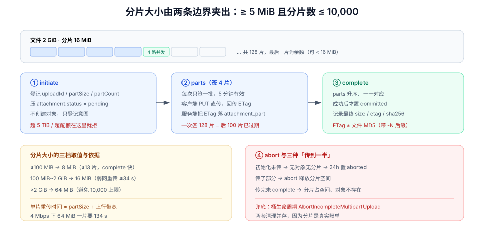

# 分片上传：把「传一个 2 GB 的文件」拆成能重试的小事

第 2 周第 11 步：第 161 天的直传把 25 MiB 以下的文件摘出了业务服务，但**大文件一次 `PUT` 会以三种方式失败**：请求体太大、慢网重传从头来、客户端一断就得重来。这一步用对象存储的 multipart 协议把大文件切成可控的小块，并把「传到一半的垃圾」变成有账可查的状态。

## 当日做了什么

| 项 | 产出 |
| --- | --- |
| 协议 | S3 multipart 的五条硬约束与它们对分片大小的约束关系 |
| 分片大小 | 从「重传代价」与「分片数上限」两侧夹出 `partSize` 的公式与三档取值 |
| 接口 | `POST /multipart/initiate`、`POST /multipart/{id}/parts`、`POST /multipart/{id}/complete`、`POST /multipart/{id}/abort` |
| 断点续传 | `uploadId` 与已传分片 ETag 落库，客户端 `resume` 的判定依据 |
| 校验 | 为什么分片场景下 ETag 不能当文件哈希，`sha256` 怎么算 |
| 清理 | 未完成上传的 24 h 过期与孤儿分片对账 |
| 判据 | `MPU-A` ~ `MPU-H` 八条 |



::: tip 本步的位置
第 161 天解决了「小文件不穿业务服务」，本步解决「**大文件不能一次传**」。两者的共同点仍然是那条铁律：**业务服务只判断能不能传，不碰字节**。
:::

## 一、一次 `PUT` 传 2 GB 会怎么坏

| 失败模式 | 现象 | 根因 |
| --- | --- | --- |
| 请求被网关拒绝 | `413 Request Entity Too Large` | 反向代理的 `client_max_body_size` 默认 1 MB |
| 传到 90% 断网 | 客户端只能从头开始 | 单请求没有「已传多少」的概念 |
| 传完但响应超时 | 客户端重传整个文件 | 服务端已存好，但客户端不知道 |
| 内存被打满 | 实例 OOM | 服务端把整个请求体读进内存做校验 |
| 无法并发 | 2 GB 单流，速度等于单连接带宽 | 一个大请求无法并行 |

分片解决的是**上面五条全部**，代价是引入了一个新的状态机：**一个文件在上传中可以有 0~10,000 个分片，且它们必须在某个时刻被「组装」起来**。

## 二、五条硬约束

| 约束 | 值 | 影响 |
| --- | --- | --- |
| 单个对象上限 | 5 TiB | 超过要拆成多对象（本项目不做） |
| 分片数上限 | **10,000** | 决定了「分片不能太小」 |
| 单分片下限 | **5 MiB**（最后一片除外） | 决定了「分片不能太小」的另一个理由 |
| 单分片上限 | 5 GiB | 决定了「分片不能太大」 |
| 分片编号 | 1 ~ 10,000，`complete` 时必须**升序** | 乱序提交会被拒 |

```text
可用分片数 = ceil(文件大小 / partSize) ≤ 10,000
partSize ≥ max(5 MiB, ceil(文件大小 / 10,000))
```

两条约束在 **48.8 GiB** 处交汇（5 MiB × 10,000 = 48.8 GiB）：小于它时 5 MiB 分片就够；大于它时 `partSize` 必须随文件增大。

## 三、`partSize` 怎么定：两侧夹

分片大小的两个方向各有代价：

| 分片太小 | 分片太大 |
| --- | --- |
| 请求数多（每片一次签名 + 一次 PUT） | 单片失败的重传代价高 |
| 小分片在慢网下也慢（TCP 慢启动反复） | 并发度上不去（分片数少） |
| 分片数逼近 10,000 上限 | 内存与磁盘缓冲压力大 |

**重传代价的量化**（这一条决定了取值）：

```text
单片重传时间 = partSize / 上行带宽
```

| 上行带宽 | 5 MiB 分片 | 16 MiB 分片 | 64 MiB 分片 |
| --- | --- | --- | --- |
| 100 Mbps | 0.4 s | 1.3 s | 5.4 s |
| 20 Mbps | 2.1 s | 6.7 s | 26.8 s |
| 4 Mbps（弱网） | **10.5 s** | 33.5 s | 134 s |

本项目的取值（三档，按文件大小）：

| 文件大小 | `partSize` | 分片数 | 依据 |
| --- | --- | --- | --- |
| ≤ 100 MiB | 8 MiB | ≤ 13 | 分片数少，一次 `complete` 快 |
| 100 MiB ~ 2 GiB | 16 MiB | ≤ 128 | 弱网重传 ≤ 34 s，并发 4 路即可打满带宽 |
| > 2 GiB | 64 MiB | ≤ 84（10 GiB） | 减少请求数，避免 10,000 上限 |

::: danger 三个分片大小的常见错法
1. **固定 5 MiB**：2 GiB 文件 = 410 个分片，每片一次签名 + 一次请求；客户端的签名请求比数据请求还多。
2. **按「文件大小 / 100」算**：100 MB 得到 1 MB 分片——**低于 5 MiB 下限**，`complete` 时直接 `EntityTooSmall`。
3. **最后一片也用固定大小**：最后一片是「余数」，通常小于 `partSize`；代码里若用 `partSize` 去校验每一片，最后一片必然报错。
:::

## 四、四条接口契约

### 1. 初始化

```http
POST /api/v1/cards/{cardId}/attachments/multipart
{ "filename": "录屏.mov", "size": 2147483648, "contentType": "video/quicktime" }
```

```json
{
  "attachmentId": "01a14f...",
  "uploadId": "2~kQ9x...",
  "partSize": 16777216,
  "partCount": 128,
  "expiresAt": "2026-10-19T10:20:00Z"
}
```

初始化时**只登记意图，不创建对象**：`attachment` 行状态为 `pending`，`upload_id` 与 `part_size` 落库。

### 2. 逐片签名

```http
POST /api/v1/attachments/{id}/multipart/parts
{ "partNumbers": [1, 2, 3, 4] }
```

```json
{
  "parts": [
    { "partNumber": 1, "url": "https://s3.example.com/...&partNumber=1&uploadId=...", "expiresIn": 300 },
    { "partNumber": 2, "url": "https://s3.example.com/...&partNumber=2&uploadId=...", "expiresIn": 300 }
  ]
}
```

一次签 4 片（并发 4），客户端传完再要下一批。**不要一次签 128 片**：签名 5 分钟过期，排在后面的片还没轮到就已经失效。

### 3. 提交（组装）

```http
POST /api/v1/attachments/{id}/multipart/complete
{ "parts": [ { "partNumber": 1, "etag": "\"d41d...\"" }, { "partNumber": 2, "etag": "\"9f2c...\"" } ] }
```

服务端拿这份列表调对象存储的 `CompleteMultipartUpload`。三条纪律：

1. **按 `partNumber` 升序**提交，且与已上传的分片一一对应；
2. **ETag 由客户端回传、服务端落库**，不要「服务端重新 `LIST` 一遍」——那样会在传完与提交之间引入竞态；
3. 提交成功后**才**把 `attachment.status` 置为 `committed`，并写入最终 `size_bytes` 与 `etag`。

### 4. 中止

```http
POST /api/v1/attachments/{id}/multipart/abort
```

用户取消、或超过 24 h 未完成时调用；存储侧的 `AbortMultipartUpload` 会释放已上传分片占用的空间。

## 五、断点续传：靠 `uploadId` + 已传列表

```sql
-- V10__multipart.sql
ALTER TABLE attachment
  ADD COLUMN upload_id  text,
  ADD COLUMN part_size  integer,
  ADD COLUMN part_count integer;

CREATE TABLE attachment_part (
  attachment_id uuid    NOT NULL,
  part_number   integer NOT NULL,
  etag          text    NOT NULL,
  size_bytes    integer NOT NULL,
  uploaded_at   timestamptz NOT NULL DEFAULT now(),

  CONSTRAINT attachment_part_pk PRIMARY KEY (attachment_id, part_number),
  CONSTRAINT attachment_part_no_ck CHECK (part_number BETWEEN 1 AND 10000),
  CONSTRAINT attachment_part_fk FOREIGN KEY (attachment_id)
      REFERENCES attachment (id) ON DELETE CASCADE
);
```

客户端 `resume` 的判定只有一步：

```http
GET /api/v1/attachments/{id}/multipart/status
→ { "uploadId": "2~kQ9x...", "partSize": 16777216, "uploaded": [1,2,3,7] }
```

`uploaded` 缺失的编号就是要补传的。**不要靠 localStorage 记进度**：换设备、换浏览器、清缓存都会丢，而服务端已经有这份账。

::: warning 一个容易搞错的地方：ETag 不是文件哈希
单次 `PUT` 的 ETag 是文件内容的 MD5（无加密时）。但 multipart 的 ETag 是
`MD5(所有分片 MD5 的二进制拼接) + "-" + 分片数`，**它与整个文件的 MD5 不同**。
所以：
- 不能用 ETag 与本地算出的 `sha256`/`md5` 比对；
- 要校验完整性，得自己算整个文件的 `sha256`（上传前算一次，或边传边增量算），并在 `complete` 时回传，服务端记录；
- `complete` 时对象存储会自己校验每个分片的 MD5（`InvalidPart`），这是**分片级**校验，不是文件级。
:::

## 六、清理：三种「传到一半」

| 情形 | 库里 | 存储里 | 处理 |
| --- | --- | --- | --- |
| 初始化后从未传 | `pending` 行 | 无对象、无分片 | 24 h 后置 `aborted` |
| 传了部分分片后放弃 | `pending` 行 + `attachment_part` 行 | 有未完成 upload | 24 h 后 `abort` + 删行 |
| 传完未 `complete` | `pending` 行 + 全部分片 | 有未完成 upload | 同上（分片占空间但对象不存在） |

对象存储侧还有一道**兜底**：桶的生命周期规则 `AbortIncompleteMultipartUpload`（S3 最小 1 天）。它挡的是「我们的清理任务自己挂了」的情况——**两套清理机制并存是故意的**，因为分片占的是真实存储费。

```shell
# 对账：库里 pending 的 uploadId 集合 vs 存储里未完成的 upload 列表
aws s3api list-multipart-uploads --bucket "$BUCKET" --prefix "t/7/card/" \
  | jq -r '.Uploads[].UploadId' | sort > /tmp/s3-uploads.txt
psql "$DB" -Atc "select upload_id from attachment where status='pending' and upload_id is not null" \
  | sort > /tmp/db-uploads.txt
comm -13 /tmp/db-uploads.txt /tmp/s3-uploads.txt   # 只在存储侧的 = 孤儿
```

## 七、验收：八条命令

```shell
# ① 初始化：分片数不超过 10,000，partSize 不低于 5 MiB
curl -s -X POST "http://localhost:8080/api/v1/cards/$CARD/attachments/multipart" \
  -H "Authorization: Bearer $TOKEN" -H 'Content-Type: application/json' \
  -d '{"filename":"录屏.mov","size":2147483648,"contentType":"video/quicktime"}' \
  | jq '{partSize, partCount, uploadId}'
# 期望：partSize=16777216，partCount=128
```

```shell
# ② 超过 5 TiB 在初始化阶段就被拒（不是传到一半才失败）
curl -s -o /dev/null -w '%{http_code}\n' -X POST "http://localhost:8080/api/v1/cards/$CARD/attachments/multipart" \
  -H "Authorization: Bearer $TOKEN" -H 'Content-Type: application/json' \
  -d '{"filename":"huge.bin","size":6597069766656,"contentType":"application/octet-stream"}'
# 期望：413
```

```shell
# ③ 小于 5 MiB 的非末片会被存储拒绝（EntityTooSmall）
# 把 partSize 人为改成 1 MiB 再传两片，然后 complete
# 期望：complete 返回 422，错误码 ENTITY_TOO_SMALL
```

```shell
# ④ 断点续传：传 3 片后放弃，重查状态能看到已传列表
curl -s "http://localhost:8080/api/v1/attachments/$AID/multipart/status" -H "Authorization: Bearer $TOKEN" | jq '.uploaded'
# 期望：[1,2,3]
```

```shell
# ⑤ 同一个 uploadId 不会因为「重连」被重建
# 连续调两次 initiate 会得到两个 uploadId；正确做法是先查 status 再决定
# 期望：客户端 resume 路径下，库里 upload_id 只有一条且未变
```

```shell
# ⑥ complete 后对象大小与声明一致
aws s3api head-object --bucket "$BUCKET" --key "$KEY" | jq '.ContentLength'
# 期望：2147483648
```

```shell
# ⑦ ETag 与文件 MD5 不相等（证明「ETag 不能当哈希」）
aws s3api head-object --bucket "$BUCKET" --key "$KEY" | jq -r '.ETag'
md5sum ./fixtures/recording.mov | cut -d' ' -f1
# 期望：ETag 形如 "xxxx-128"（带 -N 后缀），与 md5 不同
```

```shell
# ⑧ 中止后分片不再占空间
curl -s -X POST "http://localhost:8080/api/v1/attachments/$AID/multipart/abort" -H "Authorization: Bearer $TOKEN"
aws s3api list-multipart-uploads --bucket "$BUCKET" --prefix "$KEY" | jq '.Uploads | length'
# 期望：0（或 null）
```

## 八、判据族 `MPU-A` ~ `MPU-H`

| 判据 | 规则 | 违反时的样子 | 验证方式 |
| --- | --- | --- | --- |
| `MPU-A` | `partSize` 由「≥5 MiB」与「分片数 ≤10,000」两侧夹出 | 2 GiB 文件 410 个分片，签名请求超过数据请求 | 命令 ① |
| `MPU-B` | 最后一片允许小于 `partSize`，校验逻辑对它单独放行 | 最后一片恒 `EntityTooSmall` | 命令 ③ |
| `MPU-C` | `complete` 的 parts 升序且与已传分片一一对应 | `InvalidPartOrder` / `InvalidPart` | 构造乱序提交 |
| `MPU-D` | 已传分片 ETag 落库，续传靠服务端状态而非 localStorage | 换设备后必须从头传 | 命令 ④ |
| `MPU-E` | 不用 ETag 当文件哈希，完整性用 `sha256` | 校验永远不通过（或永远通过） | 命令 ⑦ |
| `MPU-F` | 未完成上传 24 h 清理 + 桶生命周期兜底 | 分片长期占空间、账单缓慢上涨 | 命令 ⑧ + 桶规则检查 |
| `MPU-G` | 单个 `uploadId` 只对应一个 `attachment` 行 | 重复初始化产生多个孤儿 upload | 命令 ⑤ |
| `MPU-H` | 超过 5 TiB / 超过配额在**初始化**阶段拒绝 | 传了 30 分钟才失败 | 命令 ② |

## 九、下一步

1. **前端分片器**：`File.slice()` + 4 路并发 + 失败分片单独重试（第 8 步的页面上还没有入口）。
2. **秒传**：先算 `sha256` 查重，命中则直接建 `attachment` 行指向已有对象（要配合配额与权限）。
3. **依赖降级**：存储不可用时附件面板应当**明确禁用**而不是转圈——这是第 13 步的内容。
4. **带宽与成本**：分片并发数在弱网下要自适应，否则 4 路并发会把 4 Mbps 的链路切成 4 份更慢。

## 十、参考资料

- [Amazon S3 · Multipart upload overview](https://docs.aws.amazon.com/AmazonS3/latest/userguide/mpuoverview.html)（10,000 分片、5 MiB 下限、5 TiB 上限）
- [Amazon S3 · `CompleteMultipartUpload`](https://docs.aws.amazon.com/AmazonS3/latest/API/API_CompleteMultipartUpload.html)（`InvalidPart` / `InvalidPartOrder` / `EntityTooSmall`）
- [Amazon S3 · 生命周期规则 `AbortIncompleteMultipartUpload`](https://docs.aws.amazon.com/AmazonS3/latest/userguide/object-lifecycle-mgmt.html)
- [MinIO · Multipart upload](https://min.io/docs/minio/linux/developers/minio-drivers.html)（本地联调用同一套协议）
- [项目章节 · 附件直传：把大文件从业务链路里摘出去](../AttachmentDirectUpload/index.md)（本步的前置与共用的 `attachment` 表）

## 与「对象存储工程」专题的分工（第 173 天补充）

| 问题 | 归本页 | 归[文件与对象存储工程](../../../../docs/Backend/ObjectStorage/index.md) |
| --- | --- | --- |
| `partSize` 怎么由 5 MiB 下限与 10,000 片上限夹出来 | ✅ | — |
| 分片 ETag 的计算方式与「它不是文件哈希」 | — | ✅ [完整性校验](../../../../docs/Backend/ObjectStorage/IntegrityChecksum/index.md) |
| `uploadId` + ETag 的续传实现与两套清理 | ✅ | — |
| 未完成分片的计费与生命周期中止规则 | — | ✅ [生命周期与分层成本](../../../../docs/Backend/ObjectStorage/LifecycleCost/index.md) |

一句话边界：本页讲「这套参数为什么这么定」，专题讲「为什么所有分片实现都会在 ETag 上踩同一脚」。

::: danger 本页特有的坑：`partSize` 一改，已传分片全部作废
分片大小只能在 `CreateMultipartUpload` 时定一次（除最后一片）。把它做成配置项、又在发布时随手调大，会让**正在续传的客户端**拿旧 `partSize` 上传的分片与新尺寸混在一起 `complete`——对象能合出来，但内容是错位的。
所以这个值属于「接口契约」，不属于「可调参数」：改它等于新开一个上传接口版本。

:::

