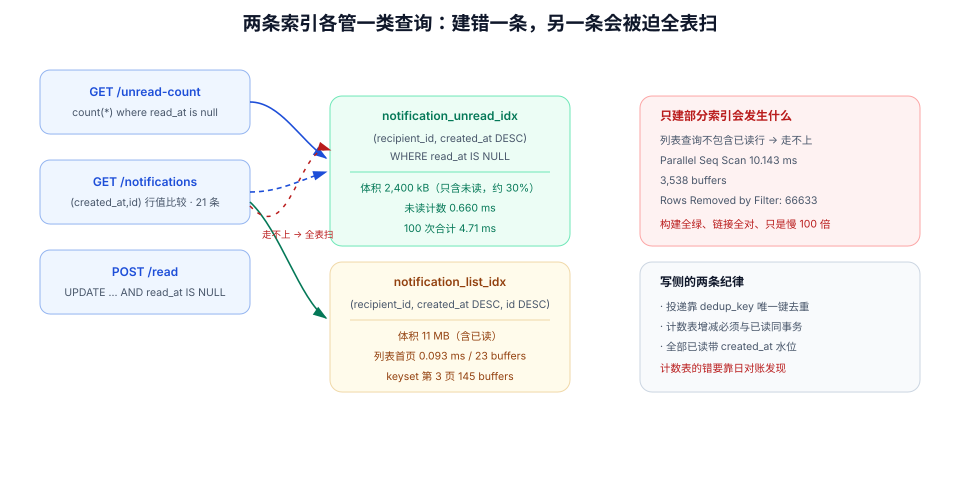

# 通知中心读接口：未读数、列表与已读回执

第 2 周第 9 步：第 160 天把通知写进了 outbox，第 161 天把附件挂上了卡片——**这一步把「通知」真正读出来**。它看起来只是两个 `GET`，实际要回答三个必须当场定死的问题：**未读数怎么算**、**列表用什么翻页**、**已读回执怎么做到点了两次结果一样**。

## 当日做了什么

| 项 | 产出 |
| --- | --- |
| 数据模型 | `notification` 表完整 DDL、两条索引（**部分索引服务未读、完整索引服务列表**）的取舍与实测 |
| 接口 | `GET /api/v1/notifications`、`GET /api/v1/notifications/unread-count`、`POST /api/v1/notifications/{id}/read`、`POST /api/v1/notifications/read-all` |
| 未读数 | 三种实现（现算 / 部分索引 / 计数表）对照与本机实测读数 |
| 投递 | outbox → notification 的「至少一次 + 去重」，`dedup_key` 与折叠窗口 |
| 已读 | 条件更新实现幂等（实测 `UPDATE 1` → `UPDATE 0`），全部已读的代价 |
| 判据 | `NC-A` ~ `NC-H` 八条 |



::: tip 本步的位置
第 160 天写的那条评论会产生通知，但**通知的可信度取决于读侧**：未读数多 1、少 1，或者点了「全部已读」但列表里还有红点，用户对整套协作系统的信任就会掉一档。
:::

## 一、三个数字，三种口径

「通知中心」在界面上只有三处数字，但每一处都有自己的坑：

| 数字 | 常见实现 | 口径陷阱 |
| --- | --- | --- |
| 未读数（铃铛红点） | `count(*) where read_at is null` | 每人每次都算：2000 人 × 每次刷新 = 2000 次聚合 |
| 列表（每页 20 条） | `offset/limit` | 新通知不断插入，翻页时会**重复与漏项** |
| 「全部已读」 | `update ... where read_at is null` | 与「正在到达的新通知」竞争：刚到的通知被一起标成已读 |

::: danger 三个会静默出错的口径
1. **未读数包含自己触发的动作**：自己评论自己的卡片也发通知，红点永远清不掉。
2. **列表与未读数用不同的过滤条件**：列表排除 `kind='self'`，未读数不排除——红点 3 个，列表里只有 2 条可读。
3. **已读只更新 UI 不落库**：换设备后红点回来。这不是缓存问题，是**根本没写**。
:::

## 二、数据模型

```sql
-- V9__notification.sql

CREATE TABLE notification (
  id           uuid        NOT NULL DEFAULT uuidv7(),
  tenant_id    bigint      NOT NULL,
  recipient_id bigint      NOT NULL,
  board_id     uuid        NOT NULL,
  card_id      uuid,
  kind         text        NOT NULL,
  payload      jsonb       NOT NULL,
  dedup_key    text        NOT NULL,
  created_at   timestamptz NOT NULL DEFAULT now(),
  read_at      timestamptz,

  CONSTRAINT notification_pk PRIMARY KEY (id),
  CONSTRAINT notification_dedup_uk UNIQUE (dedup_key),
  CONSTRAINT notification_kind_ck
      CHECK (kind IN ('mention', 'assigned', 'comment', 'attachment', 'member_join')),
  CONSTRAINT notification_recipient_fk FOREIGN KEY (recipient_id)
      REFERENCES app_user (id) ON DELETE CASCADE,
  CONSTRAINT notification_board_fk FOREIGN KEY (board_id, tenant_id)
      REFERENCES board (id, tenant_id) ON DELETE CASCADE
);

-- ① 未读：只索引「未读」那一小部分（本项目实测约占 30%）
CREATE INDEX notification_unread_idx ON notification (recipient_id, created_at DESC)
  WHERE read_at IS NULL;

-- ② 列表：完整索引，供「全部通知」按时间倒序翻页
CREATE INDEX notification_list_idx ON notification (recipient_id, created_at DESC, id DESC);
```

**两条索引不是冗余**，各自服务一类查询，本机实测（PostgreSQL 18.6，20 万行 / 2,000 收件人 / 30.0% 未读）：

| 查询 | 只有部分索引 | 补上完整索引 |
| --- | --- | --- |
| 未读数 | **0.660 ms** | 0.66 ms（走部分索引） |
| 列表首页 20 条 | `Parallel Seq Scan` **10.143 ms / 3,538 buffers** | `Index Scan` **0.093 ms / 23 buffers** |

只建部分索引时，列表查询**用不上它**（它不包含已读行），优化器只能退化成并行全表扫描——**这正是「索引建了但没生效」最典型的样子**：`EXPLAIN` 里出现 `Rows Removed by Filter: 66633`，而没有任何一条索引被用到。

体积代价（同一数据集）：

| 对象 | 大小 |
| --- | --- |
| 表 | 27 MB |
| `notification_pkey` | 6,184 kB |
| `notification_list_idx` | 11 MB |
| `notification_unread_idx` | 2,400 kB |

## 三、未读数：三种实现与它们的代价

| 方案 | 一次读取 | 一致性 | 适用 |
| --- | --- | --- | --- |
| 每次 `count(*)`（有部分索引） | 100 次合计 **4.71 ms**（≈0.047 ms/次） | 强 | 收件人通知量 < 1 万 |
| 无索引 `count(*)` | **11.577 ms** | 强 | 不该出现 |
| 计数表 `notification_unread` | **0.427 ms** | 最终（要靠事务维护） | 红点极高频率刷新 |

计数表方案的代价在**写侧**：每条通知插入要 `+1`，每次已读要 `-1`，且必须在同一事务里，否则红点会飘。

```sql
-- 计数表：一次「标记已读」的事务（两行写，必须同事务）
BEGIN;
UPDATE notification SET read_at = now()
 WHERE id = $1 AND recipient_id = $2 AND read_at IS NULL;      -- 0 行 → 幂等退出
UPDATE notification_unread SET unread = unread - 1
 WHERE recipient_id = $2 AND unread > 0;                       -- CHECK (unread >= 0) 兜底
COMMIT;
```

::: warning 计数表最容易坏在「补偿」
通知被删除（卡片删除级联）时，如果只删了 `notification` 行、没减计数，红点会永远多 1，且**没有任何查询能发现**（因为计数表不再等于真实值）。
所以计数表必须配一条日对账：`select recipient_id, unread, (select count(*) from notification n where n.recipient_id = u.recipient_id and read_at is null) real from notification_unread u` 的差值必须为 0。
:::

## 四、列表：签名游标，不用 offset

```http
GET /api/v1/notifications?limit=20&cursor=eyJ0IjoiMjAyNi0xMC0xOFQwOTo1Mjo0MS4xMjNafCIsImlkIjoiMDFhMTQifQ
```

游标里装的是**上一页最后一行的 `(created_at, id)`**，并做了签名（防止客户端伪造时间戳跳到任意位置——虽然通知不算敏感，但签名让「翻页参数」变成一个不可预测的字符串，省掉一类参数注入的讨论）。

```sql
-- 服务端解出 (t, id) 后
SELECT id, kind, payload, created_at, read_at
  FROM notification
 WHERE recipient_id = $1
   AND (created_at, id) < ($2, $3)         -- 行值比较，一次性走索引
 ORDER BY created_at DESC, id DESC
 LIMIT 21;                                  -- 多取一条判断 hasMore
```

本机实测（同一收件人，第 3 页，每页 20 条）：

| 写法 | 执行计划 | Buffers |
| --- | --- | --- |
| `OFFSET 40 LIMIT 20` | `Index Only Scan` | **123** |
| keyset（游标 + 行值比较） | `Index Only Scan` → `Bitmap Heap Scan` | **145** |

**这里有一个反直觉的读数必须写清楚**：在**小页码**上，keyset 反而比 offset 贵（145 对 123 buffers），因为它要先多查一次「游标那一行」。keyset 的价值不是「更快」，而是**代价不随页码增长**——`OFFSET 100000` 要走过 10 万行索引项，keyset 永远只走「一页 + 一次定位」。所以：

- 通知列表（每人几百条，深页很少）：**两种都能用**，选 keyset 的理由是**正确性**（插入新通知不会导致翻页重复）；
- 审计日志 / 导出（几十万行，必然深翻）：**必须 keyset**，理由才是性能。

::: danger offset 在「有插入」的列表上会漏项
用户翻到第 5 页，此时进来 3 条新通知，`OFFSET 80` 之后的前 3 条被推到第 4 页，于是**第 4 页的最后 3 条永远看不到**。
这不是性能问题，是**数据可见性**问题——而且只在高频写入的列表上出现，测试环境很难复现。
:::

## 五、已读：条件更新，天然幂等

```sql
-- 单条已读：0 行 = 已经读过了（或不是我的）
UPDATE notification
   SET read_at = now()
 WHERE id = $1
   AND recipient_id = $2
   AND read_at IS NULL;
```

本机实测（同一 `id` 连点两次）：

```text
UPDATE 1  Time: 0.984 ms    -- 第一次
UPDATE 0  Time: 0.358 ms    -- 第二次：幂等，接口仍返回 200
```

「全部已读」是一个批量更新，代价与未读数成正比：

```sql
UPDATE notification SET read_at = now()
 WHERE recipient_id = $1 AND read_at IS NULL;
-- 实测：未读 99 条 → UPDATE 99，2.189 ms
```

| 场景 | 语义 | 注意 |
| --- | --- | --- |
| 单条已读 | 只影响一条 | 返回 200 无论是否真的改了 |
| 全部已读 | 影响「当前时刻」的所有未读 | 与「正在插入的新通知」竞争：**新通知可能被一起标成已读** |
| 按看板已读 | `AND board_id = $2` | 需要 `(recipient_id, board_id)` 的复合条件，走部分索引会退化 |

「全部已读」的竞争有一个可接受的修法：**先取当前最大 `created_at` 作为水位**，再 `UPDATE ... WHERE read_at IS NULL AND created_at <= $watermark`。这样之后到达的通知仍是未读。

```sql
WITH wm AS (SELECT max(created_at) AS t FROM notification WHERE recipient_id = $1)
UPDATE notification n SET read_at = now()
  FROM wm
 WHERE n.recipient_id = $1 AND n.read_at IS NULL AND n.created_at <= wm.t;
```

## 六、从 outbox 到 notification：至少一次 + 去重

第 160 天的 `notification_outbox` 是**写侧**，本步的 `notification` 是**读侧**。两者之间是一次投递：

| 环节 | 保证 | 失败时 |
| --- | --- | --- |
| 业务事务写 outbox | 与评论/提及同事务 | 业务回滚 → 通知不存在（正确） |
| 投递器读 outbox（`delivered_at IS NULL`） | 至少一次 | 重复投递 → 靠 `dedup_key` 唯一约束挡住 |
| 写 notification | 幂等 | `23505` 视为成功，`delivered_at` 照常置位 |
| 推送（第 10 步） | 尽力而为 | 丢了靠客户端重连时拉列表补齐 |

```sql
-- 投递一条：唯一键冲突等价于「已经投过」
INSERT INTO notification (tenant_id, recipient_id, board_id, card_id, kind, payload, dedup_key)
VALUES ($tenant, $rid, $board, $card, $kind, $payload, $dedupKey)
ON CONFLICT (dedup_key) DO NOTHING;
```

`dedup_key` 的构成决定了折叠粒度：`comment:{commentId}:mention:{userId}` 表示「一条评论对一个人的一次提及只通知一次」；`card:{cardId}:comment:5min:{floor(epoch/300)}` 表示「同一张卡片的评论 5 分钟内合并成一条」。

## 七、验收：八条命令

```shell
# ① 未读数与真实未读一致
curl -s "http://localhost:8080/api/v1/notifications/unread-count" -H "Authorization: Bearer $LIN" | jq .unread
psql "$DB" -Atc "select count(*) from notification where recipient_id=$LIN and read_at is null"
# 期望：两个数字相等；不等说明过滤条件不一致（命令 ②）
```

```shell
# ② 自己给自己发的通知不计入未读
curl -s -X POST "http://localhost:8080/api/v1/cards/$CARD/comments" -H "Authorization: Bearer $LIN" \
  -H 'Content-Type: application/json' -d '{"body":"自己的评论 @lin"}'
curl -s "http://localhost:8080/api/v1/notifications/unread-count" -H "Authorization: Bearer $LIN" | jq .unread
# 期望：未读数不变
```

```shell
# ③ 列表按时间倒序，且 cursor 能翻到第 2 页
curl -s "http://localhost:8080/api/v1/notifications?limit=20" -H "Authorization: Bearer $LIN" | jq -r '.items[].createdAt' | sort -r | head -1
CUR=$(curl -s "http://localhost:8080/api/v1/notifications?limit=20" -H "Authorization: Bearer $LIN" | jq -r .nextCursor)
curl -s "http://localhost:8080/api/v1/notifications?limit=20&cursor=$CUR" -H "Authorization: Bearer $LIN" | jq '.items | length'
# 期望：第 2 页 20 条，且第一页最后一条不在第二页出现
```

```shell
# ④ 单条已读幂等：连点两次都是 200，库里只改一次
curl -s -o /dev/null -w '%{http_code}\n' -X POST "http://localhost:8080/api/v1/notifications/$NID/read" -H "Authorization: Bearer $LIN"
curl -s -o /dev/null -w '%{http_code}\n' -X POST "http://localhost:8080/api/v1/notifications/$NID/read" -H "Authorization: Bearer $LIN"
# 期望：200 / 200
```

```shell
# ⑤ 全部已读不吞掉之后到达的通知
curl -s -X POST "http://localhost:8080/api/v1/notifications/read-all" -H "Authorization: Bearer $LIN" | jq .marked
curl -s -X POST "http://localhost:8080/api/v1/cards/$CARD/comments" -H "Authorization: Bearer $OWNER" \
  -H 'Content-Type: application/json' -d '{"body":"新评论 @lin"}'
curl -s "http://localhost:8080/api/v1/notifications/unread-count" -H "Authorization: Bearer $LIN" | jq .unread
# 期望：marked = 操作前的未读数；之后未读数为 1
```

```shell
# ⑥ 越权：别人的通知不能标记已读 → 404（不是 403，避免探测）
curl -s -o /dev/null -w '%{http_code}\n' -X POST "http://localhost:8080/api/v1/notifications/$OTHERS_NID/read" -H "Authorization: Bearer $LIN"
# 期望：404
```

```shell
# ⑦ 重复投递被唯一键挡住（人为重投一次 outbox 行）
psql "$DB" -c "update notification_outbox set delivered_at=null where id='$OUTBOX_ID'"
sleep 5
psql "$DB" -Atc "select count(*) from notification where dedup_key='$DEDUP'"
# 期望：1；若为 2，说明 dedup_key 构成里少了能唯一标识事件的部分
```

```shell
# ⑧ 列表查询真的走了索引（不是全表扫）
psql "$DB" -c "EXPLAIN (ANALYZE, BUFFERS) SELECT id FROM notification WHERE recipient_id=$LIN ORDER BY created_at DESC, id DESC LIMIT 20"
# 期望：出现 Index Scan using notification_list_idx；若出现 Seq Scan，检查索引是否被建成了「只覆盖未读」
```

## 八、判据族 `NC-A` ~ `NC-H`

| 判据 | 规则 | 违反时的样子 | 验证方式 |
| --- | --- | --- | --- |
| `NC-A` | 未读数、列表、「全部已读」用**同一个**过滤条件（同一处常量） | 红点 3 个但只有 2 条可读 | 命令 ① 比对两个数字 |
| `NC-B` | 自己触发的通知不计入未读 | 自己评论自己，红点清不掉 | 命令 ② |
| `NC-C` | 列表用签名游标，不用 `OFFSET` | 翻页出现重复或漏项 | 命令 ③，检查两页交集为空 |
| `NC-D` | 未读与列表各有索引，且列表查询命中完整索引 | 列表查询 `Parallel Seq Scan` 10 ms 级 | 命令 ⑧ |
| `NC-E` | 单条已读用条件更新，重复调用返回 200 | 第二次 409 或 500 | 命令 ④ |
| `NC-F` | 「全部已读」带水位，不吞掉之后到达的通知 | 新通知一到就被标已读 | 命令 ⑤ |
| `NC-G` | 投递至少一次且靠 `dedup_key` 去重 | 同一条提及出现两条通知 | 命令 ⑦ |
| `NC-H` | 越权读/写别人的通知返回 404 | 能通过枚举 id 探测别人有没有通知 | 命令 ⑥ |

## 九、下一步

1. **实时推送接线**：通知写进库之后，要让铃铛**不用刷新**就变——这就是下一步的 STOMP + Redis 扇出。
2. **通知偏好**：现在只有 `inapp` 一个渠道，邮件要按「提及才发、评论合并发」分流。
3. **已读回执的批量接口**：移动端一次标记 20 条会发 20 个请求，需要一个 `POST /notifications/read`（body 带 id 数组）。
4. **通知保留期**：90 天前的已读通知归档（[分区分表与冷热分离](/docs/DB/PartitionArchival/index.md)的保留矩阵）。

## 与本专题的分工（第 206 天补充）

**分工一句话**：本章是**一个租户系统的收件箱实现**（鉴权、签名游标、未读数、已读回执的具体代码与 DDL）；[消息通知与触达工程](../../../../docs/Backend/NotificationDelivery/index.md)提供它背后的**读模型取舍算式**与跨通道的投递链路。

| 本章的选择 | 专题里的对应判据 | 差异 |
| --- | --- | --- |
| 签名游标分页 | `NDI-D` / `NDI-F` | 本章解决「防篡改 + 跨端一致」，专题补「ID 乱序导致永久漏读」这个边界 |
| 未读数字段 | `NDI-B` | 本章用字段，专题给出 `count(*)` 0.402 ms vs 计数器 0.014 ms 的实测与对账要求 |
| outbox 写通知 | `NDD-A` / `NDD-B` | 本章只到站内信，专题补降级通道与 `send_group_id` 去重 |

**本章特有的一个坑**：`bigserial` 的 ID 顺序**不等于**提交顺序。并发写入时事务 A 拿到 100、事务 B 拿到 101，B 先提交——用户此时打开收件箱看到 101，把游标推到 101，随后 A 提交的 100 **永远不会显示为未读**。这个 bug 只在并发写入时出现，单机测试几乎撞不到。三种解法（复合游标 / 每用户逻辑 seq / 延迟 5 秒推进）见专题的[收件箱读模型](../../../../docs/Backend/NotificationDelivery/Inbox/index.md)第三节。

## 十、参考资料

- [PostgreSQL 18 · 部分索引](https://www.postgresql.org/docs/18/indexes-partial.html)（`WHERE read_at IS NULL` 的适用条件与局限）
- [PostgreSQL 18 · 行值比较](https://www.postgresql.org/docs/18/functions-comparisons.html#ROW-WISE-COMPARISON)
- [项目章节 · 评论与 @ 提及的写入接口](../CommentMention/index.md)（outbox 与 `dedup_key` 的来源）
- [项目章节 · 看板与卡片读写接口](../BoardCardApi/index.md)（签名游标的同一套实现）
- [SQL 优化 · 分页](/docs/DB/Relational/SQLOptimization/Pagination/index.md)（offset 与游标的通用对照）
