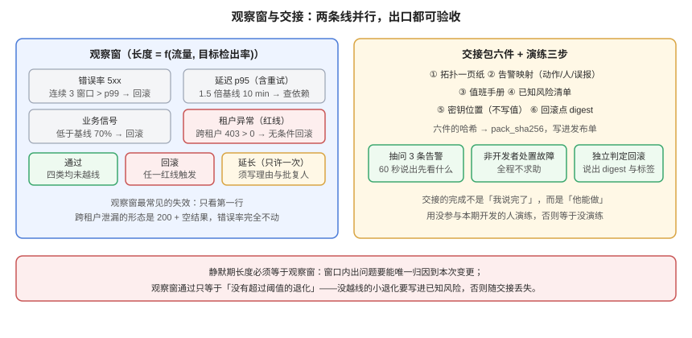

# 上线后观察窗口与值班交接：把「我看着呢」变成一条能被验收的线

[上线前置闸门](../PreLaunchGate/index.md)回答的是「**这一次能不能发**」，[回滚矩阵](../RollbackMatrix/index.md)回答的是「**发坏了怎么退**」。但在这两者之间还有一段没人认领的时间：**发布成功之后、确认稳定之前**。这段窗口里发生的事故，占本项目复盘清单里最大的一类——不是发布失败，而是「发布成功，两小时后才发现不对」。

本页把这段窗口做成两件可验收的事：**观察窗**（多长、看什么、什么时候算过）与**值班交接**（交什么、怎么证明交到了）。判据族 `OH-A` ~ `OH-H`。

::: tip 一句话
观察窗的长度不是「谨慎起见看一小时」，而是**由流量与要检出的劣化幅度算出来的**；交接的完成不是「我说完了」，而是**接手的人能独立处置一次演练事件**。
:::

## 判据族声明

本页判据族 `OH-A` ~ `OH-H`，共 8 条。定义表在第八节。

## 本页不讲什么

- 不讲发布前的七道闸门（镜像、环境、迁移、退出、冒烟、回滚、容量），归 [上线前置闸门](../PreLaunchGate/index.md)。
- 不讲回滚的四种场景与迁移标签 `R0~R3`，归 [回滚矩阵](../RollbackMatrix/index.md)。
- 不讲告警规则怎么写、分组抑制怎么设，归 [监控与告警接入](../Monitoring/index.md) 与 [告警设计](../../../../docs/Ops/Monitoring/Alerting/index.md)。
- 不讲指标口径与 SLO 的定义，归 [容量复核](../PoolCapacity/index.md) 与 [性能与容量工程](../../../../docs/Ops/PerformanceEngineering/index.md)。
- 不讲事故定级与指挥，归 [故障应急体系](../../../../docs/Ops/IncidentResponse/Overview/index.md)。



## 一、观察窗多长：算出来的，不是拍的

观察窗要检出的是「**错误率从基线涨到故障水平**」。这是一个标准的检出问题：给定每分钟请求数、窗口长度、以及阈值，能算出**检出概率**与**误报率**。

口径：基线错误率 0.5%，故障期 2.0%（4 倍），阈值取基线分布的 **p99**（即误报率锚定在 1%），用泊松分布计算（本机 Python 3.13，脚本见第七节）：

| 流量 | 窗口 | 请求数 | 基线期望错误数 | p99 阈值 | 误报率 | **检出率** |
| --- | --- | --- | --- | --- | --- | --- |
| 10 rpm | 15 min | 150 | 0.8 | 3 | 4.05% | **57.7%** |
| 10 rpm | 60 min | 600 | 3.0 | 8 | 1.19% | 91.0% |
| 10 rpm | 240 min | 2,400 | 12.0 | 21 | 1.16% | ≈100% |
| 100 rpm | 15 min | 1,500 | 7.5 | 15 | 1.03% | **99.9%** |
| 100 rpm | 60 min | 6,000 | 30.0 | 43 | 1.48% | ≈100% |
| 1000 rpm | 15 min | 15,000 | 75.0 | 96 | 1.11% | ≈100% |

三行读数值得单独说：

**① 低流量下「看一眼十五分钟」几乎等于没看。** 10 rpm、15 分钟的检出率只有 **57.7%**——四次里有一次半会漏。同样 10 rpm，窗口拉到 60 分钟才到 91%。

**② 「检出率到 80% 需要多长」是可以直接解出来的。** 本机按 5 分钟步长扫：10 rpm 需要 **35 分钟**，100 rpm 只需要 **5 分钟**。流量差 10 倍，窗口差 7 倍——**观察窗长度与流量成反比**，这是它不能一刀切的原因。

**③ 误报率随窗口变化不大（1%~4%），但低流量下会变差。** 因为阈值是整数：基线期望 0.8 次错误时，阈值只能取 3，此时「3 次」相对基线已是 3.75 倍，误报自然升到 4%。

::: danger 把观察窗定成固定一小时的两种后果
- **高流量系统**：一小时里你已经收到足够多的信号，前 15 分钟就能判定，剩下 45 分钟只是等待——窗口过长不会更安全，只会拖慢后续发布。
- **低流量系统**：一小时仍然不够（10 rpm 时 91%，还不是 99%），你以为看过了，其实还有 9% 的概率漏掉——**这才危险，因为它给了你虚假的信心**。
:::

## 二、观察窗看什么：四类信号，各有各的出口

只看错误率会漏掉「**错误率没涨但用户已经不能用**」这一类。四类信号必须同时看，且各有独立的退出条件：

| 信号 | 口径 | 观察窗内的判定 | 越线动作 |
| --- | --- | --- | --- |
| **错误率** | 5xx / 总请求，按 1 分钟窗口 | 连续 3 个窗口 > p99 阈值 | 立即回滚（不等确认） |
| **延迟** | p95 端到端（含重试） | p95 > 基线 1.5 倍且持续 10 分钟 | 先查依赖，不自动回滚 |
| **业务信号** | 卡片创建数、拖动成功数、通知投递数 | 任一低于基线 70%，持续 15 分钟 | 立即回滚 |
| **租户异常** | 单租户错误占比、跨租户 403 计数 | 403 计数 > 0（任意一条） | **无条件回滚**，因为这是越权 |

第四条是本项目的红线：`403` 是「该拒绝的拒绝了」，正常流量里也会有；但**跨租户 `403`**（租户 A 的令牌访问租户 B 的资源）在我们的矩阵里定义为「隔离被破坏」，出现一条就回滚，不设阈值、不看趋势。

::: danger 观察窗最常见的失效：只看第一条
错误率是「最容易看」的信号，也是「最晚变」的信号。本项目第 163 天的联调记录里，跨租户泄漏的形态是 **`200` + 空结果**，错误率完全不动——只有第四条信号（`403` 计数与单租户空结果比）能发现它。
:::

## 三、观察窗的退出：三种结局，都要写下来

| 结局 | 条件 | 记录内容 | 后续 |
| --- | --- | --- | --- |
| **通过** | 窗口内四类信号均未越线 | 窗口起止时间、四类信号的最大值、判定人 | 进入常态值班 |
| **回滚** | 任一红线触发 | 触发的那一条、当时的读数、回滚到哪个 digest | 走[回滚矩阵](../RollbackMatrix/index.md) |
| **延长** | 信号在阈值附近反复（未越线但 > 80% 阈值） | 延长理由、延长多久、谁批的 | 最多延长一次，第二次必须二选一 |

「延长」这一档是为了防「再等等看」。没有它，团队会在红与绿之间反复重跑；有了它，**延长必须写明理由与批复人**，而且只允许一次。

## 四、交接包：六件东西，缺一件就不算交

值班交接失败的方式很统一：**交的人以为说了，接的人以为懂了**。对抗它的办法是把「懂」变成可检查的六件东西：

| # | 物件 | 最小要求 | 缺了会怎样 |
| --- | --- | --- | --- |
| 1 | **拓扑一页纸** | 服务、依赖、数据流向、外部边界 | 出事时先花 20 分钟搞清楚谁调谁 |
| 2 | **告警映射表** | 每条告警 → 一条处置动作 → 一个负责人 | 收到告警后只能「先看看」 |
| 3 | **值班手册** | 五类高频现象的分诊与命令 | 每次从零开始排查 |
| 4 | **已知风险清单** | 当前已知的坑、临时绕过、何时修 | 同一个坑被三个人各踩一次 |
| 5 | **密钥与权限位置** | 在哪、谁能取、怎么轮换（**不写具体值**） | 需要时找不到，或者找到了不该找到的人 |
| 6 | **回滚点** | 当前版本 digest + 上一个可回滚 digest + 迁移标签 | 想退的时候不知道退到哪 |

第 2 条是六件里最容易被做成摆设的。一条合格的映射长这样：

| 告警 | 处置动作（可执行） | 负责人 | 误报时怎么办 |
| --- | --- | --- | --- |
| `ApiErrorRateHigh` | 查 `/admin/health/deps`，看是 DB 还是 Redis | 后端值班 | 标记 `known-fp` 并记一条 |
| `ApiP95Slow` | 看 `pg_stat_activity` 有无长事务 | 后端值班 | 同上 |
| `OutboxLagHigh` | 查投递进程存活 + outbox 表积压量 | 后端值班 | 同上 |
| `CrossTenantDenied` | **立即回滚**，不看趋势 | 值班 + 安全 | 不允许误报豁免 |

「误报时怎么办」这一列是关键：**没有它，团队对同一条告警会做出不同反应**，有人忽略、有人半夜升级。

## 五、交接怎么验收：一次演练，三个判据

交接的完成标准不是签字，而是**接手的人独立处置过一次**。演练设计成三步，每步都能观察：

| 步 | 做什么 | 通过标准 | 不通过说明 |
| --- | --- | --- | --- |
| 1 | 交的人随机抽 3 条告警，只报名字 | 接的人能在 60 秒内说出「先看什么」 | 告警映射表没落地 |
| 2 | 制造一次真实故障（停一个依赖，或用 `docker pause`） | 接的人独立完成定位 → 处置 → 记录，全程不求助 | 手册缺步骤，或权限不在他手上 |
| 3 | 让接的人做一次回滚判定 | 能说出回滚点 digest 与迁移标签 | 回滚点没交 |

第 2 步的故障建议用[依赖降级](../DegradePath/index.md)里那三种可控故障之一（Redis 不可用、对象存储超时、投递进程停摆），因为它们的**预期现象是写死的**，便于判分。

::: tip 演练要用「不知道答案」的人
让参与过该功能开发的人来演练，等于没演练——他知道答案。**接的人必须是没有参与本期开发的那位**，这也是交接唯一能证伪的方式。
:::

## 六、静默期与「反向交接」

发布后还有一件容易被忽略的事：**静默期的长度要与观察窗一致**。静默期内不允许同一服务的新变更上线，否则出了问题无法归因（两个变更叠在一起）。

| 项 | 规则 | 理由 |
| --- | --- | --- |
| 静默期长度 | = 观察窗长度 | 观察窗内出问题必须能唯一归因到本次变更 |
| 静默期范围 | 同一服务的所有变更（含配置） | 配置变更同样会改变行为 |
| 例外 | 只允许「修复本次问题」的变更 | 且必须引用同一个变更单号 |
| 反向交接 | 观察窗通过后，把「本次变更的已知遗留」写进风险清单 | 否则遗留项随交接丢失 |

「反向交接」是本节最实用的一条：观察窗通过不等于没有问题，它只等于「**没有超过阈值的退化**」。那些没越过阈值的小退化，必须写进已知风险清单，否则下一班会在毫无上下文的情况下遇到它们。

## 七、验证方式

```shell
# ① 观察窗长度：按流量与目标检出率算（本机口径：基线 0.5%、故障 2.0%、阈值取 p99）
python3 - <<'PY'
import math
def cdf(k, lam):
    return sum(math.exp(-lam + i*math.log(lam) - math.lgamma(i+1)) for i in range(k+1))
def q99(lam):
    k = 0
    while cdf(k, lam) < 0.99:
        k += 1
    return k
for rpm, mins in [(10,15),(10,60),(100,15),(100,60),(1000,15)]:
    n = rpm*mins; l0 = n*0.005; l1 = n*0.02
    thr = q99(l0)
    print(f'{rpm}rpm {mins}min: thr={thr} 误报={1-cdf(thr-1,l0):.3f} 检出={1-cdf(thr-1,l1):.3f}')
PY
# 期望：10rpm/15min 检出仅 0.577；100rpm/15min 检出 0.999 —— 窗口必须按流量算
```

```shell
# ② 观察窗内四类信号必须都在采集（缺一条就是盲区）
for sig in http_errors_duration_seconds request_duration_seconds \
           board_card_created_total notification_delivered_total tenant_denied_total; do
  curl -s localhost:9000/metrics | grep -q "$sig" && echo "OK   $sig" || echo "MISS $sig"
done
# 期望：五行全 OK。MISS 的那条就是观察窗里的盲区，先补采集再谈观察
```

```shell
# ③ 告警映射表覆盖率：每条告警都必须有处置动作与负责人
python3 - <<'PY'
import re
rules = set(re.findall(r'alert:\s*(\w+)', open('prometheus/alerting.yaml').read()))
rows  = set(re.findall(r'^\|\s*`?(\w+)`?\s*\|', open('runbook/alert-map.md').read(), re.M))
missing = sorted(rules - rows)
print('alerts', len(rules), 'mapped', len(rules & rows), 'missing', missing)
PY
# 期望：missing 为空。非空说明有告警收到后不知道做什么
```

```shell
# ④ 交接包六件齐全 + 内容指纹（交接是可验证的，不只是一句话）
python3 - <<'PY'
import hashlib, os
need = ['topology.md','alert-map.md','oncall.md','known-risks.md','secrets-locations.md','rollback-points.md']
h = hashlib.sha256()
for f in need:
    p = os.path.join('handover', f)
    ok = os.path.exists(p) and os.path.getsize(p) > 200
    print(('OK  ' if ok else 'MISS'), f)
    if ok:
        h.update(hashlib.sha256(open(p,'rb').read()).hexdigest().encode())
print('pack_sha256', h.hexdigest()[:16])
PY
# 期望：六行全 OK，并得到一个 pack_sha256 —— 交接记录里写上它，事后能证明「交的是这一版」
```

```shell
# ⑤ 静默期规则可判定（不是公告，是一条能查的配置）
python3 - <<'PY'
import datetime, yaml
cfg = yaml.safe_load(open('release/quiet-period.yaml'))
now = datetime.datetime.now(datetime.timezone.utc)
end = datetime.datetime.fromisoformat(cfg['until'].replace('Z','+00:00'))
print('quiet_until', cfg['until'], 'active', now < end, 'scope', cfg['scope'])
PY
# 期望：active True 期间，同服务的新变更必须被流水线拒绝（拿一个 PR 试一次）
```

## 八、判据族 `OH`

| 判据 | 内容 | 怎么验证 |
| --- | --- | --- |
| `OH-A` | 观察窗长度必须由流量与目标检出率算出，不得统一拍定 | 报告里有 rpm、窗口、检出率三个数 |
| `OH-B` | 四类信号（错误率/延迟/业务/租户异常）必须同时采集 | 命令 ② 五行全 OK |
| `OH-C` | 跨租户 `403` 必须是无条件回滚红线，不设阈值 | 告警映射表里该条的处置是「立即回滚」 |
| `OH-D` | 观察窗必须有三种结局（通过/回滚/延长），延长只允许一次 | 记录里有结局字段与延长次数 |
| `OH-E` | 交接包六件必须齐全，且生成内容指纹 | 命令 ④ 六行 OK 且有 `pack_sha256` |
| `OH-F` | 每条告警必须有处置动作、负责人、误报处理三列 | 命令 ③ missing 为空 |
| `OH-G` | 必须做一次「非开发者」的交接演练，且三步都留记录 | 演练记录含抽问、故障处置、回滚判定三节 |
| `OH-H` | 静默期长度必须等于观察窗，且能被流水线判定 | 命令 ⑤ 输出 active 与 scope，且 PR 被拒 |

## 九、下一步

1. 把本页的四类信号接进 `Monitoring` 的看板，作为**默认视图**（不是二級页面）。
2. 用 `pack_sha256` 做交接记录的唯一标识，写进发布单。
3. 第 172 天起转向「观察窗之后」的常态运营：SLO 报表、容量趋势、季度演练——见 [交付文档](../DeliveryDocs/index.md) 的维护章节。

## 十、与相邻章节的分工

| 你想知道 | 去哪 |
| --- | --- |
| 发布前怎么确认「这一次能发」 | [上线前置闸门](../PreLaunchGate/index.md) |
| 发坏了怎么退、退到哪一档 | [回滚矩阵](../RollbackMatrix/index.md) |
| 告警规则怎么写、怎么抑制 | [监控与告警接入](../Monitoring/index.md) |
| 依赖故障的三种可控演练 | [依赖降级](../DegradePath/index.md) |
| 事故定级与指挥 | [故障应急体系](../../../../docs/Ops/IncidentResponse/Overview/index.md) |
| 变更分级与审批留痕 | [变更管理与发布工程](../../../../docs/Ops/ChangeManagement/index.md) |

## 参考资料

- Google SRE Workbook：[*Monitoring Distributed Systems*](https://sre.google/workbook/monitoring-distributed-systems/)（四类信号与 SLO 的关系）
- Google SRE Book：[*Being On-Call*](https://sre.google/sre-book/being-on-call/)（值班交接与可操作性）
- PagerDuty：[*Incident Response Documentation*](https://response.pagerduty.com/)（runbook 与告警映射的写法）
- 本站：[上线前置闸门](../PreLaunchGate/index.md)、[回滚矩阵](../RollbackMatrix/index.md)、[监控与告警接入](../Monitoring/index.md)
