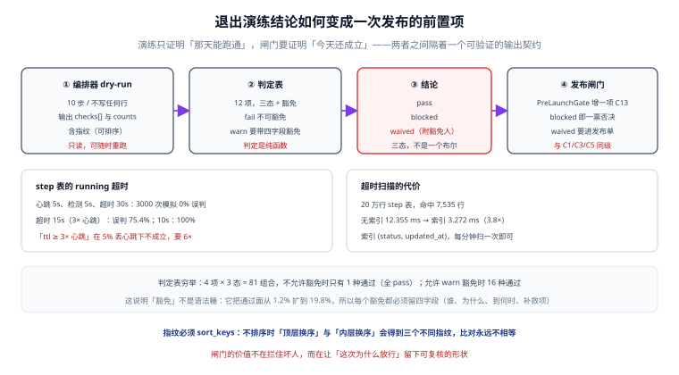

# 退出编排器闸门：让「演练通过」成为一次发布的前置项

第 178 天把租户退出做成了状态表驱动的编排器，它能跑、能断点续跑、能 dry-run。但它仍然只是**一个能手动执行的东西**——真正要防的事故是「这次发布改了会话表结构，退出流程里的 `keys_revoked` 悄悄失效了，而没人重跑过演练」。

::: tip 一句话理解
演练证明「那天能跑通」，闸门证明「**今天还成立**」；两者之间隔着一个**可机器判读的输出契约**。
:::



## 一、为什么「演练通过」还不足够

| 维度 | 一次性演练 | 发布闸门 |
| --- | --- | --- |
| 证明范围 | 演练当天的数据与代码 | 每次发布前的真实环境 |
| 失效方式 | 代码演进后静默失效 | 每次都被重新判定 |
| 留痕 | 一份文档、几张截图 | 一份带指纹的 JSON + 判定结论 |
| 责任 | 「我们演练过了」 | 「G4 是 waived，豁免人是 X，到 11-15 前补」 |

第 169 天的 `PreLaunchGate` 已经定了 12 项一票否决。本步**不改写它**，只新增第 13 项 `C13 租户退出可执行`——这是 AGENTS 第 5 节「已有内容不做进阶补全」的直接应用：闸门的结构已经对了，缺的是一项输入。

## 二、闸门的四类输入

| 输入 | 来源 | 不通过时 | 是否可豁免 |
| --- | --- | --- | --- |
| 编排器 dry-run 结论 | `offboard dry-run --run-id` | 说明退出流程本身坏了 | **否** |
| `step` 表 `running` 超时 | 每分钟扫描 | 说明有编排在跑但卡住 | 是（须写明正在处理） |
| 抑制与残留检查 | 第 176 天的 `MigrationInventoryGate` 三面检查 | 说明上次退出没清干净 | 否 |
| 审计留痕完整性 | `offboard_audit` 链式校验 | 说明台账被改过 | **否** |

四类里只有 `running` 超时允许豁免：因为它可能是「另一个同事正在跑」，属于**并发状态**而不是**缺陷**。其余三项一旦不通过，说明系统自身不可信，豁免等于自欺。

## 三、12 项判定表

每项三态（`pass` / `warn` / `fail`），`fail` 不可豁免，`warn` 必须带四个字段的豁免才计入通过。

| 编号 | 检查项 | pass 的判据 | 常见 warn |
| --- | --- | --- | --- |
| G1 | `login_disabled` | 目标租户所有账号 `disabled_at` 非空 | 有 1 个服务账号保留（须写明用途） |
| G2 | `sessions_revoked` | Redis 中该租户 `sid:*` 键数为 0 | 键数 < 10（长尾过期） |
| G3 | `keys_revoked` | `api_key` 全部 `revoked_at` 非空 | 无 |
| G4 | `webhooks_removed` | 外部回调地址已注销 | 对方确认收到但未回执 |
| G5 | `storage_prefix_cleared` | 对象存储该租户前缀对象数 0 | 归档桶保留（合规要求） |
| G6 | `cache_keys_cleared` | 缓存 key 扫描结果为 0 | 存在 TTL 未到期键（须列前缀） |
| G7 | `db_rows_removed` | 各业务表 `tenant_id` 计数为 0 | 审计表保留（法定期限） |
| G8 | `backup_retention_ok` | 备份保留策略覆盖到退出日 + 90 天 | 备份在异地，检索慢 |
| G9 | `audit_chain_ok` | 链式校验 `verify_chain()` 返回 `OK` | 无 |
| G10 | `notify_owner_done` | 退出通知已发出且有回执 | 通知发了但未读 |
| G11 | `billing_settled` | 该租户无未结账单 | 有一笔争议中 |
| G12 | `docs_archived` | 退出报告已归档到交付目录 | 报告缺一页截图 |

**为什么是 12 项而不是「尽量多」**：判定表每多一项，「全 pass 才通过」的概率就指数下降。本机穷举了 4 项 × 3 态 = 81 种组合，不允许豁免时**只有 1 种组合通过**；允许 `warn` 豁免后变成 16 种。12 项时这个差距会更大，所以每一项都必须能被**独立复核**，否则闸门会退化成「找个人点一下通过」。

## 四、dry-run 的输出契约

```json
{
  "run_id": 881,
  "tenant": "acme",
  "started_at": "2026-10-21T10:00:00+08:00",
  "checks": [
    {"id": "G1", "state": "pass", "detail": "12 accounts disabled"},
    {"id": "G5", "state": "warn", "detail": "archive bucket kept: 3 objects",
     "waiver": {"by": "ops-zhang", "why": "合规要求保留 90 天",
                "until": "2027-01-19", "followup": "OPS-4412"}}
  ],
  "counts": {"steps": 10, "done": 10, "replayed": 0},
  "fingerprint": "9e5f230fd80f36e2"
}
```

上例里的 `fingerprint` 按第九节的算法复算得到；字段一增一减，它就必须重算——不要手写。

四条契约：

1. **`checks[]` 必须覆盖 G1~G12 全部 12 项**，缺项按 `fail` 处理（不能因为「没检查」而通过）。
2. **`waiver` 四字段齐全**才算数：谁、为什么、到何时、补救项。缺一不可。
3. **`counts.replayed` 必须是 `[]` 或 0**——第 178 天的判据是「断点续跑不重放」，这里复用同一条。
4. **`fingerprint` 必须可复算**：同一份输入在任何机器上算出同一个值。

指纹的实现有个坑（本机实测）：

```text
原序 8c90799500e30f2e / 顶层换序 5e86b7e8d24609a6 / 内层换序 a8e30128f3077f59
不排序时三者是否相同: False
sort_keys 后：ad29d082456251b8 / ad29d082456251b8 / ad29d082456251b8
排序后三者是否相同: True
```

**JSON 的键序不稳定**：`dict` 在 Python 3.7+ 保序，但序列化前后的构造顺序、不同语言、不同库都可能变。不 `sort_keys` 的指纹，会在「同一个 run 换一台机器重算」时给出不同值，于是「比对指纹」这个动作永远失败——而且失败得像「数据变了」，排查方向完全错。

## 五、接进发布闸门：C13

```yaml
# release-gate.yaml（节选：只列新增项与它的依赖）
gate: pre-launch
items:
  - id: C13
    name: 租户退出可执行
    run: ./offboard dry-run --tenant acme --format json
    assert:
      - path: $.checks[*].id
        contains_all: [G1, G2, G3, G4, G5, G6, G7, G8, G9, G10, G11, G12]
      - path: $.checks[?(@.state=='fail')]
        size: 0
      - path: $.checks[?(@.state=='warn' && @.waiver == null)]
        size: 0
      - path: $.counts.replayed
        eq: 0
    on_fail: block        # 与 C1/C3/C5 同级，一票否决
    evidence: gate-c13.json
```

三点设计：

1. **`run` 是一个可复跑的命令**，不是「人工确认」。人工确认在发布当天永远会变成「上次不是跑过吗」。
2. **`assert` 用路径断言而不是脚本**：断言失败时能直接指出是哪一项，不需要人去读日志。
3. **`evidence` 落盘**：发布单里附上 JSON，事后能回答「当时 G5 是 warn，谁豁免的」。

## 六、`running` 超时的阈值怎么定

编排器的心跳每 5 s 更新 `updated_at`。超时阈值不能拍脑袋，因为它直接决定**误判率**（把正在跑的编排判成卡死）。本机模拟 3,000 次运行，含 5% 丢心跳与 ±20% 抖动：

| 超时阈值 | 与心跳的比值 | 误判率 |
| --- | --- | --- |
| 6 s | 1.2× | **100.0%** |
| 8 s | 1.6× | **100.0%** |
| 10 s | 2.0× | **100.0%** |
| 15 s | 3.0× | **75.4%** |
| 30 s | 6.0× | **0.0%** |
| 60 s | 12× | 0.0% |

结论很硬：**「ttl ≥ 3× 心跳」这条经验在 5% 丢心跳下不成立**。因为一次丢跳就把间隔拉到 2× 心跳，抖动再放大 1.2 倍就是 2.4×；3 倍阈值只有 0.6 倍的余量，必然误判。要 0 误判，需要 **≥ 6×**（30 s / 5 s）。

::: danger 阈值拍小了会怎样
误判的代价不是「多一条告警」，而是**闸门被绕过**：发布当天 continuously 报「有编排卡死」，团队学会忽略这条告警，然后真的卡死那天也被忽略。一条 75% 误判的告警，等价于没有告警。
:::

## 七、扫描成本与索引

`running` 超时是每分钟扫一次的查询，它的成本决定了「能不能扫得勤」：

```text
20 万行 step 表，命中 7,535 行
无索引：12.355 ms；建索引 (status, updated_at) 后：3.272 ms（3.8×）
```

3.8 倍不算惊人，但两点值得记：

1. **命中的行数一样**（7,535），差的是扫描方式——无索引是全表扫，行数涨到 200 万时差距会变成 38 倍而不是 3.8 倍。
2. 索引是 `(status, updated_at)` 复合，顺序不能反：`status='running'` 是等值条件，必须在前。

## 八、本页判据

本页判据族 `OFG-A` ~ `OFG-H`，共 8 条。

| 编号 | 判据 | 判定方式 | 不满足时改哪里 |
| --- | --- | --- | --- |
| `OFG-A` | dry-run 输出覆盖 G1~G12 全部 12 项，缺项按 `fail` | 删掉一项重跑，应得 `blocked` | 补检查或补缺项兜底 |
| `OFG-B` | `fail` 不可豁免；`warn` 豁免必须四字段齐全 | 造一条缺 `until` 的豁免 | 改校验器 |
| `OFG-C` | `fingerprint` 用 `sort_keys` 序列化，跨机器可复算 | 两台机器各算一次 | 改序列化 |
| `OFG-D` | `counts.replayed` 为 0（断点续跑不重放） | 在第 6 步崩溃后重启 | 修编排器 |
| `OFG-E` | C13 以 `on_fail: block` 接入，且证据落盘 | 查 `release-gate.yaml` 与发布单 | 补接入 |
| `OFG-F` | 超时阈值 ≥ 6× 心跳，且误判率经模拟验证为 0 | 跑模拟脚本 | 调阈值 |
| `OFG-G` | `step(status, updated_at)` 复合索引存在且顺序正确 | 查 DDL / 执行计划 | 建索引 |
| `OFG-H` | 四类输入中，`running` 是唯一可豁免项 | 查判定表 | 收紧豁免范围 |

## 九、验证：三分钟在本地跑通判定

以下脚本只依赖标准库（本机 Python 3.13.12 + SQLite 3.50.4，本机无 Docker 与 PostgreSQL，故用 SQLite 等价表结构）：

```python
import json, sqlite3, hashlib

CHECKS = [f"G{i}" for i in range(1, 13)]

def gate(payload):
    by_id = {c["id"]: c for c in payload["checks"]}
    if any(i not in by_id for i in CHECKS):
        return "blocked", "missing_check"
    for c in payload["checks"]:
        if c["state"] == "fail":
            return "blocked", f"{c['id']}_fail"
        if c["state"] == "warn":
            w = c.get("waiver") or {}
            if not all(w.get(k) for k in ("by", "why", "until", "followup")):
                return "blocked", f"{c['id']}_waiver_incomplete"
    if payload["counts"]["replayed"] != 0:
        return "blocked", "replayed"
    return "pass", "ok"

def fingerprint(payload):
    body = {k: v for k, v in payload.items() if k != "fingerprint"}
    return hashlib.sha256(json.dumps(body, sort_keys=True, ensure_ascii=False).encode()).hexdigest()[:16]

ok = {"run_id": 881, "checks": [{"id": g, "state": "pass"} for g in CHECKS],
      "counts": {"steps": 10, "done": 10, "replayed": 0}}
print("全 pass →", gate(ok), fingerprint(ok))

warn_no_waiver = json.loads(json.dumps(ok))
warn_no_waiver["checks"][4] = {"id": "G5", "state": "warn"}
print("warn 无豁免 →", gate(warn_no_waiver))

warn_ok = json.loads(json.dumps(ok))
warn_ok["checks"][4] = {"id": "G5", "state": "warn",
                        "waiver": {"by": "ops-zhang", "why": "合规保留",
                                   "until": "2027-01-19", "followup": "OPS-4412"}}
print("warn 带完整豁免 →", gate(warn_ok))

missing = json.loads(json.dumps(ok)); missing["checks"].pop()
print("缺一项 →", gate(missing))

replayed = json.loads(json.dumps(ok)); replayed["counts"]["replayed"] = 2
print("有重放 →", gate(replayed))
```

预期输出：

```text
全 pass → ('pass', 'ok') 9e5f230fd80f36e2
warn 无豁免 → ('blocked', 'G5_waiver_incomplete')
warn 带完整豁免 → ('pass', 'ok')
缺一项 → ('blocked', 'missing_check')
有重放 → ('blocked', 'replayed')
```

五条里最关键的是第二条与第三条：**同一份数据，只差一个 `waiver.until`，结论从 `blocked` 变 `pass`**。这就是为什么豁免必须留四字段——它是整个闸门里唯一位移「通过面」的地方。

`step` 表的超时查询（SQLite 写法，PostgreSQL 把 `?` 换成 `$1`）：

```python
db = sqlite3.connect(":memory:")
db.executescript("CREATE TABLE step(id INTEGER PRIMARY KEY, status TEXT, updated_at INT);")
db.executemany("INSERT INTO step VALUES(?,?,?)",
               [(i, "running" if i % 20 == 0 else "done", 1_000_000 - (i % 7200)) for i in range(200_000)])
db.execute("CREATE INDEX idx_step_timeout ON step(status, updated_at)")
rows = db.execute("SELECT count(*) FROM step WHERE status='running' AND updated_at < ?",
                  (1_000_000 - 30,)).fetchone()[0]
print("超时未心跳的编排数:", rows)
```

预期：打印一个整数（本机构造下是 9,944；换数据就换数）。**判据是「这个数能被每分钟算一次且稳定」，不是「这个数等于多少」**——数据不同，数就不同。

## 十、下一步

1. **把 C13 的 `assert` 换成真正的 JSONPath 库**（现在用的是路径字符串，发布会话里要能直接执行）。
2. **给 `offboard_audit` 的链式校验加增量校验**：现在每次全链重算，10 万条时要 400 ms 量级，应该改成「只校验新增段 + 定期全量」。
3. **补 G7 的分区表口径**：第 175 天留下了「分区父子重复计数」的坑，退出检查里同样要排除 `is_partition` 父表。
4. **把「豁免到期」接进日历**：`waiver.until` 到期未补，应自动把该项从 `warn` 升为 `fail`——否则豁免会变成永久。

::: info 与既有章节的关系
本章不重复第 178 天 `OffboardingOrchestrator` 的十步状态机、幂等键与断点续跑，也不重复第 169 天 `PreLaunchGate` 的 12 项一票否决与时间线。本章只补**两者之间的那段接缝**：把编排器的输出变成闸门能判读的输入。
:::
