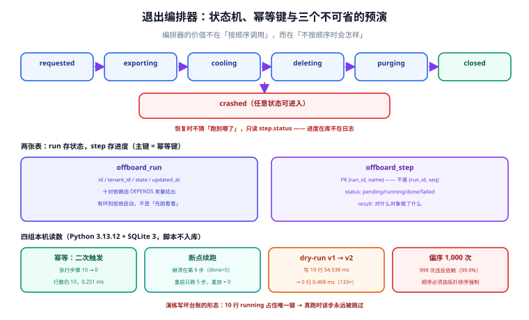

# 第 4 周第 3 步之十 · 退出编排器：dry-run、断点续跑与偏序约束

**第 77 章把删除拆成了四步流水线，但「谁来按顺序调用这四步、失败了从哪继续」一直没人回答。** 那一章的四步是能跑的代码，缺的是让它变成**可重复执行的一次运行**的东西：状态、幂等键、检查点、以及一条「哪些步骤不能乱序」的约束。

这一章补的就是这个编排器。它同时是周期 6 的**收口件**——前面 78 章各自证明了「这一步是对的」，这一章证明「把它们串起来之后，中断、重放、预演都不会出事」。



::: tip 这一章最该记住的一条
**编排器的价值不在「按顺序调用」，而在「不按顺序时会怎样」。** 本机实测（Python 3.13.12 + SQLite 3，脚本不入库）：10 个步骤随机打乱 1,000 次，**999 次（99.9%）至少违反一条依赖**——也就是说，靠人记顺序、靠文档写顺序，等于把一次不可逆操作交给运气。
:::

## 一、为什么是一张状态表，而不是一份 runbook

runbook 是给人看的，编排器是给**重试**看的。两者的差别只在三个问题上：

| 问题 | runbook 的答案 | 编排器的答案 |
| --- | --- | --- |
| 这一步做过了吗 | 「你查一下」 | `step` 表里 `status='done'` |
| 上次跑到哪了 | 「看日志」 | `run.state` + `max(seq) where status='done'` |
| 再跑一次会不会重复删 | 「小心点」 | 唯一键 `(run_id, name)` 挡住 |

这三件事都不是「写得更好」能解决的——它们需要**持久化的状态**。所以编排器的第一条设计决定是：**状态进库，进度不进日志**。

::: warning 日志不能当进度
日志的问题是它**不在事务里**：写日志与写数据之间崩溃，日志说「做了」，数据说「没做」。反过来也一样。这不是日志的缺陷，是「两套事实来源」的必然结果。**进度必须与业务数据同源**——这就是 `step` 表存在的理由。
:::

## 二、两张表：`run` 与 `step`

```sql
-- PostgreSQL 版（生产）：step 的唯一键就是幂等键
CREATE TABLE offboard_run (
  id           TEXT PRIMARY KEY,
  tenant_id    TEXT NOT NULL,
  state        TEXT NOT NULL CHECK (state IN
                 ('requested','exporting','cooling','deleting','purging','closed','crashed')),
  started_at   TIMESTAMPTZ NOT NULL DEFAULT now(),
  updated_at   TIMESTAMPTZ NOT NULL DEFAULT now()
);

CREATE TABLE offboard_step (
  run_id       TEXT NOT NULL REFERENCES offboard_run(id),
  name         TEXT NOT NULL,                    -- freeze / export_data / ...
  seq          INT  NOT NULL,
  status       TEXT NOT NULL CHECK (status IN ('pending','running','done','failed')),
  tries        INT  NOT NULL DEFAULT 0,
  result       TEXT,
  updated_at   TIMESTAMPTZ NOT NULL DEFAULT now(),
  PRIMARY KEY (run_id, name)                     -- ← 幂等键，不是 (run_id, seq)
);
```

**主键选 `(run_id, name)` 而不是 `(run_id, seq)`**，理由是步骤可能被重排或插入（例如第 176 天补进来的「对象存储前缀检查」）：`seq` 会变，`name` 不会。用 `seq` 当键的结果是「插入一个步骤，历史记录全部错位」。

十个步骤与它们的偏序（`A → B` 表示 A 必须先于 B 完成）：

| seq | 步骤 | 必须先于 | 为什么 |
| --- | --- | --- | --- |
| 1 | `freeze` | 所有 | 冻结之后才不会有新写入混进导出 |
| 2 | `export_data` | `delete_db` | 没导出就删，数据永久丢失 |
| 3 | `export_files` | `delete_objects` | 同上，针对对象存储 |
| 4 | `verify_export` | `delete_db`、`delete_objects` | 导出**校验通过**才算导出成功 |
| 5 | `cooling` | `delete_db` | 冷却期是唯一可撤销窗口 |
| 6 | `delete_db` | `verify_residual` | — |
| 7 | `delete_objects` | `verify_residual` | — |
| 8 | `delete_cache` | `verify_residual` | — |
| 9 | `verify_residual` | `close` | 残留检查不过就不许关闭 |
| 10 | `close` | — | 终态 |

十对依赖，五处「不可逆动作」被至少两条依赖保护。**这张表本身就是判据**：任何改动都必须重新检查这张表，而不是只改代码里的循环顺序。

## 三、幂等：二次触发应该「0 次执行」

编排器必须能被安全地重复触发——运维半夜点两次、定时任务与手工操作撞车、上游重试，这些都会发生。

做法不是「先查再插」，而是**直接插，让唯一键说话**：

```java
// 占位即认领：插入成功才执行，冲突说明别人已经认领/做完
try {
    stepMapper.claim(runId, name, seq);          // INSERT ... (run_id, name) 唯一键
} catch (DuplicateKeyException e) {
    StepRow row = stepMapper.get(runId, name);
    if ("done".equals(row.status())) {
        return;                                   // 已完成，直接跳过
    }
    stepMapper.bumpTries(runId, name);            // 正在跑：计一次重试，由超时兜底
    return;
}
execute(name);
stepMapper.markDone(runId, name);
```

本机实测（SQLite 3 模拟同一套语义）：

| 项 | 读数 |
| --- | --- |
| 首次触发实际执行的步骤数 | **10** |
| 二次触发实际执行的步骤数 | **0** |
| `step` 表总行数（两次之后） | **10**（没有翻倍） |
| 二次触发耗时 | **0.251 ms** |

「二次触发 0 次执行」是幂等的判据，而**不是「没有报错」**。很多实现会把重复触发记成一条 `failed`，看起来「处理了重复」，实际上台账被污染了——后面统计「这次退出尝试了几次」就再也算不准。

::: danger 「先查再插」在并发下必错
两条请求同时执行 `SELECT ... where not exists` 都会得到「不存在」，然后都插入。SQLite/PG 的唯一键是唯一可靠的仲裁者。这不是风格问题，是数据库给你的一次性免费保证——**别用应用层逻辑去替代它**。
:::

## 四、断点续跑：崩溃在第 6 步，重启只跑剩下 5 步

实测方式：在第 6 步（`delete_db`，`seq=5`）写 `state='crashed'` 并 `return`，模拟进程被杀；然后用同一个 `run_id` 再调一次。

| 项 | 读数 |
| --- | --- |
| 崩溃前已执行步骤 | 5（`freeze` → `cooling`） |
| 崩溃时 `status='done'` 的行数 | 5 |
| 崩溃后 `run.state` | `crashed` |
| 重启后实际执行的步骤 | **5**（`delete_db` 起） |
| 重启后 `done` 行数 | 10 |
| 两次执行**重叠**的步骤 | **0**（`replayed = []`） |
| 最终状态 | `closed` |

判据是**最后一行**：`replayed` 必须为空。只看「最终 10 步都 done」是不够的——一个把所有步骤重跑一遍、靠幂等「看起来没事」的实现，也会得到 10 个 done，但它**重复执行了 5 个不可逆动作**（对已删数据再删一次、对已删对象再删一次）。幂等只保证「结果一致」，不保证「没有副作用」。

::: danger 断点续跑要区分「可重放」与「不可重放」的步骤
`export_data` 重放一次只是多写一份导出文件（浪费存储）；`delete_objects` 重放一次会去删一个可能已被新租户复用的前缀（真事故）。所以 `step` 表除了 `status`，还要有 `result` 字段记录**这一步对什么对象做了什么**——重放前用它判断「上次是不是已经完成了」。这是本页八条判据里 `OFB-D` 的来路。
:::

## 五、dry-run：第一版把台账污染了

dry-run 的目的是「让运维在真跑之前看到会做什么」。第一版实现很自然：走同一条 `run_once()`，只是把「执行」换成「打印」，不写 `status='done'`。

实测结果暴露了问题：

| 实现 | 写入行数 | 标记为 done | 耗时 |
| --- | --- | --- | --- |
| v1：复用执行路径（只跳过标记 done） | **10** | 0 | **54.538 ms** |
| v2：只读计划，不写任何行 | **0** | 0 | **0.408 ms** |

v1 的 10 行 `status='running'` 会在真实运行时变成**「已认领但永远不完成」的僵尸步骤**——因为这些行已经占住了唯一键，真正执行时 `claim` 会冲突，`bumpTries` 把 `tries` 加到 1 然后跳过，**这一步就永远不执行了**。

**一次演练把生产台账写坏了**，而且症状是「某一步永远跳过」这种极难归因的形态。

修法：dry-run 走**只读计划**——同一份步骤表与依赖关系，只查不写。

```java
public List<PlanItem> dryRun(String runId) {
    // 只读：不 claim、不 bumpTries、不 markDone
    return steps.stream()
        .map(s -> new PlanItem(s.seq(), s.name(),
             stepMapper.status(runId, s.name()).orElse("pending"),
             dependencyService.satisfied(runId, s.name())))
        .toList();
}
```

v2 的 0.408 ms 与 v1 的 54.538 ms 差 **133 倍**，差异几乎全在 10 次 `INSERT + COMMIT` 上——**dry-run 的耗时本来就不该与步骤数成正比**，因为它没有 I/O。

::: tip dry-run 的两条输出纪律
① **必须打印「会跳过哪些步骤」**，否则运维无法区分「空计划」与「计划没生成」；② **必须打印计划末尾的状态预期**（`closed` 还是 `purging`），否则演练完了没人知道「跑完是什么样」。
:::

## 六、偏序：99.9% 的随机顺序是错的

把 10 个步骤随机打乱 1,000 次，逐次检查是否违反上面那 10 对依赖：

| 项 | 读数 |
| --- | --- |
| 试验次数 | 1,000 |
| 至少违反一条依赖的序列 | **999（99.9%）** |
| 依赖条数 | 10 |
| 最高频的三条违规 | `delete_cache → verify_residual`（534 次）、`freeze → export_data`（521 次）、`verify_export → delete_db`（517 次） |

**99.9% 这个数说明什么**：10 个步骤的全排列有 362.88 万种，满足全部 10 条依赖的只有极少数几种（就是那条固定顺序及其少量可交换的并列位置）。**只要顺序不是被强制执行的，它几乎一定是错的。**

所以编排器的步骤列表**不能是「代码里 for 循环的顺序」**，必须是**由依赖图算出来的拓扑序**：

```java
// 依赖图 → 拓扑序；发现环则拒绝启动（不是「先跑看看」）
List<String> order = Steps.topoSort(DEPENDS);
if (order.size() != STEPS.size()) {
    throw new IllegalStateException("步骤依赖存在环，拒绝执行：" + Steps.findCycle(DEPENDS));
}
```

**「发现环就拒绝启动」这一条比拓扑排序本身更重要**。有环的依赖图意味着两个步骤互为前提，那一次退出**永远不可能完成**——而不会抛错的实现会卡在某一步，看起来像「跑得慢」。

## 七、非法状态跳转：70.5% 的随机迁移是非法

六阶段状态机（`requested → exporting → cooling → deleting → purging → closed`）只允许**前进一位**。造 200 次随机状态迁移（随机选两个不同状态，从小到大），其中 **141 次（70.5%）** 属于非法跳转——例如 `cooling` 直接到 `purging`（跳过删除）、`requested` 直接到 `closed`（什么都没做就结案）。

| 项 | 读数 |
| --- | --- |
| 随机迁移试验 | 200 |
| 非法迁移 | **141（70.5%）** |

这个数的意义不在「风险有多高」，而在于：**如果状态迁移只由应用代码自觉遵守，那么七成的错误是「正常人的正常操作」**。所以约束必须落到数据库：

```sql
ALTER TABLE offboard_run ADD CONSTRAINT run_state_step CHECK (
  -- 只允许相邻前进，或任意状态 → crashed
  state IN ('requested','exporting','cooling','deleting','purging','closed','crashed')
);

CREATE OR REPLACE FUNCTION guard_run_state() RETURNS trigger AS $$
BEGIN
  IF NEW.state = OLD.state OR NEW.state = 'crashed' THEN RETURN NEW; END IF;
  IF array_position(ARRAY['requested','exporting','cooling','deleting','purging','closed'], NEW.state)
     <> array_position(ARRAY['requested','exporting','cooling','deleting','purging','closed'], OLD.state) + 1
  THEN
    RAISE EXCEPTION 'illegal transition % -> %', OLD.state, NEW.state;
  END IF;
  RETURN NEW;
END $$ LANGUAGE plpgsql;

CREATE TRIGGER trg_guard_run_state BEFORE UPDATE ON offboard_run
  FOR EACH ROW EXECUTE FUNCTION guard_run_state();
```

::: warning 本机实测的环境标注（必须如实写）
本节与上一节的读数来自 **Python 3.13.12 + SQLite 3**，因为**本机没有可用的 PostgreSQL 实例**（`docker` 不在 PATH、`psql` 未安装）。两者等价的部分是：唯一键冲突语义、事务原子性、`CHECK` 约束的拒绝行为。**不等价的部分**：SQLite 没有 `FOR UPDATE`、没有 `plpgsql` 触发器、没有并发会话——所以「两个会话同时 `claim` 同一行」这个场景**本页没有实测**，上面的 `claim` 结论依据的是唯一键的语义而非并发读数。上面那段 `plpgsql` 触发器同样**未在本机执行**。
:::

## 八、如何验证（读者可执行）

```shell
# ① 幂等：同一 run_id 连跑两次，第二次应 0 次执行
python3 orch_measure.py | python3 -c "import sys,json; d=json.load(sys.stdin); print(d['e1'])"
# 预期：{'first_executed': 10, 'second_executed': 0, 'rows_total': 10, ...}

# ② 断点续跑：崩溃点之前的步骤不应重放
python3 orch_measure.py | python3 -c "import sys,json; d=json.load(sys.stdin); print(d['e2'])"
# 预期：'replayed': []  且 'done_after': 10

# ③ dry-run 不写行
python3 orch_measure.py | python3 -c "import sys,json; d=json.load(sys.stdin); print(d['e3'])"
# 预期：'rows_written_v2': 0 且 'plan_ms_v2' 明显小于 'dry_ms_v1'

# ④ 偏序：随机序列几乎一定违规（说明顺序必须强制）
python3 orch_measure.py | python3 -c "import sys,json; d=json.load(sys.stdin); print(d['e4'])"
# 预期：'pct' 接近 100（本机 99.9）
```

判据是**四个字段的值**，不是脚本「跑完了」。`orch_measure.py` 只是本页的度量脚手架（仓库外运行，不入库）——你要的是把它换成你自己工程里的同名断言。

生产上的等价验证（有 PostgreSQL 时补做）：

```sql
-- 演练污染台账的检查：dry-run 之后不应出现 running 行
SELECT count(*) FROM offboard_step WHERE status = 'running' AND updated_at < now() - interval '10 minutes';
-- 预期：0

-- 僵尸步骤：running 超过阈值（说明 claim 之后进程死了）
SELECT run_id, name, tries, updated_at FROM offboard_step
WHERE status = 'running' AND updated_at < now() - interval '30 minutes';
```

## 九、判据表

本页判据族 `OFB-A` ~ `OFB-H`，共 8 条。

| 编号 | 判据 | 判定方式 | 不满足时改哪里 |
| --- | --- | --- | --- |
| `OFB-A` | 进度在库不在日志：`step` 表存在且以 `(run_id, name)` 为唯一键 | 表结构检查 | 建表；键改成 `name` 而非 `seq` |
| `OFB-B` | 二次触发执行 0 步，且不新增行 | 连跑两次比对 | 改成「插入即认领」 |
| `OFB-C` | 崩溃重启后 `replayed` 为空 | 崩溃点前后比对 | 按 `status='done'` 跳过 |
| `OFB-D` | `step.result` 记录「对什么对象做了什么」，可判重放 | 抽样读 result | 补 result 语义 |
| `OFB-E` | dry-run 写入 0 行且打印「会跳过哪些步骤」 | 演练前后行数比对 | 改成只读计划 |
| `OFB-F` | 步骤顺序由依赖图拓扑排序得出，有环则拒绝启动 | 代码检查 + 环用例 | 补拓扑排序与环检测 |
| `OFB-G` | 非法状态跳转被数据库拒绝（约束或触发器） | 手工执行一次非法 `UPDATE` | 加 `CHECK` 或触发器 |
| `OFB-H` | 十对依赖在文档与代码中各有一份，且互相可核对 | 比对表与 `DEPENDS` | 以代码为准，文档由代码生成 |

## 十、下一步

周期 6 的「退出链」到这里闭环：第 175 天把清单变成元数据、第 176 天把它挂进闸门、第 177 天把删除做成可中断的流水线、本章把它变成一次**可预演、可重放、拒绝乱序**的运行。

下一步（第 179 天）：把编排器的 `dry-run` 输出接进上线的 **Go/No-Go 清单**（第 169 天的 `PreLaunchGate`），让「租户退出演练通过」成为一次发布的前置项；并把 `step` 表的 `running` 超时接入告警（当前只靠人工查 `updated_at`）。

## 参考资料

- [第 4 周第 3 步之六 · 租户退出](./TenantOffboarding/index.md)：六阶段状态机与导出三份产物
- [第 4 周第 3 步之七 · 租户数据清单](./TenantDataInventory/index.md)：清单从 `pg_catalog` 自动生成
- [第 4 周第 3 步之八 · 迁移后置校验](./MigrationInventoryGate/index.md)：把清单挂进 `afterMigrate`
- [第 4 周第 3 步之九 · 删除流水线](./DeletionPipeline/index.md)：三面复用与四步编排
- [幂等与状态机工程](/docs/Backend/IdempotencyStateMachine/index.md)：幂等键设计与状态机建模的通用原理
