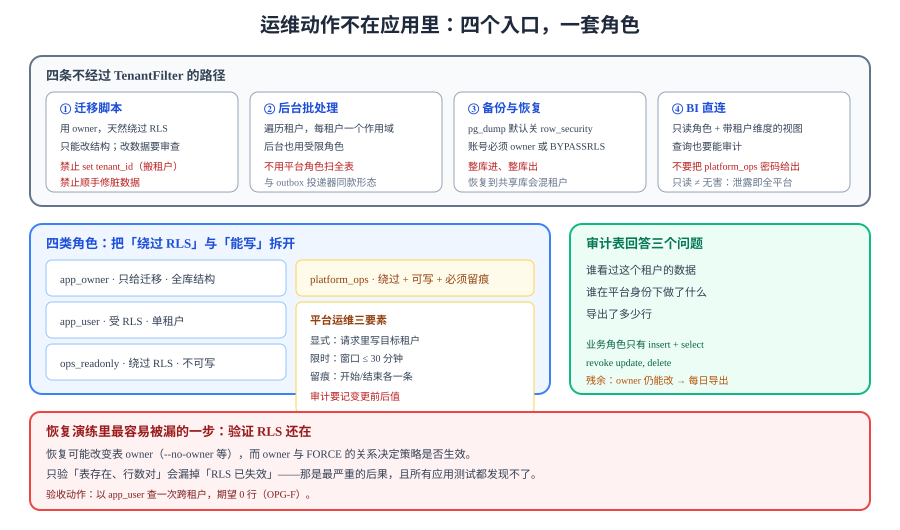

# 运维面守卫：四条最容易绕开 RLS 的路

应用侧把六条链路都接好了，RLS 也确实在挡。但**运维动作不在应用里**：迁移脚本、后台批处理、备份恢复、BI 直连，这四条路都带着「比应用更高」的数据库权限。本页把它们的边界画出来：**谁可以越过租户边界、越过时留下什么、什么时候必须不越过**。



## 判据族声明

本页判据族 `OPG-A` ~ `OPG-H`，共 8 条。定义表在第八节。

## 一、四条路径，一个共同点

| 路径 | 为什么需要高权限 | 越过租户边界的后果 | 可接受的形态 |
| --- | --- | --- | --- |
| **迁移脚本**（DDL） | 建表、加列、加策略都需要 owner | 一次 `update ... set tenant_id = 1` 就能把数据搬到别的租户 | 迁移只改结构，改数据的迁移必须有专门审查 |
| **后台批处理** | 要跨租户扫全量（清理、统计、补偿） | 用平台角色扫全表，一条脏 SQL 影响所有租户 | 遍历租户 + 每租户一个作用域（[事件隔离](../EventIsolation/index.md)同款） |
| **备份与恢复** | `pg_dump` 默认关掉 RLS 才能导出全量 | 备份文件里是**所有租户**；恢复到共享环境会混在一起 | 整库备份 + 整库恢复，禁止「按租户导出再合并」 |
| **BI / 数据分析直连** | 分析工具连库跑聚合 | 分析师看到全平台数据，且**没有审计** | 只读角色 + 视图（视图里带租户过滤）+ 强制审计 |

共同点：**它们都不经过 `TenantFilter`**，所以「租户从 token 来」这条保证在这里不成立。必须换一套保证：**角色 + 显式上下文 + 审计**。

## 二、四类角色，各自能做什么

```sql [db/roles.sql]
-- ① 表 owner：只给迁移用，应用连接永不使用
create role app_owner login password :'owner_pw';
alter table cards owner to app_owner;

-- ② 应用角色：受 RLS 约束，无 BYPASSRLS
create role app_user login password :'app_pw' nosuperuser nobypassrls;
grant select, insert, update, delete on all tables in schema public to app_user;

-- ③ 运维只读：能看全部租户，但不能写
create role ops_readonly login password :'ops_pw' nobypassrls;
grant select on all tables in schema public to ops_readonly;
-- 关键：给「绕过 RLS」的权限，但只读
alter role ops_readonly bypassrls;
revoke insert, update, delete on all tables in schema public from ops_readonly;

-- ④ 平台运维：可写、必须留痕（审计由应用层强制写，见第六节）
create role platform_ops login password :'ops_rw_pw' nobypassrls;
alter role platform_ops bypassrls;
grant select, insert, update, delete on all tables in schema public to platform_ops;
```

四类角色的分工：

| 角色 | `BYPASSRLS` | 能写 | 谁在用 | 出事时的爆炸半径 |
| --- | --- | --- | --- | --- |
| `app_owner` | 是（owner 默认绕过，除非 `FORCE`） | 是 | 只有迁移流水线 | 全库结构 + 全库数据 |
| `app_user` | 否 | 是（受 RLS） | 应用 | 单个租户 |
| `ops_readonly` | **是** | **否** | 值班排障、临时查数 | 全库读（**这就是为什么必须只读**） |
| `platform_ops` | 是 | 是 | 平台管理功能（跨租户运维） | 全库 |

::: danger 「反正都要绕过，不如给超管」
用数据库超级用户做运维是最常见的偷懒。代价是三重的：① 没有「只读」这一档，排障时手滑就能写；② 超级用户能改 `pg_hba`、能 `drop database`；③ 审计日志里只看到一个账号，无法区分「谁在用」。
正确做法是把「绕过 RLS」与「能写」拆成两个属性：`ops_readonly` 有前者没有后者，`platform_ops` 两者都有但**必须走应用接口**（接口里写审计）。
:::

## 三、平台运维：显式、限时、留痕

「平台运维」不是一个常驻身份，而是一次**有理由、有时限、有记录**的操作。三个要素缺一不可：

```java [src/main/java/com/example/team/ops/PlatformOpsGuard.java]
/** 平台级操作的唯一入口：必须带理由，必须留审计，必须限时。 */
public <T> T runAsPlatform(OpsRequest req, Supplier<T> action) {
    if (req.reason() == null || req.reason().isBlank()) {
        throw new BadRequestException("platform ops requires a reason");
    }
    if (!req.expiresAt().isBefore(Instant.now().plus(Duration.ofMinutes(30)))) {
        throw new BadRequestException("platform ops window must be <= 30 minutes");
    }
    var operator = currentOperator();
    audit.write(AuditEntry.platformStart(operator, req.targetTenantId(), req.reason()));

    try {
        return TenantContext.runWith(TenantContext.Tenant.platform(req.targetTenantId()), action);
    } finally {
        audit.write(AuditEntry.platformEnd(operator, req.reason()));   // 成功失败都记
    }
}
```

| 要素 | 要求 | 反例 |
| --- | --- | --- |
| **显式** | 请求里明确写「要操作哪个租户」 | 用「当前登录用户所属租户」隐式决定，运维人员一多就分不清 |
| **限时** | 单次窗口 ≤ 30 分钟 | 发一个长期有效的「运维 token」，等于给了一个万能钥匙 |
| **留痕** | 开始与结束各一条，含理由、目标租户、操作人 | 只记「有人访问过」，事后查不出做了什么 |

::: warning 审计要记「变更前后」
`update cards set title = 'x' where id = ...` 这条语句，事后能查到的只有「谁在什么时候执行了一条 update」。要回答「改成了什么」，必须在应用层记录**变更前后值**（`RETURNING OLD.*, NEW.*` 在 PostgreSQL 18 可用）。
只记语句不记值的审计，在争议时没有用——而争议正是审计存在的唯一理由。
:::

## 四、迁移脚本的边界

迁移用 `app_owner` 执行，它天然绕过 RLS。所以**迁移脚本是唯一一处「可以合法改任何租户数据」的地方**，必须额外收紧：

| 迁移类型 | 是否允许 | 要求 |
| --- | --- | --- |
| 纯结构（加表、加列、加索引） | ✅ | 常规审查 |
| 加策略 / 改策略 | ✅ | 必须附「改前改后各跑一次 `.sql` 验证」的读数 |
| 数据回填（`update ... set new_col = ...`） | ⚠️ | 必须**带 `tenant_id` 条件**，或明确声明「全租户统一回填」 |
| 跨租户搬数据（改 `tenant_id`） | ❌ | 不允许出现在迁移里；这是一次业务操作，要有独立的审批与审计 |
| 删除租户数据 | ❌ | 同上；停用租户是**标记**，不是删除 |

```sql [db/migration/V9__backfill_card_color.sql]
-- ✅ 允许：全租户统一回填，语义与租户无关
update cards set color = 'default' where color is null;

-- ❌ 禁止出现在迁移里：把某个租户的数据搬到另一个租户
-- update cards set tenant_id = 42 where tenant_id = 7;
```

::: danger 「顺手修一下脏数据」
迁移脚本里最容易夹带的是「顺手修一下线上那条脏数据」。它会带来两个后果：① 这条修改**没有业务审计**（它伪装成了结构变更）；② 迁移在测试环境重放时，那条脏数据不存在，于是脚本的执行结果与环境相关——**迁移必须是环境无关的**。
脏数据修复走独立的数据修复脚本：单独执行、单独审批、单独记录。
:::

## 五、备份与恢复：整库进、整库出

`pg_dump` 的默认行为值得写清：**它会把 `row_security` 设为 `off` 来导出全量数据**；如果执行账号既不是表 owner 也没有 `BYPASSRLS`，会直接报错。这条事实说明：**备份账号必须是一个「能绕过 RLS」的账号**——这本身就是运维面的一次授权。

| 做法 | 是否可接受 | 原因 |
| --- | --- | --- |
| 整库 `pg_dump` + 整库 `pg_restore` | ✅ | 租户数据之间的引用关系完整保留 |
| 按租户导出（`--enable-row-security` + 指定租户） | ⚠️ | 只用于「给某个租户导出自己的数据」，不能作为备份 |
| 恢复到共享测试库 | ❌ | 目标库已有同 `tenant_id` 的数据 → 主键冲突或数据混合 |
| 恢复到独立实例 | ✅ | 恢复演练的标准做法（见[备份与恢复](../BackupRestore/index.md)） |

::: danger 恢复演练里最容易被忽略的一步
恢复完成后只验证「表存在、行数对」，不验证「RLS 还在」。如果恢复时用了 `--no-owner` 或把表 owner 改成了 `app_user`，策略会跟着表走（策略属于表），但 **`FORCE ROW LEVEL SECURITY` 与 owner 的关系会变**：表 owner 成了 `app_user` 之后，如果没有 `FORCE`，owner 自己查询会绕过策略。
所以恢复后的第一条验证必须是：以 `app_user` 身份查一次跨租户，**期望 0 行**。
:::

## 六、BI 直连：只读角色 + 带过滤的视图 + 审计

分析师要「看看全平台的数据趋势」，这件事本身合理。不合理的做法是把 `platform_ops` 的密码给他。三条替代：

1. **只读角色**（`ops_readonly`）：能读全部，不能写。
2. **视图里带租户维度**：给 BI 的不是基表，而是 `v_cards_by_tenant`，视图输出 `tenant_id` 列，分析师自己按租户切。
3. **强制审计**：BI 的查询也要能被记录——至少记录「谁、什么时候、查了哪张视图、返回多少行」。这一条依赖连接层（例如把 BI 的流量固定走一个带日志的代理），做不到就明确接受「BI 查询不可审计」这个风险，并写进交付文档。

::: warning 「只读」不等于「无害」
`ops_readonly` 能读全部租户的数据。如果这个账号的密码泄露，攻击者拿到的是**全平台数据**，而不是一个租户。所以它必须：① 只从固定网段可连（`pg_hba.conf`）；② 密码轮换周期短于应用账号；③ 不与任何应用共享。
:::

## 七、审计表：一张表回答三个问题

```sql [db/migration/V10__audit_log.sql]
create table audit_log (
  id            bigint generated always as identity primary key,
  occurred_at   timestamptz not null default now(),
  actor_id      bigint      not null,          -- 操作人
  actor_role    text        not null,          -- app_user / platform_ops / ops_readonly
  tenant_id     bigint,                        -- 目标租户（平台级操作可空）
  action        text        not null,          -- board.read / card.update / export
  target_table  text,
  target_id     text,
  before_value  jsonb,                         -- 变更前（仅写操作）
  after_value   jsonb,                         -- 变更后（仅写操作）
  reason        text,                          -- 平台级操作必填
  request_id    text
);

-- 审计表本身不允许改：只给 insert 与 select
revoke update, delete on audit_log from app_user, platform_ops, ops_readonly;
```

三张视图回答三个问题：

| 问题 | 查询 |
| --- | --- |
| 「这个租户的数据被谁看过」 | `select actor_id, action, count(*) from audit_log where tenant_id = 42 group by 1,2` |
| 「这个人在平台身份下做了什么」 | `select * from audit_log where actor_role = 'platform_ops' order by occurred_at desc` |
| 「导出了多少数据」 | `select actor_id, sum((after_value->>'rows')::int) from audit_log where action = 'export' group by 1` |

::: danger 审计表放在同一个库里，能被同一个人删掉
这是**已知的、被接受的**局限：`platform_ops` 有 `delete` 权限时能删审计（本项目的做法是 `revoke`，但 owner 仍能改）。
真正的解法是把审计写到**独立的存储**（对象存储的追加写桶、或独立的审计库）。本项目在 30 天周期内选择「同库 + 撤权 + 每日导出到对象存储」，并在交付文档里写明这条残余风险——**不假装它不存在**。
:::

## 八、判据表

| 编号 | 判据 | 怎么验证 | 本机读数 |
| --- | --- | --- | --- |
| `OPG-A` | 四类角色存在且属性正确 | `\du+` 输出中 `app_user` 无 `Bypass RLS`，`ops_readonly` 有且无写权限 | 待跑（无工程） |
| `OPG-B` | 应用连接不使用 owner 或 `BYPASSRLS` 角色 | 应用配置里的数据库用户 = `app_user` | 待跑（无工程） |
| `OPG-C` | 平台级操作必须带理由与时限 | 不带 `reason` 的请求返回 `400` | 待跑（无工程） |
| `OPG-D` | 平台级操作开始与结束各留一条审计 | 一次操作后 `audit_log` 增加 2 行 | 待跑（无工程） |
| `OPG-E` | 迁移里没有「改 `tenant_id`」与「按租户删数据」 | `grep -rn "set tenant_id" db/migration/` 期望 0 命中；`delete from` 后跟 `where tenant_id` 同样禁止 | 待跑（无工程） |
| `OPG-F` | 恢复演练后以 `app_user` 查跨租户返回 0 行 | 恢复后执行跨租户 `count(*)`，期望 `0` | 待跑（无工程） |
| `OPG-G` | `ops_readonly` 只能从固定网段连接 | `pg_hba.conf` 中该角色有 `host ... 10.0.0.0/8` 限定 | 待跑（无工程） |
| `OPG-H` | 审计表对业务角色只读（无 update/delete） | `\dp audit_log` 显示 `app_user` 只有 `ar`（append + read） | 待跑（无工程） |

## 九、当日做了什么

1. **把「运维动作」单列出来**：迁移、批处理、备份恢复、BI 直连四条路都不经过 `TenantFilter`，所以「租户从 token 来」这条保证在它们身上不成立，必须换一套（角色 + 显式上下文 + 审计）。
2. **定死四类角色**并给出完整 SQL：`app_owner`（只给迁移）、`app_user`（受 RLS）、`ops_readonly`（`BYPASSRLS` 但只读）、`platform_ops`（可写但必须走接口留痕）。特别把「绕过 RLS」与「能写」拆成两个属性。
3. **驳掉「用超管做运维」**：三重代价（没有只读档、能改集群配置、审计里只有一个账号）。
4. **给出平台运维的三要素**（显式租户、≤30 分钟窗口、开始与结束各一条审计），并指出审计必须记**变更前后值**——只记语句的审计在争议时没有用。
5. **给迁移划五条边界**：结构迁移可、策略变更要读数、数据回填要带租户或声明全局、跨租户搬数据禁止、删除租户数据禁止。并把「顺手修脏数据」单列为禁止项（原因：无业务审计 + 与环境相关）。
6. **写清 `pg_dump` 的默认行为**（把 `row_security` 设为 `off`），由此推出「备份账号必然是一个能绕过 RLS 的账号」，这本身是运维面的一次授权。
7. **补恢复演练里最容易漏的一步**：恢复后验证「RLS 还在」——用 `app_user` 查一次跨租户，期望 0 行；并解释表 owner 变化与 `FORCE` 的关系。
8. **给 BI 直连三条替代**（只读角色、带租户维度的视图、强制审计），并写明 `ops_readonly` 泄露等于全平台泄露，必须限定网段与轮换周期。
9. **给出审计表 DDL 与三张查询**，并如实登记一条残余风险：审计与业务同库时，owner 仍能改，因此每日导出到对象存储。
10. **定稿 `OPG-A~OPG-H` 八条判据。**

## 十、如何验证

```shell
# 1) 角色属性：期望 app_user 不含 Bypass RLS，ops_readonly 含
psql "$DATABASE_URL" -c "\du+"

# 2) 应用角色是否真的受 RLS 约束：期望 0
psql "$DATABASE_URL" -U app_user -c \
  "begin; select set_config('app.tenant_id','1',true);
   select count(*) from cards where tenant_id = 2; commit;"

# 3) 迁移里有没有跨租户操作：期望无输出
grep -rn "set tenant_id" db/migration/ || echo "PASS"

# 4) 审计表权限：期望 app_user 只有 ar
psql "$DATABASE_URL" -c "\dp audit_log"

# 5) 平台操作不带理由：期望 400
curl -s -o /dev/null -w "%{http_code}\n" -H "Authorization: Bearer $TOKEN_OPS" \
  -X POST http://localhost:8080/api/ops/boards/$BOARD_ID/force-unlock
```

判读：第 2 步若返回非 0，说明应用连的是 owner 或带 `BYPASSRLS` 的角色——这是整条隔离链路上**最致命**的一处配置错误，且所有应用层测试都不会发现它；第 5 步若返回 `200`，说明平台接口缺少理由校验。

## 十一、下一步

- 四类角色定好之后，**恢复演练**要用真实备份跑一遍并回填 `OPG-F` 的读数：见[备份与恢复](../BackupRestore/index.md)。
- 平台运维接口的权限与审批：见[发布与回滚手册](../ReleaseRunbook/index.md)的灰度与冻结期口径。
- 第 1 周全部收口：[第 1 周验收](../Week1Acceptance/index.md)。

## 参考资料

- [PostgreSQL 18 文档 · `CREATE ROLE`](https://www.postgresql.org/docs/18/sql-createrole.html)——`BYPASSRLS` 属性与超级用户的差别。
- [PostgreSQL 18 文档 · `pg_dump`](https://www.postgresql.org/docs/18/app-pgdump.html)——`--enable-row-security` 与默认关闭 `row_security` 的行为。
- [PostgreSQL 18 文档 · Row Security Policies](https://www.postgresql.org/docs/18/ddl-rowsecurity.html)——表 owner 默认绕过、`FORCE` 的作用范围。
- 项目内：[多租户隔离](../MultiTenancy/index.md) · [跨租户用例矩阵](../CrossTenantMatrix/index.md)（平台运维那一行）· [备份与恢复](../BackupRestore/index.md)
- 技术专题：[PostgreSQL](/docs/DB/Relational/PostgreSQL/index.md) · [安全加固](/docs/Ops/SecurityHardening/index.md)
