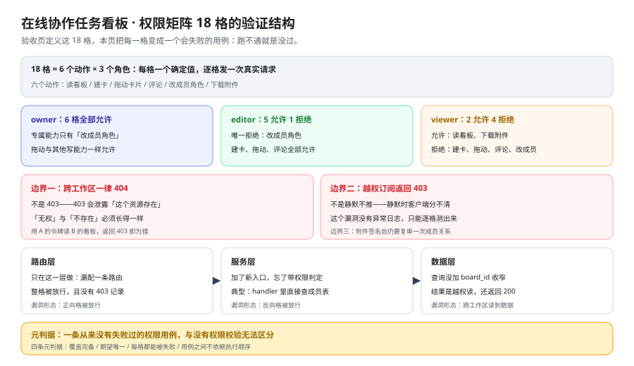

# 权限矩阵验证：把 18 格变成 18 个会失败的用例

[验收](../Acceptance/index.md) 第三节给出了权限矩阵的 18 格，这一页只回答一个问题：**这 18 格靠什么才算验过？** 答案是每一格都要有一个「错的样子」——正向格被拒、反向格被放行、边界返回了 `403` 而不是 `404`。本页不重新定义权限规则（规则在验收页与 [架构设计](../Architecture/index.md) 第七节），只把规则翻译成可执行的用例、元判据与 CI 步骤。



::: warning 本仓库只有文档，没有代码
下面的 Java / TypeScript 骨架、`curl` 序列与容器命令，都要在**你自己搭好的工程**里执行。本仓库不存放源码与可执行副本；「运行 `xxx`」一律指「先按本节创建好该文件，再执行」。
:::

## 一、为什么权限要用一张矩阵（而不是每个接口各写一遍）

接口清单能回答「这个接口判了吗」，**回答不了「覆盖完备吗」**。两件事的差别决定了写法的差别：

| 写法 | 能回答的问题 | 不能回答的问题 | 出错的形态 |
| --- | --- | --- | --- |
| **逐接口写权限** | 这个接口判了没有 | 一共该有多少个组合、漏了哪个组合 | 新加一个接口时忘了加判定——清单里**根本没有这一行**，所以看不出少 |
| **一张矩阵（6 动作 × 3 角色）** | 一共多少格、哪一格还没有用例 | 某一格具体怎么实现 | 有格子被漏掉时，矩阵里会出现一个**空格**，空格是**看得见的** |

矩阵的第二个好处是**它把「完整性」变成了算术**：6 个动作乘 3 个角色恰好 18，数一遍就知道缺不缺。接口清单是加法（每加一个接口就多一行），加法式的清单**永远无法自证完整**——你无法知道「还差几个接口没写」。

### 1.1 本页与验收页第三节的分工

同一张 18 格表在两页出现，但两页做的是**两件事**，这一点必须先写死，否则会出现「两张表不一致，不知道以哪张为准」：

| 页面 | 做什么 | 表里每一行的含义 | 改动规则 |
| --- | --- | --- | --- |
| [验收](../Acceptance/index.md) 第三节 | **定义**这 18 格 | 「这一格应该是什么值」 | 改权限规则时**只改这里** |
| 本页第二节 | **验证**这 18 格 | 「这一格用什么输入、期望什么输出、错了长什么样」 | 只把定义翻译成用例，**不改任何一格的值** |

写死一条：**本页不新增任何一格、不修改任何一格的值**。如果本页的 18 格与验收页第三节出现任何文字级差异，**以验收页为准，本页视为缺陷**——所以第七节把「两页逐格一致」也接进了 CI。

## 二、18 格原样引用与数据驱动的用例矩阵

### 2.1 18 格（与 [验收](../Acceptance/index.md) 第三节逐格一致）

6 个动作 × 3 个角色 = **18 格**，每格一个确定值：

| 动作 | `owner` | `editor` | `viewer` |
| --- | --- | --- | --- |
| 读看板 | **允许** | **允许** | **允许** |
| 建卡 | **允许** | **允许** | **拒绝 `403`** |
| 拖动卡片 | **允许** | **允许** | **拒绝 `403`** |
| 评论 | **允许** | **允许** | **拒绝 `403`** |
| 改成员角色 | **允许** | **拒绝 `403`** | **拒绝 `403`** |
| 下载附件 | **允许** | **允许** | **允许** |

按角色数一遍，18 格的分布是：`owner` 6 格全允许、`editor` 5 允许 1 拒绝、`viewer` 2 允许 4 拒绝，合计允许 13 格、拒绝 5 格。**这三个数字本身就是一条静态判据**：用例跑完后统计通过数，若不是 13 与 5，说明有用例没跑或表被改了。

### 2.2 用例矩阵：三角色 × 六动作 × 期望值数组

18 格不要写成 18 个手写用例，而是写成**一张数据表 + 一个参数化测试**。数据结构只要三列：

| 列 | 取值 | 说明 |
| --- | --- | --- |
| `role` | `owner` / `editor` / `viewer` | 用哪个角色的令牌发请求 |
| `action` | 六个动作之一 | 每个动作对应一个方法与一条路径 |
| `expected` | 状态码（`200` 或 `403`） | 期望值**只有一个**，见第五节第二条元判据 |

写成数组之后，「18 格」不再是一段散文，而是一个长度为 18 的集合：

```text [用例矩阵的期望值数组（顺序固定，逐格可数）]
owner  : 200 200 200 200 200 200     # 读看板 建卡 拖动 评论 改成员 下载附件
editor : 200 200 200 200 403 200
viewer : 200 403 403 403 403 200
```

三条编写纪律，每条都对应一种会做假的写法：

1. **一个用例只断言一格**：把「三角色各建一张卡」写成一个用例，失败时报出的是「建卡有问题」，**说不出是哪一格**。
2. **断言必须落在状态码上，不是「没有报错」**：`viewer` 建卡返回 `200` 但响应体里写着 `{"ok":false}` 也算漏判，所以断言是 `status == 403`。
3. **正向格与反向格用同一段代码**：只给反向格写校验、正向格「跑通就行」，会让正向格在权限过紧时依然全绿。

### 2.3 Java 骨架

用 JUnit 5 的参数化测试，依赖项由 Testcontainers for Java **2.0.5**（2026-04-20）起（口径日期：2026-10-16）：

```java [app/src/test/java/…/PermissionMatrixTest.java]
@ParameterizedTest(name = "格坐标 ({0}, {1}) 期望 {2}")
@MethodSource("matrix")
void permission_matrix_is_enforced(String role, Action action, int expected) {
    String token = tokens.get(role);                     // 三个角色各取一次令牌
    var res = http.send(action.request(token));           // 每个动作一条方法与路径
    assertEquals(expected, res.status(),
        "格坐标 (" + role + ", " + action + ") 期望 " + expected + " 实际 " + res.status());
}

static Stream<Arguments> matrix() {                        // 恰好 18 个 Arguments
    return Stream.of(
        arguments("owner",  READ_BOARD, 200), arguments("owner",  CREATE_CARD, 200),
        arguments("owner",  MOVE_CARD,  200), arguments("owner",  COMMENT,     200),
        arguments("owner",  SET_ROLE,   200), arguments("owner",  DOWNLOAD,    200),
        arguments("editor", READ_BOARD, 200), arguments("editor", CREATE_CARD, 200),
        arguments("editor", MOVE_CARD,  200), arguments("editor", COMMENT,     200),
        arguments("editor", SET_ROLE,   403), arguments("editor", DOWNLOAD,    200),
        arguments("viewer", READ_BOARD, 200), arguments("viewer", CREATE_CARD, 403),
        arguments("viewer", MOVE_CARD,  403), arguments("viewer", COMMENT,     403),
        arguments("viewer", SET_ROLE,   403), arguments("viewer", DOWNLOAD,    200));
}
```

断言消息里必须**带上格坐标**——这一条不是风格问题，见第七节。

### 2.4 TypeScript 骨架

用 Playwright **1.63.0**（2026-09 发布，`@playwright/test` 同版本）的 `request` fixture，与 Vitest **5.0.3** 同机跑（口径日期：2026-10-16）：

```typescript [web/tests/permission-matrix.spec.ts]
const ROLES = ['owner', 'editor', 'viewer'] as const;
const expected = {
  owner:  [200, 200, 200, 200, 200, 200],
  editor: [200, 200, 200, 200, 403, 200],
  viewer: [200, 403, 403, 403, 403, 200],
} satisfies Record<string, number[]>;

for (const role of ROLES) {
  ACTIONS.forEach((action, i) => {
    test(`格坐标 (${role}, ${action.name}) 期望 ${expected[role][i]}`, async ({ request }) => {
      const res = await action.send(request, await tokenFor(role));
      expect(res.status(), `格坐标 (${role}, ${action.name})`).toBe(expected[role][i]);
    });
  });
}
```

两个骨架的共同点：**格坐标出现在用例名里**，且期望值与实现分开。这不只是为了好看——当 CI 报红时，用例名本身就告诉你「哪一格错了」，不需要去读断言。

## 三、三条不属于 18 格但约束每一格的边界

这三条**不是**第 19、20、21 格：它们不落在「动作 × 角色」的笛卡尔积里，而是**约束每一格的成立方式**。写在这里的理由是——它们的失败形态与 18 格完全不同，混进矩阵会让矩阵不再是矩阵。

| 边界 | 口径 | 失败形态 | 为什么不能用另一种状态码代替 |
| --- | --- | --- | --- |
| **跨工作区访问** | 一律 **`404`** | 返回了 `403` | 用 `403` 等于告诉对方「这个资源存在，只是你不属于它」——攻击者据此可以枚举出别人的工作区 ID。**「无权」与「不存在」必须长得一样** |
| **越权订阅实时流** | 未授权订阅返回 **`403`** | 连接被接受但**静默不推**任何事件 | 用静默代替 `403` 时，「这里没有新数据」与「你没有权限」在客户端**完全同形**；而且这条路径**没有任何异常日志**，只能靠逐格测试发现 |
| **附件签名后复审成员关系** | 签名时**重新判定一次**成员关系 | 先拿到签名 URL、再被移出工作区的人，**仍然下载成功** | 这一条不能用「签名短时效」代替：短时效只是把窗口变小，**判据仍然是「被移除后立刻失效」** |

三条各有自己的反例改法，写下来才算被测过：

1. **跨工作区返回 `403`** 的反例：把跨租户判定与角色判定合并成一个 `require_member`，失败时统一抛 `403`。改法是**先判成员关系、不存在直接 `404`**，再判角色、角色不允许才 `403`。
2. **越权订阅静默不推** 的反例：握手只校验令牌，订阅帧直接进房间、房间没消息就什么都不发。改法是**订阅帧处理时判定一次成员关系**，未授权直接 `403` 并关闭连接。
3. **附件签名不复审** 的反例：签名 URL 的有效期写成 24 小时，签名时不查成员表。改法是**每次签名都重新判定读取权限**，被移除的成员重新签名为 `404` 或 `403`。

::: danger 三条边界里最容易写错的一条
1. **把「跨工作区」当成「角色不允许」**：两者都返回 `403`，代码很干净，但租户存在性被泄露了。正确写法是**两种失败在服务层就是两个异常类型**，翻译层不允许把它们映射成同一个状态码。
2. **把「越权订阅」当成「连接建立失败」**：握手成功、订阅被忽略，客户端一直等消息。正确写法是**订阅帧必须回一个显式的拒绝帧**，且这条拒绝要落一条日志。
3. **把「附件复审」当成「签名有效期」**：改长期限看起来解决了问题，实际只是把窗口从 24 小时缩短到 5 分钟。正确写法是**把复审写进签名方法本身**——签名方法里没有成员查询，就是缺陷。
:::

## 四、判定为错的形态表

每一格都要有「错的样子」。**没有失败形态的格子，等于没有被验证过**——它可能测的是别的东西，或者什么都没测。

| 类型 | 错的样子 | 这说明什么 | 反例改法（让它变红） |
| --- | --- | --- | --- |
| **正向格被拒** | `owner` 的拖动返回 `403` | 权限**过紧**：把 `owner` 的专属能力（改成员角色）误当成了唯一能力 | 把角色判定从「等于 owner」改成「不是 viewer」 |
| **反向格被放行** | `viewer` 的建卡返回 `200` | **漏判**：写接口没走权限判定，或判定写在了只读路径上 | 注释掉建卡 handler 里的 `require_member` 一行 |
| **边界返回 `403` 而不是 `404`** | 用 A 的令牌读 B 的看板返回 `403` | 租户**存在性泄露** | 把跨租户判定与角色判定合并成同一个异常 |
| **边界静默不推** | 越权订阅后连接不关、也没有任何消息 | 越权**不可见**，只能靠测试发现 | 去掉订阅帧里的成员判定 |
| **附件签名后仍可下载** | 被移除的成员用旧签名 URL 下载成功 | 签名**只验了一次**，且没验成员关系 | 把签名方法里的成员查询删掉 |

这张表与第二节的矩阵合起来才是完整的：**矩阵说「该是什么」，形态表说「错了长什么样」**。只有前者时，一个把所有请求都放行的实现也能让矩阵「看起来跑过了」（如果用例只断言「没有 500」）。

## 五、矩阵的四条元判据

元判据管的是**矩阵本身**，不是任何一格。四条缺一条，矩阵就会退化成一个好看的表格：

| 元判据 | 内容 | 违反它的现象 |
| --- | --- | --- |
| **覆盖完备** | 6 × 3 恰好 18 格，且每一格都在用例集合里出现一次 | 新增一个动作（例如「删除卡片」）时，只加了接口、没加进 `ACTIONS` 数组，矩阵悄悄变成 6 × 3 而实际有 7 个动作 |
| **期望唯一** | 每一格只有一个确定值，不允许「允许或拒绝都行」 | 把某格期望写成「不返回 `500`」——它恒真，任何实现都能通过 |
| **每格都能被失败** | 每一格都存在一个输入让它变红（第四节的形态表） | 反例是把期望写成 `status < 500`，删掉整个权限模块它也是绿的 |
| **用例之间不依赖执行顺序** | 任何一格单独跑、或 18 格乱序跑，结果相同 | 反例是用例 1 建了卡、用例 7 依赖那张卡——单独跑用例 7 会 404，而它报的是「权限错了」 |

**「一条从来没有失败过的权限用例，与没有权限校验无法区分。」** 这句话是四条元判据的操作化版本：如果你从来没见它红过，你不知道它拦的是权限、还是恰好那个请求本来就该成功。所以第五节的第三条元判据要求**每一格都要做一次「故意弄错」的实验**，并把实验结果记下来。

::: tip 怎么用最小代价做「故意弄错」
不用改业务代码，改**用例的期望值**就行：把 `viewer` 建卡的期望从 `403` 临时改成 `200`，跑一次——它**必须变红**。变红说明这条用例真的在拦；不变红说明它测的是别的东西（例如令牌本身过期了，所有格都返回 `401`，而 `401` 既不是 `403` 也不是 `200`，所以恰好「全绿」）。
:::

## 六、权限判定的三个层次

### 6.1 三层各自判什么

| 层次 | 判什么 | 对应 18 格的哪部分 | 漏掉它的后果 |
| --- | --- | --- | --- |
| **路由层** | 这个路径是否要求登录、要求哪个角色 | 全部 18 格的第一道门 | 漏配一条路由 = **整格默认放行** |
| **服务层** | 这次操作在该工作区是否被当前角色允许 | 全部 18 格的判定主体 | 新入口忘了调用判定 = **反向格被放行** |
| **数据层** | 这条查询是否被 `board_id` / `workspace_id` 收窄 | 三条边界（跨工作区） | 查询不带租户条件 = **越权读，且返回 `200`** |

三层的关系是**串联**：任何一层单独成立都不够，因为它们拦的是不同的东西。路由层拦「谁能进这个入口」，服务层拦「进来之后能不能做这个动作」，数据层拦「做这个动作时能看到谁的数据」。

### 6.2 只在一层做的三个漏洞

| 只做哪一层 | 具体漏洞 | 为什么它不会被别的层兜住 |
| --- | --- | --- |
| **只做路由层** | 新增一条路径但忘了挂角色配置，默认策略是「登录即可」 | 服务层没判定，数据层不收窄，于是**这一格整格放行**，且日志里只有一条正常的 `200` |
| **只做服务层** | 加了一个新入口（例如批量拖动），代码里直接查成员表、复用旧逻辑 | 路由层不知道这个入口的存在，服务层的判定**写在了旧入口里**；新入口是全绿的 `200` |
| **只做数据层** | 查询忘了加 `board_id`，靠服务层的判定「兜底」 | 服务层只判了「这个人在这块看板上的角色」，判不了「他读的是不是另一个工作区的另一块看板」——**越权读返回 `200`** |

三个漏洞有一个共同点：**它们都不报错**。所以判据只能是逐格的用例，不能是日志或监控——一条「异常率没有上升」的看板，对这三类漏洞一无所知。

## 七、把矩阵接进 CI 与判据表

### 7.1 哪一步跑、跑多久

| 事项 | 口径 |
| --- | --- |
| **跑在哪一步** | 集成测试阶段（依赖容器已起、迁移已跑完），**不在单元测试阶段**——18 格全都要发真实 HTTP 请求 |
| **请求次数** | 18 格 = 18 次请求；三条边界 = 3 次请求；合计 21 次（每格一次，不重跑） |
| **耗时口径** | 起一次容器约 20~40 秒，21 次请求的耗时以百毫秒计；整组目标 **90 秒以内**（口径，非实测：本仓库无工程代码，见第九节第 9 条） |
| **串行还是并行** | **串行**。并行会引入「用例之间依赖执行顺序」的嫌疑，而第四节第四条元判据恰好禁止这一点 |

### 7.2 失败时输出必须包含什么

失败输出只有「断言失败」四个字时，排查要从头读一遍代码。**输出必须自带三样东西：格坐标、期望值、实际值**：

```text [一条合格的失败输出（形态）]
格坐标 (viewer, 建卡) 期望 403 实际 200
  请求：POST /api/v1/boards/b_7f3a/cards
  令牌角色：viewer（workspaceId=w_01）
  提示：写接口的权限判定缺失，见权限矩阵第六节「只做服务层」
```

三行的分工是：第一行给出**哪一格**（可直接对照第二节的表），第二行给出**怎么复现**（方法与路径），第三行给出**该往哪查**（指向本页的小节）。这三行不是可选项——缺哪一行，排查就要多绕一圈。

### 7.3 判据表（`PM-A ~ PM-H`）

前六条是**文档级、本机可判**（命令与实测值见第九节）；后两条是**运行期**，如实标注状态。

| 判据 | 判什么 | 级别 | 状态 |
| --- | --- | --- | --- |
| **`PM-A`** | 本页 18 格与 [验收](../Acceptance/index.md) 第三节逐格一致，且写死「以验收页为准」 | 文档级 | ✅ 本机可判 |
| **`PM-B`** | 用例矩阵是数据驱动的（三角色 × 六动作 × 期望值数组），且一次运行恰好产生 18 个用例 | 文档级 | ✅ 本机可判 |
| **`PM-C`** | 三条边界各有失败形态，并写清「为什么不能用另一种状态码代替」 | 文档级 | ✅ 本机可判 |
| **`PM-D`** | 判定为错的形态表覆盖五类（正向被拒 / 反向被放行 / 边界 `403` / 静默不推 / 签名不复审） | 文档级 | ✅ 本机可判 |
| **`PM-E`** | 四条元判据齐全，且「从来没有失败过的用例与没有校验无法区分」写死 | 文档级 | ✅ 本机可判 |
| **`PM-F`** | 三层判定与「只在一层做的三个漏洞」各写清后果；CI 失败输出含格坐标、期望、实际 | 文档级 | ✅ 本机可判 |
| **`PM-G`** | 18 格逐格实测：13 格允许、5 格拒绝，无 `500` | 运行期 | `⏳ 未跑`（原因：**本仓库只有文档，没有可执行的工程与前端**；容器运行时本机可用，复验见 [第 3 周验收结论](../Week3Acceptance/index.md) 第三节） |
| **`PM-H`** | 三条边界实测：跨工作区 `404`、越权订阅 `403`、被移除成员重新签名为 `404` 或 `403` | 运行期 | `⏳ 未跑`（原因：**本仓库只有文档，没有可执行的工程与前端**） |

::: warning 状态列的读法
`PM-A ~ PM-F` 验的是**「这份矩阵是否自洽、是否可被执行」**，不是「这套系统的权限判得对不对」——后者归 `PM-G` / `PM-H`，它需要的是**能跑起来的工程与前端**（对照 [第 3 周验收结论](../Week3Acceptance/index.md) 第五节的 B 类残余）。**不把期望值抄进状态列，也不把「跑过了」写成「通过了」。**
:::

## 八、当日做了什么

1. 定下**矩阵式与清单式的差别**：矩阵能回答「覆盖完备吗」（6 × 3 是算术，空格看得见），接口清单是加法、**永远无法自证完整**；据此写死本页与 [验收](../Acceptance/index.md) 第三节的分工——那边**定义** 18 格，这里**验证** 18 格，冲突时以验收页为准。
2. 原样引用**18 格表**（6 动作 × 3 角色），并给出分布读数：`owner` 6 格全允许、`editor` 5 允许 1 拒绝、`viewer` 2 允许 4 拒绝，合计**允许 13 格、拒绝 5 格**——这三个数字本身是一条可核对的静态判据。
3. 把 18 格改写成**数据驱动的用例矩阵**（三角色 × 六动作 × 期望值数组，数组长度 18），并给 Java（JUnit 5 参数化 + Testcontainers for Java 2.0.5）与 TypeScript（Playwright 1.63.0）两段骨架，两条纪律写死：**一个用例只断言一格**、**断言落在状态码上**。
4. 写清**三条不属于 18 格但约束每一格的边界**（跨工作区一律 `404`、越权订阅返回 `403`、附件签名后复审成员关系），每条给出失败形态与「为什么不能用另一种状态码代替」，并点出三条最容易写错的写法。
5. 产出**判定为错的形态表**（正向格被拒 / 反向格被放行 / 边界返回 `403` / 静默不推 / 签名不复审），每行给出「反例改法」——让「这一格能被弄红」成为可执行的事实。
6. 产出**四条元判据**（覆盖完备 / 期望唯一 / 每格都能被失败 / 用例之间不依赖执行顺序），并把「**一条从来没有失败过的权限用例，与没有权限校验无法区分**」写成操作化做法：临时改期望值，它必须变红。
7. 拆出**权限判定的三个层次**（路由层 / 服务层 / 数据层）与「只在一层做」的三个漏洞（路由层漏配、服务层新入口忘判定、数据层没加 `board_id`），并指出三个漏洞的共同点是**都不报错**。
8. 定下 **CI 口径**：跑在集成测试阶段、21 次请求（18 格 + 3 边界）、串行执行，失败输出必须自带**格坐标 + 期望 + 实际 + 该往哪查**三行。

## 九、如何验证

前八条是本页可跑的自查（**本机已跑**，括注为实测值）；第 9 条需要**能跑起来的工程与前端**，只给命令、**不给通过结论**。

```shell
# 1) 18 格：6 行 × 3 列，且与验收页第三节同形
grep -cE '^\| (读看板|建卡|拖动卡片|评论|改成员角色|下载附件) \|' index.md   # 实测 6

# 2) 八条判据齐全（PM-A ~ PM-H，从 A 连续到 H）
grep -cE '^\| \*\*`PM-[A-H]`\*\*' index.md                                # 实测 8

# 3) 三条边界各有一行（写在第七节那张表里）
grep -cE '^\| \*\*(跨工作区访问|越权订阅实时流|附件签名后复审成员关系)\*\* \|' index.md   # 实测 3

# 4) 四条元判据（覆盖完备 / 期望唯一 / 每格都能被失败 / 用例之间不依赖执行顺序）
grep -cE '^\| \*\*(覆盖完备|期望唯一|每格都能被失败|用例之间不依赖执行顺序)\*\* \|' index.md   # 实测 4

# 5) 两段骨架都在（Java 与 TypeScript）
grep -cE '^```(java|typescript)' index.md                                 # 实测 2

# 6) 「从来没有失败过」这句口径写死（模式串里用 [例] 打断自匹配）
grep -c '从来没有失败过的权限用[例]' index.md                              # 实测 2

# 7) 三个层次的三个漏洞都在
grep -cE '^\| \*\*只做(路由层|服务层|数据层)\*\*' index.md                  # 实测 3

# 8) 配图被本页引用（只此一处，且是 ../assets/ 相对路径）
grep -c '../assets/tb-permission-matrix.sv[g]' index.md                   # 实测 1

# 9) 逐格跑一次权限矩阵（需要容器运行时 + 工程代码；本机未跑）
#    期望：13 格 200、5 格 403，无 500；三条边界分别返回 404 / 403 / 404
```

::: warning 这八条命令的期望值是怎么来的
第 1 ~ 8 条的期望值**全部是本机实跑 `grep -c` 读出来的**（含第 6 条的 `2`——那句话在正文出现两次，一次在第五节、一次在第八节；模式串里用 `[例]` 打断自匹配，否则命令会把自己那一行也数进去，得到 `3`）。
它们验的是「这一页是否自洽、是否按约定成形」，**不是「这套系统的权限判得对不对」**——后者归 `PM-G` / `PM-H`。**不把期望值抄进状态列，也不把「跑过了」写成「通过了」。**
:::

## 十、下一步

1. **18 格矩阵进 CI 的哪一步要写死**：放在契约层 job 内、跑在端到端之前——它用的是一次性容器 + `request` fixture，比端到端快一个数量级，能在最便宜的位置挡住权限回归。
2. **新增接口必须先加格**：矩阵是权限的**入口**而不是附属物。一个接口加进来却没有对应格，说明它的权限规则没被定义过，此时跑的 18 格全绿也证明不了任何事。
3. **「跨工作区一律 `404`」这条口径要与网关对齐一次**：它是防枚举口径，只要网关层把 `404` 改写成 `403`（或反过来），矩阵的边界用例就会与真实部署行为不一致——第 4 周 [部署与交付](../index.md) 接入网关时要复验这一条。

## 与「跨租户用例矩阵」的分工（第 155 天补充）

| 维度 | 本页 | 「租户边界」章节集（第 155 天） |
| --- | --- | --- |
| 主体范围 | 同一租户内的三种角色（所有者 / 成员 / 访客） | 跨租户的成员、访客，加平台运维 |
| 核心问题 | 「这个角色能不能做这件事」 | 「这个租户的人能不能碰到那个租户的数据」 |
| 失败语义 | `403`（存在但无权） | `404` 且 body 为空（在你的世界里不存在） |
| 兜底层 | 应用层角色判定 | 数据库 RLS + 对象 key 前缀 + 主题命名空间 |

一句话结论：**本页的 18 格与跨租户矩阵的 18 格是两套矩阵，缺一套都不完整**——本页全绿时，一条漏了 `tenant_id` 的查询仍能把别的租户数据返回给你。

::: danger 这一页特有的坑
两套矩阵都叫「18 格」，容易被当成同一份东西改来改去。判断归属只看一条：**资源属不属于同一个租户**——同一租户内的问题归本页，跨租户的问题归跨租户矩阵。
:::

## 参考资料

- 同项目章节：[验收：把「做完了」变成可执行的步骤](../Acceptance/index.md)（**第三节定义这 18 格**、`TB-G` 权限判据、阻塞项台账 `BL-1` ~ `BL-4`） · [架构设计：模块边界与实时链路](../Architecture/index.md)（三处权限判定点与八个失败模式） · [接口契约定稿](../Contracts/index.md)（`401` / `403` / `404` / `409` 的口径来源）
- 同项目章节：[领域核心](../DomainCore/index.md)（工作区、看板与成员关系的读写服务） · [需求拆分](../Requirements/index.md)（三角色与 US-01~US-12 的验收条件） · [编码期分诊](../FAQ/index.md)（越权订阅与附件签名两条现象的处置）
- 方法论：[完整项目交付 · 需求与验收条件](/docs/Others/ProjectDelivery/Requirements/index.md)（四类验收条件） · [完整项目交付 · 接口契约](/docs/Others/ProjectDelivery/Contract/index.md)（「约定是什么、定错的后果、怎么验证没被破坏」三问）
- 原理侧：[认证与授权](/docs/Backend/Auth/index.md)（令牌与授权判定的关系） · [数据建模](/docs/DB/DataModeling/index.md)（租户列与查询收窄）
- 同类资产的对照写法：[实时监控大盘 · 残余项收口](../../MonitoringDashboard/ResidualClose/index.md) · [项目总览](../index.md)
