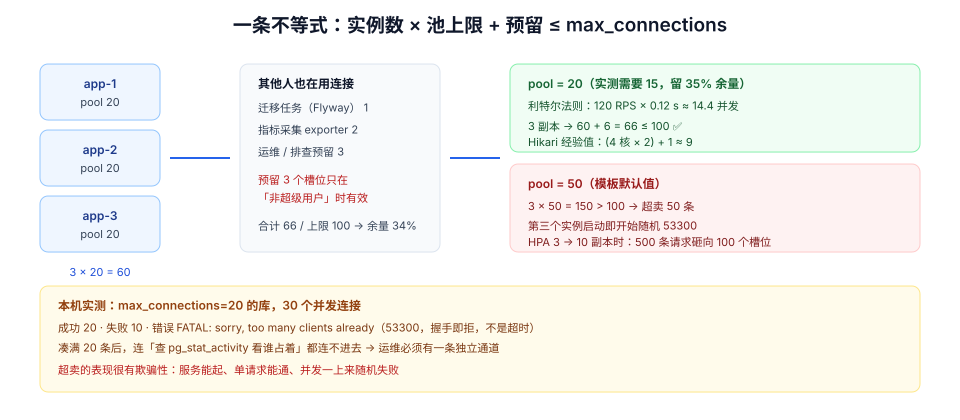

# 第 4 周第 7 步 · 上线前容量复核：池的总量必须小于库的上限

前六步都在防「部署出错」。这一步防的是**部署成功之后的第一波流量**。

它要复核的东西很少，但每一样都能单独把服务打死：**实例数 × 每实例连接池上限，与数据库 `max_connections` 的关系**。这个乘法在测试环境永远成立（1 个实例 × 20 = 20 < 100），在生产上第一次扩容就破了。

## 判据族声明

本页判据族 `CRC-A` ~ `CRC-H`，共 8 条。定义表在第七节。

## 本页不讲什么

- 不讲压测场景模型、`constant-arrival-rate` 的坑与 `carry` 恒等式，归 [压测四场景与池层断言](../LoadTestGate/index.md)。
- 不讲连接池串租户的五种泄漏形态与 `SET LOCAL` 的三档成本，归 [连接池串租户](../PoolTenantLeak/index.md)；本页只讲**池的总量**，不讲池的**内容**。
- 不讲水位线、HPA 与单位成本，归 [容量规划与成本治理](/docs/Ops/CapacityCost/index.md)。
- 不讲 `pgbouncer` 的安装与运维，归 [部署脚本](../DeployScripts/index.md)。



## 一、一条不等式，三个数

```text
实例数 × 每实例池上限  +  迁移任务  +  监控采集  +  运维预留  ≤  max_connections
```

三个数里，只有第一个是「你说了算」的，另外两个是**别人也在用**的：

| 占用方 | 典型连接数 | 谁负责 |
| --- | --- | --- |
| 应用实例池 | 实例数 × `maximumPoolSize` | 你（本次复核的对象） |
| 迁移任务（Flyway） | 1~2 | 部署脚本 |
| 指标采集（exporter） | 1~2 | 监控 |
| 运维 / 排查 | ≥ 3（`superuser_reserved_connections` 默认 3） | DBA |

`superuser_reserved_connections` 那 3 个槽位是给**超级用户**留的。但注意：如果你的应用连接用的也是超级用户（很多沙盒和默认配置就是这样），这 3 个槽位**不构成保护**——应用会照样把它们吃掉。

## 二、实测：`max_connections=20` 的库，30 个并发连接

实验：独立 PG 18 容器，`-c max_connections=20`，`superuser_reserved_connections` 为默认 3；用 30 个 `psql` 进程各自 `select pg_sleep(12)`，间隔 80 ms 依次启动。

| 观测 | 读数 |
| --- | --- |
| 成功建立的连接 | **20** |
| 失败的连接 | **10** |
| 失败错误 | `FATAL: sorry, too many clients already`（SQLSTATE `53300`） |
| 失败发生的时机 | **立即**（不是超时，是拒绝握手） |
| 凑满 20 条后再查 `pg_stat_activity` | **连不进去**——运维自己的排查连接也被拒绝 |

三个读数各有含义：

1. **20 = `max_connections` 全额**，说明「预留 3 个给超级用户」**没有**保护到任何人：测试用的 `lab` 用户本身是超级用户，它把预留槽位也算进了自己的额度。
2. **失败是立即的、`FATAL` 级别的**：连接池拿不到连接时会抛 `SQLTransientConnectionException`，而**每一条业务请求都会走到这一步**。表现不是「慢」，是雪崩式的 500。
3. **第三条最容易被忽略**：连接打满时，你连「看看谁占着连接」都做不到。所以运维永远要有一条**不经过业务库连接池**的通道（独立用户 + `superuser_reserved`，或 PgBouncer 的 admin 库）。

::: danger 「池开大一点，反正库扛得住」
池的作用不是「多占连接」，而是**限制同时打到库上的并发**。池开得越大，落在库上的并发越高，每个查询的排队时间越长，而**总吞吐不会变高**——因为库的核数是固定的。

HikariCP 的作者给过一个经验公式：`connections = (cpu_cores × 2) + effective_spindle_count`。4 核机器配 SSD ≈ **9**，不是 50。配 50 的结果是：50 个连接里有 41 个在等 CPU，而它们仍然占着库的 `backend` 进程与内存（每个 `backend` 约 5~10 MB）。
:::

## 三、把不等式算成本项目的表

本项目的生产形态：3 个应用实例（Compose 三副本或 K8s 三副本）、PG 18 单实例（`max_connections=100`）。

| 项 | 计算 | 值 |
| --- | --- | --- |
| 应用池总量 | 3 × 20 | 60 |
| 迁移任务 | 1（一次性） | 1 |
| 指标采集 | 2 | 2 |
| 运维预留 | 3 | 3 |
| **合计** | | **66** |
| `max_connections` | | 100 |
| **余量** | (100 − 66) / 100 | **34%** |

如果每实例开到 50（很多模板的默认值）：

| 项 | 值 |
| --- | --- |
| 应用池总量 | 3 × 50 = **150** |
| `max_connections` | 100 |
| 结果 | **超卖 50 条**——第三个实例启动时就开始随机 `53300` |

超卖的表现很有欺骗性：**服务能起来、单请求能通、并发一上来就随机失败**。所以这条不等式必须在**发布前**算，而不是等告警。

## 四、池大小的定值：从「核数」推，不从「连接数上限」推

| 输入 | 本项目取值 | 说明 |
| --- | --- | --- |
| 单实例 CPU 配额 | 4 核 | `deploy.resources.limits.cpus: "4"` |
| 公式值 | 4 × 2 + 1 = 9 | Hikari 经验公式（SSD 记 1） |
| 业务实测需要 | 12~15 | S1 列表 120 RPS × p99 120 ms ≈ 14.4 并发（利特尔法则） |
| 取整 | **20** | 在实测值上留 ~35% 余量，且 3 × 20 + 6 = 66 ≪ 100 |

利特尔法则那一行是关键：**并发数 ≈ 到达率 × 停留时间**。120 RPS × 0.12 s = 14.4，所以 15 个连接就能撑住 S1 的峰值；开到 20 是给抖动留余量。开到 50 不会让 S1 更快，只会让 35 个连接在等 CPU。

## 五、连接池模式与租户上下文的冲突（部署前必须确认）

如果为了省连接而引入 PgBouncer，模式选错会**静默破坏租户隔离**：

| 模式 | 会话级 `SET` 是否保留 | 能不能配 `SET LOCAL` | 本项目能否用 |
| --- | --- | --- | --- |
| `session` | ✅ 保留 | ✅ | 可以，但省不了多少连接 |
| `transaction` | ❌ 每次事务后重置 | ✅（事务内有效） | **只能配 `SET LOCAL`**，且必须在显式事务里 |
| `statement` | ❌ | ❌ 跨语句不保留 | **不可用**——租户上下文活不过一条语句 |

这与 [连接池串租户](../PoolTenantLeak/index.md) 的五种泄漏形态是同一件事的两面：那边讲「同一根连接上的下一个请求」，这边讲「中间多了一层代理之后，会话状态还在不在」。结论只有一句：**`transaction` 模式下，租户上下文只能靠 `SET LOCAL` + 显式事务，任何依赖会话状态的写法都会失效。**

## 六、复核清单：上线前逐项打勾

| # | 项 | 判据 |
| --- | --- | --- |
| 1 | 实例数（含 HPA 的 `maxReplicas`） | 按**最大副本数**算，不是按当前副本数 |
| 2 | 每实例 `maximumPoolSize` | 与实际核数、利特尔法则一致 |
| 3 | `max_connections` 与预留 | 不等式成立，余量 ≥ 25% |
| 4 | 运维独立通道 | 有一条不经过业务池的连接方式 |
| 5 | HPA 扩容时的总量 | `maxReplicas × pool ≤ max_connections − 预留` |
| 6 | 连接泄漏兜底 | `leakDetectionThreshold` ≤ 10 s，且日志有告警 |
| 7 | 池耗尽的表现 | 有指标 `hikaricp_connections_pending > 0` 的告警 |

第 5 项是最容易失效的一条：**HPA 按 CPU 扩容，但连接数是按副本数线性增长的**。3 → 10 副本时，池总量从 60 变成 200，库直接崩。所以 `maxReplicas` 必须与池上限**联立求解**，或者改用 PgBouncer 做连接复用。

## 七、判据表

| 编号 | 规则 | 违反时的样子 | 怎么验证 |
| --- | --- | --- | --- |
| `CRC-A` | 池总量 + 预留 ≤ `max_connections`，余量 ≥ 25% | 扩容后随机 `53300` | 命令①，算出余量 |
| `CRC-B` | 按 `maxReplicas` 而非当前副本数计算 | HPA 扩容时打爆库 | 命令②，读 HPA 上限 |
| `CRC-C` | 池上限由核数与利特尔法则推出 | 池过大，连接等 CPU | 命令③，比值 ≤ 3 |
| `CRC-D` | 有独立运维连接通道 | 打满后无法排查 | 用非应用用户连一次 |
| `CRC-E` | `transaction` 模式下只用 `SET LOCAL` | 租户上下文被代理重置 | 代码审查 + 跨租户用例 |
| `CRC-F` | 有池等待数告警 | 排队无人知 | `hikaricp_connections_pending` 有告警规则 |
| `CRC-G` | 泄漏检测开启且阈值 ≤ 10 s | 连接慢慢漏光 | 配置里 `leakDetectionThreshold` 存在 |
| `CRC-H` | 容量复核结果写进发布记录 | 每次发布靠回忆 | 发布记录含「池总量 / 余量」两行 |

## 验证命令

```shell
# ① CRC-A：一条 SQL 算出总量与余量（把 3 与 20 换成实际值）
psql "$DATABASE_URL" -tAc "
select current_setting('max_connections')::int as max_conn,
       current_setting('superuser_reserved_connections')::int as reserved,
       3 * 20 + 1 + 2 as planned,
       round((current_setting('max_connections')::int - (3*20 + 1 + 2))::numeric
             / current_setting('max_connections')::int * 100, 1) as headroom_pct;"
# 期望：headroom_pct ≥ 25.0

# ② CRC-B：HPA 的最大副本数（K8s 环境）
kubectl get hpa teamboard -o jsonpath='{.spec.maxReplicas}{"\n"}'
# 期望：maxReplicas × pool ≤ max_connections - 预留 - 采集

# ③ CRC-C：池上限与核数的比值
psql "$DATABASE_URL" -tAc "select 20 / 4.0 as pool_per_core;"
# 期望：≤ 3（超过说明池只是把排队从库里搬到了池里）

# ④ CRC-A 运行时侧：当前连接数 vs 上限（在业务高峰采）
psql "$DATABASE_URL" -c "select count(*) as used, current_setting('max_connections') as max
from pg_stat_activity;"
# 期望：used / max ≤ 0.75；持续 > 0.85 时必须扩容或改连接复用

# ⑤ CRC-E：transaction 模式下不许出现会话级 SET
grep -rnE 'set_config\([^,]+,[^,]+,\s*false\)|SET +app\.tenant_id' src/ | grep -v "SET LOCAL"
# 期望：无输出（会话级设置会被代理重置，造成串租户）
```

## 与「连接池与连接生命周期」专题的分工

| 本页管什么 | 专题那一页管什么 |
| --- | --- |
| **本项目**的池容量核算与启动顺序：实例数、上限、代理、离线任务的具体取值与上线复核清单 | **通用算式与实测**：`Σ池上限 × 实例数 ≤ 0.8 × max_connections`、膝点曲线、`L = λ × W` 反推下限 |

**本页特有的一处坑**：预算表最容易漏两档——**代理池**与**运维会话**（DBA、监控、备份）。本机实测：`max_connections=20` 时 17 条普通连接就把可用槽位吃完，第 18 条普通连接直接 `53300`，而超级用户仍能进（3 条保留槽位）。漏算的那两档在低峰期永远看不出问题，**在发布或故障转移时才会集体撞墙**。

## 八、下一步

七步前置走完：产物有指纹、配置进白名单、迁移有闸门、退出能排空、冒烟能判定、回滚有矩阵、容量有预算。最后一步是**把它们串成一次上线**。

归第 4 周第 8 步 [上线前置闸门与 Go/No-Go](../PreLaunchGate/index.md)：八页分工表、T-60 到 T+60 的时间线、以及第 3 周留下的 `C1`/`C3`/`C5` 三条为什么被列为**上线前必跑**。
