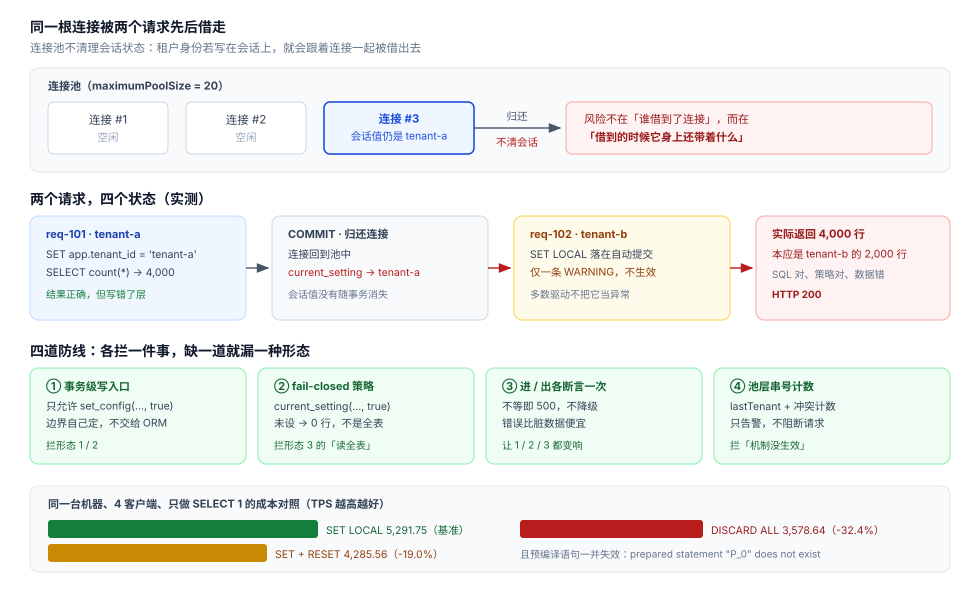

# 连接池串租户：同一根连接上的下一个请求

第 2 周把「租户身份从哪来」定死在了令牌上，第 3 周第 1 步又把「请求该去哪个库」定死在了归属表上。但这两件事都假设了一个前提：**执行这条 SQL 的那根数据库连接，它的会话状态是干净的**。

连接池打破了这个前提。池把「连接」借给你，用完收回，再借给别人——而租户身份如果写在**会话**上，它就会跟着连接一起被借出去。这一页不讲「怎么写租户过滤」（第 1 周已经写过），只讲**同一根连接上的下一个请求，会不会看见上一个租户的数据**，以及怎么用四条防线把它钉死。

::: danger 这一页最反直觉的一条读数
在自动提交模式下执行 `SET LOCAL app.tenant_id = 'tenant-b'`，PostgreSQL **只发一条 `WARNING`，不报错、不生效**，随后的查询照旧按上一个租户 `tenant-a` 的口径返回 **4,000 行**。
「设置了租户」与「租户生效了」之间，隔着一整个事务边界。
:::

## 判据族声明

本页判据族 `PLP-A` ~ `PLP-H`，共 8 条。定义表在第七节。

## 一、泄漏发生在哪一层

先分清三样东西，否则后面的现象会互相打架。

| 层 | 生命周期 | 谁在管 | 与本页的关系 |
| --- | --- | --- | --- |
| **数据库连接**（session） | 从建立到关闭，可能跨越上千个 HTTP 请求 | 连接池（HikariCP / pgbouncer） | **租户身份绝不能停在这一层** |
| **事务**（transaction） | 一次 `BEGIN` 到 `COMMIT`/`ROLLBACK` | 应用（`@Transactional` / 手写） | 租户身份的正确落点 |
| **语句**（statement） | 单条 SQL | 驱动 | 语句级没有「状态」可放租户身份 |

连接池的三种复用粒度，决定了「会话状态」能残留多久：

| 池模式 | 一根连接服务的范围 | `SET`（会话级）的下场 | `SET LOCAL`（事务级）的下场 |
| --- | --- | --- | --- |
| **Session pooling**（HikariCP 默认、pgbouncer `pool_mode=session`） | 一个客户端独占一根连接直到归还 | 残留到归还为止，**下一个借到它的人继承** | 事务结束即消失，安全 |
| **Transaction pooling**（pgbouncer 推荐） | 一个事务独占一根连接，事务结束立刻换人 | 设置落在**已经还给别人的连接**上，污染下一个事务 | 安全，且是唯一可用的写法 |
| **Statement pooling** | 一条语句一根连接 | 无意义（也可能直接报错） | 无意义 |

一根连接的真实时间线长这样——注意第二条请求拿到的是**同一根连接**：

```text
连接 #3  [req-101 tenant-a]  SET app.tenant_id='tenant-a'  ──COMMIT──┐
                                                                     │  归还池（会话值仍是 tenant-a）
         [req-102 tenant-b]  忘记 SET（或 SET LOCAL 落在自动提交里）  ←┘
                              → 策略读到 tenant-a → 返回 tenant-a 的 4,000 行
```



## 二、五种形态，逐个实跑

实验环境：本机 `postgres:18` 沙盒库（`teamboard-sandbox-db-1`），表 `poolsafe.card` **6,000 行**（`tenant-a` 4,000 行 / `tenant-b` 2,000 行），启用 `ENABLE` + `FORCE ROW LEVEL SECURITY`，策略只有一条：

```sql
CREATE POLICY card_tenant_isolation ON card
  USING (tenant_id = current_setting('app.tenant_id', true));
```

### 形态 1：会话级 `SET` 被下一个请求继承

```sql
-- 请求一：正确的租户，错误的写法
SET app.tenant_id = 'tenant-a';
SELECT count(*) FROM card;            -- 4000

-- 请求二：同一个连接，代码路径忘了 SET（或 SET 在异常分支里没走到）
SELECT current_setting('app.tenant_id', true), count(*) FROM card;
```

实测输出：

```text
 inherited_guc | rows_visible
---------------+--------------
 tenant-a      |         4000
```

请求二要的是 `tenant-b` 的数据，拿到的却是 `tenant-a` 的 4,000 行——**策略没坏、SQL 没坏，坏的是「谁都没设，于是沿用了上一次」**。这是最典型的一种，也是最容易被测试漏掉的一种：单测里每个用例都新建连接，永远复现不出来。

### 形态 2：`SET LOCAL` 回滚到的是「外层会话值」，不是空

很多人以为 `SET LOCAL` 在 `COMMIT` 之后就「清空了」。它清空的是**本事务的设置**，恢复的是**外层会话值**——如果外层早就被 `SET` 过，那个旧租户会原地复活。

```sql
SET app.tenant_id = 'tenant-a';        -- 某次历史请求留下的

BEGIN;
SET LOCAL app.tenant_id = 'tenant-b';
SELECT count(*) FROM card;             -- 2000，本次请求正确
COMMIT;

SELECT current_setting('app.tenant_id', true), count(*) FROM card;
```

```text
 guc_after_commit | rows_visible
------------------+--------------
 tenant-a         |         4000
```

**「用了 `SET LOCAL` 就安全」是错的**：它只保证不污染下一个请求，不保证上一个请求没污染你。

### 形态 3：自动提交下 `SET LOCAL` 只有一条 `WARNING`

`SET LOCAL` 的语义是「本事务内有效」。如果它落在自动提交的语句里，PostgreSQL 给的是警告，不是错误：

```shell
docker exec -e PGPASSWORD=*** teamboard-sandbox-db-1 psql -U teamboard -d teamboard \
  -c "SET search_path=poolsafe,public; SET ROLE app_user;" \
  -c "SET app.tenant_id='tenant-a'" \
  -c "SET LOCAL app.tenant_id='tenant-b'" \
  -c "SELECT current_setting('app.tenant_id',true), count(*) FROM card;"
```

```text
WARNING:  SET LOCAL can only be used in transaction blocks
   guc    | count
----------+-------
 tenant-a |  4000
```

这次请求的口径是 `tenant-b`（应为 2,000 行），实际用了 `tenant-a` 的 4,000 行。**警告在多数驱动里不会抛异常**：JDBC 只把它挂在 `SQLWarning` 链上，日志不打就永远看不见；很多 ORM 的只读查询默认就是自动提交。

### 形态 4：超级用户与表属主绕过 RLS，`FORCE` 也拦不住

第一轮实验里，同样的策略查出了 **6,000 行**——全部数据。原因是连接用的是 `POSTGRES_USER`，而它是超级用户：

```sql
SELECT rolsuper FROM pg_roles WHERE rolname = 'teamboard';   -- t
```

**超级用户永远绕过行级安全**，`FORCE ROW LEVEL SECURITY` 只让**表属主**也受策略约束，对超级用户无效。所以要复现真实的隔离行为，必须换一个普通角色：

```sql
CREATE ROLE app_user NOLOGIN;
GRANT USAGE ON SCHEMA poolsafe TO app_user;
GRANT SELECT, INSERT, UPDATE, DELETE ON poolsafe.card TO app_user;
-- 演示时用 SET ROLE app_user 切过去
```

这条不是「配置建议」，是**验收前提**：用超级用户跑出来的「隔离正常」是假象，6,000 对 4,000 的差就是证据。

### 形态 5：`DISCARD ALL` 与预编译语句不共存

「那我在归还连接前 `DISCARD ALL` 不就行了？」——它确实能清干净，但会顺手把连接上的预编译语句一起丢掉：

```shell
pgbench -U teamboard -d teamboard -n -M prepared -c 2 -T 3 -f /tmp/t3.sql
```

```text
pgbench: error: client 0 script 0 aborted in command 0 query 0:
        ERROR:  prepared statement "P_0" does not exist
```

驱动缓存的 statement 名还在，服务端已经删了，于是下一次执行直接报「预编译语句不存在」。**这是把「隔离」做成「故障」的典型**：安全了，但每次归还都在给自己埋一个随机失败。

## 三、三种写法的成本：正确的写法恰好最便宜

用 `pgbench`（4 客户端 / 5 秒 / 脚本只做 `SELECT 1`，把查询本身的影响压到最低）对比三种「每个请求都要做一次」的写法：

| 写法 | 每事务语句 | TPS | 相对基准 | 问题 |
| --- | --- | --- | --- | --- |
| `BEGIN; SET LOCAL app.tenant_id=…; …; COMMIT` | 5 | **5,291.75** | 基准 | 无（前提：确实在事务里） |
| `BEGIN; SET …; …; COMMIT; RESET app.tenant_id` | 6 | 4,285.56 | **-19.0%** | 多一次往返，且不是原子的 |
| `BEGIN; SET …; …; COMMIT; DISCARD ALL` | 6 + 重连准备 | 3,578.64 | **-32.4%** | 预编译失效（形态 5） |

真实查询（`count(*)` 扫 2,000~4,000 行）下的同一组对照，差距被摊薄到 **-10.1% / -18.6%**（1,357.37 → 1,220.52 → 1,104.84 TPS）——查询越重，池层兜底的相对代价越小，但**预编译失效这一条与查询轻重无关**。

结论可以直接写进设计：**事务级 `SET LOCAL` 是唯一「既安全又便宜」的写法**。`RESET`/`DISCARD` 那 19%/32% 买到的是「对写错代码的容错」，而正确的做法是把写错这件事本身消灭掉（第四节）。

顺带一个性能好消息：策略里的 `current_setting(...)` 会被下推进索引条件，不是「过滤后丢弃」：

```sql
EXPLAIN (ANALYZE, BUFFERS, COSTS OFF)
SELECT count(*) FROM card;   -- 会话里已设 app.tenant_id='tenant-b'
```

```text
Aggregate (actual time=0.215..0.216 rows=1.00 loops=1)
  Buffers: shared hit=5
  ->  Index Only Scan using card_tenant_idx on card (actual time=0.031..0.139 rows=2000.00 loops=1)
        Index Cond: (tenant_id = current_setting('app.tenant_id'::text, true))
        Heap Fetches: 0
Execution Time: 0.350 ms
```

`Index Cond` 里出现的是策略表达式本身：**RLS 没有让索引失效**，5 个 buffer 就是全部代价。这一点决定了「行级隔离 vs 独立 schema」的选择——行级隔离在正确写法下没有想象中贵。

## 四、四道防线

一条请求从进入到离开，有四个位置可以拦。**四道都要有，因为它们拦的不是同一件事**：

| 防线 | 拦什么 | 落在哪 | 失败时的表现 |
| --- | --- | --- | --- |
| ① 事务级写入口 | 不允许任何 session 级 `SET` | 数据访问层唯一入口 | 代码评审 + 静态检查 |
| ② fail-closed 策略 | 没人设租户时返回 0 行 | RLS 策略写 `current_setting(..., true)` | 查不到数据（而不是查到别人的） |
| ③ 请求级断言 | 事务开始/结束各校验一次 GUC | 拦截器 | 立刻 500，带 `TENANT_CONTEXT_MISMATCH` |
| ④ 池层串号计数 | 同一连接连续服务不同租户 | 连接池包装 | 指标 + 告警，不阻断 |

### ① 唯一入口：租户只能在事务里写，且只写一次

```java
// 数据访问层唯一入口：任何 Repository 都不许自己 SET
public <T> T inTenant(String tenantId, Function<Connection, T> work) {
    try (Connection c = dataSource.getConnection()) {
        c.setAutoCommit(false);                       // 边界由这里定，不交给 ORM
        try (PreparedStatement ps =
                 c.prepareStatement("SELECT set_config('app.tenant_id', ?, true)")) {
            ps.setString(1, tenantId);
            ps.execute();                             // true = 事务级，等价 SET LOCAL
        }
        T result = work.apply(c);
        assertTenant(c, tenantId);                    // ③ 出口断言
        c.commit();
        return result;
    } catch (SQLException e) {
        throw new TenantScopeException(tenantId, e);
    }
}
```

`set_config(name, value, is_local=true)` 与 `SET LOCAL` 等价，但**可以传参数**——这是它比 `SET LOCAL` 更合适的原因：租户 ID 不进 SQL 文本，也就没有拼接与注入面。

### ② 策略：没设就是 0 行，不是「全部」

```sql
-- 正确：第二个参数 true = 未设置时返回 NULL，比较结果 false → 0 行
USING (tenant_id = current_setting('app.tenant_id', true))
```

对照实测：未设 GUC 时返回 **0 行**（fail-closed）；而不带 `missing_ok` 时，在**从未设置过**的新连接上是直接报错：

```text
ERROR:  unrecognized configuration parameter "app.tenant_id"
```

两者都比「返回全部」好，但适用场景不同：**报错**适合开发期（错得响亮），**0 行**适合生产（错得安静但不漏数据）。注意一个坑：`RESET app.tenant_id` 之后严格读取返回的是**空字符串**而不是报错——因为参数已经被这个会话「认识」了。所以不要把「有没有报错」当成「有没有设置」的判据，要直接比对值。

### ③ 断言：进和出各一次，成本可以忽略

```java
private void assertTenant(Connection c, String expected) throws SQLException {
    try (PreparedStatement ps = c.prepareStatement(
             "SELECT current_setting('app.tenant_id', true)");
         ResultSet rs = ps.executeQuery()) {
        rs.next();
        String actual = rs.getString(1);
        if (!expected.equals(actual)) {
            throw new TenantContextMismatch(expected, actual);   // 500，不降级
        }
    }
}
```

两次断言 = 两次同连接往返，在上面的基准里被 `SELECT 1` 的成本盖住（同一数量级），换来的是**任何形态 1~3 都会立刻变成 500 而不是错数据**。

### ④ 池层：只计数，不做「兜底重置」

```yaml
# HikariCP 关键几项（其余略）
maximumPoolSize: 20
autoCommit: false                 # 边界由应用控制，不让池替你提交
connectionInitSql: "SET statement_timeout = '5s'"
# 不做 connectionTestQuery 式的 RESET：19% 的代价买不到隔离
```

串号计数放在池的包装层：每次借出记录 `lastTenant`，借入时若与本次租户不同且 GUC 未变，计数 +1 并打点 `pool_tenant_carry_total`。**它不阻断请求**——阻断会让一次配置错误变成全站 500，而计数能让它在灰度阶段就被看见。

## 五、八条联调用例

每条都写清「红了说明什么」。用例全部打在 `app_user` 角色上（形态 4 的教训）。

| # | 用例 | 操作 | 期望 | 红了说明什么 |
| --- | --- | --- | --- | --- |
| 1 | 基本隔离 | A 的令牌查列表 | 只见 A 的 4,000 行 | 策略没生效，或连接是超级用户 |
| 2 | 未设 GUC | 直连不发令牌执行查询 | 0 行 | 策略写成了「未设即全部」 |
| 3 | 会话残留 | 同一连接先 A 后 B 两次请求 | 第二次只见 B 的 2,000 行 | 有人用了 session 级 `SET` |
| 4 | 自动提交 | 关掉事务（`autoCommit=true`）跑一次 | 抛 `TENANT_CONTEXT_MISMATCH`，不得返回数据 | 断言 ③ 缺失，或 `SET LOCAL` 落在自动提交里 |
| 5 | 回滚路径 | 事务中途 `ROLLBACK` 后再查 | 0 行或抛断言，**不得看到 A** | 恢复到了外层会话值（形态 2） |
| 6 | 预编译复用 | 连续 1,000 次请求，第 500 次换租户 | 全程无 `prepared statement does not exist` | 池归还时做了 `DISCARD ALL`（形态 5） |
| 7 | 连接复用率 | 20 连接 × 200 并发 | `pool_tenant_carry_total` 恒为 0 | 有连接在跨租户复用且 GUC 未重置 |
| 8 | 超级用户守卫 | 用 `POSTGRES_USER` 启动应用 | 启动即失败（配置校验） | 生产会用超级用户跑，隔离全是假象 |

用例 6 与 7 是这一页新增的两个角度：前者验证「没有为了安全而制造故障」，后者验证「安全机制本身是否在被使用」——一个从不触发的计数器等于没有。

## 六、验证方式

全部命令可在本机复现（`postgres:18` 容器 + `psql` + `pgbench`，无额外依赖）。**先把五个实验文件落到宿主机再拷进容器**——下面这些脚本就是本页全部读数的来源，不含任何手工步骤。

```shell
# ① 实验表：6,000 行 / 两个租户 / FORCE RLS / 普通角色 app_user
cat > /tmp/pool_lab.sql <<'SQL'
DROP SCHEMA IF EXISTS poolsafe CASCADE;
CREATE SCHEMA poolsafe;
SET search_path = poolsafe, public;
CREATE TABLE card (id bigserial PRIMARY KEY, tenant_id text NOT NULL, title text NOT NULL);
INSERT INTO card (tenant_id, title)
SELECT CASE WHEN g % 3 = 0 THEN 'tenant-b' ELSE 'tenant-a' END, 'card-' || g
FROM generate_series(1, 6000) g;
CREATE INDEX card_tenant_idx ON card (tenant_id);
ALTER TABLE card ENABLE ROW LEVEL SECURITY;
ALTER TABLE card FORCE ROW LEVEL SECURITY;
CREATE POLICY card_tenant_isolation ON card
  USING (tenant_id = current_setting('app.tenant_id', true));
ANALYZE card;
DROP ROLE IF EXISTS app_user;
CREATE ROLE app_user NOLOGIN;
GRANT USAGE ON SCHEMA poolsafe TO app_user;
GRANT SELECT, INSERT, UPDATE, DELETE ON poolsafe.card TO app_user;
GRANT USAGE, SELECT ON SEQUENCE poolsafe.card_id_seq TO app_user;
SQL

# ② 形态 1~3：同一根连接上连做四次查询
cat > /tmp/pool_demo2.sql <<'SQL'
SET search_path = poolsafe, public;
SET ROLE app_user;
SELECT coalesce(current_setting('app.tenant_id', true), '<unset>') AS guc, count(*) FROM card;
SET app.tenant_id = 'tenant-a';
SELECT count(*) FROM card;
BEGIN;
SET LOCAL app.tenant_id = 'tenant-b';
SELECT count(*) FROM card;
COMMIT;
SELECT current_setting('app.tenant_id', true) AS guc, count(*) FROM card;
SQL

# ③ 三档写法：t1 = SET LOCAL，t2 = SET + RESET，t3 = SET + DISCARD ALL
printf 'SET ROLE app_user;\nBEGIN;\nSET LOCAL app.tenant_id = $$tenant-a$$;\nSELECT 1;\nCOMMIT;\n' > /tmp/t1.sql
printf 'SET ROLE app_user;\nBEGIN;\nSET app.tenant_id = $$tenant-a$$;\nSELECT 1;\nCOMMIT;\nRESET app.tenant_id;\n' > /tmp/t2.sql
printf 'SET ROLE app_user;\nBEGIN;\nSET app.tenant_id = $$tenant-a$$;\nSELECT 1;\nCOMMIT;\nDISCARD ALL;\nSET ROLE app_user;\n' > /tmp/t3.sql

for f in pool_lab pool_demo2 t1 t2 t3; do
  docker cp /tmp/$f.sql teamboard-sandbox-db-1:/tmp/ >/dev/null
done
```

```shell
# ④ 建表 + 确认角色（rolsuper 必须是 t / f，两者反过来后面全部读数作废）
docker exec -e PGPASSWORD="$PGPW" teamboard-sandbox-db-1 \
  psql -U teamboard -d teamboard -f /tmp/pool_lab.sql
docker exec -e PGPASSWORD="$PGPW" teamboard-sandbox-db-1 \
  psql -U teamboard -d teamboard -c \
  "SELECT rolname, rolsuper FROM pg_roles WHERE rolname IN ('teamboard','app_user');"
```

**预期**：建表输出末尾是 `tenant-a | 4000` 与 `tenant-b | 2000`；角色查询是 `teamboard | t`、`app_user | f`。若 `teamboard` 那一行是 `f`，形态 4 无法复现，要另建一个超级用户连接做对照。

```shell
# ⑤ 复现形态 1~3：同一根连接、四次查询
docker exec -e PGPASSWORD="$PGPW" teamboard-sandbox-db-1 \
  psql -U teamboard -d teamboard -f /tmp/pool_demo2.sql
```

**预期**（关键三行）：

```text
<unset>   | 0        ← 未设 GUC，fail-closed
tenant-a  | 4000     ← 会话残留被下一请求继承
tenant-a  | 4000     ← SET LOCAL 提交后恢复到外层会话值
```

```shell
# ⑥ 成本对照：三种写法的 TPS（4 客户端 / 5 秒 / 只做 SELECT 1）
for f in t1 t2 t3; do
  docker exec teamboard-sandbox-db-1 pgbench -U teamboard -d teamboard \
    -n -c 4 -T 5 -f /tmp/$f.sql | grep -E '^tps'
done
```

**预期**：约 `5291` / `4285` / `3578`，相对差 **-19% / -32%**。绝对值随机器变化，**比值才是判据**：若三者差异 < 3%，说明脚本没真的多执行语句，检查 `t2`/`t3` 末尾那两行是否被 `pgbench` 跳过。

```shell
# ⑤ 预编译 + DISCARD ALL：必须报错，这就是不能用的证据
docker exec teamboard-sandbox-db-1 pgbench -U teamboard -d teamboard \
  -n -M prepared -c 2 -T 3 -f /tmp/t3.sql
```

**预期**：`ERROR: prepared statement "P_0" does not exist`。

## 七、判据族 `PLP`

| 判据 | 约定 | 定错了会怎样 | 怎么验证 |
| --- | --- | --- | --- |
| `PLP-A` | 租户身份只允许事务级写（`SET LOCAL` / `set_config(...,true)`），禁止会话级 `SET` | 下一个借到该连接的请求继承旧租户 | 全库搜索 `SET app.tenant_id` 无会话级写法；用例 3 通过 |
| `PLP-B` | 事务边界由应用显式控制，不依赖自动提交 | `SET LOCAL` 只发 `WARNING`，按旧租户返回数据 | 关掉事务跑用例 4，必须抛 `TENANT_CONTEXT_MISMATCH` |
| `PLP-C` | 未设租户时策略必须 fail-closed | 未认证请求读到全表或上一租户 | 用例 2 返回 0 行 |
| `PLP-D` | 事务开始后必须断言 GUC 等于本次租户 | 串号静默发生，日志全绿 | 断言代码存在且有用例 4 覆盖 |
| `PLP-E` | 事务结束前必须再断言一次 | 中途被改（嵌套调用、手动 SQL）无人发现 | 用例 5 走回滚路径仍不返回 A 的数据 |
| `PLP-F` | 应用连接角色不得是超级用户或表属主 | `FORCE RLS` 也无效，隔离全是假象 | 启动校验 `rolsuper=false`；用例 8 |
| `PLP-G` | 池归还不得用 `DISCARD ALL` 做兜底 | 预编译失效，随机 `prepared statement does not exist` | 用例 6 连跑 1,000 次无该错误 |
| `PLP-H` | 串号必须可观测：每连接 `lastTenant` + 冲突计数 | 安全机制是否生效无从判断 | 指标 `pool_tenant_carry_total` 存在且用例 7 恒为 0 |

## 八、下一步

第 3 周还剩三件事，都建立在这一页的结论上：

1. **四个压测场景**（第 3 周第 3 步）：列表翻页 / 拖动写入 / 评论写入 / 附件直传，每个场景都要带「20 连接 × 200 并发」下的 `pool_tenant_carry_total=0` 断言——压测不只是压 QPS，也是压隔离。
2. **跨租户矩阵补到 22 格**：第 1 周的 18 格是 HTTP 层，这一页补出的 4 格是**连接层**（形态 1/2/3/5），它们在任何 HTTP 用例里都不会红。
3. **降级链复查**：Redis 降级（第 54 章）之后如果回落到「直连数据库不走事务」，`PLP-B` 就会当场失效——降级路径必须复用同一个 `inTenant` 入口。

## 与「连接池与连接生命周期」专题的分工

| 本页管什么 | 专题那一页管什么 |
| --- | --- |
| **本项目**的五种串租户形态与实测读数：会话级 `SET` 被继承、`SET LOCAL` 提交后回到外层值、自动提交下只发 WARNING、超级用户绕过 RLS、`DISCARD ALL` 打掉预编译 | **通用的复位契约与代价**：三种复位写法的 TPS 对比（5,291.75 / 4,285.56 / 3,578.64）、复位为什么必须优先用「作用域自带恢复」、以及复位与事务边界的对齐 |

**本页特有的一处坑**：`DISCARD ALL` 最安全也最贵——它会清掉服务端预编译语句，`-M prepared` 下直接报 `prepared statement "P_0" does not exist`；上了 PgBouncer 的 `transaction` 模式后，这个错误会提前到**每次事务切换**时出现，而且只在有预编译的路径上出现，压测时若连接恰好固定反而测不出来。

## 参考资料

- [PostgreSQL 18 · Row Security Policies](https://www.postgresql.org/docs/18/ddl-rowsecurity.html)——`FORCE ROW LEVEL SECURITY` 的适用范围与超级用户例外
- [PostgreSQL 18 · `SET` / `SET LOCAL`](https://www.postgresql.org/docs/18/sql-set.html)——「只在事务块内有效」的原文与警告行为
- [PostgreSQL 18 · 系统管理函数 · `set_config`](https://www.postgresql.org/docs/18/functions-admin.html)——`is_local` 参数语义
- [PgBouncer · Pool Modes](https://www.pgbouncer.org/features.html)——session / transaction / statement 三种粒度的差异
- 前置章节：[多租户隔离](../MultiTenancy/index.md) · [租户上下文](../TenantContext/index.md) · [单元路由与切流闸门](../CellRouting/index.md)
- 方法侧：[分布式缓存 · 键与失效](/docs/Backend/DistributedCache/Overview/index.md) · [性能与容量工程](/docs/Ops/PerformanceEngineering/index.md)
