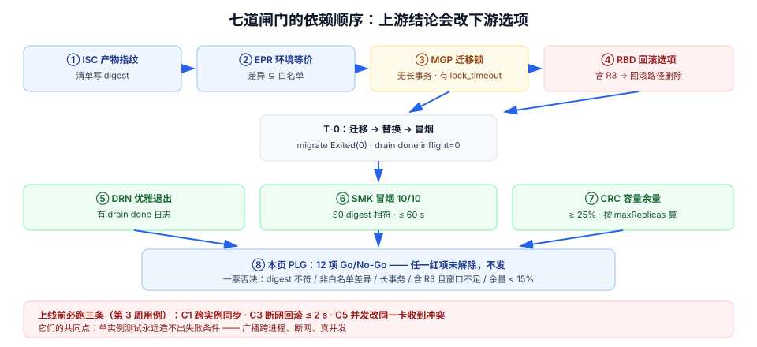

# 第 4 周第 8 步 · 上线前置闸门：把七道闸门串成一次 Go/No-Go

第 4 周前七步各修了一道闸门：[镜像供应链](../ImageSupplyChain/index.md)、[环境等价](../EnvParity/index.md)、[迁移前置](../MigrationPreflight/index.md)、[优雅退出](../GracefulDrain/index.md)、[部署后冒烟](../SmokeGate/index.md)、[回滚矩阵](../RollbackMatrix/index.md)、[容量复核](../PoolCapacity/index.md)。

它们的共同问题是：**单独看都是绿的，串起来仍然可能放行一个有问题的版本**。因为「上线」不是七个检查的并集，而是一条有先后依赖的链——第 3 步的结论会改变第 6 步的选项（含 `R3` 迁移 → 回滚选项消失），第 7 步的结论会改变第 4 步的时机（连接余量不足 → 必须错峰分批）。

本页是第 4 周第 1 步的收口：**把七道闸门串成一次可执行的 Go/No-Go。**

## 判据族声明

本页判据族 `PLG-A` ~ `PLG-H`，共 8 条。定义表在第七节。

## 本页不讲什么

- 不讲上线验收清单的 20 项怎么逐条勾，归 [上线验收](../LaunchAcceptance/index.md)（那份清单判的是**交付是否完整**，本页判的是**这一次能不能发**）。
- 不讲发布步骤表、灰度白名单与冻结期，归 [发布与回滚手册](../ReleaseRunbook/index.md)。
- 不讲第 4 周后续步骤（迁移脚本与数据回填、灰度放量、监控接线复核），它们在第 4 周第 2~7 步里展开。
- 本页**不做复盘**：只做「发布前判定」与「发布后 60 分钟的观测点」，不写总结性回顾。



## 一、八页分工：谁否决谁

| 页 | 回答的问题 | 否决时的一句话 | 判据族 |
| --- | --- | --- | --- |
| [镜像供应链](../ImageSupplyChain/index.md) | 部署的是不是我们验证过的那一份？ | 「清单里没有 digest，无法指认版本」 | `ISC` |
| [环境等价](../EnvParity/index.md) | 三套环境的差异是不是都在白名单里？ | 「`DB_STATEMENT_TIMEOUT` 两边不一样」 | `EPR` |
| [迁移前置](../MigrationPreflight/index.md) | 这次 DDL 会不会锁死库？ | 「有长事务，迁移会排队」 | `MGP` |
| [优雅退出](../GracefulDrain/index.md) | 替换时在途请求会不会丢？ | 「没有 drain 日志，无法证明排空」 | `DRN` |
| [部署后冒烟](../SmokeGate/index.md) | 起来之后是不是好的？ | 「`S0` digest 不符，测的是旧实例」 | `SMK` |
| [回滚矩阵](../RollbackMatrix/index.md) | 出事能不能退？ | 「含 `R3` 迁移，回滚选项不存在」 | `RBD` |
| [容量复核](../PoolCapacity/index.md) | 第一波流量会不会打爆连接？ | 「池总量 150 > 上限 100」 | `CRC` |
| **本页** | 以上七条能否同时成立？ | 「任一红项未解除，不发」 | `PLG` |

分工的关键在最后一列：**每页只对自己那一族判据负责，本页不重复判内容，只判「结论是否齐全、是否互相矛盾」。**

## 二、七道闸门的依赖关系

顺序不是随意的，改一条会连带改后面的选项：

```text
产物（ISC）──┬─→ 环境（EPR）──→ 迁移（MGP）──┬─→ 回滚选项（RBD）
             │                              │
             └──────────────────────────────┴─→ 容量（CRC）──→ 发布时机
                                                    │
                              退出（DRN）──────→ 冒烟（SMK）──→ Go/No-Go
```

两条真实存在的连带关系：

| 上游结论 | 下游影响 |
| --- | --- |
| 迁移含 `R3`（不可逆） | 回滚矩阵里「回滚镜像」整条路径删除 → 冒烟失败只能「发补丁版」，发布时间必须选在**有人能连着干 4 小时**的窗口 |
| 容量余量 < 25% | 不能一次全量替换 → 必须分批 + 错峰，`preStop` 从 6 s 拉到 12 s（网关刷新 + 连接回收更慢） |

所以「先算容量、再定发布方式、最后才排时间」这个顺序是硬的。

## 三、T-60 → T+60 的时间线

| 时刻 | 动作 | 谁 | 输出 |
| --- | --- | --- | --- |
| **T-60 min** | 冻结变更：合并窗口关闭，只允许回滚类提交 | 发布负责人 | 一条「已冻结」记录 |
| **T-45** | 跑 ①~④ 四项前置（digest / 配置差异 / 迁移体检 / 容量算式） | 发布负责人 | 四项结论写进发布记录 |
| **T-30** | 备份点确认：`pg_current_wal_lsn()` + 最近基础备份时间 | DBA | 两个值 |
| **T-20** | 预发环境跑一遍完整发布（同 digest、同迁移） | 发布负责人 | 预发冒烟 10/10 |
| **T-10** | 宣布 Go/No-Go：按第四节的表逐项念结论 | 全员 | Go 或 No-Go |
| **T-0** | 迁移（`migrate` 服务）→ 应用替换 → 冒烟 | 自动化 | `migrate Exited(0)`、`drain done inflight=0`、`SMOKE PASS` |
| **T+5** | 五项线上观测（错误率 / p99 / 池等待 / 长连接 / 告警） | 值班 | 五个读数 |
| **T+30** | 决定是否继续放量（若分批） | 发布负责人 | 放量或停 |
| **T+60** | 宣布发布结束，解除冻结 | 发布负责人 | 一条「发布完成」记录 |

三个「必须先于 T-0 完成」的动作值得单独说：**备份点确认（T-30）** 与 **预发全流程（T-20）**。它们的共同点是「出事时无法补做」——备份是 T-0 之前那一刻的状态，发布后再备份已经晚了；预发演练是唯一能在不伤用户的前提下发现「回滚不了」的地方。

## 四、Go/No-Go 检查表：一票否决

| # | 项 | 判据 | 一票否决的条件 |
| --- | --- | --- | --- |
| 1 | 产物指纹 | 清单里是 digest | 出现 tag / `latest` |
| 2 | 环境差异 | 差异 ⊆ 白名单 | 出现 `DB_STATEMENT_TIMEOUT`、`WS_QUEUE`、`JWT_TTL` 等非白名单差异 |
| 3 | 结构指纹 | 预发 = 生产 | 两边指纹不等 |
| 4 | 迁移体检 | 无 > 5 s 长事务 | 有 `wait_event_type=Lock` 或 `idle in transaction` > 60 s |
| 5 | 迁移标签 | 最高 `R2` 以内 | 含 `R3` 且窗口不足 4 小时 |
| 6 | 连接预算 | 余量 ≥ 25% | 余量 < 15%，或按 `maxReplicas` 算超卖 |
| 7 | 回滚点 | digest / LSN / 配置快照齐全 | 缺任一项 |
| 8 | 预发冒烟 | 10/10 且 digest 相符 | 有红项，或 digest 不符 |
| 9 | drain 证据 | 上一次替换有 `drain done inflight=0` | 没有该日志（说明上一版也是硬退） |
| 10 | 回滚演练 | 已迁移库上跑过「旧版写路径」 | 未演练，或演练库未迁移 |
| 11 | 三条必跑用例 | `C1`/`C3`/`C5` 通过（见第五节） | 任一未通过 |
| 12 | 值守 | T+60 内有人在线 | 无人值守 |

12 项里，**第 9、10、11 项最常被跳**——它们都不是「这次发布做了什么」，而是「上次有没有留下证据」。发布链最容易断的地方，恰恰是「证据的连续性」。

## 五、为什么 `C1` / `C3` / `C5` 是上线前必跑

三条用例来自第 3 周的 [状态一致性联调](../Week3StateConsistency/index.md)（十二条用例里的三条），它们对应三类**上线后才会被投诉**的故障：

| 用例 | 验什么 | 上线后的投诉长什么样 | 为什么必须在发布窗口跑 |
| --- | --- | --- | --- |
| `C1` | W1 拖动，W2 在 1 s 内同步 | 「我改了别人看不到」 | 跨实例广播依赖 Redis 发布订阅——**多副本才第一次真正生效** |
| `C3` | 断网拖动 ≤ 2 s 回弹 + 提示 | 「网一抖卡片就飞了/丢了」 | 失败回滚依赖超时配置，而超时在白名单之外（不能与环境不同） |
| `C5` | 两端先后改同一张卡，后提交者收到冲突提示 | 「我的修改被别人的覆盖了」 | `409` 依赖版本号，而版本号语义在本次迁移里可能变（`R2`） |

三条的共同点：**单实例测试永远造不出它们的失败条件**。`C1` 需要两个实例（广播跨进程）、`C3` 需要断网（客户端行为）、`C5` 需要真并发。所以它们不能留在「预发单实例」的自测里，必须在发布后**对真实多副本环境**跑一次。

## 六、第 4 周验收表补一栏

第 4 周验收（[Week4Acceptance](../Week4Acceptance/index.md)）原按四类交付证据收口。这一步之后补第五类与一列时间：

| 证据类 | 来源 | 本次补什么 |
| --- | --- | --- |
| 部署可重复 | `DY` | —— |
| 配置分层 | `CF` | —— |
| 监控接入 | `MO` | —— |
| 上线验收清单 | `LX` | —— |
| **部署前置（新增）** | `ISC` / `EPR` / `MGP` / `DRN` / `SMK` / `RBD` / `CRC` / `PLG` | 每族「最近一次通过时间」 |

补这一列的理由和 [第 3 周](../Week3StateConsistency/index.md) 一样：**前置证据会静默过期**。镜像 digest 三个月后还在，但它指向的镜像可能已被清理；容量算式三个月后还在，但实例数从 3 变成了 5。

## 七、判据表

| 编号 | 规则 | 违反时的样子 | 怎么验证 |
| --- | --- | --- | --- |
| `PLG-A` | 12 项 Go/No-Go 逐项有结论，不许「待定」 | 上线后互相追责 | 命令①，12 行齐全 |
| `PLG-B` | 上游结论必须传导到下游选项 | 含 `R3` 却按「可回滚」发布 | 发布记录里「回滚选项」与迁移标签一致 |
| `PLG-C` | 备份点在 T-0 之前确认 | 出事无法恢复 | 发布记录含 LSN 与备份时间，且早于 T-0 |
| `PLG-D` | 预发跑完整发布（同 digest、同迁移） | 生产第一次跑迁移 | 预发 `flyway_schema_history` 含本次版本 |
| `PLG-E` | `C1`/`C3`/`C5` 在**多副本**环境通过 | 「别人看不到我的修改」 | 三条用例的执行记录带实例 ID |
| `PLG-F` | 每条闸门有「最近一次通过时间」 | 证据静默过期 | 命令②，每族一行时间 |
| `PLG-G` | T+5 五项观测有读数 | 出了问题靠用户举报 | 五个读数写进发布记录 |
| `PLG-H` | 本页不含复盘内容 | 发布文档变成总结报告 | 页面无「复盘 / 总结 / 经验」章节 |

## 验证命令

```shell
# ① PLG-A：Go/No-Go 12 项必须都有结论（GO / NO-GO / 附条件 GO），不许 TODO
grep -cE '^\| *[0-9]+ *\|' deploy/GO-NOGO.md
# 期望：12

grep -nE '待定|TODO|TBD' deploy/GO-NOGO.md
# 期望：无输出

# ② PLG-F：八个判据族的最近一次通过时间
for p in ISC EPR MGP DRN SMK RBD CRC PLG; do
  printf '%-4s %s\n' "$p" "$(grep -oE "$p-[A-H].*20[0-9]{2}-[0-9]{2}-[0-9]{2}" deploy/evidence.md | tail -1)"
done
# 期望：八行都有日期；空行 = 该族证据没落盘

# ③ PLG-E：C1/C3/C5 的执行记录必须来自不同实例（证明多副本）
grep -E '(^|[^A-Za-z])(C1|C3|C5)([^0-9]|$)' logs/smoke-$(date +%Y%m%d).log | head -5
# 期望：至少一条记录里出现两个不同 instance_id
```

## 八、第 4 周第 1 步到此收口

八页走完，第 4 周的**部署前置**成型：

| 步 | 页 | 交付的核心读数 |
| --- | --- | --- |
| 1 | [镜像供应链](../ImageSupplyChain/index.md) | 6 次构建 5 个 image ID、层 diffID 不变 |
| 2 | [环境等价](../EnvParity/index.md) | 20 键 / 键集合指纹相同 / 值指纹不同 / 8 键差异 |
| 3 | [迁移前置](../MigrationPreflight/index.md) | `lock_timeout` 0.238 s 自杀 vs 1.42 s 排队；只读被堵 1.19 s |
| 4 | [优雅退出](../GracefulDrain/index.md) | 200 个在途请求：abrupt 全丢 vs graceful 全成（472 ms） |
| 5 | [部署后冒烟](../SmokeGate/index.md) | 10 步 ≤ 60 s；超时按 p99 的 30~100 倍定 |
| 6 | [回滚矩阵](../RollbackMatrix/index.md) | 四个实测场景：`101\|0` / `not-null` / 列消失 / `42703` |
| 7 | [容量复核](../PoolCapacity/index.md) | `max_connections=20` 时 30 并发 → 20 成 10 拒 |
| 8 | 本页 | 12 项 Go/No-Go + 三条必跑用例 |

## 九、下一步

第 4 周第 2 步进入**迁移的落地形态**：把「一次发布里带几条迁移、数据回填怎么分批、回填的进度怎么观测」写成可执行步骤——重点在**回填的批次与限速**（一次 `UPDATE` 百万行会把库锁死，而分批回填需要可中断、可续跑、可观测）。

再往后是灰度放量与监控接线复核，最终由 [上线验收](../LaunchAcceptance/index.md) 的 20 项清单收尾。
