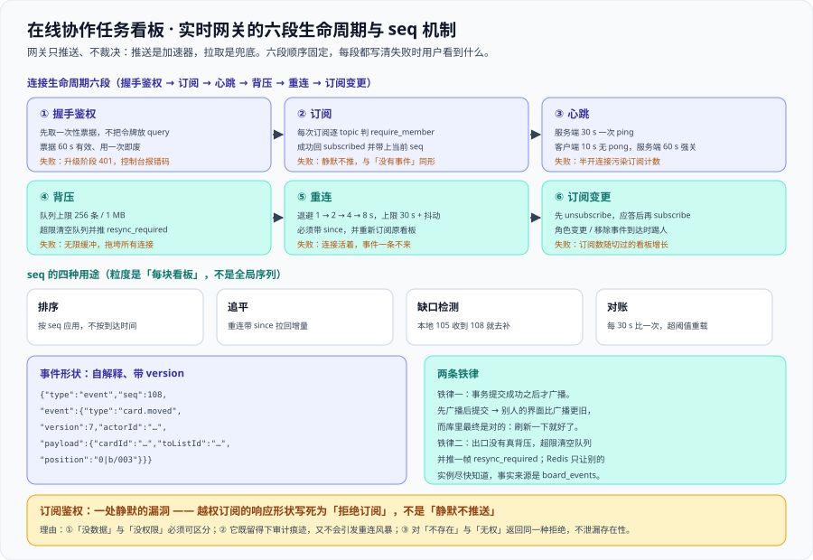

# 实时网关：订阅鉴权、事件序号与断线追平

这一页把 [架构设计](../Architecture/index.md) 第三节第 ⑩~⑫ 步与第 4.3 节「连接的生命周期」落成**一套能照着实现的网关口径**：连接从建立到关闭要经过哪六段、每一段失败时用户会看到什么、订阅鉴权为什么是最容易被漏且最静默的一处、`seq` 凭什么能让断线不丢改动，以及**出口没有真背压**时该丢什么、该留什么。



::: warning 本项目只有文档，没有代码
本页出现的 `/ws` 地址、事件 JSON、订阅帧与 `wscat` 命令，都是**读者在自己工程里要落地的形态**。本仓库不存放源码、脚本与配置；「运行 `xxx`」一律指「先按本页与 [环境与工程骨架](../Environment/index.md) 创建好对应文件，再执行」。
:::

## 一、实时网关在系统里的位置

实时网关是[架构设计](../Architecture/index.md)第一层「接入层」里唯一持有**长连接**的部分。它的边界很清楚：**它推送、它不裁决**。

| 网关负责 | 网关不负责 |
| --- | --- |
| 握手鉴权、订阅鉴权、心跳、背压、按 `seq` 顺序分发 | 不决定「谁有权改」（那是 `workspace` 与各领域模块的事） |
| 把每个实例收到的事件按 `seq` 顺序写进本机连接 | 不做顺序的**真相源**（真相在 `board_events`） |
| 告诉客户端「你落后了，去补拉」 | 不做补拉本身（补拉走 HTTP 的 `GET /events?since=`） |

一句话口径：**推送是加速器，拉取是兜底。** 任何「只靠推送就能保证正确」的写法，都会在第一次网络抖动时暴露。

## 二、连接生命周期六段

六段**顺序固定**，每段都写清「失败时用户看到什么」——否则排障时只能靠猜。

### 2.1 握手鉴权：只验身份，不验订阅

客户端先调用 `POST /api/v1/realtime/ticket` 拿一张**一次性短时效票据**（60 秒有效、用一次即废），再升级连接到 `ws://host/ws?ticket={票据}`。

票据存在的理由只有一条：浏览器的 WebSocket API **不能自定义请求头**，长期令牌只能塞进 query string——而 query string 会进访问日志、`Referer` 与浏览器历史。票据把它换成了一张「用完即废、且只对握手有效」的凭据。

**失败表现**：

1. 票据过期或被复用 → 升级阶段直接拒绝，浏览器控制台看到 `WebSocket connection to 'ws://…' failed: Unexpected response code: 401`。
2. 用了长期令牌 → 短期无异常，长期表现为「日志里能找到一堆有效令牌」。
3. 只在握手验一次就再也不验 → 见第三节：长连接会把握手那一刻的身份快照**一直用下去**。

### 2.2 订阅：逐 topic 判权限

连接建立之后，客户端发订阅帧申请加入某块看板的实时流：

```json [订阅帧与它的显式应答]
{ "type": "subscribe", "boardId": "0191f2c4-8a3b-7c21-9f4e-1c2d3e4f5a6b" }
```

服务端对**每一次订阅**执行一次 `require_member(workspaceId, userId)`，并把结果用一个显式应答帧返回（成功回 `subscribed` + 当前 `seq`，失败回 `error`）。这一段的细节见第三节——它是本页最重要的一节。

**失败表现**：越权订阅若「静默不推」，攻击者收到的只是安静，与「这块看板真的没有事件」**完全同形**，没有 4xx、没有日志异常、没有界面差异。

### 2.3 心跳：两端都要判，服务端那一端更关键

| 参数 | 值 | 依据 |
| --- | --- | --- |
| 服务端 `ping` 间隔 | 30 s | 与 [需求拆分](../Requirements/index.md) 4.2 节一致 |
| 客户端 `pong` 超时 | 10 s 无 `pong` 视为断开 | 客户端侧判定，负责尽快走重连 |
| 服务端僵尸判定 | 60 s 内**无任何入站帧**（`pong` 或订阅帧）强制关闭 | 容忍一次丢包，且不把「安静但健康」的连接误杀 |
| 关闭前记录 | 一条 `zombie_connection_closed` 日志 | 否则「连接数下降」这件事在运维侧没有痕迹 |

**失败表现**：缺了服务端那一端时，TCP 半开连接（客户端进程被杀、笔记本休眠、NAT 表项超时）不会立刻通知服务端。后果是连锁的：事件推给一个没人读的 socket → 发送缓冲堆满 → 触发背压丢弃（而没人看见标记）→ 连接数与订阅数虚高，把「实时在线人数」这类指标彻底污染。

### 2.4 背压：有上限、超限即丢、丢弃必须被标记

每连接的发送队列上限固定为 **256 条事件 / 1 MB**（以先到者为准）。超限的动作是**清空队列 + 推一帧 `resync_required`**。第七节给出这个选择的取舍与代价。

**失败表现**：不做上限时，一个被浏览器挂起的标签页会把事件堆在服务端内存里，最终拖垮所有连接；只丢弃不标记时，用户看到的是**某个人的界面莫名偏旧**，而服务端各项指标一片正常。

### 2.5 重连：退避 + 抖动 + 必须带 `since`

指数退避 1 → 2 → 4 → 8 s（上限 30 s）叠加随机抖动；重连成功后的第一件事是**带 `since={本地最大 seq}` 补拉**（第六节），第二件事是**重新订阅原来看板**。

**失败表现**：

1. 没有退避 → 服务端重启后全部客户端在同一秒重连，重连风暴把启动期的资源全吃掉。
2. 没有抖动 → 即使有退避，同一批客户端依然会「同频」重连。
3. 带了 `since` 但忘了重新订阅 → 连接是活的、心跳是正常的、事件一条都不来。这个现象最容易被误判成「推送功能坏了」，实际是订阅没恢复。

### 2.6 订阅变更：先退后订，且权限变化要能踢人

用户切走看板时**显式** `unsubscribe` 旧 topic，收到应答后再 `subscribe` 新 topic。另外，服务端在 `member.role_changed` / `member.removed` 事件到达时，把该用户从受影响看板的订阅里踢出。

**失败表现**：

1. 不取消订阅 → 连接数与订阅数随「用户切过的看板数」增长，属于典型的**内存型泄漏**：一天不出问题，一周后连接数翻十倍。
2. 权限被收回后不踢 → 被降级或移除的人**继续收到**该看板的实时数据流。这与架构页点名的越权订阅是同一类问题，区别只是「一开始就没权限」还是「后来失去了权限」。

## 三、订阅鉴权：一处静默的漏洞

### 3.1 为什么「HTTP 层鉴权」不等于「WebSocket 订阅鉴权」

| 维度 | HTTP 接口 | WebSocket 连接 |
| --- | --- | --- |
| 鉴权点数量 | 每个路径天然一个（URL 里就写着要动哪个资源） | **只有一个**：握手地址 |
| 「我要看哪块看板」写在哪 | URL 路径或查询参数里 | 连上之后用**消息**发的 |
| 校验漏了的后果 | 越权读写一个资源，通常在日志与指标上可见 | **越权接收一整条实时数据流**，静默、无日志、无指标 |

于是「握手时校验了身份，却忘了校验订阅的看板是否属于该用户的工作区」成为协作类系统最典型的漏洞。它不是「没做鉴权」，而是**做了鉴权、挂在了错误的粒度上**。

### 3.2 越权订阅的响应形状：选「拒绝订阅」

三种可选的响应形状，代价完全不同：

| 形状 | 攻击者看到什么 | 排障时运维看到什么 | 副作用 |
| --- | --- | --- | --- |
| **静默不推送** | 一片安静 | 与「这块看板确实没有事件」**同形** | 订阅计数虚高；漏洞只能靠逐格测试发现 |
| **拒绝订阅（显式错误帧）** | 一条明确的拒绝 | 日志里一条明确的越权告警 | 客户端需要处理一个错误态（成本最低） |
| **直接断开连接** | 明确的拒绝，但更粗 | 与「网络抖动 / 服务端重启」同形 | 客户端立刻重连 → 重连风暴，且要区分「被踢」与「掉线」 |

**写死选第二种：拒绝订阅。** 三条理由：

1. **「没数据」与「没权限」必须可区分。** 这与「跨工作区一律 `404` 而不是 `403`」是同一条纪律的另一面：后端要尽量不泄漏存在性，但**前端必须能分辨「这里本来就没有」与「你没资格看」**，否则界面只能显示空白，用户无法自救。
2. **它是唯一能同时留下审计痕迹、又不引发重连风暴的形状。** 静默不留痕，断开则逼客户端立刻重连。
3. **它不泄漏资源存在性。** 订阅不是「取一个资源」，而是「申请加入一条流」；对**不存在的看板**与**无权订阅的看板**返回**同一种**拒绝即可——两种情况下攻击者拿到的信息完全一样。

```json [越权订阅的应答（不区分「不存在」与「无权」）]
{
  "type": "error",
  "code": "FORBIDDEN_SUBSCRIPTION",
  "boardId": "0191f2c4-8a3b-7c21-9f4e-1c2d3e4f5a6b",
  "message": "订阅被拒绝"
}
```

::: danger 订阅鉴权上四个会静默变歪的写法
1. **只在握手时判权限，订阅时不判。** 握手只证明「你是谁」，证明不了「这块看板你有权看」。订阅必须**逐 topic** 重新判一次。
2. **把「订阅」做成「加入全局频道」。** 一旦所有看板共用一个频道，鉴权就无处可挂；频道粒度必须是 `board:{boardId}`，权限与频道一一对应。
3. **握手时的身份快照被一直用下去。** 长连接的寿命是小时级甚至天级，而成员关系是分钟级可变的（[需求拆分](../Requirements/index.md) US-10 要求「降级立刻生效」）。因此必须有**订阅重验**：收到 `member.role_changed` / `member.removed` 事件时踢人，并且每 5 分钟对活跃订阅做一次周期性重验。
4. **用「返回空数组」代替拒绝。** 补拉接口（第六节）若对越权请求返回空事件列表，客户端会认为「已追平」，世界状态永久停在一个错误的位置。
:::

## 四、事件形状与 `seq` 的四种用途

### 4.1 为什么需要 `seq`

WebSocket 推送有三个天然缺口：**顺序不保证**（两台实例同时推送，客户端收到顺序可能颠倒）、**断线期间的事件永久丢失**、**推送不能作为数据源**（丢了一条，客户端无从发现）。给每块看板维护一个单调递增的 `seq`，三个缺口同时被补上。

### 4.2 事件形状：自解释

事件必须让客户端**不需要再请求任何接口**就能把界面改对。它同时是推送帧的内容，也是补拉接口返回的内容——**同一个 `seq` 的内容必须逐字节稳定**，否则客户端的去重与排序会出错。

```json [一条事件（推送帧与补拉接口共用同一个形状）]
{
  "type": "event",
  "seq": 108,
  "event": {
    "boardId": "0191f2c4-8a3b-7c21-9f4e-1c2d3e4f5a6b",
    "type": "card.moved",
    "actorId": "0191f2c4-1111-7000-8000-000000000001",
    "at": "2026-10-14T11:02:31.412Z",
    "version": 7,
    "payload": {
      "cardId": "0191f2c4-2222-7000-8000-000000000002",
      "fromListId": "0191f2c4-3333-7000-8000-000000000003",
      "toListId": "0191f2c4-4444-7000-8000-000000000004",
      "position": "0|b/003"
    }
  }
}
```

| 字段 | 作用 | 少了它会怎样 |
| --- | --- | --- |
| `seq` | 排序、去重、缺口检测、对账 | 客户端只能按到达时间排序，抖动即错序 |
| `type` | 客户端分发到哪个处理分支 | 只能靠 `payload` 的字段猜事件类型 |
| `actorId` | 过滤「自己发起的改动」（避免自己的乐观更新被回滚） | 自己拖动时界面会闪一下回弹 |
| `at` | 展示与排查 | 无法回答「这条事件是什么时候产生的」 |
| `version` | 判断这条事件是否比已应用的那条更新 | 重复推送会造成界面回跳 |
| `payload` | **带齐改界面所需的一切** | 推送退化成触发器，重连时打出请求风暴 |

### 4.3 `seq` 的四种用途

| 用途 | 解决什么 | 具体做法 |
| --- | --- | --- |
| **排序** | 两台实例同时推送导致乱序 | 客户端按 `seq` 升序应用，不按到达时间 |
| **追平** | 断线期间的事件丢失 | 重连带 `since={本地最大 seq}`，服务端返回增量 |
| **缺口检测** | 「悄悄丢了一条」无从发现 | 收到 `seq = 108` 而本地停在 `105` → 主动补拉 106~108 |
| **对账** | 前面三条全部失效后的兜底 | 每 30 秒比对本地最大 `seq` 与服务端；超出阈值则整体重载 |

::: tip `seq` 的粒度是「每块看板」，不是全局
全局序列会让两块互不相干的看板互相「制造缺口」——B 看板的事件把 A 看板的 `seq` 顶上去，客户端在 A 上永远检测到缺口并反复补拉。**缺口检测的前提是序列的粒度与订阅的粒度一致。**
:::

## 五、提交之后再广播：Redis 发布订阅的角色

### 5.1 铁律：事务提交成功之后才广播

第 ⑩ 步的顺序**不能反、也不能合并**：

1. 事务内：写 `cards` + `audit_log` + `board_events`（占用一个 `seq`）+ outbox。
2. 事务**提交成功**。
3. 把事件投到 Redis 频道 `board:{boardId}`。
4. 每个持有该看板连接的实例从频道收到事件，按 `seq` 顺序推给自己持有的连接。

**先广播、后提交**会产生这类系统里最难查的缺陷：另外两个客户端收到事件后立刻去拉详情，而事务还没提交，于是它们**拉到旧数据**——它们的界面比广播更旧。数据库里最终是正确的，手动刷新一下又好了。

::: danger 为什么它比其他并发缺陷更难查
1. **只在并发时出现**：单机、单人、慢速操作全绿。
2. **现象与原因不同层**：用户报的是「界面不更新」，代码里出问题的是**事务边界的顺序**。
3. **有一条看起来有效的补丁**：让客户端收到事件后延迟 200 ms 再拉。这会把一个必然缺陷变成一个小概率缺陷，**它不是修复**。
4. **它破坏的是「推送即真相」这个前提**：一旦客户端学到「推送之后要等一下」，这份代码里所有的实时逻辑都不可信了。
:::

### 5.2 Redis 发布订阅在多实例下的角色

多实例部署时，A 实例上的写必须让持有该看板连接的 B 实例也知道——这是跨进程的，也是本项目唯一需要外部依赖的地方。

| 决定 | 取值 | 理由 |
| --- | --- | --- |
| 频道粒度 | `board:{boardId}` | 权限与事件流一一对应；避免全实例处理全部广播 |
| 语义 | 广播，**at-most-once** | 它只负责「让别的实例尽快知道」，不负责不丢 |
| 持久化 | 不依赖 | 订阅者掉线期间的消息**永久丢失**——所以它不是事实来源 |
| 事实来源 | `board_events`（持久、可裁剪） | 补拉从这里读，正确性由它兜底 |

由此得到一条必须写下来的降级口径：**Redis 不可用时，写接口仍然 `200`、库里数据仍然正确，只是实时性降级**——事件不再跨实例传播，客户端靠 30 秒对账与下次重连补拉把状态追回来。判据是「写接口成功率不变、推送指标归零」，而不是「系统挂了」。

::: danger 广播链路上两个容易写错的点
1. **事务内广播。** 看起来「更及时」，实际是把 5.1 节的缺陷写进了代码。广播必须发生在提交之后。
2. **在提交前后各广播一次。** 有人为了「保证不丢」而广播两次：客户端会按 `seq` 去重，所以不会出错，但每次写都产生一份无效流量，且掩盖了真正的重试逻辑有没有生效。
:::

## 六、断线追平：`since`、上限与整体重载

补拉走 HTTP，形状固定：

```shell
GET /api/v1/boards/{boardId}/events?since={本地最大 seq}&limit=500
```

| 情形 | 服务端行为 | 客户端行为 |
| --- | --- | --- |
| `since` 在保留期（30 天）内且缺口 ≤ 500 | 返回 `seq > since` 的事件，**升序**，最多 500 条 | 逐条按 `seq` 去重后应用 |
| 缺口 > 500 或 `since` 早于保留期 | 返回 `409` + `details.reason = "too_far_behind"` | **整体重载**（重新拉全量看板） |
| `since` 缺失或为 0 | 视为「首次加载」 | 直接整体重载 |
| `since` **大于**服务端最大 `seq` | 返回 `409` + `details.reason = "seq_ahead"` | 整体重载 |

::: danger 断线追平上三个写反了会静默出错的点
1. **缺口太大时返回「截断后的最新 500 条」。** 客户端会认为自己追平了，而它的世界状态里**永远缺一段**，且它自己不知道缺的是哪一段。正确做法是明确要求**整体重载**：慢，但结果是确定的。
2. **`since` 比服务端最大 `seq` 还大时返回空数组。** 空数组会被解读成「已追平」。这种情况实际会发生（客户端连过另一个实例、服务端做过一次回滚或恢复），必须显式判为「请整体重载」。
3. **补拉结果不保证升序。** 客户端如果按「到达顺序」应用，补拉与推送并发时就会错序。补拉接口必须**显式按 `seq` 升序**返回，客户端也只按 `seq` 排序。
:::

整体重载的代价要说清楚：它拉的是「看板 + 全部列 + 全部分页卡片」，是本项目里最重的一个读请求。因此它必须是**低频路径**（只在缺口过大、对账失败时走），且要有一条指标统计它被触发的次数——**这个数字突然上涨，通常意味着推送链路已经暗地里坏了很久**。

## 七、背压与慢消费者：出口没有真背压

出口是浏览器连接：**服务端无法让客户端「慢一点读」**。这是[响应式编程 · 背压](/docs/Backend/ReactiveProgramming/Backpressure/index.md)里那条现实的直接应用。三种做法，代价完全不同：

| 做法 | 代价 |
| --- | --- |
| 无限缓冲 | 一个卡住的客户端把事件堆在服务端内存里，最终拖垮**所有**连接。这是把一次小故障预约成一次大故障 |
| 超限即断开 | 实现最简单，但客户端退避后立刻重连、重连后立刻再次超限 → 断开风暴；且用户看到的是「无缘无故掉线」，与网络问题同形 |
| **超限清空队列 + 标记 `resync_required`** | 丢的是**实时性**，不是**正确性**；客户端走整体重载补齐 |

**写死选第三种。** 它的代价有两条，必须一并接受：

1. 客户端**必须实现整体重载路径**，不能只实现增量应用——只写增量的话，收到该标记时客户端无处可去。
2. 被丢弃的那一段事件**不会再被推送**，只能靠标记显式告知。所以标记**不能省**：省掉它，用户看到的就是「某个人的界面莫名偏旧」，而没有任何可观测的信号。

丢弃的粒度是**整批清空**，而不是丢最旧的那些。理由很具体：**丢最旧会让客户端的世界状态缺「头部」，而缺头部比缺尾部更难检测**——尾部能被 `seq` 缺口检测发现（本地停在 105，下一条是 120，缺口可算出），头部缺失则完全没有参照物。「清空 + 标记」等价于「在客户端已知的最后一个 `seq` 处干净地断开」。

慢消费者的三种成因都不是用户故意的，因此处置必须自动：客户端标签页被浏览器挂起（后台节流）、网络带宽不足、客户端主线程被长任务阻塞。

## 八、心跳与僵尸连接的判定参数

| 判定 | 由谁做 | 参数 | 为什么要两端都判 |
| --- | --- | --- | --- |
| 连接还活着 | 客户端 | 10 s 无 `pong` 即断开并走重连 | 客户端知道得最快，用户体验取决于它 |
| 连接已死 | 服务端 | 60 s 无任何入站帧即强制关闭并记日志 | 服务端要回收**资源**与**订阅计数**，不能被半开连接占着 |
| 连接是不是「安静但健康」 | 服务端 | 只要收到 `pong` 就不算僵尸 | 没有事件的连接是正常状态，不能靠「有没有数据」判断 |

::: danger 心跳上两个容易做成隐蔽故障的写法
1. **只做一端。** 只做客户端：半开连接永远挂在服务端，资源与计数被污染。只做服务端：客户端在服务端已经放弃它之后还在等，界面卡死在「连接中」。
2. **把心跳做成中心化的。** 多实例部署时，心跳必须是**持有该连接的那个实例**的本机定时器。做成「中心化心跳」的后果是：实例崩了，它对连接的心跳也停了，而没有任何人接管——连接看起来还在，实际已经没有任何人在管它。
:::

## 九、消息大小上限与压缩口径

| 项 | 上限 | 超限的处置 |
| --- | --- | --- |
| 单条推送事件 | 64 KB | 事件必须改成「引用 + 摘要」，正文/附件不让它进事件 |
| 入站单帧（订阅 / 取消订阅） | 16 KB | 视为违规，直接关闭连接 |
| 单连接发送缓冲 | 1 MB（或 256 条） | 清空 + `resync_required`（第七节） |
| 单次补拉响应 | 500 条或 2 MB（先到者为准） | 返回不足的部分，由客户端带新 `since` 继续拉 |

**压缩口径：默认不开启 `permessage-deflate`。** 三条理由：

1. 服务端要为**每个连接**维护一份压缩上下文，内存开销随连接数线性增长，而事件通常只有几百字节。
2. 小消息的压缩率极低，甚至因为帧头开销而**变大**。
3. 压缩 + 用户可控内容 = BREACH 类攻击面（攻击者通过压缩后的长度差分推断内容）。

比压缩更有效的做法是**把大内容从事件里移出去**：事件只带 id 与变更摘要，客户端按需拉正文。这样既减小了上限压力，也顺手降低了「一次广播打满所有连接带宽」的风险。

顺带一个数量级感受：一条 `card.moved` 事件约 300 B，按 [需求拆分](../Requirements/index.md) 的峰值 200 RPS 全量广播也就约 60 KB/s。所以**大小上限不是为了省带宽，而是为了防单条异常事件把发送队列一次撑爆**。

## 十、当日做了什么

1. 划出实时网关的边界（**推送是加速器，拉取是兜底**），并明确它「只推送、不裁决、不做顺序真相源」。
2. 画出**连接生命周期六段**（握手鉴权 / 订阅 / 心跳 / 背压 / 重连 / 订阅变更），每段写清关键动作与**失败表现**；握手段落地为「一次性短时效票据」，理由是浏览器 WebSocket 不能自定义请求头。
3. 把**订阅鉴权**单列一节：给出「HTTP 层鉴权 ≠ WebSocket 订阅鉴权」的四维对照，比较三种越权响应形状，**写死选「拒绝订阅」**并给出三条理由（可区分、可留痕且不引发重连风暴、不泄漏存在性），另加「订阅重验」与四条静默变歪的写法。
4. 定稿**事件形状**（自解释、带 `version`、同一 `seq` 内容稳定）与 **`seq` 的四种用途**（排序 / 追平 / 缺口检测 / 对账），并写死序列粒度是**每块看板**。
5. 写死**「提交之后再广播」**铁律，逐条说明「先广播后提交」为什么最难查（并发才出现、现象与原因不同层、有看起来有效的补丁、破坏「推送即真相」这个前提）；明确 Redis 发布订阅在多实例下只负责**让别的实例尽快知道**，事实来源是 `board_events`。
6. 定稿**断线追平**的四个分支（增量 / 缺口过大 / 首次加载 / `seq` 超前）与三条写反了会静默出错的点，并写明整体重载必须是低频路径且要有指标。
7. 给出**背压二选一的结论**（清空队列 + 标记，而不是断开）与它的两条代价，并解释为什么丢弃粒度是「整批」而不是「最旧」。
8. 定稿**心跳参数**（客户端 10 s / 服务端 60 s / `ping` 30 s）、**僵尸连接的来源**与「心跳必须由持有连接的实例做」这条实现纪律。
9. 给出**消息大小上限与压缩口径**（默认不开 `permessage-deflate` 的三条理由），并回到「把大内容移出事件」这个更有效的方向。

## 十一、如何验证

`RT-A` ~ `RT-H` 八条判据。前六条是**文档级、本机可判**（下面的命令已实跑，括注为实测值）；后两条是**运行期**，如实标注状态。

| 判据 | 判什么 | 命令 | 期望 | 是否已跑 |
| --- | --- | --- | --- | --- |
| **`RT-A`** | 连接生命周期六段齐全（2.1 ~ 2.6） | 第 1 条 | `6` | ✅ 本机已跑 |
| **`RT-B`** | 越权订阅的响应形状写死为「拒绝订阅」 | 第 2 条 | `6` | ✅ 本机已跑 |
| **`RT-C`** | `seq` 四种用途齐全（排序 / 追平 / 缺口检测 / 对账） | 第 3 条 | `4` | ✅ 本机已跑 |
| **`RT-D`** | 「提交之后再广播」铁律与它的反面情形写死 | 第 4 条 | `4` | ✅ 本机已跑 |
| **`RT-E`** | 断线追平的两个 `reason` 写死 | 第 5 条 | `2` | ✅ 本机已跑 |
| **`RT-F`** | 背压结论写死为「清空队列 + 标记」 | 第 6 条 | `6` | ✅ 本机已跑 |
| **`RT-G`** | 越权订阅在运行期返回**显式拒绝帧** | 第 7 条 | 收到 `FORBIDDEN_SUBSCRIPTION` | ⏳ 未跑 · 本机无容器运行时，也没有 WebSocket 客户端 |
| **`RT-H`** | 慢消费者触发 `resync_required` 且客户端完成整体重载 | 第 8 条 | 一帧 `resync_required` 后本地 `seq` 追平 | ⏳ 未跑 · 同上 |

```shell
# RT-A：连接生命周期六段齐全（2.1 ~ 2.6）
grep -c '^### 2\.[1-6] ' index.md                       # 期望 6

# RT-B：越权订阅的响应形状写死为「拒绝订阅」（不是静默不推）
grep -c '拒绝订[阅]' index.md                             # 期望 6

# RT-C：seq 四种用途齐全（排序 / 追平 / 缺口检测 / 对账）
grep -cE '^\| \*\*(排序|追平|缺口检测|对账)\*\* \|' index.md   # 期望 4

# RT-D：「提交之后再广播」铁律写死（第五节标题 + 当日做了什么第 5 条 + 本行注释）
grep -c '提交之后再广[播]' index.md                        # 期望 4

# RT-E：断线追平的四个分支与两个 reason 写死
grep -cE '"(too_far_behind|seq_ahead)"' index.md          # 期望 2

# RT-F：背压的结论写死为「清空队列 + 标记」
grep -c 'resync_require[d]' index.md                      # 期望 6

# RT-G：越权订阅在运行期返回显式拒绝帧（需要容器运行时 + WebSocket 客户端）
#    A 用工作区 A 的令牌订阅工作区 B 的看板；期望收到 FORBIDDEN_SUBSCRIPTION
#    反例：把订阅鉴权注释掉 → 连接保持安静、没有任何错误帧（这就是漏洞的样子）
wscat -c "ws://localhost:8080/ws?ticket=$TICKET"

# RT-H：慢消费者触发 resync_required 且客户端完成整体重载（需要容器运行时）
#    把客户端的读取暂停 30 s，另一终端连发 400 张卡片的改动
#    期望：客户端收到一帧 resync_required，随后整体重载后本地最大 seq 追平服务端
```

::: warning 后两条为什么只给命令
`RT-G` / `RT-H` 的判据对象是**运行中的网关**，而本机既没有容器运行时、也没有 WebSocket 客户端。按本项目一贯的纪律：**不把设计完成写成运行期验证完成**，这两条如实标 `⏳ 未跑`。
另需说明边界：`RT-B` / `RT-G` 与 [验收](../Acceptance/index.md) 页的 `TB-G`（权限矩阵，含越权订阅那一格）覆盖面相邻但**不重合**——`TB-*` 回答「这条验收怎么跑」，`RT-*` 回答「网关自身的实现口径是否自洽且可执行」，两者**互不替代**。
:::

## 参考资料

- [架构设计：模块边界与实时链路](../Architecture/index.md)（十二步链路第 ⑩~⑫ 步、连接生命周期、三处权限判定点） · [数据库设计](../Database/index.md)（`board_events` 与单调序号、`seq` 的分配方式）
- [需求拆分](../Requirements/index.md)（心跳与背压的口径来源、US-10「降级立刻生效」） · [环境与工程骨架](../Environment/index.md) · [验收](../Acceptance/index.md)（`TB-F` / `TB-G`）
- [响应式编程 · 背压](/docs/Backend/ReactiveProgramming/Backpressure/index.md)（出口没有真背压时的正确策略）
- [分布式缓存 · 拓扑](/docs/Backend/DistributedCache/Topology/index.md)（多实例广播与发布订阅的取舍）
- [完整项目交付 · 架构文档](/docs/Others/ProjectDelivery/Architecture/index.md)（架构文档该产出什么的通用口径）
