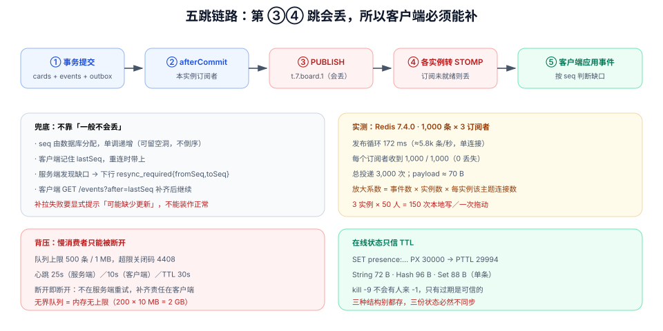

# 实时推送接线：从一次提交到另一个浏览器亮起来

第 2 周第 10 步：把 `board_events` 与附件、通知三类事件接进实时通道，让「另一个浏览器里那张卡片自己动了」成为**可复现、可验证、断电也不丢**的行为。这一步的难点不在 WebSocket 语法，而在**跨实例**：两个应用实例各自持有自己的连接，一条事件必须让两边都发出去，且**只能发一次**。

## 当日做了什么

| 项 | 产出 |
| --- | --- |
| 拓扑 | 一次提交到客户端渲染的五跳链路，与「哪一跳允许丢」的判定 |
| 命名 | Redis 频道与 STOMP 主题的两层命名（`t.{tenant}.board.{id}`）与订阅两道鉴权 |
| 扇出 | Redis 发布订阅的实测读数（1,000 条 × 3 订阅者）与放大系数 |
| 背压 | 每连接队列上限、丢弃策略、`resync_required` 与客户端补拉 |
| 在线状态 | presence 的 TTL 设计，与三个 Redis 结构的实测体积 |
| 判据 | `RW-A` ~ `RW-H` 八条 |

::: tip 本步的位置
第 9 步让通知**能被读到**，这一步让它**立刻被看到**。区别在于：读接口失败可以重试，推送失败会**静默地少一条**——所以推送的第一原则不是「快」，而是「丢了能被发现」。
:::

## 一、一条广播要走五跳



| 跳 | 动作 | 能不能丢 |
| --- | --- | --- |
| ① | 业务事务提交（`cards` / `board_events` / `outbox` 同事务） | 不能（回滚则整条不存在） |
| ② | `afterCommit` 后取事件、分发到本实例订阅者 | 不能（否则本实例自己都收不到） |
| ③ | `PUBLISH t.{tenant}.board.{id}` 到 Redis | **能**（Redis 不持久化 pub/sub） |
| ④ | 各实例的订阅线程收到后转成本地 STOMP 消息 | **能**（实例刚重启、订阅还没建好） |
| ⑤ | 客户端收到后应用事件 | 能（客户端正在切换标签页、JS 长任务） |

**第 ③④ 跳会丢，这件事必须设计进去，而不是靠「一般不会」**。兜底只有一条：客户端拿 `seq` 判断缺口，缺了就调 `GET /boards/{id}/events?after={seq}` 补齐。这条兜底的正确性由[事件表与顺序字段](../EventSequence/index.md)保证——`seq` 是数据库分配的、单调的、连续的（允许回滚留空洞，但不会倒序）。

## 二、为什么不能在事务里广播

```java
// 错误：广播在事务内
@Transactional
public void moveCard(...) {
    cardRepo.update(...);
    events.append(...);
    realtime.publish(event);        // ← 事务可能后面回滚
}

// 正确：提交之后才广播
@Transactional
public void moveCard(...) {
    cardRepo.update(...);
    events.append(...);
    TransactionSynchronizationManager.registerSynchronization(new TransactionSynchronization() {
        @Override public void afterCommit() { realtime.publish(event); }
    });
}
```

在事务内广播的后果是**「幽灵卡片」**：别人屏幕上卡片动了，刷新后又回去了。这类问题只在回滚路径上出现（版本冲突、约束冲突），常规测试很难覆盖。

::: danger 三个「发两次」的常见来源
1. **本地订阅 + Redis 订阅同时生效**：本实例既直接推给本地连接，又订阅了自己的频道 → 每个客户端收到两条。修法：`PUBLISH` 时带 `origin`（实例 id），订阅侧丢弃 `origin == self` 的消息；或者**统一只走 Redis**（简单，但多一次往返）。
2. **重连后重复订阅**：客户端断线重连又 `SUBSCRIBE` 一次，服务端没先解绑旧会话 → 同一用户两个订阅。
3. **多标签页各自订阅同一主题**：这是**正确行为**，但如果按「用户」而不是「会话」去重，就会漏推另一个标签页。
:::

## 三、命名：两层，不是一个字符串

| 层 | 形态 | 谁用 | 为什么这样 |
| --- | --- | --- | --- |
| Redis 频道 | `t.{tenantId}.board.{boardId}` | 应用实例之间 | 带租户前缀，实例可以按前缀做批量订阅与审计 |
| STOMP 目的地 | `/topic/t.{tenantId}.board.{boardId}` | 浏览器 | 与频道同构，便于排查时对着看 |
| 私有队列 | `/user/queue/notify` | 单个用户 | 通知不该广播给整个看板 |

同构命名的收益在排障时最明显：`redis-cli PUBSUB CHANNELS 't.7.*'` 的输出可以直接对应到前端的订阅路径。

## 四、跨实例扇出：实测与放大系数

本机实测（Redis **7.4.0**，standalone，单机容器）：

```shell
# 3 个订阅者，向同一频道发布 1,000 条（payload ≈ 70 B）
for i in 1 2 3; do redis-cli subscribe t.7.board.1 > /tmp/s$i.log 2>&1 & done
awk 'BEGIN{for(i=1;i<=1000;i++) printf "PUBLISH t.7.board.1 msg-%04d-xxx…\n", i}' | redis-cli
```

| 指标 | 读数 |
| --- | --- |
| 发布循环耗时 | **172 ms**（≈ 5.8k 条/秒，单连接顺序往返） |
| 每个订阅者收到 | **1,000 / 1,000**（无丢失） |
| 总投递次数 | 3,000 |
| 单条 payload | ≈ 70 B |

由此得到本项目的**放大系数**：

```text
总投递 = 事件数 × 订阅者实例数 × 该实例上该主题的本地连接数
```

一条拖动事件在「3 个实例 × 每实例 50 人在同一块看板」下是 **150 次本地写**。这不是 Redis 的问题，是**推送本质上是广播**——所以第 3 周的压测把「长连接 1 万」单列一个场景（见[压测与容量验收](../CapacityTest/index.md)），而不是按普通 API 估。

::: warning pub/sub 不持久化，这不是配置问题
Redis 的发布订阅是「发出去就不管」：**没有订阅者时消息直接丢弃**，Redis 重启也不会重放。所以：

- 不要用 pub/sub 承担「必须有」的语义（那是 outbox 与 `board_events` 的职责）；
- 实例启动时必须**先建订阅、再对外提供健康检查的 ready 状态**，否则前几秒的推送会静默丢失；
- 客户端必须实现「按 `seq` 补拉」，否则断线期间的事件永远看不到。
:::

## 五、慢消费者与背压

一个卡住的浏览器连接不会只卡住自己——它会拖住整个发送队列。

| 手段 | 参数（本项目取值） | 说明 |
| --- | --- | --- |
| 每连接待发队列上限 | 500 条或 1 MB（先到者为准） | 超限即断开，不发「部分帧」 |
| 应用层心跳 | 服务端每 25 s 发 `PING`，客户端 10 s 内不回则关闭 | 比 TCP keepalive 更早发现半开连接 |
| 断线关闭码 | `4408 SLOW_CONSUMER` | 客户端据此**直接重连并补拉**，不要指数退避重试发送 |
| 补拉协议 | 重连后带 `lastSeq`，服务端回 `resync_required` + 缺口区间 | 客户端拉一次 `GET /events?after=` |

```json
// 服务端发现缺口时的下行帧
{ "type": "resync_required", "fromSeq": 1043, "toSeq": 1187, "reason": "gap_detected" }
```

::: danger 三个背压实现错误
1. **无界队列**：`LinkedBlockingQueue()` 不传容量 = 内存无上限。200 个慢客户端各积压 10 MB 就是 2 GB。
2. **丢弃中间帧而不告知**：客户端以为连续，实际中间少了几条，界面上就是「卡片莫名跳了一下」。
3. **断开后服务端自己重试推送**：客户端已经走了，重试只是把队列越堆越高。断开就是断开，补齐的责任在客户端重连之后。
:::

## 六、在线状态（presence）：TTL 才是真相

「谁在线」不能靠「连接建立时 +1、断开时 -1」——进程被 kill -9 时不会有人来 -1。**唯一可靠的判据是 TTL**。

```shell
# 本项目的心跳写法：客户端每 10 s 续一次，TTL 30 s
SET presence:t.7.board.1:u42 "tab=3;at=1760000000" PX 30000
PTTL presence:t.7.board.1:u42     # → 29994（实测）
```

| 结构 | 用途 | 实测体积（单条） |
| --- | --- | --- |
| String `presence:{topic}:{user}` | 单用户在该看板的心跳 | **72 B** |
| Hash `presence:board:{id}` | 按看板聚合（一次 `HGETALL` 拿全） | **96 B** |
| Set `presence:t.{tenant}.board.{id}` | 只关心「有哪些人」 | **88 B** |

三个数字量级相同，选哪个取决于**读取模式**：前端画头像用 Hash（一次拿全），判断「某人是否在线」用 String（`EXISTS`），做「广播给在线者」用 Set。**不要三个都存**——三份状态必然不同步。

| 参数 | 取值 | 依据 |
| --- | --- | --- |
| 客户端心跳间隔 | 10 s | 移动端后台被冻结时，30 s 内必然过期 |
| 服务端 TTL | 30 s | `TTL ≥ 3 × heartbeat`：容忍两次丢包 |
| 过期后的展示 | 立即从「在线」移除，但保留「最后活跃时间」 | 用户能理解「刚才还在」 |

## 七、鉴权必须是两道

| 时机 | 校验 | 漏掉的后果 |
| --- | --- | --- |
| 握手（`CONNECT`） | 令牌有效性、租户归属 | 未登录也能建连，后续全靠订阅校验 |
| 订阅（`SUBSCRIBE`） | 该用户对 `boardId` 的读权限 | **能订阅任意看板**——这是本项目最危险的一处静默漏洞 |

第 155 天的[事件与推送隔离](../EventIsolation/index.md)已经把这个矩阵写死；本步只是把它接到代码里，并补一条**降级后的时效性**：成员被降级/移除时，服务端主动关闭该用户在该看板上的订阅（关闭码 `4403`），而不是等下一次订阅校验。

## 八、验收：七条命令

```shell
# ① 两个客户端订阅同一看板，一边拖动，另一边 1s 内收到
npx wscat -c "ws://localhost:8080/ws" -H "Authorization: Bearer $LIN"
# 发送：CONNECT → SUBSCRIBE /topic/t.7.board.1
# 期望：另一个浏览器拖动后，本端收到 MESSAGE，body 里 seq 连续递增
```

```shell
# ② 无权限订阅别人的看板 → 立即收到 ERROR 帧并断开
# 在 wscat 里 SUBSCRIBE /topic/t.7.board.999
# 期望：ERROR + 关闭；不是「订阅成功但收不到消息」
```

```shell
# ③ Redis 频道确实有消息（确认确实走了扇出，而不是本地直推）
redis-cli PUBSUB CHANNELS 't.7.*'
redis-cli --csv PSUBSCRIBE 't.7.*' > /tmp/psub.csv &
# 期望：频道存在；拖动后 /tmp/psub.csv 每行一条事件
```

```shell
# ④ 两个实例时不重复投递（origin 去重生效）
# 起两个应用实例（8080 / 8081），客户端连 8081，另一个客户端连 8080 拖动
# 期望：8081 上的客户端只收到 1 条（若 2 条，说明本地直推与 Redis 订阅同时生效）
```

```shell
# ⑤ 事务回滚不发广播（幽灵事件）
curl -s -o /dev/null -w '%{http_code}\n' -X POST "http://localhost:8080/api/v1/cards/$CARD/move" \
  -H "Authorization: Bearer $LIN" -H 'Content-Type: application/json' \
  -d '{"toListId":"'$LIST'","beforeCardId":null,"expectedVersion":1}'
# 期望：409；订阅端在接下来 3 s 内不应收到任何 MESSAGE
```

```shell
# ⑥ 断线期间的事件靠 seq 补拉补齐
# 断开客户端 → 另一端连拖 3 张卡 → 客户端重连（带 lastSeq）
curl -s "http://localhost:8080/api/v1/boards/$BOARD/events?after=$LAST_SEQ" -H "Authorization: Bearer $LIN" | jq '.items | length'
# 期望：3
```

```shell
# ⑦ presence 会自己过期（不靠 -1）
redis-cli SET presence:t.7.board.1:u42 "tab=1" PX 30000
redis-cli PTTL presence:t.7.board.1:u42      # 期望 ≈ 30000
# 31s 后
redis-cli EXISTS presence:t.7.board.1:u42    # 期望 0
```

## 九、判据族 `RW-A` ~ `RW-H`

| 判据 | 规则 | 违反时的样子 | 验证方式 |
| --- | --- | --- | --- |
| `RW-A` | 广播只在 `afterCommit` 之后发生 | 事务回滚后别人屏幕上卡片动过又复原 | 命令 ⑤ |
| `RW-B` | 频道与主题同构且带租户前缀 | 无法按租户审计/清空 | `PUBSUB CHANNELS 't.7.*'` |
| `RW-C` | 每个事件恰好投递一次（`origin` 去重或只走 Redis） | 一次拖动收到两条 | 命令 ④ |
| `RW-D` | 订阅时必须校验该看板读权限 | 任意看板都能订阅 | 命令 ② |
| `RW-E` | 每连接队列有上限，超限断开并给 `4408` | 一个慢客户端拖垮实例内存 | 人为暂停一个客户端（`kill -STOP`）观察 |
| `RW-F` | 客户端能按 `seq` 补拉，缺口有 `resync_required` | 断线 30 s 后界面永久少几条 | 命令 ⑥ |
| `RW-G` | presence 靠 TTL，不靠增减计数 | 进程被 kill 后永久「在线」 | 命令 ⑦ |
| `RW-H` | 实例启动时订阅先于 ready | 滚动发布后新实例前几秒丢推送 | 滚动重启一次，统计丢失条数应为 0 |

## 十、下一步

1. **依赖降级**：Redis 挂掉之后，实时推送怎么办？这一步的答案会写进下一步的降级矩阵（第 13 步）。
2. **分片上传**：附件面板的 25MiB 上限要放开，分片是唯一的路。
3. **多端同看板的在线列表**：presence 已能回答「谁在线」，但「谁正在看哪张卡」还没做。
4. **推送指标**：`ws_connections`、`ws_send_queue_depth`、`pubsub_lag` 三个指标要接进周期 5 的采集链路。

## 十一、参考资料

- [Redis 7.4 · Pub/Sub](https://redis.io/docs/latest/develop/interact/pubsub/)（不持久化、无订阅者即丢弃的官方说明）
- [STOMP 1.2 规范](https://stomp.github.io/stomp-specification-1.2.html)（`CONNECT` / `SUBSCRIBE` / `ERROR` 帧语义）
- [Spring Framework · WebSocket STOMP](https://docs.spring.io/spring-framework/reference/web/websocket/stomp.html)
- [项目章节 · 事件与推送隔离](../EventIsolation/index.md)（主题命名与两道鉴权的来源）
- [项目章节 · 实时网关：订阅鉴权与追平](../RealtimeGateway/index.md)（`seq` 与重连的早期设计）
- [实时协作 · Presence](/docs/Backend/RealtimeCollaboration/Presence/index.md)（心跳与 TTL 的通用口径）
