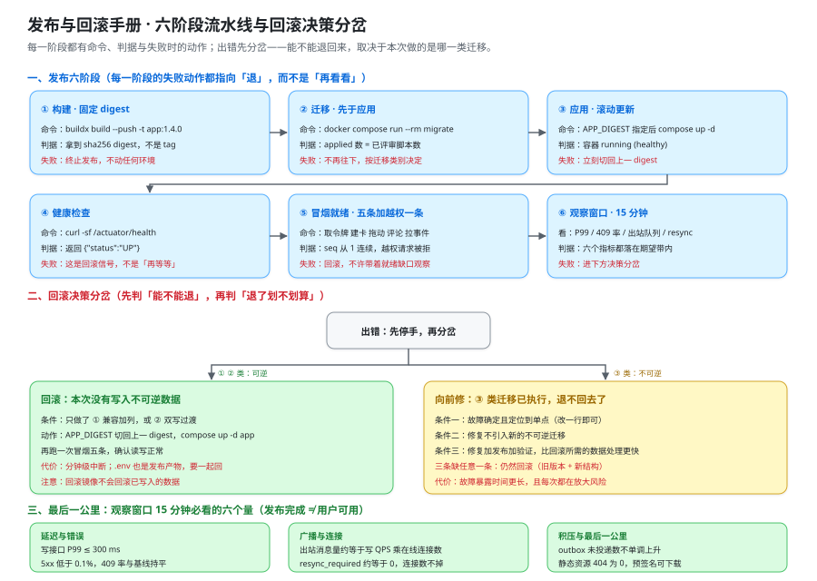

# 发布与回滚手册：每一步都要能退回来

这一页回答「**一次发布从「决定发」到「确认发成功」再到「退回去」，每一步做什么、看什么、谁来做**」——它把三道前置门禁、迁移的三种变更类别、七行发布步骤、回滚决策分岔、灰度取舍与回滚演练写成可执行的命令与判据。它**不回答**「编排文件与配置怎么分层」（那是 [环境与工程骨架](../Environment/index.md) 与 [配置与密钥](../ConfigSecrets/index.md) 的事），也**不回答**「交付物清单与验收签署」（那是 [交付文档](../DeliveryDocs/index.md) 与 [上线验收](../LaunchAcceptance/index.md) 的事）。



::: warning 本仓库只有文档，没有代码
下面的 `docker buildx`、`docker compose`、`psql`、`curl` 命令，都要在**读者自己搭好的工程**里执行。本仓库不存放源码、脚本与迁移文件（`project/` 只允许 `*.md` 与配图）；「运行 `xxx`」一律指「先按本节把文件建出来，再执行」。
:::

## 一、发布前的三道门禁

发布这件事最容易出问题的地方，不在发布过程，而在**发布前没有确认「退得回去」**。所以三道门禁的顺序是固定的，**任何一道不过就不进入下一步**：

| 门禁 | 判据 | 为什么必须是它 | 命令 |
| --- | --- | --- | --- |
| **G1 产物只升不变** | 预发与生产跑的是**同一个 digest** | tag 可以被覆盖，`1.4.0` 今天是 A、明天可能是 B；digest 不会 | `docker buildx imagetools inspect` |
| **G2 迁移先于应用** | 迁移脚本在应用启动**之前**跑完，且脚本已过评审 | 应用先起来会撞上「表还没建」或「列还没加」 | `docker compose run --rm migrate` |
| **G3 回滚包先备好且发布前可验证** | 上一版 digest + 回滚动作 + **演练过一次** | 发布之后才第一次尝试回滚，等于把回滚也变成一次未验证的变更 | 第七节 |

```shell
# G1：把本次要发布的 digest 固定下来（三个环境都引用这个 sha256，而不是 tag）
docker buildx imagetools inspect registry.example.com/teamboard-app:1.4.0 \
  --format '{{.Manifest.Digest}}'
# 期望：sha256:2f1c...（把这一行抄进发布记录，回滚时用的也是它）

# G2：迁移先在生产结构上「干跑」一次——事务里执行完就回滚，验证语法与约束
psql -h "$DB_HOST" -U teamboard -d teamboard -v ON_ERROR_STOP=1 \
  -c "BEGIN; \i deploy/db/migrations/V5__card_due_reminded.sql; ROLLBACK;"
# 期望：BEGIN / ALTER TABLE / ROLLBACK，无 ERROR

# G3：回滚包的核心就是「上一版 digest 仍然可拉取」
docker manifest inspect registry.example.com/teamboard-app@sha256:"$PREV_DIGEST" >/dev/null && echo "上一版可拉取"
```

::: danger 三道门禁上最容易省掉的动作
1. **用 tag 而不是 digest。** 正确写法：`.env` 里用 `APP_DIGEST=sha256:…`，编排里写 `image: registry.example.com/teamboard-app@sha256:${APP_DIGEST}`。tag 只用来给人看，不用来做判据。
2. **把迁移和应用写在同一个 `up` 里。** 正确写法：迁移是一次性服务（`compose run --rm migrate`），跑完 `exit 0` 才允许 `up -d app`；顺序写进发布步骤表，不靠人记。
3. **「回滚很简单，出问题再回滚就行」。** 正确写法：回滚能力在**发布前**验证过一次（第七节），否则它只是一个未验证的假设。
:::

## 二、数据库迁移：三种变更类别与 14 张表归类

先清一处口径： [数据库设计](../Database/index.md) 第九节的「迁移三分法」讲的是**一次迁移内部的三步顺序**（加列给存量语义 → 回填 → 再改默认值）；本节讲的是**一个发布周期内允许做的三类变更**，以及它们的**可回滚性**。两者不冲突，但不要混着引用。

| 类 | 长什么样 | 可回滚？ | 回滚要做什么 |
| --- | --- | --- | --- |
| **① 向后兼容加列** | `ADD COLUMN ... DEFAULT NULL`、加索引 | **可以** | 新列留着不用即可；旧版本代码不认识它也不受影响 |
| **② 双写过渡** | 新旧两列/两种键并存，读走旧、写两边 | **可以，但要等一轮** | 停写新列、等两个写入路径都切回旧列，数据可重建 |
| **③ 破坏性收口** | 改名、改类型、收紧约束、加主键、改分区 | **不可以，只能向前** | 没有回滚动作，只有「向前修」或「用旧版本 + 新结构跑」 |

本项目 14 张表在本轮发布里的归类（**这是一次规划的示例，不是「已经做过」的结论**）：

| 表 | 类 | 本轮动作 | 为什么在这一类 |
| --- | --- | --- | --- |
| `users` | ① | 加 `disabled_at`（可空） | 新列可空，旧代码不认识也不影响读写 |
| `user_tokens` | ② | 加 `family_id` → 回填 → 再置非空 | 存量行必须先回填，才谈得上「非空」 |
| `workspaces` | —— | 本轮不动 | 根对象，动它的代价最大、收益最小 |
| `memberships` | ③ | 补 `PRIMARY KEY (workspace_id, user_id)` | 加主键会拒绝已有重复行，一旦执行不可回滚 |
| `invitations` | ① | 加 `accepted_at`（可空） | 纯新增列 |
| `boards` | ① | 加 `archived_at` 上的部分索引 | 索引可随时删，属于最轻的一类 |
| `board_lists` | ③ | `position` 改 `COLLATE "C"` | 改排序规则会重写表，回滚要再重写一次 |
| `cards` | ①+② | 加 `due_reminded_at`（①）；换排序键算法（②） | **两件事不能同一次发布做**，见下方纪律 |
| `comments` | ① | 加 `mentions uuid[] DEFAULT '{}'` | 有安全默认值，存量行语义不受影响 |
| `notifications_outbox` | ② | `dedup_key` 生成规则变更 → 双写旧新键 | 旧行仍在，回滚要停写新键并等一轮 |
| `attachments` | ① | 加 `checksum`（可空） | 纯新增列 |
| `audit_log` | ③ | 改按月分区 | 重建表 + 迁移数据，回滚要再迁一次 |
| `idempotency_keys` | ① | 加 `(created_at)` 索引供清理 | 索引级变更 |
| `board_events` | —— | 本轮不动 | 它是实时链路的地基，动它要单独排一次发布 |

::: danger 「一次发布最多做一类」的三条理由
1. **三类一起上，回滚就要同时撤销三种代价不同的动作**，而其中一类是不可逆的——你不再拥有回滚这个选项，只剩「向前修」一条路。
2. **判据会失效**：观察窗口里看到的异常，无法归因到三件事中的哪一件，于是「向前修」也失去方向。
3. **演练失去意义**：回滚演练只能覆盖一类变更，混着做就练不到。

正确写法：`cards` 的 ① 与 ② 拆成两次发布；`memberships` 加主键这类 ③ 类动作**单独排一次发布**，前面先把重复行清干净（清理本身是另一次 ①/② 类动作）。
:::

## 三、完整发布步骤表

**八行（T-1 冻结检查 + ①~⑦），顺序固定**；「谁执行」一列是硬要求——没有责任人的步骤等于没有步骤。

| 阶段 | 命令 | 预期输出 | 失败时怎么办 | 谁执行 |
| --- | --- | --- | --- | --- |
| **T-1 冻结检查** | 确认变更窗口、值班人手、迁移脚本已评审 | commit 与 digest 已记录 | 窗口不符就**取消发布**，不「先发完再说」 | 发布负责人 |
| **① 构建并固定 digest** | `docker buildx build --push -t app:1.4.0 .` | `sha256:…` 一行 | 构建失败直接终止，**不动环境** | CI |
| **② 预发先跑一遍** | 在预发重复 ③~⑥ | 全部判据绿 | 任一红，不许上生产 | CI + 发布负责人 |
| **③ 迁移** | `docker compose run --rm migrate` | `Successfully applied N migrations` | 属 ③ 类且中途失败 → 不再继续，走第四节 | 值班 / DBA |
| **④ 应用** | `APP_DIGEST=sha256:… docker compose up -d app` | 容器 `running (healthy)` | 起不来 → 立刻切回上一 digest | 值班 |
| **⑤ 健康与就绪** | `curl -sf /actuator/health` + 冒烟五条 + 越权一条 | `{"status":"UP"}`；五条 `2xx`；越权被拒 | 健康不过 → 回滚；就绪缺口 → 回滚 | 值班 |
| **⑥ 观察窗口（15 分钟）** | 看下一节的六个量 | 全部落在期望带内 | 任一危险信号 → 进第四节分岔 | 值班 + 发布负责人 |
| **⑦ 宣告完成** | 记录 digest / 迁移版本 / 观察结论 | 一条发布记录 | —— | 发布负责人 |

**就绪判据（不是「健康检查通过」）**：取令牌 → 建卡 → 拖动 → 评论 → 从 `since=0` 拉事件（`seq` 从 1 起连续）→ **再加一条越权请求被拒**（`401`/`403`/`404`）。这与月末交付判据里的**「越权请求全部被拒」是同一条**——交付判据的五条（一键起、两个人同时拖动不打架、越权请求全部被拒、断线重连不丢改动、按文档能从零复现）在 [上线验收](../LaunchAcceptance/index.md) 里逐条展开，本页负责其中的「发布这一次」必须满足的部分。

```shell
# 就绪冒烟：健康检查只是第 0 条，真正判「就绪」的是这四条
curl -sf localhost:8080/actuator/health                                   # {"status":"UP"}
curl -s -o /dev/null -w '%{http_code}\n' -X POST localhost:8080/api/v1/boards/$BOARD_ID/cards/$CARD_ID/move \
  -H "Authorization: Bearer $TOKEN" -H 'Content-Type: application/json' \
  -d "{\"targetListId\":\"$LIST_DST\",\"beforeCardId\":null,\"version\":$V,\"client_op_id\":\"release-$RANDOM\"}"
# 期望 200（版本已过期则 409 —— 也是合法结果，但必须能解释）
# 越权一条：换一个不属于该工作区的令牌重放同一条请求
curl -s -o /dev/null -w '%{http_code}\n' -X POST localhost:8080/api/v1/boards/$BOARD_ID/cards/$CARD_ID/move \
  -H "Authorization: Bearer $OTHER_WORKSPACE_TOKEN" -H 'Content-Type: application/json' \
  -d "{\"targetListId\":\"$LIST_DST\",\"beforeCardId\":null,\"version\":$V,\"client_op_id\":\"release-deny\"}"
# 期望 404（跨工作区一律 404）或 403 —— 不许是 200
```

### 3.1 发布完成 ≠ 用户可用：观察窗口必看的六个量

**技术指标全绿而用户不可用，是这个项目里真实存在的一类故障**：前端静态资源 404（缓存未失效）、CORS 没加新域名、WebSocket 票据用的域名不对、附件预签名 URL 指向内网端点。它们都不会让 `/actuator/health` 变红。

| 量 | 期望 | 危险信号 |
| --- | --- | --- |
| **延迟** | 写接口 `P99 ≤ 300 ms` | 抬升且不回落（先看是否被回滚中的旧实例拖住） |
| **错误率** | `5xx < 0.1%` | 出现 `500`：多为迁移与代码不匹配 |
| **`409` 率** | 与基线持平 | 长时间高：乐观锁在误伤（版本口径对不上） |
| **出站消息量** | ≈ 写 QPS × 该看板在线连接数 | 远高于估算：广播在重复扇出 |
| **`resync_required` 次数** | ≈ 0 | 突增：客户端跟不上，事件在丢 |
| **最后一公里** | 静态资源 404 = 0；附件预签名可下载；outbox 未投递数不单调上升 | 任一不满足 → 用户已经不可用，指标再好看也没用 |

::: tip 观察窗口为什么是 15 分钟
它的作用不是「等系统稳」，而是**覆盖一个真实的使用节拍**：至少要有一个人真的拖一次卡片、发一条评论、看到一个附件。窗口太短会漏掉「只在有人操作时才出现」的问题；窗口太长则会让「回滚」的代价变大——**观察窗口的长度本身就是回滚成本的一部分**。
:::

## 四、回滚决策：什么时候退，什么时候向前修

```text
出错
├─ ③ 类迁移（破坏性收口）已经执行了吗？
│   ├─ 已执行 → 退不回去了，只能向前修（三条触发条件）
│   └─ 未执行 → 可以回滚
└─ 能回滚时再判一次：回滚的可见中断时长 < 向前修的代价吗？
    ├─ 是 → 回滚
    └─ 否 → 向前修
```

**回滚的代价不是「敲两条命令」**，它分五层，逐层更贵：

| 层 | 回滚动作 | 代价 / 容易漏掉的地方 |
| --- | --- | --- |
| **镜像** | 上一版 digest 重新拉起 | 分钟级；**已经写入的数据不会因为回滚镜像而消失** |
| **配置** | `.env` 一起回退 | `.env` 也是发布产物；只回镜像会把两套不一致的取值拼在一起（见 [配置与密钥](../ConfigSecrets/index.md)） |
| **迁移** | ① 留着不管；② 停写新列；③ 无解 | ② 类要**等一轮**，不是回滚命令一敲就完了 |
| **数据** | 由写入决定，不能靠「回版本」撤销 | ③ 类迁移期间写入的行，会留在新结构里 |
| **事件流** | 广播格式兼容 | 回滚后的旧客户端可能不认识新事件类型 → 需要「忽略未知类型」而不是报错 |

**向前修的三条触发条件**（缺一条就回滚）：

1. **故障确定且定位到单点**：例如一个空指针，改一行即可；而不是「表现很奇怪，先加个日志上去看看」。
2. **修复不引入新的不可逆迁移**：修的过程中不能顺手再加一个 ③ 类动作。
3. **修复 + 重新发布 + 验证的总时间 < 回滚所需的数据结构处理时间**：把三段时间写下来比较，不靠感觉。

::: danger 回滚决策里最容易做反的一件事
**「先回滚，再看看代码」在 ③ 类已执行时是做不到的。** 正确写法：出错第一件事是**查本次做了什么类别的迁移**（发布记录里有），而不是先敲回滚命令——否则你会把一个已经写入新结构的数据环境，配上不认识新结构的旧代码，得到一串更难解释的错误。
:::

## 五、灰度：为什么先从 workspace 白名单开始

本项目有两种灰度方式可选，但**它们不等价**：

| 维度 | 按 workspace 白名单 | 按流量比例 |
| --- | --- | --- |
| 路由判据 | `workspace_id`（本项目天然有的租户维度） | 请求级别（哈希 / 权重） |
| 影响面 | **可枚举**：内部看板 + 指定 1 个真实客户 | 不可枚举，随时有人被切到新版 |
| 实现成本 | 低：路由表按租户分发 | 高：需要无状态路由 + 会话粘性 |
| 与长连接的配合 | 天然成立：一个租户的所有连接落到同一版本 | **不成立**：连接建起来就一直挂着，比例灰度按请求分配，同一用户可能又连旧版又连新版 |
| 代表性问题 | 白名单租户规模小，流量不具代表性 | 流量真实 |

**结论：先从白名单开始。** 理由不是「白名单更简单」，而是**实时通道的粘性让流量比例灰度在本项目里不成立**——按请求比例分流对「连接建立后就长期存在」的通道没有意义。本项目的判据是「**一次拖动只更新一行**」，而灰度要验的正是「新版本的拖动在真实数据上不打架」，这需要**整块看板落到同一版本**，白名单正好满足。

灰度期间实时通道要多看四个量：

| 量 | 期望 | 说明 |
| --- | --- | --- |
| **连接数（按版本分组）** | 与白名单规模一致 | 只有新版连接数、没有旧版，说明路由没生效 |
| **广播延迟 `P95` / `P99`** | 与基线同量级（口径 ≤ 1 s） | 新版若引入跨实例广播，延迟会先在这里露出来 |
| **`resync_required` 次数** | ≈ 0 | 突增说明客户端缺口补拉跟不上 |
| **`seq` 缺口告警** | 0 | 出现缺口就是丢改动，**灰度立刻停** |

## 六、变更窗口与冻结期

**什么时候不发**，要和「怎么发」写得一样具体：

1. **对外承诺的实时性窗口内**（活动、演练、客户演示）不发：协作看板的可用性是**被看着的**，中断的观感代价远高于收益。
2. **值班人手不足**（单人值班、当班人同时是发布人）不发：没有人能在出事时独立执行回滚。
3. **迁移脚本未评审**不发：`deploy/db/migrations/` 的任何改动是唯一**不可回滚**的一类，给它单列一道评审门。
4. **依赖方变更窗口冲突**不发：对象存储、邮件出口、反向代理任何一侧同时在变更，都无法判断异常归谁。
5. **观察窗口无人值守的时间段**（周五下午、节假日前夜）不发：15 分钟观察窗口没人看，等于没有窗口。

**冻结期的口径**：大促或演练开始前 N 小时起，代码与迁移一律冻结；冻结期内只允许两类动作——**改配置的非密钥项**与**回滚**。冻结期的开始与结束时间写进发布记录，不靠「大家记得」。

::: warning 冻结期最容易破的一条
「只是改一行 SQL，不用发了」——**迁移脚本的改动本身就是一次发布**，它必须走完整的七行流程。冻结期唯一允许的例外是回滚，因为回滚的目标是「回到已经被验证过的状态」。
:::

## 七、回滚演练：在预发把上一版重新拉起

**回滚演练的判据不是「上一版能启动」，而是「上一版能在当前结构上正常读写」。** 这两件事差很远：迁移只加了列时，旧版本不认识新列，但它照样能读写它认识的列——这正是 ① 类可回滚的含义。

```shell
# 1) 把上一版 digest 写回 .env（编排里 image 引用的就是 APP_DIGEST），再拉起
PREV_DIGEST=sha256:1a0b...                   # 上一版在发布记录里留的那个
docker manifest inspect registry.example.com/teamboard-app@sha256:"$PREV_DIGEST" >/dev/null && echo "可拉取"
sed -i.bak "s|^APP_DIGEST=.*|APP_DIGEST=$PREV_DIGEST|" .env     # 回滚 = 改配置 + 重建，两件事成对
docker compose up -d app

# 2) 健康 + 就绪：与发布时同一组判据，一条不许省
curl -sf localhost:8080/actuator/health                       # {"status":"UP"}
# 3) 读写正常（这是演练真正的判据）
curl -s localhost:8080/api/v1/boards/$BOARD_ID/events?since=0 -H "Authorization: Bearer $TOKEN" | jq '.events | length'
# 期望：能读到事件（说明旧版本在当前结构上读得通）
curl -s -o /dev/null -w '%{http_code}\n' -X POST localhost:8080/api/v1/boards/$BOARD_ID/cards/$CARD_ID/move \
  -H "Authorization: Bearer $TOKEN" -H 'Content-Type: application/json' \
  -d "{\"targetListId\":\"$LIST_DST\",\"beforeCardId\":null,\"version\":$V,\"client_op_id\":\"rollback-drill\"}"
# 期望：200 或 409（都是「写路径通了」），不许是 500
```

演练要留痕四项：**演练日期、上一版 digest、当前迁移版本、读写判据的读数**。另外一条纪律：**演练必须在不提前告知当班人的情况下做一次**——提前通知的演练只能验出「有人会兜底」，验不出「流程自己站得住」。

## 八、判据族声明（`RU-A` ~ `RU-H`）

八条判据里七条是**文档级**（验「每一步是否都有命令、判据与责任人」），一条是**运行期**（验「真发过一次、真演练过一次」）。

| 判据 | 一句话声明：它回答什么 | 级别 |
| --- | --- | --- |
| **`RU-A`** | 三道门禁齐全（digest 只升不变 / 迁移先于应用 / 回滚包发布前可验证） | 文档级 |
| **`RU-B`** | 迁移三种类别与 14 张表归类齐全，且「一次发布最多做一类」写死 | 文档级 |
| **`RU-C`** | 发布步骤表八行、五列齐全（含健康检查与就绪判据） | 文档级 |
| **`RU-D`** | 观察窗口写死（六个量 + 时长 + 「发布完成 ≠ 用户可用」） | 文档级 |
| **`RU-E`** | 回滚决策分岔与五层代价写清，向前修三条触发条件齐全 | 文档级 |
| **`RU-F`** | 灰度取舍写清（为什么先白名单），实时通道四个观察量齐全 | 文档级 |
| **`RU-G`** | 变更窗口与冻结期写清，且与交付文档的边界写死 | 文档级 |
| **`RU-H`** | 真发一次、真回滚演练一次：就绪全绿、回滚后读写正常、留痕四项齐全 | 运行期 |

## 九、与交付文档的边界

两页都在讲「别人怎么把这个系统跑起来」，但它们**面向的人不同**：

| 维度 | 本页（发布与回滚手册） | [交付文档](../DeliveryDocs/index.md) |
| --- | --- | --- |
| 回答什么 | **动手的人怎么做**：命令、判据、责任人、失败时的动作 | **别人怎么照着做一遍**：交付物清单、环境要求、账号与权限、验收签署 |
| 产物形态 | 一份**动作序列**（谁在什么时候敲哪条命令） | 一份**清单 + 签署页**（有什么、缺什么、谁确认） |
| 失败时 | 给出回退路径（第四节） | 登记为遗留项并约定处置窗口 |
| 读者 | 当班的值班人与发布负责人 | 接手团队、验收方、后续维护者 |

::: tip 边界的一句话判据
**「一个当班的人只读本页，能不能独立完成一次发布并回滚？」** 能 → 本页完整。**「一个没参与过的团队只读交付文档，不问人能不能从零复现？」** 能 → 交付文档完整。两者缺一，「交付」就只完成了一半：本页保证**当下发得出去**，交付文档保证**以后接得下去**。
:::

## 十、当日做了什么

1. 产出**三道前置门禁**（产物只升不变用 digest 而不是 tag / 迁移先于应用 / 回滚包发布前可验证），逐条给出判据与命令，并写死「任何一道不过就不进入下一步」。
2. 区分了**两处同名口径**：数据库页的「迁移三分法」是一次迁移内部的三步顺序，本节的「三种变更类别」是一个发布周期内允许做的三类动作——并给出 14 张表在本轮的归类（示例规划）。
3. 写死纪律**「一次发布最多做一类迁移」**，给出三条理由（回滚要同时撤销三种代价、异常无法归因、演练覆盖不到）。
4. 产出**八行发布步骤表**（阶段 / 命令 / 预期输出 / 失败时怎么办 / 谁执行）与**就绪判据**（冒烟五条 + 越权一条），并论证「健康检查通过 ≠ 就绪」。
5. 产出**观察窗口的六个量**与「发布完成 ≠ 用户可用」的四类真实故障（静态资源 404、CORS、票据域名、预签名指向内网），并说明窗口时长本身就是回滚成本的一部分。
6. 产出**回滚决策分岔**（先判「能不能退」，再判「退了划不划算」）、**五层回滚代价**与**向前修的三条触发条件**。
7. 产出**灰度取舍**：论证实时通道的粘性让流量比例灰度在本项目里不成立，因此**先从 workspace 白名单开始**；给出灰度期实时通道的四个观察量。
8. 产出**变更窗口与冻结期**（五条「不发」+ 冻结期只允许改非密钥配置与回滚）、**回滚演练步骤与留痕四项**，以及 **`RU-A` ~ `RU-H` 八条判据**（七条文档级、一条运行期如实标 `⏳`）。

## 十一、如何验证

### 11.1 判据定义表（`RU-A` ~ `RU-H`）

| 判据 | 判什么 | 怎么判 | 级别 | 状态 |
| --- | --- | --- | --- | --- |
| **`RU-A`** | 三道门禁齐全，且 digest（不是 tag）写死 | 11.2 第 1 组 `grep` | 文档级 | ✅ 本机可判 |
| **`RU-B`** | 三种类别 + 14 张表归类 + 「一次发布最多做一类」 | 11.2 第 2 组 | 文档级 | ✅ 本机可判 |
| **`RU-C`** | 步骤表七行齐全，且就绪判据含越权一条 | 11.2 第 3 组 | 文档级 | ✅ 本机可判 |
| **`RU-D`** | 观察窗口六个量 + 「发布完成 ≠ 用户可用」 | 11.2 第 4 组 | 文档级 | ✅ 本机可判 |
| **`RU-E`** | 决策分岔 + 五层代价 + 向前修三条触发条件 | 11.2 第 5 组 | 文档级 | ✅ 本机可判 |
| **`RU-F`** | 灰度取舍 + 实时通道四个量 | 11.2 第 6 组 | 文档级 | ✅ 本机可判 |
| **`RU-G`** | 变更窗口五条 + 冻结期 + 与交付文档的边界 | 11.2 第 7 组 | 文档级 | ✅ 本机可判 |
| **`RU-H`** | 真发一次、真演练一次：就绪全绿、回滚后读写正常 | 11.3 的命令序列 | 运行期 | `⏳ 未跑 · 原因：本仓库无工程代码（BL-2），无法起本项目自己的栈` |

### 11.2 本机可判的部分

以下命令在 `ReleaseRunbook/` 目录内执行，期望值均为本机实跑后回填：

```shell
# 1) RU-A：digest 口径与三道门禁
grep -c 'diges[t]' index.md                                        # 期望 18
grep -cE '^\| \*\*G[1-3] ' index.md                                # 期望 3
# 2) RU-B：三种类别 + 14 张表归类 + 一次一类纪律
sed -n '/^## 二、/,/^## 三、/p' index.md | grep -cE '^\| \*\*[①②③] '   # 期望 3
grep -cE '^\| `(users|user_tokens|workspaces|memberships|invitations|boards|board_lists|cards|comments|notifications_outbox|attachments|audit_log|idempotency_keys|board_events)` \|' index.md   # 期望 14
grep -c '一次发布最多做一[类]' index.md                              # 期望 4
# 3) RU-C：步骤表八行（T-1 + ①~⑦）与越权就绪判据
sed -n '/^## 三、/,/^### 3\.1/p' index.md | grep -c '^| \*\*'       # 期望 8
grep -c '跨工作区一律 404' index.md                                  # 期望 2
# 4) RU-D：观察窗口六个量
sed -n '/^### 3\.1/,/^## 四、/p' index.md | grep -c '^| \*\*'        # 期望 6
grep -c '发布完成 ≠ 用户可用' index.md                                # 期望 5
# 5) RU-E：向前修与回滚代价
grep -c '向前修' index.md                                          # 期望 13
grep -c '已经写入的数据不会因为回滚镜像而消[失]' index.md             # 期望 1
# 6) RU-F：白名单结论与实时通道四个量
grep -c '先从白名单开[始]' index.md                                 # 期望 1
sed -n '/^灰度期间实时通道/,/^## 六、/p' index.md | grep -c '^| \*\*'  # 期望 4
# 7) RU-G：变更窗口五条与交付边界
sed -n '/^## 六、/,/^## 七、/p' index.md | grep -cE '^[0-9]\. \*\*'   # 期望 5
grep -c '交付文档' index.md                                        # 期望 8
# 配图与判据族（声明表 8 行 + 定义表 8 行）
grep -c 'assets/tb-release-runbook.sv[g]' index.md                 # 期望 1
grep -cE '^\| \*\*`RU-[A-H]`\*\*' index.md                         # 期望 16
```

### 11.3 需要真实环境的部分

`RU-H` 的判据对象是**发布与回滚这两次真实操作**。本仓库按约定只有文档，因此如实标 `⏳ 未跑`，只给命令。注意原因**不是**「本机没有容器运行时」——本机 `docker` 客户端与服务端可用（`27.1.1`，compose `v2.29.1`，2026-10-17 复验，见 [第 3 周验收结论](../Week3Acceptance/index.md) 第三节）；真实原因是**本仓库无工程代码，无法起本项目自己的栈**。

```shell
# RU-H（需要：容器运行时 + 读者自己搭好的工程 + 一份上一版 digest）
# 发布：按第三节七行依次执行，观察窗口结束后记录三样东西
docker buildx imagetools inspect registry.example.com/teamboard-app:1.4.0 --format '{{.Manifest.Digest}}'
# 回滚演练：按第七节在预发把上一版拉起，并确认读写正常
PREV_DIGEST=sha256:… docker compose up -d app && curl -sf localhost:8080/actuator/health
# 留痕四项：演练日期 / 上一版 digest / 当前迁移版本 / 读写判据读数
```

::: warning 状态列的读法
`RU-A` ~ `RU-G` 的期望值是**本机 `grep -c` 数出来的**，不是从模式里反推的。`RU-H` 的状态不是「结论」而是「当前可执行性」，它唯一的阻塞项与 [验收](../Acceptance/index.md) 的 `BL-2` 是同一条：**本仓库只有文档，没有可执行的工程**。**不把「演练设计完成」写成「演练通过」。**
:::

## 十二、下一步

1. **上线验收接在观察窗口之后**：[上线验收](../LaunchAcceptance/index.md) 会把本页第六节的六个量写成验收项的「通过标准」，并把「按文档从零复现」作为最后一条判据。
2. **备份与恢复要和回滚分清**：[备份与恢复](../BackupRestore/index.md) 管的是「数据没了怎么回来」，本页管的是「版本错了怎么退」——两者的触发条件与代价完全不同，不要混用。
3. **告警要覆盖本页的危险信号**：`resync_required` 突增、出站队列积压、`409` 率长时间偏高，这三条是 [监控与告警接入](../Monitoring/index.md) 里必须接线的项，它们是第四节决策分岔的输入。

## 参考资料

- [配置与密钥：同一份镜像跑在三套环境上](../ConfigSecrets/index.md)（`.env` 也是发布产物：配置回退与镜像回退必须成对） · [数据库设计](../Database/index.md)（14 张表的完整 DDL、六条不变量与迁移三分法）
- [环境与工程骨架](../Environment/index.md)（一键起与四条验证、五类启动失败排查） · [可运行验证](../Verification/index.md)（并发与实时两条链路的实跑口径，本页就绪判据的来源）
- [验收](../Acceptance/index.md)（`A1`~`A8` 与阻塞项台账 `BL-1`/`BL-2`） · [第 3 周验收结论](../Week3Acceptance/index.md)（八条运行期判据与口径更正的出处）
- [交付文档](../DeliveryDocs/index.md)（本页第九节的对照物：交付物清单与签署） · [上线验收](../LaunchAcceptance/index.md) · [备份与恢复](../BackupRestore/index.md)
- [事故响应手册](/docs/Ops/IncidentResponse/Runbook/index.md)（发布出错时「先停手再分岔」的通用写法） · [应急演练](/docs/Ops/IncidentResponse/Drill/index.md)（演练不留痕等于没练） · [灾难恢复策略](/docs/Ops/BackupDR/Strategy/index.md)（回滚与恢复的边界）
