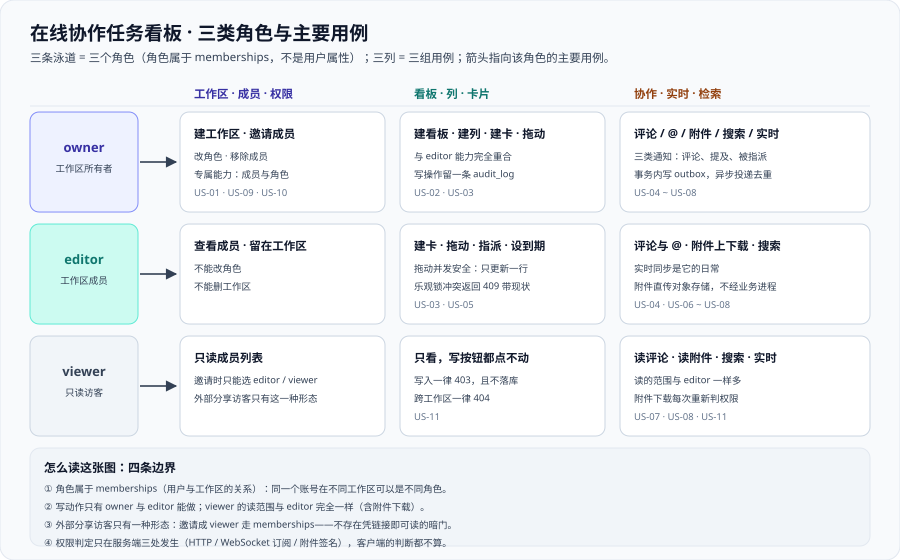

# 需求拆分：角色、故事与验收条件

这一页把「在线协作任务看板」从一句话定位拆成**能照着验收的东西**：三类角色各自要什么、十二条用户故事每条配一组 Give/When/Then（写成可执行的条件）、四类非功能需求各自的数字口径，以及**每条非功能需求最终由验收页的哪条判据兜住**。它是本项目的第一页，也是 [技术选型](../TechStack/index.md)、[架构设计](../Architecture/index.md)、[数据库设计](../Database/index.md) 三页共同的输入。



::: warning 本项目只有文档，没有代码
下面出现的接口路径、表名与命令，都是**读者在自己工程里要落地的东西**。本仓库不存放源码、脚本与 SQL；「运行 `xxx`」一律指「先按本章创建好该文件 / 服务，再执行」。
:::

## 一、三类角色与他们的关注点

角色只有三个，且**与 `memberships.role` 的取值一一对应**（[数据库设计](../Database/index.md) 第二节的 `CHECK (role IN ('owner', 'editor', 'viewer'))`）。角色不是「用户属性」而是「用户与工作区的关系」——同一个人在 A 工作区可以是 `owner`，在 B 工作区是 `viewer`。

### 1.1 三类角色

| 角色 | 能做什么 | 最关心什么 | 绝不能做什么 |
| --- | --- | --- | --- |
| `owner` 工作区所有者 | 全部读写 + 工作区设置 + 成员与角色管理 + 移除成员 | 「谁能进、谁能改」——权限是它唯一的专属领域 | 不能绕过审计；每一次成员与角色变更都要留一条 `audit_log` |
| `editor` 成员 | 建看板 / 建列 / 建卡片 / 拖动卡片 / 评论与 `@` / 上传与下载附件 / 搜索 | 「我的改动立刻被别人看到，而且不覆盖别人的」——并发与实时是它的日常 | 不能改成员角色；不能删工作区 |
| `viewer` 只读访客 | 看板、列、卡片的读取；评论的读取；**附件下载**；搜索 | 「我只想看一眼，千万不要误改任何东西」 | 不能建卡、不能拖动、不能评论、不能上传附件 |

::: tip 三条能带走的判据
1. **写动作只有两类角色能做**：`owner` 与 `editor`。凡是出现「`viewer` 也能写」的实现，权限矩阵必然漏判。
2. **`owner` 的专属能力只有一条**：改成员角色（含移除成员）。除此之外 `owner` 与 `editor` 的能力应当**完全重合**——多出来的专属能力每一条都要能说清理由。
3. **附件下载对三类角色都放开**，但「放开」的前提是**每次签名都重新判定一次权限**（见 [架构设计](../Architecture/index.md) 第七节的第三处判定点）。
:::

### 1.2 边界：外部分享访客

「分享给外部的人看」这件事，本项目只支持**一种**形态，且必须写死在需求里，否则它会以「只读链接」的形式绕过整套权限体系：

| 问法 | 本项目的答案 |
| --- | --- |
| 能不能发一个链接、对方不用登录就能看？ | **不能。** 不存在「凭链接即可读」的路径；能读的前提是**对方账号是该工作区的一条 `memberships`** |
| 那「外部分享」到底怎么做到？ | 把对方的账号**邀请成 `viewer`**，走 `invitations` → 接受 → `memberships` 三步；对方读完可以随时被移除 |
| 被移除之后，他手里已经打开过的页面和已经拿到的附件链接怎么办？ | 页面：下一次轮询 / 重连补拉时因不再是成员而 `404`；附件：签名 URL 是**短时效**的，到期即失效 |
| 为什么不做匿名公开链接？ | 匿名链接等于**在 `memberships` 之外开一条暗门**——一旦开了，权限判定的「只有一个数据源」这个前提就不成立了，后面的所有判据都失去意义 |

## 二、用户故事 US-01~US-12 总览

十二条故事覆盖了一个工作区从建立到清理的完整生命周期。**编号即契约**：后续所有章节引用需求时一律用这个编号。

| 编号 | 一句话故事 | 涉及模块 | 写动作 |
| --- | --- | --- | --- |
| US-01 | 我创建工作区并邀请同事加入 | `identity` `workspace` | 是 |
| US-02 | 我在工作区里建看板与列 | `board` | 是 |
| US-03 | 我建卡片，并用拖动把它移到别的列 | `card` | 是 |
| US-04 | 我在卡片下评论，并用 `@` 让某人收到通知 | `comment` `notification` | 是 |
| US-05 | 我把卡片指派给某人，并给它设一个到期时间 | `card` `notification` | 是 |
| US-06 | 我给卡片上传附件，并让别人能下载 | `attachment` | 是 |
| US-07 | 我按关键词搜出可见范围内的卡片 | `search` | 否 |
| US-08 | 该收到通知的时候我在应用内看到它 | `notification` | 否 |
| US-09 | 我修改工作区设置（名称、可见范围） | `workspace` | 是 |
| US-10 | 我把某个成员从 `editor` 改成 `viewer`，或移除他 | `workspace` `audit` | 是 |
| US-11 | 只读访客看到的范围恰好等于「能读、不能写」 | 全部模块 | 否 |
| US-12 | 我退出工作区，或删掉一张卡片 | `workspace` `card` `audit` | 是 |

## 三、用户故事与验收条件

每条故事配一组 **Given / When / Then**，条件一律写成**可执行的形式**：`Given` 写环境与前置数据、`When` 写一个具体的请求或操作、`Then` 写一个能用命令或界面观察到的结果。写不出来的条件不算条件。

::: tip 为什么统一用「请求 + 可观察结果」而不是「用户感觉怎样」
「拖动很流畅」不是条件，「拖动响应 200 且另一个客户端在 1 秒内看到卡片换列」才是。本项目所有 `Then` 都必须能被**一条命令或一次屏幕观察**判定——这是 [验收](../Acceptance/index.md) 页 A1~A8 能写成步骤表的前提。
:::

### US-01 创建工作区并邀请成员

作为新用户，我创建一个工作区并把同事邀请进来，这样我们才有地方协作。

- **Given**：我已登录（持有有效令牌），且不属于任何工作区
- **When**：我调用 `POST /api/v1/workspaces`（body 含 `name`），随后调用 `POST /api/v1/workspaces/{id}/invitations`（body 含 `email` 与 `role`）
- **Then**：`workspaces` 新增 1 行、`memberships` 新增 1 行且 `role = 'owner'`、`invitations` 新增 1 行且 `expires_at` 非空；被邀请人接受邀请后 `memberships` 出现第 2 行，且他的 `role` 恰好是我邀请时指定的那个

### US-02 我在工作区里建看板与列

作为 `editor`，我在工作区里建一块看板，并在看板里建出「待办 / 进行中 / 已完成」三列。

- **Given**：我是该工作区的 `editor`，且该工作区当前没有看板
- **When**：我调用 `POST /api/v1/workspaces/{id}/boards`（body 含 `name`），再调用三次 `POST /api/v1/boards/{id}/lists`（body 含 `name`）
- **Then**：`boards` 新增 1 行且 `seq = 0`；`board_lists` 新增 3 行，三行的 `position` **互不相同**（`UNIQUE (board_id, position)` 成立），且按 `position` 升序查出来的顺序等于我创建的顺序

### US-03 我建卡片并用拖动移列

作为 `editor`，我建一张卡片，然后把它从「待办」列拖到「进行中」列。

- **Given**：看板里已有三列，且「待办」列里已有 3 张卡片，我手里持有目标卡片当前的 `version`
- **When**：我调用 `POST /api/v1/boards/{id}/cards/{cardId}/move`（body 含 `targetListId`、`beforeCardId`、`version`、`client_op_id`）
- **Then**：该卡片的 `list_id` 变成目标列、`position` 落在目标位置前后两张卡片之间、`version` 恰好 `+1`；`board_events` 新增 1 行（`type = 'card.moved'`）且 `seq` 恰好比拖动前大 1；**该列只有这一行被改动**（把「一次拖动只更新一行」当成可测的断言）

### US-04 我在卡片下评论并用 `@` 提及

作为 `editor`，我在卡片下写一条评论，并用 `@` 提到另一个人。

- **Given**：我和被提及的人都是该工作区成员，且被提及的人当前不在这个看板页面上
- **When**：我调用 `POST /api/v1/cards/{cardId}/comments`，body 的 `body` 里含 `@someone`
- **Then**：`comments` 新增 1 行，且 `mentions` 数组里**恰好含被提及用户的 id**（解析不出用户的 `@` 不写进数组）；同一个事务里 `notifications_outbox` 新增 1 行，其 `dedup_key` 形如 `mention:{cardId}:{userId}:{commentId}`

### US-05 我把卡片指派给某人并设到期时间

作为 `editor`，我把卡片指派给同事，并给它设一个下周五的到期时间。

- **Given**：我是 `editor`，被指派人是同工作区的 `editor` 或 `owner`
- **When**：我调用 `PATCH /api/v1/cards/{cardId}`（body 含 `assignee` 与 `due_at`）两次（一次只改 `assignee`，一次只改 `due_at`）
- **Then**：两次调用各让 `cards.version` `+1`，且 `assignee` 与 `due_at` 互不覆盖（后一次不会把前一次的赋值清空）；指派成功那一次在 `notifications_outbox` 里留下 1 行

### US-06 我给卡片上传附件

作为 `editor`，我给卡片挂一个 2 MB 的 PDF，并让同工作区的人都能下载。

- **Given**：我是 `editor`，目标卡片存在，且对象存储里的目标桶已就绪
- **When**：我先调用 `POST /api/v1/cards/{cardId}/attachments:sign` 拿到预签名上传地址，直传到对象存储，再调用一次确认接口写入元数据
- **Then**：确认后 `attachments` 新增 1 行，且 `byte_size` 等于实际字节数、`checksum` 与服务端回读结果一致；**业务进程没有经手这 2 MB 文件流量**；另一个人调用下载签名接口拿到的是**短时效 URL**，过期后再访问该 URL 被对象存储拒绝

### US-07 我按关键词搜出可见范围内的卡片

作为任意角色，我搜「上线」，只应看到我有权查看的那些卡片。

- **Given**：库里存在两张标题含「上线」的卡片，一张在我的工作区 A，一张在别人的工作区 B
- **When**：我用工作区 A 的身份调用 `GET /api/v1/search?q=上线&workspaceId={A}`
- **Then**：结果里**只有工作区 A 的那张**，总数不超过 50；把 `workspaceId` 换成 B（我不是 B 的成员）时返回 `404` 而不是「空结果」——**「无权」与「没有」必须可区分**

### US-08 该收到通知的时候我能看到

作为被 `@` 的人，我应当在工作区里收到一条通知，且**不会收到两条**。

- **Given**：有人刚在卡片下用 `@` 提到了我，投递循环尚未跑
- **When**：投递循环扫描到这一行 outbox，投递成功并把 `delivered_at` 写上
- **Then**：我这边出现**恰好 1 条**通知；如果投递中途失败被重试，我也**仍然只有 1 条**（因为 `dedup_key` 唯一）；查询 `notifications_outbox` 时 `delivered_at IS NULL` 的行数会归零

### US-09 我修改工作区设置

作为 `owner`，我把工作区改个名。

- **Given**：我是 `owner`
- **When**：我调用 `PATCH /api/v1/workspaces/{id}`（body 含新的 `name`）
- **Then**：`workspaces.name` 更新；长度校验生效（1~60 字符），超长返回 `400` 而不是静默截断；`audit_log` 新增 1 行且 `action = 'workspace.update'`，`diff` 里同时含旧值与新值

### US-10 我改变成员角色或移除成员

作为 `owner`，我把一个 `editor` 降成 `viewer`，随后又把他移除。

- **Given**：我是 `owner`，目标成员当前是 `editor`
- **When**：我调用 `PATCH /api/v1/workspaces/{id}/members/{userId}`（body 含 `role = 'viewer'`），再调用 `DELETE` 同一路径
- **Then**：第一步之后该成员的 `role` 变成 `viewer`，**他此刻起不能再建卡 / 拖动 / 评论**（立刻生效，不是「下次登录生效」）；第二步之后 `memberships` 里该行消失，他用旧令牌访问该工作区任何资源一律 `404`；两步各留 1 条 `audit_log`

### US-11 只读访客的可见范围

作为 `viewer`，我看到的内容与 `editor` **一样多**，但一个写按钮都点不动。

- **Given**：我是该工作区的 `viewer`
- **When**：我依次执行「读看板 / 读卡片 / 读评论 / 下载附件」与「建卡 / 拖动 / 评论 / 改成员角色」
- **Then**：前四类全部成功；后四类**全部被拒**——`403`（我是成员但角色不允许），且**没有任何一次写入落库**（用改动前后 `boards.seq` 不变来验证）

### US-12 我退出工作区，或删掉一张卡片

作为 `editor`，我删掉一张卡片；作为成员，我主动退出工作区。

- **Given**：我是 `editor`，目标卡片下已有 2 条评论与 1 个附件
- **When**：我调用 `DELETE /api/v1/cards/{cardId}`；随后以普通成员身份调用 `DELETE /api/v1/workspaces/{id}/members/me`
- **Then**：删卡后 `cards` 该行消失，**级联删除**它的评论与附件元数据（靠外键 `ON DELETE CASCADE`，不是应用层逐个删）；退出后 `memberships` 该行消失、我再也读不到该工作区；两次动作各留 1 条 `audit_log`（审计**不随业务数据一起被删**）

::: danger 删卡这一条最容易做错的地方
「删除卡片」有两类完全不同的正确实现：**物理删除**（级联清掉评论与附件元数据）与**软删除**（`deleted_at`）。本项目选前者，理由是本期不做「回收站」。
但无论选哪种，**审计不能跟着消失**——`audit_log` 与业务表不是一对级联关系。把 `audit_log` 也加上 `ON DELETE CASCADE` 是很自然的手滑，后果是「删掉卡片就抹掉了删卡这件事本身」。
:::

## 四、非功能需求四类表

非功能需求不是「越好越好」的形容词，而是**必须给出一个数字与一个口径**的约束。四类各一张表，每行都能回答「怎么算达标」。

### 4.1 性能与容量

| 项 | 指标 | 口径（怎么算数） |
| --- | --- | --- |
| 目标规模 | **500 工作区 / 5000 用户 / 50 万卡片** | 首年规模；单库（PostgreSQL 18.6）承载，不分库分表 |
| 吞吐 | 峰值 **200 RPS** | 以写接口为主的开环压测到达率，不是平均值 |
| 延迟 | 写接口 **P99 ≤ 300 ms** | 拖动、建卡、评论三类写接口；在 200 RPS 到达率下测 |
| 实时可见延迟 | **≤ 1 s** | 从服务端事务提交，到另一个客户端界面上看到该改动 |
| 单看板规模 | 每列 ≤ 500 张卡片、每看板 ≤ 30 列 | 分页与「顺序键退化压缩」的触发前提 |
| 写放大 | 一次拖动**只更新 1 行** | 对比拖动前后被改动的行数（`xmin` 或自增 `updated_seq`） |
| 搜索 | 结果上限 50 条 | 先按可见工作区收窄，再按相关度排序，**必须带 `LIMIT`** |
| 事件流保留 | `board_events` 保留 **30 天** | 保留策略要写成一条可执行的清理动作，不是文档里的一句「定期清理」 |

### 4.2 可用性

| 项 | 指标 | 口径 |
| --- | --- | --- |
| 断线重连 | 服务端重启后 **30 秒内**全部连接恢复 | 指数退避（1s → 2s → 4s → 8s，上限 30s）+ 随机抖动 |
| 心跳 | 服务端 30 秒 ping，客户端 10 秒无 pong 视为断开 | 连接列表中超过 60 秒无心跳的连接强制关闭 |
| 广播失败降级 | **数据仍然正确**，实时性降级 | 事务提交之后才广播；广播失败靠客户端补拉兜底 |
| 背压 | 每连接发送队列有上限，超限**丢事件**并标记 `resync_required` | 不做无限缓冲；「丢一条 + 客户端补拉」优于「拖死一个进程」 |
| 幂等 | 同一次操作重发两次只产生一次副作用 | `idempotency_keys` 按 `(scope, client_op_id)` 去重 |
| 并发冲突 | 返回 `409` 且**带上最新版本与最新位置** | 只回「冲突了」不带现状，等于逼客户端去猜 |

### 4.3 安全与权限

| 项 | 指标 | 口径 |
| --- | --- | --- |
| 权限判定点 | **只有 3 处**：HTTP 请求、WebSocket 订阅、附件签名 | 出现第四处即视为缺陷 |
| 跨工作区访问 | 一律 **`404`**，不是 `403` | 不暴露资源存在性；`403` 只用于「是成员但角色不允许」 |
| 越权订阅 | 未授权订阅返回 **`403`**，不是静默不推 | 静默不推会让「没数据」与「没权限」长得一样 |
| 令牌 | **只存散列**，按 `family_id` 分族，复用即整族撤销 | 库里不存在令牌明文（一票否决项之一） |
| 附件 | 下载走**短时效签名 URL**，每次签名重新判权限 | 不发永久公开链接 |
| 审计 | 每一次可见的写操作留 **1 条** `audit_log` | 不可变、只追加、不因业务数据删除而消失 |
| 权限矩阵 | **18 格逐格无漏判** | 6 个动作 × 3 个角色，见 [验收](../Acceptance/index.md) |
| 密码 | 只存散列（`password_hash`），不落明文、不进日志 | —— |

### 4.4 可维护性

| 项 | 指标 | 口径 |
| --- | --- | --- |
| 迁移 | 一律**三分法**：加列给存量语义 → 回填 → 改默认值 | 顺序不可换；凡是 `ADD COLUMN ... DEFAULT` 都要能回答「这个默认值代表存量还是新数据」 |
| 表结构 | DDL 可直接执行，且 **ER 图与 DDL 一致** | 共 **14 张**业务表（另有 `audit_log` 的按月分区子表） |
| 索引 | 每条索引都能说清服务于哪个查询 | 说不出来源的索引一律不加 |
| 判据 | 每条判据都能回答「**怎样才能失败**」 | 答不上来的判据等于没有；本项目的判据族是 `TB-A ~ TB-H` |
| 版本 | 基线固定为一份（见 [技术选型](../TechStack/index.md)） | **不建版本目录**，30 天周期内不引入第二条并行维护线 |
| 契约 | 接口契约能回答「约定是什么 / 定错的后果 / 怎么验证没被破坏」 | 契约单独成目录，改它必须走评审 |

## 五、需求到判据的映射

这张表回答一个问题：**上面每一条非功能需求，最终在 [验收](../Acceptance/index.md) 页由哪条判据兜住？** 判据族统一编号为 `TB-A ~ TB-H`，不新增第二套编号。

| 非功能需求 | 覆盖它的判据 | 判据怎么覆盖 |
| --- | --- | --- |
| 目标规模 500 工作区 / 5000 用户 / 50 万卡片 | `TB-H` | 容量与成本判据：按峰值建容量，并在压测数据上外推 |
| 峰值 200 RPS、P99 ≤ 300 ms | `TB-H` | 开环压测按 200 RPS 到达率跑，阈值（`P99 ≤ 300`）写进脚本而非人眼判读 |
| 一次拖动只更新 1 行 | `TB-H` | 拖动前后对比被修改的行数，期望恰好 `+1` |
| 实时可见延迟 ≤ 1 s | `TB-F` | 两个客户端同时挂在一个看板上，另一终端改一张卡片，观察另一端界面更新的时间差 |
| 断线重连不丢改动 | `TB-F` | 带 `since={seq}` 重连补拉，第一条事件的 `seq` 必须恰好是缺口的下一号 |
| 广播失败不影响正确性 | `TB-D` `TB-F` | 提交后才广播；广播链路断掉时接口仍 `200`、库里数据仍正确 |
| 幂等：重发不产生第二次副作用 | `TB-D` | 用同一个 `client_op_id` 连发两次，第二次返回上次结果且库里 `seq` 只前进 1 |
| 并发冲突返回 `409` 且带最新现状 | `TB-D` | 用过期 `version` 重发，期望 `409` 且响应体含最新版本与位置 |
| 权限只有 3 处判定点、跨工作区一律 `404` | `TB-G` | 18 格权限矩阵逐格执行，另加「换租户 ID 查同一个资源」用例 |
| 附件走短时效签名 | `TB-G` | 下载附件那一格通过后，再用过期签名访问，期望被对象存储拒绝 |
| 迁移三分法、ER 与 DDL 一致 | `TB-A` | 比对 ER 与 DDL 的 14 张表；对迁移脚本做「默认值代表存量还是新数据」的逐条检查 |
| 每条索引都能说清服务于哪个查询 | `TB-A` | 索引清单与查询清单双向对账，无孤儿索引 |
| 依赖可起 / 服务可启动 / 接口可调用 / 页面可访问 | `TB-B` `TB-C` `TB-D` `TB-E` | 分别对应验收步骤 A2 ~ A5，逐条给出命令与通过标准 |

## 六、范围外四项

这四项**本期明确不做**，与 [架构设计](../Architecture/index.md) 第九节逐字一致，写在这里是为了让每一条都能回答「为什么不做」：

1. **不做 CRDT / 离线优先**：本期是「在线优先 + 断线补拉」。真正的离线编辑需要合并语义（谁赢、怎么并），会吃掉整个周期。
2. **不做跨工作区全局搜索**：搜索范围限定在用户可见的工作区内，既是性能选择也是安全选择。
3. **不做卡片自定义字段引擎**：本期字段是固定的。自定义字段是「用配置生成 SQL」的开始，属于另一个量级的问题。
4. **不做多实例的分库分表**：单库 + 连接池 + 合理索引足够撑住本期的容量目标。

::: danger 「范围外」不等于「可以先放着」
范围外的事项必须**在需求页里就写下**，而不是留到架构评审时口头确认。原因很具体：**范围外的第四项一旦被当成「以后再说」，顺序字段与 `seq` 的设计就会被顺手做成分片友好型**（例如把 `seq` 做成全局序列）——而那是本期不需要付出的复杂度，代价却会立刻体现在 [数据库设计](../Database/index.md) 的复合主键上。
:::

## 七、当日做了什么

1. 定下三类角色（`owner` / `editor` / `viewer`）的**能力边界**，并把 `owner` 的专属能力收窄到只有「改成员角色」一条；给出三条可带走的判据。
2. 为「外部分享访客」写下**唯一形态**（邀请成 `viewer`，三步走），并逐条回答「为什么不发匿名链接 / 被移除后手上的页面与签名链接怎么办」。
3. 写出 **US-01~US-12** 十二条用户故事，覆盖创建与邀请、建看板与列、建卡与拖动、评论与 `@`、指派与到期、附件、搜索、通知、工作区设置、成员角色变更、只读访客可见范围、退出与删卡。
4. 为每条故事配一组 **Given / When / Then**，全部写成「请求 + 可观察结果」的形式，且尽量把 `Then` 落在一条能直接执行的查询或命令上。
5. 产出**非功能需求四类表**（性能与容量、可用性、安全与权限、可维护性），锁定目标规模、200 RPS、P99 ≤ 300 ms、实时可见延迟 ≤ 1 s 四个关键数字。
6. 产出**需求到判据映射表**，把每一条非功能需求指向 `TB-A ~ TB-H` 中的具体一条，避免「需求写了没人验」。
7. 复述**范围外四项**并补一条纪律：范围外的事必须在需求页写死，否则它会以「顺手做复杂一点」的形式渗进数据模型。

## 八、如何验证

下面六条**全部是本机可跑的静态自查**（括注的期望值就是实测值），不依赖容器与工程代码。模式串里用 `[x]` 打断自匹配，避免「命令把自己那一行也数进去」。

```shell
# 1) 十二条故事齐全（US-01 ~ US-12）
grep -c '^### US-' index.md                     # 期望 12

# 2) 每条故事都配了一组 Given / When / Then
grep -c '^- \*\*Given\*\*：' index.md           # 期望 12
grep -c '^- \*\*When\*\*：' index.md            # 期望 12
grep -c '^- \*\*Then\*\*：' index.md            # 期望 12

# 3) 关键数字逐字存在（三处：4.1 表、五 映射表、验收引用）
grep -c '500 工作区 / 5000 用户 / 50 万卡[片]' index.md  # 期望 2
grep -c 'P99 ≤ 300 m[s]' index.md                        # 期望 3
grep -c '≤ 1 [s]' index.md                               # 期望 3

# 4) 需求到判据的映射覆盖 TB-A ~ TB-H
grep -oE 'TB-[A-H]' index.md | sort -u | wc -l           # 期望 8

# 5) 范围外四项与架构页一致（四项一个不少）
grep -c '^[1-4]\. \*\*不做' index.md                     # 期望 4

# 6) 配图被本页引用
grep -c 'assets/tb-usecases.sv[g]' index.md              # 期望 1
```

::: warning 状态列的读法
「期望值」是**本机跑出来读到的**，不是从模式里推出来的。第 4 条用的是 `-oE` 加 `sort -u` 再去重计数——它验的是「映射表里八条判据都出现过」，而不是「出现过八次」；两者差一个量级，不要混。
:::

## 九、下一步

需求定稿之后，顺序是固定的三页，**不可跳**：

1. **[技术选型](../TechStack/index.md)**：把每条需求落到一个具体的版本与方案上，并论证三处关键取舍（实时通道、多实例广播、搜索）。
2. **[架构设计](../Architecture/index.md)**：把能力拆给九个模块，画出一次拖动的十二步链路与三处权限判定点。
3. **[数据库设计](../Database/index.md)**：把「顺序用可比较字符串」「乐观锁」「事件序号」三条约束落成 14 张表的 DDL。
4. **第 140 天**：进入**核心链路编码**——卡片拖动的服务端实现、接口契约定稿、幂等与并发控制的落地。

## 参考资料

- [技术选型与版本基线](../TechStack/index.md) · [架构设计：模块边界与实时链路](../Architecture/index.md) · [数据库设计：表、约束与顺序字段](../Database/index.md)
- [环境与工程骨架](../Environment/index.md) · [验收：把「做完了」变成可执行的步骤](../Acceptance/index.md)
- [完整项目交付 · 需求与验收条件](/docs/Others/ProjectDelivery/Requirements/index.md)（用户故事三段式、Given/When/Then、四类验收条件的方法论）
- [完整项目交付 · 数据模型](/docs/Others/ProjectDelivery/DataModel/index.md)（从验收条件反推实体）
- [性能与容量工程 · 概览](/docs/Ops/PerformanceEngineering/Overview/index.md)（SLO、水位线与峰均比的口径来源）
- [性能与容量工程 · 压测方法论](/docs/Ops/PerformanceEngineering/LoadTesting/index.md)（开环压测与「到达率」的定义）
- [数据建模](/docs/DB/DataModeling/index.md)（角色与成员关系的建模口径）
- 上一周期同类资产的收口方式：[实时监控大盘](../../MonitoringDashboard/index.md) · [全栈博客平台的上线验收](../../BlogPlatform/ReleaseAcceptance/index.md)
