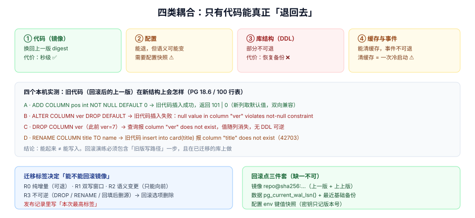

# 第 4 周第 6 步 · 回滚矩阵：代码能退回上一版，数据不能

[冒烟](../SmokeGate/index.md)一旦红了，动作是回滚。这时候最危险的一句话是：

> 「把镜像换回上一个 tag 就行。」

镜像确实能换回去。但**库的结构、配置的语义、缓存里的键、事件流里的字段**未必能跟着退。本页把「回滚」拆成四类耦合，并用四个本机实测场景说明：**有些回滚会立刻把「部分功能不可用」变成「写入全挂」。**

## 判据族声明

本页判据族 `RBD-A` ~ `RBD-H`，共 8 条。定义表在第七节。

## 本页不讲什么

- 不讲发布步骤表、灰度白名单、冻结期与回滚决策树，归 [发布与回滚手册](../ReleaseRunbook/index.md)；本页给的是**决策树每个分支背后的数据事实**。
- 不讲 `pg_dump` / `pg_restore` 与 PITR 的具体操作，归 [备份与恢复](../BackupRestore/index.md)。
- 不讲迁移本身怎么写（锁、`CONCURRENTLY`、`NOT VALID`），归 [迁移前置闸门](../MigrationPreflight/index.md)。
- 不讲缓存键的三段式设计，归 [缓存隔离](../CacheIsolation/index.md)；本页只说「回滚时缓存必须清哪几段」。



## 一、四类耦合，退回成本差三个数量级

| 类别 | 能退吗 | 退的代价 | 退不掉的后果 |
| --- | --- | --- | --- |
| **代码（镜像）** | ✅ 换 digest 即可 | 秒级 | —— |
| **配置** | ⚠️ 能退，但**语义**可能变了 | 需要配置快照 | 新代码写入的新格式，旧代码读不懂 |
| **库结构（DDL）** | ❌ 部分不可退 | 分钟~小时（恢复备份） | 旧代码 `42703` / `not-null violation` |
| **缓存与事件** | ⚠️ 能清，但有窗口 | 清缓存 = 一次冷启动 | 旧代码读到新结构的缓存值，反序列化失败 |

一句话总结这张表：**回滚的难点从来不是「回到旧版本」，而是「旧版本能不能读新数据」。** 这就是 N-1 兼容窗口要解决的问题。

## 二、四个实测场景：旧代码在新结构上会怎样

实验环境：PG 18.6，表 `card(id bigserial, title text not null)`，预置 100 行。「旧代码」用一条不带新列的 `INSERT` 模拟——这就是回滚后仍在跑的上一版服务。

| 场景 | 迁移动作 | 旧代码行为 | 读数 |
| --- | --- | --- | --- |
| **A** 加列带常量默认值 | `ADD COLUMN pos int NOT NULL DEFAULT 0` | 插入成功 | `101 \| 0`（新列取默认值） |
| **B** 加列后**去掉默认值** | `ALTER COLUMN ver DROP DEFAULT` | 插入失败 | `ERROR: null value in column "ver" violates not-null constraint`；`DETAIL: Failing row contains (102, old-code-B, 0, null)` |
| **C** 回滚时 `DROP COLUMN` | `DROP COLUMN ver`（此前 `ver = 7`） | 查询失败 | `ERROR: column "ver" does not exist`——**值 7 随列一起消失** |
| **D** 回滚时改名回来 | `RENAME COLUMN title TO name` | 插入失败 | `ERROR: column "title" of relation "card" does not exist`（SQLSTATE `42703`） |

四个场景对应四条不同的结论：

1. **A 是「安全的加列」**：带常量默认值的新列对旧代码完全透明——旧代码不写它，它取默认值。这就是为什么 [迁移前置](../MigrationPreflight/index.md) 要求「易变默认值禁止直接进 `ADD COLUMN`」：不是性能洁癖，是因为只有常量默认值才能让**双向兼容**成立。
2. **B 是最隐蔽的坑**：迁移文件里明明写了 `NOT NULL DEFAULT 1`，但为了「以后必须显式传值」又加了一条 `DROP DEFAULT`。上线当晚一切正常（新代码会传值），回滚后**所有写入立刻 500**。这类回滚不是「部分功能降级」，是**写路径全挂**。
3. **C 证明 DDL 不可逆**：`DROP COLUMN` 之后没有任何 SQL 能把数据找回来，只能恢复到备份点——而备份点意味着**丢掉从备份到现在的全部写入**。所以「删列」永远是「先停写、再删、观察一个版本周期」的三步动作，不是一次迁移。
4. **D 证明改名要两阶段**：`RENAME` 是瞬时的、看起来最轻，但它同时让**旧代码的每一条 SQL 失效**。正确做法是「加新列 → 双写 → 回填 → 切读 → 观察 → 删旧列」，五个发布周期。

::: danger 一个「迁移成功、回滚失败」的真实序列
1. 迁移里写了 `ADD COLUMN ver int NOT NULL DEFAULT 1`，随后 `DROP DEFAULT`（想让新代码必须显式传值）。
2. 新代码上线，冒烟全绿——因为新代码每条 `INSERT` 都带 `ver`。
3. 两小时后发现一个业务缺陷，回滚镜像。
4. 旧代码的 `INSERT` 不带 `ver`，`NOT NULL` 无默认 → **每一条写入 `500`**。
5. 此时唯一的出路是**再发一版**（加回默认值），而「回滚」已经不是选项。

结论：`NOT NULL` 列的默认值必须**保留至少一个版本周期**。想强制显式传值，用应用层校验，不要用 `DROP DEFAULT`。
:::

## 三、回滚点三件套：没有它们就没有回滚

| 回滚点 | 记什么 | 记在哪 | 没有它会怎样 |
| --- | --- | --- | --- |
| **镜像** | `repo@sha256:…`（上一版与上上版） | 发布记录（不是聊天记录） | 找不到「上一版」到底是哪个镜像 |
| **数据** | 迁移前的 `pg_current_wal_lsn()` + 最近基础备份位置 | 发布记录 | 只能恢复到「最近一次备份」，丢失窗口不可知 |
| **配置** | 上一版 env 的键值快照（密钥只记版本号） | 配置中心的历史版本 | 配置语义变了，回滚代码也读不对 |

三件套的共同要求是**回滚时不需要再做判断**：值都在记录里，执行人只需要「按记录操作」。凡是需要「回忆一下当时改了什么」的回滚，都会在压力下出错。

## 四、回滚时的缓存与事件

| 对象 | 回滚时必须做什么 | 不做会怎样 |
| --- | --- | --- |
| 看板卡片缓存 | 清 `t.{tenant}.board.{id}.cards` 整段 | 旧代码读到新结构（多字段 / 少字段）→ 反序列化失败或字段丢失 |
| 成员缓存 | 清 `t.{tenant}.member.*` | 角色字段结构变化后，旧代码把 `owner` 读成 `null` |
| 事件流 | **不能回滚**，只能向前兼容 | 旧代码遇到新事件类型 → 未知类型异常或静默丢弃 |
| outbox | 保留，由新版消费者处理 | 回滚后未投递的通知永久卡住 |

事件流那一行是硬约束：**事件一旦发出去就收不回来**。所以事件 schema 的演进规则是「只加可选字段 + 未知字段忽略 + 未知类型跳过并计数」，而不是「回滚时把事件删掉」。

## 五、回滚演练：四个必须跑的步骤

| # | 步骤 | 通过判据 |
| --- | --- | --- |
| 1 | 把镜像换回上一版 digest（配置不动） | 服务起来、`/healthz` 的 digest = 上一版 |
| 2 | 用旧版走一遍**写路径**（建卡 + 拖动） | 全部 `2xx`；出现 `not-null` / `42703` 即判定「本次发布不可回滚」 |
| 3 | 读一条**新版本写入**的数据 | 能正确读出（字段有默认值或反序列化忽略未知字段） |
| 4 | 把镜像换回新版，重复冒烟 | 冒烟 10/10 |

第 2 步是整场演练的核心，也是最容易被省略的一步：大家演练「回滚后能起来」，却不演练「回滚后能写入」。**能起来但不能写入的回滚，等于没回滚。**

::: warning 演练要在预发做，而且要带着当次迁移
演练用的库必须是**已经跑过本次迁移**的库。在没跑迁移的库上演练回滚，永远是通过的——因为结构没变，旧代码当然能写。这是回滚演练最常见的假绿。
:::

## 六、迁移的可回滚性怎么标注

每个迁移文件在评审时打一个标签，标签决定「出事时能不能回滚镜像」：

| 标签 | 含义 | 例子 | 回滚策略 |
| --- | --- | --- | --- |
| `R0` | 纯增量、旧代码透明 | 加列（常量默认值）、加索引（`CONCURRENTLY`） | 可直接回滚镜像 |
| `R1` | 需要双写窗口 | 加新表 + 新代码写两处 | 回滚前确认双写仍在 |
| `R2` | 语义变更 | 枚举值含义变化、默认值变化 | 只能向前修，禁止回滚 |
| `R3` | 不可逆 | `DROP COLUMN`、`RENAME`、数据回填后删源 | **禁止回滚**，只能发补丁版 |

标签写在迁移文件的头部注释里，发布记录里汇总成本次的最高标签：**本次发布含 `R3` → 回滚选项从决策树里删掉**。这不是流程洁癖，而是让人在按下「发布」之前就知道「这一版没有退路」。

## 七、判据表

| 编号 | 规则 | 违反时的样子 | 怎么验证 |
| --- | --- | --- | --- |
| `RBD-A` | 每个迁移标注 `R0`~`R3` | 出事时才发现不能回滚 | 命令①，`grep` 每个文件头部有标签 |
| `RBD-B` | `NOT NULL` 列的默认值保留 ≥ 1 个版本周期 | 回滚后写入全挂 | 命令②，`pg_attrdef` 中该列默认值存在 |
| `RBD-C` | 改名走「加列 → 双写 → 回填 → 切读 → 删旧」 | 旧代码 `42703` | 迁移里无 `RENAME COLUMN`（`R3` 除外且单独评审） |
| `RBD-D` | 回滚点三件套齐全 | 回滚时找不到上一版 | 发布记录含 digest / LSN / 配置快照版本 |
| `RBD-E` | 回滚演练含「旧版写路径」一步 | 能起来但不能写 | 演练报告第 2 步有写入结果 |
| `RBD-F` | 回滚演练在**已迁移**的库上做 | 演练永远通过 | 演练库的 `flyway_schema_history` 含本次版本 |
| `RBD-G` | 回滚时清缓存，事件流只向前兼容 | 反序列化失败、未知事件被吞 | 回滚清单含缓存段；事件消费者有未知类型计数 |
| `RBD-H` | 发布记录标注本次最高回滚标签 | 含 `R3` 却按「可回滚」处理 | 发布记录与迁移标签一致 |

## 验证命令

```shell
# ① RBD-A：每个迁移都有回滚标签
for f in migrations/*.sql; do head -3 "$f" | grep -qE 'R[0-3]' || echo "NO-TAG $f"; done
# 期望：无输出

# ② RBD-B：NOT NULL 列必须有默认值（可空列不在此列）
psql "$DATABASE_URL" -c "
select c.relname, a.attname
from pg_attribute a
join pg_class c on c.oid = a.attrelid
left join pg_attrdef d on d.adrelid = a.attrelid and d.adnum = a.attnum
where c.relkind = 'r' and a.attnotnull and a.attnum > 0 and not a.attisdropped
  and d.adbin is null;"
# 期望：0 行。有行 = 该列插入必须显式传值，回滚后旧代码会 500

# ③ RBD-C：禁用 RENAME（除已评审的 R3）
grep -rn "rename column" migrations/ | grep -v "R3"
# 期望：无输出

# ④ RBD-E/F：回滚演练记录（人工核对发布记录）
grep -nE "回滚演练|rollback drill" docs/runbooks/*.md | tail -5
# 期望：最近一次记录含「旧版写路径 2xx」与演练库的 flyway 版本号
```

## 八、下一步

回滚矩阵决定了「出事能不能退」，而「会不会出事」很大程度上取决于最后一个前置项：**上线时的并发量与连接数，是不是真的在预算内。**

归第 4 周第 7 步 [上线前容量复核](../PoolCapacity/index.md)：`max_connections=20` 的库里开到 30 个并发连接会发生什么（实测 **20 成功 / 10 个 `FATAL: sorry, too many clients already`**），以及为什么第一个被挤掉的往往是运维自己的排查连接。
