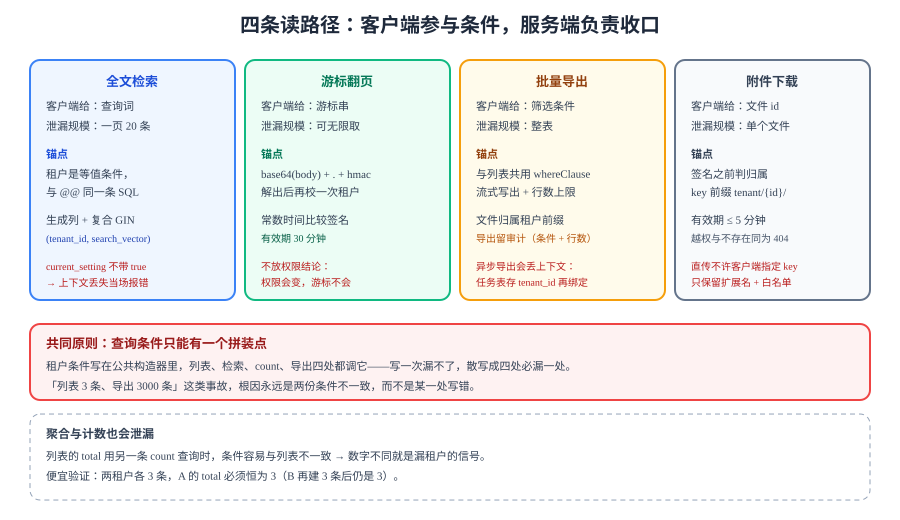

# 读路径隔离：检索、游标与导出

前面两页的读都是「按 id 取一条」或「按看板取一页」，它们最终都落成一条带 `where` 的 SQL，RLS 能兜住。本页处理另外三条读路径——**全文检索、游标翻页、批量导出**——它们的共同点是「查询条件由客户端提供了一部分」，隔离一旦做漏，泄漏的不是一行，而是**一整页或一整个文件**。



::: tip 本页与第 1 周已有页面的分工
[租户上下文与索引设计](../TenantIndexing/index.md)讲的是 B-tree 前缀：`tenant_id` 放在复合索引的第一列，等值查询走 `Index Scan`。本页讲另一类读路径——**全文检索的 GIN、游标翻页的签名、导出的条件复用**，它们的共同点是「过滤条件由客户端参与构造」，因此每一条都得有独立的锚点。索引能不能走起来见前者，这里只问会不会漏过租户。
:::

## 判据族声明

本页判据族 `RPI-A` ~ `RPI-H`，共 8 条。定义表在第七节。

## 一、三条读路径，三种「客户端参与条件」的方式

| 读路径 | 客户端提供什么 | 泄漏规模 | 隔离锚点 |
| --- | --- | --- | --- |
| **全文检索** | 查询词（可能含语法） | 一页 20 条，可翻页取全量 | 检索表达式必须与租户条件**同一条 SQL** |
| **游标翻页** | 游标（不透明字符串） | 一页，但可无限取 | 游标必须**签名**，且不携带权限结论 |
| **批量导出** | 筛选条件 + 格式 | **整表** | 导出查询必须与在线查询**共用同一段条件拼装** |
| 附件下载 | 文件 id 或对象 key | 单个文件 | 对象 key 前缀 + 签名有效期 |

第四行不在本页主体里，但它是同一类问题（客户端给了一个标识，服务端要判断它属不属于你），放在第五节一起讲。

::: danger 「检索走另一个引擎」是最典型的漏点
只要检索换成 Elasticsearch / Meilisearch 这类外部索引，**RLS 就完全失效**——那里没有行级策略，只有文档。此时隔离必须靠「每条查询都带 `tenant_id` 过滤」，而这类漏写在代码里**看不出异常**：单租户环境返回正确结果，多租户环境返回别人的结果。
本项目因此选了 PostgreSQL `tsvector`（见[技术选型](../TechStack/index.md)）：**少一个存储就少一处要自己实现的隔离**。
:::

## 二、全文检索：租户进生成列，进索引，也进每一条查询

三种写法，只有一种在「忘记加条件」时也安全：

| 写法 | 索引 | 忘记加租户条件时 | 评价 |
| --- | --- | --- | --- |
| 查询里临时 `to_tsvector(...)` | 用不上 GIN（表达式不匹配） | 返回全库 | ❌ 既慢又漏 |
| 生成列 + GIN 索引，查询里 `where tenant_id = ?` | 用得上 | 返回全库 | ⚠️ 快但漏 |
| 生成列 + GIN，**租户进查询的公共条件构造器** | 用得上 | 构造器强制带租户 | ✅ |

```sql [db/migration/V7__card_search.sql]
alter table cards
  add column search_vector tsvector
  generated always as (
    to_tsvector('simple', coalesce(title, '') || ' ' || coalesce(description, ''))
  ) stored;

-- 复合索引：租户在前，检索列在后
create index idx_cards_search on cards using gin (tenant_id, search_vector);
```

查询写法（注意 `tenant_id` 是**等值条件**，不是检索条件的一部分）：

```sql
select id, title, ts_rank(search_vector, q) as rank
from cards, websearch_to_tsquery('simple', $1) as q
where tenant_id = current_setting('app.tenant_id')::bigint
  and search_vector @@ q
order by rank desc, id
limit 20;
```

::: tip 为什么用 `simple` 而不是 `chinese` 配置
PostgreSQL 自带的全文检索**没有中文分词器**（`zhparser` 是第三方扩展）。本项目的做法是：中文场景用 `simple` 配置 + `pg_trgm` 做子串匹配，英文/标识符场景用 `simple` 的整词匹配。
这不是最优解，是**在「不引入第二个存储」这条约束下的取舍**——真正的分词需求出现时（例如中文相关性排序），才考虑外部引擎，那时隔离成本要重新算一遍（见第一节的危险块）。
:::

::: warning `current_setting` 读不到会返回空串而不是报错
`current_setting('app.tenant_id')` 在未设置时**抛异常**；带第二参数 `current_setting('app.tenant_id', true)` 才返回 `NULL`。上面这条 SQL 故意用**不带 `true`** 的版本：上下文没设置时**直接报错**，而不是静默返回 0 行。
「静默返回 0 行」在检索场景里极其危险——用户会以为「没有搜索结果」，而实际是「上下文丢了」。
:::

## 三、游标翻页：签名，且不携带权限结论

游标分页（keyset）的形态是「上一页最后一条的排序键」，客户端原样带回：

```text
GET /api/boards/{boardId}/cards?after=<cursor>&limit=20
```

游标的三种实现，风险递增：

| 实现 | 客户端能改什么 | 风险 |
| --- | --- | --- |
| 明文 JSON 的 base64 | 全部字段（排序键、租户、看板 id） | **可以伪造成别的看板的游标** |
| base64 + HMAC 签名 | 只能改「无关紧要的字符串」，改了签名就不过 | 安全，但要处理密钥轮换 |
| 服务端存会话（Redis） | 什么都改不了 | 安全，但多一次 Redis 往返，且要处理过期 |

本项目选**签名**：

```java [src/main/java/com/example/team/api/CursorCodec.java]
public record Cursor(long tenantId, UUID boardId, String positionKey, UUID lastId, long exp) {}

public String encode(Cursor c) {
    var json = objectMapper.writeValueAsBytes(c);
    var body = Base64.getUrlEncoder().withoutPadding().encodeToString(json);
    var mac  = hmacSha256(body);                       // 密钥来自密钥管理，不写在代码里
    return body + "." + mac;
}

public Cursor decode(String raw) {
    var parts = raw.split("\\.");
    if (parts.length != 2 || !constantTimeEquals(hmacSha256(parts[0]), parts[1])) {
        throw new BadRequestException("invalid cursor");
    }
    var c = objectMapper.readValue(Base64.getUrlDecoder().decode(parts[0]), Cursor.class);
    if (c.exp() < clock.millis()) throw new BadRequestException("cursor expired");
    if (c.tenantId() != TenantContext.require().tenantId()) {   // 再校一次租户
        throw new NotFoundException();                          // 404，不泄漏存在性
    }
    return c;
}
```

三条纪律：

1. **签名只证明「这个游标是我发的」，不证明「它现在还有效」**。所以解出来之后仍要**再校一次租户**——用户的租户可能在两次翻页之间被改了（例如被移出工作区）。
2. **常数时间比较**：`Arrays.equals` 会因为提前返回泄漏前缀匹配长度；用 `MessageDigest.isEqual`。
3. **游标里不要放权限结论**（例如 `canRead: true`）。权限会变，游标不会——一个「翻页时不必再查权限」的优化，等于把权限判定的时效性钉死在发游标的那一刻。

::: danger 游标过期时间不是越长越好
`exp` 设成 7 天看起来很友好（用户隔天回来还能继续翻），但它把「租户被移除后仍能继续读」的窗口也拉到了 7 天。本项目取 **30 分钟**：超过就重新从第一页开始，代价是极少的一次「回到顶部」。
:::

## 四、导出：必须与在线查询共用同一段条件

导出的泄漏规模是整表，所以它的实现不能是「另写一条 SQL」。正确做法是**把条件拼装抽成一个函数**，在线查询与导出都调它：

```java [src/main/java/com/example/team/query/CardQueryBuilder.java]
/** 唯一允许拼装卡片查询条件的地方：租户条件在这里强制加入。 */
public String whereClause(CardFilter f) {
    var sql = new StringBuilder(" where tenant_id = current_setting('app.tenant_id')::bigint");
    if (f.listId() != null)  sql.append(" and list_id = :listId");
    if (f.assignee() != null) sql.append(" and assignee_id = :assignee");
    if (f.keyword() != null)  sql.append(" and search_vector @@ websearch_to_tsquery('simple', :kw)");
    return sql.toString();
}
```

导出侧只做「流式写出」，不做条件判断：

```java [src/main/java/com/example/team/export/CardExporter.java]
public void export(CardFilter filter, OutputStream out) {
    var sql = "select id, title, list_id, assignee_id, created_at from cards"
            + queryBuilder.whereClause(filter)
            + " order by position_key, id";
    jdbc.query(sql, queryBuilder.params(filter), rs -> {
        csvWriter.write(rs);                 // 逐行写，不把结果集读进内存
    });
    csvWriter.flush(out);
}
```

四条纪律：

| 纪律 | 原因 |
| --- | --- |
| **流式写出**（`fetchSize` + 逐行） | 一次性 `List` 会把 10 万行读进堆，导出 3 次就 OOM |
| **导出有行数上限**（如 5 万行） | 超限时明确报错并建议缩小范围，而不是静默截断 |
| **导出文件归属到租户**：`tenant/{id}/export/{uuid}.csv` | 后续签名下载时前缀能再校一次 |
| **导出留审计**（谁、什么条件、多少行） | 导出是最容易被滥用的读操作，必须可追溯 |

::: warning 导出任务不能跑在请求线程里
「点一下导出，等 30 秒」在 10 万行时一定会超时。异步导出意味着**任务执行时请求已经结束**——租户上下文没了。这是[租户上下文](../TenantContext/index.md)里「定时任务/异步任务必须显式绑定」那条规则的具体触发点：任务表里要存 `tenant_id`，执行时用它绑定作用域。
:::

## 五、附件：key 前缀是第二道锁

附件的下载走「预签名 URL」，一旦签出去，**在有效期内任何人拿到 URL 都能下载**，服务端不再参与。所以隔离必须在**签名之前**做完：

```java [src/main/java/com/example/team/attachment/AttachmentService.java]
public String presignDownload(UUID attachmentId) {
    var tenant = TenantContext.require();
    var att = attachmentRepo.find(attachmentId)                    // 这条查询受 RLS 保护
        .orElseThrow(NotFoundException::new);
    if (!att.tenantId().equals(tenant.tenantId())) throw new NotFoundException();  // 双保险

    // 对象 key 由服务端拼装，客户端无法指定前缀
    var key = "tenant/" + att.tenantId() + "/board/" + att.boardId() + "/" + att.id();
    return s3.presignGetObject(key, Duration.ofMinutes(5));
}
```

| 检查项 | 期望 | 为什么 |
| --- | --- | --- |
| 对象 key 前缀含租户 | `tenant/{tenantId}/...` | 即使有人拿到别的 key，前缀也不匹配（配合 IAM 前缀策略可硬挡） |
| 有效期 | ≤ 5 分钟 | 签名 URL 是「无身份凭证」，泄漏后无法撤回 |
| 状态码 | 不存在与越权都是 `404` | 与[跨租户用例矩阵](../CrossTenantMatrix/index.md)一致 |
| 直传（PUT） | 客户端**不能指定** key | 否则可以把文件写进别的租户前缀下 |

::: danger 直传最容易开的口子
浏览器直传时，常见做法是让前端传 `fileName`，服务端拼 key。如果拼的时候用了 `fileName` 里的路径（如 `../tenant/43/...`），就能写到别的租户下。**key 必须由服务端生成 UUID 拼接，只保留扩展名**，且扩展名要在白名单里。
:::

## 六、聚合与计数也会泄漏

「有多少条」本身就是信息。三处容易漏：

| 位置 | 泄漏形态 | 正确做法 |
| --- | --- | --- |
| 列表接口的 `total` | 用另一条 `count(*)` 查询，条件拼装与列表不同 → 数字不同 | `count` 与列表**共用同一段条件**（同第四节） |
| 全局搜索的「共 N 条结果」 | 检索条件里有租户，但 `count` 用了不带租户的简化查询 | 同上 |
| 后台报表 | 用平台角色跑全量聚合，结果直接给业务看 | 报表也必须按租户切分，或明确标注「平台级视图」并限权 |

::: tip 一个便宜的验证
造两个租户、各 3 张卡片，然后用 A 的 token 请求列表，断言 `total == 3` 且 `items.length == 3`。再让 B 也建 3 张，重新请求，**`total` 仍然是 3**。这条断言能同时抓住「列表漏租户」与「count 漏租户」——因为两者的数字只要不一致就会暴露。
:::

## 七、判据表

| 编号 | 判据 | 怎么验证 | 本机读数 |
| --- | --- | --- | --- |
| `RPI-A` | 检索与租户条件在同一条 SQL 里，租户是等值条件 | 检索 SQL 里出现 `tenant_id =` 与 `@@` 两个条件 | 待跑（无工程） |
| `RPI-B` | 全文索引是「生成列 + 复合 GIN（tenant 在前）」 | `\d+ cards` 输出含 `idx_cards_search` 与 `search_vector` | 待跑（无工程） |
| `RPI-C` | 游标带签名，篡改后返回 `400` | 改游标最后一个字符，期望 `400 invalid cursor` | 待跑（无工程） |
| `RPI-D` | 游标解码后再校租户，跨租户返回 `404` | 用 A 的 token 带 B 的游标，期望 `404` | 待跑（无工程） |
| `RPI-E` | 导出与在线查询共用条件构造器 | `grep -c "whereClause"` 在导出与列表两处都出现 | 待跑（无工程） |
| `RPI-F` | 导出流式写出且有限额 | `grep -rn "fetchSize" src/` 命中；限额常量存在 | 待跑（无工程） |
| `RPI-G` | 附件 key 前缀由服务端拼装，含租户段 | `grep -rn "tenant/" src/main/java` 命中且无 `fileName` 拼接 | 待跑（无工程） |
| `RPI-H` | `total` 与列表条件一致 | 两租户各 3 条时 `total` 均为 3 | 待跑（无工程） |

## 八、当日做了什么

1. **把「客户端参与条件」的读路径单列出来**：检索（查询词语法）、游标（不透明串）、导出（筛选条件）、附件（文件标识）四条，逐条给出「泄漏规模」与「隔离锚点」。并指出外部检索引擎会让 RLS 完全失效，这是本项目选 `tsvector` 的一个理由。
2. **给出卡片检索的迁移脚本与查询写法**：生成列 + `(tenant_id, search_vector)` 复合 GIN；租户作为等值条件而不是检索条件的一部分。
3. **说明「忘记加租户条件」的三种写法差异**，结论是「把租户条件放进公共构造器」，让它无法被漏写。
4. **解释 `current_setting` 带不带 `true` 的取舍**：检索场景故意用不带 `true` 的版本，让「上下文丢失」当场报错，而不是静默返回 0 条。
5. **给游标加签名**：`base64(body) + "." + hmac`，并写三条纪律（解出后再校租户、常数时间比较、不放权限结论），过期时间取 30 分钟并说明代价。
6. **给导出定四条纪律**：流式写出、行数上限、文件归属租户、留审计；并指出异步导出会丢上下文，必须用任务表里的 `tenant_id` 重新绑定。
7. **把附件隔离写成「签名之前的检查」**：key 前缀由服务端拼、有效期 5 分钟、越权与不存在同为 `404`、直传不允许客户端指定 key（含路径穿越的具体写法）。
8. **补聚合与计数的泄漏**，并给出一条「两租户各 3 条、`total` 恒为 3」的便宜验证。
9. **定稿 `RPI-A~RPI-H` 八条判据。**

## 九、如何验证

```shell
# 1) 检索：期望只返回本租户的 3 条
curl -s -H "Authorization: Bearer $TOKEN_A" \
  "http://localhost:8080/api/cards/search?q=设计" | jq '.total'
# 期望：3（造数据：A 三条含「设计」，B 三条也含「设计」）

# 2) 索引是否存在：期望输出含 idx_cards_search
psql "$DATABASE_URL_TEST" -c "\d+ cards" | grep idx_cards_search

# 3) 游标篡改：期望 400
C=$(curl -s -H "Authorization: Bearer $TOKEN_A" \
  "http://localhost:8080/api/boards/$BOARD_A/cards?limit=2" | jq -r '.next')
curl -s -o /dev/null -w "%{http_code}\n" -H "Authorization: Bearer $TOKEN_A" \
  "http://localhost:8080/api/boards/$BOARD_A/cards?after=${C}x"
# 期望：400

# 4) 导出：期望行数 = 本租户条数，且审计表 +1
curl -s -H "Authorization: Bearer $TOKEN_A" \
  "http://localhost:8080/api/cards/export" | wc -l
```

判读：第 1 步若得到 6，说明检索 SQL 缺租户条件（最常见）或 `count` 另写了一条；第 3 步若返回 `200`，说明游标没签名（服务端直接信了客户端内容）；第 4 步行数若大于本租户条数，说明导出没走公共条件构造器。

## 十、下一步

- **本页只管「不漏」，不管「排得对」**：`search_vector` 是把 `title` 与 `description` 拼在一起建的，两者同权重，长描述会压过标题命中；游标里的 `rank` 是 `float8`，序列化后可能丢精度。这两件事已在[检索相关性联调](../BoardSearch/index.md)里补齐（`BSR`）。
- 三条读路径都通了之后，**写路径**的隔离靠事务里的 `set_config` 与 `WITH CHECK`：见[跨租户用例矩阵](../CrossTenantMatrix/index.md)第三节。
- 检索结果要推送给人时，推送主题不能按 `boardId` 裸命名：见[事件与推送隔离](../EventIsolation/index.md)。
- 导出文件落在对象存储里，它的访问控制与[跨租户用例矩阵](../CrossTenantMatrix/index.md)的附件签名格是同一套判据：**在签名之前判，签名之后服务端不再参与**。
- 第 1 周全部收口：[第 1 周验收](../Week1Acceptance/index.md)。

::: tip 本页与第 167 天那一章的边界
本页的 `search_vector` 复合索引形态（`gin (tenant_id, search_vector)`）**保持不变**，后续章节新增的是**并行的第二列** `search_vector_w`，不是改写它。理由很实际：改生成列表达式要重写全表并持有强锁，而「加一列 + 并发建索引 + 双读」可以在线完成。

这也是本页那三行警告的延伸——**索引结构一旦落地，演进方式是「加」，不是「改」**。
:::

## 参考资料

- [PostgreSQL 18 文档 · Full Text Search](https://www.postgresql.org/docs/18/textsearch.html)——生成列 + GIN 的标准做法、`websearch_to_tsquery` 的语法。
- [PostgreSQL 18 文档 · `current_setting`](https://www.postgresql.org/docs/18/functions-admin.html#FUNCTIONS-ADMIN-SET)——第二个参数 `missing_ok` 的语义。
- [OWASP · Insecure Direct Object Reference](https://cheatsheetseries.owasp.org/cheatsheets/Insecure_Direct_Object_Reference_Prevention_Cheat_Sheet.html)——附件与导出的对象级授权。
- 项目内：[缓存隔离](../CacheIsolation/index.md)（另一条绕过 RLS 的路径）· [跨租户用例矩阵](../CrossTenantMatrix/index.md)（签名与导出的两格）
- 技术专题：[SQL 优化](/docs/DB/Relational/SQLOptimization/index.md) · [数据建模](/docs/DB/DataModeling/index.md)
