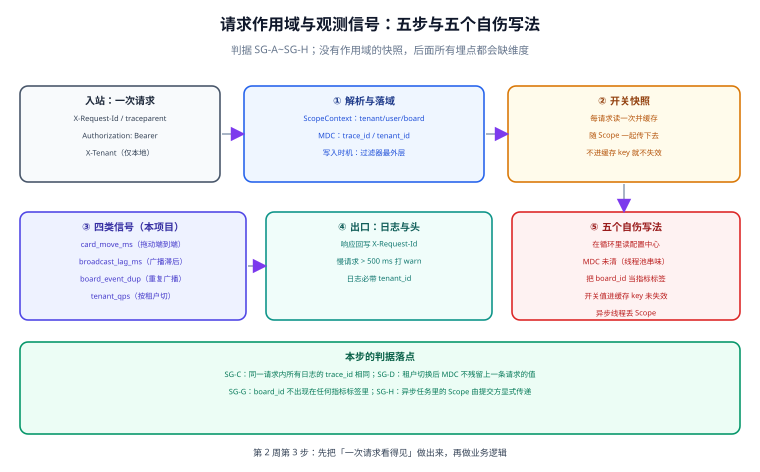

# 请求作用域与观测信号：先把「一次请求」做出来

前两步让服务能起（`/healthz` 返回 200）、让请求有身份（令牌解出 `sub` 与成员角色）。这一步做的是第三件事：**让这一次请求在整条链路上可被识别、可被切分、可被解释**。

时机不是随意选的。作用域必须建立在认证之后——因为作用域里最重要的两个字段（`tenant_id`、`role`）来自成员关系查询，而不是请求头。它又必须建立在任何业务查询之前——因为后面的每一条 SQL 都要用同一个租户上下文，每一个日志都要带同一个 `trace_id`。**夹在这两者之间的位置只有这一个。**

## 判据族声明

本页判据族 `SG-A` ~ `SG-H`，共 8 条。定义表在第九节。

## 本页不讲什么

- 不讲多租户隔离的原理与三种方案取舍（第 151 天 [多租户隔离](../MultiTenancy/index.md)）。
- 不讲租户上下文的四层传播与三类失效形态（第 155 天 [租户上下文](../TenantContext/index.md)）。
- 不讲指标口径的一般方法论（专题侧 [指标先行](/docs/Tools/ObservabilityDriven/MetricsFirst/index.md)）。

本页只讲**这套栈里具体怎么做**：类怎么放、字段从哪来、什么时候清、哪些维度不能进标签。

## 一、五步链路



一次请求进入进程后的顺序是固定的，任何一步提前或推后都会产生一类特定故障：

| 步 | 做什么 | 提前 / 推后的后果 |
| --- | --- | --- |
| ① 解析入站头 | 取 `traceparent`、`Authorization`、本地 `X-Tenant` | 不解析：下游看不到调用链，日志无 `trace_id` |
| ② 建作用域 | 令牌 → `sub` → 成员关系 → `tenant_id` / `role` | 提前建：角色来自令牌，被移出成员的人仍可用 |
| ③ 读开关快照 | 每请求一次，随作用域传下去 | 推后到业务里读：循环内 N 次配置查询 |
| ④ 上报四类信号 | 拖动耗时、广播滞后、重复广播、租户 QPS | 放在事务内：失败样本随回滚一起丢 |
| ⑤ 出口清理 | 回写 `X-Request-Id`、清 MDC、慢请求告警 | 不清理：线程池复用导致下一条请求串味 |

## 二、作用域对象：不可变、来源唯一

```java
public record ScopeContext(
    UUID tenantId,        // 来自 tenant_member 查询，不来自请求头
    UUID userId,          // 来自令牌 sub
    String role,          // 来自 tenant_member.role
    UUID boardId,         // 路径参数，可空
    String traceId,       // 入站 traceparent，缺失则生成并标记 source=self
    String appVersion,    // 构建期注入
    FlagSnapshot flags    // 本请求的开关快照
) {}
```

四条设计约束，每条都对应一个具体的坑：

| 约束 | 为什么 | 违反后 |
| --- | --- | --- |
| `record`（不可变） | 请求处理中途改角色，会出现「前半段有权限、后半段没权限」 | 一个请求内两套权限判定，审计无法解释 |
| `tenantId` 来自成员关系表 | 请求头可伪造 | 改一个头即可跨租户读数据 |
| `appVersion` 构建期注入 | 请求头可伪造 | 灰度期归因失效 |
| `flags` 是快照不是服务引用 | 服务引用会被再次求值 | 同一请求内开关值变化，半新半旧 |

第三条容易被省：很多实现从 `User-Agent` 或自定义头读版本。这在排查时是「猜」，不是「事实」——客户端可以撒谎，而构建期注入的版本号不能。

## 三、MDC 与线程池：最隐蔽的一处串味

日志框架的 MDC 是 **ThreadLocal**。它在同步链路里天然正确，在两种情况下必然出错：

```text
① 线程池复用：任务 A 设置 MDC → 线程归还 → 任务 B 复用该线程
   → B 的日志带着 A 的 tenant_id（这就是「串味」）

② 异步提交：CompletableFuture.supplyAsync 默认用 ForkJoinPool
   → 新线程没有 MDC → 异步段日志全部缺 tenant_id
```

第一种更危险，因为它产生的是**错误的**数据而不是**缺失的**数据。缺失会被发现，错误会误导。

两条修法，必须同时用：

| 修法 | 做法 | 覆盖 |
| --- | --- | --- |
| 入口设置 + 出口清除 | `try { MDC.put(...) } finally { MDC.clear() }` | 同步链路 |
| 显式传递 | 提交任务时把 `ScopeContext` 作为参数传入，在任务体内重建 MDC | 异步链路 |

第二条不能靠「线程池装饰器」蒙过去——装饰器只能拿到提交时的 MDC，若任务内部又派生子任务（并行流、异步回调），仍然断链。所以本项目的口径是：**异步任务的接口签名必须显式带 `ScopeContext`**，编译器帮着拦。

::: warning 一个反例
```java
// 反例：MDC 传递靠装饰器，但任务内部再并行
executor.submit(() -> {
    cards.parallelStream().forEach(c -> {
        // 这里跑在 ForkJoinPool 上，MDC 已丢失
        log.info("moved {}", c.id());
    });
});
```
这类代码在压测里看不出问题（日志变少不会被注意到），只在事故排查时才发现——而那正是最需要日志的时候。
:::

## 四、开关快照：读一次，传下去

`FlagSnapshot` 的设计只有两个要点：

```java
// 快照：本请求内不可变
public record FlagSnapshot(Map<String, Boolean> values, String version) {
    public boolean isOn(String name) {
        return values.getOrDefault(name, false);
    }
}

// 获取：每请求一次，内部有本地缓存 + 变更推送 + 60s 兜底 TTL
FlagSnapshot snapshot = flagService.snapshot();
```

| 要点 | 理由 |
| --- | --- |
| 每请求一次 | 循环内读配置中心的最坏情况是 200 次远程调用（见专题侧 [功能开关](/docs/Tools/ObservabilityDriven/FeatureFlag/index.md) 4.1） |
| 不可变 | 保证同一请求内判定一致；否则会出现半新半旧 |
| 带 `version` | 出问题时能回答「当时是哪个版本的开关集」，这是事后归因的唯一依据 |

`version` 这一项在事故复盘中价值极高。没有它，只能靠时间戳推断「当时开关是什么状态」，而这个推断在「开关在事故期间被改过」的情况下必然错。

## 五、四类业务信号与口径

本项目只上报四个信号。**只有四个**是刻意的——每个都要能对应一个具体的决策：

| 信号 | 类型 | 口径公式 | 用来回答 |
| --- | --- | --- | --- |
| `card_move_ms` | Histogram | 从收到 PATCH 到事务提交后返回响应的耗时 | 拖动是否变慢（主指标，看 P99） |
| `broadcast_lag_ms` | Histogram | `广播发出时刻 − 事件提交时刻` | 实时协作是否延迟（看 P99） |
| `board_event_dup` | Counter | 客户端因 `seq` 重复而丢弃的事件数 | 重复广播是否在增长 |
| `tenant_qps` | Counter | 按 `tenant_id` 计数的请求数 | 单租户是否在打爆（切分用） |

四个信号的分工：

1. **`card_move_ms` 是主指标**。它对应「用户拖动后多久看到结果」，与用户感受一一对应。它是唯一进门的（用于灰度判定）。
2. **`broadcast_lag_ms` 是协作体感指标**。单机场景它没意义，多人协作时它是「别人看到我改动」的延迟。
3. **`board_event_dup` 是正确性护栏**。它的正常值应当接近 0；持续大于 0 说明广播链路在重复投递，客户端去重在兜底。
4. **`tenant_qps` 是切分维度**，不单独告警。它用于回答「是不是某个租户在打爆」——这是事故里最高频的问题。

::: tip 为什么没有 `tenant_id` 之外的标签
`card_move_ms` 的标签只有 `board_tier`（免费/付费）与 `app_version` 两个。**没有 `board_id`，没有 `user_id`**。

理由是可算的：一万块活跃板 × 5 个版本 × 2 档 = 十万条序列；去掉 `board_id` 后是 10 条。差值不是「更省」，而是「从不可用到可用」——十万条序列的查询会超时，十条不会。
:::

## 六、五个自伤写法

前三个来自专题侧的方法论，后两个是本项目这套栈特有的：

| 写法 | 现象 | 修法 |
| --- | --- | --- |
| 在循环里读配置中心 | 一次拖动 200 次远程调用，P99 从 80 ms 到 400 ms | 每请求读快照 |
| MDC 未清（线程池串味） | 日志里的 `tenant_id` 属于上一条请求 | `finally { MDC.clear() }` + 异步显式传递 |
| 把 `board_id` 当指标标签 | 序列数从 10 涨到十万 | 高基数维度进日志，不进标签 |
| 开关值进缓存 key 未失效 | 关掉开关仍生效 10 分钟 | 开关值不进 key |
| 异步线程丢作用域 | 异步段日志无租户、事件无 `trace_id` | 签名显式带 `ScopeContext` |

第四条在本项目有个具体形态：看板快照缓存。如果把 `flags.isOn("batch_write")` 拼进缓存 key，开关关掉后旧 key 的数据仍会被读到。本项目的做法是**缓存只存与开关无关的原始数据**，开关判断在出缓存之后。

## 七、与前三步的接口

| 步 | 提供的 | 本步如何使用 |
| --- | --- | --- |
| 第 1 周 多租户隔离 | `tenant` / `board` 表、RLS 策略 | 作用域里的 `tenantId` 是 `set_config` 的输入 |
| 第 1 周 事件表与顺序 | `board_events.seq` | `broadcast_lag_ms` 的终点取事件提交时刻，`seq` 用于去重计数 |
| 第 2 周第 1 步 `Bootstrap` | `/healthz` 与目录边界 | 作用域过滤器放在 `app-web` 层，`core` 不含 web 依赖，故 `ScopeContext` 定义在 `app-core` |
| 第 2 周第 2 步 `AuthTenantMember` | 令牌解析、`tenant_member` 查询 | 作用域的两个关键字段从这里来，本步不重复实现认证 |

第四行的边界值得强调：**本步不碰认证逻辑**，只在认证产物之上建作用域。若把两者混在一个过滤器里，会出现「认证失败但作用域已建」的半初始化状态——后续代码拿到一个 `tenantId` 为 null 的作用域，比拿不到作用域更危险。

## 八、本步不做什么

| 不做 | 原因 | 什么时候做 |
| --- | --- | --- |
| 不做追踪后端接入 | 本步只保证 `trace_id` 在日志与响应头里可用 | 第 3 周（与联调监控一起） |
| 不做告警规则 | 需要先有稳定的信号与历史分布 | 第 4 周 |
| 不做开关的分流实现 | 本步只做快照读取，分流在网关完成后才有意义 | 第 2 周末 |
| 不做压测 | 需要先有可跑的业务路径 | 第 3 周 |

## 九、判据族定义

| 判据 | 规则 | 违反时的样子 | 验证方式 |
| --- | --- | --- | --- |
| `SG-A` | 作用域必须在认证之后、任何业务查询之前建立 | 作用域里的角色来自令牌，被移出成员仍可用 | 命令 1 |
| `SG-B` | `tenantId` 必须来自成员关系查询，不得读请求头 | 改一个头即可跨租户 | 命令 2 |
| `SG-C` | 同一请求内所有日志的 `trace_id` 相同，且回写到响应头 | 一条链路的日志分散在多个 trace 下 | 命令 3 |
| `SG-D` | MDC 必须在 `finally` 清除；异步任务必须显式传 `ScopeContext` | 日志里的租户属于上一条请求 | 命令 4 |
| `SG-E` | 开关快照每请求一次且不可变，带 `version` 用于事后归因 | 循环内重复查询；事故时无法回答开关状态 | 命令 5 |
| `SG-F` | 四类信号各有明确口径，主指标唯一（`card_move_ms`） | 出现七八个指标，灰度时不知以哪个为准 | 命令 6 |
| `SG-G` | 指标标签不得包含 `board_id` / `user_id`，取值必须可枚举且 < 100 | 序列数到十万级，查询超时 | 命令 7 |
| `SG-H` | 埋点上报必须在事务提交之后，失败样本不得随回滚丢失 | 失败路径恒定无样本 | 命令 8 |

## 如何验证

```shell
# ① SG-C：响应头是否回写请求标识
curl -s -D - -o /dev/null localhost:8080/api/boards \
  -H "Authorization: Bearer $TOKEN" | grep -i "x-request-id"
```

**预期输出**：一行 `X-Request-Id: <uuid>`。缺失说明过滤器没有回写——用户报障时无法把他的请求与服务端日志对上。

```shell
# ② SG-G：指标定义里是否混入高基数标签
grep -rn "labelNames(" src/main/java --include=*.java | grep -E "board_id|user_id|card_id"
```

**预期输出**：空。若命中，按 `SG-G` 降维——这些维度应放进日志或追踪属性（见专题侧 [埋点规范](/docs/Tools/ObservabilityDriven/Instrumentation/index.md) 第四节）。

```shell
# ③ SG-E：快照是否每请求一次（循环内是否出现 flagService 调用）
grep -rn -A 5 "for (\|forEach" src/main/java --include=*.java | grep -c "flagService\."
```

**预期输出**：`0`。若大于 0，说明在循环里问配置中心，`SG-E` 不成立。

```shell
# ④ SG-D：MDC 是否在 finally 里清理
grep -rn -A 3 "MDC.put" src/main/java --include=*.java | grep -c "finally"
grep -rn "MDC.clear()" src/main/java --include=*.java | wc -l
```

**预期输出**：两个数应大致相等（每个设置点都有对应清理）。若设置点远多于清理点，线程池复用时会串味。

```shell
# ⑤ SG-H：埋点是否在事务提交后（afterCommit / 事务外）
grep -rn "afterCommit\|TransactionSynchronization" src/main/java --include=*.java | wc -l
grep -rn -B 2 "metrics\.\|counter\." src/main/java --include=*.java | grep -c "@Transactional"
```

**预期输出**：第一个数 ≥ 1（存在提交后回调）；第二个数应为 `0`（指标上报紧贴在 `@Transactional` 方法内即为可疑）。

```text
⑥ SG-A：顺序读法
   打开过滤器链配置，确认作用域过滤器的 order 在认证之后、
   且在事务拦截器之前。写在同一个过滤器里即为不成立。

⑦ SG-B：来源读法
   grep 作用域构造处，确认 tenantId 的赋值来源是成员关系查询结果，
   而不是 request.getHeader("X-Tenant")。

⑧ SG-F：口径读法
   打开指标定义文件，数「主指标」个数。> 1 即不成立。
   再逐条确认每个信号都能回答一个具体问题——答不出的删除。
```

::: info 诚实标注
本条为**设计态交付**：`ScopeContext`、`FlagSnapshot`、四类信号的口径与五个自伤写法的对策已定稿，**Java 代码截至本轮为设计片段，工程尚未构建**（第 156 天进度表记录「Java 片段未编译」，本步沿用同一标注）。故 ①~⑤ 的命令**均未在真实产物上跑过**，给出的是本步完成后应当满足的判据形状。凡未跑过的，本页不标 ✅。
:::

## 下一步

第 2 周第 4 步（第 159 天）：**看板读链路与查询改写**——把作用域接到 RLS 上，让「一次读」变成可验证的（`EXPLAIN` 读数、跨租户 0 行、缓存命中率），并把 `tenant_qps` 与 `card_move_ms` 真正接到读路径上。

## 参考资料

- [OpenTelemetry · Context propagation](https://opentelemetry.io/docs/concepts/context-propagation/)——跨线程与异步链路的上下文传递，`SG-D` 的依据
- [OpenTelemetry · Semantic conventions for logs](https://opentelemetry.io/docs/specs/semconv/general/logs/)——日志必带字段的约定，`trace_id` 的标准化位置
- [SLF4J · MDC](https://www.slf4j.org/manual.html#mdc)——MDC 的 ThreadLocal 语义与清理责任
- [Spring Framework · Transaction synchronization](https://docs.spring.io/spring-framework/reference/data-access/transaction.html#transaction-declarative-applying-more-than-just-transactions)——`afterCommit` 的时机，`SG-H` 的实现依据
- 本站 [微服务可观测性](/docs/Ops/Observability/Overview/index.md) · [OpenTelemetry](/docs/Ops/Observability/OpenTelemetry/index.md)
- 专题侧方法论：[观测驱动开发](/docs/Tools/ObservabilityDriven/index.md) · [埋点规范](/docs/Tools/ObservabilityDriven/Instrumentation/index.md) · [功能开关](/docs/Tools/ObservabilityDriven/FeatureFlag/index.md)
- 前序步骤：[工程骨架与最小可跑集](../Bootstrap/index.md) · [认证与租户成员关系](../AuthTenantMember/index.md) · [租户上下文](../TenantContext/index.md)
