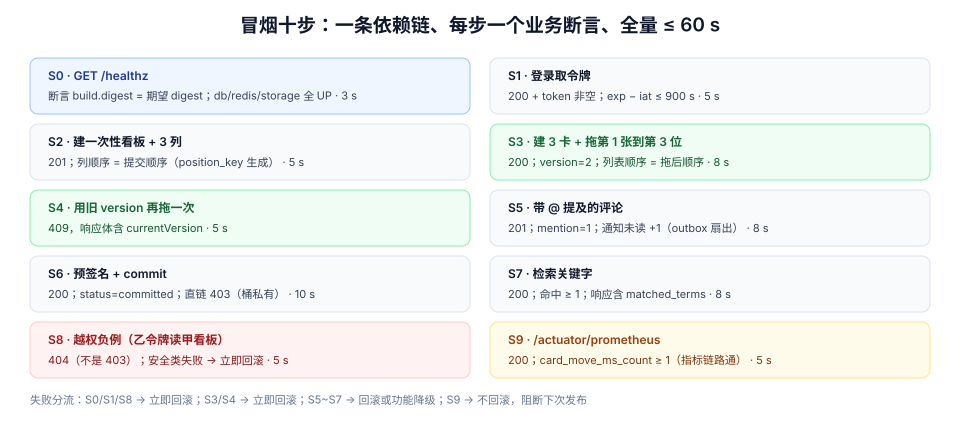

# 第 4 周第 5 步 · 部署后冒烟：六十秒内判定「这版是好的」

前四步都是**部署前**的闸门：产物、配置、库、进程。它们能挡住大部分问题，但挡不住一类最尴尬的情况——**所有闸门都绿，部署也成功，可是服务就是不对**。

这类问题只有「真的跑一遍业务链路」才能发现。所以部署链的最后一步不是部署，而是**部署后的 60 秒**：一组走真实链路的请求，每条都带断言，任何一条红了就**立刻回滚**，而不是等人打开浏览器看。

## 判据族声明

本页判据族 `SMK-A` ~ `SMK-H`，共 8 条。定义表在第七节。

## 本页不讲什么

- 不讲端到端测试怎么设计用例、怎么管测试数据、失败怎么分诊，归 [端到端测试](../E2ETest/index.md)；冒烟是它的**极小真子集**，区别见第二节。
- 不讲压测的场景模型与阈值，归 [压测四场景与池层断言](../LoadTestGate/index.md)；本页只引用它的 p99 作为超时预算的来源。
- 不讲 Liveness / Readiness / Startup 三级探针的语义，归 [部署脚本](../DeployScripts/index.md)。
- 不讲告警规则与大盘，归 [监控与告警接入](../Monitoring/index.md)。



## 一、冒烟的第一条断言：新版本真的在跑

最容易漏、也最荒唐的一种「冒烟通过」是：**你测的是旧实例**。滚动更新期间旧实例还在，`curl` 打到旧实例上，一切正常。

所以第 0 条断言不是业务，是身份：

```http
GET /healthz HTTP/1.1
```

```json [响应示例]
{
  "status": "UP",
  "build": { "version": "1.4.2", "digest": "sha256:5c1e…", "commit": "8f3c1a2" },
  "checks": { "db": "UP", "redis": "UP", "storage": "UP" }
}
```

断言：`build.digest` **等于**本次要发布的 digest（来自 [镜像供应链](../ImageSupplyChain/index.md) 的发布记录）。不等就停——不是重试，是停：这说明请求打到了旧实例、或者镜像被换过、或者配置里写死的版本号没更新。

## 二、冒烟与 E2E 的分工

| 维度 | 冒烟（本页） | E2E（[端到端测试](../E2ETest/index.md)） |
| --- | --- | --- |
| 目的 | 判定「这版能不能留」 | 证明「功能是否正确」 |
| 数量 | **10 条**，只增不轻易改 | 数十条，随需求演进 |
| 时长 | 全量 ≤ 60 s | 分钟级 |
| 数据 | 专用租户 + 可重复执行（幂等或自清理） | 三种数据来源，含固定夹具 |
| 失败处理 | **立即回滚**，不排查 | 分诊、归属、修用例或修代码 |
| 归属 | 运维 / 发布负责人 | 测试 / 开发 |

一句话：**E2E 失败说明产品有问题，冒烟失败说明这版不能上。** 所以冒烟的用例必须「少、快、只覆盖不可替代的链路」，一旦它变成 E2E 的复制品，就会因为太慢而被人跳过。

## 三、十条用例：每一步都在验一件「只有整体起来才能验」的事

| # | 步骤 | 断言 | 超时预算 | 为什么必须有它 |
| --- | --- | --- | --- | --- |
| `S0` | `GET /healthz` | `build.digest` = 期望 digest；三个依赖 `UP` | 3 s | 排除「测到旧实例」 |
| `S1` | 登录取令牌（`smoke@tenant-a`） | `200` + `access_token` 非空；`exp - iat ≤ 900 s` | 5 s | 认证链路 + 令牌配置生效 |
| `S2` | 建一块一次性看板 + 3 列 | `201`；列顺序 = 提交顺序 | 5 s | 写路径 + `position_key` 生成 |
| `S3` | 建 3 张卡片，拖第 1 张到第 3 位 | `200`；返回 `version=2`；列表顺序 = 拖后顺序 | 8 s | 核心链路（乐观锁 + 排序键） |
| `S4` | 用**旧 version** 再拖一次 | `409`，响应体含 `currentVersion` | 5 s | 并发保护没被绕过 |
| `S5` | 发一条带 `@` 提及的评论 | `201`；`mention` 计数 = 1；通知未读数 +1 | 8 s | 事务内 outbox + 扇出 |
| `S6` | 申请附件预签名并 `commit` | `200`；`commit` 后 `status=committed`；直链 403（桶私有） | 10 s | 对象存储 + 桶策略 |
| `S7` | 检索看板内关键字 | `200`；命中 ≥ 1；响应含 `matched_terms` | 8 s | 全文检索索引在线可用 |
| `S8` | 越权负例：乙租户令牌读甲看板 | `404`（**不是 403**） | 5 s | 租户边界在发布后仍成立 |
| `S9` | `GET /actuator/prometheus` | `200`；含 `card_move_ms_count` 且 ≥ 1 | 5 s | 指标链路接通（否则第 4 周后半段的告警全是瞎的） |

十步的顺序是**依赖顺序**，不能重排：`S0` → `S1`（要令牌）→ `S2`（要板）→ `S3`~`S5`（要卡）→ `S6`~`S7`（挂在卡/板上）→ `S8`（要两块租户的数据）→ `S9`（最后读指标，此时计数已非零）。

::: danger 三个把冒烟做废的写法
1. **用生产数据做冒烟**：`S3` 拖动会改真实卡片的位置，`S8` 越权用例会写审计日志。正确做法是专用租户 `smoke-tenant` + 一次性看板，跑完即归档（不是删除，留下证据）。
2. **每条都 `retry 3`**：重试会把「偶发 500」变成「最终 200」，而冒烟要抓的恰恰是偶发。正确做法是**只允许 `S0` 重试一次**（等新实例就绪），业务步骤一律零重试。
3. **断言只看状态码**：`409` 与 `404` 混淆、`200` 但 `version` 没变、`201` 但 `mention` 没落库——这些在状态码上都是「成功」。正确做法是每条都断言**响应体里的一个业务字段**。
:::

## 四、超时预算怎么定：从 p99 推，不从感觉推

冒烟的超时不能拍「10 秒够了」，因为「够」的反面是「慢到看不出问题」。本项目的预算从第 3 周压测的 p99 推出来：

| 链路 | 压测 p99（第 3 周基线） | 冒烟超时 | 倍数 |
| --- | --- | --- | --- |
| `S1` 登录 | 未压测（低频） | 5 s | 锁定「明显挂了」而非性能 |
| `S3` 拖动写入 | 80 ms | **8 s** | 100× |
| `S5` 评论写入 | 150 ms | 8 s | 53× |
| `S4` 附件预签名 | 300 ms | 10 s | 33× |
| `S7` 检索 | 120 ms（同 S1 列表档） | 8 s | 67× |

**为什么倍数这么大还要写出来**：因为冒烟的超时不是性能阈值，而是**防挂死阈值**。它要区分的是「慢」与「卡住」，所以取 p99 的 30~100 倍、并统一压在 10 s 以内，让**全量 10 步的总预算 ≤ 60 s**。性能回归由压测闸门负责（[LoadTestGate](../LoadTestGate/index.md)），冒烟不重复承担。

反过来说：**任何一步真的用满了预算，本身就说明有问题**。所以冒烟脚本要输出每步耗时，而不是只输出 PASS/FAIL——总耗时从 8 s 涨到 40 s 的时候，红的是闸门，但真正该看的是那一列数字。

## 五、失败即回滚：这一步必须由机器决定

冒烟失败后最常见的处理是「先看看日志」，而看日志的十分钟里，线上一直是有问题的版本。所以规则要前置：

| 失败类型 | 判定 | 动作 |
| --- | --- | --- |
| `S0` 失败（digest 不符 / 依赖 DOWN） | 部署没生效或依赖不可用 | **立即回滚**，不排查 |
| `S1`/`S8` 失败（认证 / 租户边界） | **安全类**，最不可容忍 | 立即回滚 + 拉安全负责人 |
| `S3`/`S4` 失败（核心写路径 / 并发） | 业务不可用 | 立即回滚 |
| `S5`~`S7` 失败（评论 / 附件 / 检索） | 部分功能不可用 | 回滚；若配置开关可关则该功能降级、不回滚 |
| `S9` 失败（指标） | 可观测性缺失 | **不回滚**，阻断后续发布并加急修 |

最后一行是有意的例外：指标缺失不影响用户，但它会让**下一次**故障无法定位。把它做成「阻断下一次」，而不是「回滚这一次」。

回滚动作本身归 [回滚矩阵](../RollbackMatrix/index.md)，本页只负责**交出决定**。

## 六、可重复执行：冒烟要能连跑十次

冒烟会在一天内被跑很多次（每次发布、每次回滚后再上）。它必须**幂等或自清理**：

| 步骤 | 幂等方式 |
| --- | --- |
| `S2` 建板 | 板名带 `smoke-{yyyymmddHHMM}-{8位随机}`，不依赖「板不存在」 |
| `S3` 拖动 | 以 `opId = smoke-{runId}-s3` 作为幂等键，重跑不产生第二次移动 |
| `S5` 评论 | 同上，`Idempotency-Key` 按 run 生成 |
| `S6` 附件 | key 里带 `runId`，`commit` 本身幂等（见 [附件直传](../AttachmentDirectUpload/index.md)） |
| 收尾 | 板归档（`archived_at`），保留 7 天后由归档任务清理 |

`runId` 是整个冒烟的「一次执行」标识，它同时出现在日志、幂等键与看板名里——**出问题时能一条命令捞出这次执行的全部痕迹**。

## 七、判据表

| 编号 | 规则 | 违反时的样子 | 怎么验证 |
| --- | --- | --- | --- |
| `SMK-A` | 第一条断言校验 `build.digest` | 测到旧实例，冒烟假绿 | `S0` 返回值与发布记录比对 |
| `SMK-B` | 冒烟 ≤ 10 条、全量 ≤ 60 s | 冒烟变成 E2E，被人跳过 | 命令①，总耗时与步数 |
| `SMK-C` | 业务步骤零重试，仅 `S0` 允许重试 1 次 | 偶发错误被重试掩盖 | 脚本里 `retry` 只出现在 `S0` |
| `SMK-D` | 每条断言一个业务字段，不只状态码 | `409`/`404` 混淆、`200` 但没生效 | 逐条审查断言 |
| `SMK-E` | 用专用租户 + 一次性看板，跑完归档 | 生产数据被改、越权用例写真库 | 看板名含 `smoke-` 前缀；归档时间非空 |
| `SMK-F` | 幂等键按 `runId` 生成，可连跑 | 第二次跑产生重复卡片 | 同 `runId` 连跑两次，卡片数不变 |
| `SMK-G` | 失败按第五节分流，安全类立即回滚 | 带病运行、边看日志边放量 | 发布记录里「冒烟结论」一栏 |
| `SMK-H` | 输出每步耗时，不只 PASS/FAIL | 性能退化无人察觉 | 冒烟报告含耗时列 |

## 验证命令

```shell
# ① SMK-B：全量冒烟耗时（10 步，期望 ≤ 60 s）
time bash scripts/smoke.sh "https://staging.example.com" "$EXPECTED_DIGEST"
# 期望：real ≤ 60s，且最后一行输出 "SMOKE PASS 10/10"

# ② SMK-A：digest 必须与发布记录一致
curl -fsS https://staging.example.com/healthz | jq -r '.build.digest'
# 期望：与 deploy/RELEASE 文件里记录的 sha256 完全相同

# ③ SMK-F：幂等性——同一 runId 连跑两次，卡片数不变
for i in 1 2; do
  bash scripts/smoke.sh "$BASE_URL" "$EXPECTED_DIGEST" --run-id smoke-fixed-001 || exit 1
done
psql "$DATABASE_URL" -tAc "select count(*) from card where board_id =
  (select id from board where name like 'smoke-fixed-001%');"
# 期望：两次都是 3

# ④ SMK-E：冒烟数据可识别、可清理
psql "$DATABASE_URL" -tAc "select count(*) from board where name like 'smoke-%' and archived_at is null;"
# 期望：只包含本次运行创建的板；长期 > 0 说明收尾步骤没执行
```

## 八、下一步

冒烟红了要回滚，但**回滚本身也会失败**——尤其是当这次发布带了不可逆的 DDL 时。归第 4 周第 6 步 [回滚矩阵](../RollbackMatrix/index.md)：四类耦合（代码 / 迁移 / 配置 / 缓存键）的组合表，以及四个本机实测场景——加列带默认值时旧代码仍能写（`101|0`），去掉默认值后旧代码插入直接 `not-null violation`，`DROP COLUMN` 之后数据随列消失，`RENAME` 之后旧代码 `42703`。
