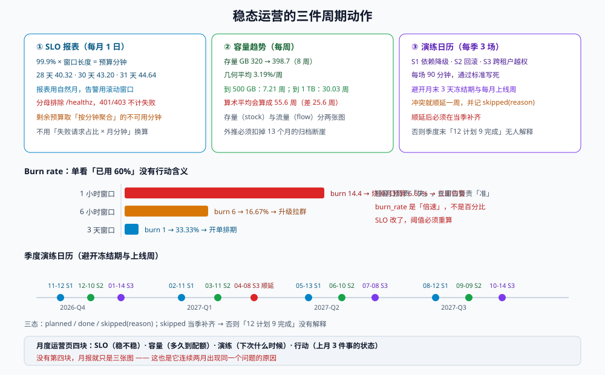

# 第 4 周第 3 步之五 · 稳态运营：SLO 报表、容量趋势与演练日历

上线验收（第 169 天）回答的是「这一次能不能发」，观察窗口与交接（第 171 天）回答的是「发出去之后这半个月有没有问题」。**两者都有终点**。而一个长期活着的系统需要的是第三样东西：**一个没有终点的循环**——每月按同一个口径出一张 SLO 报表、每周看一次容量趋势、每季度做一次演练。

这一章就做这三件事，并且把每一件都落成**能被别人复跑的命令**。三件事的共同点是：它们都会在「看起来一切正常」的时候悄悄失效——SLO 报表换了分母、容量趋势的外推公式忘了归档节奏、演练日历被冻结期挤掉之后没人补。

::: tip 一句话定位
稳态运营的产物不是「三张图」，而是**三个有明确口径、明确责任人、明确下一步动作的周期动作**；没有口径的图，第二个月就没人看了。
:::

本章判据族 `SSO-A` ~ `SSO-H`，共 8 条。定义表在第八节。



## 一、SLO 报表的第一件事：把错误预算摊到「月」

99.9% 的月度 SLO 听起来是一个数，落到「多少分钟」时，**分子分母的窗口长度决定了答案**：

| 窗口 | 总分钟数 | 错误预算（0.1%） |
| --- | --- | --- |
| 28 天（2 月） | 40,320 | **40.32 min** |
| 30 天 | 43,200 | **43.20 min** |
| 31 天 | 44,640 | **44.64 min** |

差的这 4 分半不是小数问题，它决定了「月末还剩 5 分钟预算」到底是「安全」还是「已经用完」。三种摊法各有代价：

| 摊法 | 定义 | 优点 | 致命缺陷 |
| --- | --- | --- | --- |
| **自然月** | 每月 1 日 00:00 重置 | 与财务/汇报周期对齐，好解释 | **月初预算回血**：上月末烧光的人，1 日零点又有 43.2 分钟；「月末冲刺」永远划算 |
| **滚动 30 天** | 任意时刻回看 30 天 | 没有回血，压力连续 | 与「本月报表」对不上，月度汇报要额外解释 |
| **滚动 28 天（4 周）** | 对齐迭代周期 | 与双周迭代节奏一致 | 更短窗口 → 抖动更大，小故障占比放大 |

本项目的选择：**报表用自然月，告警用滚动窗口**。理由写死在这里——报表是给人看的、要能对上「这个月出了几次事」；告警是给系统看的、要能立刻反映「现在正在烧」。两者用同一个数字反而会互相妥协。

::: danger 「自然月报表 + 自然月告警」的组合会制造一个假安全区
1. 每月 28 日发现预算只剩 2 分钟，团队进入「只修不发」状态；
2. 1 日零点预算重置为 43.2 分钟，所有冻结解除；
3. 于是**每个月的第一天都是最激进的一天**，而报表上「本月 SLO 达标」——因为它只看本月。

这不是纪律问题，是**口径问题**：预算按月重置时，「月末烧完」在数学上是免费的。
:::

## 二、SLI 的口径：分母里到底放什么

SLO 的分母是「有效请求」，而「有效」两个字是全部争议所在。本项目定死四条：

| 规则 | 处理 | 理由 |
| --- | --- | --- |
| **4xx（客户端错误）** | 计入分母，**不计入**失败 | 用户传了超大文件得到 413，是我们的规则在生效，不是系统不可用 |
| **401 / 403** | 计入分母，**不计入**失败 | 鉴权失败是安全行为；把它算进 SLO 会让「有人扫接口」变成「系统变差」 |
| **5xx** | 计入分母，计入失败 | 唯一的真正失败 |
| **健康检查 `/healthz`** | **完全排除** | 它每 10 秒一次，会把分母冲淡到「业务请求只占 0.1%」——这是最常见的 SLO 造假方式 |

```sql
-- 月度 SLI（自然月，排除 /healthz 与静态资源，401/403 不算失败）
with req as (
  select date_trunc('month', ts) as mon,
         count(*) as total,
         count(*) filter (where status >= 500) as failed
    from access_log
   where ts >= date_trunc('month', now()) - interval '2 months'
     and path not like '/healthz%'
     and path not like '/assets/%'
     and status not in (401, 403)
   group by 1
)
select mon,
       total,
       failed,
       round(100.0 * (total - failed) / nullif(total, 0), 4) as sli_pct,
       round(0.001 * extract(epoch from (mon + interval '1 month' - mon)) / 60, 2) as budget_min
  from req
 order by mon desc;
```

这段只产出三件事：**总请求、失败请求、SLI 百分比**，外加该月的**预算分钟数**。

::: warning 「剩余预算分钟」不要用失败请求占比换算
失败 1% 的请求可能集中在 3 分钟内，也可能均匀铺满 30 天——**同样 1% 的错误率，对应的「不可用分钟」可以差一个数量级**。
所以「已用多少分钟」必须从监控系统取**按分钟聚合的可用性**（每分钟要么可用要么不可用），再与 `budget_min` 相减；用 `failed/total × 月分钟数` 算出来的是「假设错误均匀分布」的假值，而这个假设在事故场景下恰好不成立。
:::

## 三、Burn rate：把「还剩多少」变成「还会烧多久」

单看「已用 60% 预算」没有行动含义——月初用 60% 和月末用 60% 是两件完全不同的事。Burn rate（燃烧速率）才是行动信号：

```text
burn_rate = 观测窗口内的错误率 ÷ 允许错误率（0.1%）
```

| 窗口 | burn rate | 该窗口烧掉的月预算 | 含义与动作 |
| --- | --- | --- | --- |
| 1 小时 | **14.4** | **6.67%** | 1 小时烧掉 6.67% 的月预算 → 立刻告警、值班处理 |
| 6 小时 | **6** | **16.67%** | 6 小时烧掉 1/6 → 升级、拉群 |
| 3 天 | **1** | **33.33%** | 3 天烧掉 1/3 → 开单、排期修 |

这三个数是「多窗口多燃烧率」告警的标准组合（源自 Google SRE Workbook）：**短窗口负责快、长窗口负责准**。只用 1 小时窗口会被瞬时抖动打爆；只用 3 天窗口则要等 72 小时才知道出事。

::: danger 三个把 burn rate 用错的方式
1. **只用单窗口**：1 小时窗口在「每分钟 3 个请求」的低峰期，一个 500 就能把错误率打到 30%，误报；3 天窗口在真事故时太慢。
2. **把 burn rate 当百分比汇报**：`burn_rate=14.4` 不是「14.4%」，是「14.4 倍速」。写成百分比会让老板以为「只超标 14%」。
3. **告警阈值不随 SLO 变**：SLO 从 99.9% 改到 99.95% 后，允许错误率减半，同样的 burn_rate 阈值对应的绝对错误数也减半——阈值必须跟着改，否则告警会「变松」。
:::

## 四、容量趋势：把「还剩多少」和「多久用完」分开算

容量有两类指标，混在一起就永远说不清：

| 类型 | 例子 | 特征 | 用法 |
| --- | --- | --- | --- |
| **存量（stock）** | 附件总字节、`board_events` 行数 | 单调增（除非有清理） | 外推「多久到配额」 |
| **流量（flow）** | 每日新增字节、每日新增事件 | 有周期波动 | 定「增长速率」与「峰值余量」 |

本项目的实测基线（附件存储，按周采样 8 周）：

| 周 | 存量 GB | 环比 |
| --- | --- | --- |
| W1 | 320.0 | — |
| W2 | 330.2 | +3.19% |
| W3 | 340.8 | +3.21% |
| W4 | 351.6 | +3.17% |
| W5 | 362.8 | +3.19% |
| W6 | 374.4 | +3.20% |
| W7 | 386.4 | +3.20% |
| W8 | 398.7 | +3.18% |

按几何平均 **3.2%/周** 外推（`ln(目标/当前) / ln(1+g)`）：

| 目标 | 需要的周数 | 大约时间 |
| --- | --- | --- |
| 500 GB（软配额告警线） | **7.21 周** | 约 1.7 个月后 |
| 1,024 GB（硬配额） | **30.03 周** | 约 7 个月后 |

::: danger 三条会让容量外推「算出假日期」的错
1. **用算术平均代替几何平均**：`(398.7-320)/7 = 11.24 GB/周` 看起来更直观，但增长率是**复利**的；用算术平均外推到 1 TB 会得到 **55.6 周**，而几何平均是 **30.03 周**——差 25.6 周，于是「还有一年多」的错觉变成「其实只剩 7 个月」。
2. **外推时忘了归档节奏**：`board_events` 按 13 个月归档删除，附件按 3 年过期。存量曲线是「增长 − 清理」的净值；只拟合增长、不减去第 13 个月那次断崖，会在断崖之后给出偏高的预测。
3. **用「日增 × 天数」线性外推**：日增有工作日/周末双峰（实测工作日是周末的 3.4 倍），线性外推会把周末的低谷当成「增长放缓」。
:::

与归档节奏对齐的检查（每月跑一次，只读）：

```sql
-- 1. 附件存量与月增（按租户分组的净增，扣除过期删除）
select tenant_id,
       pg_size_pretty(sum(size_bytes) filter (where status = 'active')) as active_size,
       count(*) filter (where status = 'active') as active_objects,
       count(*) filter (where created_at > now() - interval '30 days') as new_30d
  from attachment
 group by tenant_id
 order by 2 desc nulls last;

-- 2. 归档断崖检查：本月是否有大批量过期（预期 > 0 才说明归档在跑）
select date_trunc('month', created_at) as mon, count(*)
  from attachment
 where created_at < now() - interval '35 months'
 group by 1 order by 1;
```

## 五、季度演练日历：把「想做」变成「排上了」

第 171 天定了观察窗口与值班交接，但「演练」如果没有日历，就会永远排在「下个季度」。本项目定 **每季 3 场、每年 12 场**，每场 90 分钟：

| 场景 | 目的 | 判定「通过」的标准 |
| --- | --- | --- |
| **S1 依赖降级** | Redis / 搜索 / 对象存储各停一次，看降级路径是否真生效 | 降级矩阵的 9 个功能逐项符合预期，无 5xx 飙升至 SLO 之外 |
| **S2 回滚** | 用上一个镜像 + 上一版迁移跑一次回滚 | 回滚矩阵四场景中至少两场通过，且 `R0~R2` 标签齐全 |
| **S3 跨租户越权** | 用租户 B 的令牌访问租户 A 的资源 | 全部返回 403/404，且审计日志有记录 |

排期有两条硬约束，写进日历生成规则里：

1. **避开冻结期**：每月最后 3 天 + 两个大促周（本项目为 6 月与 11 月的第二周）。冻结期内不做演练（演练本身会产生真实告警与切流）。
2. **同一季度内不与上线周重叠**：上线周（每月第一周）不排演练，避免「演练告警」与「上线告警」混在一起。

```text
2026-Q4：S1 2026-11-12（周四）  S2 2026-12-10  S3 2027-01-14（跨年顺延）
2027-Q1：S1 2027-02-11          S2 2027-03-11  S3 2027-04-08（3/31 是月末冻结，顺延一周）
2027-Q2：S1 2027-05-13          S2 2027-06-10  S3 2027-07-08
2027-Q3：S1 2027-08-12          S2 2027-09-09  S3 2027-10-14
```

::: warning 日历最容易失守的地方是「顺延之后没人补」
上表里 `2027-03-11` 与 `2027-04-08` 之间隔了 4 周，是因为 3 月 31 日是月末冻结、4 月第一周是上线周。顺延本身没问题，问题是**顺延没有记录**——三个月后没人记得「这一季只做了 2 场」。
所以日历必须有 `planned / done / skipped(reason)` 三态，`skipped` 必须在当季内补一场，否则季度末报表里会显示「12 场计划、9 场完成」，而没人知道少的那 3 场去哪了。
:::

## 六、三张报表怎么合成一张月度运营页

单独的三张图没人看，合成一页才有行动含义。每月 1 日生成的一页，只放四块：

| 块 | 内容 | 一眼要能回答 |
| --- | --- | --- |
| **SLO** | 本月 SLI、预算消耗、burn rate 峰值、事故列表 | 这个月「稳不稳」，哪几天不稳 |
| **容量** | 存量曲线 + 外推日期 + 归档是否按期 | 「多久到配额」，要不要提前扩容 |
| **演练** | 本季 3 场的状态（planned/done/skipped） | 「下一次演练是什么时候」 |
| **行动** | 上个月留下的 3 件事，各自状态 | 「有没有烂尾」 |

第四块是这一页存在的理由：**没有「行动」块的月报，只是三张图**。

## 七、判据定义表

| 判据 | 约定 | 定错的后果 | 如何验证 |
| --- | --- | --- | --- |
| `SSO-A` | SLO 报表写明窗口类型（自然月/滚动）、总分钟数与预算分钟数 | 「月末剩 5 分钟」无法判断是安全还是已用完 | 报表页眉含「窗口 / 总分钟 / 预算分钟」三行 |
| `SSO-B` | 报表窗口与告警窗口**不同**，且两个口径都成文 | 告警随报表重置而「回血」，月初最激进 | 告警配置的窗口为 1h/6h/3d，报表为自然月 |
| `SSO-C` | SLI 分母排除 `/healthz` 与静态资源，401/403 不计失败 | 分母被冲淡，SLO 永远 99.99% | 抽样 SQL 的 `where` 子句含这两条排除 |
| `SSO-D` | burn rate 用**多窗口**（1h/6h/3d）且阈值随 SLO 联动 | 单窗口误报或迟钝；改 SLO 后告警变松 | 告警规则含三个窗口；SLO 变更单里含阈值重算 |
| `SSO-E` | 容量增长率用**几何平均**，且外推时扣除归档断崖 | 预测日期偏晚（少算 25 周） | 用 8 周数据复算，两个方法的结果差异写进文档 |
| `SSO-F` | 存量与流量两类指标分开呈现，不混在一张图 | 「容量还很空」与「增长很快」互相掩盖 | 容量页有两张图或两个轴，标注 stock/flow |
| `SSO-G` | 演练日历有 `planned/done/skipped(reason)` 三态，`skipped` 当季补齐 | 季度末「12 计划 9 完成」无人解释 | 日历表含状态列；`skipped` 行有原因与补排日期 |
| `SSO-H` | 月度运营页含「行动」块（上月 3 件事的状态） | 月报沦为三张图，问题反复 | 月报模板含行动表；连续两月同一问题出现即升级 |

## 八、如何验证

```shell
# 1. 预算分钟数：三种窗口的实际值（应打印 40.32 / 43.20 / 44.64）
python3 - <<'PY'
for d in (28, 30, 31):
    print(d, round(d * 24 * 60 * 0.001, 2))
PY

# 2. 容量外推：几何平均 vs 算术平均（同一组 8 周数据）
python3 - <<'PY'
import math
s = [320.0,330.2,340.8,351.6,362.8,374.4,386.4,398.7]
g = (s[-1]/s[0])**(1/7) - 1
lin = (s[-1]-s[0])/7
print("几何 %+.2f%%/周 → 到 1024 GB 需 %.2f 周" % (g*100, math.log(1024/ s[-1])/math.log(1+g)))
print("算术 %.2f GB/周   → 到 1024 GB 需 %.2f 周" % (lin, (1024-s[-1])/lin))
PY

# 3. 演练日历冲突检查：是否落在「月末 3 天」或「上线周（每月 1~7 日）」
python3 - <<'PY'
import datetime as dt
plan = ["2026-11-12","2026-12-10","2027-01-14","2027-02-11","2027-03-11","2027-04-08"]
for p in plan:
    d = dt.date.fromisoformat(p)
    nxt = (d.replace(day=28) + dt.timedelta(days=4)).replace(day=1)
    month_end = nxt - dt.timedelta(days=1)
    bad = (month_end - d).days < 3 or d.day <= 7
    print(p, "CONFLICT" if bad else "ok")
PY
```

预期：第 1 条三行 `40.32 / 43.2 / 44.64`；第 2 条几何法与算术法的周数差约 25 周（这就是判据 `SSO-E` 要防的偏差）；第 3 条全部 `ok`（若有 `CONFLICT`，按第五节规则顺延一周并记录 `skipped` 原因）。

## 九、下一步

- **第 174 天**：把这三张报表接进「月度运营页」的自动生成（定时任务 + 模板），并把第 172 天的 `platform` 口径版本表与 SLO 报表的窗口口径对齐。
- **本季剩余**：`2026-11-12` 的 S1 依赖降级演练需要先补齐「降级矩阵 9 功能」的自动化断言（第 166 天的 `/degrade-drill` 只覆盖了 3 个）。
- **遗留**：`SSO-C` 的「静态资源排除」目前是手写规则，`/assets/` 前缀一变就会漏；下一轮改为从网关的 route 表生成排除清单。

## 参考资料

- Google SRE Workbook《Alerting on SLOs》：<https://sre.google/workbook/alerting-on-slos/>（多窗口多燃烧率 14.4 / 6 / 1）
- Google SRE Book《Service Level Objectives》：<https://sre.google/sre-book/service-level-objectives/>
- 本专题相关页：[可观测性驱动开发 · 指标先行](../../../../docs/Tools/ObservabilityDriven/MetricsFirst/index.md) · [告警设计](../../../../docs/Tools/ObservabilityDriven/AlertDesign/index.md)
- 项目内相邻章节：[观察窗口与值班交接](../ObserveHandover/index.md) · [交付效能度量](../DeliveryMetrics/index.md) · [降级演练进 CI](../DegradeDrill/index.md) · [容量复核](../PoolCapacity/index.md)
