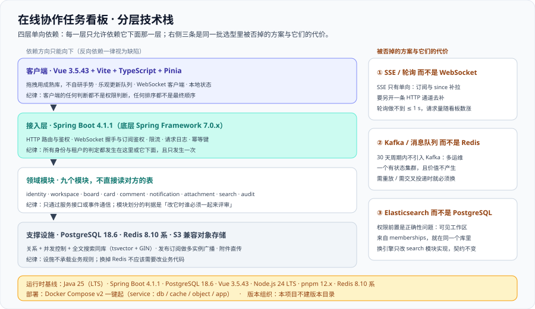

# 技术选型与版本基线

这一页回答三个问题：**每一项选型为什么是它**；**被否掉的方案代价是什么**；以及**这一套东西到底锁在哪个版本上**。它是 [需求拆分](../Requirements/index.md) 的下游——需求定了「要达到什么」，选型定「用什么达到」——也是 [环境与工程骨架](../Environment/index.md) 的上游：环境页里的每一个镜像 tag 与运行时版本，都能在这一页找到出处。



::: warning 本项目只有文档，没有代码
下面出现的配置文件、依赖坐标与命令，都要读者**在自己的工程里创建**。本仓库不存放 `pom.xml`、`package.json`、`compose.yaml` 与任何源码。
:::

## 一、选型三原则

选型不是「哪个技术更好」，而是**在既定约束下哪个代价可以接受**。本项目三条原则，按优先级排序：

| 原则 | 含义 | 违反它的代价 |
| --- | --- | --- |
| **一、复用既有资产优先** | 后端基座取 [后端通用模板](../../../Base/BackendTemplate/index.md)，前端基座取 [Vue3 前端模板](../../../Base/Vue3Template/index.md)；认证、统一响应、异常处理、CI 门禁一律复用 | 每个项目重写一遍登录、异常与门禁，30 天里至少要吃掉一周，而且**重写出来的版本一定比模板差** |
| **二、30 天能交付** | 每一项都要能在一个月内被人「看懂 + 起得来 + 排得了障」 | 引入一个没人维护过的中间件，排障时间不可预测；周期末的卡点会全部集中在这里 |
| **三、每一项都要能说清「被替换的代价」** | 选型表必须带一列「被否掉的方案与它的代价」 | 写不出代价，说明这一项是「习惯」而不是「选择」；将来没人敢替换它，也没人知道为什么不能替换 |

::: tip 三原则的读法
这三条不是并列的：**第一条是默认动作**（能复用就不自研），**第二条是否决条件**（30 天做不完的方案直接出局），**第三条是留档要求**（选它的理由与不选它的理由必须同时写下）。
只有第三条容易被认为是「写文档的负担」——恰恰相反，它是**唯一能让下一个人做出同样判断的东西**。本页第四节的四条 ADR 就是它的落地形态。
:::

## 二、逐层选型表

下面前八行与[项目总览](../index.md)的「技术选型（结论）」表**逐字一致**，本节把「一句话理由」扩写为「一句话理由 + 被否掉的方案与它的代价」；后三行（搜索、测试、观测）只在总览里出现结论，论证在此补全。

| 层 | 选型 | 一句话理由 | 被否掉的方案与它的代价 |
| --- | --- | --- | --- |
| 前端 | **Vue 3.5 + Vite + TypeScript + Pinia** | 复用前端模板；拖拽用成熟库，不自研手势 | 自研拖拽：要自己处理指针捕获、自动滚动、触摸设备与无障碍，**至少一周，且结果一定不如现成库** |
| 后端 | **Java 25（LTS）+ Spring Boot 4.1** | 复用后端模板；实时链路用 Spring 自己的 WebSocket 支持，不引入第二个运行时 | 上 Node.js 做实时层：多一个运行时、多一套部署与监控，**并且要把 Java 侧的鉴权逻辑重写一遍** |
| 数据库 | **PostgreSQL 18** | 一个库同时解决关系、并发控制与全文搜索，30 天周期内不引入第二套存储 | 关系库 + 搜索引擎 + 缓存三件套：一致性面与运维面同时翻倍，**而本期规模根本用不上** |
| 实时通道 | **WebSocket（STOMP 语义）+ Redis 发布订阅** | 多实例部署时「广播」必须跨进程，这是唯一需要外部依赖的地方 | 见本节 3.1 的完整论证 |
| 顺序与并发 | **乐观锁（`version`）+ 分数排序键（fractional ranking）** | 拖动是「重排」，用整数 `position` 重排必然引发全列更新 | 整数 `position`：一次拖动更新 N 行并锁整列，**并发拖动互相覆盖**；见 [数据库设计](../Database/index.md) 第四节 |
| 通知 | **事务内写 outbox 表 + 异步投递** | 「评论成功但通知丢了」是协作系统最容易被投诉的一类不一致 | 事务内直接发通知：事务回滚会**凭空多一条通知**，发送失败会**永久丢一条** |
| 附件 | **S3 兼容对象存储 + 预签名上传** | 附件不穿业务库；签名把「能不能下载」交给服务端判定 | 附件存数据库或经业务进程转发：**大文件流量把业务线程池拖满**，且备份体积失控 |
| 部署 | **Docker Compose 一键起** | 与周期 5 同构，减少「换项目就要重学部署」的成本 | 上 Kubernetes：本地开发、联调与交付三套环境都要维护，**30 天里纯属负担** |
| 搜索 | **PostgreSQL `tsvector` + GIN 索引** | 搜索 QPS 远低于写入 QPS，一个库就够 | 见本节 3.3 的完整论证 |
| 测试 | **JUnit 5 + MockMvc 集成测试（复用模板）+ 前端 Vitest** | 复用后端模板已有的集成测试骨架；接口层用 MockMvc 覆盖权限与幂等 | 端到端浏览器测试先行：**慢、脆、且难定位**；`viewer` 的每一格权限都跑一遍浏览器不可接受 |
| 观测 | **Actuator + Micrometer 指标 + 结构化日志（含 `traceId`）** | 直接接周期 5 那套采集与告警链路，接口指标、错误率与延迟口径不用重定 | 自建观测栈：多一套要运维的系统，**且第 4 周的上线验收本来就要接周期 5 的链路** |

## 三、三处关键取舍

三处取舍的共同点是：**都能「先用简单方案跑起来」，但都会在某个确定的节点上必须换掉**。所以每一处都要写清「什么时候就必须换」——不写这一条，替换就会被无限延期。

### 3.1 实时通道：WebSocket（STOMP 语义）而不是 SSE 或轮询

**结论**：一条 WebSocket 连接，语义层用 STOMP 的「订阅 / 目的地」模型（`/topic/board:{boardId}`），让「订阅哪块看板」成为一次显式的订阅动作而不是一条约定俗成的消息格式。

三个方案的对照：

| 方案 | 能力 | 代价 |
| --- | --- | --- |
| 轮询（每 2 秒拉一次） | 实现最简单，不需要长连接 | 实时可见延迟受轮询周期限制，**做不到 ≤ 1 s**；且连接数与请求量随「打开的看板数」线性增长，与本期 200 RPS 的目标直接冲突 |
| SSE（Server-Sent Events） | 单向推送，天然带浏览器自动重连与 `Last-Event-ID` | **只有服务端到客户端一个方向**；而本项目需要「客户端告诉服务端我要订阅哪块看板、我上次收在哪个 `seq`」。用 SSE 就得再加一条 HTTP 通道去补这两件事，**等于把一条连接拆成两条** |
| **WebSocket + STOMP 语义** | 双工；订阅动作显式、可鉴权；与 Spring 的 `WebSocketMessageBroker` 直接对应 | 需要自己实现心跳、背压与重连（`Last-Event-ID` 那种免费能力没有） |

**为什么订阅语义必须是显式的（这是选 STOMP 而不是「裸 WebSocket」的真正原因）**：如果订阅靠一条自定义 JSON 消息，那么「鉴权」这一步很容易被写成「连上了就能收」。STOMP 把订阅做成一个**有目的地的动作**，服务端才有地方插进那次检查——这正是 [架构设计](../Architecture/index.md) 第七节把「WebSocket 订阅」列为三处权限判定点之一的前提。

**代价**：心跳（服务端 30 秒 ping / 客户端 10 秒无 pong 断开）、背压（每连接队列上限，超限丢事件并标记 `resync_required`）、重连（指数退避 + 抖动）全部要自己实现。**这三件事一个都不能省**，它们共同对应 [需求拆分](../Requirements/index.md) 4.2 节的三个指标。

**什么时候就必须换**：当订阅关系需要**跨实例共享**（例如「一个人打开了 50 块看板、连接被分散在 10 台实例上」）时，需要在 Redis 里维护一份连接与订阅的映射，并处理实例下线的清理。本期**不做连接迁移**，因为多实例下的连接数远小于这个量级。

### 3.2 多实例广播：Redis 发布订阅，而不是消息队列

**结论**：事务提交之后，把事件投到频道 `board:{boardId}`；每个持有该看板连接的实例订阅这个频道，收到后推给本机连接。

| 方案 | 为什么不用 / 为什么用它 |
| --- | --- |
| 单实例内的 `ApplicationEventPublisher` | **多实例部署时完全失效**：A 实例的改动永远推不到挂在 B 实例上的连接。而「多实例」不是可选项——第 4 周的一键部署起的就是可水平扩展的形态 |
| 消息队列（Kafka / RabbitMQ 形态） | 能力强得多：持久化、消费位点、重放、消费者组。但本项目**根本不需要这些**：广播是「尽力而为」的——丢了不要紧，客户端带 `since` 补拉就能补回来。引入队列等于**为一份不需要的持久化承诺，多运维一个中间件** |
| **Redis 发布订阅** | 恰好匹配「尽力而为 + 低延迟 + 不需要历史」的语义；Redis 本来就要用于在线状态，**零新增组件** |

**一条必须写死的纪律**：**Redis 的发布订阅不做持久化**，因此它不能承担「事件不丢」的责任。事件不丢的责任在 `board_events` 表（同一事务内落库）与客户端的 `since` 补拉上。**把这两件事混起来，是这一层最常见的误用**——一旦有人以为「发过就一定会收到」，补拉逻辑就会被删掉。

**什么时候就必须换**：出现下面任意一条时，就必须换成带持久化与消费位点的消息队列——

1. **需要事件重放**：例如新增一个「审计分析」或「周报生成」的下游消费者，它要读历史事件而不是实时事件。
2. **广播的吞吐超过了单个 Redis 频道的处理能力**（单频道能扛的量很大，但一旦出现「一块超热看板占满整个频道」就需要分片）。
3. **要求至少一次投递到外部系统**（例如把事件同步到别的存储），这时不能靠客户端补拉兜底。

::: danger 为什么不在 30 天周期内引入 Kafka
不是因为 Kafka 不好，而是因为**引入它要付三笔账，且这三笔账在本期都不产生价值**：① 运维一套有状态集群（含磁盘与备份策略）；② 事件要重新定义「key、分区、保留期、幂等」四项语义；③ 排障要多学一层（消费位点、分区倾斜、再平衡）。
而它解决的那个问题——「多实例广播」——**Redis 发布订阅已经够用**，因为正确性由 `board_events` 与补拉保证，与广播通道是否持久无关。
:::

### 3.3 搜索：先用 PostgreSQL（`tsvector` + GIN），不引入 Elasticsearch

**结论**：`cards.search_doc` 用触发器在写入时维护，配 `GIN (search_doc)` 索引；查询**先按可见工作区收窄，再按相关度排序，最后带 `LIMIT 50`**。

| 判断维度 | 继续用 PostgreSQL | 该换搜索引擎 |
| --- | --- | --- |
| 语料规模 | 单表在百万级以内 | 需要跨表、跨类型统一打分与高亮 |
| 查询形态 | 能接受「先收窄租户再匹配」的两段式 | 需要聚合、同义词、拼音、拼写纠错 |
| 流量结构 | 搜索 QPS 远低于写入 QPS | 搜索本身成为主要流量 |

**为什么本期一定选前者**：三个理由里最硬的一条是**权限前置**。搜索结果必须限定在用户可见的工作区内，而「可见工作区」这个集合来自 `memberships`——它就在同一个库里。用 PostgreSQL 时这件事是一条 `WHERE b.workspace_id = ANY(...)`；换成 Elasticsearch 之后，就变成**「把权限数据同步到索引里」还是「查完再逐条回表过滤」**的两难：前者引入一份会漂移的权限副本（改一次角色要重建一批文档），后者在深分页时会退化成逐条查库。**这不是性能问题，是正确性问题。**

另外两条：中文分词（`pg_jieba` / `zhparser`）在本期语料上够用，且**必须在第 2 周之前实测决定**（[数据库设计](../Database/index.md) 第七节已登记这一条）；以及搜索 QPS 远低于写入 QPS，索引维护成本可以接受。

**代价**：① 分词扩展要自己装，装不上时相关性明显变差；② 没有高亮与拼写纠错，只能前端做简单处理。

**什么时候就必须换**：语料超过百万级、或需要跨表统一打分与高亮、或搜索成为主要流量时。**替换的接口边界已经预留**：`search.search(userId, workspaceId, q)` 是 `search` 模块唯一的对外契约，换引擎只改这个模块的实现——**这也是把它单独列成一个模块的原因**。

## 四、四条一票否决项

下面四条不是「建议」，是**评审时可以直接否掉方案的判据**。每条都给出「为什么」与「正确的替代写法」。

| 一票否决 | 为什么 | 正确的替代写法 |
| --- | --- | --- |
| **任何要求「把顺序写成整数 `position`」的方案** | 插入到第 2 位要更新它后面所有行，一次拖动产生 N 次行更新，并且并发拖动会互相覆盖 | 分数排序键：取相邻两键算中间值，**只更新一行** |
| **任何让前端决定权限的方案** | 前端代码对攻击者完全可见；前端「藏按钮」只是体验优化，不是权限。一旦权限判断出现在客户端，服务端必然有一处没判 | 权限只在服务端三处判定（HTTP / WebSocket 订阅 / 附件签名）；前端按角色渲染只是为了少让人点空 |
| **任何把附件流量穿过业务进程的方案** | 2 MB 的附件乘以并发数会占满业务线程池与堆内存；备份体积与出口带宽也一起失控 | 客户端直传对象存储 + 短时效预签名 URL；业务进程只签发与登记元数据 |
| **任何需要在业务库里存令牌明文的方案** | 一次数据库泄漏 = 全部会话被接管；而且明文令牌无法被安全地「按族撤销」 | 只存散列（`token_hash`），按 `family_id` 分族，检测到复用即整族撤销 |

::: tip 一票否决项的用法
四条都写在**评审的前 5 分钟**：先把方案过一遍这四条，有命中就直接返回修改，不必进入后续讨论。
这样做的收益不是「严格」，而是**省时间**——这四类问题一旦进了实现阶段才发现，返工范围都是数据模型级的。
:::

## 五、版本事实表（2026-10 口径）

下表是本项目锁定的版本基线，**与 [项目总览](../index.md) 的选型结论、[环境与工程骨架](../Environment/index.md) 的镜像 tag 三处必须逐字一致**：

| 组件 | 版本事实（2026-10） | 本项目用它做什么 |
| --- | --- | --- |
| Java | **25（LTS）** | 后端运行时；虚拟线程用于阻塞式 JDBC 与 outbox 投递循环 |
| Spring Boot | **4.1.1**（2026-08-20，4.1 线 OSS 支持至 2027-07-31） | 后端框架：Web、WebSocket、Actuator、多环境配置与健康检查 |
| Spring Framework | **7.0.x** | Boot 4.1 的底层框架；WebSocket / STOMP 的支持来自这一层 |
| PostgreSQL | **18.6**（当前稳定主版本 18，`uuidv7()` 自 18 起可用） | 关系存储 + 并发控制 + 全文搜索（`tsvector` + GIN） |
| Vue | **3.5.43**（3.5 稳定线） | 前端框架：组合式 API、`script setup`、Pinia 状态管理 |
| Node.js | **24 LTS** | 前端构建与开发服务器运行时（Vite） |
| pnpm | **12.x** | 前端包管理（含 lockfile 与 workspace） |
| Redis | **8.10 系** | 多实例广播（发布订阅）+ 连接在线状态 |
| Docker Compose | **v2** | 本地与交付环境的一键编排（`docker compose` 子命令形态） |

::: danger 「日期 + 支持窗口」这一列不能省
`Spring Boot 4.1.1（2026-08-20）` 与 `4.1 线 OSS 支持至 2027-07-31` 是**两个不同的事实**：前者是版本发布的日期，后者是这一条线还能收到开源修复的截止日。
只写前者，半年后会有人问「我们是不是该升级了」却查不到依据；只写后者，没人知道当前到底是哪个补丁版本。
**判断某个基线是否还成立，第一眼看的是支持窗口，不是发布日。**
:::

## 六、版本组织说明

::: info 本项目不建版本目录
本项目**不建版本目录**——30 天周期内不引入第二条并行维护线。理由有三条：

1. **周期内只有一个基线**：四个里程碑共用同一份版本事实表，不存在「老项目还在用上一版」的场景。
2. **并行维护线的成本不在文档而在验证**：一旦出现第二个版本目录，每一次判据执行都要问「这条判的是哪个版本」，[验收](../Acceptance/index.md) 的 18 格权限矩阵会被迫跑两遍。
3. **仓库的既有做法是给「框架与语言」建版本目录，不是给「项目」建**：需要按大版本组织的是框架类主题——[Spring5](/docs/Backend/Java/Frame/Spring/Spring5/index.md) / [Spring6](/docs/Backend/Java/Frame/Spring/Spring6/index.md)、Vue [Vue2](/docs/Frontend/Frame/Vue/Vue2/index.md) / [Vue3](/docs/Frontend/Frame/Vue/Vue3/index.md)、Spring Boot [v2](/docs/Backend/Java/Frame/SpringBoot/v2/index.md) / [v3](/docs/Backend/Java/Frame/SpringBoot/v3/index.md) / [v4](/docs/Backend/Java/Frame/SpringBoot/v4/index.md)。它们的共同做法是**旧版本保留并标注维护状态、不覆盖**——本项目按同样的精神处理版本变化：**换基线时更新本页的一张表，并为旧基线保留一行「已停止在本项目使用」的说明，而不是新建一个页面**。
:::

## 七、决策记录（ADR）

ADR 记录的**不是结论，而是结论的保质期**：每一条都必须能回答「什么情况下我要推翻它」。四条 ADR 与第三节的三处取舍是一体两面——第三节给论证过程，这里给可长期引用的四段式。

### ADR-1：实时通道用 WebSocket（STOMP 语义）

| 项 | 内容 |
| --- | --- |
| **背景** | 改动必须在 1 秒内出现在其他人的屏幕上；同时客户端要能表达「我订阅这块看板」与「我上次收在 `seq=105`」 |
| **决定** | 一条 WebSocket 长连接；语义层用 STOMP 的订阅模型，每块看板单独订阅 |
| **代价** | 心跳、背压、重连三件事全部自己实现；代理与负载均衡要显式配置长连接升级与超时 |
| **什么情况下推翻它** | 需要跨实例共享订阅关系、或需要「连接迁移」时，要引入连接的集中登记与清理；若届时也不做，就换成服务端主动下发订阅（客户端只报 `workspaceId`），把订阅决策收回服务端 |

### ADR-2：多实例广播用 Redis 发布订阅

| 项 | 内容 |
| --- | --- |
| **背景** | 多实例部署时，一次写操作产生的广播必须送到「所有持有该看板连接的实例」 |
| **决定** | 事务提交后投到频道 `board:{boardId}`；实例订阅后推给本机连接。**广播不承诺送达**，漏掉由客户端带 `since` 补拉 |
| **代价** | Redis 抖动或重启期间**实时性下降**（数据仍正确）；没有历史，无法重放；需要一条「`seq` 落后」的告警来发现它 |
| **什么情况下推翻它** | ① 出现需要重放历史事件的下游消费者；② 要求把事件至少一次投递到外部系统；③ 单频道吞吐不够（出现超热看板）。命中任意一条即换消息队列，**并且只换这一处**——业务代码只依赖「投递事件」这个动作 |

### ADR-3：顺序字段用分数排序键（字符串），不用整数 `position`

| 项 | 内容 |
| --- | --- |
| **背景** | 拖动是「重排」；用整数表示顺序时，插入到第 2 位要更新它后面所有行 |
| **决定** | `position text COLLATE "C"`，取相邻两键算中间值；**一次拖动只更新一行**；相邻键无空隙时对该列做一次压缩并占用一个新 `seq` 广播 |
| **代价** | 键长会随插入次数缓慢增长；需要一条低频的压缩路径；比较必须与数据库默认排序规则无关（必须写 `COLLATE "C"`） |
| **什么情况下推翻它** | ① 单列容量远超本期假设（每列 500 张）且插入集中在同一位置；② 业务改成「按字段排序」（例如按到期日排），此时顺序不再是人工维护的偏好，而是一个函数——**那就应当改成计算字段 + 索引，而不是继续维护排序键** |

### ADR-4：搜索先用 PostgreSQL（`tsvector` + GIN），不引入 Elasticsearch

| 项 | 内容 |
| --- | --- |
| **背景** | 搜索必须限定在用户可见的工作区内；可见集合来自 `memberships`，与卡片数据在同一个库 |
| **决定** | `cards.search_doc`（触发器维护）+ `GIN` 索引；查询两段式：先按可见工作区收窄，再按相关度排序，最后 `LIMIT 50` |
| **代价** | 需要自装分词扩展（`pg_jieba` / `zhparser`）才能在中文上有可用性；没有高亮、同义词与拼写纠错 |
| **什么情况下推翻它** | ① 语料超过百万级；② 需要跨表统一打分与高亮；③ 搜索 QPS 超过写入 QPS。**推翻时只改 `search` 模块的实现**——它的对外契约 `search(userId, workspaceId, q)` 不变 |

## 八、当日做了什么

1. 定下**选型三原则**并排好优先级（复用既有资产优先 → 30 天能交付 → 每一项都要能说清被替换的代价），指出只有第三条最容易被当成负担，而它恰恰是唯一能让下一个人做出同样判断的东西。
2. 产出**逐层选型表**（前端 / 后端 / 数据库 / 实时通道 / 顺序与并发 / 通知 / 附件 / 搜索 / 测试 / 部署 / 观测共 11 层），每行补齐「被否掉的方案与它的代价」一列，前八行与[项目总览](../index.md)的技术选型结论表逐字一致。
3. 完成**三处关键取舍的完整论证**：① 为什么是 WebSocket（含 STOMP 语义）而不是 SSE 或轮询——**并指出选 STOMP 的真正理由是让「订阅」成为一个可鉴权的显式动作**；② 为什么 Redis 发布订阅够用而 30 天周期内不引入 Kafka——**并写下它一旦被误当成「发过就一定收到」就会删掉补拉逻辑**；③ 为什么搜索先用 PostgreSQL——**权限前置是正确性问题而不是性能问题**。三处都写了「什么时候就必须换」。
4. 定下**四条一票否决项**（整数 `position`、前端决定权限、附件穿业务进程、令牌明文入库），每条给出「为什么」与「正确的替代写法」，并说明用法是评审前 5 分钟先过一遍。
5. 产出**版本事实表（2026-10 口径）**，九项版本逐字锁定 Java 25（LTS）、Spring Boot 4.1.1、Spring Framework 7.0.x、PostgreSQL 18.6、Vue 3.5.43、Node.js 24 LTS、pnpm 12.x、Redis 8.10 系、Docker Compose v2，并逐项写明「本项目用它做什么」。
6. 写下 **`::: info` 版本组织说明**：本项目不建版本目录，并指路仓库既有做法（Spring / Vue / Spring Boot 的版本目录**保留旧版、标注状态、不覆盖**）。
7. 产出**四条 ADR**（实时通道 / 多实例广播 / 顺序字段 / 搜索），每条按「背景 / 决定 / 代价 / 什么情况下推翻它」四段式记录。
8. 给出**本机可跑的版本确认命令与预期输出**，并补一条自检：九项基线里每一项都要有一条能返回 0/1 的命令。

## 九、如何验证

前四条是本机可跑的版本确认命令（**输出随发行版略有差异，判据是能否匹配到主版本号**，不要求逐字相同）：

```shell
# 1) 后端运行时：期望包含 version "25" 且带 LTS
java -version 2>&1 | head -n 1
```

```text
openjdk version "25" 2026-09-15 LTS
```

```shell
# 2) 前端运行时与包管理：期望 v24.x 与 12.x
node -v
pnpm -v
```

```text
v24.10.0
12.1.0
```

```shell
# 3) 数据库客户端：期望 psql (PostgreSQL) 18.6
psql --version
```

```text
psql (PostgreSQL) 18.6
```

```shell
# 4) 编排形态：期望子命令形态 v2.x（不是独立二进制的 docker-compose）
docker compose version
redis-server --version
```

```text
Docker Compose version v2.39.1
Redis server v=8.10.2 sha=00000000:0 malloc=jemalloc-5.3.0 bits=64
```

把四条写成一条能返回 0/1 的自检（**判据只匹配主版本号**，避免被补丁号卡住）：

```shell
# 5) 一次跑完九项基线中的四项可探测项；全部匹配则输出 OK
java -version 2>&1 | grep -qE 'version "25' \
  && node -v | grep -qE '^v24\.' \
  && pnpm -v | grep -qE '^12\.' \
  && psql --version | grep -qE '18\.6' \
  && echo OK
# 期望输出：OK
```

::: warning 版本确认命令的两条读法
1. **`java -version` 的输出走 stderr**，必须 `2>&1` 或 `2>/dev/null`，否则在脚本里会「看起来什么都没打印」；`node -v` / `pnpm -v` / `psql --version` 走 stdout，不需要重定向——**同一条命令块里不能对两者用同一种写法**。
2. **判据匹配主版本号（`"25`、`^v24\.`），不匹配完整补丁号**：本页写的 `Spring Boot 4.1.1`、`PostgreSQL 18.6` 是**当前基线的取值**，用它当门禁会在下一次补丁发布时误报。**基线的用途是「记录」，门禁的用途是「拦截不兼容」**——两者用的粒度不同。
:::

```shell
# 6) 本页的文档级自查（本机已跑，括注为实测值）
grep -c '^| Java |' index.md                                   # 期望 1
grep -c '30 天周期内不引入第二条并行维护[线]' index.md           # 期望 1
grep -c '^### ADR-' index.md                                   # 期望 4
grep -c '^| \*\*什么情况下推翻它\*\* |' index.md               # 期望 4
grep -c 'assets/tb-techstack.sv[g]' index.md                   # 期望 1
```

## 十、下一步

1. **[环境与工程骨架](../Environment/index.md)**：把本页的九项版本落成一份 `compose.yaml`、一份 `.env` 与一份目录结构，并给出**一键起 + 四条验证**。
2. **[验收](../Acceptance/index.md)**：把「依赖可起 / 服务可启动 / 接口可调用 / 页面可访问」写成 A2 ~ A5 四步。
3. **第 140 天**：进入**核心链路编码**——卡片拖动的服务端实现、接口契约定稿、幂等与并发控制的落地。

## 参考资料

- [项目总览](../index.md)（技术选型结论表，与本页前八行逐字一致） · [需求拆分](../Requirements/index.md) · [架构设计](../Architecture/index.md)
- [环境与工程骨架](../Environment/index.md) · [验收：把「做完了」变成可执行的步骤](../Acceptance/index.md)
- [完整项目交付 · 架构文档](/docs/Others/ProjectDelivery/Architecture/index.md)（ADR 的四段式与「可逆 / 不可逆决策」的划分口径）
- [完整项目交付 · 接口契约](/docs/Others/ProjectDelivery/Contract/index.md)（契约三问：约定是什么、定错的代价、怎么验证没被破坏）
- [分布式缓存 · 拓扑](/docs/Backend/DistributedCache/Topology/index.md)（多实例广播与发布订阅的取舍）
- [响应式编程 · 背压](/docs/Backend/ReactiveProgramming/Backpressure/index.md)（出口没有真背压时的正确策略）
- [数据建模](/docs/DB/DataModeling/index.md) · [PostgreSQL 专题](/docs/DB/Relational/PostgreSQL/index.md)（顺序字段与全文检索的原理侧）
- [性能与容量工程 · 容量规划与弹性](/docs/Ops/PerformanceEngineering/Capacity/index.md)（200 RPS 与 P99 的口径来源）
