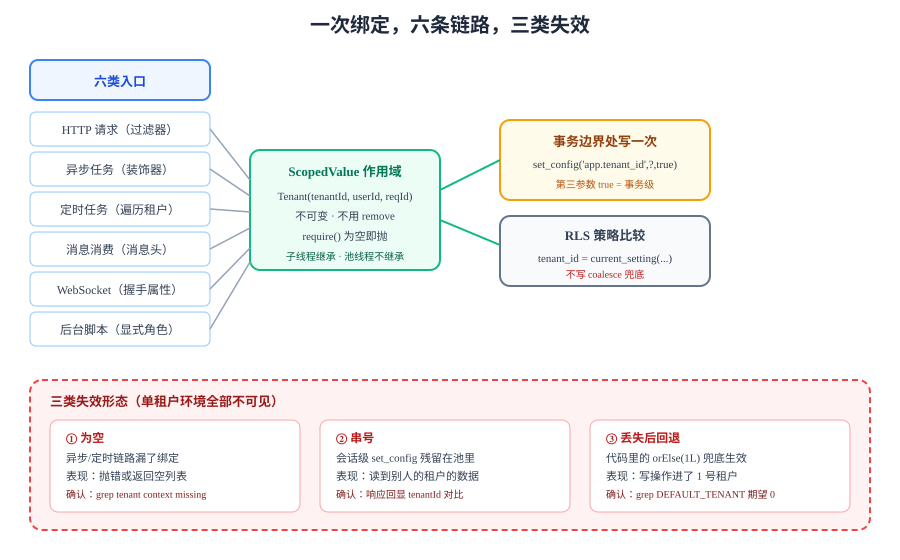

# 租户上下文：从请求头到 SQL 的六条链路

数据库层的行级安全只认一个东西：**当前连接上的 `app.tenant_id`**。这个值从哪来、什么时候没的、什么时候串了，全在应用侧决定。本页把「谁的请求」这条信息从入口一路追到 SQL，并给出六条链路上各自的失效形态与判据。



## 判据族声明

本页判据族 `TCT-A` ~ `TCT-H`，共 8 条。定义表在第十节。

## 一、为什么不能靠「每个方法都传 tenantId」

最直觉的做法是把 `tenantId` 加进每个服务方法的参数表。它在三个地方必然失守：

| 失守点 | 具体表现 | 后果 |
| --- | --- | --- |
| **框架回调** | 定时任务、消息监听、WebSocket 消息处理、缓存失效回调——这些方法的签名由框架决定，加不了参数 | 只能从别处「猜」一个租户，通常是错的 |
| **间接调用** | 服务 A 调仓储 B 调审计 C，B 和 C 都要租户，于是 A 的签名变成 `(tenantId, x, y, z, ...)` | 参数列表被污染，且**任何一个人漏传都编译通过**（`long` 传错位置也编译通过） |
| **新人改代码** | 新增一个方法时，参数表里少写一个 `long tenantId` | 编译成功、测试可能也过，线上变成「读到别人的数据」 |

::: danger 最容易漏的一层
参数化方案在**单租户测试环境**里 100% 正常——因为只有一个租户，传错也看不出来。它的缺陷只会在多租户数据同时存在时暴露，而那时通常已经上线。
:::

结论：**租户是「请求的属性」，不是「方法的参数」**。它必须存在于一个与请求同生命周期、且业务代码读得到的地方。

## 二、上下文对象：不可变 + 作用域绑定

上下文对象本身只装两样东西：租户标识与「谁在操作」。**不要**把语言、时区、功能开关全部塞进来——那些是配置项，不是请求属性。

```java [src/main/java/com/example/team/tenant/TenantContext.java]
public final class TenantContext {

    /** 一次请求的租户身份。不可变，构造后不再改动。 */
    public record Tenant(long tenantId, long userId, String requestId) {}

    private static final ScopedValue<Tenant> CURRENT = ScopedValue.newInstance();

    private TenantContext() {}

    /** 读：没绑定就抛，绝不返回 null。 */
    public static Tenant require() {
        if (!CURRENT.isBound()) {
            throw new IllegalStateException("tenant context missing: 请求未经过 TenantFilter 或异步链路未传播");
        }
        return CURRENT.get();
    }

    /** 写：只在入口处调用一次，作用域结束自动失效。 */
    public static void runWith(Tenant tenant, Runnable body) {
        ScopedValue.where(CURRENT, tenant).run(body);
    }

    public static <T> T callWith(Tenant tenant, Callable<T> body) throws Exception {
        return ScopedValue.where(CURRENT, tenant).call(body::call);
    }
}
```

::: info 为什么用 `ScopedValue` 而不是 `ThreadLocal`
`ScopedValue`（JEP 506）在 **JDK 25 转正**，和 `ThreadLocal` 的差别正好落在这三条上：

1. **不需要 `remove()`**——绑定随作用域结束自动失效，不存在「忘了清理导致串号」；
2. **不可变**——作用域内谁都不能改，想换租户只能再开一层作用域（换租户这件事本身就该显眼）；
3. **会传给在绑定期内新建的子线程**——`StructuredTaskScope.fork()` 出来的子任务自动继承，不需要 `InheritableThreadLocal` 那套复制。

注意它**不会**自动传给线程池里的线程：池里的线程是在绑定之前就创建好的，不满足「绑定期内新建」。第三节讲这一条怎么补。
:::

## 三、六条链路：谁负责把上下文放进作用域

同一个应用有六个入口，每个入口都要做「解析 → 绑定 → 收尾」三件事。**漏掉任何一个，该链路就会退化成「读到别人的数据」或「什么都读不到」**。

| 链路 | 绑定发生的位置 | 漏了会怎样 | 保护手段 |
| --- | --- | --- | --- |
| **HTTP 请求** | `TenantFilter`（在认证之后、事务之前） | 上下文为空 → 所有查询报 `IllegalStateException` | `require()` 抛错 + 启动自检 |
| **异步任务**（`@Async`、线程池） | `TaskDecorator` 或提交点显式绑定 | 上下文为空（池线程没有绑定） | 装饰器统一包装 + 禁用裸 `new Thread` |
| **定时任务** | 任务体自己按租户遍历 | 要么空，要么用「第一个租户」跑全量 | 遍历器统一入口，禁止单租户定时任务 |
| **消息消费** | 消息头里的 `tenant_id` | 空，或用了生产者线程残留的值 | 消费者模板统一从 header 绑定 |
| **WebSocket** | 握手阶段解析 token，写进会话属性 | 空（消息帧里没有 token） | 握手拦截器 + 每帧从会话取 |
| **启动期自检 / 后台脚本** | 显式指定租户，或使用平台角色 | 空，或越权全表扫 | 显式角色 + 审计 |

::: warning 「异步」是最常漏的一条
`@Async` 方法在另一个线程执行，那个线程上没有绑定。表现不是报错，而是**上下文为空 → 抛 `IllegalStateException`**（如果用了 `require()`），或者**静默返回空列表**（如果用了 `orElse(null)`）。后者更危险：业务上看起来「这个人没有待办」，实际是「查不到」。
:::

## 四、三种失效形态，三种确认方法

上下文出问题的形态只有三种，每种都有一条**不依赖读代码**的确认方法：

| 形态 | 现象 | 一句话确认 | 为什么难发现 |
| --- | --- | --- | --- |
| **为空** | 查询报 `IllegalStateException`，或返回空列表 | 日志里搜 `tenant context missing`，看是否集中在异步/定时任务 | 只在特定入口出现，主流程完全正常 |
| **串号** | 读到了别的租户的数据 | 在响应里回显 `tenantId`，对比登录用户所属租户 | 需要两个租户同时有数据才看得见 |
| **丢失后回退** | 代码里 `orElse(1L)` 之类的「兜底租户」生效 | `grep -rn "DEFAULT_TENANT" src/`，期望 0 命中 | 兜底值通常是开发环境的租户 ID，测试环境正好有数据 |

::: danger 兜底值是最坏的一种「修复」
`TenantContext.get().orElse(1L)` 能让报错消失，也能让演示跑通，但它把「上下文丢失」变成了「以 1 号租户身份执行」。如果 1 号租户是种子数据所在租户，读操作看起来完全正常，**写操作会往别人的租户里插数据**。
正确写法只有一条：**为空就抛**。要兜底就在入口处补绑定，不要在下游猜。
:::

## 五、HTTP 链路：过滤器的三件事与顺序

```java [src/main/java/com/example/team/tenant/TenantFilter.java]
@Component
@Order(Ordered.LOWEST_PRECEDENCE - 100)   // 必须在认证之后、事务之前
public class TenantFilter extends OncePerRequestFilter {

    private final JwtDecoder decoder;

    @Override
    protected void doFilterInternal(HttpServletRequest req, HttpServletResponse res, FilterChain chain)
            throws ServletException, IOException {

        // ① 只从已验签的 token 里取租户，绝不读 X-Tenant-Id 之类的请求头
        var auth = (JwtAuthenticationToken) SecurityContextHolder.getContext().getAuthentication();
        long tenantId = ((Number) auth.getToken().getClaim("tid")).longValue();
        long userId   = Long.parseLong(auth.getToken().getSubject());

        var tenant = new TenantContext.Tenant(tenantId, userId, req.getHeader("X-Request-Id"));

        // ② 绑定作用域，把整条链路包进去（含事务提交与响应序列化）
        TenantContext.runWith(tenant, () -> {
            try { chain.doFilter(req, res); }
            catch (IOException | ServletException e) { throw new UncheckedServletException(e); }
        });
    }
}
```

三件事按顺序：**认证 → 解析租户 → 绑定作用域**。顺序错了会出两类问题：

1. **绑定放在认证之前**：认证失败也要绑定，绑出来的租户来自未验签的 token，等于信任了攻击者。
2. **绑定放在 `chain.doFilter` 之后**：业务代码在 `doFilter` 内部执行，此时上下文还没绑定。

::: danger 不要信任任何「租户」请求头
`X-Tenant-Id`、`X-Workspace`、查询参数 `?tenant=` 都是**输入**，不是**身份**。把它们当身份用，等于把越权入口直接开在网关后面。唯一可信来源是**已验签 token 里的 claim**（或服务端会话）。
`TCT-F` 就是这条判据：全库检索这三个名字的读取点，期望只在「日志/审计」里出现，不在「解析租户」里出现。
:::

## 六、异步链路：装饰器是唯一可控的补法

线程池里的线程**不会**继承 `ScopedValue`（它们不是绑定期内新建的）。补法有两种，推荐第一种：

```java [src/main/java/com/example/team/tenant/TenantAwareTaskDecorator.java]
/** 把提交时刻的上下文带进池线程，并在任务结束后清空。 */
public class TenantAwareTaskDecorator implements TaskDecorator {
    @Override
    public Runnable decorate(Runnable task) {
        var captured = TenantContext.require();          // 提交线程上的租户
        return () -> TenantContext.runWith(captured, task);
    }
}
```

```java [src/main/java/com/example/team/config/AsyncConfig.java]
@Bean
TaskExecutor applicationTaskExecutor() {
    var exec = new ThreadPoolTaskExecutor();
    exec.setCorePoolSize(8);
    exec.setMaxPoolSize(32);
    exec.setQueueCapacity(200);
    exec.setTaskDecorator(new TenantAwareTaskDecorator());   // ← 唯一需要改的一行
    exec.initialize();
    return exec;
}
```

判据是「**提交线程必须已有上下文**」：如果 `@Async` 方法被一个定时任务调用，而定时任务自己没绑定，装饰器在 `require()` 处就会抛错——这是**想要的**，它把「哪个入口忘了绑定」当场暴露，而不是等到查询返回空列表。

第二条路是 `ScopedValue` 的显式传递：在 `StructuredTaskScope` 里 `fork()` 子任务，绑定自动继承。它适合「一次请求内并行查三块数据」这种场景，不适合「提交一个后台任务，五分钟后执行」——后者已经出了作用域。

## 七、定时任务与消息消费：两条「没有请求」的链路

这两条链路没有 HTTP 请求，上下文只能由**任务本身**提供。它们的正确形态是「遍历 + 逐个绑定」：

```java [src/main/java/com/example/team/job/OutboxRelayJob.java]
@Scheduled(fixedDelay = 2_000)
public void relay() {
    // 取待投递任务时只读 tenant_id，不读业务字段
    for (long tenantId : outboxRepo.distinctPendingTenants(200)) {
        TenantContext.runWith(TenantContext.Tenant.system(tenantId), () -> {
            outboxRepo.relayBatch(tenantId, 100);   // 这里所有 SQL 都带上该租户
        });
    }
}
```

消息消费则从消息头取：

```java [src/main/java/com/example/team/mq/CardEventListener.java]
@KafkaListener(topics = "board.events")
public void onEvent(ConsumerRecord<String, String> rec) {
    long tenantId = Long.parseLong(new String(rec.headers().lastHeader("tenant_id").value()));
    TenantContext.runWith(TenantContext.Tenant.system(tenantId),
            () -> handler.handle(rec.value()));
}
```

::: danger 两条最容易踩的坑
1. **「系统租户」当成 0 号租户用**：`Tenant.system(0)` 看起来很干净，但如果 0 号在数据库里对应一个真实租户，所有后台任务都会写进那个租户。系统身份要用**独立的角色**表达（`opg` 页讲），不要借用一个真实 ID。
2. **`@KafkaListener` 的批量模式**：一次拉一批消息时，`record` 是列表，循环里必须**每条消息各自绑定**。见过把绑定写在循环外的写法——于是整批都用了第一条消息的租户。
:::

## 八、WebSocket：握手定身份，每帧取上下文

实时链路（[实时网关](../RealtimeGateway/index.md)）与 HTTP 的差别在于：**身份只在握手时验一次**，之后的每一帧都没有 token。

```java [src/main/java/com/example/team/ws/TenantHandshakeInterceptor.java]
@Override
public boolean beforeHandshake(ServerHttpRequest req, ServerHttpResponse res,
                               WebSocketHandler handler, Map<String, Object> attrs) {
    var jwt = tokenFromQueryOrCookie(req);              // 握手只能用 query/cookie
    var claims = decoder.decode(jwt);
    attrs.put("tenantId", ((Number) claims.getClaim("tid")).longValue());
    attrs.put("userId", Long.parseLong(claims.getSubject()));
    return true;
}
```

每帧处理时从会话属性重建上下文，**不要**在握手时绑定一次然后期望它一直在——会话可能被复用到不同线程上。

::: tip 一条便宜的兜底
在消息处理入口统一写 `TenantContext.runWith(sessionTenant(session), ...)`，并且在 `require()` 失败时**关闭连接**（自定义关闭码 4403）。这样「上下文丢失」会表现为「连接被踢」，而不是「消息发到了别人的板上」。
:::

## 九、把上下文落到 SQL：责任只有一个落点

上下文到 SQL 之间还有一步：`set_config('app.tenant_id', ?, true)`。这一条在[租户上下文与索引设计](../TenantIndexing/index.md)里讲过「必须在显式事务内」，本页只补**谁负责写**。

| 写入点 | 是否可接受 | 理由 |
| --- | --- | --- |
| 每个 Repository 方法自己写 | ❌ | 一定会漏；漏了不报错，RLS 默认拒写（`WITH CHECK` 失败）或读到空集 |
| 事务边界处写一次（拦截器 / AOP） | ✅ | 一个落点，事务内所有语句共享 |
| 连接池借出时写 | ⚠️ | 连接复用时上一个事务的 local 设置已失效，等于没写 |
| 数据源包装（`DelegatingDataSource`） | ⚠️ | 只在拿连接时执行，事务内多条语句会重复设置；且 `set_config(..., true)` 的作用域是事务，写早了会丢 |

推荐落点：**在开启事务的同一个拦截器里**，紧接着 `BEGIN` 之后执行。这样「上下文绑定」与「SQL 身份」在时间上是同一个点，不存在「绑了但没设置」的中间态。

::: warning `set_config` 的第三参数
`set_config('app.tenant_id', '42', true)` 的 `true` 表示 **transaction-local**（等价于 `SET LOCAL`），事务结束即失效。写成 `false`（默认）则是**会话级**，会在连接归还池后残留——下一个借到这条连接的请求若忘了设置，就会以**上一个租户**的身份执行。
这条正是 `TCT-D` 要防的东西：**会话级残留是「串号」的最常见来源**。
:::

## 十、判据表

| 编号 | 判据 | 怎么验证 | 本机读数 |
| --- | --- | --- | --- |
| `TCT-A` | 上下文对象不可变，租户标识只在入口处写入 | `grep -rn "new TenantContext.Tenant(" src/` 命中数 = 入口类个数（1 个过滤器 + 1 个任务入口） | 待跑（无工程） |
| `TCT-B` | 上下文缺失时 fail-fast，不返回 null，不兜底 | `grep -rn "orElse(" src/` 期望 0 命中（`isBound` 分支除外） | 待跑（无工程） |
| `TCT-C` | 六条链路各有显式传播点，无裸 `new Thread` | `grep -rn "new Thread(" src/` 期望 0 命中 | 待跑（无工程） |
| `TCT-D` | 租户设置是事务级（`set_config(..., true)`），不是会话级 | `grep -rn "set_config" src/` 第三个参数均为 `true` | 待跑（无工程） |
| `TCT-E` | SQL 侧租户来自上下文，不来自请求参数或请求体 | `grep -rn "tenantId" src/**/dto/` 期望 0 命中 | 待跑（无工程） |
| `TCT-F` | 不信任租户类请求头 | `grep -rn "X-Tenant-Id" src/` 期望 0 命中（审计与日志除外） | 待跑（无工程） |
| `TCT-G` | 异步提交点都有装饰器或显式绑定 | 装饰器存在 + `grep -c "setTaskDecorator"` = 线程池 Bean 个数 | 待跑（无工程） |
| `TCT-H` | 上下文进入日志与错误响应（可观测） | 日志模板含 `tenant` 与 `requestId` 两个字段；错误响应体不含 `tenantId` 明文 | 待跑（无工程） |

## 十一、当日做了什么

1. **定死上下文的形状**：两个字段（租户、用户）+ 一个请求号，其余一律不进上下文。给出 `record` + `ScopedValue` 的完整实现，并写明为什么不用 `ThreadLocal`（三条：不用 `remove`、不可变、子线程继承）。
2. **列出六条链路**并逐条给出绑定位置、漏掉的后果、保护手段。六条是：HTTP、异步任务、定时任务、消息消费、WebSocket、启动期自检。
3. **给 HTTP 链路写出完整过滤器**，写明三件事的**顺序不可换**（认证 → 解析 → 绑定），并给出「为什么不能信 `X-Tenant-Id`」的判据 `TCT-F`。
4. **给异步链路写出装饰器**，并写清一个常被误解的事实：线程池线程**不会**继承 `ScopedValue`，因为继承只对「绑定期内新建的线程」成立。
5. **给定时任务与消息消费写出「遍历 + 逐个绑定」的形态**，并点出两个坑：系统身份不要借用真实租户 ID；批量消费必须每条各自绑定。
6. **把「谁负责写 `set_config`」做成四行对照表**，结论是「事务边界处的拦截器，一个落点」。
7. **定稿 `TCT-A~TCT-H` 八条判据**，每条给出可执行的 `grep` 与期望读数。因为本机没有该工程的源码，读数一律标「待跑（无工程）」，不抄期望值。

## 十二、如何验证

以下命令在**读者自己的工程**里执行（仓库不含源码）。三条命令覆盖「有没有漏网」「有没有兜底」「有没有会话级残留」：

```shell
# 1) 兜底值检查：期望 0 行
grep -rn "orElse(\|DEFAULT_TENANT\|TenantContext.get()" src/main/java | grep -v "isBound" || echo "PASS: 无兜底"

# 2) 上下文写入点唯一：期望 1 行（过滤器），加任务入口 1 行
grep -rn "TenantContext.runWith\|TenantContext.callWith" src/main/java | wc -l

# 3) set_config 第三参数：期望全部为 true
grep -rn "set_config" src/main/java src/main/resources
```

再加一条**行为验证**（两个终端、两个租户）：

```shell
# 用 A 租户的 token 请求 B 租户的看板（boardId 属于 B）
curl -s -o /dev/null -w "%{http_code}\n" \
  -H "Authorization: Bearer $TOKEN_A" \
  http://localhost:8080/api/boards/$BOARD_ID_OF_B
```

期望 `404`（不是 `403`，也不返回任何 body）。若返回 `200` 或 `403`，说明上下文没生效或错误处理泄漏了存在性——分别去看 `TCT-B` 与[跨租户用例矩阵](../CrossTenantMatrix/index.md)。

## 十三、下一步

- 上下文通了之后，**每一格越权都应当能失败**：下一步是[跨租户用例矩阵](../CrossTenantMatrix/index.md)，把「上下文正确」变成 18 个会红的具体用例。
- 缓存与推送这两条链路**不经过 SQL**，它们绕开了 RLS：见[缓存隔离](../CacheIsolation/index.md)与[事件与推送隔离](../EventIsolation/index.md)。
- 后台任务、迁移脚本、备份恢复这类**运维面**会在 RLS 之外操作数据：见[运维面守卫](../OpsGuard/index.md)。
- 第 1 周全部收口：[第 1 周验收](../Week1Acceptance/index.md)。

## 与「多租户 SaaS 架构」的分工（第 195 天补充）

| 那边（专题）回答 | 本页回答 |
| --- | --- |
| 六段传播链与三个断点的**机制**：为什么「忘了设」会读到上一租户的 1,000 行 | 四层传播在本项目里的**具体落点**（拦截器、事务模板、`ThreadLocal`、MQ 头） |
| 事务级 `set_config(..., true)` 与会话级 `set_config(..., false)` 的后果差异（实测 1.6 µs 的开销） | 本项目每条链路各自用的是哪一种，以及为什么 |
| 空串与 `null` 的四种组合：0 行 / 0 行 / 别人的行 | 项目侧的 `require()` 与 `get()` 分别用在哪 |

**本页独有的一个坑**：拦截器的**排除名单**就是「不设上下文」的入口清单。本项目的排除名单最初有四条：健康检查、静态资源、内部回调、缓存预热。其中「缓存预热」会读数据库——它在预热时读到的是**上一条连接残留的租户**，而预热任务恰好是单线程循环跑所有租户，于是第一个租户的数据被预热了 300 次。

修法不是「记得设」，而是把排除名单收缩到「一定不碰数据库」的两条（健康检查、静态资源），其余一律进主流程。

专题详见 [租户上下文](../../../../docs/Backend/MultiTenantSaaS/TenantContext/index.md)。


## 参考资料

- [JEP 506: Scoped Values](https://openjdk.org/jeps/506)——JDK 25 转正的 `ScopedValue`，本文第二节的三条依据出自该 JEP 的 Goals 与 History。
- [JEP 444: Virtual Threads](https://openjdk.org/jeps/444)——虚拟线程下 `ThreadLocal` 的成本与「每请求一个线程」模型的关系。
- 项目内：[多租户隔离](../MultiTenancy/index.md)（数据库级边界）· [租户上下文与索引设计](../TenantIndexing/index.md)（`set_config` 与索引前缀）
- 技术专题：[Spring Security 认证授权](/docs/Backend/Auth/Authorization/index.md) · [Java 并发编程](/docs/Backend/Java/JavaSE/Multithreading/index.md)
