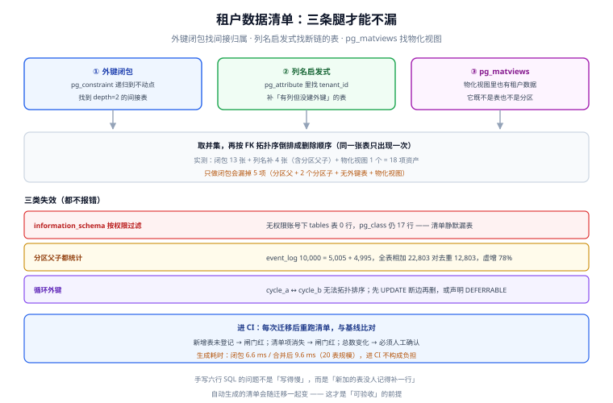

# 第 4 周第 3 步之七 · 租户数据清单：从手写六行 SQL 到自动生成

[租户退出](../TenantOffboarding/index.md) 那一章把六阶段状态机、导出三份产物、级联删除与证据包都写清了，但留了一个尾巴：**「租户数据清单」是手写的六行 SQL**。手写的问题不是写得慢，而是**新加一张表时没人记得补一行**——于是删除少删一张、导出少导一张，而这两件事都不会报错。

本步把这个尾巴收掉：清单从 `pg_catalog` **自动生成**，并按三种发现方式取并集；同时把「清单与基线一致」做成 CI 里的一条闸门。

::: tip 一句话理解
「租户的数据在哪」这个问题，**不能靠人回答，要靠元数据回答**。人写的清单只对写的那一刻正确；元数据的清单跟着迁移一起变。
:::

本页判据族 `TDI-A` ~ `TDI-H`，共 8 条。定义表在第七节。

## 本页不讲什么

- 不讲六阶段状态机与导出产物格式，归 [租户退出](../TenantOffboarding/index.md)。
- 不讲外键列索引带来的 150 倍删除差异，同样归上一章。
- 不讲 `information_schema` 与 `pg_catalog` 的通用差异清单，那属于 [PostgreSQL 进阶](/docs/DB/Relational/PostgreSQL/Advanced/index.md)。

## 一、手写清单会漏在哪三类地方



第一版清单是这样的（真实项目里非常常见）：

```sql
-- 手写清单：按「我知道有 tenant_id 的表」列出来
SELECT 'card', count(*) FROM card WHERE tenant_id = :t
UNION ALL SELECT 'comment', count(*) FROM comment WHERE tenant_id = :t
UNION ALL SELECT 'attachment', count(*) FROM attachment WHERE tenant_id = :t
UNION ALL SELECT 'board', count(*) FROM board WHERE tenant_id = :t
UNION ALL SELECT 'notification', count(*) FROM notification WHERE tenant_id = :t
UNION ALL SELECT 'audit_log', count(*) FROM audit_log WHERE tenant_id = :t;
```

它漏的恰好是三类**最容易漏、也最贵**的表：

| 漏的类型 | 例子 | 为什么手写会漏 | 后果 |
| --- | --- | --- | --- |
| **没有 `tenant_id` 的关联表** | `comment_mention`、`card_label`、`board_member` | 「我又没写 `tenant_id`，它怎么会是租户数据」 | 删租户时外键挡住删除，或者残留一堆孤儿行 |
| **有 `tenant_id` 却没建外键的表** | `event_log`（分区表不能建外键）、历史遗留表 | 靠「外键闭包」的脚本会漏，靠人记更会漏 | 数据留下了，但没人知道它属于谁 |
| **不是表的对象** | 物化视图 `tenant_stats` | 「视图不是表」 | 视图里留着聚合后的租户数据，导出与删除都碰不到 |

## 二、三条腿：外键闭包 + 列名启发式 + 物化视图

### 腿一：外键闭包（找「间接归属」）

从根表 `tenant` 出发，沿 `pg_constraint` 的反向边递归，直到不动点：

```sql
WITH RECURSIVE fk AS (
  SELECT c.conrelid AS child, c.confrelid AS parent
  FROM pg_constraint c WHERE c.contype = 'f'
), closure AS (
  SELECT 'tdi.tenant' COLLATE "C" AS rel, 0 AS depth, '>tdi.tenant>' COLLATE "C" AS path
  UNION ALL
  SELECT n.nspname||'.'||ch.relname, cl.depth+1, cl.path || (n.nspname||'.'||ch.relname) || '>'
  FROM closure cl
  JOIN pg_class p ON p.oid = to_regclass(cl.rel)
  JOIN fk ON fk.parent = p.oid
  JOIN pg_class ch ON ch.oid = fk.child
  JOIN pg_namespace n ON n.oid = ch.relnamespace
  WHERE position('>'||(n.nspname||'.'||ch.relname)||'>' in cl.path) = 0
)
SELECT rel, min(depth) AS depth FROM closure GROUP BY rel ORDER BY depth, rel;
```

在一个 20 张表的实验 schema（`tdi`）上，这条查询返回 **13 行**，其中 `board_member`、`card_label`、`comment_mention` 三张**完全没有 `tenant_id`** 的表出现在 `depth=2`——它们靠 `board_id` / `card_id` / `user_id` 间接属于租户。这正是手写清单必然漏掉的那一类。

### 腿二：列名启发式（找「断链的表」）

闭包只认外键。分区表在 PostgreSQL 里**不能引用普通表**（外键要求唯一约束，而分区表上的唯一约束必须包含分区键），所以「有 `tenant_id` 但没有外键」是常态，不是例外：

```sql
SELECT n.nspname||'.'||c.relname AS rel
FROM pg_class c
JOIN pg_namespace n ON n.oid = c.relnamespace
JOIN pg_attribute a ON a.attrelid = c.oid AND a.attname = 'tenant_id'
                    AND a.attnum > 0 AND NOT a.attisdropped
WHERE n.nspname = 'tdi' AND c.relkind IN ('r','p');
```

这一腿在实验里补进 **4 张**：`event_log`（分区父）、`event_log_2026m09`、`event_log_2026m10`（两个分区子）、`secret_vault`（无外键的历史表）。

::: danger 不要用 `information_schema.tables` 生成清单
`information_schema` 的视图**按当前账号的权限过滤**。实验里换成一个没有任何授权的角色：

```sql
SET ROLE app_reader;
SELECT count(*) FROM information_schema.tables WHERE table_schema = 'tdi';  -- 0
SELECT count(*) FROM pg_class c JOIN pg_namespace n ON n.oid=c.relnamespace
 WHERE n.nspname='tdi' AND c.relkind IN ('r','p');                          -- 17
```

同一个 schema、同一时刻，一个说 0 张、一个说 17 张。用前者生成的清单**会静默漏掉全部表**——它不报错，只是返回空，而空清单在「没有残留」这个结论上恰好是「看起来最干净」的那种。
:::

### 腿三：物化视图

```sql
SELECT schemaname, matviewname FROM pg_matviews WHERE schemaname = 'tdi';
-- tdi | tenant_stats
```

`tenant_stats` 里存着按租户聚合的卡片数，它**既不在 `information_schema.tables` 里，也不在 `pg_class.relkind in ('r','p')` 里**（物化视图是 `'m'`）。导出与删除都必须单独处理它：导出要作为「派生数据」重建，删除要 `REFRESH` 或直接 `DROP`。

## 三、实测：18 项资产，17 张表 + 1 个物化视图

三腿取并集之后，实验 schema 的清单是 **18 项**（17 张表 + 1 个物化视图）。逐项跑 `count(*) WHERE tenant_id = 't1'` 得到：

| 资产 | 类型 | 发现方式 | t1 行数 |
| --- | --- | --- | --- |
| `tenant` | 表（根） | 起点 | 1 |
| `app_user` | 表 | 闭包 depth 1 | 1 |
| `board` | 表 | 闭包 depth 1 | 1 |
| `card` | 表 | 闭包 depth 1 | 100 |
| `comment` | 表 | 闭包 depth 1 | 100 |
| `attachment` | 表 | 闭包 depth 1 | 100 |
| `notification` | 表 | 闭包 depth 1 | 0 |
| `audit_log` | 表 | 闭包 depth 1 | 2,500 |
| `cycle_a` / `cycle_b` | 表 | 闭包 depth 1 | 0 / 0 |
| `board_member` | 表（无 `tenant_id`） | 闭包 depth 2 | —— |
| `card_label` | 表（无 `tenant_id`） | 闭包 depth 2 | —— |
| `comment_mention` | 表（无 `tenant_id`） | 闭包 depth 2 | —— |
| `event_log` | 分区父表 | 列名启发式 | 10,000 |
| `event_log_2026m09` | 分区子表 | 列名启发式 | 5,005 |
| `event_log_2026m10` | 分区子表 | 列名启发式 | 4,995 |
| `secret_vault` | 表（无外键） | 列名启发式 | 1 |
| `tenant_stats` | 物化视图 | `pg_matviews` | —— |

两个读数值得单独记下来：

1. **生成耗时**：闭包查询 **6.647 ms**、三腿合并后 **9.584 ms**（20 张表规模）。放进 CI 完全不构成负担——**「自动生成太慢所以手写」这个理由不成立**。
2. **分区会重复计数**：`event_log` 的父表 `count(*)` 是 **10,000**，两个分区子表分别是 **5,005** 与 **4,995**，相加正好也是 10,000。把清单里所有行数直接相加得到 **22,803**，去重后（父表已含子表）是 **12,803**——**虚增 78%**。清单里必须标注「父表已含分区」，否则导出的行数会比实际多出近一倍，而这在验收时会被当成「导出很完整」。

```sql
-- 行数统计的写法：一次查一张，避免手写 18 条 UNION
WITH t AS (
  SELECT n.nspname||'.'||c.relname AS rel
  FROM pg_class c JOIN pg_namespace n ON n.oid = c.relnamespace
  JOIN pg_attribute a ON a.attrelid = c.oid AND a.attname = 'tenant_id'
                      AND a.attnum > 0 AND NOT a.attisdropped
  WHERE n.nspname = 'tdi' AND c.relkind IN ('r','p')
)
SELECT rel,
       (xpath('/row/cnt/text()',
              query_to_xml(format('select count(*) as cnt from %s where tenant_id = %L', rel, 't1'),
                           false, true, '')))[1]::text::int AS rows_t1
FROM t ORDER BY rel;
```

## 四、删除顺序：拓扑排序在两个地方会翻车

清单解决「有哪些」，删除还要解决「按什么顺序」。规则是**外键图的反向拓扑序**（先删子表）。实践中两处会翻车：

### 翻车一：分区父表不能直接删

`DELETE FROM event_log WHERE tenant_id = 't1'` 会**路由到各分区**并逐行删除，走的是行级删除而不是 `DROP`。数据量大时它比 `DETACH` 慢一个量级（见 [分区分表与冷热分离](/docs/DB/PartitionArchival/PartitionOps/index.md) 的实测）。退出租户时的正确做法是：先 `DELETE` 当前分区里的租户行，历史分区如果整月都属于该租户，则直接 `DETACH` 后 `DROP`。

### 翻车二：循环外键排不出序

实验里造了一对互相引用的表：

```sql
-- 结构：cycle_a.b_id → cycle_b(id)，cycle_b.a_id → cycle_a(id)
DELETE FROM tdi.cycle_a WHERE tenant_id = 't1';
-- ERROR:  update or delete on table "cycle_a" violates foreign key constraint "fk_b_a" on table "cycle_b"
-- DETAIL:  Key (id)=(ca1) is still referenced from table "cycle_b".
```

任何顺序都不对：先删 A 被 B 挡住，先删 B 被 A 挡住。三种解法：

| 解法 | 写法 | 适用 |
| --- | --- | --- |
| **先断边再删** | `UPDATE cycle_a SET b_id=NULL WHERE tenant_id=:t;` 再删两边 | 字段可空；实测 `UPDATE 1 / UPDATE 1 / DELETE 1 / DELETE 1` 全部成功 |
| **延迟约束** | 建表时 `DEFERRABLE INITIALLY DEFERRED`，同一事务内顺序无关 | 能从建表阶段规划 |
| **`ON DELETE SET NULL`** | 让数据库自己断边 | 语义上「父没了引用就该清空」时 |

清单生成器必须**检测环**（递归 CTE 里用 `path` 做环检测，命中即标记），并把环上的表单独列出来交给人工决定用哪种解法——**不要让脚本自己猜**。

::: warning 递归 CTE 拼文本键会遇到排序规则冲突
第一版用 `ARRAY['tdi.tenant'::text]` 做路径，PG 18 直接报：

```text
ERROR:  recursive query "closure" column 1 has collation "default" in non-recursive term
        but collation "C" overall
HINT:  Use the COLLATE clause to set the collation of the non-recursive term.
```

根因是**非递归项的字面量用默认排序规则，而递归项里的 `||` 拼接产出 `C` 排序规则**，两者不一致。修法两种：给字面量加 `COLLATE "C"`（本页采用），或改用 `text` 路径 + `position()` 判环（避开数组的排序规则）。**这条不是「PG 18 的新 bug」，而是文本键递归一直有的坑**，只是平时表少、路径浅，不容易撞上。
:::

## 五、把清单接进 CI：一条闸门 + 一份基线

清单自动生成之后，价值不在「生成」，而在**「变了会被发现」**：

```shell
# 生成当前清单（CI 里跑，输出排序后的稳定文本）
psql "$DATABASE_URL" -At -f scripts/tenant_inventory.sql | sort > /tmp/inventory.now

# 与基线比对
diff -u config/tenant_inventory.baseline /tmp/inventory.now && echo "OK: inventory unchanged"
```

三个判定：

| 差异类型 | 含义 | 处置 |
| --- | --- | --- |
| 新增行（表/视图） | 迁移加了表，但没人更新导出与删除逻辑 | **闸门红**，必须补实现或显式登记为「无租户数据」 |
| 删除行 | 表被删或改名，清单里有死项 | **闸门红**，同步清理导出与删除逻辑 |
| 顺序变化 | 外键关系变了，删除顺序要复核 | 提示，人工确认 |

基线文件里**只放「表名 + 类型 + 是否含 `tenant_id` + 是否分区」四列**，不放行数（行数每次都在变，放进去等于每天红一次）。行数留给导出时的运行时校验。

## 六、当日做了什么

| 交付 | 内容 |
| --- | --- |
| 清单生成 SQL | 三腿并集（外键闭包 + 列名启发式 + `pg_matviews`），输出「表名 / 类型 / 发现方式 / depth」四列 |
| 环检测 | 递归 CTE 里用 `path` 判环，环上的表单独输出 |
| 删除顺序 | 外键图反向拓扑序；分区父表标注「按分区处理」；环上的表标注「先断边」 |
| CI 闸门 | `tenant_inventory.baseline` 与实时清单 `diff`，新增/删除即红 |
| 本机实测 | 6.647 ms / 9.584 ms 两个耗时读数；13 表闭包、18 项资产、22,803 对 12,803 的重复计数 |

## 七、判据表

| 编号 | 规则 | 违反时的样子 | 怎么验证 |
| --- | --- | --- | --- |
| `TDI-A` | 清单必须由元数据生成，禁止手写表名 | 新加表漏删漏导 | 仓库里有生成脚本；清单文件带「自动生成」头 |
| `TDI-B` | 生成必须走 `pg_catalog`，禁止用 `information_schema` | 无权限账号下清单为空 | 脚本里 `information_schema` 出现次数为 0 |
| `TDI-C` | 三条腿齐全：外键闭包 + `tenant_id` 列 + 物化视图 | 分区表、物化视图被漏 | 脚本里三个来源都能找到 |
| `TDI-D` | 清单必须标出「无 `tenant_id` 的间接表」及其依赖路径 | 删除时被外键挡住才发现 | 清单有 depth 列，且 depth≥2 的行能说出经由哪张表 |
| `TDI-E` | 分区父子表必须标注「父表已含分区」，行数不得重复相加 | 导出量虚增 78% | 基线里有 `is_partition` 列；汇总时排除父表或子表之一 |
| `TDI-F` | 环检测必须存在，环上的表单独列出 | 删除顺序排不出，脚本静默跳过 | 递归 CTE 有 `path`；环表在输出里可见 |
| `TDI-G` | 清单变化必须让 CI 变红（新增/删除） | 新表上线三个月后才发现没删 | 有 baseline 文件与 `diff` 步骤 |
| `TDI-H` | 基线只存结构，不存行数 | 每天红一次，最后被忽略 | baseline 里没有数字列 |

## 如何验证

```shell
# 1) 清单能生成，且是稳定输出（两次结果一致）
psql "$DATABASE_URL" -At -f scripts/tenant_inventory.sql | sort > /tmp/a.txt
psql "$DATABASE_URL" -At -f scripts/tenant_inventory.sql | sort > /tmp/b.txt
diff /tmp/a.txt /tmp/b.txt && echo "OK: stable"

# 2) 活性：清单不能为空（权限不够时 information_schema 会返回 0 行）
test -s /tmp/a.txt || echo "FAIL: empty inventory"

# 3) 三条腿都在：应能看到 depth=2 的间接表与物化视图
grep -c '|2|' /tmp/a.txt        # 期望 >= 1（间接表）
grep 'matview' /tmp/a.txt       # 期望至少 1 行

# 4) 环检测有效：造一对互相引用的表后应出现在输出里
psql "$DATABASE_URL" -At -f scripts/tenant_inventory.sql | grep -i cycle
```

```text
5) CI 闸门演练（三分钟）
   a. 手工建一张带 tenant_id 的新表 → 期望 diff 出现新增行、CI 红
   b. 在 baseline 里补上该行 → 期望 CI 绿
   c. 删掉该表 → 期望 diff 出现删除行、CI 红
   三个动作都做完，才算「闸门真的会红」（这与第 167 天质量闸门的变异测试是同一个纪律）

6) 行数不重复计数
   对分区父表与其分区子表分别 count，期望 父 = Σ子（本实验 10,000 = 5,005 + 4,995）
```

## 下一步

1. **把清单生成接进迁移流水线**：Flyway 的 `afterMigrate` 之后跑一次，清单变化直接写进迁移日志。
2. **导出按清单驱动**：现在导出脚本仍然写死了表名，下一步改成读清单，逐表 `COPY`，分区表按分区导出。
3. **残留检查扩展到对象存储与缓存**：清单只管数据库，对象前缀与缓存 key 还没有对应的自动发现，留给下一步。
4. **环检测的用例入回归**：造环的表结构要进测试库，确保环检测不会因为「线上恰好没有环」而长期不被执行。

## 参考资料

- [PostgreSQL · 递归查询](https://www.postgresql.org/docs/current/queries-with.html#QUERIES-WITH-RECURSIVE)——`WITH RECURSIVE` 与环检测写法
- [PostgreSQL · 系统目录](https://www.postgresql.org/docs/current/catalogs.html)——`pg_class` / `pg_constraint` / `pg_attribute` 的字段语义
- [PostgreSQL · information_schema](https://www.postgresql.org/docs/current/information-schema.html)——「按权限过滤」的官方说明
- [PostgreSQL · 分区表限制](https://www.postgresql.org/docs/current/ddl-partitioning.html#DDL-PARTITIONING-DECLARATIVE-LIMITATIONS)——为什么分区表不能随便建外键
- 本站 [租户退出](../TenantOffboarding/index.md) · [分区分表与冷热分离](/docs/DB/PartitionArchival/PartitionOps/index.md) · [PostgreSQL 进阶](/docs/DB/Relational/PostgreSQL/Advanced/index.md)
