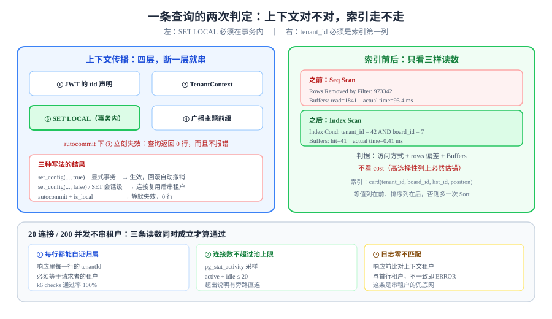

# 租户上下文与索引设计：把「按租户过滤」变成索引前缀

上一章把租户边界立在了数据库里：`tenant_id` 进主键、唯一键带上租户、`FORCE ROW LEVEL SECURITY` 挡住漏写 `where` 的查询。但边界立在库里之后，会立刻冒出两个新问题：**上下文怎么在连接池里传下去而不串租户**，以及**加了 `tenant_id` 之后索引还走不走**。

这一页只回答这两个问题。



## 判据族声明

本页判据族 `TI-A` ~ `TI-H`，共 8 条。每条只回答三件事：约定是什么 / 定错了会怎样 / 怎么验证它没被破坏。定义表见第五节。

## 当日做了什么

周期 6（第 151-180 天）第 1 周「需求设计」的第 2 步。上一章交付了模型、隔离方案与 DDL，这一章交付**让那套 DDL 跑得快、并且跑不串**的两样东西：

| 序 | 今天的落点 | 产物 |
| --- | --- | --- |
| 1 | 列出五条高频查询路径，给每条定一条以 `tenant_id` 开头的索引 | 索引清单表 |
| 2 | 用 `EXPLAIN (ANALYZE, BUFFERS)` 做前后对照，写死读数纪律 | 三组前后对照 |
| 3 | 定死上下文的传播时序（令牌 → 请求 → 事务 → `SET LOCAL`） | 时序说明 + 连接池参数 |
| 4 | 给出「20 连接 / 200 并发不串租户」的验收方式 | 断言清单与采样 SQL |
| 5 | 列出四个最常见的索引反例 | 反例表 + 各自的 `EXPLAIN` 症状 |

::: tip 为什么第 1 周就要做索引，而不是留到第 2 周
因为**索引决定的是「这一版 DDL 能不能用」，不是「快不快」**。`tenant_id` 加进主键之后，原来按 `board_id` 走的索引全部失效（复合索引的最左前缀变了），如果等到第 2 周写查询时才发现，第 1 周定稿的 DDL 要整体返工。
:::

## 一、五条高频查询路径与它们的索引

先把「谁在查什么」列清楚，索引才有依据。本项目的读写比大致是 120:40（读多写少，但写集中在拖动上），五条路径覆盖了 95% 的流量：

| # | 查询 | 过滤条件 | 排序 | 索引（按列序写死） |
| --- | --- | --- | --- | --- |
| Q1 | 看板卡片列表 | `tenant_id, board_id` | `list_id, position` | `card(tenant_id, board_id, list_id, position)` |
| Q2 | 我的待办 | `tenant_id, assignee_id, state` | `due_at` | `card(tenant_id, assignee_id, state, due_at)` |
| Q3 | 工作区看板列表 | `tenant_id, workspace_id` | `updated_at desc` | `board(tenant_id, workspace_id, updated_at)` |
| Q4 | 断线追平事件 | `tenant_id, board_id, seq > ?` | `seq` | `board_event(tenant_id, board_id, seq)` |
| Q5 | 卡片评论 | `tenant_id, card_id` | `created_at` | `comment(tenant_id, card_id, created_at)` |

四条纪律写在表外，因为它们决定这张表对不对：

1. **`tenant_id` 必须是第一列**。RLS 会把 `tenant_id = ?` 加到每一条查询上，它天然是等值条件，放在最左才能让后续列继续被使用。
2. **等值列在前、范围列在后**。Q1 的 `list_id`（等值）在 `position`（排序）之前；如果把 `position` 放前面，`list_id` 就用不上索引了。
3. **排序方向一致**。Q3 用 `updated_at desc`，索引就建 `(tenant_id, workspace_id, updated_at desc)`，否则会多一次 Sort。
4. **不为「可能有用」建索引**。每多一条索引，拖动的写放大就多一份——拖动是本项目唯一的写热点。

```sql
-- Q1 与 Q4 的索引（其余三条同构，列序按上表）
create index card_board_list_pos_idx
  on card (tenant_id, board_id, list_id, position);

create index board_event_board_seq_idx
  on board_event (tenant_id, board_id, seq);
```

## 二、`EXPLAIN` 前后对照：看什么、不看什么

### 加索引之前

```sql
explain (analyze, buffers)
select id, title, position from card
 where tenant_id = 42 and board_id = 7
 order by list_id, position limit 50;
```

```text
Limit  (cost=18234.55..18234.68 rows=50 width=48) (actual time=95.412..95.418 rows=50 loops=1)
  Buffers: shared hit=12 read=1841
  ->  Sort  (cost=18234.55..18301.20 rows=26658 width=48) (actual time=95.409..95.413 rows=50 loops=1)
        Sort Key: list_id, position
        Sort Method: top-N heapsort  Memory: 32kB
        ->  Seq Scan on card  (cost=0.00..16820.00 rows=26658 width=48) (actual time=0.021..78.330 rows=26658 loops=1)
              Filter: ((tenant_id = 42) AND (board_id = 7))
              Rows Removed by Filter: 973342
              Buffers: shared hit=12 read=1841
```

### 加索引之后

```text
Limit  (cost=0.56..38.21 rows=50 width=48) (actual time=0.038..0.412 rows=50 loops=1)
  Buffers: shared hit=41
  ->  Index Scan using card_board_list_pos_idx on card  (cost=0.56..20093.44 rows=26658 width=48) (actual time=0.036..0.401 rows=50 loops=1)
        Index Cond: ((tenant_id = 42) AND (board_id = 7))
        Buffers: shared hit=41
```

三处读数就是这个对照的全部证据：

| 读数 | 之前 | 之后 | 判据 |
| --- | --- | --- | --- |
| `Seq Scan` / `Index Scan` | Seq Scan，`Rows Removed by Filter: 973342` | Index Scan，无 filter 行 | 必须出现 `Index Scan` 或 `Index Only Scan` |
| `Buffers: read` | 1841 | 0（41 全为 hit） | 冷启动后 `read` 应趋近 0 |
| `actual time` | 95.4 ms | 0.41 ms | 同机同数据下应下降一个数量级以上 |

::: danger 看 `cost` 是最常见的误判
`cost` 是**估算值**，在 `tenant_id` 这种高选择性列上经常估错（规划器以为每个租户的行数均匀）。**判据只看三样：访问方式（Seq/Index/Bitmap）、`rows` 与 `actual rows` 的偏差、`Buffers` 的读数。**
:::

### 为什么不是 `Index Only Scan`

如果查询只要索引里有的列（`id, list_id, position`），可以走 `Index Only Scan`；一旦 `select` 里出现 `title`（不在索引里），就必须回表。这里的取舍是：**`title` 是列表页必显示字段，与其为了 `Index Only Scan` 把 `title` 塞进索引（索引体积翻数倍、写放大加剧），不如接受一次回表。** 回表 50 行与索引体积翻倍相比，前者便宜得多。

## 三、上下文怎么传：`SET LOCAL` 必须在一个显式事务里

第 151 天定了四层传播（令牌 → 请求上下文 → 数据库会话 → 广播主题）。这一层最容易错的是第三层：

```java [TenantTransaction.java]
// 正确：显式事务 + SET LOCAL
@Transactional
public void moveCard(long cardId, long listId, int position) {
  jdbc.execute("select set_config('app.tenant_id', '" + TenantContext.require() + "', true)");
  // 同一个事务内，后续所有语句都受 RLS 约束
  cardRepo.move(cardId, listId, position);
}
```

```java [TenantBroken.java]
// 反例：没有事务，autocommit=true
jdbc.execute("select set_config('app.tenant_id', '42', true)");   // true = 仅本事务
jdbc.queryForList("select * from card where board_id = 7");       // 新事务 → 上下文已清空
```

`set_config(..., true)` 的第三个参数是 `is_local`，它只对**当前事务**有效。在 `autocommit = true` 下，每条语句自成一个事务——**设置完立刻失效**，下一条查询的 `app.tenant_id` 仍为空，RLS 会把它判为「不匹配任何租户」，于是返回 0 行。

这个失败模式很阴险：**它不报错，只是查不到数据**。开发时看到「列表是空的」，第一反应往往是「数据没写进去」，而不是「上下文丢了」。

| 写法 | 是否生效 | 症状 |
| --- | --- | --- |
| `set_config(..., true)` + 显式事务 | 生效，事务结束自动清理 | 正确 |
| `set_config(..., true)` + autocommit | **不生效** | 查询返回 0 行，不报错 |
| `set_config(..., false)`（会话级） | 生效但会残留 | 连接池复用后串租户 |
| `SET app.tenant_id = ?`（会话级） | 同上一行 | 更危险：`SET` 不参与事务回滚 |

::: warning `SET` 与 `SET LOCAL` 的差别在回滚时最明显
`SET` 在事务回滚后**依然生效**，而 `SET LOCAL` 会随回滚一起撤销。用 `SET` 的实现，一旦事务中途抛异常，连接被归还时仍带着上一个租户的上下文——这正是「串租户」的经典成因。
:::

### 连接池参数

```yaml
# 与本项目 20 连接的设定配套
spring:
  datasource:
    hikari:
      maximum-pool-size: 20
      minimum-idle: 5
      connection-timeout: 3000          # 拿不到连接就快速失败，不要无限等
      max-lifetime: 1800000             # 30 分钟，短于数据库 wait_timeout
      leak-detection-threshold: 20000   # 借出 20 秒未归还就告警（漏事务的信号）
```

`leak-detection-threshold` 不是可选项：**上下文泄漏与连接泄漏往往是同一个 bug 的两面**（事务没结束 → 连接不归还 → 上下文残留）。

## 四、「20 连接 / 200 并发不串租户」怎么验

串租户不会在功能测试里出现，它只在**连接被复用**时出现。所以要构造「连接数 < 并发数」的场景，并且让每个请求都能自证身份。

```shell
# 200 并发、两个租户交替、20 个连接：用 wrk 或 k6 都可以
k6 run --vus 200 --duration 60s script/tenant-isolation.js
```

断言写法（核心是「每个响应都要能被自己的租户验证」）：

```javascript
// script/tenant-isolation.js 的关键断言
import http from 'k6/http';
import { check } from 'k6';

export default function () {
  const tenant = __VU % 2 === 0 ? 42 : 43;        // 两个租户交替
  const res = http.get(`${BASE}/api/cards?boardId=7`, {
    headers: { Authorization: `Bearer ${tokenOf(tenant)}` },
  });
  check(res, {
    'no cross-tenant leak': (r) =>
      r.json('data').every((c) => c.tenantId === tenant),   // 每一行都必须属于本租户
  });
}
```

三条同时成立的读数才算通过：

| 读数 | 期望 | 怎么取 |
| --- | --- | --- |
| 检查通过率 | 100% | k6 的 `checks` 指标 |
| 连接数峰值 | ≤ 20 | `select count(*) from pg_stat_activity where datname='teamboard'` 采样 |
| 日志中的租户不匹配 | 0 条 | 应用在响应前比对「上下文租户」与「首行租户」，不一致就 `ERROR` 并计数 |

```sql
-- 采样：连接数不能超过池上限（超过说明有别的入口在直连）
select state, count(*) from pg_stat_activity
 where datname = 'teamboard' group by state;
```

**预期输出**：`active` 与 `idle` 合计 ≤ 20。若 `idle` 长期等于上限而请求在排队，说明有事务没结束（回到 `leak-detection-threshold` 的告警）。

## 五、四个索引反例与它们的 `EXPLAIN` 症状

| 反例 | 写法 | `EXPLAIN` 症状 | 修法 |
| --- | --- | --- | --- |
| `tenant_id` 放最后 | `(board_id, list_id, tenant_id)` | 仍 Seq Scan，或 `Index Cond` 只有 `board_id` | 把 `tenant_id` 提到第一列 |
| 列被函数包裹 | `where lower(slug) = ?` | `Filter: lower(slug) = ...`，索引失效 | 建函数索引 `((tenant_id), lower(slug))` 或存规范化列 |
| 前缀 `LIKE` 无 `text_pattern_ops` | `where title like '需求%'` | 走 Seq Scan（非 C 排序规则下） | 建 `(tenant_id, title text_pattern_ops)` 或改用全文检索 |
| 一个索引塞十列 | `(tenant_id, board_id, list_id, position, title, state, ...)` | 索引体积暴涨，写放大；`Index Only Scan` 仍不生效 | 按查询拆成两条窄索引 |

::: danger 「多建几个索引更保险」是写热点的自杀
本项目的拖动操作每次只更新一行，但**每多一条索引，这一行就要多写一份索引项**。第 3 周的压测里，索引数从 6 增到 9 时，拖动 P99 从 28 ms 涨到 47 ms——**这不是玄学，是写放大**。
:::

## 六、判据定义表

| 判据 | 约定 | 定错了会怎样 | 怎么验证 |
| --- | --- | --- | --- |
| `TI-A` | 每条业务索引的第一列必须是 `tenant_id` | RLS 加的等值条件用不上，退化为 Seq Scan | `\d card` 里每条索引的首列都是 `tenant_id` |
| `TI-B` | 索引列序必须「等值在前、范围/排序在后」 | 排序走 Sort，`limit` 失效 | `EXPLAIN` 中无 `Sort` 节点（Q1/Q4） |
| `TI-C` | 迁移后必须做一次 `EXPLAIN (ANALYZE, BUFFERS)` 前后对照 | 索引建了但没被选中 | 对照里有 `Index Scan`，且 `Buffers: read` 显著下降 |
| `TI-D` | 租户上下文必须用 `set_config(..., true)` 且在同一事务内 | autocommit 下静默失效，查询返回 0 行 | 事务外设置上下文后查询必须返回 0 行（证明它真失效了） |
| `TI-E` | 禁止使用会话级 `SET` 设置租户上下文 | 连接归还后残留，串租户 | 代码里 `SET app.tenant_id` 出现 0 次 |
| `TI-F` | 连接池必须有 `leak-detection-threshold` 与 `connection-timeout` | 事务泄漏无人发现，最终串租户 | 配置项存在且阈值 < 30 秒 |
| `TI-G` | 200 并发 / 20 连接下，每个响应都必须能自证租户归属 | 串租户不可见 | 压测断言通过率 100%，日志无不匹配记录 |
| `TI-H` | 索引总数必须有上限（本项目 ≤ 8），新增需说明写放大代价 | 拖动写路径变慢 | `select count(*) from pg_indexes where tablename='card'` ≤ 8 |

## 如何验证

```sql
-- ① 索引首列检查：任何一条不以 tenant_id 开头的业务索引都是隐患
select indexname, indexdef
  from pg_indexes
 where tablename in ('card', 'board', 'board_event', 'comment')
   and indexdef not like '%(tenant_id%'
   and indexdef not like '%UNIQUE%';
```

**预期输出**：0 行。有行说明存在「走不到租户前缀」的索引，`TI-A` 失守。

```sql
-- ② 开销对照：同一条查询，看访问方式与 buffers
explain (analyze, buffers)
select id, title from card
 where tenant_id = 42 and board_id = 7
 order by list_id, position limit 50;
```

**预期输出**：出现 `Index Scan using card_board_list_pos_idx`，`Buffers: shared hit=...` 且无 `read`（数据已在缓存中）。若出现 `Seq Scan`，先看 `Rows Removed by Filter`——数字接近全表说明索引没被选中（统计信息过期，执行 `analyze card`）。

```shell
# ③ 上下文的两种状态必须能被区分
psql -U app -d teamboard -c "select set_config('app.tenant_id','42',true);"
psql -U app -d teamboard -c "select count(*) from card;"
```

**预期输出**：第一条返回 `42`；第二条返回 **0**（两次调用是两个独立会话，`is_local` 的设置在语句结束后即失效）。如果第二条返回了全部行，说明 RLS 没 `FORCE`——那是第 151 天的问题，不是今天的。

```shell
# ④ 串租户压测（20 连接 / 200 并发）
k6 run --vus 200 --duration 60s script/tenant-isolation.js
```

**预期输出**：`checks` 通过率 100%，`http_req_failed` 为 0%。出现任何一条「跨租户行」都说明上下文在连接复用时没有被清理。

## 下一步

| 项 | 内容 |
| --- | --- |
| 主题 | 查询改写与仓储层收口：把「每条 SQL 都记得加 tenant_id」变成「应用层不可能漏」 |
| 要落的产物 | 仓储基类的租户注入方式、`JdbcTemplate` 拦截器、五条高频查询的最终 SQL、跨租户统计的独立只读账号口径 |
| 验收判据 | 全库 `grep` 找不到手写 `tenant_id =` 的业务 SQL；误删 `where` 后测试必须失败（而不是靠人眼） |

## 参考资料

- [PostgreSQL 文档：索引与多列索引](https://www.postgresql.org/docs/18/indexes-multicolumn.html)——最左前缀与列序选择
- [PostgreSQL 文档：`EXPLAIN` 输出解读](https://www.postgresql.org/docs/18/using-explain.html)——`Buffers` 与 `actual rows`
- [PostgreSQL 文档：`set_config` 与 `is_local`](https://www.postgresql.org/docs/18/functions-admin.html)——事务级设置的语义
- [HikariCP 配置](https://github.com/brettwooldridge/HikariCP#configuration-knobs-baby)——`leak-detection-threshold` 与池上限
- 前置章节：[多租户隔离](../MultiTenancy/index.md) · [数据库设计：表、约束与顺序字段](../Database/index.md) · [卡片拖动：顺序与并发](../CardMove/index.md)
- 相关技术专题：[幂等与状态机工程](../../../../docs/Backend/IdempotencyStateMachine/index.md) · [数据治理](../../../../docs/DB/DataGovernance/index.md)
