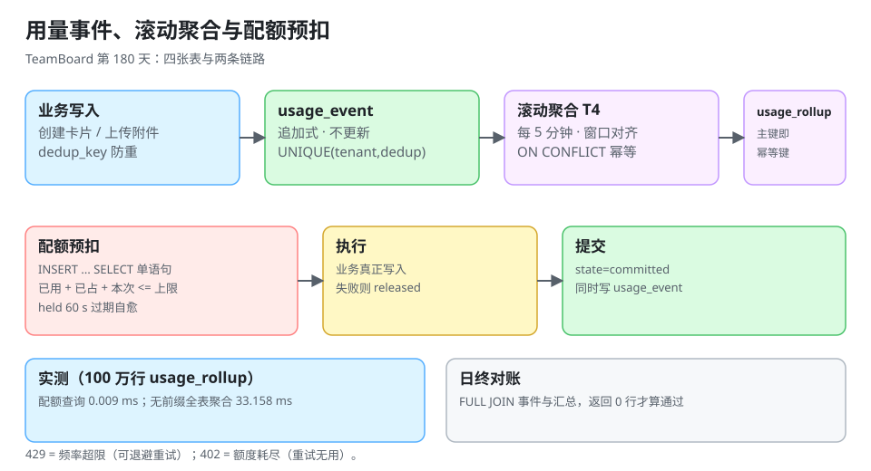

# 用量计量与配额执行

周期 6 走到第 180 天，TeamBoard 已经能上线、能退租、能回填。但它还缺一件**「产品能不能收费」**的事：**谁用了多少、超了怎么办**。这一章补的是从「用量事件」到「配额闸门」的完整链路——它同时是两个新专题的落地：[分布式调度](../../../../docs/Backend/DistributedScheduling/index.md)（滚动聚合与补跑）与 [幂等与状态机](../../../../docs/Backend/IdempotencyStateMachine/index.md)（预扣与回滚）。

::: tip 一句话理解
配额不是「查一下有没有超」，而是**「先占位、再执行、失败退回」**——只查不占的实现在并发下必然超卖，而超卖的账在下个月才看得见。
:::



## 一、这一章要解决的三件事

| 问题 | 现状 | 本章做法 |
| --- | --- | --- |
| 用了多少 | 只能从 `card` / `attachment` 表 `count(*)` 现算 | 追加式 `usage_event` + 5 分钟滚动 `usage_rollup` |
| 超了怎么办 | 无（无限使用） | 配额预扣表 `quota_reservation` + 两道闸门（`429` / `402`） |
| 账对不对 | 无法核对 | 日终对账 SQL，返回 0 行才算通过 |

`count(*)` 现算的问题不是慢，而是**会被删除影响**：租户删掉 1 万张卡片，历史用量凭空消失，这个月的账单和上个月对不上。

## 二、四张表

### 1. 用量事件（追加式，不更新不删除）

```sql
CREATE TABLE usage_event (
  id          BIGSERIAL   PRIMARY KEY,
  tenant_id   TEXT        NOT NULL,
  kind        TEXT        NOT NULL,          -- card_created / attachment_bytes / api_call
  quantity    BIGINT      NOT NULL,
  occurred_at TIMESTAMPTZ NOT NULL,
  dedup_key   TEXT        NOT NULL,          -- 业务侧防重（如 card_id）
  UNIQUE (tenant_id, dedup_key)
);
CREATE INDEX usage_event_tenant_time_idx ON usage_event (tenant_id, occurred_at);
```

`dedup_key` 的作用：卡片创建事件若因重试被写两次，唯一键把第二次挡掉（`ON CONFLICT DO NOTHING` 返回 0 行）。**没有它，所有下游统计都会翻倍**。

### 2. 滚动汇总（5 分钟一个窗口）

```sql
CREATE TABLE usage_rollup (
  tenant_id   TEXT        NOT NULL,
  window_start TIMESTAMPTZ NOT NULL,
  cards_created BIGINT    NOT NULL DEFAULT 0,
  attachment_bytes BIGINT NOT NULL DEFAULT 0,
  PRIMARY KEY (tenant_id, window_start)
);
```

主键就是幂等键：**同一个租户的同一个窗口只可能有一行**。

### 3. 配额计划

```sql
CREATE TABLE quota_plan (
  tenant_id     TEXT PRIMARY KEY,
  plan          TEXT NOT NULL,                -- free / team / enterprise
  cards_per_day BIGINT NOT NULL,
  storage_bytes BIGINT NOT NULL,
  api_per_min   INT    NOT NULL
);
```

### 4. 配额预扣（关键）

```sql
CREATE TABLE quota_reservation (
  id         BIGSERIAL PRIMARY KEY,
  tenant_id  TEXT NOT NULL,
  metric     TEXT NOT NULL,                  -- cards / storage
  amount     BIGINT NOT NULL,
  state      TEXT NOT NULL,                  -- held / committed / released
  biz_key    TEXT NOT NULL,                  -- 与业务操作一一对应
  created_at TIMESTAMPTZ NOT NULL DEFAULT now(),
  expires_at TIMESTAMPTZ NOT NULL,
  UNIQUE (tenant_id, metric, biz_key)        -- 同一个业务操作只占一次
);
CREATE INDEX quota_res_held_idx ON quota_reservation (tenant_id, metric, state);
```

`held` 有 `expires_at`（默认 60 秒）：**进程崩溃留下的占位会自动过期**，不需要补偿任务去扫。

## 三、配额判定的完整流程

```text
① 预扣  INSERT ... SELECT 校验「已用量 + 已预扣 + 本次 <= 上限」
        成功 → held，返回 reservation_id
        失败 → 429（限流）或 402（额度耗尽）
② 执行  真正的业务写入（创建卡片）
③ 提交  state='committed'，同时写 usage_event
④ 释放  业务失败 → state='released'（额度退回）
```

第 ① 步必须是**一条语句**，否则并发下必然超卖：

```sql
INSERT INTO quota_reservation (tenant_id, metric, amount, state, biz_key, expires_at)
SELECT :tenant, 'cards', 1, 'held', :biz_key, now() + interval '60 second'
 WHERE (SELECT coalesce(sum(amount), 0) FROM quota_reservation
         WHERE tenant_id = :tenant AND metric = 'cards'
           AND (state = 'committed' OR (state = 'held' AND expires_at > now()))
       ) + 1 <= (SELECT cards_per_day FROM quota_plan WHERE tenant_id = :tenant)
ON CONFLICT (tenant_id, metric, biz_key) DO NOTHING
RETURNING id;
```

四条读法：

1. **`WHERE` 里的子查询是「占位 + 已提交」的和**，不是「今天的用量」——两套口径混用会漏算在飞的请求。
2. **`ON CONFLICT DO NOTHING`** 让同一个 `biz_key` 重试不会重复占额（返回 0 行 → 说明已占过，直接复用）。
3. **`RETURNING id` 为空 = 额度不足**，应用层据此返回 `429`/`402`。
4. **`expires_at` 保证崩溃自愈**：占位过期后自动不参与求和。

### 429 与 402 的分工

| 状态码 | 含义 | 客户端该怎么做 |
| --- | --- | --- |
| `429 Too Many Requests` | 短时频率超限（`api_per_min`） | 退避重试 |
| `402 Payment Required` | 额度耗尽（`cards_per_day` / `storage_bytes`） | 提示升级套餐，不要重试 |
| `403 Forbidden` | 无权限（与配额无关） | 不要重试 |

把「额度耗尽」返回成 `429` 会让客户端无限重试，**每一次重试都是一次无效的数据库访问**。

## 四、滚动聚合任务

聚合任务就是 [分布式调度 · 实战](../../../../docs/Backend/DistributedScheduling/Practice/index.md) 里的 **T4**：

| 属性 | 值 |
| --- | --- |
| 周期 | 每 5 分钟 |
| 幂等键 | `(usage_rollup, tenant_id, window_start)` |
| 补跑策略 | 全量补，上限 12（= 1 小时） |
| 分片 | `hash(tenant_id) % 8` |

```sql
INSERT INTO usage_rollup (tenant_id, window_start, cards_created, attachment_bytes)
SELECT tenant_id,
       date_trunc('hour', occurred_at) + floor(extract(minute from occurred_at) / 5) * interval '5 minute',
       sum(quantity) FILTER (WHERE kind = 'card_created'),
       sum(quantity) FILTER (WHERE kind = 'attachment_bytes')
  FROM usage_event
 WHERE occurred_at >= :win_start AND occurred_at < :win_end
 GROUP BY tenant_id, 2
ON CONFLICT (tenant_id, window_start) DO NOTHING;
```

**窗口由 `occurred_at` 对齐到 5 分钟边界，不由任务执行时刻决定**——这样补跑与正常跑算出的是同一批窗口。

## 五、成本：配额检查不能变成新瓶颈

本机实测（SQLite，`usage_rollup` **1,000,000 行** / 200 个租户 × 5,000 个窗口）：

| 操作 | 耗时 | 说明 |
| --- | --- | --- |
| 配额查询（`tenant_id` 前缀 + `window_start` 范围） | **0.009 ms** | 走主键前缀，与表规模无关 |
| 无租户条件的全表聚合（等价于缺索引） | **33.158 ms** | 全扫 100 万行，**慢 3,683 倍** |
| 逐条插入 500 条计量事件 | 0.864 ms | — |
| 批量插入 500 条 | 0.633 ms | 只快 1.37 倍 |
| `ON CONFLICT DO NOTHING` 重复插入 | **0 行** | 幂等生效 |

两个结论：

1. **配额检查的成本取决于索引前缀，不取决于数据量**。0.009 ms 意味着「每个写请求都查一次」是可接受的（10,000 QPS 也只有 9% 的单核）。
2. **批量插入只快 37%**：说明这里的瓶颈是唯一索引维护，不是往返次数。所以**不要为了性能把事件攒批**——攒批会引入「事件丢了」的新风险，收益却很小。

## 六、日终对账

```sql
WITH ev AS (
  SELECT tenant_id,
         sum(quantity) FILTER (WHERE kind='card_created') AS cards
    FROM usage_event
   WHERE occurred_at >= :day_start AND occurred_at < :day_end
   GROUP BY tenant_id
), ro AS (
  SELECT tenant_id, sum(cards_created) AS cards
    FROM usage_rollup
   WHERE window_start >= :day_start AND window_start < :day_end
   GROUP BY tenant_id
)
SELECT coalesce(ev.tenant_id, ro.tenant_id) AS tenant_id,
       coalesce(ev.cards, 0) AS from_events,
       coalesce(ro.cards, 0) AS from_rollup,
       coalesce(ev.cards, 0) - coalesce(ro.cards, 0) AS diff
  FROM ev FULL JOIN ro USING (tenant_id)
 WHERE coalesce(ev.cards, 0) <> coalesce(ro.cards, 0);
```

**返回 0 行才算通过**。`FULL JOIN` 是必须的：只有 `LEFT JOIN` 时会漏掉「汇总有、事件没有」的行——那恰好是「聚合任务写错窗口」的形态。

::: danger 三个必须避免的写法
1. **配额判定用 `count(*)` 现算 `card` 表**：删除卡片会让用量下降，租户可以「删了再建」绕过日额度。
2. **预扣不设过期**：进程崩溃后占位永久有效，额度被慢慢吃掉，最后「没人用却超限」。
3. **聚合任务按「执行时刻」算窗口**：补跑时窗口错位，同一批事件入两个窗口，对账立刻不平。
:::

## 七、本页判据

本页判据族 `TMT-A` ~ `TMT-H`，共 8 条。

| 编号 | 判据 | 判定方式 | 不满足时改哪里 |
| --- | --- | --- | --- |
| `TMT-A` | 用量来自追加式 `usage_event`，不从业务表现算 | 查实现 | 改事件源 |
| `TMT-B` | `usage_event` 有 `dedup_key` 唯一约束 | `\d usage_event` | 加唯一键 |
| `TMT-C` | 配额判定是单条 `INSERT ... SELECT`，非「先查后插」 | 读 SQL | 合并语句 |
| `TMT-D` | 预扣有 `expires_at`，且有 `held` 部分索引 | 查表结构 | 加列与索引 |
| `TMT-E` | 额度耗尽返回 `402`，频率超限返回 `429` | 造两种超限 | 分开状态码 |
| `TMT-F` | 聚合窗口由 `occurred_at` 对齐，不由执行时刻决定 | 读 SQL | 改窗口表达式 |
| `TMT-G` | 日终对账用 `FULL JOIN`，返回 0 行才算通过 | 执行一次 | 补 join 方式 |
| `TMT-H` | 配额查询走 `(tenant_id, window_start)` 前缀 | `EXPLAIN` | 加索引/调列序 |

## 八、如何验证（读者可执行）

### 1. 建表与种子数据

```shell
psql "$DATABASE_URL" -f schema/usage.sql      # 四张表 + 索引
psql "$DATABASE_URL" -c "INSERT INTO quota_plan VALUES ('t1','free',100,1073741824,60);"
```

预期：`INSERT 0 1`；`\d quota_reservation` 能看到 `UNIQUE (tenant_id, metric, biz_key)` 与 `quota_res_held_idx`。

### 2. 并发预扣不超卖

```shell
seq 1 200 | xargs -P 20 -I{} psql "$DATABASE_URL" -tAc \
  "INSERT INTO quota_reservation(tenant_id,metric,amount,state,biz_key,expires_at)
   SELECT 't1','cards',1,'held','k{}',now()+interval '60 second'
    WHERE (SELECT coalesce(sum(amount),0) FROM quota_reservation
            WHERE tenant_id='t1' AND metric='cards'
              AND (state='committed' OR (state='held' AND expires_at>now()))) + 1 <= 100
   ON CONFLICT DO NOTHING RETURNING id;" | grep -c .
```

预期输出：**`100`**（上限 100，20 并发下不会出现 101）。

### 3. 预扣过期自愈

```shell
psql "$DATABASE_URL" -c "UPDATE quota_reservation SET expires_at = now() - interval '1 second' WHERE tenant_id='t1';"
psql "$DATABASE_URL" -c "SELECT count(*) FROM quota_reservation WHERE tenant_id='t1' AND state='held' AND expires_at > now();"
```

预期：`0` —— 过期占位不再计入求和，下一个请求可以重新占满 100。

### 4. 对账

```shell
psql "$DATABASE_URL" -f sql/reconcile_usage.sql
```

预期：`(0 rows)`。若有行，`diff` 列直接告诉你差多少。

### 5. 静态自查

```shell
grep -rn "count(\*)" --include=*.java src/main/java/**/quota/ || echo "OK: 配额域未从业务表现算"
grep -rn "state='held'" --include=*.sql sql/ | grep -v "expires_at" || echo "OK: 所有 held 求和都带过期条件"
```

预期：两行 `OK`。

## 九、本步交付与下一步

**本步交付**（第 180 天）：

- `usage_event` / `usage_rollup` / `quota_plan` / `quota_reservation` 四张表的完整 DDL 与索引。
- 单条 `INSERT ... SELECT` 的配额预扣、过期自愈、`429`/`402` 分工。
- 聚合任务的幂等键、窗口对齐与补跑上限（与 T4 一致）。
- 日终对账 SQL 与五条可执行验收。

**下一步**（周期 6 收口后进入周期 7）：

1. 把 `quota_reservation` 的 `held` 数量接进监控（`held_total` 持续上涨 = 有请求占位后没提交/没释放）。
2. 用量导出（CSV）复用 [租户数据清单](../TenantDataInventory/index.md) 的三条腿，避免新增表被漏掉。
3. 配额变更（升级套餐）要写审计，并与 [退出编排器](../OffboardingOrchestrator/index.md) 的 `step` 表共用同一套幂等键规范。

## 十、参考资料

- [分布式调度 · 实战：六类定时任务验收](../../../../docs/Backend/DistributedScheduling/Practice/index.md)：T4 的调度配置
- [幂等与状态机工程](../../../../docs/Backend/IdempotencyStateMachine/index.md)：预扣/提交/释放的状态机
- [PostgreSQL 文档：`INSERT ... SELECT` 与 `ON CONFLICT`](https://www.postgresql.org/docs/current/sql-insert.html)
- [PostgreSQL 文档：`date_trunc` 与窗口对齐](https://www.postgresql.org/docs/current/functions-datetime.html)
