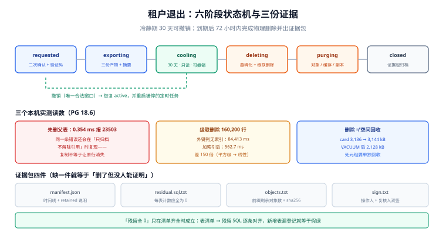

# 第 4 周第 3 步之六 · 租户退出：导出、冷静期与级联删除

前面五步（稳态运营、观察窗交接、交付度量、分批回填、部署前置）都在回答「系统活着的时候怎么运营」。这一章处理一件所有多租户产品都会遇到、但极少在验收清单里出现的事：**一个租户要走了**。

它不是「运维点一下删除」。它是一条有状态的产品流程：导出数据 → 冷静期 → 级联删除 → 存储回收 → 出具证据。走错的代价不是报错，而是**删不干净**（合规问题）或**删太快**（客户反悔没得救）。本项目的口径先写死：**冷静期 30 天，期间可撤销；到期后 72 小时内完成物理删除并出证据包。**

::: tip 一句话定位
租户退出的难点不在「删」，在**证明删干净了**。删除本身是一条 `DELETE`，证据是一组可复跑的计数与对象清单。
:::

本章判据族 `TNO-A` ~ `TNO-H`，共 8 条。定义表在第八节。



## 一、六阶段状态机

| 状态 | 进入条件 | 允许的动作 | 退出条件 |
| --- | --- | --- | --- |
| `requested` | 租户管理员提交注销申请（需二次确认 + 邮箱验证码） | 撤销 | 导出任务受理 → `exporting` |
| `exporting` | 导出任务已建 | 撤销（导出继续，产物留 7 天） | 导出完成且校验通过 → `cooling` |
| `cooling` | 冷静期开始（30 天） | **撤销**（唯一窗口） | 到期且未撤销 → `deleting` |
| `deleting` | 冷静期结束 | 无（不可撤销） | 级联删除完成 → `purging` |
| `purging` | 数据库行已删 | 无 | 对象存储与缓存清空 → `closed` |
| `closed` | 证据包已生成 | —— | —— |
| `cancelled` | 任一阶段撤销 | —— | 回到 `active`（导出产物保留或删除由租户选择） |

三条纪律：

1. **状态只能前进，不能跳**。`requested → deleting` 的直接跳转必须在代码里不存在（不是靠产品经理记得）。
2. **`cooling` 期间租户是只读的**。允许继续写入会让「导出快照」与「删除范围」不一致——删多或删少都是事故。
3. **`closed` 之后不可复活**。租户 id 永久占位（不能重新分配给新客户），否则审计记录会指向「另一个人」。

## 二、导出：三份产物与一个摘要

| 产物 | 内容 | 格式 | 校验 |
| --- | --- | --- | --- |
| `data/` | 业务表按表导出（含租户 id、创建时间） | 每表一个 `*.csv.gz` | 行数 + sha256 |
| `files/` | 附件原文件（对象存储按前缀打包） | 保持原扩展名 | 文件数与总字节数 |
| `manifest.json` | 表清单、行数、字节数、导出时间、schema 版本 | JSON | 整体 sha256，作为信封签名对象 |

```sql
-- 逐表导出（示例：评论表）。要点：JOIN 到租户，不依赖调用方传参
COPY (
  SELECT c.id, c.card_id, c.body, c.created_at
    FROM comment c
    JOIN card  d ON d.id = c.card_id
    JOIN board b ON b.id = d.board_id
   WHERE b.tenant_id = :tenant_id
   ORDER BY c.id
) TO STDOUT WITH (FORMAT csv, HEADER true);
```

本机实测（PG 18.6，容器内，写到 `/dev/null`）：**100,000 行 / 约 13.2 MB / 72.6 ms ≈ 182 MB/s**。这个读数的意义是**排除一个常见误判**：导出慢的时候不要先怀疑数据库——瓶颈几乎总在「附件打包」与「对象存储带宽」，见 `TNO-C`。

## 三、冷静期：为什么必须有，以及它和「只读」的关系

30 天不是拍出来的，它由三个约束夹出：

| 约束 | 要求 | 对冷静期的影响 |
| --- | --- | --- |
| 客户反悔窗口 | 至少覆盖一个完整月度结算周期 | ≥ 30 天 |
| 合规删除时限 | 收到请求后「合理时间」内完成（各地不同，通常 30 天内启动） | 不宜 > 45 天 |
| 数据可恢复性 | 期间必须能撤销且数据完好 | 期间不能做不可逆操作（如 compaction 式的重写） |

「只读」有三个容易漏的口子：**API 写接口**（拦）、**实时推送**（拦，否则离线客户端会继续发写请求）、**定时任务**（拦，导出期间的报表任务会写 `report` 表）。三者都必须按 `tenant.status` 判断，而不是各自实现一遍。

::: danger 冷静期最常见的三个错
1. **用 `now() - requested_at > interval '30 days'` 判断到期**：`requested_at` 是 `timestamptz` 时没问题，但如果存的是 `timestamp`（无时区）且服务器在 UTC、业务在 UTC+8，实际冷静期会变成 **29 天 16 小时**。第 170 天的变更窗口章节踩过同一个坑（`AT TIME ZONE` 把一个变更单算到 2027 年）。
2. **冷静期内允许「只读」，但导出任务自己写了一张 `export_job` 表**：这张表如果不随租户删除，`closed` 之后仍有该租户的记录 → 证据包里的「残留 0 行」自相矛盾。
3. **撤销时只改状态，不恢复被停的定时任务**：租户回来了，报表却三个月没跑，没人发现。
:::

## 四、级联删除：顺序、性能与「归档 ≠ 解除引用」

### 4.1 顺序错的那一步，0.35 ms 就报错

审计表为了合规**故意不带 `ON DELETE CASCADE`**（账单与审计不能随租户消失）。于是直接删租户必然失败：

```text
DELETE FROM tenant WHERE id='t-a';
ERROR:  update or delete on table "tenant" violates foreign key constraint
        "audit_log_tenant_id_fkey" on table "audit_log"
DETAIL:  Key (id)=(t-a) is still referenced from table "audit_log".
Time: 0.354 ms
```

这个 0.354 ms 很值得记住：**它快得让人以为「什么都没做」，其实是「一条都没删」**。把人误导到「删除没生效」的方向，然后有人去加 `CASCADE`——那才是真正的事故（审计数据被一并删掉）。

### 4.2 归档不解除引用：本步踩到的最真实的一个坑

第一版实现是「把审计行复制到 `audit_archive`，再删租户」。结果**仍然报同一个错**：

```text
INSERT INTO audit_archive SELECT * FROM audit_log WHERE tenant_id='t-a';  -- INSERT 0 1000
DELETE FROM tenant WHERE id='t-a';
ERROR:  ... still referenced from table "audit_log"      -- 1000 行还在原地
```

原因很朴素：**复制不会让原行消失**。两条正确的路：

| 做法 | 操作 | 优点 | 代价 |
| --- | --- | --- | --- |
| **墓碑化（本项目采用）** | `UPDATE audit_log SET tenant_id='tombstone' WHERE tenant_id=:id`，先确保 `tombstone` 租户存在 | 审计行保留、可追溯「某年某月某租户注销」 | 需要一条占位租户，报表要把它排除 |
| 物理搬迁 | `DELETE FROM audit_log WHERE tenant_id=:id`（归档已落冷存） | 表更干净 | 审计链断裂，需要额外的归档索引 |

`tombstone` 的命名要能被人读懂（不是 `t-000`）：本项目用 `tombstone`，并在租户表里 `name='已注销租户（审计留痕占位）'`。

### 4.3 性能：同规模租户，84 秒与 0.56 秒的差别

删除的规模（一个中等租户）：

```text
app_user 20,000 + board 200 + card 20,000 + comment 100,000 + attachment 20,000
= 160,200 行，五张表级联
```

同一个 `DELETE FROM tenant WHERE id=...` 两次实测：

| 版本 | 外键列索引 | 耗时 | 折算 |
| --- | --- | --- | --- |
| 第一版 | **没有**（只有主键） | **84,413 ms（1 分 24 秒）** | 526 µs / 行 |
| 加索引后 | `app_user(tenant_id)`、`board(tenant_id)`、`card(board_id)`、`comment(card_id)`、`attachment(card_id)` | **562.7 ms** | 3.5 µs / 行 |

**150 倍**。根因是级联删除的执行方式：每删一行父记录，都要去子表找引用它的行；子表外键列没有索引时这是一次**顺序扫描**，于是 2 万次父行删除 × 每次扫 10 万行 = 平方级。

这条读数的工程含义：**外键列必须建索引，理由不是查询快，而是删除不会变成平方级**。在 `card.board_id` 上建索引看起来「没用」（没有人按 board_id 单独查），但它是 `DELETE FROM board` 的加速器。

### 4.4 删除不等于空间回收

```text
card 表：删除前 3,136 kB → 删除后 3,144 kB（死元组还在）→ VACUUM 后 2,128 kB
```

**删完反而变大**是正常现象（删除写的是新元组标记）。真正回收空间要靠 `VACUUM`（必要时 `VACUUM FULL`，但那会锁表）。别在删除事务里做 `VACUUM FULL`——它会把一次 0.5 秒的删除变成一个几分钟的停机。

## 五、存储回收：三类残留，三种手段

| 残留 | 在哪 | 检查方式 | 清理方式 |
| --- | --- | --- | --- |
| 附件对象 | 对象存储 `tenant/<id>/` 前缀 | `list-objects-v2 --prefix`，数量应为 0 | 前缀批量删除（分批，每批 ≤ 1,000） |
| 缓存 | Redis 的租户 key | `SCAN` 匹配 `t:<id>:*` | 按前缀删除（用 `SCAN` 不要用 `KEYS`） |
| 搜索/湖仓副本 | 检索索引、湖表分区 | 按 `tenant_id` 过滤 count | 走各自的删除接口（湖表是 `DELETE` + 一次 compaction） |

四条纪律：

1. **对象删除要幂等**：删到一半失败，重跑必须能继续（按前缀列出来再删，不要「删完再数」）。
2. **缓存要先切读再删**：直接删会让正在处理的请求把旧数据写回缓存。
3. **湖表删除要跟一次 compaction**：只写删除文件不合并，`TNO-G` 的读断言会一直看到旧数据（见 [湖仓 · 增量读](../../../../docs/DB/Lakehouse/IncrementalRead/index.md)）。
4. **保留「删除清单」而不是「删除日志」**：证据包里要的是「这些对象曾经属于该租户且已删除」，一份带前缀与对象数的清单，比十万行 access log 有用。

## 六、证据包：四份产物

```text
evidence/<tenant_id>-<yyyyMMdd>/
├── manifest.json        # 表清单 + 行数 + 状态机时间线
├── residual.sql.txt     # 每条残留检查的 SQL 与结果（应全为 0）
├── objects.txt          # 前缀 → 剩余对象数（应为 0）+ 清单 sha256
└── sign.txt             # 上述三份的 sha256，由操作人与复核人双签
```

`manifest.json` 至少四个字段能被人读懂：

| 字段 | 例 | 为什么需要 |
| --- | --- | --- |
| `tenant_id` | `t-9f3a` | 与合同对得上 |
| `timeline` | `requested → cooling → deleting → closed` 各时间戳 | 证明冷静期确实存在（不是当天删） |
| `residual` | 每表 `0`，对象前缀 `0` | 证明删干净 |
| `retained` | `audit_log: 1,000 行（已墓碑化）` | **主动说明「哪些没删、为什么」**——这一行最能减少审计来回 |

::: warning 「残留全 0」这句话本身可能是假的
如果残留检查只覆盖了服务端的五张主表，而漏了「导出任务的 `export_job` 表」「审计表的墓碑行」「搜索索引」「湖表快照」，那么证据包是**绿的但不成立**。`TNO-E` 要求残留检查清单与「租户数据清单」逐条对齐——先有清单，才有检查。
:::

## 七、可运行验证

### 7.1 残留检查（一条 SQL 出全部计数）

```sql
-- 期望：每一行都为 0；任何一行非 0 都说明漏了一张表
SELECT 'app_user' AS t, count(*) FROM app_user WHERE tenant_id = :tid
UNION ALL SELECT 'board',      count(*) FROM board      WHERE tenant_id = :tid
UNION ALL SELECT 'card',       count(*) FROM card  c JOIN board b ON b.id=c.board_id WHERE b.tenant_id = :tid
UNION ALL SELECT 'comment',    count(*) FROM comment m JOIN card c ON c.id=m.card_id
                                                     JOIN board b ON b.id=c.board_id WHERE b.tenant_id = :tid
UNION ALL SELECT 'attachment', count(*) FROM attachment a JOIN card c ON c.id=a.card_id
                                                     JOIN board b ON b.id=c.board_id WHERE b.tenant_id = :tid
UNION ALL SELECT 'export_job', count(*) FROM export_job  WHERE tenant_id = :tid AND state <> 'archived';
```

本机实测（删除后）：`app_user 0 / board 0 / audit_log 0`（墓碑化之后），六条 UNION 全部返回 0 的耗时 **0.914 ms**。

### 7.2 删除前的三道闸（顺序执行，任一失败即中止）

```text
1) 状态检查：SELECT state FROM tenant WHERE id=:tid  → 必须等于 'deleting'
2) 导出检查：evidence 目录下 manifest.json 存在且 sha256 校验通过
3) 审计解除引用：SELECT count(*) FROM audit_log WHERE tenant_id=:tid → 必须为 0
   （若不为 0，先执行墓碑化 UPDATE，而不是加 CASCADE）
```

### 7.3 对象前缀清空

```shell
# 期望：第二条命令输出 0；不为 0 则重跑清理（幂等）
aws s3api list-objects-v2 --bucket tb-files --prefix "tenant/${TID}/" --query 'KeyCount'
aws s3api list-objects-v2 --bucket tb-files --prefix "tenant/${TID}/" --query 'KeyCount'   # 清理后复查
```

### 7.4 三步演练脚本（本机能跑，需一个 PG 实例）

```text
S1 造一个测试租户（2 万用户 / 20 万行），记录五表计数基线
S2 直接 DELETE FROM tenant → 期望 23503（存在未解除引用的审计行）
S3 墓碑化审计 → DELETE → 期望成功；再跑 7.1 的残留检查 → 全部 0
S4 检查 card 表体积与 VACUUM 前后的差值（预期回收 30% 左右）
```

本机 S1~S4 的读数已写进 4.1 / 4.3 / 4.4 三节；`S2` 的报错信息与 `0.354 ms` 是原样贴出的输出。

## 八、判据表

| 编号 | 规则 | 违反时的样子 | 怎么验证 |
| --- | --- | --- | --- |
| `TNO-A` | 六阶段状态机，禁止跨状态跳转 | 当天提交当天删 | 状态迁移表里有 `(from,to)` 白名单；单测覆盖非法跳转 |
| `TNO-B` | 冷静期 30 天，期间租户只读 | 反悔后数据已被改 | 冷静期内调用写接口返回 403；定时任务跳过该租户 |
| `TNO-C` | 导出含三份产物 + 信封摘要 | 客户拿到一份没有清单的压缩包 | `manifest.json` 存在且 sha256 可校验 |
| `TNO-D` | 审计表不带 `CASCADE`，靠墓碑化解除引用 | 审计被一并删除 | 表定义里无 `ON DELETE CASCADE`；删除前有墓碑化步骤 |
| `TNO-E` | 残留检查清单与租户数据清单逐条对齐 | 证据包绿色但不成立 | 清单里每张表在残留 SQL 里都有一行 |
| `TNO-F` | 所有外键列有索引 | 一次删除跑 84 秒并锁住表 | `pg_indexes` 里外键列都有索引；用测试租户量一次耗时 |
| `TNO-G` | 删除后跟一次空间回收与副本清理 | 库变小了但盘没变；湖表仍能查到 | `VACUUM` 后体积下降；湖表 `count(*)` 为 0 |
| `TNO-H` | `closed` 后租户 id 永久占位不可复用 | 审计记录指向另一个客户 | 租户表有 `retired` 标记，注册接口拒绝复用 id |

## 九、下一步

- **第 175 天**：把「租户数据清单」做成从 `information_schema` 自动生成（现在是手写六行 SQL，新增表会漏），并把残留检查接进 CI 的一个测试租户。
- **本月内**：`TNO-G` 的湖表部分要接上 `DELETE` 后的一次 compaction，否则「删除后仍可查」在湖侧会持续一个快照周期。
- **遗留**：`tombstone` 租户会让「按租户计数」的报表多一行，需要在前端过滤；这件事已登记为数据口径债，不在本步处理。

## 参考资料

- PostgreSQL 18 · `ON DELETE` 与引用完整性：<https://www.postgresql.org/docs/18/ddl-constraints.html#DDL-CONSTRAINTS-FK>
- PostgreSQL 18 · `COPY`：<https://www.postgresql.org/docs/18/sql-copy.html>
- PostgreSQL 18 · `VACUUM` 与空间回收：<https://www.postgresql.org/docs/18/routine-vacuuming.html>
- 本专题相关页：[对象存储 · 生命周期与成本](../../../../docs/Backend/ObjectStorage/LifecycleCost/index.md) · [湖仓 · 保留与清理](../../../../docs/DB/Lakehouse/Retention/index.md)
- 项目内相邻章节：[租户上下文](../TenantContext/index.md) · [跨租户用例矩阵](../CrossTenantMatrix/index.md) · [稳态运营](../SteadyStateOps/index.md) · [观察窗与交接](../ObserveHandover/index.md)
