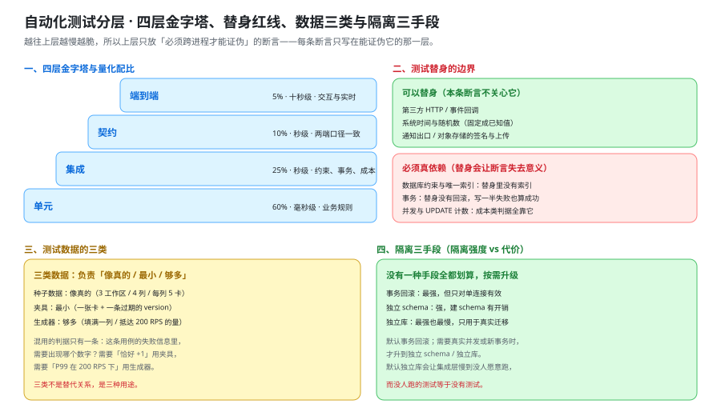

# 自动化测试分层：四层金字塔与测试数据的隔离

这一页回答的是「自动化测试该写在哪一层、每层该断言什么、测试数据怎么才不互相污染」——它把四层的职责边界、测试替身的红线、容器化集成的落地口径、测试数据的隔离代价与四层的量化配比写成能照着落地的口径；它**不回答**「端到端该写哪些用例」——那在 [端到端测试](../E2ETest/index.md)，本页只界定「什么必须下沉到下面三层」。



下面的命令、配置与代码骨架要在**你自己搭好的工程**里执行；本仓不存放源码、脚本与构建文件。版本口径一律以 [技术选型与版本基线](../TechStack/index.md) 定稿的基线为准（Java 25 LTS、Spring Boot 4.1、PostgreSQL 18、Node.js 24 LTS、pnpm 12.x），本页只补测试工具自身。

## 一、四层各自回答什么问题

分层不是为了把测试「摆得好看」，而是为了让**每一条断言都写在唯一能证伪它的那一层**。四层同时回答三个问题：这层能抓到什么、不该在这层抓什么、以及为什么不能搬到别层。

| 层 | 回答什么问题 | 该层能抓到的缺陷 | 不该在这一层抓的 |
| --- | --- | --- | --- |
| **单元** | 一段纯逻辑对给定输入是否给出给定输出 | 分数排序键的 midpoint 算法、权限判定的角色矩阵、`@` 提及的解析 | 任何要连库、连 Redis、连 HTTP 才能出现的缺陷 |
| **集成** | 多个真实组件放在一起是否还成立 | 唯一索引与事务边界、乐观锁真的拒绝了过期版本、outbox 与业务写在同一个事务里 | 界面行为、跨浏览器的渲染差异 |
| **契约** | 两端对同一份约定的理解是否一致 | 路径与方法、状态码口径、请求与响应体字段形状、`401` 先于 `403` | 业务规则本身对不对（那是单元与集成的事） |
| **端到端** | 真实浏览器 + 真实并发下，用户看到的行为是否成立 | 实时推送与乐观更新回滚、双端同时在线、断线重连追平 | 任何在下面三层能证伪的断言 |

一句话定值：**越往上层越慢越脆，所以上层只放「必须跨进程才能证伪」的断言。** 这条不是审美，是可操作的判据——写完一条上层用例，先问一句「把这条断言搬到下面某一层，还能不能失败」。能失败，就说明它放错了层，该下沉。

::: danger 三种「放错层」的典型形态
1. **用端到端测业务规则。** 为了验证「拖动只更新一行」而启动浏览器点一次拖动——这条断言在集成层只用一个 `UPDATE` 计数就能证伪，而且快两个数量级。它的代价不是慢，是**脆**：浏览器、网络、动画任何一环抖动都会让它变红，最后没人看它。
2. **用单元测试测数据库约束。** 用内存替身验证「唯一索引会拒绝重复的 `position`」——替身里根本没有索引，这条测试**永远绿**，而真实库里两张卡片拿到同一个键。
3. **用集成测试测界面。** 断言「拖动后卡片出现在目标列」要在浏览器里看，集成层看不到任何界面。
:::

## 二、测试替身的边界

替身（test double）的用途是**把一个与本条断言无关的外部依赖换成可控的东西**。它有一条红线：**被断言行为所依赖的那一层，必须是真的。**

| 可以替身（替身不影响被验的规则） | 必须真依赖（替身会让断言失去意义） |
| --- | --- |
| 第三方 HTTP 服务（回调、Webhook） | **数据库的约束、唯一索引**：替身没有索引，重复插入照样成功 |
| 系统时间与随机数（固定成已知值） | **数据库的事务**：替身没有回滚，写一半失败也会「成功」 |
| 邮件 / 站内通知的投递出口 | **数据库的隔离级别与并发行为**：替身里没有并发 |
| 对象存储的签名与上传 | **真实的 `UPDATE` 计数与执行计划**（成本类判据依赖它） |
| 浏览器的位置、语言、时区 | **真实 WebSocket 的投递顺序**（推送类判据依赖它） |

右列第二项是这一节的落点：**[卡片拖动](../CardMove/index.md) 的核心判据是「一次拖动只更新一行」**——它的证据是「该列被改动的行数恰好 `+1`」，也就是一条 `UPDATE` 影响的行数。任何内存替身都**无法伪造这个数字**：它既没有索引要维护，也没有 `WHERE position >= 2` 这类全列后移的写法。所以这条判据**必须在集成层用真库跑**，这也是 [可运行验证](../Verification/index.md) 第四节要连库数行的原因。

::: warning 替身不是「越多越好」
替身每多一层，测试与生产环境的差距就多一处：替身的行为要**自己维护**，它一旦与真实实现漂移，测试就从「保护」变成「误导」。取舍只有一句：**替身只用于「本条断言不关心、但起不来」的依赖**——第三方服务起不来，所以替身；数据库起得来（Testcontainers），所以不替身。
:::

## 三、集成测试用 Testcontainers 落地

集成测试需要一个**真的 PostgreSQL**。Testcontainers for Java **2.0.5**（发布日 2026-04-20；1.x 维护线为 **1.21.4**，2025-12-16）解决的问题正是「让容器随测试生命周期起停，且只起一次」。

### 3.1 `@ServiceConnection`：让容器告诉 Spring 连哪儿

Spring Boot 4.1 的 `@ServiceConnection` 会把容器的端口与凭据直接注册成应用配置，**不需要**手写 `@DynamicPropertySource` 把 `spring.datasource.url` 拼出来。少一处手写，就少一处「容器端口变了、配置没跟着改」的漂移。

### 3.2 容器复用与等待策略

| 项 | 口径 | 不做会怎样 |
| --- | --- | --- |
| **容器复用** | 开发机开启复用（同一个容器跨测试类复用并常驻），CI 关闭（每个 job 干净起） | 每个测试类起一次容器：一条集成测试从毫秒级变成十几秒，本地没人愿意跑 |
| **等待策略** | 不用固定 `sleep`，用就绪探测（`db` 用 `pg_isready`；`cache` 用 `PING` 有应答） | `sleep 5` 在慢机器上不够、在快机器上白等，是**经典 flaky 来源** |
| **初始化脚本** | 建表与种子脚本挂成容器的初始化脚本，与 [环境与工程骨架](../Environment/index.md) 的 `compose.yaml` **共用同一份** | 两处各写一份 DDL，早晚漂移 |
| **隔离** | 每个测试类一个 schema，或每个用例一个事务并回滚 | 用例之间互相看见对方的数据，失败与顺序强耦合 |

### 3.3 与 `docker compose` 的关系

两者**不是二选一**：

- `docker compose` 面向**人和整栈**：一键起 `db` / `cache` / `object` / `app`，用于联调与冒烟（见 [可运行验证](../Verification/index.md)）。
- Testcontainers 面向**测试进程**：只起这条测试需要的容器，生命周期跟着测试走，用完即销毁。

共用的部分必须是**那一份 DDL 与那一份种子脚本**——`compose.yaml` 的初始化目录与 Testcontainers 挂载的初始化目录指向同一个路径。这条「两处引用一份」是本节唯一的纪律。

### 3.4 Java 骨架

```java [app/src/test/java/…/integration/IntegrationTestBase.java（骨架）]
// 依赖：org.testcontainers:postgresql:2.0.5（1.x 维护线为 1.21.4）
@Testcontainers
@SpringBootTest
abstract class IntegrationTestBase {

  @Container
  @ServiceConnection                       // 端口与凭据自动注册，不手写 @DynamicPropertySource
  static final PostgreSQLContainer<?> POSTGRES =
      new PostgreSQLContainer<>("postgres:18-alpine")
          .withInitScript("db/schema.sql")   // 与 compose.yaml 引用同一份 DDL
          .withReuse(true);                  // 本地复用；CI 用 -Dtestcontainers.reuse.enable=false 关掉

  @BeforeEach
  void resetPerCase() {
    // 顺序无关的前提：每条用例从同一份状态出发（事务回滚或独立 schema）
  }
}
```

```shell [本地与 CI 的两种跑法]
# 本地：开复用，第二次起跑不再等容器就绪
./gradlew test --tests '*Integration*'

# CI：每个 job 干净起，不复用（否则容器状态会跨 job 泄漏）
./gradlew test -Dtestcontainers.reuse.enable=false
```

## 四、测试数据的三类与隔离三手段

### 4.1 三类数据

| 类 | 是什么 | 适用 | 代价 |
| --- | --- | --- | --- |
| **种子数据** | 一套固定的、贴近真实的初始状态（3 工作区 / 每看板 4 列 / 每列 5 卡） | 端到端与冒烟：需要一个「看起来像真的」的看板 | 与真实数据一起腐烂；改一次 schema 要跟着改 |
| **夹具** | 只为本条用例准备的最小数据（一张卡、一条过期 `version`） | 单元与集成：只让被断言的规则成立 | 每条用例都要写，容易与「真实形状」脱节 |
| **生成器** | 用代码按规则批量造数据（N 张卡、随机位置键） | 成本类与容量类判据：需要「填满」的量 | 生成的数据不自然，抓不到「长尾形状」的缺陷 |

三类**不是替代关系**：种子数据负责「像真的」，夹具负责「最小」，生成器负责「够多」。混用的判据只有一条：**这条用例的失败信息里，需要出现哪个数字？** 需要「恰好 `+1`」就用夹具（最小），需要「P99 在 200 RPS 下」就用生成器（够多）。

### 4.2 隔离三手段与代价

| 手段 | 做法 | 隔离强度 | 代价 |
| --- | --- | --- | --- |
| **事务回滚** | 每条用例包在事务里，结束回滚 | 最强（用例之间互不可见） | 只对**单连接**有效：被测代码若自己开新连接或新事务，回滚看不到它的写入 |
| **独立 schema** | 每个测试类建一个 schema，用完销毁 | 强 | 建 schema 有开销；跨 schema 的连接池要随类切换 |
| **独立库** | 每个测试类一个库（或每个容器一个库） | 最强、最慢 | 建库 + 迁移的开销最大，通常只用于「需要真实迁移」的用例 |

代价那一列决定了取舍：**默认用事务回滚，需要真实并发或新事务时才升到独立 schema / 独立库**。反过来（默认独立库）会让整个集成层慢到没人愿意跑——而没人跑的测试等于没有测试。

### 4.3 顺序无关是唯一硬判据

写死一条：**测试必须顺序无关。** 证明方式不是「我看了一遍代码」，而是**用随机顺序真的跑一遍**——用例之间有隐式顺序依赖时，随机顺序必然把它暴露成一次无关的失败。

```shell
# 随机顺序跑一遍：这是「顺序无关」唯一的证明方式
./gradlew test --tests '*Integration*' -Djunit.jupiter.testmethod.order.default=org.junit.jupiter.api.MethodOrderer\$Random

# 前端同理（Vitest 的随机顺序）
cd web && pnpm vitest run --sequence.shuffle --sequence.seed=20261016
```

```text
# 期望：与固定顺序跑出同样多的通过数
# 出现「某条用例单独跑绿、混跑红」即说明它依赖了别的用例留下的状态
```

## 五、前端测试分层

前端同样分层，但层数与后端不同：**组件测试**（渲染一个组件、断言它的行为）与**浏览器模式**（在真实浏览器里跑同一批测试）是两种运行方式，不是两种测试。

| 方式 | 跑在哪 | 能抓到 | 抓不到 |
| --- | --- | --- | --- |
| **组件测试**（默认，jsdom） | Node 进程里的模拟 DOM | 逻辑、状态流转、条件渲染、事件回调 | 真实布局、真实滚动、CSS 引起的可见性问题、拖拽手势 |
| **浏览器模式**（同一批用例，换成真实浏览器） | 真实浏览器（Playwright provider） | 上面那一列 | 跨进程的实时推送（那是 [端到端测试](../E2ETest/index.md) 的事） |

版本口径：前端单元 / 组件测试用 **Vitest 5.0.3**（口径日期：2026-10-16；4.x 维护线为 4.1.11）。

网络替身的边界：组件测试里的 HTTP 用 **Mock Service Worker（MSW）** 在**网络层**拦截，而不是 mock 掉自己的 `fetch` 封装。理由是：mock 掉封装等于**同时 mock 掉了「怎么拼 URL、怎么带令牌、怎么解析错误体」这三件事**——而这三件恰恰是最容易两端不对齐的地方（见 [前后端联调](../Integration/index.md)）。MSW 让这些代码真的执行，只把最外面的响应换掉。

::: tip 一个反过来的边界
MSW **不能**用来验 WebSocket。WebSocket 不是「一条请求一条响应」，它有顺序、有重连、有服务端主动推送——用假的长连接去验「两端 `seq` 相同」，验的是假实现自己的行为。推送类断言一律留给端到端层的真实连接。
:::

## 六、四层的量化配比与「先写哪一层」

### 6.1 配比表

| 层 | 占比量级 | 单条耗时量级 | 它拦住的缺陷类型 |
| --- | --- | --- | --- |
| 单元 | 约 **60%** | 毫秒 | 业务规则算错、分支漏写 |
| 集成 | 约 **25%** | 秒 | 约束、事务、并发、成本类判据 |
| 契约 | 约 **10%** | 秒 | 两端口径不一致 |
| 端到端 | 约 **5%** | 十秒级 | 交互、实时、跨进程时序 |

### 6.2 三条定值理由

配比**不是教条**，它是从「缺陷归属」推出来的三个数的结果：

1. **按缺陷归属分配。** 每一层的占比应当近似「历史上归到这一层的缺陷占比」。业务规则算错这类缺陷天然最多，所以单元层最厚；「必须跨进程才能出现」的缺陷天然最少，所以端到端最薄。**比例跟着缺陷走，而不是跟着「想不想写」走。**
2. **按单位成本反向补偿。** 单元一条是毫秒、端到端一条是十秒级。上层每加一条，整套测试的墙钟时间就多十秒；所以上层必须先被下面三层「筛过一遍」，只承接筛不掉的那部分。
3. **上层的每一条都要可审计。** 一条上层用例必须能回答「它为什么不能下沉」。答不上来的就该迁下去——这条规则让配比**可被复算**：任何人加一条端到端用例都要当场说明理由，而不是靠「多测一点总没错」。

### 6.3 先写哪一层

顺序是**自下而上**：单元 → 集成 → 契约 → 端到端。但「先写」另有一条更实用的规则：**在发现缺陷的那一层就地补一条测试，然后把它下沉到能证伪它的最低层。** 生产上发现「拖完 `seq` 跳了两格」，第一反应是在端到端补一条——正确的做法是在集成层补一条「一次拖动只前进一个 `seq`」，端到端那条**只在需要真实并发时才保留**。

## 七、测试命名与失败信息

### 7.1 命名要能读出「哪条规则、什么条件下、期望什么」

| 写法 | 示例 | 读出来的信息 |
| --- | --- | --- |
| 推荐 | `moveCard_conflictingVersion_returns409WithCurrentPosition` | 规则 + 条件 + 期望，一条读完 |
| 不推荐 | `testMove2` | 什么都没读到，只能点进去看实现 |

### 7.2 失败信息要能直接指向被破坏的规则

失败信息的第一句必须**点名被破坏的规则与实测值**：

| 差的失败信息 | 好的失败信息 |
| --- | --- |
| `expected: true but was: false` | `一次拖动应恰好更新 1 行，实测更新了 12 行——它是否退回了整数 position 的全列后移？` |
| `AssertionError` | `看板 seq 应恰好 +1，实测 +2：这条事件是否被写了两次（重试没有走幂等）？` |

这条纪律的收益很具体：**失败信息出现的那一刻，往往是三天后或别人手里**——「`expected true`」只能告诉人「有地方不对」，点名规则的失败信息能直接把注意力送到那一个模块。

### 7.3 五条测试反模式

1. **断言「没报错」。** 一条只写「调用不抛异常」的测试，在函数体被清空成 `return` 时照样绿。
2. **用例之间共享可变状态。** 顺序一换就红，且红的是第二条而不是第一条——它掩盖真实原因。
3. **用 `sleep` 等异步。** 慢机器上不够、快机器上白等；要等就等**业务信号**（那一条事件、那个状态）。
4. **一条用例断言一堆事。** 失败时无法定位是哪条规则被破坏；拆开之后每条都有独立的失败信息。
5. **测试里把实现重写一遍。** 用同样的公式再算一遍期望值，实现错了测试跟着错——期望值必须是**手写的常量或外部事实**。

## 八、当日做了什么

1. 定下**四层的职责表**（单元 / 集成 / 契约 / 端到端），每层给「能抓到的缺陷」与「不该在这一层抓的」，并把「越往上层越慢越脆，所以上层只放必须跨进程才能证伪的断言」写成可操作的判据，补上三种「放错层」的典型形态。
2. 定下**测试替身的边界**（可替身 / 必须真依赖两张清单），并写死「数据库的约束、事务、唯一索引不能替身」，指明 [卡片拖动](../CardMove/index.md) 的「一次拖动只更新一行」为什么必须在集成层用真库跑。
3. 定稿**Testcontainers for Java 2.0.5**（发布日 2026-04-20；1.x 维护线 1.21.4）的落地口径：`@ServiceConnection` 免手写 `@DynamicPropertySource`、容器复用的本地与 CI 差异、就绪探测替代固定 `sleep`、与 `docker compose` 的关系（共用同一份 DDL 与种子脚本），并给出一段 Java 骨架。
4. 定稿**测试数据的三类**（种子数据 / 夹具 / 生成器）与**隔离三手段及代价表**（事务回滚 / 独立 schema / 独立库），给出「默认事务回滚、需要真实并发才升级」的取舍，并把「顺序无关」写成唯一硬判据与可执行的随机顺序命令。
5. 定稿**前端测试分层**：组件测试与浏览器模式的差别、**Vitest 5.0.3**（口径日期 2026-10-16；4.x 维护线 4.1.11）、以及 **MSW 的边界**（替换 HTTP 的网络层，但不用于验 WebSocket）。
6. 给出**四层配比表**与**三条定值理由**（按缺陷归属分配 / 按单位成本反向补偿 / 上层每条都要可审计），并写清这类配比是从「缺陷归属」推导出来的、不是教条；另给出「先写哪一层」的两条规则。
7. 定稿**测试命名与失败信息**的要求（失败信息必须点名被破坏的规则与实测值），并列出**五条测试反模式**。
8. 产出 **`TS-A ~ TS-H` 八条判据**，如实区分文档级与运行期：七条文档级本机可判、一条运行期标 `⏳ 未跑`。

## 九、如何验证

### 9.1 判据表（`TS-A ~ TS-H`）

| 判据 | 判什么 | 级别 | 状态 |
| --- | --- | --- | --- |
| **`TS-A`** | 四层职责表齐全，且「上层只放必须跨进程才能证伪的断言」写死 | 文档级 | ✅ 本机可判 |
| **`TS-B`** | 测试替身边界写死：数据库的约束 / 事务 / 唯一索引不可替身 | 文档级 | ✅ 本机可判 |
| **`TS-C`** | Testcontainers for Java 2.0.5（2026-04-20；1.x 维护线 1.21.4）落地口径与 Java 骨架齐全 | 文档级 | ✅ 本机可判 |
| **`TS-D`** | 测试数据三类与隔离三手段代价表齐全，且「顺序无关、随机顺序跑一遍」写死 | 文档级 | ✅ 本机可判 |
| **`TS-E`** | 前端分层写清组件测试与浏览器模式的区别，Vitest 5.0.3 带口径日期，MSW 边界写死 | 文档级 | ✅ 本机可判 |
| **`TS-F`** | 四层配比表与三条定值理由齐全，且写明配比不是教条 | 文档级 | ✅ 本机可判 |
| **`TS-G`** | 测试命名与失败信息要求 + 五条测试反模式齐全 | 文档级 | ✅ 本机可判 |
| **`TS-H`** | 四层真的各跑过一次，随机顺序跑出的通过数与固定顺序一致 | 运行期 | `⏳ 未跑`（原因：**本仓库只有文档，没有可执行的工程与前端**；容器运行时本机可用，复验见 [第 3 周验收结论](../Week3Acceptance/index.md) 第三节） |

### 9.2 本机可判的部分

前七条是**文档级、本机可判**——下面的命令已在仓库根实跑，括注为实测值。

```shell
# TS-A：四层职责表四行 + 「越往上层越慢越脆」写死
grep -cE '^\| \*\*(单元|集成|契约|端到端)\*\* \|' index.md           # 期望 4
grep -c '必须跨进程才能证[伪]' index.md                              # 期望 4

# TS-B：替身边界两张清单各行 + 「不能替身」写死
grep -c '唯一索[引]' index.md                                        # 期望 5

# TS-C：Testcontainers 版本、日期与骨架齐全
grep -c 'Testcontainers for Jav[a]' index.md                         # 期望 3
grep -c '@ServiceConnectio[n]' index.md                              # 期望 4
grep -c '2026-04-2[0]' index.md                                      # 期望 3

# TS-D：三类数据与三手段齐全 + 随机顺序复跑写死
grep -c '^### 4\.[1-3] ' index.md                                    # 期望 3
grep -c '顺序无[关]' index.md                                        # 期望 6

# TS-E：前端分层 + 版本口径日期
grep -c 'Vitest 5\.0\.[3]' index.md                                  # 期望 3
grep -c '口径日期：2026-10-1[6]' index.md                            # 期望 1
grep -c 'Mock Service Worke[r]' index.md                             # 期望 1

# TS-F：配比表四行 + 三条定值理由
grep -c '^### 6\.[1-3] ' index.md                                    # 期望 3
grep -c '按缺陷归[属]' index.md                                      # 期望 2

# TS-G：五条反模式 + 失败信息要求
grep -c '^### 7\.[1-3] ' index.md                                    # 期望 3

# 配图与判据条数
grep -c 'assets/tb-test-strategy.sv[g]' index.md                     # 期望 1
grep -cE '^\| \*\*`TS-[A-H]`\*\*' index.md                           # 期望 8
```

### 9.3 需要真实环境的部分

`TS-H` 的判据对象是**真的跑起来的四层**，本机既没有容器运行时、也没有工程代码，按本项目一贯纪律如实标 `⏳ 未跑`，只给命令：

```shell
# TS-H（需要容器运行时 + 工程代码 + JDK + Node 工具链）：
# 1) 单元层：./gradlew test --tests '*Unit*'      —— 期望全绿，墙钟在秒级
# 2) 集成层：./gradlew test --tests '*Integration*' —— 期望全绿（Testcontainers 起真库）
# 3) 契约层：逐路径一条成功 + 一条主要错误，路径数 == 测试类数
# 4) 端到端层：见 E2ETest 页
# 5) 随机顺序复跑一次，通过数与固定顺序一致
```

::: warning 状态列的读法
`TS-A` ~ `TS-G` 的结论是**逐条 `grep` 数出来的**，不是推断的。`TS-H` 的状态不是「结论」而是「当前可执行性」，它的阻塞项只有**一条**：本仓库按约定只有文档、没有可执行的工程与前端。**不是容器运行时**——本机 2026-10-17 复验 `docker version` 输出客户端与服务端均为 `27.1.1`、且有常驻容器在运行，[验收](../Acceptance/index.md) 台账里的 `BL-1` 因此已不成立，更正过程见 [第 3 周验收结论](../Week3Acceptance/index.md) 第三节。**不把「跑过了」写成「通过了」，也不把期望值抄进状态列。**
:::

## 十、下一步

1. **四层配比要落成 CI 的两条 job 边界**：单元 + 集成在一个 job、契约 + 端到端在另一个 job，前者必须「几十秒内给结论」，后者可以慢；混在一个 job 里会让快反馈消失。
2. **Testcontainers 的复用开关按环境二分**（本地开、CI 关，第三节已给理由），并在 CI 里显式写 `TESTCONTAINERS_REUSE_ENABLE=false`——依赖默认值会随版本变化。
3. **随机顺序复跑进日常**：先在本地与 nightly 各跑一次，两周稳定后再进 PR 门禁；一个「单独绿、混跑红」的用例在 PR 上会表现为随机失败，那是最难查的一类红。

## 与「测试数据与仿真环境」专题的分工（第 165 天补充）

| 专题 | 负责什么 | 与本页的边界 |
| --- | --- | --- |
| 本页 | 本项目的测试分层、用例组织、验收口径 | —— |
| [测试数据与仿真环境](../../../../docs/Tools/TestDataSimulation/index.md) | 数据配方的方法：口径、生成器、指纹、隔离 | 本页引用那边的**方法**，不重复定义 |
| [测试数据流水线](../../../../docs/Tools/TestDataSimulation/Practice/index.md) | 本项目的八步流水线与 S1~S10 验收 | 本页说「分几层」；那边说「每层的数据怎么来」 |
| [压测与池层断言](LoadTestGate/index.md) | 四场景负载模型与 `mismatch = 0` | 压测属于第 3 周，不在测试分层里重复 |

::: danger 本页特有的坑：「使用测试库现有数据」
测试策略里写这句话，等于承认「共享夹具」——用例之间通过库里的残留互相影响，单跑就红。
正确写法是「每个用例自带最小数据集（builder 或独立租户）」，并在策略里写明**谁负责清理**。
:::

## 参考资料

- [卡片拖动：一次拖动只更新一行](../CardMove/index.md)（「一次拖动只更新一行」这条必须在集成层用真库验的判据） · [领域核心](../DomainCore/index.md)（乐观锁与幂等键的单元级规则来源）
- [端到端测试：只测必须跨进程才能证伪的东西](../E2ETest/index.md)（四层里最上面一层的用例集与选择器纪律） · [可运行验证](../Verification/index.md)（种子数据与并发的可执行口径）
- [接口契约定稿：路径、错误码与幂等](../Contracts/index.md)（契约层逐路径覆盖的对象） · [技术选型与版本基线](../TechStack/index.md)（Java / Spring Boot / PostgreSQL / Node 基线，测试工具只补自身版本）
- [环境与工程骨架](../Environment/index.md)（`compose.yaml` 与 Testcontainers 共用的那一份 DDL 与种子脚本）
- [完整项目交付 · 测试策略](/docs/Others/ProjectDelivery/Testing/index.md)（分层测试的通用口径） · [性能与容量工程 · 压测方法论](/docs/Ops/PerformanceEngineering/LoadTesting/index.md)（生成器类数据的用途）
