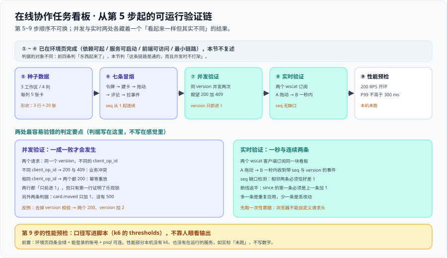

# 可运行验证：从零起一套能跑的环境

这一页把第 2 周里程碑的四条判据（**服务可启动、接口可调用、页面可访问、两次拖动不互相覆盖**）写成**能照着跑的命令**：种子数据 → 七条冒烟命令 → 一次真并发 → 一次真实时 → 压测骨架。它**接着 [环境与工程骨架](../Environment/index.md) 第六节的四条验证往下走**，从第 5 步起。



::: warning 本项目只有文档，没有代码
本页的 `psql` 脚本、`curl` 序列、`wscat` 会话与 k6 脚本，都是**读者在自己工程里要创建并执行的东西**。本仓库不存放源码、脚本与 SQL；「运行 `xxx`」一律指「先按本节创建好该文件 / 服务，再执行」。
:::

## 一、验证顺序与前置

前四步在 [环境与工程骨架](../Environment/index.md) 第六节里，本节**从第 5 步接着往下**。

| 步骤 | 验什么 | 命令所在 |
| --- | --- | --- |
| ① 起依赖 | `db` / `cache` / `object` 三个长驻服务 `running` | 环境页 ⑥ ①（**本节不复述**） |
| ② 起服务 | `/actuator/health` 恰好返回 `{"status":"UP"}` | 环境页 ⑥ ②（**本节不复述**） |
| ③ 起前端 | 5173 列表页可访问、控制台无报错 | 环境页 ⑥ ③（**本节不复述**） |
| ④ 最小链路 | 建一个工作区并把它读回来 | 环境页 ⑥ ④（**本节不复述**） |
| **⑤ 种子数据** | 库里出现「3 工作区 / 每看板 4 列 / 每列 5 卡」 | **第二节** |
| **⑥ 七条冒烟命令** | 取令牌 → 建卡 → 拖动 → 评论 → 拉事件全通 | **第三节** |
| **⑦ 并发验证** | 同时拖同一张卡片：一成一败、`version` 只前进 1 | **第四节** |
| **⑧ 实时验证** | 两个 `wscat` 客户端：A 拖动 → B 一秒内收到，`seq` 无缺口 | **第五节** |
| **⑨ 性能预检** | 200 RPS 到达率下写接口 P99 ≤ 300 ms | **第六节** |

::: tip 为什么本节不重复前四条
1. **重复的验证会在两处漂移。** 环境页改了端口或服务名之后，本节那份副本没人记得同步——而它照样「看起来能跑」。
2. **判据的对象不同。** 前四条判「东西起来了」；本节判「**这条链路是通的，而且并发时不打架**」。一个只能返回 `UP` 的服务，连不上库也会返回 `UP`。
:::

前置四条，缺一不可：**环境页四条全绿**（否则后面每一步的现象都会失真）、**一个能登进来的账号**（否则第 5 步之后全卡 `401`）、**`psql` 能连上库**（否则 2.1 的 `curl` 替代方案要接手）、**两个终端**（否则第 7、8 步无法制造「同时」与「两个客户端」）。

四条里程碑判据与本节步骤的对应：**服务可启动** → 环境页 ①②（本节只重新确认一次 `health`）；**接口可调用** → 第 5、6 步；**页面可访问** → 环境页 ③ + 第 6 步的响应体；**两次拖动不互相覆盖** → 第 7 步。最后一条**只有本节覆盖**——环境页没有对应验证。

## 二、第 5 步：种子数据

目标形状写死：**3 个工作区 / 每块看板 4 列 / 每列 5 张卡片**（合计 3 块看板、12 列、60 张卡片）。

### 2.1 为什么种子数据用 SQL 而不是 `curl`

三条理由：① 种子数据只为**造形状**，不验任何业务规则，走 `curl` 只是把 60 次请求变慢；② `curl` 每建一张卡都写一条 `board_events`，`seq` 顶到 60 以上，第五节的「`seq` 无缺口」就不好读了；③ 代价必须写明——SQL 直插**绕过业务逻辑**，因此必须自己保证不破坏 [数据库设计](../Database/index.md) 第五节的不变量。本页脚本**不写** `board_events`，所以 `boards.seq` 保持 `0`，正好满足 INV-3（看板 `seq` 等于事件表最大 `seq`，无事件时为 0）。

### 2.2 种子脚本

```sql [deploy/db/seed/seed_local.sql]
BEGIN;
-- 三个工作区 + 每个工作区一条 owner 成员关系（权限判定的唯一数据源）
INSERT INTO workspaces (id, name, created_by)
SELECT uuidv7(), '种子工作区 ' || g, (SELECT id FROM users WHERE email = 'owner@example.com')
FROM generate_series(1, 3) AS g;
INSERT INTO memberships (workspace_id, user_id, role)
SELECT w.id, w.created_by, 'owner' FROM workspaces w
WHERE w.name LIKE '种子工作区 %' ON CONFLICT DO NOTHING;
-- 每工作区一块看板（seq = 0）+ 四列，位置键是可比较字符串
INSERT INTO boards (id, workspace_id, name, seq)
SELECT uuidv7(), w.id, '种子看板', 0 FROM workspaces w WHERE w.name LIKE '种子工作区 %';
INSERT INTO board_lists (id, board_id, name, position)
SELECT uuidv7(), b.id, l.name, l.position FROM boards b
CROSS JOIN (VALUES ('待办','0|a'),('进行中','0|b'),('待评审','0|c'),('已完成','0|d')) AS l(name, position)
WHERE b.name = '种子看板';
-- 每列五张卡，位置键在列内升序；本脚本不写 board_events，故 boards.seq 保持 0
INSERT INTO cards (id, board_id, list_id, title, position, created_by)
SELECT uuidv7(), l.board_id, l.id, '种子卡片 ' || g,
       l.position || '/' || lpad(g::text, 3, '0'),
       (SELECT id FROM users WHERE email = 'owner@example.com')
FROM board_lists l CROSS JOIN generate_series(1, 5) AS g
WHERE l.name IN ('待办','进行中','待评审','已完成');
COMMIT;
```

```shell
# 执行（幂等性靠「换一个干净的库重跑」保证，脚本本身不负责去重）
psql -h localhost -U teamboard -d teamboard -f deploy/db/seed/seed_local.sql
```

::: warning 只用 `curl` 也可以，但要接受两个后果
顺序固定：登录 → 建工作区 → 建看板 → 建 4 列 → 每列建 5 张卡。① `boards.seq` 会从 0 涨到 60 以上，第五节的期望值全要跟着改；② 60 次请求全部走完整链路，任意一次失败都要从头补，而 SQL 版本是一个事务。**用它造形状时不必追求好看；用它当验证时，就必须把期望值算清楚。**
:::

## 三、第 6 步：七条冒烟命令

七条**顺序固定**，每条给出命令与期望输出。第 5 条跑完，「接口可调用」这条里程碑判据就已经验完了。

### 3.1 取令牌

```shell
TOKEN=$(curl -s -X POST http://localhost:8080/api/v1/auth/login \
  -H 'Content-Type: application/json' \
  -d '{"email":"owner@example.com","password":"local-dev-password"}' | jq -r '.accessToken')
```

### 3.2 确认种子数据在接口里可见

```shell
curl -s http://localhost:8080/api/v1/workspaces -H "Authorization: Bearer $TOKEN" | jq '.items | length'
```

```text
3
```

### 3.3 取看板与两个列的 ID

```shell
BOARD_ID=$(psql -h localhost -U teamboard -d teamboard -tAc "SELECT id FROM boards ORDER BY created_at LIMIT 1")
LIST_SRC=$(psql -h localhost -U teamboard -d teamboard -tAc "SELECT id FROM board_lists WHERE board_id='$BOARD_ID' ORDER BY position LIMIT 1")
LIST_DST=$(psql -h localhost -U teamboard -d teamboard -tAc "SELECT id FROM board_lists WHERE board_id='$BOARD_ID' ORDER BY position OFFSET 1 LIMIT 1")
```

### 3.4 建一张卡（带幂等键）

```shell
CARD=$(curl -s -X POST "http://localhost:8080/api/v1/boards/$BOARD_ID/cards" \
  -H "Authorization: Bearer $TOKEN" -H 'Content-Type: application/json' \
  -H "Idempotency-Key: $(uuidgen)" \
  -d "{\"listId\":\"$LIST_SRC\",\"title\":\"冒烟卡片\",\"beforeCardId\":null}")
echo "$CARD" | jq -c '{id, version, position}'
```

```text
{"id":"0191f2c4-0004-7000-8000-000000000004","version":1,"position":"0|a/006"}
```

### 3.5 拖动它

```shell
CARD_ID=$(echo "$CARD" | jq -r '.id'); V=$(echo "$CARD" | jq -r '.version')
curl -s -X POST "http://localhost:8080/api/v1/boards/$BOARD_ID/cards/$CARD_ID/move" \
  -H "Authorization: Bearer $TOKEN" -H 'Content-Type: application/json' \
  -d "{\"targetListId\":\"$LIST_DST\",\"beforeCardId\":null,\"version\":$V,\"client_op_id\":\"op-smoke-1\"}" \
  | jq -c '{version, position, listId}'
```

```text
{"version":2,"position":"0|b/001","listId":"0191f2c4-0003-7000-8000-000000000003"}
```

### 3.6 评论它（含 `@` 提及）

```shell
curl -s -X POST "http://localhost:8080/api/v1/cards/$CARD_ID/comments" \
  -H "Authorization: Bearer $TOKEN" -H 'Content-Type: application/json' \
  -H "Idempotency-Key: $(uuidgen)" -d '{"body":"@owner 这张卡我接手了"}' | jq -c '{id, mentions}'
```

```text
{"id":"0191f2c4-0005-7000-8000-000000000005","mentions":["0191f2c4-0006-7000-8000-000000000006"]}
```

### 3.7 拉事件（从 `since=0` 起）

```shell
curl -s "http://localhost:8080/api/v1/boards/$BOARD_ID/events?since=0&limit=50" \
  -H "Authorization: Bearer $TOKEN" | jq -r '.events[] | "\(.seq) \(.type)"'
```

```text
1 card.created
2 card.moved
3 comment.added
```

三条事件、`seq` 从 1 起**连续**——这是种子数据用 SQL（不写事件）换来的好处：事件流的起点是干净的。

## 四、第 7 步：并发验证

目标：**两个请求同时拖同一张卡片 → 一成一败、`version` 只前进 1。** 先读出当前版本，让两个请求用**同一个** `$V`：

```shell
V=$(psql -h localhost -U teamboard -d teamboard -tAc "SELECT version FROM cards WHERE id='$CARD_ID'")
for i in 1 2; do
  curl -s -o "/tmp/move-$i.json" -w "term$i=%{http_code}\n" \
    -X POST "http://localhost:8080/api/v1/boards/$BOARD_ID/cards/$CARD_ID/move" \
    -H "Authorization: Bearer $TOKEN" -H 'Content-Type: application/json' \
    -d "{\"targetListId\":\"$LIST_SRC\",\"beforeCardId\":null,\"version\":$V,\"client_op_id\":\"race-$i\"}" &
done
wait
```

```text
term1=200
term2=409
```

读结果的三个动作（冲突体、库里的版本、事件条数）：

```shell
jq -c '.error | {code, details}' /tmp/move-2.json
psql -h localhost -U teamboard -d teamboard -tAc "SELECT version FROM cards WHERE id='$CARD_ID';"                # 期望 3
psql -h localhost -U teamboard -d teamboard -tAc "SELECT count(*) FROM board_events WHERE board_id='$BOARD_ID' AND type='card.moved';"   # 期望 2
```

```text
{"code":"VERSION_CONFLICT","details":{"currentVersion":3,"currentPosition":"0|a/006"}}
```

三条判据（**任何一条不满足即为不过**）：① 状态码必须是 `200` 与 `409`，出现 `500` 说明约束冲突没被翻译成业务错误；② `cards.version` 恰好 `+1`；③ `board_events` 里 `card.moved` 只 `+1`（**失败的那次请求一行都没写**）。

::: danger 并发验证里最容易验错的一件事：两种「看起来一样」的结果
| 两个请求的 `client_op_id` | 结果 | 这验的是 |
| --- | --- | --- |
| **不同** | 一个 `200`、一个 `409`；`version` 只 `+1` | **业务冲突（乐观锁）** |
| **相同** | 两个都 `200`，返回同一份结果；`version` 只 `+1` | **幂等重放（`Idempotency-Key`）** |

两行都表现为「没有互相覆盖」，但只有第一行证明了乐观锁生效。第二行**在一个完全没有并发控制的实现上也能通过**——服务端根本没走到版本比对，它在幂等命中时就返回了上次结果。所以：**并发验证必须用两个不同的 `client_op_id`**；想验幂等就单独验幂等——同一个 `client_op_id` 连发两次，检查第二次响应头里有没有 `Idempotency-Replayed: true`。
:::

反例（怎样才能失败）：去掉服务端的 `version` 校验，两个请求都会 `200`、`version` 变成 `$V+2`、`card.moved` 多出两条——这就是「两次拖动互相覆盖」在数据上留下的痕迹。

## 五、第 8 步：实时验证

目标：**两个 `wscat` 客户端 A / B 订阅同一块看板，第三个终端拖动 → B 在一秒内收到事件，且 `seq` 连续无缺口。** A 与 B 要各取一张票据（一次性、60 秒有效）：

```shell
TICKET=$(curl -s -X POST http://localhost:8080/api/v1/realtime/ticket \
  -H "Authorization: Bearer $TOKEN" | jq -r '.ticket')
```

终端 A 与终端 B 各跑一条 `wscat`，订阅帧是连上之后手动输入的：

```shell
wscat -c "ws://localhost:8080/ws?ticket=$TICKET"
```

```text
Connected (press CTRL+C to quit)
> {"type":"subscribe","boardId":"0191f2c4-8a3b-7c21-9f4e-1c2d3e4f5a6b"}
< {"type":"subscribed","boardId":"0191f2c4-8a3b-7c21-9f4e-1c2d3e4f5a6b","seq":3}
```

第三个终端拖动，前后各打一次时间戳（差值即「实时可见延迟」，口径来自 [需求拆分](../Requirements/index.md) 4.1 节的 **≤ 1 s**）：

```shell
date +%s.%N
curl -s -o /dev/null -w '%{http_code}\n' -X POST \
  "http://localhost:8080/api/v1/boards/$BOARD_ID/cards/$CARD_ID/move" \
  -H "Authorization: Bearer $TOKEN" -H 'Content-Type: application/json' \
  -d "{\"targetListId\":\"$LIST_DST\",\"beforeCardId\":null,\"version\":3,\"client_op_id\":\"op-rt-1\"}"
date +%s.%N
```

B 侧应出现（把 B 的原始输出重定向到 `/tmp/ws-b.log`，再跑下面的缺口检测）：

```json
{"type":"event","seq":4,"event":{"type":"card.moved","version":4,"payload":{"cardId":"…","toListId":"…","position":"0|b/001"}}}
```

```shell
# seq 缺口检测：相邻两条不差 1 就打印一行
grep -o '"seq":[0-9]*' /tmp/ws-b.log | cut -d: -f2 \
  | awk 'NR>1 && $1 != prev + 1 { print "缺口:", prev, "->", $1 } { prev = $1 }'
```

```text
# 期望：无输出。每一对相邻的 seq 都恰好差 1
```

断线追平放在这一节验，因为它是「实时」的另一半：断开 B，用第三个终端再拖两次，然后带 `since` 重连补拉：

```shell
LAST=$(grep -o '"seq":[0-9]*' /tmp/ws-b.log | tail -1 | cut -d: -f2)
curl -s "http://localhost:8080/api/v1/boards/$BOARD_ID/events?since=$LAST" \
  -H "Authorization: Bearer $TOKEN" | jq -r '.events[].seq'
```

```text
5
6
```

判据：第一条恰好是 `LAST + 1`，条数恰好等于「断线期间发生的改动条数」。**多一条少一条都说明追平逻辑错了**——少了是丢改动，多了是重复应用。

## 六、第 9 步：性能预检

口径来自 [需求拆分](../Requirements/index.md) 4.1 节：**峰值 200 RPS（开环到达率）、写接口 P99 ≤ 300 ms**。

```js [perf/board-move.js（k6 最小骨架）]
import http from 'k6/http';
import { check } from 'k6';

export const options = {
  scenarios: {
    move_card: {
      executor: 'constant-arrival-rate',  // 开环：按到达率打，不随服务变慢而降
      rate: 200,
      timeUnit: '1s',
      duration: '60s',
      preAllocatedVUs: 200,
      maxVUs: 400,
    },
  },
  thresholds: {
    http_req_duration: ['p(99)<300'],     // 口径写进脚本，不靠人眼看输出
    http_req_failed: ['rate<0.01'],
  },
};

export default function () {
  // 每个 VU 取「自己那张卡片」与它当前的 version：所有 VU 抢同一张卡会让压出来全是 409
  const card = nextCard();
  const res = http.post(`${__ENV.BASE}/api/v1/boards/${card.boardId}/cards/${card.id}/move`,
    JSON.stringify({ targetListId: card.targetListId, beforeCardId: null,
                     version: card.version, client_op_id: `k6-${__VU}-${__ITER}` }),
    { headers: { 'Content-Type': 'application/json', Authorization: `Bearer ${__ENV.TOKEN}` } });
  check(res, { 'status is 200': (r) => r.status === 200 });
}
```

```shell
# 运行（本机未跑：既没有 k6，也没有在运行的服务）
k6 run -e BASE=http://localhost:8080 -e TOKEN=$TOKEN perf/board-move.js
```

四条编写纪律：① 用 `constant-arrival-rate`，不用 `constant-vus`——闭环压测下服务一慢压力就自动下降，测出来的永远是「服务刚好能承受的」；② 阈值写进 `thresholds`，不达标时 k6 退出码非 0，能直接接进 CI；③ 到达率打的是**写接口**（拖动 / 建卡 / 评论），不是全部请求；④ 数据必须填满且每轮用不同的卡片——「数据没填满时，预算类判据测的是空集」是从上一周期带过来的教训，本项目再叠一条：**所有 VU 抢同一张卡片会让 `409` 淹没 `200`**。

::: warning 本节的性能部分一条都没跑
本机既没有 k6、也没有在运行的服务，所以这一节**只给脚本骨架与口径，不给任何数字**。`⏳ 未跑` 是如实标注，不是「预计没问题」。
:::

## 七、判据汇总（`VF-A` ~ `VF-H`）

前六条是**文档级、本机可判**（命令见第九节，期望值即实测值）；后两条是**运行期**，如实标注状态。

| 判据 | 判什么 | 命令 | 期望 | 是否已跑 |
| --- | --- | --- | --- | --- |
| **`VF-A`** | 本节从第 5 步起，且**不复述**环境页的前四条 | 第九节第 1 条（两条 `grep`） | `5` 与 `4` | ✅ 本机已跑 |
| **`VF-B`** | 种子数据形状写死为「3 工作区 / 4 列 / 每列 5 卡」 | 第九节第 2 条 | `1` | ✅ 本机已跑 |
| **`VF-C`** | 七条冒烟命令齐全（3.1 ~ 3.7） | 第九节第 3 条 | `7` | ✅ 本机已跑 |
| **`VF-D`** | 并发验证把「幂等重放」与「业务冲突」分开写 | 第九节第 4 条 | `3` | ✅ 本机已跑 |
| **`VF-E`** | 实时验证含 `seq` 缺口检测与断线追平 | 第九节第 5 条（两条 `grep`） | `1` 与 `2` | ✅ 本机已跑 |
| **`VF-F`** | 性能口径与需求页一致（200 RPS / P99 ≤ 300 ms） | 第九节第 6 条 | `5` | ✅ 本机已跑 |
| **`VF-G`** | 种子数据真的插进去了（3 行 × 20 张卡） | 第九节第 7 条（`psql`） | 3 行且 `cards` 均为 20 | ⏳ 未跑 · 本机无容器运行时（`BL-1`） |
| **`VF-H`** | 并发与实时两条真的跑过一次 | 本页第四、第五节的两组命令 | `200` / `409`；B 侧 `seq` 连续 | ⏳ 未跑 · 本机无容器运行时 + 本仓库无工程代码（`BL-1` / `BL-2`） |

::: warning 状态列的读法
`VF-A` ~ `VF-F` 的期望值是**本机跑出来读到的**，不是从模式里推出来的。`VF-G` / `VF-H` 的状态不是「结论」而是「当前可执行性」，其阻塞项与 [验收](../Acceptance/index.md) 页的 `BL-1` / `BL-2` 是同样两个。**不把期望值抄进状态列，也不把「设计完成」写成「跑过了」。**
:::

## 八、当日做了什么

1. 定下**验证顺序**：前四步引用环境页，本节从第 5 步接着往下；用「重复的验证会漂移」与「判据的对象不同」两条理由说明为什么不复述，并点出「两次拖动不互相覆盖」**只有本节覆盖**。
2. 产出**种子数据脚本**（3 工作区 / 每看板 4 列 / 每列 5 张卡片，一次事务），说明「种子用 SQL、链路用 `curl`」的分工与 SQL 直插的代价——脚本不写 `board_events`，因此 `boards.seq` 保持 0。
3. 产出**七条冒烟命令**（取令牌 → 确认种子可见 → 取 ID → 建卡 → 拖动 → 评论 → 拉事件），每条给「命令 + 期望输出」；第 7 条从 `since=0` 起拉，正好看到 `seq` 1~3 连续。
4. 产出**并发验证**：并行 `curl` 写法 + 三个读结果的动作，写死三条判据（`200`/`409`、`version` 只 `+1`、`card.moved` 只 `+1`），并给出反例；把「`client_op_id` 相同与不同会得到两种看起来一样的结果」单独立成危险块。
5. 产出**实时验证**（两个 `wscat` 客户端 + 第三个终端拖动、一行 `awk` 的 `seq` 缺口检测、`since=$LAST` 的断线追平）与**性能预检**的 k6 最小骨架（口径取自需求页的 200 RPS / P99 ≤ 300 ms，**本机未跑**）。

## 九、如何验证

前六条是本页可跑的自查（**本机已跑**，括注为实测值）；末尾两条需要容器运行时与工程代码，只给命令。

```shell
# 1) 本节从第 5 步起（第二节 ~ 第六节各一条），且四行「不复述」都在
grep -cE '^## [二三四五六]、第 [5-9] 步' index.md      # 期望 5
grep -c '本节不复[述]' index.md                        # 期望 4

# 2) 种子数据形状写死
grep -c '每块看板 4 列 / 每列 5 张卡[片]' index.md       # 期望 1

# 3) 七条冒烟命令齐全
grep -c '^### 3\.[1-7] ' index.md                     # 期望 7

# 4) 并发验证把「幂等重放」与「业务冲突」分开写
grep -c '幂等重[放]' index.md                          # 期望 3

# 5) 实时验证含 seq 缺口检测与断线追平
grep -c '期望：无输[出]' index.md                       # 期望 1
grep -c 'since=\$LAS[T]' index.md                      # 期望 2

# 6) 性能口径与需求页一致
grep -cE '(200 RP[S]|P99 ≤ 300 m[s])' index.md         # 期望 5

# 7) 种子数据真的插进去了（需要容器运行时）
psql -h localhost -U teamboard -d teamboard -c "
SELECT w.name, count(DISTINCT b.id) AS boards, count(DISTINCT l.id) AS lists, count(c.id) AS cards
FROM workspaces w JOIN boards b ON b.workspace_id = w.id
JOIN board_lists l ON l.board_id = b.id LEFT JOIN cards c ON c.list_id = l.id
WHERE w.name LIKE '种子工作区 %' GROUP BY w.name ORDER BY w.name;"
# 期望：3 行，每行 boards=1 / lists=4 / cards=20

# 8) 并发与实时两条真的跑过一次（需要容器运行时 + 工程代码）
#    第 7 步：两个并发拖动 → 期望 200 与 409，version 只 +1
#    第 8 步：两个 wscat 客户端 → 期望 B 侧一秒内收到事件，seq 连续无缺口
```

::: tip 第 1 条两条命令在验什么
第一条数的是**小节编号**：`二、第 5 步` 到 `六、第 9 步` 恰好五节，多一节少一节都说明顺序被改动了。第二条数的是**「不复述」这句话出现四次**——它出现在第一节的表格里（四条各一次）。作用很具体：如果有人把环境页那四条验证**复制**进本页，这四个标记会被删掉，判据随之变红。
:::

## 参考资料

- [环境与工程骨架](../Environment/index.md)（一键起与四条验证：本页步骤 ①~④，不重复） · [验收](../Acceptance/index.md)（`TB-*` 判据与阻塞项台账 `BL-1` ~ `BL-4`）
- [接口契约定稿](../Contracts/index.md)（本页 `curl` 序列的路径、状态码与幂等键口径来源） · [实时网关](../RealtimeGateway/index.md)（订阅帧、事件形状、`since` 补拉与 `seq` 缺口检测）
- [数据库设计](../Database/index.md)（种子脚本要遵守的六条不变量） · [需求拆分](../Requirements/index.md)（200 RPS 与 P99 ≤ 300 ms 的口径来源）
- [性能与容量工程 · 压测方法论](/docs/Ops/PerformanceEngineering/LoadTesting/index.md)（开环压测与「到达率」的定义）
- [实时监控大盘 · 第 2 周收口（终）](../../MonitoringDashboard/Week2Final/index.md)（「阻塞项不是缺陷」与最短路径的写法）
