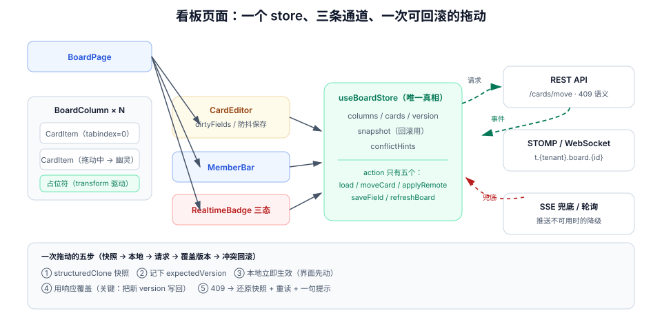

# 看板页面：把「页面可访问」变成可复现的一次拖动

第 2 周第 8 步：第 2 周里程碑的最后一条验收是「**页面可访问**」。这一步交付看板页面——它不只是把接口数据画出来，还要处理三件后端看不见的事：**乐观更新与回滚**、**拖动在触屏与键盘下也能用**、**别人的实时改动不能把你正在输入的内容冲掉**。

## 当日做了什么

| 项 | 产出 |
| --- | --- |
| 页面骨架 | 登录 → 工作区 → 看板 三级路由与六个组件的职责边界 |
| 数据层 | 三个 Pinia store（会话 / 看板 / 实时）与一次拖动的五步乐观更新 |
| 冲突处理 | `409 VERSION_CONFLICT` 的本地回滚与重读，UI 只有一句话 |
| 输入兼容 | 指针事件拖动 + 键盘拖动（原生 HTML5 DnD 在触屏与键盘下不可用） |
| 实时合并 | 本地正在编辑的卡片不被远端事件覆盖的三条规则 |
| 性能 | 500 张卡片下的渲染预算与虚拟列表的取舍 |
| 判据 | `UI-A` ~ `UI-H` 八条 |

::: tip 本步的位置
前七步都是服务端。这一步第一次出现「**客户端的真相与服务端的真相不一致**」——乐观更新让界面先动，冲突让它退回去。第 3 周的联调会反复踩这一层，所以现在就要把回滚写成可观察的行为，而不是 `catch` 里一句 `console.error`。
:::

## 一、「页面可访问」的四种假通过

| 现象 | 看起来 | 实际 |
| --- | --- | --- |
| 首屏白屏 3 秒后正常 | 「网络慢」 | 路由守卫里同步请求 `/me`，阻塞了首帧 |
| 页面能打开但列表为空 | 「没数据」 | `tenant` 头没带上，服务端按 RLS 返回 0 行（**不报错**） |
| 拖动看起来成功，刷新后复位 | 「偶发」 | 乐观更新后没有用响应里的 `version` 覆盖本地值 |
| 页面在开发机正常、在别人机器上 403 | 「环境问题」 | 前端把 `tenantId` 存在 `localStorage`，换了账号还在用旧值 |

四种的共同点：**都能通过「打开页面看一眼」这条验收**。所以本步的验收必须写成可执行断言，而不是「页面能打开」。

## 二、页面结构与数据流



| 组件 | 职责 | 明确不做 |
| --- | --- | --- |
| `BoardPage` | 路由参数、加载看板、错误边界 | 不持有卡片状态 |
| `BoardColumn` | 一列的容器、拖放目标的注册 | 不算顺序键 |
| `CardItem` | 卡片渲染、进入编辑态 | 不发请求 |
| `CardEditor` | 标题/描述编辑、`@` 提及补全 | 不决定何时保存（防抖在 store） |
| `MemberBar` | 在线成员、邀请入口 | 不轮询成员列表 |
| `RealtimeBadge` | 连接状态（已连接 / 重连中 / 降级为轮询） | 不吞掉断开事件 |

**状态只放在一个地方**：`useBoardStore` 持有 `columns: Column[]`，组件只读它、只通过 action 改它。这条纪律的收益在冲突回滚时才显现——回滚只需要替换 store 里的一份快照，不需要逐个组件去「撤销」。

## 三、一次拖动：五步乐观更新

```ts
// src/stores/board.ts（节选）
async function moveCard(cardId: string, toListId: string, beforeCardId: string | null) {
  const snapshot = structuredClone(cards.value)          // ① 快照（只存一次，用于回滚）
  const card = cards.value[cardId]
  const expectedVersion = card.version                   // ② 记下本地版本
  applyLocal(cardId, toListId, beforeCardId)             // ③ 本地立即生效（界面先动）

  try {
    const res = await api.moveCard(cardId, {
      toListId, beforeCardId, expectedVersion,
      idempotencyKey: crypto.randomUUID(),
    })
    cards.value[cardId] = { ...cards.value[cardId], ...res.card }   // ④ 用服务端结果覆盖
  } catch (e) {
    if (e.status === 409) {
      cards.value = snapshot                             // ⑤ 回滚到快照
      await refreshBoard()                               //    并重读（别人的改动要看到）
      toast('这张卡片刚被别人改过，已刷新')
    } else {
      cards.value = snapshot
      toast('保存失败，请重试')
    }
  }
}
```

五步里最容易漏的是 ④：**服务端返回的 `version` 必须写回本地**。否则连续拖两次时，第二次带的是过期版本，服务端返回 `409`，用户看到「明明我自己刚拖的却不让我拖」。

| 步骤 | 漏掉会怎样 |
| --- | --- |
| ① 快照 | 回滚时无从下手，只能整页刷新 |
| ② 记版本 | 并发保护失效，两次拖动互相覆盖 |
| ③ 本地先动 | 每次拖动都要等一个 RTT，长距离拖拽明显卡顿 |
| ④ 覆盖版本 | 第二次拖动必然 409 |
| ⑤ 重读 | 回滚后看到的是旧板面，与别人的改动继续冲突 |

## 四、拖动在触屏与键盘下也要能用

原生 `draggable="true"` 的三个硬限制：

1. **触屏不触发**（iOS Safari / Android Chrome 都不产生 `dragstart`）；
2. **键盘无法发起**（`Space` 不进入拖拽态）；
3. **拖拽影像不可控**（无法做「占位符 + 半透明幽灵」的观感）。

本项目的做法是**指针事件自绘拖动**：

```ts
// 指针拖动的最小骨架（节选）
function onPointerDown(e: PointerEvent, cardId: string) {
  if (e.button !== 0) return
  el.setPointerCapture(e.pointerId)          // 捕获，移出元素也能继续收事件
  drag.value = { cardId, startY: e.clientY, active: false }
}
function onPointerMove(e: PointerEvent) {
  if (!drag.value) return
  if (!drag.value.active && Math.abs(e.clientY - drag.value.startY) > 4) {
    drag.value.active = true                 // 4px 阈值：区分「点击」与「拖动」
  }
  if (drag.value.active) updatePlaceholder(e.clientX, e.clientY)
}
function onPointerUp() {
  if (drag.value?.active) commitMove()       // 只有真的拖了才发请求
  drag.value = undefined
}
```

键盘路径（无障碍要求，见 [键盘与焦点](/docs/Frontend/IntlA11y/KeyboardFocus/index.md)）：

| 按键 | 行为 |
| --- | --- |
| `Tab` | 聚焦到卡片（卡片是 `tabindex="0"` 的 `role="button"`） |
| `Space` / `Enter` | 进入「抓取」模式，`aria-grabbed="true"`，屏幕阅读器朗读「已抓取，用方向键移动」 |
| `←` `→` `↑` `↓` | 移动到相邻列 / 相邻位置，**每次移动都立即发请求**（不做批量） |
| `Esc` | 取消抓取，回到原位 |

::: danger 三个拖动实现里的坑
1. **`pointermove` 里直接 `setState` 整个列表**：500 张卡片时每帧重排，拖动帧率掉到 20fps。占位符用 `transform: translateY()` 单独驱动，不要动列表数据。
2. **没有 `setPointerCapture`**：鼠标快速移出卡片后 `pointerup` 收不到，卡片永远停在「拖动中」状态。
3. **`touch-action` 未设置**：移动端浏览器把纵向拖动当成页面滚动，`pointermove` 被取消。容器上必须写 `touch-action: none`（仅卡片区域）。
:::

## 五、实时事件不能冲掉正在输入的内容

第 10 步接通实时推送后，同一张卡片会同时收到两类更新：**本地编辑**与**远端事件**。三条合并规则：

| 本地状态 | 收到远端 `card.updated` | 处理 |
| --- | --- | --- |
| 未编辑 | — | 直接覆盖本地字段 |
| 编辑中，字段未被远端改动 | — | 只更新其他字段，不动 `title` / `body` |
| 编辑中，同一字段被远端改动 | — | **不覆盖**，在编辑器下方显示「他人已修改，查看差异」 |

第三条是最容易被写成「直接覆盖」的：用户正在打一句话，屏幕上突然变回别人的版本，输入法组合串被打断——这类问题在联调期几乎必然出现一次。

```ts
// 远端事件的合并（节选）
function applyRemote(evt: BoardEvent) {
  const local = cards.value[evt.cardId]
  if (!local) return
  const editing = editorState.value[evt.cardId]
  if (editing && evt.changedFields.some(f => editing.dirtyFields.includes(f))) {
    conflictHints.value.push({ cardId: evt.cardId, fields: evt.changedFields })
    return                              // 不动本地，只提示
  }
  cards.value[evt.cardId] = { ...local, ...evt.patch, version: evt.version }
}
```

## 六、500 张卡片的渲染预算

| 手段 | 收益 | 代价 |
| --- | --- | --- |
| `v-memo` 绑定 `[card.id, card.version]` | 只有变动的那张卡片重渲染 | 需要保证 `version` 一定更新（第 ④ 步） |
| 虚拟列表（只渲染可视区 ±5 屏） | 首屏 DOM 从 500 降到 ~40 | 拖动跨屏时需手动滚动，占位符计算变复杂 |
| 图片懒加载 `loading="lazy"` | 首屏请求数下降 | 拖动到未加载区域会闪一下 |
| 列级 `content-visibility: auto` | 未在视口的列跳过布局 | 滚动条长度会跳（需 `contain-intrinsic-size`） |

**结论**：单板 ≤ 200 张卡片用 `v-memo` 即可；> 200 张再上虚拟列表。**先测量再优化**——第 3 周的压测会给真实数据量。

## 七、验收：六条可执行断言

```shell
# ① 前端能起来，且首屏不依赖同步 /me
pnpm dev --port 5173
curl -s -o /dev/null -w '%{http_code}\n' http://localhost:5173/
# 期望：200；浏览器 Network 里 /me 出现在文档之后（不是阻塞首帧的同步请求）
```

```shell
# ② 未登录访问看板 → 跳登录页，且不白屏
curl -s http://localhost:5173/board/1 | grep -c '<div id="app">'
# 期望：1；页面在 1s 内出现登录表单（人工确认）
```

```shell
# ③ 拖动的服务端结果可核对：拖动后 version 自增 1
curl -s "http://localhost:8080/api/v1/boards/$BOARD/cards" -H "Authorization: Bearer $TOKEN" \
  | jq -r ".items[] | select(.id==\"$CARD\") | .version"
# 期望：拖动前 3 → 拖动后 4
```

```shell
# ④ 冲突可复现：用旧版本号发一次 move，必须 409
curl -s -o /dev/null -w '%{http_code}\n' -X POST "http://localhost:8080/api/v1/cards/$CARD/move" \
  -H "Authorization: Bearer $TOKEN" -H 'Content-Type: application/json' \
  -d '{"toListId":"'$LIST'","beforeCardId":null,"expectedVersion":1}'
# 期望：409；界面上出现「刚被别人改过」并自动刷新
```

```shell
# ⑤ 键盘可达：Tab 能聚焦卡片，Space 进入抓取态
# （在浏览器控制台执行，或人工按 Tab / Space）
document.querySelector('[data-card]').focus()
document.activeElement.getAttribute('aria-grabbed')
# 期望：聚焦成功；按 Space 后 aria-grabbed="true"
```

```shell
# ⑥ 断网时拖动 → 乐观更新后回滚，且提示可见
# 人为断开：DevTools → Network → Offline，然后拖动一张卡片
# 期望：卡片先动、约 1s 后回到原位，右上角出现重试提示；控制台无未捕获异常
```

::: warning 这六条依赖读者自己的前端工程
`project/` 只有文档。命令里的 `$TOKEN` / `$BOARD` 指你按[环境与工程骨架](../Environment/index.md)与[技术选型](../TechStack/index.md)搭起来的本地栈（Vue 3.5 + Vite + Spring Boot 4.1 + PostgreSQL 18）。
第 ⑤ 条用浏览器控制台代替自动化，是因为本仓不提交 Playwright 脚本；第 3 周的 [端到端测试](../E2ETest/index.md)会给完整的用例清单。
:::

## 八、判据族 `UI-A` ~ `UI-H`

| 判据 | 规则 | 违反时的样子 | 验证方式 |
| --- | --- | --- | --- |
| `UI-A` | 首屏不依赖同步鉴权请求，登录态异步补齐 | 白屏 2~3 秒 | 命令 ① + Network 瀑布图 |
| `UI-B` | 卡片状态只有一份（store），组件不各存一份 | 同一卡片两处显示不同标题 | 搜索 `ref(` 出现在 `CardItem` 内则违规 |
| `UI-C` | 乐观更新必须带快照，`409` 时回滚并重读 | 冲突后界面停在错误顺序 | 命令 ④ |
| `UI-D` | 服务端返回的 `version` 写回本地 | 连续两次拖动，第二次必 409 | 命令 ③ 连拖两次 |
| `UI-E` | 触屏与键盘都能拖动，`aria-grabbed` 正确切换 | 手机上拖不动、键盘用户无法排序 | 命令 ⑤ + 真机触摸 |
| `UI-F` | 编辑中的字段不被远端事件覆盖 | 输入法组合串被打断、内容跳回旧值 | 两个浏览器同时编辑同一卡片 |
| `UI-G` | 连接断开可见（`RealtimeBadge` 三态），不静默降级 | 用户以为实时，其实早已断开 | 断开服务端 WebSocket，观察角标 |
| `UI-H` | `tenantId` 不落 `localStorage`，来自登录响应 | 换账号后数据串号或全 403 | `grep -rn "localStorage.*tenant" src/` 应为空 |

## 九、下一步

1. **通知中心读接口**：页面右上角的铃铛现在是死的，需要 `GET /notifications` 与未读数。
2. **实时推送接线**：`RealtimeBadge` 的「已连接」目前指向一个本地 mock，下一步接真实 STOMP。
3. **大文件上传**：附件面板只支持 ≤ 25MiB，超过要走分片（第 11 步）。
4. **移动端布局**：列横向滚动在 375px 宽下会挤，需要「一列一屏」的切列手势。

## 十、参考资料

- [Pointer Events · W3C](https://www.w3.org/TR/pointerevents3/)（`setPointerCapture` 与 `touch-action` 的规范定义）
- [MDN · HTML 拖放 API 的移动端限制](https://developer.mozilla.org/en-US/docs/Web/API/HTML_Drag_and_Drop_API)
- [WAI-ARIA · `aria-grabbed` 与键盘拖放](https://www.w3.org/WAI/ARIA/apg/patterns/)（作者实践指南里的拖放模式）
- [Vue 3 · `v-memo`](https://vuejs.org/api/built-in-directives.html#v-memo)
- [项目章节 · 看板与卡片读写接口](../BoardCardApi/index.md)（`move` 契约与 409 口径的来源）
- [项目章节 · 微交互与动效工程](/docs/Frontend/Motion/index.md)（拖动落位动画的时长与缓动）
