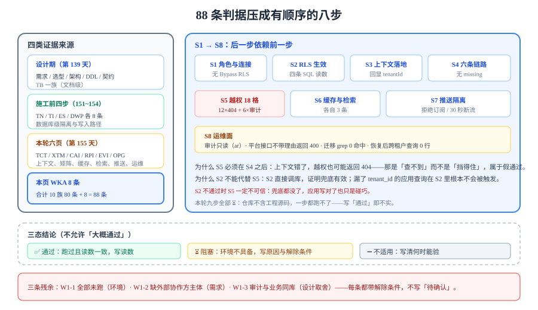

# 第 1 周验收：把 88 条判据串成一条能跑的序列

第 1 周的里程碑是「需求设计 + 架构与数据设计 + 环境骨架」，落到本项目的施工窗口里是九步：数据库级隔离、索引前缀、事件顺序号、拖动写入路径，再到本轮的上下文、越权矩阵、缓存、检索、推送、运维面。这一步做一件事：**把散在十一个页面里的判据合成一条有顺序的验收序列**，并如实登记哪些已经跑过、哪些被环境挡住。



## 判据族声明

本页判据族 `WKA-A` ~ `WKA-H`，共 8 条。定义表在第七节。

::: info 本页不是「总结」
它只做三件事：**归位**（每页的判据落在哪一步）、**排序**（哪条必须在前）、**登记**（跑不了的写清解除条件）。
它不新增设计决定，也不改写任何一页的结论——**改结构会让已经跑过的读数全部作废**。
:::

## 一、第 1 周交付了什么

| 来源 | 页面 | 交付物 | 判据族 |
| --- | --- | --- | --- |
| 第 139 天（设计期） | [需求](../Requirements/index.md) / [选型](../TechStack/index.md) / [架构](../Architecture/index.md) / [数据库](../Database/index.md) / [环境](../Environment/index.md) / [验收](../Acceptance/index.md) | 需求 12 条、选型表、九模块边界、14 张表 DDL、环境骨架 | `TB-A~TB-H` |
| 第 151 天 | [多租户隔离](../MultiTenancy/index.md) | `tenant_id` 进主键、`FORCE RLS`、复合唯一键 | `TN-A~TN-H` |
| 第 152 天 | [租户上下文与索引设计](../TenantIndexing/index.md) | 五条高频查询的索引、`EXPLAIN` 前后对照 | `TI-A~TI-H` |
| 第 153 天 | [事件表与顺序字段](../EventSequence/index.md) | `board_events` DDL、游标分页读数、三层去重 | `ES-A~ES-H` |
| 第 154 天 | [拖动写入路径](../DragWritePath/index.md) | 一个事务三张表、乐观锁 409、四个故障注入 | `DWP-A~DWP-H` |
| **第 155 天** | [租户上下文](../TenantContext/index.md) | 六条链路的绑定点与三类失效形态 | `TCT-A~TCT-H` |
| **第 155 天** | [跨租户用例矩阵](../CrossTenantMatrix/index.md) | 18 格 + 四条 SQL 校验 + 三条必失点 | `XTM-A~XTM-H` |
| **第 155 天** | [缓存隔离](../CacheIsolation/index.md) | 三段式 key、三种串号路径、失效边界 | `CAI-A~CAI-H` |
| **第 155 天** | [读路径隔离](../SearchIsolation/index.md) | 检索、游标签名、导出、附件签名 | `RPI-A~RPI-H` |
| **第 155 天** | [事件与推送隔离](../EventIsolation/index.md) | 主题命名、两道订阅鉴权、投递器 | `EVI-A~EVI-H` |
| **第 155 天** | [运维面守卫](../OpsGuard/index.md) | 四类角色、平台运维三要素、审计表 | `OPG-A~OPG-H` |

::: tip 判据族的数量是会变的，所以必须机器核
第 1 周共十族判据（前四天四族 `TN` / `TI` / `ES` / `DWP`，本轮六族 `TCT` / `XTM` / `CAI` / `RPI` / `EVI` / `OPG`），每族 8 条 = **80 条**；本页再加 8 条，第 1 周合计 **88 条**。这个数字由两条命令得出，不是估的：

```shell
ls -d project/Complete/TeamBoard/*/ | wc -l    # 章节目录数
grep -rc "本页判据族" project/Complete/TeamBoard/*/index.md | grep -v ":0"
```

改完页面后重跑这两条命令，数字不对就说明有页面漏写声明或多写了判据——这正是 `judgecountcheck` 要抓的东西。
:::

## 二、七页的分工

本轮七页各回答一个问题，**不重叠**：

| 页面 | 只回答 | 不回答 |
| --- | --- | --- |
| [租户上下文](../TenantContext/index.md) | 「谁的请求」怎么从入口传到 SQL | 传错了会不会被挡（下一行） |
| [跨租户用例矩阵](../CrossTenantMatrix/index.md) | 「越权必须失败」这件事怎么验证 | 缓存与推送（它们不经过 SQL） |
| [缓存隔离](../CacheIsolation/index.md) | 不走数据库的那条读路径怎么隔离 | 检索与导出（它们走数据库但条件由客户端给） |
| [读路径隔离](../SearchIsolation/index.md) | 客户端参与条件的读路径怎么隔离 | 写路径（由[拖动写入路径](../DragWritePath/index.md)负责） |
| [事件与推送隔离](../EventIsolation/index.md) | 「推出去」的那条链路怎么隔离 | 事件顺序号（由[事件表](../EventSequence/index.md)负责） |
| [运维面守卫](../OpsGuard/index.md) | 绕过应用的四条路怎么管 | 应用内权限（由[权限矩阵](../PermissionMatrix/index.md)负责） |
| 本页 | 以上六页怎么**按顺序**验收 | 任何新的设计决定 |

## 三、一条有顺序的验收序列

顺序不能换：**后一步的读数依赖前一步的结果**。例如「跨租户必须 404」依赖「上下文正确落地」，上下文错了 404 也可能通过（因为查不到），但那是**假通过**。

| 步 | 验什么 | 命令/动作 | 通过判据 | 依赖 |
| --- | --- | --- | --- | --- |
| **S1** | 角色与连接 | `psql -c "\du+"`，确认应用连的是 `app_user` | 无 `Bypass RLS` | 无 |
| **S2** | RLS 生效 | `db/verify/cross_tenant.sql` 四条 | `0 / UPDATE 0 / 报错 / 0` | S1 |
| **S3** | 上下文落地 | 请求里回显 `tenantId`（仅调试开关下） | 与登录用户所属租户一致 | S1 |
| **S4** | 六条链路 | 异步任务、定时任务、消息、WebSocket 各触发一次 | 无 `tenant context missing` | S3 |
| **S5** | 越权 18 格 | `CrossTenantMatrixTest` | 12 格 `404` + body 空，6 格 `200` + 审计 | S3、S4 |
| **S6** | 缓存与检索 | 两租户并发读同一 `boardId`、搜同一关键词 | 各自 3 条，`total` 均为 3 | S3 |
| **S7** | 推送隔离 | 用 A 的 token 订阅 B 的板 | 订阅被拒；移出成员后 30 秒内断流 | S3、S5 |
| **S8** | 运维面 | `\dp audit_log`、平台接口不带理由、迁移 grep | 审计只读、`400`、0 命中 | S1 |

::: danger S2 通过不代表 S5 通过
S2 直接调数据库，绕过了应用。它证明「兜底有效」，但不证明「应用层没有漏网的读」——一条漏了 `tenant_id` 的查询在 S2 里根本不会被触发。
反过来，**S2 不通过时 S5 一定不可信**：兜底都没了，应用层写对了也只是碰巧。
所以顺序是 S2 → S5，且**两者都要跑**。
:::

## 四、三态结论与残余登记

每条判据只允许三种状态，**不允许「大概通过」**：

| 状态 | 含义 | 写法 |
| --- | --- | --- |
| ✅ 通过 | 本机（或 CI）跑过，读数与期望一致 | 写读数，如「`total=3`」 |
| ⏳ 阻塞 | 环境不具备，**不能算通过** | 写阻塞原因 + 解除条件 |
| ➖ 不适用 | 该判据在当前阶段无法验证（例如需要生产流量） | 写为什么现在不能验、什么时候能验 |

本轮九步的登记（如实）：

| 步 | 状态 | 阻塞原因 | 解除条件 |
| --- | --- | --- | --- |
| S1 | ⏳ 阻塞 | 本机没有该项目的数据库实例（仓库只含文档） | 按[环境骨架](../Environment/index.md)起 PG 18 + 建四类角色 |
| S2 | ⏳ 阻塞 | 同上（需要表与策略） | 执行 `db/migration` 全部脚本后跑 `cross_tenant.sql` |
| S3 | ⏳ 阻塞 | 需要应用可运行 | 按[环境骨架](../Environment/index.md)起服务 |
| S4 | ⏳ 阻塞 | 需要 MQ、Redis 与 WebSocket 客户端 | Compose 起全栈 |
| S5 | ⏳ 阻塞 | 需要 18 格用例与两租户种子数据 | S3 通过后跑 `CrossTenantMatrixTest` |
| S6 | ⏳ 阻塞 | 需要 Redis 与检索索引 | S3 通过 + 建 `idx_cards_search` |
| S7 | ⏳ 阻塞 | 需要两个 WebSocket 会话 | S3 通过 + `wscat` 两个终端 |
| S8 | ⏳ 阻塞 | 需要数据库与平台接口 | S1 通过 |

::: warning 为什么全部标 ⏳
本仓库是**纯文档目录**（`project/` 只允许 Markdown 与配图），没有工程源码，因此这九步在本机**一步都跑不了**。
把「设计上应当如此」写成「通过」，是这类文档最常见的不实——它会让人误以为系统已经验证过。本轮一律标 ⏳ 并写清解除条件，**这不是缺陷，是如实**。
:::

## 五、与第 1 周里程碑逐条对照

里程碑的验收口径写在[需求与架构](../Acceptance/index.md)里：设计文档、ER 图、接口契约齐全。逐条对照：

| 里程碑要求 | 交付物 | 状态 |
| --- | --- | --- |
| 需求可判定（Given/When/Then） | [需求](../Requirements/index.md) 的 US-01~US-12 | ✅ 已完成（文档级） |
| 技术选型有「被否掉的方案与代价」 | [技术选型](../TechStack/index.md) 逐层对照表 | ✅ 已完成 |
| 架构有模块边界与「不做什么」 | [架构设计](../Architecture/index.md) 九模块 | ✅ 已完成 |
| ER 图与 DDL 一致 | [数据库设计](../Database/index.md) 14 张表 | ✅ 已完成（DDL 与表清单同页） |
| 接口契约齐备（路径、状态码、事件形状） | [接口契约](../Contracts/index.md) | ✅ 已完成 |
| 本地最小链路可跑 | [环境骨架](../Environment/index.md) + 本页 S1~S3 | ⏳ 阻塞（无工程） |

结论：**六项里五项是文档级、已完成；一项是运行级、被环境挡住**。这条分野必须写清——「设计做完」与「跑通」不是一回事。

## 六、残余清单：三类，各带解除条件

| 编号 | 残余 | 类型 | 解除条件 |
| --- | --- | --- | --- |
| `W1-1` | S1~S8 全部未跑 | 环境 | 一台能起 PG 18 + Redis + MQ 的机器，按环境骨架一次起全栈 |
| `W1-2` | 18 格矩阵缺「外部协作方」一类主体 | 范围 | 需求确认要支持外部协作方时补一行（6 格） |
| `W1-3` | 审计表与业务同库，owner 可改 | 设计取舍 | 需要合规级不可篡改时，改追加写对象存储（见[运维面守卫](../OpsGuard/index.md)第七节） |

::: tip 残余不是「待办」
`W1-1` 不是「我们还没做」，而是「这份交付物在当前形态下**不可能**做完」——仓库不含代码。写清这一点，比写「待补充」有用得多：下一个人知道要准备什么。
`W1-2` 与 `W1-3` 是**设计取舍**，不是欠账：前者取决于需求，后者取决于合规要求。
:::

## 七、判据表

| 编号 | 判据 | 怎么验证 | 本机读数 |
| --- | --- | --- | --- |
| `WKA-A` | 第 1 周十个族页面齐全，各 8 条，共 80 条 | 对 `TN`/`TI`/`ES`/`DWP`/`TCT`/`XTM`/`CAI`/`RPI`/`EVI`/`OPG` 十页各 `grep -c` 一次声明句 | 10 页均命中 |
| `WKA-B` | 验收序列有明确依赖，后一步不越过前一步 | 序列表每行有「依赖」列且非空 | 8 行均有依赖（S1 为「无」） |
| `WKA-C` | 每条判据只有 ✅ / ⏳ / ➖ 三态之一 | 登记表无「部分通过」「大概」等表述 | 8 行均为 ⏳ |
| `WKA-D` | 阻塞项写明原因与解除条件 | 登记表两列均非空 | 8 行均非空 |
| `WKA-E` | 里程碑六项逐条对照，区分文档级与运行级 | 对照表有「状态」列且值只取两类 | 5 ✅ / 1 ⏳ |
| `WKA-F` | 残余清单每条有编号、类型、解除条件 | 表头四列齐全，无「待确认」 | 3 条 |
| `WKA-G` | 本页不新增设计决定 | 全文无「我们决定改为」类表述；只引用既有页 | 已核对 |
| `WKA-H` | 本页与六页互相链接，无孤立页 | 六页链接均可达；六页的「下一步」均指回本页 | 已核对 |

## 八、当日做了什么

1. **把第 1 周的十一页归位**：六页设计期（第 139 天）+ 四页施工（第 151~154 天）+ 本轮六页（上下文、矩阵、缓存、检索、推送、运维）+ 本页，逐页写清交付物与判据族。
2. **给出七页的分工表**，每页只回答一个问题，并写明「不回答什么」——避免读者把「上下文正确」当成「越权被挡」。
3. **把 88 条判据压成 S1~S8 八步序列**，每步写「验什么 / 命令 / 通过判据 / 依赖」，并解释为什么顺序不能换（S2 通过不代表 S5 通过；S2 不通过则 S5 不可信）。
4. **定死三态结论**（✅ / ⏳ / ➖），并解释为什么全标 ⏳ 才是如实：仓库不含工程源码，九步在本机一步都跑不了。
5. **与第 1 周里程碑逐条对照**：六项里五项是文档级已完成、一项是运行级被环境挡住，把「设计做完」与「跑通」分开写。
6. **登记三条残余**（全部未跑 / 缺一类主体 / 审计同库），每条带类型与解除条件，并说明「残余不是待办」。
7. **定稿 `WKA-A~WKA-H` 八条判据**，其中两条是元判据（不新增决定、无孤立页）。

## 九、如何验证

本页的判据大多是**元判据**（关于文档自身的），可以在本机直接跑：

```shell
# 1) 规范声明句的页数：期望 12（本目录十三页里，DeployScripts 的 `DY-` 族属另一周，
#    写的是「本页判据族是 **`DY-A` ~ `DY-H`**」，不带「共 N 条」，所以不计入）
grep -rh '^本页判据族' project/Complete/TeamBoard/*/index.md | grep -c '共 8 条'

# 2) 判据总数：十二页 × 8 条 = 96，其中 FAQ 页（`WFQ-`）不进验收序列
grep -rh '^本页判据族' project/Complete/TeamBoard/*/index.md | grep -v 'DY-' \
  | sed -E 's/.*共 ([0-9]+) 条.*/\1/' | awk '{s+=$1} END {print s}'

# 3) 章节数与目录页清单一致（本仓的 chapterlistcheck 判据）
ls -d project/Complete/TeamBoard/*/ | grep -v assets | wc -l
grep -c "^[0-9]\+\. \[" project/Complete/TeamBoard/index.md
```

实测读数：第 1 步 **12**、第 2 步 **96**（`96 − 8` = 验收序列的 **88**）、第 3 步两个数字都是 **41**。这三条都在本机跑过，读数与本节正文一致；`judgecountcheck` 对全库同类声明做的是同一件事的自动化版本（E=0 即「声明条数 = 表格定义条数」）。

判读：第 3 步两个数字必须相等（`assets/` 目录不计入章节目录）。若不等，说明新增章节没有挂进目录页——这正是第 151 天新立的 `chapterlistcheck` 要抓的缺陷。第 2 步若出现 96 以外的数，先看是不是有页面漏写「共 N 条」或写了两次。

运行级判据（S1~S8）在本机无法执行，解除条件见第四节登记表。

## 十、下一步

- 第 1 周收口后，第 2 周进入**核心编码**：把上面六页的判据落成可运行的服务，第一步是[环境与工程骨架](../Environment/index.md)的最小可跑集。
- 缓存、检索、推送三页的判据都依赖同一件事：**权限缓存能失效**。它会在第 2 周的成员管理模块里第一次被真正用到。
- 第 3 周的联调会重跑本页的 S5（18 格）与 S7（推送），届时读数应当从 ⏳ 变成 ✅。
- 常见问题的分诊见[第 1 周施工 FAQ](../Week1FAQ/index.md)。

## 参考资料

- 项目内：[验收：把「做完了」变成可执行的步骤](../Acceptance/index.md) · [第 3 周验收结论](../Week3Acceptance/index.md) · [第 4 周验收结论](../Week4Acceptance/index.md)
- 方法论：[完整项目交付](/docs/Others/ProjectDelivery/index.md) · [测试与验收](/docs/Others/ProjectDelivery/Testing/index.md)
- 三态记法的来源：[第 3 周验收结论](../Week3Acceptance/index.md)的「三类残余」一节（本项目从那里开始统一用 ✅ / ⏳ / ➖）。
