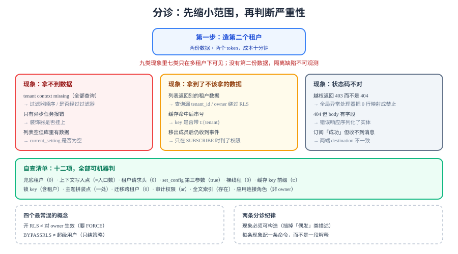

# 第 1 周施工 FAQ：分诊与自查

第 1 周写的是「隔离」，而隔离的缺陷有一个共同特征：**单租户环境下永远正常**。本页把这一周最常遇到的九类现象整理成分诊表（现象 → 先查什么 → 一条确认命令 → 处置），再给十二个具体问题与一份可以照抄的自查清单。



::: tip 本页与同周页面（尤其验收页）的分工
[第 1 周验收](../Week1Acceptance/index.md)给的是**一条按顺序跑的序列**：先验什么、通过判据是什么、顺序为什么不能换。本页给的是**反向入口**：从现象出发（报错、空列表、串号、连接被关），分诊到该看哪一页的哪一节。验收页回答「该做什么」，本页回答「出问题了先看哪里」。
:::

## 判据族声明

本页判据族 `WFQ-A` ~ `WFQ-H`，共 8 条。定义表在第五节。

## 一、九类现象分诊

按「先看什么」排序，不按严重程度排序——因为**分诊的第一目标是缩小范围**，不是判断严重性。

| 现象 | 先查什么 | 一条确认命令 | 处置 |
| --- | --- | --- | --- |
| 所有查询抛 `tenant context missing` | 请求是否经过 `TenantFilter` | 在过滤器入口打一行日志，看有没有输出 | 过滤器顺序（必须在认证之后）；或 `@Order` 被覆盖 |
| 只有异步/定时任务抛同样的错 | 该链路的绑定点 | `grep -rn "@Async" src/` 与装饰器是否挂上 | 加 `TaskDecorator`；定时任务改成遍历租户 |
| 列表返回空但数据库里明明有数据 | `app.tenant_id` 是否设置 | `select current_setting('app.tenant_id', true);` | `set_config` 未在事务内，或第三参数写成 `false` 后被池清掉 |
| 列表返回**别的租户**的数据 | 查询是否漏 `tenant_id` | 该查询的 SQL 里有没有 `tenant_id =` | 加条件；同时确认 RLS 是否被 owner 绕过 |
| 越权请求返回 `403` 而不是 `404` | 错误处理把「查不到」映射成了「禁止」 | 看 `NotFoundException` 是否被全局处理器改写成 `403` | 统一映射：0 行 → `404` |
| 越权请求返回 `404` 但 body 里有字段 | 错误响应直接序列化了实体 | `curl -i` 看 body | 错误响应只返回 `code` 与 `message` |
| 缓存命中后数据串了 | key 是否含租户段 | `redis-cli --scan --pattern 'board:*'` | 改成 `t:{tenant}:...`；旧 key 靠 TTL 过期 |
| 订阅成功但收不到消息 | 主题名两端是否一致 | 服务端日志打印 destination；客户端打印 `SUBSCRIBE` 帧 | 主题名必须由同一个类拼装 |
| 成员被移出后仍能收到事件 | 是否只在 `SUBSCRIBE` 时判权限 | 移出成员后观察 60 秒 | 广播前再判 + 变更时踢（关闭码 4403） |

::: tip 分诊的第一个动作永远是「造第二个租户」
上面九类现象里，有七类在**只有一个租户**时根本不会出现。所以第一步不是看日志，而是**造第二个租户、两张数据、两个 token**——没有第二份数据，隔离类缺陷是不可观测的。
这一步的成本是十分钟，收益是把「偶发」变成「必现」。
:::

## 二、高频十二问

**Q1：`tenant_id` 到底该不该出现在 DTO 里？**
不该。DTO 里的 `tenantId` 会被客户端填，一旦某处代码用了它，就多了一个越权入口。响应里可以**回显**（便于排查），请求里不要有。判据是[租户上下文](../TenantContext/index.md)的 `TCT-E`。

**Q2：为什么 `SET LOCAL` 之后还是读到了空？**
两种可能：① 它不在事务里（autocommit 下 `SET LOCAL` 立刻失效）；② 事务在另一个连接上（连接池借出顺序与你想的不同）。确认方法：在同一个 `begin ... commit` 里 `select current_setting('app.tenant_id', true)`，看是否为空串。

**Q3：RLS 开了，为什么应用还是能读到全部数据？**
应用连的是**表 owner**。owner 默认绕过 RLS，除非表上写了 `FORCE ROW LEVEL SECURITY`。两条都要做：`FORCE` + 应用用非 owner 角色。

**Q4：`FORCE` 写了，为什么还是能读？**
角色带 `BYPASSRLS` 属性。查 `\du+`，看应用角色那一行有没有 `Bypass RLS`。

**Q5：跨租户写入为什么没报错？**
策略只写了 `USING` 没写 `WITH CHECK`。`USING` 管「能看见哪些行」，`WITH CHECK` 管「能写进哪些行」。只写前者时，`update` 影响 0 行（因为看不见），但 `insert` 会成功。

**Q6：缓存里明明删了，为什么还是旧数据？**
三重可能：① 本地缓存（进程内）没被广播失效；② 广播丢了（pub/sub 不保证送达）且 TTL 太长；③ 删的是 `t:42:...` 而读的是 `t:43:...`（租户段错了）。按顺序查。

**Q7：游标为什么必须签名？**
因为游标的内容由客户端带回，服务端会**信任它**（例如用它拼排序条件）。不签名时，客户端可以把 `boardId` 改成别人的，或把 `exp` 改到十年后。签名保证「这个游标是我发的」，但**不保证「它现在还有效」**——所以解出后仍要再校租户。

**Q8：导出为什么要和列表共用条件构造器？**
因为两处条件不一致时，会出现「列表里 3 条、导出 3000 条」这种事故，而且**很难被发现**（导出是低频操作）。共用构造器是唯一可靠的写法。

**Q9：附件签名有效期能不能设 24 小时？**
不能。签名 URL 是「无身份凭证」，泄漏后无法撤回，只能等它过期。本项目取 5 分钟，下载慢的大文件改用「后端转发 + 鉴权」而不是加长有效期。

**Q10：平台运维为什么不能直接用超管账号？**
三重代价：没有「只读」这一档（排障时手滑就能写）、能改集群配置、审计里只有一个账号分不清是谁。正确做法是拆成 `ops_readonly`（绕过 RLS 但只读）与 `platform_ops`（可写但必须走接口留痕）。

**Q11：备份为什么要用能绕过 RLS 的账号？**
`pg_dump` 默认把 `row_security` 设为 `off` 导出全量；账号既不是 owner 又没有 `BYPASSRLS` 时会直接报错。所以「备份」这件事本身就是一次运维授权，要单独管。

**Q12：恢复演练为什么必须验一次跨租户查询？**
因为恢复可能改变了表 owner（`--no-owner` 等），而 owner 与 `FORCE` 的关系决定了策略是否生效。只验「表存在、行数对」会漏掉「RLS 已经失效」这种最严重的后果。

## 三、自查清单：十二项，全部可机器判

```shell
# 1) 兜底租户：期望 0
grep -rn "DEFAULT_TENANT\|orElse(1L)" src/main/java || echo "PASS 1"

# 2) 上下文写入点：期望等于入口个数（过滤器 + 任务入口）
grep -rn "TenantContext.runWith" src/main/java | wc -l

# 3) 租户类请求头：期望 0（审计/日志除外）
grep -rn "X-Tenant-Id" src/main/java || echo "PASS 3"

# 4) set_config 第三参数：期望全部 true
grep -rn "set_config" src/main/java src/main/resources

# 5) 裸线程：期望 0
grep -rn "new Thread(" src/main/java || echo "PASS 5"

# 6) 缓存 key 前缀：期望全部 t:
redis-cli --scan --pattern 'board:*' | head

# 7) 锁/限流 key 带租户：期望每条含 t:
grep -rn "lock:" src/main/java

# 8) 主题名拼装点：期望只在 TopicNaming 里出现 /topic/
grep -rn '"/topic/' src/main/java

# 9) 迁移里的跨租户操作：期望 0
grep -rn "set tenant_id" db/migration/ || echo "PASS 9"

# 10) 审计表权限：期望业务角色只有 ar
psql "$DATABASE_URL" -c "\dp audit_log"

# 11) 全文索引存在：期望输出含 idx_cards_search
psql "$DATABASE_URL" -c "\d+ cards" | grep idx_cards_search

# 12) 应用连接角色：期望不是 owner 且无 BYPASSRLS
psql "$DATABASE_URL" -c "\du+"
```

十二项与判据的对应关系写在下表，**自查不是「看一眼」，是「跑一遍并记读数」**：

| # | 对应判据 | 通过读数 |
| --- | --- | --- |
| 1 | `TCT-B` | 无输出 |
| 2 | `TCT-A` | 等于入口数（本项目 2） |
| 3 | `TCT-F` | 无输出 |
| 4 | `TCT-D` | 全部 `true` |
| 5 | `TCT-C` | 无输出 |
| 6 | `CAI-A` | 无输出（业务 key 必须带 `t:`） |
| 7 | `CAI-G` | 每条含 `t:` |
| 8 | `EVI-A` | 只有一处文件命中 |
| 9 | `OPG-E` | 无输出 |
| 10 | `OPG-H` | `ar` |
| 11 | `RPI-B` | 命中一行 |
| 12 | `OPG-A` | 无 `Bypass RLS` |

## 四、术语表

| 术语 | 一句话解释 | 容易混淆的点 |
| --- | --- | --- |
| **RLS**（Row Level Security） | 数据库按行过滤的访问策略 | 不是「视图」，它作用于表本身，且 owner 默认绕过 |
| **`FORCE ROW LEVEL SECURITY`** | 让表 owner 也受策略约束 | 与「开了 RLS」是两件事，缺它则 owner 直通 |
| **`BYPASSRLS`** | 角色属性，绕过所有策略 | 与「超级用户」不同：它只绕策略，不改集群 |
| **`set_config(..., true)`** | 事务级设置会话变量 | 第三参数 `false` 是会话级，会残留在池里 |
| **租户上下文** | 一次请求的租户身份 | 不是「参数」，不该出现在 DTO 里 |
| **`ScopedValue`** | JDK 25 转正的作用域绑定值 | 与 `ThreadLocal` 不同：不可变、不用 `remove`、传给新建子线程 |
| **游标（cursor）** | 分页的「上一页末尾位置」 | 不是 offset；必须签名，且不携带权限结论 |
| **预签名 URL** | 带签名参数的临时下载地址 | 有效期内**无身份**，泄漏不可撤回 |
| **outbox** | 事务内写的待投递队列表 | 与 MQ 不是一回事：它是数据库里的表 |
| **投递器（relay）** | 把 outbox 里的行发出去的循环 | 必须按租户遍历，不能用平台角色扫全表 |
| **主题（destination）** | 消息代理里的分发地址 | 与 Redis 频道是两层：后者是实例间的 |
| **策略（policy）** | RLS 的具体规则 | `USING` 管读，`WITH CHECK` 管写 |

## 五、判据表

| 编号 | 判据 | 怎么验证 | 本机读数 |
| --- | --- | --- | --- |
| `WFQ-A` | 分诊表覆盖九类现象，每类有「一条确认命令」 | 表格行数 = 9，第四列均非空 | 9 行 |
| `WFQ-B` | 十二问每问给出「为什么」而不只是「怎么做」 | 逐问核对含原因句 | 12 问 |
| `WFQ-C` | 自查清单十二项全部可执行，且标注期望读数 | 每项有 `grep`/`psql`/`redis-cli` 与期望 | 12 项 |
| `WFQ-D` | 自查项与判据族有映射表 | 映射表行数 = 12，编号均指向已存在的判据 | 12 行 |
| `WFQ-E` | 术语表 ≥ 10 条，且每条有「容易混淆的点」 | 表格行数 ≥ 10，第三列均非空 | 12 行 |
| `WFQ-F` | 分诊表首列现象可被读者复现（不是「偶发」类描述） | 逐行核对现象是否可构造 | 已核对 |
| `WFQ-G` | 本页链接的七个页面均可达，且验收页指回本页 | `linkcheck` 全绿；[第 1 周验收](../Week1Acceptance/index.md) 的「下一步」含本页链接 | 已核对 |
| `WFQ-H` | 本页不含「待补充」「待确认」类占位 | `grep -c "待确认"` 期望 0 | 0 |

## 六、当日做了什么

1. **按「先缩小范围」而不是「按严重程度」排九类现象**，每类给出「先查什么 / 一条确认命令 / 处置」。九类里七类只在多租户下才可见，所以第一条纪律是「先造第二个租户」。
2. **把这一周踩过的坑写成十二问**，每问都回答「为什么」：`SET LOCAL` 为什么失效、`FORCE` 为什么还不够、`USING` 与 `WITH CHECK` 的分工、游标为什么要签名、导出为什么必须共用条件构造器、备份账号为什么必然是高权限、恢复演练为什么必须验跨租户查询。
3. **给出十二项可机器判的自查清单**，每项写明期望读数，并配一张「自查项 ⇄ 判据编号」的映射表——自查不是「看一眼」，是「跑一遍并记读数」。
4. **整理十二个术语**，每条都补上「容易混淆的点」（`FORCE` 与开 RLS、`BYPASSRLS` 与超级用户、主题与频道、outbox 与 MQ）。
5. **定稿 `WFQ-A~WFQ-H` 八条判据**，其中 `WFQ-F` 要求「现象可复现」——把「偶发」类描述挡在门外。

## 七、如何验证

本页是 FAQ，它自己的判据全是**元判据**，可以在本机直接跑：

```shell
# 1) 十二项自查命令都能跑（不报「command not found」类错误）
sed -n '/^## 三、自查清单/,/^## 四、术语表/p' project/Complete/TeamBoard/Week1FAQ/index.md \
  | grep -c '^grep\|^psql\|^redis-cli'

# 2) 没有占位语：期望 0
grep -c "待确认\|待补充" project/Complete/TeamBoard/Week1FAQ/index.md

# 3) 六个专题链接可达（用本仓的 linkcheck 兜底）
python3 ~/.workbuddy/skills/docs-website-doc-ops/scripts/linkcheck.py
```

判读：第 1 步期望 12（十二项各自一条命令）；第 2 步期望 0；第 3 步期望 `E1=E2=E3=0`。三条都过，本页才算「可以用」——FAQ 最常见的失败不是写错，而是**写了不可执行的话**。

## 八、下一步

- 第 2 周进入核心编码时，本页的十二问会被反复用到；先把自查清单接进 CI（跑一次、记读数），比事后排查便宜得多。
- 隔离类问题的完整判据在六个专题页：[租户上下文](../TenantContext/index.md) · [跨租户用例矩阵](../CrossTenantMatrix/index.md) · [缓存隔离](../CacheIsolation/index.md) · [读路径隔离](../SearchIsolation/index.md) · [事件与推送隔离](../EventIsolation/index.md) · [运维面守卫](../OpsGuard/index.md)。
- 第 1 周的整体验收顺序见[第 1 周验收](../Week1Acceptance/index.md)。

## 参考资料

- 项目内：[常见问题与最佳实践：编码期分诊与自查](../FAQ/index.md)（编码期的另一份分诊表） · [第 1 周验收](../Week1Acceptance/index.md)
- 技术专题：[PostgreSQL 行级安全](/docs/DB/Relational/PostgreSQL/index.md) · [Redis 高级用法](/docs/DB/NoRelational/Redis/Advanced/index.md) · [认证与授权](/docs/Backend/Auth/Authorization/index.md)
- 外部：[PostgreSQL 18 · Row Security Policies](https://www.postgresql.org/docs/18/ddl-rowsecurity.html) · [OpenJDK JEP 506](https://openjdk.org/jeps/506)
