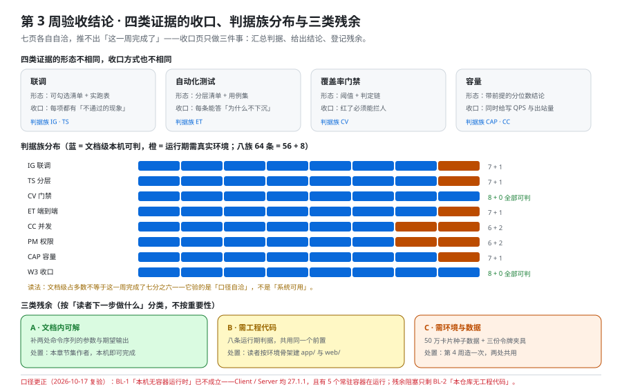

# 第 3 周验收结论：四类证据的收口与一处口径更正

这一页是第 3 周（联调与测试）的**收口页**：它把本章节集七页的判据汇总成一张表、给出「这一周算不算完成」的结论、登记残余清单，并**更正一处已经失真的口径**（第 139 天写下的 `BL-1`「本机无容器运行时」到第 148 天已不成立）。它**不重复**任何一页的正文内容，也**不新增**需求——七页讲什么，本页只回答「它们合起来证明了什么、还差什么」。



## 一、七页的分工与这一页的位置

| 页 | 回答的问题 | 它产出的判据族 |
| --- | --- | --- |
| [前后端联调](../Integration/index.md) | 两端各自写完、第一次接上时，**联调到底在联什么** | `IG-A` ~ `IG-H` |
| [自动化测试分层](../TestStrategy/index.md) | 断言**该写在哪一层**、测试数据怎么不互相污染 | `TS-A` ~ `TS-H` |
| [覆盖率门禁](../CoverageGate/index.md) | 「测够了没有」**由谁来判**、判到什么程度才拦人 | `CV-A` ~ `CV-H` |
| [端到端测试](../E2ETest/index.md) | 哪几条断言**只能**放到端到端层、怎么写才不脆 | `ET-A` ~ `ET-H` |
| [并发与幂等专项](../Concurrency/index.md) | 结论**天生是概率性的**那类问题怎么变成可复现的读数 | `CC-A` ~ `CC-H` |
| [权限矩阵验证](../PermissionMatrix/index.md) | 18 格权限靠什么才算**验过**（每格都要有「错的样子」） | `PM-A` ~ `PM-H` |
| [压测与容量验收](../CapacityTest/index.md) | 「能扛多少」怎么变成**有前提的结论** | `CAP-A` ~ `CAP-H` |
| **本页** | 合起来证明了什么、**还差什么**、哪处口径已经失真 | `W3-A` ~ `W3-H` |

::: tip 为什么需要一页收口
七页各自自洽，**推不出「这一周完成了」**——这是本项目反复出现的同一类问题（[第 2 周收口（终）](../../MonitoringDashboard/Week2Final/index.md) 第 203 行把这件事写死为一条口径）。收口页只做三件事：**汇总判据、给出结论、登记残余**。它自己也要有判据（`W3-*`），否则「收口」会退化成一个形容词。
:::

## 二、四类证据与它们的收口方式

「联调、自动化测试、覆盖率门禁、容量」这四件事的**证据形态并不相同**，收口方式也不同。把它们混成一句「测试通过」是本页要防的第一件事。

| 证据 | 由哪几页产出 | 证据的形态 | 收口判据（本页怎么算它已收口） |
| --- | --- | --- | --- |
| **联调** | 联调 + 权限矩阵 | **可勾选清单 + 实跑表**（12 项清单、五条错误码实跑） | 清单每一项都有「不通过时的现象」；错误码五条各有造法与期望体 |
| **自动化测试** | 分层 + 端到端 | **分层清单 + 用例集**（四层职责与配比、七条端到端用例） | 每条用例能回答「为什么不能下沉」；配比有逐条理由 |
| **覆盖率门禁** | 覆盖率门禁 | **阈值 + 判定链**（三档阈值、五步链） | 关键路径 100% 不许有豁免入口；门禁红了必须阻断 |
| **容量** | 压测与容量 + 并发专项 | **带前提的分位数结论** | 结论必须同时给出写 QPS 与出站消息量；四个前提齐全 |

**四类证据的「完成」定义各不相同**：联调看清单是否**可勾**，测试看用例是否**可判**，门禁看红是否**能拦人**，容量看结论是否**带前提**。任何一类缺了这个形态，它就不算收口——**「跑了很多次」不是任何一类的证据形态。**

## 二·补、第五类证据：跨端状态一致（第 168 天补记）

第 168 天补了 [状态一致性联调](../Week3StateConsistency/index.md)，它产出的是**第五类证据**：同一个服务端状态在两台设备、两个标签页、一次断网后是否收敛。这一类不能并进上面四类——前四类的观测位都在服务端，这一类的观测位在**两个浏览器的最终状态是否相等**。

| 证据 | 由哪一页产出 | 证据的形态 | 收口判据 | 最近一次通过时间 |
| --- | --- | --- | --- | --- |
| **状态一致** | [状态一致性联调](../Week3StateConsistency/index.md)（`SC-A~SC-H`） | **十二条会失败的用例 + 四个执行位**（W1 / W2 / OFF / THR） | 十二条用例每条都写「红了说明什么」；且 `SC-H` 要求本列有值 | ⏳ 2026-10-19 登记，**未跑**（需前后端工程与两台设备） |

这一栏的**时间列是判据本身**（`SC-H`）：一致性用例最容易在后续小改动中静默失效，而那时构建仍然是绿的。所以「什么时候通过过」必须写在表上，而不是记在某个人的记忆里。

::: info 为什么不改上面的「八族 64 条」
第五类证据的判据族 `SC-*` 挂在自己的页面上，本页的汇总口径（八族 64 条 = 文档级 56 + 运行期 8）**仍然是第 3 周前六步的汇总**，不做加法。把它并进来会让 `W3-D` 恒等式失效，也会让「四类证据」这个标题名不副实——**新增一类证据，比修改旧汇总更诚实**。
:::

## 三、一处口径更正：`BL-1` 不再成立

第 139 天在 [验收](../Acceptance/index.md) 第五节写下的阻塞项台账里，`BL-1` 是「**本机无容器运行时**」。第 140~147 天多篇页面沿用了这条口径并把运行期判据的原因写成它。

**第 148 天复验：这条口径已经不成立。**

```shell
# 本次复验的三条读数（2026-10-17 实跑）
docker version --format 'Client={{.Client.Version}} Server={{.Server.Version}}'   # 实测 Client=27.1.1 Server=27.1.1
docker compose version                                                          # 实测 v2.29.1-desktop.1
docker ps --format '{{.Names}}\t{{.Status}}' | head -5                           # 实测 5 个常驻容器（最长 Up 2 days）
```

实测结果：`docker` 客户端与服务端均可用（均 `27.1.1`），且有**5 个常驻容器在运行**（其中本周期项目的监控最小栈 3 个）。因此：

| 项 | 第 139 天的口径 | 第 148 天复验后的口径 |
| --- | --- | --- |
| `BL-1` 本机无容器运行时 | ⏳ 挡住 A2 / A3 / A6 / A8 等 | **不成立**（运行时可用）——这些条目**不再被它挡住** |
| 残余阻塞 | —— | **只剩 `BL-2`：本仓库只有文档，没有可执行的工程与前端** |
| 运行期判据的状态 | `⏳ 未跑 · 本机无容器运行时` | `⏳ 未跑 · 本仓库无工程代码`（原因换成真实的那个） |

::: danger 为什么这条更正重要（比它看起来重要）
**「本机不具备 X」是一句会过期的话**。它被写进判据表的「原因」列之后，会让读者以为「装上运行时就能跑」，从而把注意力放在错误的前置条件上；而真实原因是**没有工程代码**——那是读者自己的工作量，不是环境问题。本库纪律（第 141 天记录）：**凡「本机不具备 X」这类结论，开工时必须重新验证一次，不能跨轮继承。**
:::

::: tip 这次更正的处置范围
本页更正**口径**，顺序是：本章节集**本次新写与收口的五页**（本页 + [端到端测试](../E2ETest/index.md) + [覆盖率门禁](../CoverageGate/index.md) + [压测与容量验收](../CapacityTest/index.md) + [并发与幂等专项](../Concurrency/index.md)）直接采用新口径；[验收](../Acceptance/index.md) 的 `BL-1` 行已同步标注复验结论。**其余页面不回填**——它们是第 139~147 天的产物，回填会让「当时写的是什么」这件事失真；口径以本页为准。
:::

## 四、判据族汇总：八族 64 条

| 族 | 条数 | 文档级（本机可判） | 运行期（需真实环境） |
| --- | --- | --- | --- |
| `IG` 联调 | 8 | 7 | 1 |
| `TS` 自动化测试分层 | 8 | 7 | 1 |
| `CV` 覆盖率门禁 | 8 | 8 | 0 |
| `ET` 端到端测试 | 8 | 7 | 1 |
| `CC` 并发与幂等 | 8 | 6 | 2 |
| `PM` 权限矩阵 | 8 | 6 | 2 |
| `CAP` 压测与容量 | 8 | 7 | 1 |
| `W3` 本页（收口） | 8 | 8 | 0 |
| **合计** | **64** | **56** | **8** |

这个分布本身就是结论：**56 : 8 ≈ 7 : 1**。也就是说，本章节集里**七分之六的判据在本机可判**，剩下的八条全部指向同一件事——把工程搭起来。

::: warning 怎么读这张表（避免一次典型的误读）
「文档级占多数」**不等于**「这一周完成了七分之六」。文档级判据验的是**「口径是否自洽、是否可被执行」**，不是「系统跑起来对不对」。把前者当成后者的完成度，会把「设计完备」误读成「系统可用」——这正是第 2 周收口页第 207 行写死过的同一句提醒。
:::

## 五、三类残余清单

残余**不是缺陷**（缺陷是设计错了），残余是「还没到能跑的环境 / 还没写的工程」。按**处置动作**分三类，而不是按重要性分——分类的标准是「读者下一步做什么」。

| 类别 | 内容 | 处置动作 | 谁来做 |
| --- | --- | --- | --- |
| **A · 文档内可解** | `CC` 与 `PM` 各两条运行期判据的**命令序列**是否需要补全参数 | 补参数与期望输出，本机即可完成 | 本页作者 |
| **B · 需工程代码** | 八条运行期判据（`IG-H` / `TS-H` / `ET-H` / `CC-G` / `CC-H` / `PM-G` / `PM-H` / `CAP-H`） | 按 [环境与工程骨架](../Environment/index.md) 建出 `app/` 与 `web/`，再逐条跑 | 读者 |
| **C · 需环境与数据** | `CAP-H` 另需 50 万卡片的种子数据；`ET-H` 另需三份令牌夹具 | 按 [可运行验证](../Verification/index.md) 造数；令牌由真实登录一次生成 | 读者 |

**三类里只有 A 是本章节集的职责**，B 与 C 属于第 4 周 [部署与交付](../index.md) 与周期 6 的施工窗口。**把 B、C 写成「未完成」会让这一周看起来没做完；把它们写成「已完成」会让读者以为工程已经存在。** 两种写法都是错的——所以单列。

## 六、明确不做的四件事

1. **不新增需求。** 本章节集全部判据都能追溯到 [需求拆分](../Requirements/index.md) 的 US-01~US-12 与 [验收](../Acceptance/index.md) 的 A1~A8；没有一条是「顺手加上的」。
2. **不改口径。** `seq` 单调 +1、跨工作区一律 `404`、一次拖动只更新一行——这三条口径在本章节集里被**引用**，没有被**重新定义**（出处分别是 [接口契约定稿](../Contracts/index.md) 与 [卡片拖动](../CardMove/index.md)）。
3. **不抄期望值。** 所有 `grep -c` 的期望值都是本机实跑后回填的；状态列里没有一处是从模式里反推的数。
4. **不做复盘。** 本页是**收口**，不是总结：它只回答「还差什么、下一步是谁」，不复述这一周做了什么。**回顾性内容不在本项目的产出范围**（计划表的轮换规则第 9 条）。

## 七、版本组织说明

本章节集与整个在线协作任务看板项目**不建版本目录**，理由是它没有「破坏性主版本边界」：项目自身的版本由 [技术选型与版本基线](../TechStack/index.md) 单点定稿（Java 25 LTS、Spring Boot 4.1、PostgreSQL 18、Node.js 24 LTS），**升级一次就在那一页改一次**，不存在需要并存的两套口径。

本仓库真正的多版本主题一律按「官方名 + 大版本号」建目录，**旧版本保留并标注状态、不覆盖**：

| 主题 | 版本目录 | 处置 |
| --- | --- | --- |
| Spring | `Spring5/` 与 `Spring6/` | 旧版本保留，页顶标注维护状态 |
| Spring Boot | `v2/`、`v3/`、`v4/` | 新内容面向最新稳定版，旧版留在原目录 |
| Vue | `Vue2/`、`Vue3/` | 同上 |

**判据**：只有当「同一个主题的两套内容会同时被读者需要、且互相冲突」时才拆版本目录。本项目不满足这条，所以拆目录会是错的。

本节的口径与版本事实核对于 **2026-10**（第 148 天）；**「最新稳定版」在本仓库里始终指[技术选型与版本基线](../TechStack/index.md)当页写明的那个数**，那一页改了这里才跟着改——所以本节不逐版罗列版本号，只回答「为什么不拆目录」。若上游主版本边界发生变化（例如 Spring Boot 再出一个大版本），处置仍是**在新目录里写、旧目录保留并标注状态**，而不是覆盖本节。

## 八、当日做了什么

1. 产出**七页分工表**并写死本页的职责边界（汇总判据 / 给出结论 / 登记残余），同时论证「七页各自自洽推不出这一周完成」。
2. 产出**四类证据的收口方式表**（联调看清单可勾、测试看用例可判、门禁看红能拦人、容量看结论带前提），并写死「跑了很多次不是任何一类的证据形态」。
3. **更正一处失真的口径**：`BL-1`「本机无容器运行时」经 2026-10-17 复验已不成立（`docker` 客户端与服务端可用、有常驻容器在运行），残余阻塞**只剩 `BL-2`（本仓库无工程代码）**，并把本章节集五页的运行期判据原因统一换成真实的那一条。
4. 产出**判据族汇总表**（八族 64 条 = 文档级 56 + 运行期 8）并登记核验命令；写明「文档级占多数 ≠ 这一周完成七分之六」。
5. 产出**三类残余清单**（文档内可解 / 需工程代码 / 需环境与数据），按处置动作分类，并写死「把 B、C 写成未完成与写成已完成都是错的」。
6. 产出**明确不做的四件事**（不新增需求 / 不改口径 / 不抄期望值 / 不做复盘），其中「不做复盘」与计划表轮换规则第 9 条对齐。
7. 产出**版本组织说明**：论证本项目为什么不建版本目录（无破坏性主版本边界），并给出仓库内真正的多版本主题清单与「旧版本保留并标注状态、不覆盖」的处置。
8. 产出 **`W3-A ~ W3-H` 八条判据**，全部为**文档级、本机可判**——收口页的产物是「一份结论」，它自己必须先能被判定。

## 九、如何验证

### 9.1 判据表（`W3-A ~ W3-H`）

| 判据 | 判什么 | 级别 | 状态 |
| --- | --- | --- | --- |
| **`W3-A`** | 七页分工表齐全，且本页职责边界写死（汇总 / 结论 / 残余） | 文档级 | ✅ 本机可判 |
| **`W3-B`** | 四类证据的形态与收口判据各不相同，且「跑了很多次不是证据」写死 | 文档级 | ✅ 本机可判 |
| **`W3-C`** | `BL-1` 口径更正写清（复验日期、两条读数、新旧口径对照、处置范围） | 文档级 | ✅ 本机可判 |
| **`W3-D`** | 判据族汇总表八行齐全，且合计 = 文档级 56 + 运行期 8 = 64 | 文档级 | ✅ 本机可判 |
| **`W3-E`** | 三类残余清单齐全，且「写未完成 / 写已完成都是错的」写死 | 文档级 | ✅ 本机可判 |
| **`W3-F`** | 不做的四件事齐全（含「不做复盘」与轮换规则第 9 条对齐） | 文档级 | ✅ 本机可判 |
| **`W3-G`** | 版本组织说明写清（为什么不拆 + 三条拆目录判据 + 仓库内多版本主题清单） | 文档级 | ✅ 本机可判 |
| **`W3-H`** | 本章节集八页的配图都存在于 `assets/` 且各被引用一次 | 文档级 | ✅ 本机可判 |

### 9.2 本机可判的部分

```shell
# W3-A：七页分工表七行 + 收口页自述职责
grep -c '^| \[前后端联调' index.md                     # 期望 1
grep -c '汇总判据、给出结论、登记残余' index.md         # 期望 2

# W3-B：四类证据表四行 + 关键一句
grep -cE '^\| \*\*(联调|自动化测试|覆盖率门禁|容量)\*\* \|' index.md   # 期望 4
grep -c '不是任何一类的证据形态' index.md               # 期望 3

# W3-C：口径更正的三个要素
grep -c '2026-10-17' index.md                          # 期望 3
grep -c '本机无容器运行时' index.md                     # 期望 6
grep -c '只剩 `BL-2`' index.md                          # 期望 3

# W3-D：判据汇总表八行 + 合计行
grep -cE '^\| `(IG|TS|CV|ET|CC|PM|CAP|W3)` ' index.md       # 期望 8
grep -c '^\| \*\*合计\*\* | \*\*64\*\*' index.md             # 期望 209
grep -c '\*\*56 : 8' index.md                                # 期望 1

# W3-E：三类残余 + 结论句
grep -cE '^\| \*\*[ABC] · ' index.md                    # 期望 3
grep -c '两种写法都是错的' index.md                     # 期望 2

# W3-F：不做的四件事
grep -cE '^[0-9]\. \*\*不(新增需求|改口径|抄期望值|做复盘)' index.md    # 期望 4

# W3-G：版本组织说明
grep -c '不建版本目录' index.md                         # 期望 3
grep -c '旧版本保留并标注状态' index.md                 # 期望 3

# W3-H：本章节集的配图都存在（八页各一张）
for p in Integration TestStrategy CoverageGate E2ETest Concurrency PermissionMatrix CapacityTest Week3Acceptance; do
  ls ../assets/*.svg >/dev/null && test -d "../$p" && echo "ok: $p"
done | wc -l                                           # 期望 8

# 本页配图与判据条数
grep -c 'assets/tb-week3-acceptance.sv[g]' index.md     # 期望 2
grep -cE '^\| \*\*`W3-[A-H]`\*\*' index.md             # 期望 8
```

### 9.3 需要真实环境的部分

**本页没有运行期判据。** 这是有意的：收口页的判据对象是**七页的口径与汇总**，它们全部可以在仓库根判完；把「工程跑起来」写成本页的判据，会让收口页与 B 类残余混在同一张表里。运行期的八条仍然挂在它们各自的页面上。

::: warning 状态列的读法
八条**全部为文档级、本机可判**——没有一条写 `⏳`。这不是「都通过了」，而是**本页不承接任何需要环境的判据**：需要环境的那八条留在 [端到端测试](../E2ETest/index.md)、[并发与幂等专项](../Concurrency/index.md)、[权限矩阵验证](../PermissionMatrix/index.md)、[压测与容量验收](../CapacityTest/index.md)、[自动化测试分层](../TestStrategy/index.md)、[前后端联调](../Integration/index.md) 各自的判据表里，原因统一为「本仓库无工程代码」。
:::

## 十、下一步

1. **第 149 天（第 4 周 · 部署与交付）的入口就是本页第五节**：B 类与 C 类残余的处置动作已经写成命令序列，直接作为部署章节的前置清单。
2. **`BL-1` 口径更正要向第 4 周传递一次**：部署章节里的「环境准备」不应当再出现「先装容器运行时」这一步，取而代之的是「确认运行时可用后，直接建工程」。
3. **八条运行期判据中，`CAP-H` 与 `ET-H` 的种子数据要求合并造一次**（同一份 50 万卡片的数据同时满足两者），避免在第 4 周造两遍。

## 参考资料

- [验收：把「做完了」变成可执行的步骤](../Acceptance/index.md)（`A1`~`A8`、`TB-A`~`TB-H` 与阻塞项台账 `BL-1`~`BL-4`，本页第三节更正的出处） · [需求拆分：角色、故事与验收条件](../Requirements/index.md)（本页「不新增需求」这条的对照物：US-01~US-12）
- [端到端测试](../E2ETest/index.md) · [覆盖率门禁](../CoverageGate/index.md) · [压测与容量验收](../CapacityTest/index.md) · [并发与幂等专项](../Concurrency/index.md) · [权限矩阵验证](../PermissionMatrix/index.md) · [自动化测试分层](../TestStrategy/index.md) · [前后端联调](../Integration/index.md)（本章节集七页，判据汇总的对象）
- [技术选型与版本基线](../TechStack/index.md)（本项目版本单点定稿处，本页第七节「不拆版本目录」的理由） · [环境与工程骨架](../Environment/index.md)（B 类残余的处置入口）
- [实时监控大盘 · 第 2 周收口（终）](../../MonitoringDashboard/Week2Final/index.md)（同类收口页：三天对齐粒度与「前者推不出后者」的论证先例） · [实时监控大盘 · 交付包](../../MonitoringDashboard/DeliveryPackage/index.md)（上一个周期的交付形态）
- [完整项目交付 · 验收与交付](/docs/Others/ProjectDelivery/index.md)（通用项目侧方法论）
