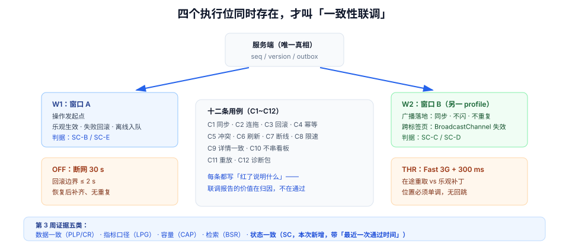

# 第 3 周第 7 步 · 状态一致性联调：两台设备、一次断网、一个必须丢弃的回环

第 2 周把[看板页面](../WebBoardUI/index.md)做出来了，第 3 周前六步把后端的一致性逐个证完：单元路由、池层泄漏、压测断言、降级演练、检索相关性、质量闸门。但这些证据都站在**服务端一侧**——它们证明「库里是对的」，没有证明「屏幕上是对的」。

这一步补的就是这条缝：**同一个服务端状态，在两台设备、两个标签页、一次断网之后，是否收敛到同一个结果。** 它属于第 3 周「联调 + 测试」的收口，产出的不是新功能，而是**一组会失败的用例**与**第 3 周验收表上的一栏**。

## 判据族声明

本页判据族 `SC-A` ~ `SC-H`，共 8 条。定义表在第六节。

## 本页不讲什么

- 不讲服务端 `seq` 怎么分配、outbox 怎么写，归 [事件表与顺序字段](../EventSequence/index.md) 与 [实时推送接线](../RealtimeWiring/index.md)。
- 不讲租户隔离的 18 格矩阵，归 [跨租户用例矩阵](../CrossTenantMatrix/index.md)。
- 不讲压测与容量，归 [压测与容量验收](../CapacityTest/index.md)。
- 前端的通用判据（缓存分档、乐观回滚、可观测三件套）在专题 [状态管理与数据流](/docs/Frontend/StateDataFlow/index.md) 里，本页只写**这个项目里的落点与读数**。



## 一、为什么这一步不能提前做

第 2 周验收时「页面可访问」是达标的：打开、拖动、刷新，都对。但那时**只有一台设备、一个标签页、网络良好**，而一致性问题恰好全部藏在这三个条件的反面：

| 条件 | 单设备良好网络下 | 加上第二设备 / 断网 / 乱序之后 |
| --- | --- | --- |
| 乐观更新 | 看起来永远成功 | 失败后是否弹回、是否提示 |
| 事件广播 | 自己的操作靠本地补丁就够 | 另一端是否收到、收到几次 |
| 版本冲突 | 不会发生 | 后写者是否被拦下 |
| 断线 | 不会发生 | 补齐期间是否有空洞 |

所以这一步的输入不是「新代码」，而是**新的观测条件**：两个浏览器窗口、一条被限速的网络、一段被切断的连接。

## 二、四个执行位

| 执行位 | 配置 | 验证什么 |
| --- | --- | --- |
| **W1** | 窗口 A，正常网络 | 操作发起点：乐观生效、失败回滚 |
| **W2** | 窗口 B（同账号，另一浏览器 profile） | 广播落地：是否同步、是否闪、是否重复 |
| **OFF** | W1 切 Offline | 离线队列与回滚边界 |
| **THR** | 两个窗口都限速 Fast 3G + 延迟 300 ms | 在途重取与乐观补丁的竞争 |

四个位置必须**同时存在**，因为一致性问题的判据是「W1 与 W2 的最终状态相等」，任何单点观测都无法证明它。

## 三、六项前端改动清单

这一步只允许改前端状态层，不动服务端契约——契约在第 3 周前六步已经冻结（改契约会让前面跑过的读数全部作废）。

| # | 改动 | 落点 | 判据 |
| --- | --- | --- | --- |
| 1 | 拖动前 `cancelQueries` | `onMutate` 首行 | `SC-B` |
| 2 | 广播落地判序 `seq > local` | 推送处理器 | `SC-C` |
| 3 | 跨标签页广播失效 | `BroadcastChannel('tb-state')` | `SC-D` |
| 4 | 幂等键按「一次拖动」生成 | `opId` 随 mutation 变量传递 | `SC-E` |
| 5 | `409` / `412` 走冲突分支 | `onError` 分支判断 | `SC-F` |
| 6 | 诊断包导出（日志 + 差量快照） | 开发环境按钮 | `SC-G` |

改动 1 与 2 是最容易被跳过、也最容易在联调里爆的两项。它们的共同点是**只在「有竞争」时才有用**，而单设备测试永远造不出竞争。

::: danger 三项改动的具体写法
```ts
// ① 拖动补丁前必须取消在途重取
onMutate: async (v) => {
  await queryClient.cancelQueries({ queryKey: keys.cards(v.boardId) });
  const prev = queryClient.getQueryData(keys.cards(v.boardId));
  queryClient.setQueryData(keys.cards(v.boardId), applyMove(prev, v));
  return { prev };
},

// ② 推送落地：小于等于本地 seq 的一律丢弃（含自己触发的回环）
socket.on("card.moved", (evt) => {
  const s = queryClient.getQueryData(keys.cards(boardId));
  if (!s || evt.seq <= s.seq) return;      // 丢弃要记日志，否则排障看不出「收到没用」
  queryClient.setQueryData(keys.cards(boardId), applyMove({ ...s, seq: evt.seq }, evt));
});

// ③ 跨标签页只广播「哪个 key 旧了」，不广播数据
new BroadcastChannel("tb-state").postMessage({ type: "invalidate", keys: keys.cards(boardId) });
```
:::

## 四、十二条联调用例

每条都写「红了说明什么」——这是本页最有价值的一列，因为联调报告的价值不在于「通过」，而在于**失败时能立刻归因**。

| 编号 | 场景 | 期望 | 红了说明什么 |
| --- | --- | --- | --- |
| `C1` | W1 拖动，W2 观察 | W2 ≤ 1 s 同步；W1 不闪 | 不同步 = 推送没落地；W1 闪 = 回环没判序 |
| `C2` | W1 拖动后立刻连拖 3 次 | 最终位置 = 第 3 次 | 顺序错 = 用本地 `position_key` 未以响应为准 |
| `C3` | W1 断网拖动 | ≤ 2 s 弹回 + 提示 | 停在原位 = 缺回滚；> 8 s = 沿用默认重试 |
| `C4` | W1 恢复正常后重做 C3 | 成功且只移动一次 | 两次 = 幂等键每次重生成 |
| `C5` | W1、W2 先后改同一卡片标题 | 后提交者收到冲突提示 | 都成功 = 服务端版本校验被绕过（`The header` 未带或未校验） |
| `C6` | W1 拖动后刷新 W2 | 位置正确、无重复条目 | 错乱 = `seq` 未持久化或判序用了 `>=` |
| `C7` | W1 断网 30 s，W2 移动 3 张卡，W1 恢复 | W1 补齐 3 处，顺序正确 | 少数据 = 无补拉；顺序错 = 补拉未走落地四步 |
| `C8` | 两窗口都限速 Fast 3G，W1 拖动 | 位置单调变化，无回跳 | 回跳 = 在途重取覆盖乐观值（缺 `cancelQueries`） |
| `C9` | W1 拖动后点进详情 | 详情列 = 列表列 | 不一致 = 归一化三处只改了两处 |
| `C10` | W2 打开另一个看板，W1 拖动 | W2 界面不变 | 变了 = 落地前没校验 `boardId`/`tenantId` |
| `C11` | 手工重放同一条广播事件 | 状态不变、计数不翻倍 | 变化 = 判序缺失或用了 `>=` |
| `C12` | 连拖 10 次后导出诊断包 | ≤ 2 MB，日志能排出因果链 | 超限 = 每步都存全量快照 |

`C1` 与 `C10` 是一对：一个证「该同步的同步了」，一个证「不该同步的没串」。只做前者，会把「串看板」当成「同步很灵」——因为界面上确实变了。

## 五、读数与预算

浏览器侧的十二条用例需要可运行的工程，**本仓不提交工程代码**，因此下表把「本机已得」与「⏳ 待跑」分开写，不把期望值抄进实测列。

| 项 | 类型 | 数值 | 来源 |
| --- | --- | --- | --- |
| 一次拖动全量快照体积 | 本机实测 | 13,117 B（5 列 × 12 卡） | Node 22.22.2 序列化 |
| 一次拖动的差量事件 | 本机实测 | 186 B（JSON Patch 三条） | 同上 |
| 快照 / 差量倍数 | 本机实测 | 70.5× | 同上 |
| 双端并发编辑的撞车率 | 本机模拟 | 11.6%（1000 轮，读时刻 0~400 ms 均匀） | 固定种子模拟 |
| LWW 静默覆盖 | 本机模拟 | 116 / 1000 | 同上 |
| 版本号策略下的可见冲突 | 本机模拟 | 116 / 1000（覆盖 0） | 同上 |
| `C1` 同步延迟 | ⏳ 待跑 | 目标 ≤ 1 s | 需前后端工程 + 两台设备 |
| `C3` 回滚耗时 | ⏳ 待跑 | 目标 ≤ 2 s | 同上 |
| `C8` 无回跳 | ⏳ 待跑 | 位置单调 | 同上 |

::: warning 为什么不一并标「本机实测」
「11.6% 撞车率」是**模拟**：它证明「冲突不是罕见事件」这个结论，不代表这个项目的真实比例。真实比例要用 `C5` 的日志统计，而那需要跑起来的服务。把模拟数字写成实测，是这一类文档最容易犯的错。
:::

## 六、第 3 周验收表补一栏

第 3 周验收（[Week3Acceptance](../Week3Acceptance/index.md)）原来按「四类证据」收口：数据、指标、压测、检索。这一步之后，验收表要补第五类与一列时间戳：

| 证据类 | 原判据来源 | 本次补什么 |
| --- | --- | --- |
| 数据一致 | `PLP` / `CR` | —— |
| 指标口径 | `LPG` | —— |
| 容量 | `CAP` | —— |
| 检索 | `BSR` | —— |
| **状态一致（新增）** | `SC` | 十二条用例的最近一次通过时间 |

新增的一列是「**闸门自检最近一次通过时间**」，理由很直接：一致性用例最容易在「某次小改动」后静默失效，而失效时构建仍然是绿的。列上时间戳，读者一眼能看出「这份证据有多旧」。

## 七、下一步

第 3 周到此收口（第 3 周共 7 步）。第 4 周进入「部署 + 文档沉淀」：这一步产出的十二条用例会作为**冒烟清单**带进 [发布与回滚手册](../ReleaseRunbook/index.md)，其中 `C1`/`C3`/`C5` 三条列为上线前必跑（它们分别对应「看不到别人改的」「失败不回滚」「静默覆盖」三类线上投诉）。

## 八、判据表

| 编号 | 规则 | 违反时的样子 | 怎么验证 |
| --- | --- | --- | --- |
| `SC-A` | 一致性验收在「两窗口 + 限速 + 断网」下执行 | 单设备测试全绿，上线即投诉 | 联调报告注明四个执行位 |
| `SC-B` | 乐观补丁前取消在途重取 | 卡片回跳 | `C8`：限速下位置单调 |
| `SC-C` | 广播落地严格判序（大于才应用） | 卡片闪、计数翻倍 | `C11`：重放同一事件状态不变 |
| `SC-D` | 跨标签页广播失效信号而非数据 | 另一端拿到旧数据或字段缺失 | 双窗口改一侧，另一侧 ≤ 2 s 更新 |
| `SC-E` | 幂等键按一次用户操作生成 | 重试后移动两次 | `C4`：审计日志同 `op_id` 仅一条 |
| `SC-F` | `409`/`412` 走冲突分支，不静默重试 | 后写者覆盖前者 | `C5`：后提交者看到冲突提示 |
| `SC-G` | 诊断包 ≤ 2 MB 且能排出因果链 | 「偶现」无法定位 | `C12` |
| `SC-H` | 验收表含「最近一次通过时间」 | 证据静默失效无人察觉 | 表中有时间列且非空 |

## 验证命令

```shell
# SC-E：同一 op_id 的成功记录只能有一条
grep "card.move" logs/app.log | jq -r 'select(.op_id!=null and .result=="ok") | .op_id' \
  | sort | uniq -c | sort -rn | head -3
# 期望：每行计数 1

# SC-C：本端应丢弃「自己触发的回环」，且丢弃有日志
grep '"op":"drop"' diag/state-log.json | jq -r '.reason' | sort | uniq -c
# 期望：出现 seq<=local 若干；不应出现「同 seq 被应用两次」

# SC-H：验收表里「状态一致」一栏存在，且带最近一次通过时间
grep -n "状态一致" project/Complete/TeamBoard/Week3Acceptance/index.md
# 期望：命中 1 行以上，且该行带日期（yyyy-mm-dd）；只有标题没有日期 = 这一栏还没落
```

::: info 本页与专题的分工
专题 [状态管理与数据流](/docs/Frontend/StateDataFlow/index.md) 回答「**为什么**要判序、要回滚、要广播」；本页回答「**在这个项目里**改哪六处、跑哪十二条用例、补哪一栏」。两边的判据族不重叠：`SD*` 是通用工程判据，`SC-*` 是本项目的施工判据。
:::
